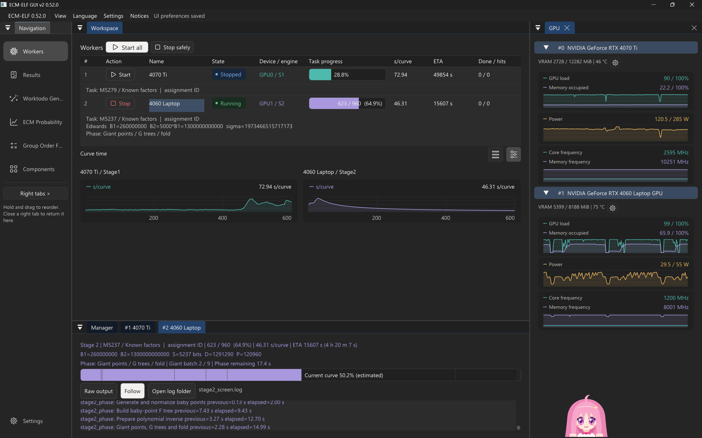
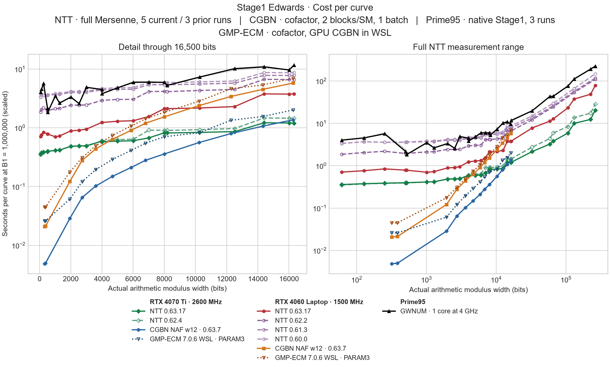
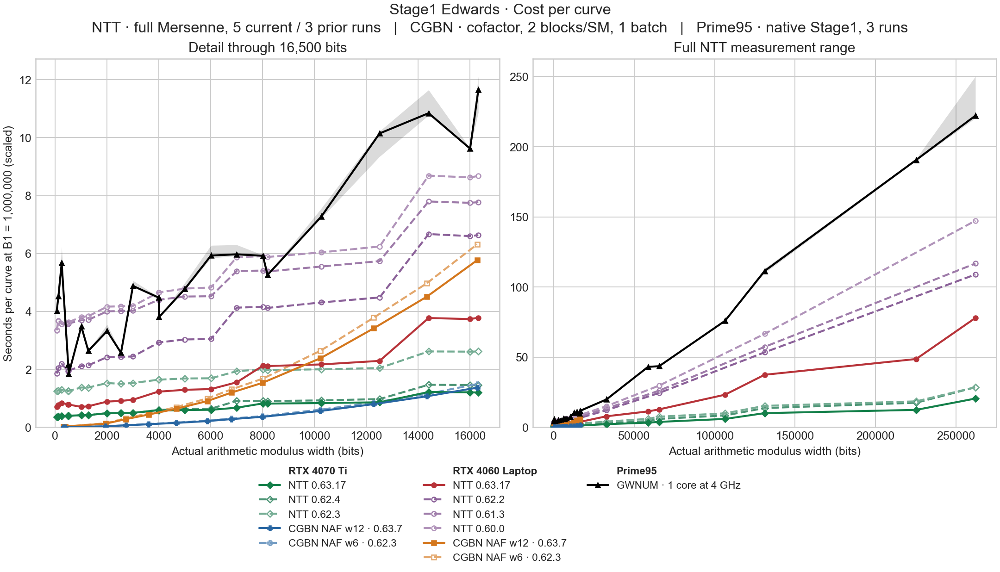
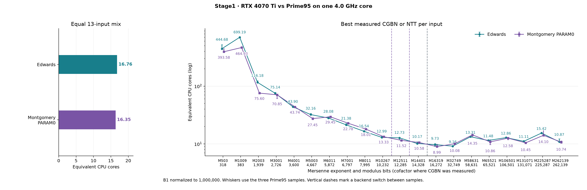
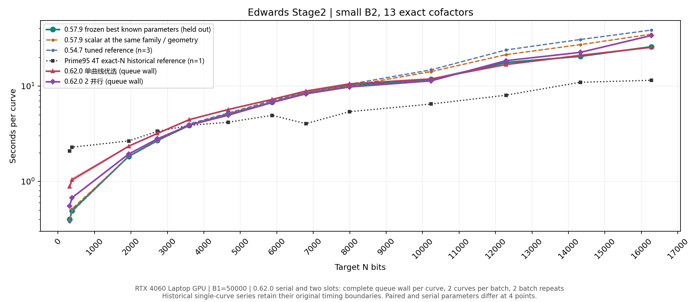
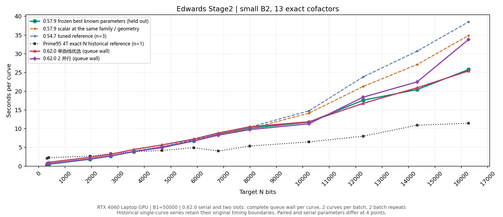
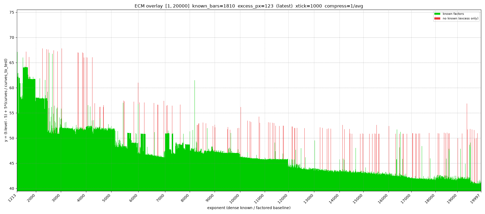
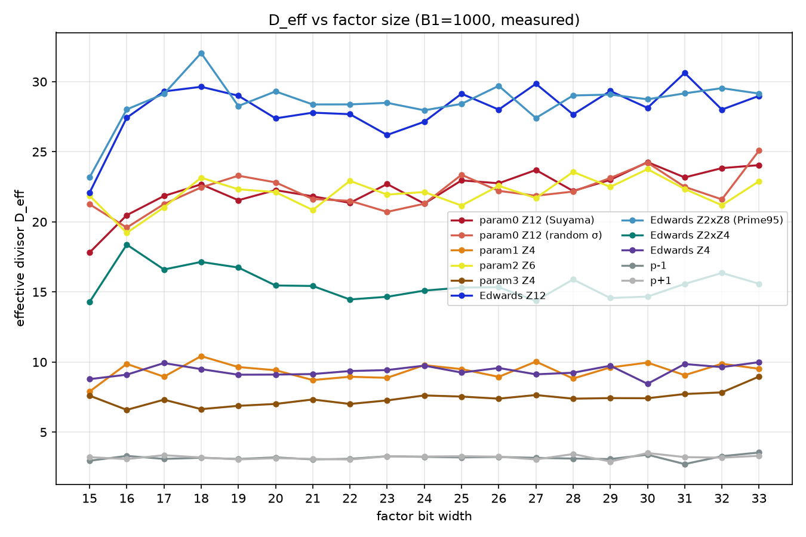
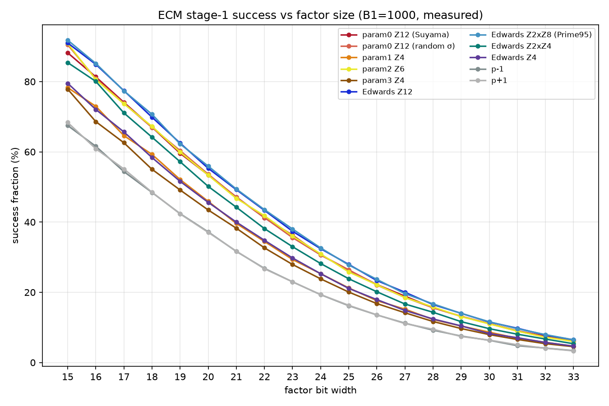
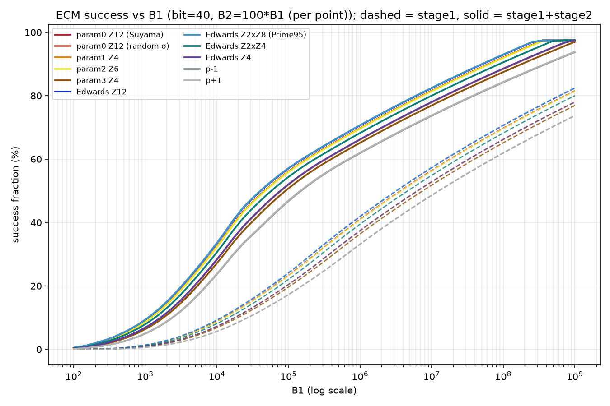

# ECM-ELF

[中文](README.md) | English

ECM-ELF is an Elliptic Curve Method (ECM) toolkit. Stage1 runs on GPUs with CUDA CGBN, CUDA NTT, or OpenCL, and on CPUs with GMP, AVX-512 IFMA, or optional GWNUM. Separate CUDA, OpenCL, and CPU Stage2 programs read compatible Stage1 saves.

For configuration defaults and accepted values, see the [TOML reference (English)](docs/ECM_TOML_REFERENCE.en.md) · [TOML 参考（中文）](docs/ECM_TOML_REFERENCE.zh-CN.md).


Use `ecm_gui_v2.exe` to manage Stage1 and Stage2 workers, queues, progress, and results. See the [GUI v2 guide](docs/usage/GUI_V2.md).



## Contents

| Section | Scope |
| --- | --- |
| [Compared with established ECM tools](#comparison) | Edwards Stage1 and Stage2 timings against Prime95 |
| [Programs and capabilities](#programs) · [Quick start](#quick-start) | Choosing a program, runnable commands and common options |
| [CPU Stage1 configuration](#cpu-stage1) · [Queues and handoff](#queues) | Recipes, thread batches, workers, saves and checkpoints |
| [Separate CUDA Stage2](#stage2) · [Building and releasing](#build) | Stage2 input/resuming and build entry points |
| [Android, GUI and bundled tools](#android-tools) | Mobile builds, graphical frontend and helper tools |
| [Documentation and repository layout](#docs-layout) · [Dependencies and license](#license) | Topic guides, source entry points and licenses |

<a id="comparison"></a>
## Compared with established ECM tools

The timing comparisons show the same data on logarithmic and linear scales. They report seconds per curve. **Lower is faster.**

### Edwards Stage1

The chart compares ECM-ELF CUDA NTT (0.63.17) and CGBN on the RTX 4070 Ti and RTX 4060 Laptop GPUs with single-core Prime95 at 4.0 GHz. Times are scaled to B1 = 1,000,000. See [Stage1 performance](docs/performance/STAGE1.md#stage1-ntt-与-cgbn-和-prime95-对比) for the inputs, sample counts, and timing scopes.





#### RTX 4070 Ti equivalent CPU cores

For each input, the chart compares the fastest measured CGBN or NTT result on the RTX 4070 Ti with Prime95 running on one 4.0 GHz CPU core. The Edwards data cover inputs up to 262,139 bits. See [how equivalent CPU cores are calculated](docs/performance/STAGE1.md#gpu-型号与-cpu-等效核心数).



### Stage2

The chart compares ECM-ELF CUDA (0.62.0) in serial and two-slot modes on the RTX 4060 Laptop GPU with four-thread Prime95 31.4b05. The comparison uses 13 Edwards cofactor saves at B1 = 50,000 and B2 around 27 billion. See [Stage2 performance](docs/performance/STAGE2.md#0620-串行优选与双槽) for the timing scopes.





<a id="programs"></a>
## Programs and capabilities

| Program | Current purpose | Main input and output |
| --- | --- | --- |
| `ecm_cuda.exe` | CUDA Stage1. CGBN supports Edwards and the built-in Montgomery parametrizations. NTT supports Edwards and PARAM0 on full Mersenne numbers or assignments with known factors | Number, expression, or Stage1 queue. Writes `.save` files and checkpoints |
| `ecm.exe` | OpenCL GPU Stage1 or CPU Edwards and Suyama-Montgomery Stage1 | Shared driver input, TOML, queue and text saves; selectable OpenCL operators |
| `ecm_stage2.exe`, `ecm_opencl_stage2.exe` | Standalone GPU polynomial Stage2 | Normalized PARAM0 or Edwards AM saves, directly or through `ECMSTAGE2=` and `ECMSTAGE2N=` |
| `ecm_stage2.exe` | Edwards Stage2 in the CPU package | Reads saves directly or via worktodo. Whole-curve checkpoints are shared with CUDA. See [CPU Stage2](docs/usage/EDWARDS_CPU_STAGE2.md) for backends and build options |
| `ecm_gui_v2.exe` | Windows graphical frontend | Manages Stage1 and Stage2 workers, queues, logs, and results |

### Stage1 backends

The CUDA worker selects an algorithm using the actual modulus and the default rule `gpu_algorithm = "ntt[16384:], cgbn[]"`. See [GPU algorithm selection](docs/usage/STAGE1.md#gpu-算法选择).

- **CUDA CGBN** supports Edwards and Montgomery at the widths included in the build. `param = "m0"` selects the Suyama family used by GMP-ECM `-param 0`. `"m2"` and `"m3"` select their respective batch parametrizations. Montgomery uses the ladder by default and offers PRAC for PARAM0. See [Stage1 implementation](docs/architecture/STAGE1.md).
- **CUDA NTT** supports Edwards and Montgomery PARAM0. Assignments with known Mersenne factors can use full-Mersenne arithmetic by default, with checks and saves on the remaining cofactor. Use `--gpu-algorithm ntt` to select it explicitly. NTT queue assignments run in automatically sized batches and record observed throughput in `tune.toml`. See [full-width CUDA NTT](docs/usage/STAGE1.md#cuda-全宽-ntt).
- **CUDA one thread per curve** supports Edwards up to 1024 bits and shares its NAF arithmetic with OpenCL. Select it with `gpu_algorithm = "thread"` or `--gpu-algorithm thread`. See [Stage1 usage](docs/usage/STAGE1.md#cuda-edwards-一线程一曲线).
- **OpenCL** on desktop supports Montgomery PARAM3 and Edwards NAF through 1024 bits. Edwards uses one work-item per curve, shares the NAF encoding and builds the dictionary on the device. `ecm.exe --showkernel` lists selectable Montgomery operators. [OpenCL Stage1 usage](docs/usage/STAGE1.md#opencl-edwards) · [OpenCL architecture](docs/architecture/OPENCL.md#stage1-曲线执行)
- **CPU** supports Edwards and Suyama-Montgomery with scalar GMP or eight-curve AVX-512 IFMA batches. On Windows x64, Montgomery PARAM0 can also use a locally built `gwnum.dll` when explicitly selected. See [Stage1 implementation](docs/architecture/STAGE1.md) and the [GWNUM build guide](docs/usage/BUILD.md#cpu-stage1-本地-gwnum-316).

`gpucurves` is a task batch size, not a promise that all curves reside on the GPU at once. Choose GPU batches using `--gpu-info`, operand size, TPI, TPB, SM count and actual resource occupancy. CPU SIMD parallelism is bounded by `ceil(curves/8)` batches; the scalar path assigns one curve per task. With a fixed sigma, curve `i` uses `sigma+i`. The same numeric sigma under different parametrizations does not define the same curve.

<a id="quick-start"></a>
## Quick start

Run these commands from the executable directory, or replace the paths with the output locations described in the [build guide](docs/usage/BUILD.md). `B2=0` runs Stage1 only; give the completed save to a compatible Stage2 consumer afterward.

```powershell
# Inspect the actual backend, options and available tiers; --gpu-info runs no curve
.\ecm_cuda.exe --help
.\ecm_cuda.exe --gpu-info --bits 5240
.\ecm.exe --showkernel

# One-off OpenCL / CUDA Stage1; N may be a decimal number or an expression
echo '(2^347-1)' | .\ecm.exe --param m3 --target gpu -gpucurves 1 -d 0 1e4 0
echo '(2^421-1)' | .\ecm_cuda.exe --param m0 --target gpu -gpucurves 32 -d 0 1e5 0
echo '(2^8191-1)' | .\ecm_cuda.exe --curve ed --target gpu --gpu-algorithm ntt -gpucurves 8 -d 0 1e4 0

# CPU Suyama-Montgomery; auto selects SIMD on a supported CPU
echo '(2^1277-1)' | .\ecm.exe --curve mont --target cpu --impl auto -gpucurves 8 1e5 0
```

A one-off run has the form `echo '<N>' | <ecm.exe or ecm_cuda.exe> [options] B1 [B2]`. With no positional bound, the program enters Stage1 queue mode. `--curve` selects the curve and `--target` selects CPU or GPU. One-off runs default to GPU Montgomery. `-d` selects a device by its backend index. `--gpu-info` reports CUDA tiers and suggested batch sizes.

### Run Stage1 from worktodo

This example assumes `ecm_cuda.exe`, `ecm_stage2.exe` and `ecm.toml` are in the same directory and commands run there. Merge these keys into an existing TOML if you have one. Create `ecm.toml`:

```toml
config_version = 3

[shared]
worktodo_file = "worktodo.txt"

[stage1]
param = "m0"
target = "gpu"
gpu_device = 0
save_dir = "."
handoff.mode = "off"
```

Create `worktodo.txt`. The final `ECM2` fields are B1, B2 and curve count; `B2=0` runs Stage1 only:

```text
[Worker #1]
ECM2=1,2,3001,-1,10000,0,8
ECMSTAGE1=1,2,503,-1,e_m503_1e6.save,1000000,0,3840
ECMSTAGE1=1,2,1009,-1,e_m1009_1e6.save,1000000,0,3840
ECMSTAGE1=1,2,2003,-1,e_m2003_2e5.save,200000,0,1920
ECMSTAGE1=1,2,3001,-1,e_m3001_5e4.save,50000,0,960,"74377120512065560887888955738547726230067911062228332102593647695996426590861891993"
ECMSTAGE1=1,2,4001,-1,e_m4001_5e4.save,50000,0,960
ECMSTAGE1=1,2,5003,-1,e_m5003_5e4.save,50000,0,960,"226024016418421435298344442894288706759183133013891943201151261634794580524042962593009658426023377823"
ECMSTAGE1=1,2,6011,-1,e_m6011_5e4.save,50000,0,960,"857617390900380339876897531255996012288097"
ECMSTAGE1=1,2,7001,-1,e_m7001_5e4.save,50000,0,960,"40904995823389659106595800207541412633707011574995413435800807"
ECMSTAGE1=1,2,8011,-1,e_m8011_5e4.save,50000,0,960,"80111"
ECMSTAGE1=1,2,10267,-1,e_m10267_1e4.save,10000,0,480,"35491478951"
ECMSTAGE1=1,2,12511,-1,e_m12511_1e4.save,10000,0,480,"121147116870729142848119447488872718579398235696988789692775064038071"
ECMSTAGE1=1,2,14401,-1,e_m14401_1e4.save,10000,0,480,"11913945416781811886807"
ECMSTAGE1=1,2,16319,-1,e_m16319_1e4.save,10000,0,480,"270811405193137"
```

```powershell
.\ecm_cuda.exe --config .\ecm.toml --worker 1
```

This command consumes Stage1 assignments for the selected worker. The first assignment writes `m0_m3001_1e4.save` under `save_dir`. Completed assignments go to `worktodo.finished.txt`. If the run stops or a save fails, unfinished work stays in the queue. Rerun the command to resume from a valid checkpoint. See [queues and handoff](#queues) and [Stage1 usage](docs/usage/STAGE1.md).

### Run and tune CUDA Stage2

After the first Stage1 assignment completes without a factor, add the following line to `[Worker #1]` in the same `worktodo.txt`. Give it the actual save name and the desired B2. To queue Stage2 automatically for future jobs, set `[stage1] handoff.mode` to `"ecm-elf"`. See the [handoff guide](docs/usage/STAGE1.md#自动交接到-stage2).

```text
[Worker #1]
ECMSTAGE2=1,2,3001,-1,"m0_m3001_1e4.save",1000000
```

```powershell
# Optional: measure complete ECM using the current Stage2 queue and save; leaves the queue untouched
.\ecm_stage2.exe --config .\ecm.toml --worker 1 --tune ecm --tune-level 1 --tune-file .\stage2_ecm_tune.toml

# Consume one queued assignment; after tuning, you may add --tune-profile .\stage2_ecm_tune.toml
.\ecm_stage2.exe --config .\ecm.toml --worker 1 --once

# Or process the same save directly without the queue (do not run both paths)
.\ecm_stage2.exe --save .\m0_m3001_1e4.save --b2 1000000 --device 0

# Optional: measure the NTT component only; this is not a complete ECM tune
.\ecm_stage2.exe --tune ntt --tune-level 1 --tune-file .\stage2_ntt_tune.toml
```

ECM tune reads the selected worker's Stage2 queue by default. Use `--tune-save FILE --tune-b2 B2` to select a particular save. Load the resulting data for a Stage2 command with `--tune-profile FILE`, or set `[shared] tune_file` for both stages. An explicit B2 can run directly. For Auto B2 cost data requirements, see [Stage2 usage](docs/usage/STAGE2.md) and [Auto B2](docs/architecture/AUTO_B2.md).

Common options are below. Run the relevant binary's `--help` and consult the [TOML reference](docs/ECM_TOML_REFERENCE.en.md) for all options and exact defaults.

| Option | Purpose |
| --- | --- |
| `--param e\|m0\|m2\|m3`, `-sigma S` | Curve construction and fixed seed; PARAM0 can use a full 64-bit sigma |
| `-gpucurves N` | Direct-run task curve count; NTT can split the task into batches |
| `--curve mont\|ed`, `--target cpu\|gpu` | Curve model and execution target |
| `--gpu-algorithm cgbn\|ntt\|thread` | GPU Stage1 algorithm; also accepts a bit-range policy |
| `--impl auto\|simd\|scalar\|gwnum`, `--reduction auto\|montgomery\|mersenne-fold` | CPU arithmetic and SIMD reduction |
| `--lcm 1\|12` | Montgomery Stage1 scalar construction |
| `--stage1-threads N`, `--affinity LIST` | Stage1 host thread count and optional CPU affinity |
| `--ckpt SEC`, `--tmp-dir DIR`, `--exp-cache DIR` | Checkpoint interval, local Stage1 output and exponent cache |
| `--config FILE`, `--worker N` | TOML configuration and queue section |
| `--mul/--sqr/--add/--sub/--special-mult ID` | OpenCL operator paths; CUDA does not use these overrides |
| `--go`, `--gp PATH`, `--verify-gpu`, `--profile-ops` | Group-order diagnostics, GP path, GPU cross-check and operator counts |

Current `--help` also lists OpenCL kernel-root, binary-cache, TPI, work-group, logging and diagnostic options.

### OpenCL runtime and operator diagnostics

`--kernel-root DIR` selects the `.cl` source tree. `--kernel-cache-dir DIR`, `--no-kernel-cache`, and `--kernel-cache-verbose` control the binary cache. `--compile-verbose` reports compilation time. `--tpi N` and `--wg N` adjust instance threads and work-group size. `--force-normalize`, `--addsub-fused-unroll`, `--sync-each-batch`, `--gpu-dump`, `--profile-ops`, and `--verify-gpu` support OpenCL diagnostics and cross-checks.

Operator microbenchmarks have their own CLI. `opencl_ecm_addsub` provides `--no-asm`, `--asm-b64`, `--addsub-fused-unroll` and `--csv`; `opencl_ecm_montsqr` provides `--wg-impl`, `--wg-impl4-unroll`, `--csv` and related options. Both take kernel iterations, instances and launch repeats as positional arguments, with `--bits` selecting operand size. These are single-operator measurements and cannot be equated directly with complete ECM seconds per curve. Source entry points are `tools/bench/opencl_ecm_addsub_bench.cpp` and `tools/bench/opencl_ecm_montsqr_bench.cpp`.

<a id="cpu-stage1"></a>
## CPU Stage1 configuration

In `[stage1]`, set `target = "cpu"` and choose `param = "m0"` for Suyama PARAM0 or `"e"` for Atkin–Morain Edwards. With Montgomery, `montgomery_lcm_multiplier = "1"` uses `lcm(1…B1)`. Set it to `"12"` for the scalar convention used in Prime95 handoff. Edwards uses the fixed `48·lcm(1…B1)` scalar.

Example local Montgomery configuration:

```toml
config_version = 3

[shared]
worktodo_file = "worktodo.txt"

[stage1]
param = "m0"
target = "cpu"
cpu_implementation = "auto"
cpu_simd_reduction = "auto"
montgomery_lcm_multiplier = "1"
cpu_threads = 0
save_dir = "saves"
```

`edwards_naf_window_bits` controls the Edwards window. An explicit `cpu_simd_reduction` other than `"auto"` requires `cpu_implementation = "simd"`. The `"mersenne-fold"` reduction requires the actual modulus to be a full Mersenne number. See the [TOML reference](docs/ECM_TOML_REFERENCE.en.md).

Common CPU recipes:

| Purpose | Change from the example above | Check |
| --- | --- | --- |
| GMP-ECM PARAM0 comparison | `param = "m0"`, `montgomery_lcm_multiplier = "1"` | Compare Stage1 final points for the same N, B1, and sigma |
| Prime95 Suyama handoff | `param = "m0"`, `montgomery_lcm_multiplier = "12"` | Scalar convention, save path, and task fields |
| Edwards on a full Mersenne number | `param = "e"`, `cpu_simd_reduction = "auto"` | Actual reduction, NAF setting, and Edwards save |
| Edwards on a general modulus | `param = "e"`, `cpu_implementation = "simd"`, `cpu_simd_reduction = "montgomery"` | For example, a cofactor after removing known factors |

`save_name_pattern` controls automatically named CPU and GPU saves. A queue entry can name a save with its curve prefix, and a one-off command can specify a path with `-save`. To resume an unfinished CPU job from its checkpoint, rerun the original command.

Each eight-curve SIMD batch is one CPU scheduling task, so 64 curves create at most eight parallel batches. `cpu_threads = 0` selects the thread count automatically. An explicit count is also bounded by the number of tasks. Give concurrent processes separate `save_dir` paths to avoid filename collisions.

Explicit `simd` requires AVX-512 IFMA. If a TOML edit has no effect, check `[worker.N]` and CLI overrides. To cross-check Stage1, compare final points at the same N, B1, sigma, parametrization, and scalar convention.

<a id="queues"></a>
## Queues, workers and handoff

`--worker N` selects TOML overrides under `[worker.N]` and the `[Worker #N]` section of worktodo. Run one consumer per worker. The program records completed tasks in `[shared] finished_file`. GUI v2 can preview and append PrimeNet `ECM=` and `ECM2=` assignments.

### Worktodo formats

`ECM=`, `ECM2=` and `ECMSTAGE1=` run Stage1. `ECMSTAGE1` takes B1 from the `_B1.save` filename suffix. Queue tasks default to Edwards. Set `[stage1] curve = "mont"`, or choose `param = "m0"`, `"m2"` or `"m3"` for a specific Montgomery parametrization. An `e_`, `m0_`, `m2_` or `m3_` filename prefix in `ECMSTAGE1` takes precedence.

```text
ECM|ECM2=[<AID>,|N/A,|<nul>]<k>,<b>,<n>,<c>,<B1>,<B2>,<curves_to_run>[,"known-factors"]
ECMSTAGE1=[<AID>,|N/A,|<nul>]<k>,<b>,<n>,<c>,filename,B2-or-zero,skip_curves,num_curves[,"known-factors"]
ECMSTAGE2=[<AID>,|N/A,|<nul>]<k>,<b>,<n>,<c>,filename[,B2-or-zero][,skip_curves][,num_curves][,"known-factors"]
ECMSTAGE2N=[<AID>,|N/A,|<nul>]filename[,B2-or-zero][,skip_curves][,num_curves][,"known-factors"]
```

Choose either `ECM` or `ECM2`. AIDs have 32 hexadecimal digits. `<nul>` means to omit the AID field. You can also use `N/A,` or leave the first field empty. Put comma-separated known factors inside one pair of double quotes.

```text
ECM2=1,2,3001,-1,100000,1000000,64
ECMSTAGE1=1,2,3001,-1,"e_m3001_1e5.save",1000000,0,64
ECMSTAGE2=1,2,3001,-1,"e_m3001_1e5.save",1000000,0,64
ECMSTAGE2N="e_bit4096_1e5.save",1000000,0,64
```

Both Stage2 formats read B1 from the save. `ECMSTAGE2` checks the saved modulus against `k*b^n+c` after removing known factors. `ECMSTAGE2N` takes the full modulus from the selected records and keeps known factors as result metadata. The selected records must share N and B1. Skip defaults to 0, and an omitted or zero count uses all remaining records. An omitted or zero B2 uses Stage2 configuration. Edwards needs an effective B2.

### Automatic Stage1 handoff

When Stage1 finishes without a factor and publishes supported saved points, it creates `ECMSTAGE2=` from `ECM=`, `ECM2=` or `ECMSTAGE1=`. The new line reuses the AID, `k,b,n,c`, B2 and known factors, and records the actual absolute save path and the batch's saved skip and count.

```toml
[stage1]
# handoff.mode = "ecm-elf"  # "off" | "ecm-elf" | "prime95"
# handoff.workers = "2-3"  # ID, list, range or "auto"
# handoff.worktodo_file = "worktodo-stage2.txt"
```

The default `"ecm-elf"` appends to the source worker's queue. Use `handoff.workers` or `handoff.worktodo_file` to choose another worker or queue. `"off"` keeps the save. `"prime95"` requires `prime95.worktodo_file` and `prime95.save_dir` and delivers compatible tasks to `worktodo.add`. ECM-ELF handles Edwards and other saves that Prime95 cannot accept by default. [Stage1 handoff](docs/usage/STAGE1.md#自动交接到-stage2)

### Saves and checkpoints are different

A completed `.save` contains a normalized point and task fields for a compatible Stage2. An in-progress checkpoint contains unfinished point state, exponent position and implementation layout. CUDA, OpenCL, CPU Edwards and CPU Montgomery validate their own checkpoint formats; similar names do not make them cross-backend files. A normal stop or Ctrl+C waits for a safe save boundary. Forced termination can leave a partially written checkpoint. Resume the original task with matching N, B1, parametrization, exponent mode and compatible build; the log reports whether a checkpoint was loaded. See [Stage1 usage](docs/usage/STAGE1.md).

Save compatibility is also bounded. Eligible CUDA/CPU PARAM0 and CUDA/OpenCL PARAM3 text records can feed the corresponding GMP-ECM/Prime95 workflow. PARAM2 saves carry `PARAM=2`; GMP-ECM accepts them, Prime95 does not. This repository's CUDA Stage2 accepts normalized PARAM0 and Edwards AM text records. CPU/GPU Edwards share the same text save, also accepted by the separate [libecm CPU Stage2](docs/usage/EDWARDS_CPU_STAGE2.md). A checksum tests file integrity, not mathematical correctness of GPU point multiplication. Independent acceptance checks should cover N, B1, sigma, exponent mode and final point.

<a id="stage2"></a>
## Separate CUDA Stage2

`ecm_stage2.exe` consumes a completed Stage1 save; it does not rerun Stage1. Direct invocation and queue examples (replace the filename and B2 with the actual task):

```powershell
.\ecm_stage2.exe --save .\m0_m3701_260e6.save --b2 26000000000 --device 0
.\ecm_stage2.exe --config .\ecm.toml --worker 1 --once
```

GUI v2 uses the [task prefix](#worktodo-formats) to start the corresponding program. Set `[shared] queue_order` to `"file_order"`, `"stage1_first"`, or `"stage2_first"` and `queue_skip` to `"none"`, `"stage1"`, or `"stage2"`. A nonzero `[stage2] b2_ratio` sets B2 to B1 × ratio. On queue resume, receipts identify completed curves. For a direct save run, use `--skip-curves` and `--curves` to select records. See [Stage2 usage](docs/usage/STAGE2.md) for B2 precedence.

Manual B2 supports eligible 2…16384-bit inputs. Auto B2 additionally needs a suitable cost profile and Stage1 cost, and always remains subject to current memory and arithmetic checks. Give production tasks an explicit B2 when no qualified model is available. `--dry-run` only validates input. `--plan-only` may run a short startup calibration; add `--short-calibration 0` for a pure query. See [Stage2 usage](docs/usage/STAGE2.md), [pipeline](docs/architecture/STAGE2.md) and [Auto B2](docs/architecture/AUTO_B2.md) for arguments, receipts, memory summaries and tuning data.

<a id="build"></a>
## Building and releasing

CUDA Stage1 and Stage2 each have **development, local production and release production** PS1/BAT entry points. The PS1 files under `tools/build/` define their defaults and full parameters:

```powershell
.\tools\build\build_stage1_dev.ps1
.\tools\build\build_stage1_local.ps1
.\tools\build\build_stage1_release.ps1
.\tools\build\build_stage2_dev.ps1
.\tools\build\build_stage2_local.ps1
.\tools\build\build_stage2_release.ps1
```

**Choosing a CUDA release package (Windows x64):**

- **cu11.8 legacy GPU package**: for Maxwell, Pascal and Volta, including the GTX 750/900/10 series and V100.
- **cu13.3 modern package (recommended for newer GPUs)**: for Turing and later, including the GTX 16 and RTX 20/30/40/50 series.

Your driver must also support the selected package. See the [GPU model and SM quick reference](docs/usage/BUILD.md#gpu-型号与发布包选择) for model mappings and compatibility limits.

Local and development builds default to a local Zen3 GMP. Release packages default to generic x64 GMP. Standard Stage1 builds include PARAM0 PRAC and the resident ladder, and select the ladder by default at runtime. See the [build and release guide](docs/usage/BUILD.md) and [launcher parameters](tools/build/README.md).

OpenCL/CPU builds require a C++ toolchain, GMP, and an OpenCL runtime and headers. CUDA builds also need compatible versions of nvcc and MSVC. This Windows example builds the OpenCL/CPU project and runs two operator benchmarks.

```powershell
# Supply local dependency paths if needed when configuring the OpenCL/CPU project
New-Item -ItemType Directory -Force build_opencl | Out-Null
Set-Content -LiteralPath build_opencl/.gitignore -Value '*'
cmake -S . -B build_opencl -DECM_ENABLE_CUDA=OFF
cmake --build build_opencl --config Release

.\build_opencl\Release\opencl_ecm_addsub.exe --bits 512 10000 128 3
.\build_opencl\Release\opencl_ecm_montsqr.exe --bits 512 1000 128 1
```

<a id="android-tools"></a>
## Android, GUI and bundled tools

The Android app lives in `Android/ECM` and provides OpenCL device probing, ECM Stage1 factoring, operator microbenchmarks, work queues and local saves. Open that subproject in Android Studio; native factoring requires GMP. The app loads the vendor OpenCL library at runtime. Do not package a `libOpenCL.so` pulled from a phone into the APK. The build syncs `.cl` kernels into assets; the first compilation of a large kernel may take time. See the [Android overview](Android/README.md), [factoring guide](Android/ECM/README_ECM_FACTORIZATION.md) and [app guide](Android/ECM/README.md) for entry points, 16 KiB page constraints and device checks.

On Windows, GUI v2 starts the Stage1 or Stage2 process required by each worker's queue and shows progress, GPU metrics, and results. Configure it with `[gui]` and `[worker.N]`. See the [GUI v2 guide](docs/usage/GUI_V2.md).

- [`ecm_prob`](tools/ecm_prob/README.md): ECM success probability, parametrization and effective-divisor models; interpret predictions under their model conditions.
- [`ecm_report`](tools/ecm_report/README.md): PrimeNet ECM progress and result summaries.
- [`ecm_dataset`](tools/ecm_dataset/README.md): Mersenne and factor data, including sigma management and queries.
- [`tools/bench`](tools/README.md): device arithmetic, CUDA/OpenCL, NTT, Stage2 planning and timing probes; run data goes into ignored `data/`.
- [`tools/test`](tools/README.md): CPU/GPU arithmetic, queue, GUI, save/checkpoint and Stage2 regression checks.

Example PrimeNet ECM progress:



The plots below show examples of effective divisors and success rates. See [ecm_prob](tools/ecm_prob/README.md) for the model and its assumptions.



| Success rate versus factor size | Success rate versus B1 |
| --- | --- |
|  |  |

<a id="docs-layout"></a>
## Documentation and repository layout

- The [documentation index](docs/README.md) covers usage, implementation, performance, and TODO. For program instructions, see [Stage1](docs/usage/STAGE1.md), [Stage2](docs/usage/STAGE2.md), and [GUI v2](docs/usage/GUI_V2.md).
- The [architecture overview](docs/architecture/OVERVIEW.md) traces `src/main.cpp`, `src/io/`, `src/sync/`, and the CPU/CUDA/OpenCL backends under `src/ecm/`; standalone tests and tools live under `tools/`. [Configuration maintenance](docs/architecture/CONFIGURATION.md) explains generation from `config/ecm_options.json` into templates and references.
- [Fixed mathematical and third-party references](docs/reference/README.md) retain ECM, curve, Goldilocks/NTT, Prime95/PrMers/GPUOWL derivations and research conditions. Original papers and translations remain in `docs/paper/`.
- The [tools index](tools/README.md) covers `build/`, `bench/`, `test/`, `gen/`, `disasm/`, `log_parser/`, `ecm_prob/` and more. NPU microbenchmarks are under [RyzenAI](tools/RyzenAI/README_ADDSUB.md).

Original experiment logs, saves and profiles belong in ignored `data/experiments/`, summaries in `data/benchmarks/` and generated figures in `data/figures/`. Evidence paths from an older commit do not substitute for current local raw data. External sources belong in `.refactor/`. Current project documents, fixed research references and temporary development drafts are maintained under the [repository rules](AGENTS.md).

<a id="license"></a>
## Dependencies and license

The project builds on [GMP-ECM](https://gitlab.inria.fr/zimmerma/ecm), uses CGBN for CUDA multi-precision arithmetic and Dear ImGui for the GUI. Builds need the relevant CUDA/OpenCL, C++ toolchain, GMP and other components. Preserve each dependency's copyright and license when distributing binaries. See [LICENSE](LICENSE) for the project license.
