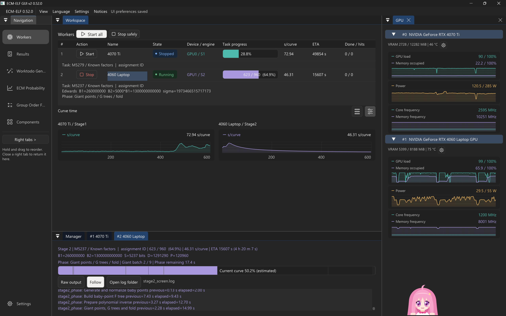
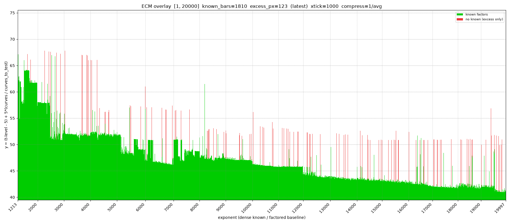
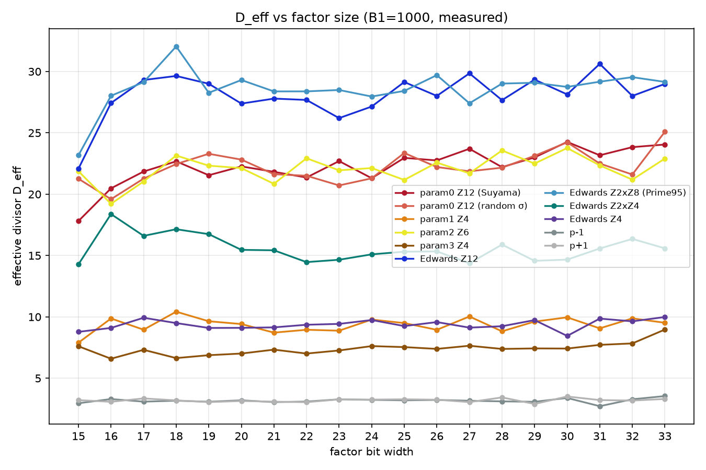
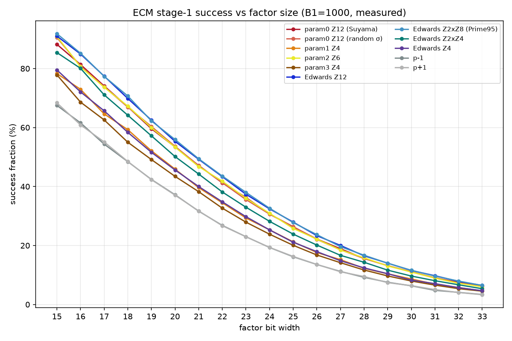
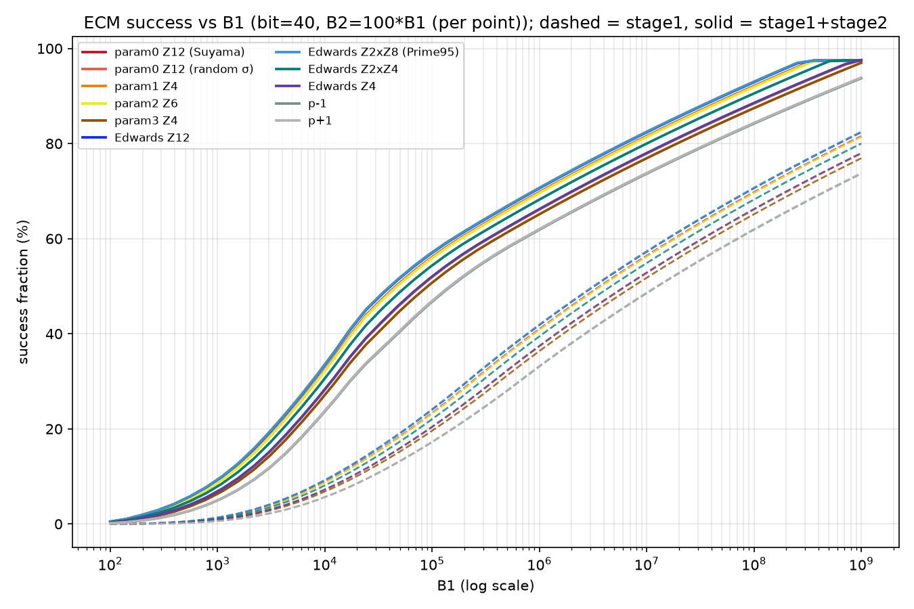

# ECM-ELF

[English](README.en.md) | 中文

ECM-ELF 是椭圆曲线因子分解（ECM）工具集：CUDA/CGBN 与 OpenCL GPU Stage1、GMP 与可选 AVX-512 IFMA CPU Stage1、独立 CUDA 多项式 Stage2、libecm CPU Edwards Stage2，以及 Windows GUI、任务队列和因子数据工具。原仓库名 OpenCL-ECM 只覆盖了其中一个后端；程序名仍为 `ecm.exe`、`ecm_cuda.exe` 等。

本页保留各入口的实际用途、可运行命令、配置方法、存档关系、构建方式和工具索引。配置键的默认值、范围及双语说明以生成的 [TOML 参考](docs/ECM_TOML_REFERENCE.md) 为准；特定构建是否包含某个内核档位或实验算法，要检查该程序的构建身份与帮助输出。


<a id="comparison"></a>
## 与现有主流工具相比

ECM-ELF 提供可独立运行的多后端 ECM 工作流：使用 CUDA/CGBN、OpenCL 或 CPU 批量执行 Stage1，再由本仓库的 CUDA 多项式 Stage2、[CPU Edwards Stage2](docs/usage/EDWARDS_CPU_STAGE2.md)，或符合条件的外部工具继续处理完成的 save。

- **计算路径：** CUDA 与 OpenCL 覆盖不同 GPU 平台；CPU 提供 GMP 标量和 AVX-512 IFMA 批量实现。各路径共用 Stage1 任务入口，实际可用位宽与算法以构建版本为准。
- **独立 Stage2：** CUDA Stage2 使用精确整数多项式运算，支持直接读档、独立队列、逐曲线续跑，以及基于实测资料的参数调优与 Auto B2。[Stage2 使用](docs/usage/STAGE2.md)列出输入和资源限制。
- **长任务管理：** worktodo、worker、Windows GUI 和 Prime95 交接支持批量任务。Stage1 在安全边界写入检查点并轮换备份；Stage2 用完成回执恢复队列进度。[队列与交接](#queues)说明各文件的职责。
- **存档互通：** 符合条件的 Suyama PARAM0 和 batch PARAM3 save 可交给 GMP-ECM 或 Prime95。

性能比较与适用范围见 [Stage1 性能](docs/performance/STAGE1.md)、[Stage2 性能](docs/performance/STAGE2.md)和[历史性能记录](#historical-performance)；结论以各自注明的输入、设备、构建及计时边界为准。

**推荐使用新版 [GUI v2](docs/usage/GUI_V2.md)**（`ecm_gui_v2.exe`），集中管理 Stage1/Stage2 worker、任务队列、运行状态和结果。



## 目录

| 章节 | 内容 |
| --- | --- |
| [与现有主流工具相比](#comparison) | 后端、存档互通和工作流的文字比较；性能数据见后文 |
| [程序与能力](#programs) · [快速开始](#quick-start) | 程序选择、实际命令与常用选项 |
| [CPU Stage1 配置教程](#cpu-stage1) · [队列与交接](#queues) | 配方、线程批数、worker、save 与 checkpoint |
| [独立 CUDA Stage2](#stage2) · [构建与发布](#build) | Stage2 输入/续跑和构建入口 |
| [Android、GUI 与附带工具](#android-tools) | 移动端、图形前端及辅助工具 |
| [历史性能记录](#historical-performance) | 原 README 数据及适用边界 |
| [文档与仓库布局](#docs-layout) · [依赖与许可](#license) | 专题文档、源码入口和许可 |

<a id="programs"></a>
## 程序与能力

| 程序 | 当前用途 | 主要输入与输出 |
| --- | --- | --- |
| `ecm_cuda.exe` | NVIDIA CUDA/CGBN Stage1，批量运行曲线；支持构建中包含的 PARAM0、PARAM2、PARAM3 曲线族 | 数字/表达式或 Stage1 队列；生成最终 `.save` 和运行中 checkpoint |
| `ecm.exe` | OpenCL GPU Stage1 或 CPU Edwards、Suyama-Montgomery Stage1 | 与驱动共用的输入、TOML、队列及文本 save；GPU 算子可单独选择 |
| `ecm_cuda_stage2.exe` | 独立 CUDA 多项式 Stage2，处理合格的归一化 PARAM0 Stage1 save | 直接读档或共用 `worktodo` 的 `ECMSTAGE2=` 任务；输出因子、结果和逐曲线回执 |
| `ecm_gui.exe` | Windows Stage1 worker、配置、队列生成、日志、GPU 状态和结果界面 | 管理 worker 进程；计算仍由所选 `ecm_cuda.exe` 完成 |
| `ecm_p95feeder` | CPU 本地 save 的 Prime95 交接工具 | 交付可供 Prime95 消费的任务；驱动也支持完成任务交接 |

### 各 Stage1 后端

- **CUDA/CGBN**：原生 Windows CUDA 路径；主机生成指数与曲线，GPU 分片推进点乘，主机检查末点并写 save。`gpu_param=0` 是 Suyama σ 曲线，与 CPU Montgomery 和 GMP-ECM `-param 0` 同族；`gpu_param=2` 是 GMP-ECM batch 2，产生带 `PARAM=2` 的 save，Prime95 不接受该参数化；`gpu_param=3` 是 batch 族，CUDA 与 OpenCL 都可使用。受支持位宽由实际构建的 kernel 档位决定。生产构建默认 ladder；resident/PRAC 需要构建时显式启用，不能从源码存在推断为发布功能。见 [Stage1 实现](docs/architecture/STAGE1.md)。
- **OpenCL**：Windows、Linux、macOS 和 Android 的 GPU 路径，支持从注册表选择 Montgomery 乘/平方、模加/减和 special multiplication 算子。`ecm.exe --showkernel` 列出当前构建可用的路径。OpenCL 与 CUDA 的设备编号、运行时和内部 checkpoint 不互换；同名驱动选项不表示两者有相同的内核。见 [OpenCL 架构](docs/architecture/OPENCL.md) 和 [内核说明](kernels/opencl/README.md)。
- **CPU**：Edwards（Atkin–Morain）与 Suyama-Montgomery 是两条独立曲线族，可选 GMP 标量或 AVX-512 IFMA SIMD；SIMD 一批处理 8 条曲线。`reduction=auto` 可对完整梅森数选择折叠域，对一般整数使用 Montgomery 归约。`impl=simd` 是硬要求，缺少指令集时报错；`impl=auto` 才允许回退。算法和点表示见 [Stage1 实现](docs/architecture/STAGE1.md) 与 [数学参考](docs/reference/README.md)。

`gpucurves` 表示一次任务的曲线数，并不保证所有曲线同时驻留 GPU。GPU 批量应结合 `--gpu-info`、位宽、TPI、TPB、SM 数及实际资源占用选择。CPU SIMD 的线程并行度上限为 `ceil(曲线数/8)` 个批；标量路径则按每曲线一个任务分配。固定 σ 时，第 `i` 条曲线使用 `sigma+i`；不同参数化的同一 σ 不是同一条曲线。

<a id="quick-start"></a>
## 快速开始

以下命令从程序所在目录执行。发布包或本机构建中实际的 exe 路径可按 [构建说明](docs/usage/BUILD.md) 替换。`B2=0` 用于只执行 Stage1；完成的 Stage1 save 再交给合适的 Stage2 消费端。

```powershell
# 查看实际后端、选项和可用档位；--gpu-info 不运行曲线
.\ecm_cuda.exe --help
.\ecm_cuda.exe --gpu-info --bits 5240
.\ecm.exe --showkernel

# 单次 OpenCL / CUDA Stage1；N 可以是十进制数或表达式
echo '(2^347-1)' | .\ecm.exe --curve mont --target gpu -gpucurves 1 -d 0 1e4 0
echo '(2^421-1)' | .\ecm_cuda.exe --curve mont --target gpu --gpu-param 0 -gpucurves 32 -d 0 1e5 0

# CPU Suyama-Montgomery；auto 在支持的机器上选 SIMD
echo '(2^1277-1)' | .\ecm.exe --curve mont --target cpu --impl auto -gpucurves 8 1e5 0
```

单次运行的形式为 `echo '<N>' | <ecm.exe 或 ecm_cuda.exe> [选项] B1 [B2]`；无位置参数时进入 Stage1 队列模式。`--curve` 与 `--target` 分别选择曲线和执行位置；默认是 Montgomery + GPU，CUDA 支持 Edwards + GPU，OpenCL 不支持该组合。`-d` 是当前程序列出的设备编号；`--gpu-info` 可报告 CUDA 档位与建议批量，OpenCL 构建会说明该查询不适用。

### 使用 worktodo 运行 Stage1

以下示例假设 `ecm_cuda.exe`、`ecm_cuda_stage2.exe` 和 `ecm.toml` 位于同一目录，并从该目录运行命令；已有 TOML 时将这些键合并进去。创建 `ecm.toml`：

```toml
[shared]
worktodo = "worktodo.txt"

[stage1]
curve = "mont"
target = "gpu"
gpu_param = 0
device = 0
finished = "worktodo.finished.txt"
tmp_dir = "."

[stage2]
stage2_finished = "worktodo.stage2.finished.txt"
```


创建 `worktodo.txt`，其中 `ECM2` 的末尾字段依次为 B1、B2、曲线数；`B2=0` 表示只运行 Stage1：

```text
[Worker #1]
ECM2=1,2,3001,-1,10000,0,8
```

```powershell
.\ecm_cuda.exe --config .\ecm.toml --worker 1
```

该命令不带位置参数，只消费所选 worker 的 Stage1 任务。`ECM2=` 队列任务的 Montgomery 最终存档写在 `tmp_dir`，仍采用 `m{n}_{b1}.save` 格式，例如 `m3001_1e4.save`。完成的任务写入 `worktodo.finished.txt`；正常中断或最终存档写入失败时，未完成任务留在 `worktodo.txt`，重启同一命令可从有效 checkpoint 恢复。`ecm.exe` 也使用同一队列入口，但应按所选 CPU/OpenCL 路径配置。不同 worker 可使用同一队列的独立分区；同一 worker 同时只运行一个程序。详见[队列与交接](#queues)和 [Stage1 使用](docs/usage/STAGE1.md)。

### 运行和调优 CUDA Stage2

Stage1 完成且未找到因子，并生成 `m3001_1e4.save` 后，在同一个 `worktodo.txt` 的 `[Worker #1]` 分区添加下行；这里的 B2 为显式上界，save 文件名必须与实际产物一致。也可在 `[stage1]` 设置 `auto_stage2 = 1` 自动交接，默认原位改写；接收 worker 列表和其他队列文件的设置见[自动交接说明](docs/usage/STAGE1.md#自动交接到-stage2)：

```text
[Worker #1]
ECMSTAGE2=1,2,3001,-1,"m3001_1e4.save",1000000
```

```powershell
# 可选：按当前 Stage2 队列和 save 测量完整 ECM；不会消费队列
.\ecm_cuda_stage2.exe --config .\ecm.toml --worker 1 --tune ecm --tune-level 1 --tune-file .\stage2_ecm_tune.toml

# 执行队列中的一项；生成调优文件后可加 --tune-profile .\stage2_ecm_tune.toml
.\ecm_cuda_stage2.exe --config .\ecm.toml --worker 1 --once

# 或跳过队列，直接处理同一 save（不要与上述队列命令重复执行）
.\ecm_cuda_stage2.exe --save .\m3001_1e4.save --b2 1000000 --device 0

# 可选：仅测量 NTT 组件，不等同于完整 ECM 调优
.\ecm_cuda_stage2.exe --tune ntt --tune-level 1 --tune-file .\stage2_ntt_tune.toml
```

ECM tune 默认使用所选 worker 的 Stage2 队列；队列不存在时改测通用位宽网格，也可用 `--tune-save FILE --tune-b2 B2` 指定单个 save。调优有时间预算，生成的档案可由 `--tune-profile FILE` 或 TOML 的 `stage2_tune_profile` 加载。显式 B2 无需先调优；自动选择 B2 还需要合格的 Stage1 成本和 Stage2 profile。Stage2 队列、直接读档和 Auto B2 的限制见[独立 CUDA Stage2](#stage2)、[Stage2 使用](docs/usage/STAGE2.md)及 [Auto B2](docs/architecture/AUTO_B2.md)。

常用命令行参数如下；完整参数和准确默认值请运行相应程序的 `--help` 并查 [TOML 参考](docs/ECM_TOML_REFERENCE.md)。

| 选项 | 用途 |
| --- | --- |
| `-gpucurves N`、`--gpu-param P`、`-sigma S` | 曲线批量、GPU 参数化和固定种子；PARAM0 可使用完整 64 位 σ |
| `--curve mont|ed`、`--target cpu|gpu` | 分别选择曲线模型和执行位置 |
| `--impl auto|simd|scalar`、`--reduction auto|montgomery|mersenne-fold` | CPU 算术实现和 SIMD 约减 |
| `--lcm 1|12` | Montgomery Stage1 标量的构造方式 |
| `--stage1-threads N`、`--affinity LIST` | CPU 工作线程与可选亲和性；混合核机器须实测后再绑定 |
| `--ckpt SEC`、`--tmp-dir DIR`、`--exp-cache DIR` | 检查点间隔、Stage1 本地输出目录和指数缓存 |
| `-ini FILE`、`--worker N` | 队列配置与分区选择 |
| `--mul/--sqr/--add/--sub/--special-mult ID` | OpenCL 算子路径；CUDA 不使用这些覆盖项 |
| `--go`、`--gp PATH`、`--verify-gpu`、`--profile-ops` | 群阶诊断、GP 路径、GPU 交叉验证和算子计数 |

OpenCL 的内核根目录、二进制缓存、TPI、work-group 及日志诊断选项均由当前 `--help` 列出。

### OpenCL 运行时与算子诊断

原 README 的环境变量迁移说明对应当前命令行：`--kernel-root DIR` 指定 `.cl` 源码树，`--kernel-cache-dir DIR`、`--no-kernel-cache` 和 `--kernel-cache-verbose` 控制二进制缓存，`--compile-verbose` 显示编译耗时；`--tpi N` 与 `--wg N` 用于实验实例线程数和 work-group。`--force-normalize`、`--addsub-fused-unroll`、`--sync-each-batch`、`--gpu-dump`、`--profile-ops`、`--verify-gpu` 是诊断/对拍开关。它们不能作为 CUDA kernel 选择接口；改变内核路径后应重新验证结果。

算子微基准的 CLI 与主程序分开：`opencl_ecm_addsub` 提供 `--no-asm`、`--asm-b64`、`--addsub-fused-unroll`、`--csv`；`opencl_ecm_montsqr` 提供 `--wg-impl`、`--wg-impl4-unroll`、`--csv` 等。两者的位置参数为内核迭代数、实例数、重复 launch 次数，`--bits` 指定位宽。微基准是单算子测量，不应与完整 ECM 每曲线耗时直接混用。源码入口分别为 `src/opencl_ecm_addsub_bench.cpp`、`src/opencl_ecm_montsqr_bench.cpp`。

<a id="cpu-stage1"></a>
## CPU Stage1 配置教程

两条 CPU 曲线模型使用与 GPU 相同的驱动和 `ecm.toml`，但曲线构造、坐标和 checkpoint 文件不同。`curve=mont` 且 `target=cpu` 对应 Suyama σ / GMP-ECM PARAM0；`curve=ed` 对应 Atkin–Morain 曲线。Montgomery 路径的 `lcm=1` 使用 `lcm(1…B1)`，`lcm=12` 再乘 12，适用于需要 Prime95 标量约定的交接。标量构造改变了实际计算点，不应在比较 save 时忽略。

一份本地 Montgomery 配置示例：

```toml
[shared]
worktodo = "worktodo.txt"

[stage1]
curve = "mont"
target = "cpu"
impl = "auto"
reduction = "auto"
lcm = "1"
stage1_threads = 0
tmp_dir = "saves"
finished = "worktodo.finished.txt"
```

将 `curve` 改为 `ed` 就会选择 Edwards 路径；`naf_w` 只影响该路径。需要在同一数学目标上比较归约方式时，可将 `reduction` 分别设为 `mersenne-fold` 和 `montgomery`，前者只适用于完整的 `2^k−1`。要给 Prime95 的 Suyama Stage2 交接，应明确使用与接收端相符的参数化、标量构造和可访问的 save 路径。配置范围与各键是否适用于 GPU/CPU 见 [TOML 参考](docs/ECM_TOML_REFERENCE.md)。

常用 CPU 配方：

| 用途 | 在上述示例上修改 | 要核对的结果 |
| --- | --- | --- |
| GMP-ECM PARAM0 对照 | `curve=mont`、`lcm=1` | 同 N、B1、σ 下检查 Stage1 最终点；参考程序只运行 Stage1 |
| Prime95 Suyama 交接 | `curve=mont`、`lcm=12` | Prime95 所需曲线和标量语义、save 位置与任务字段 |
| Edwards 完整梅森数 | `curve=ed`、`reduction=auto` | 实际归约域、NAF 设置与 Edwards 专用 save |
| Edwards 通用模数或 A/B | `curve=ed`、`impl=simd`、`reduction=montgomery` | 已知因子剥离后的 N 不再是 `2^k−1` 时，避免错误强制折叠 |

`save_name_pattern` 只控制 CPU Montgomery 写出的文件名；别的后端保留自身命名。给 GMP-ECM 的文本 save、给 Prime95 的任务行与本地 `.ckpt` 是三种不同用途的产物。需要继续本仓库自身的 CPU 任务时，优先重跑原命令读取 checkpoint；对已完成 save 的外部 `-resume` 要提供该程序要求的 B1/B2 参数。

一批 8 条 SIMD 曲线是一个 CPU 调度任务；例如 64 条曲线最多形成 8 个可并行批。`stage1_threads=0` 自动选线程，显式线程数也会受任务数约束。多个进程不要并发写同一 `(N,B1)` 的 save 和 checkpoint；为各进程配置独立输出目录。固定 σ 可用于重复验证曲线，随机 σ 不宜靠日志顺序推断。

常见排查顺序：若显式 `simd` 报 ISA 错误，改用 `auto` 或 `scalar`；若线程数未用满，先比较曲线批数与线程数；若 `reduction=mersenne-fold` 被拒绝，核对实际 N 是否仍是完整梅森数；若改变 TOML 后行为不变，检查所选 worker 分区与命令行覆盖。对 Stage1 校验应比较相同 N/B1/σ/参数化/标量构造下的最终点，不能把仅通过 checksum 当成数学一致。

<a id="queues"></a>
## 队列、worker 与交接

Stage1 使用 `worktodo.txt`，完成的任务移入 `worktodo.finished.txt`；出错任务保留带原因的错误记录。TOML 和 worktodo 的 `[Worker #N]` 必须对应，`--worker N` 同时选择两边的分区。每个队列只安排一个消费进程；不同 worker 使用独立输出路径。GUI 生成器可以解析 PrimeNet 的 `ECM=` / `ECM2=` 任务，预览并追加，而计算和真正的 save 写入仍由 worker 完成。

例如在所选 worker 的 worktodo 段中放入一条 Stage1 任务：

```text
ECM2=1,2,3001,-1,100000,0,64
```

队列行中的已知因子、AID、σ、曲线数和 save 名称有各自语义；不要通过改名把不匹配的文件交给另一个任务。生产交接配置使用 `p95_worktodo_path`：驱动把完成任务的 save 同步到配置位置，并向 Prime95 的 `worktodo.add` 追加任务；失败交付进入 pending 文件供后续重试。GUI 只显示状态，不直接改 Prime95 活动队列。CPU 本地存档也可由 `ecm_p95feeder` 处理。详见 [Stage1 使用](docs/usage/STAGE1.md)、[GUI](docs/usage/GUI.md)。

### Save 与 checkpoint 不能互用

最终 `.save` 含可交给兼容 Stage2 的归一化点及任务字段；运行中 checkpoint 含未完成的点状态、指数偏移和实现布局。CUDA、OpenCL、CPU Edwards、CPU Montgomery 的 checkpoint 各按自身格式验证，不能凭相似文件名跨后端恢复。正常停止或 Ctrl+C 要等安全边界保存；强制结束可能丢失尚未写完的 checkpoint。恢复时重跑原任务并保留相同的 N、B1、参数化、指数模式和相容构建，日志会说明是否读到检查点。详见 [Stage1 使用](docs/usage/STAGE1.md)。

save 的兼容范围也有限：CUDA/CPU PARAM0 及 CUDA/OpenCL PARAM3 的合格文本记录可用于相应 GMP-ECM/Prime95 流程；PARAM2 带 `PARAM=2`，GMP-ECM 可读，Prime95 不接受；本仓库的 CUDA Stage2 接受归一化 PARAM0 和 Edwards AM 文本记录；CPU/GPU Edwards 统一文本 save 也可交给独立 libecm CPU Stage2。checksum 检查文件完整性，不证明 GPU 点乘数学正确。验收应独立核对 N、B1、σ、指数模式和最终点。

<a id="stage2"></a>
## 独立 CUDA Stage2

`ecm_cuda_stage2.exe` 消费已经完成的 Stage1 save，不重新执行 Stage1。直接运行示例（将文件名和 B2 换成实际任务）：

```powershell
.\ecm_cuda_stage2.exe --save .\m3701_260e6.save --b2 26000000000 --device 0
.\ecm_cuda_stage2.exe --config .\ecm.toml --worker 1 --once
```

Stage1 与 Stage2 共用 `worktodo`，由 `ECMSTAGE1=` / `ECMSTAGE2=` 前缀决定执行阶段；GUI 会按队列自动切换程序。`priority=1` 优先 Stage1，`2` 优先 Stage2，空值或 `0` 按文件顺序；优先阶段无任务时处理另一阶段。`skip=1` 忽略 Stage1，`2` 忽略 Stage2；`priority`、`skip`、`auto_stage2` 均可按 worker 覆盖。`b2_ratio` 为非零整数时，Stage2 使用 B1 × ratio 覆盖其他 B2 来源；使用该 TOML 直接读档时也适用。Stage2 任务格式为 `ECMSTAGE2=[AID,]k,b,n,c,save[,B2][,skip_curves][,num_curves][,"known_factors"]`。直接读档可用 `--skip-curves` 和 `--curves` 选择记录；队列按回执记录已完成的曲线，在中断后对账，未完成的当前曲线需要重算。输入文件缺失、损坏、任务字段不匹配与设备/资源故障有不同的队列处理方式。

手动 B2 支持符合实现约束的 2…16384-bit 输入。Auto B2 还要求适用的成本 profile 和 Stage1 成本，且始终受当前显存及算术检查约束；对没有合格模型的生产任务应明确给出 B2。`--dry-run` 只校验输入；`--plan-only` 可进行启动短校准，若要纯查询需配合 `--short-calibration 0`。参数、回执、内存摘要、调优数据格式见 [Stage2 使用](docs/usage/STAGE2.md)、[管线](docs/architecture/STAGE2.md)、[Auto B2](docs/architecture/AUTO_B2.md)。

<a id="build"></a>
## 构建与发布

CUDA Stage1 与 Stage2 各有**开发、本机生产、发布生产**三组入口，每组均提供 PS1/BAT；默认和完整参数由 `tools/build/` 下的 PS1 维护。常用入口：

```powershell
.\tools\build\build_stage1_dev.ps1
.\tools\build\build_stage1_local.ps1
.\tools\build\build_stage1_release.ps1
.\tools\build\build_stage2_dev.ps1
.\tools\build\build_stage2_local.ps1
.\tools\build\build_stage2_release.ps1
```

发布入口默认覆盖 sm60、70、75、86、89、120：sm60/70 使用 CUDA 12.6，其他档位使用 CUDA 13.3；实际执行仍需匹配的 NVIDIA GPU、驱动和 CPU 依赖验证。本机/开发默认以本地 Zen3 GMP 构建，发布默认使用通用 x64 GMP，不能把本机 DLL 直接视为通用发布依赖。生产 Stage1 默认完整位宽/曲线族与 ladder；PRAC/resident 实验需要显式构建和选择。构建成功并不代表全部架构已经运行验收。详见 [构建与发布](docs/usage/BUILD.md)、[脚本参数](tools/build/README.md)。

OpenCL/CPU 的 CMake 工程需要相应 C++ 工具链、GMP、OpenCL 运行时/头文件及构建所需库；CUDA 工程还需要匹配的 nvcc/MSVC。OpenCL 构建中的 `ecm.exe` 和算子微基准可单独构建；Windows 调试、发布或特定工具链的命令应以当前 [构建说明](docs/usage/BUILD.md) 和 CMake 选项为准。下列微基准是原 README 的常用入口，实际可用目标和选项取决于构建：

```powershell
# 单独配置 OpenCL/CPU 工程；按本机依赖位置补充 CMake 参数
cmake -S . -B build_opencl -DECM_ENABLE_CUDA=OFF
cmake --build build_opencl --config Release

.\build_rel\Release\opencl_ecm_addsub.exe --bits 512 10000 128 3
.\build_rel\Release\opencl_ecm_montsqr.exe --bits 512 1000 128 1
```

示例中微基准沿用旧 `build_rel` 路径；若从上面的 `build_opencl` 构建，应改为该目录的实际产物路径。`--showkernel` 供列出算子，`--gpu-info` 供 CUDA 查看档位；两者都不是端到端吞吐基准。

<a id="android-tools"></a>
## Android、GUI 与附带工具

Android App 位于 `Android/ECM`，提供 OpenCL 设备探测、ECM Stage1 分解、算子微基准、工作队列和本地保存。用 Android Studio 打开该子工程；原生分解需要链接 GMP。运行时动态加载设备厂商的 OpenCL 库，不应将从手机抽取的 `libOpenCL.so` 打包入 APK。构建会同步 `.cl` 内核到 assets；首次编译大型内核可能较慢。入口、16 KB 页设备约束及真机验证见 [Android 总览](Android/README.md)、[ECM 分解说明](Android/ECM/README_ECM_FACTORIZATION.md)、[App 说明](Android/ECM/README.md)。

Windows GUI 使用 Dear ImGui docking、Win32/DX11 和 NVML。一个 worker 对应一个 Stage1 子进程；它可编辑配置、生成/预览任务、显示独立输出、GPU 指标与结果，但不执行 ECM 算术，也不作为 Prime95 队列的第二消费者。GUI 的 `[gui]` 与 `[workers.N]` 设置和窗口恢复、停止策略见 [GUI 使用](docs/usage/GUI.md)。

- [`ecm_prob`](tools/ecm_prob/README.md)：ECM 成功率、参数化与有效除子模型；预测值须按模型条件解释。
- [`ecm_report`](tools/ecm_report/README.md)：PrimeNet ECM 进度与结果汇总。
- [`ecm_dataset`](tools/ecm_dataset/README.md)：梅森数与因子数据、sigma 的管理和查询。
- [`tools/bench`](tools/README.md)：设备算术、CUDA/OpenCL、NTT、Stage2 规划与计时探针；测试记录写入 Git 忽略的 `data/`。
- [`tools/test`](tools/README.md)：CPU/GPU 算术、队列、GUI、save/checkpoint 与 Stage2 回归验证。

原 README 的 PrimeNet 进度示例图：



原 README 的概率模型和实测对照图保留为**历史示例**，图中的样本、模型和结论不代表当前二进制的最新验证：



| 历史成功率样本 | 历史 B1 成功率对照 |
| --- | --- |
|  |  |

<a id="historical-performance"></a>
## 历史性能记录与适用边界

旧 README 的 CPU 对比不是当前推荐位宽或性能承诺，仍可用于复核旧实现。以下保留 2026-09-24 的**单线程、B1=1e6、每曲线秒**旧表，来源为提交 `9be3d433855856fbb1519ff5e77e0bdc3bcb4789` 中 `docs/ECM_Montgomery_STAGE1.md` §14.1–14.6。目标是完整梅森数；本实现用 Ryzen AI 9 HX 370 上的 AVX-512 IFMA 8 曲线/批，GMP-ECM 为 7.0.6 `ecm-zen3.exe`（`-c 2`），Prime95 为 v31.04b05、单 worker。原记录说明 CPU 频率钉在大核 3990 MHz/小核 2995 MHz、90 W 条件；计时仅 Stage1，本实现以批墙钟/8，GMP-ECM 取 `Step 1 took`。本实现实测批为 8 曲线、GMP-ECM 对照命令为 2 曲线；Prime95 只有 M3001 的 7 条曲线为实测，其他行是按 FFT 档位标定的模型。本实现与 GMP-ECM 表中还有按位宽拟合/外推的条目，不能把整张表读成逐行实测。原记录没有可独立核对的本实现 exe SHA，因此不能当作当前构建的成绩。

| N | 本实现 SIMD | GMP-ECM 7.0.6 | Prime95 v31.04b05 |
| --- | ---: | ---: | ---: |
| M127 | 0.118 s | — | 3.86 s（模型） |
| M521 | 0.371 s | — | 3.86 s（模型） |
| M1277 | 0.979 s | 2.484 s | 3.86 s（模型） |
| M2203 | 2.285 s | 5.804 s | 3.86 s（模型） |
| M3001 | 4.137 s | 9.586 s | 5.65 s（7 曲线中位，实测） |
| M3500 | 5.164 s | 11.656 s | 5.65 s（模型） |
| M4001 | 6.290 s | 14.624 s | 5.65 s（模型） |
| M5755 | 12.05 s（拟合） | ~21 s（外推） | 8.06 s（模型） |
| M8527 | 24.9 s（拟合） | ~43 s（外推） | 10.06 s（模型） |
| M19701 | ~123 s（拟合） | ~215 s（外推） | 20.6 s（模型） |

这组历史数字只显示当时特定机器、指数、二进制和计时边界的比较。原文的更大位宽行是拟合值，不能据此宣布今天的性能交叉点；GPU/CPU、不同功耗、不同曲线族或完整 Stage1+Stage2 墙钟也不能由此直接换算。当前可复核的测试口径与证据见 [Stage1 性能](docs/performance/STAGE1.md)、[Stage2 性能](docs/performance/STAGE2.md)。

<a id="docs-layout"></a>
## 文档与仓库布局

- [文档目录](docs/README.md) 汇总当前使用、实现、性能依据和 TODO；[Stage1](docs/usage/STAGE1.md)、[Stage2](docs/usage/STAGE2.md)、[GUI](docs/usage/GUI.md) 是各程序的详细用法。
- [架构总览](docs/architecture/OVERVIEW.md) 从 `src/core/` 驱动、`src/cpu/`、`src/cuda/`、`src/opencl_ecm_stage1.cpp`、`kernels/cuda/` 和 `kernels/opencl/` 追踪数据流。[配置维护](docs/architecture/CONFIGURATION.md) 说明 `config/ecm_options.json` 到模板/参考的生成关系。
- [固定数学与第三方资料](docs/reference/README.md) 保留 ECM、曲线、Goldilocks/NTT、Prime95/PrMers/GPUOWL 的推导和研究条件；原论文与译述在 `docs/paper/`。
- [工具目录](tools/README.md) 索引 `build/`、`bench/`、`test/`、`gen/`、`disasm/`、`log_parser/`、`ecm_prob/` 等。NPU 微基准见 [RyzenAI](RyzenAI/README_ADDSUB.md)。

原始实验日志、保存点、剖析文件在 Git 忽略的 `data/experiments/`，汇总数据在 `data/benchmarks/`，生成图表在 `data/figures/`；旧提交中的证据路径不能代替当前本机原始数据。外部源码位于 `.refactor/`。仓库当前状态文档、固定研究资料和临时开发草稿按 [仓库工作规则](AGENTS.md) 分别维护。

<a id="license"></a>
## 依赖与许可

项目建立在 [GMP-ECM](https://gitlab.inria.fr/zimmerma/ecm) 框架上；CUDA 多精度算术使用 CGBN，GUI 使用 Dear ImGui。具体构建依赖对应 CUDA/OpenCL、C++ 工具链、GMP 等组件；分发时保留各依赖的版权和许可。项目许可见 [LICENSE](LICENSE)。
