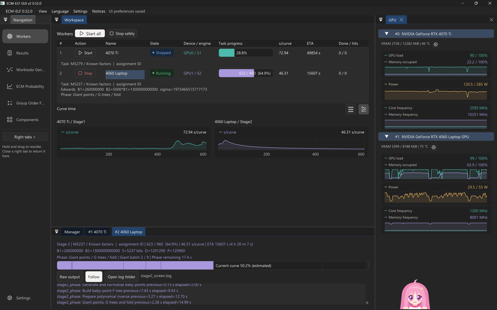
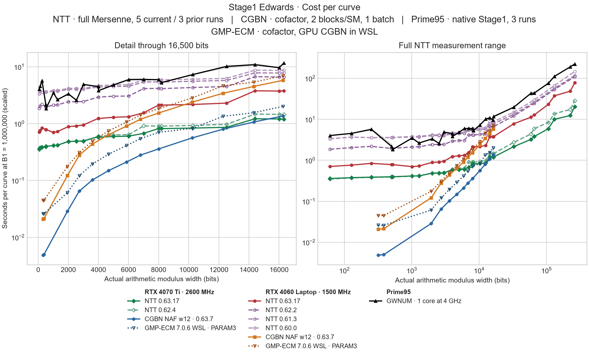
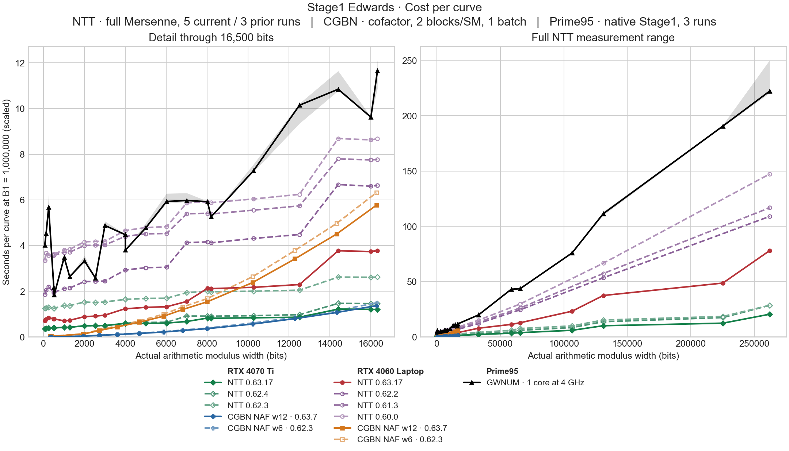
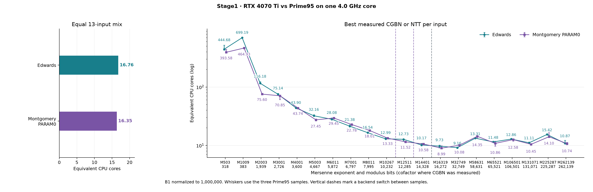
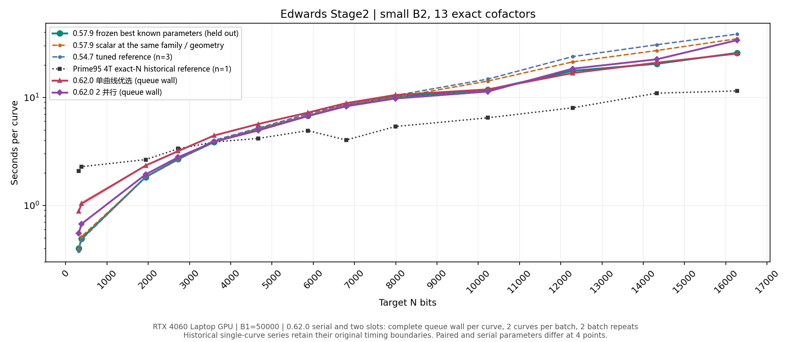
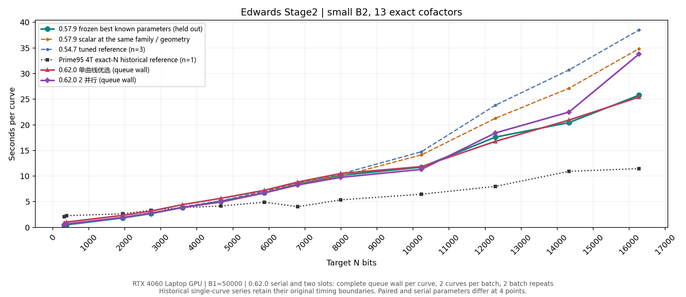
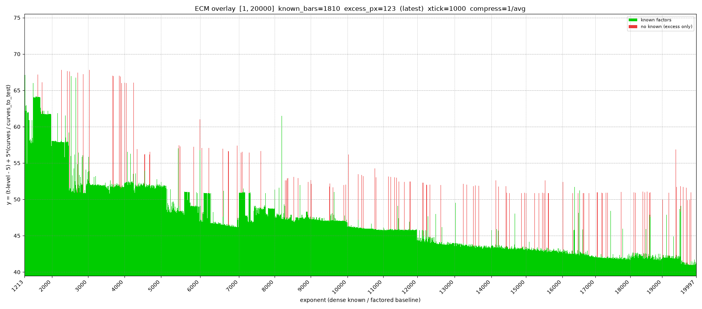
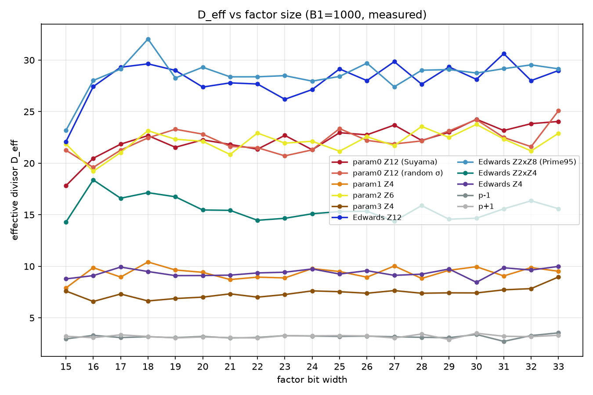
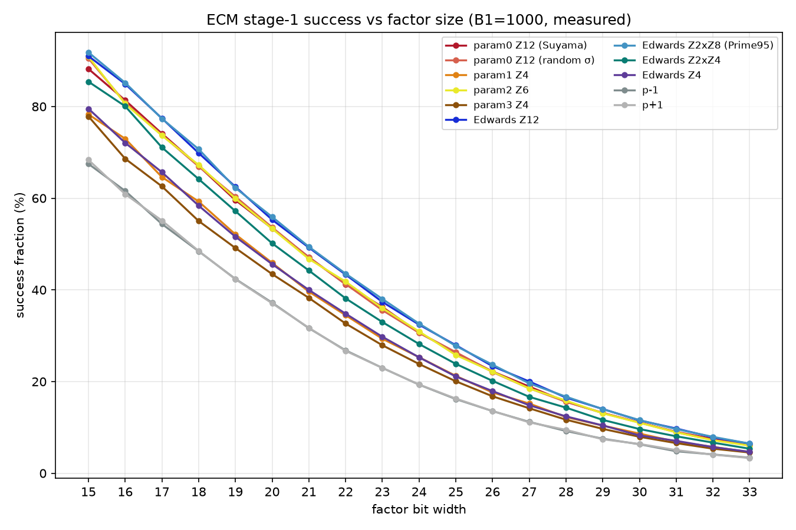
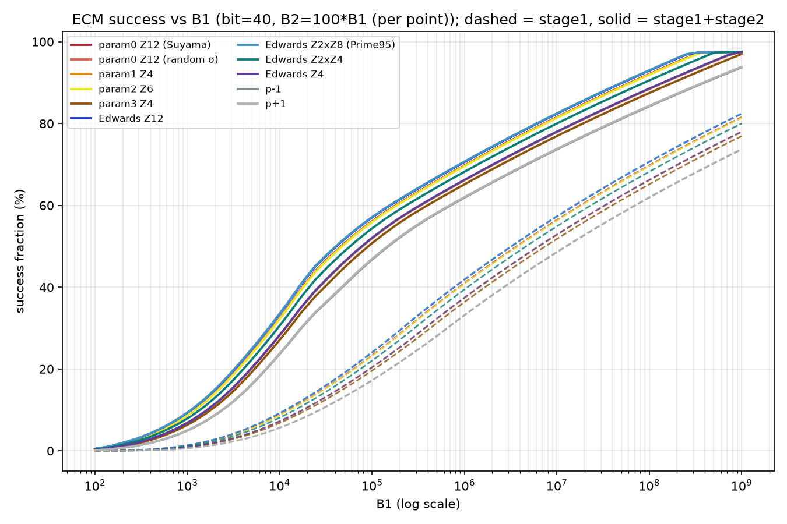

# ECM-ELF

[English](README.en.md) | 中文

ECM-ELF 是椭圆曲线因子分解（ECM）工具集。GPU Stage1 支持 CUDA CGBN、CUDA NTT 和 OpenCL，CPU Stage1 提供 GMP、AVX-512 IFMA 和可选的 GWNUM。独立 Stage2 可在 CUDA、OpenCL 或 CPU 上读取相应的 Stage1 存档。

配置默认值及取值范围见 [TOML 参考（中文）](docs/ECM_TOML_REFERENCE.zh-CN.md) · [TOML reference (English)](docs/ECM_TOML_REFERENCE.en.md)。


使用 `ecm_gui_v2.exe` 管理 Stage1 和 Stage2 worker、队列、进度和结果。见 [GUI v2 指南](docs/usage/GUI_V2.md)。



## 目录

| 章节 | 内容 |
| --- | --- |
| [与现有主流工具相比](#comparison) | Edwards Stage1 和 Stage2 与 Prime95 的耗时对比 |
| [程序与能力](#programs) · [快速开始](#quick-start) | 程序选择、实际命令与常用选项 |
| [CPU Stage1 配置教程](#cpu-stage1) · [队列与交接](#queues) | 配方、线程批数、worker、save 与 checkpoint |
| [独立 CUDA Stage2](#stage2) · [构建与发布](#build) | Stage2 输入/续跑和构建入口 |
| [Android、GUI 与附带工具](#android-tools) | 移动端、图形前端及辅助工具 |
| [文档与仓库布局](#docs-layout) · [依赖与许可](#license) | 专题文档、源码入口和许可 |

<a id="comparison"></a>
## 与现有主流工具相比

每组对比使用相同数据绘制对数图和线性图。耗时图的纵轴为每条曲线的耗时，**越低越快（lower is faster）。**

### Edwards Stage1

比较 RTX 4070 Ti 和 RTX 4060 Laptop 上的 ECM-ELF CUDA NTT（0.63.17）、CGBN，以及 4.0 GHz 单核 Prime95。耗时折算到 B1 = 1,000,000。输入、样本及计时口径见 [Stage1 性能](docs/performance/STAGE1.md#stage1-ntt-与-cgbn-和-prime95-对比)。





#### RTX 4070 Ti 等效 CPU 核心数

逐档采用 RTX 4070 Ti 上耗时最短的 CGBN 或 NTT 实测结果，与同一输入的 4.0 GHz Prime95 单核耗时比较。Edwards 和 Montgomery PARAM0 均覆盖至 262,139 位。计算口径见 [GPU 型号与 CPU 等效核心数](docs/performance/STAGE1.md#gpu-型号与-cpu-等效核心数)。




### Stage2

比较 RTX 4060 Laptop 上的 ECM-ELF CUDA 串行和双槽（0.62.0），以及四线程 Prime95 31.4b05。输入为 13 个 Edwards 余因子存档，B1 = 50,000，B2 约为 270 亿。计时口径见 [Stage2 性能](docs/performance/STAGE2.md#0620-串行优选与双槽)。





<a id="programs"></a>
## 程序与能力

| 程序 | 当前用途 | 主要输入与输出 |
| --- | --- | --- |
| `ecm_cuda.exe` | CUDA Stage1。CGBN 支持 Edwards 和构建中包含的 Montgomery 参数化，NTT 支持 Edwards 和 PARAM0 的完整梅森数或已知因子任务 | 数字、表达式或 Stage1 队列，输出 `.save` 和检查点 |
| `ecm.exe` | OpenCL GPU Stage1 或 CPU Edwards、Suyama-Montgomery Stage1 | 与驱动共用的输入、TOML、队列及文本 save；GPU 算子可单独选择 |
| `ecm_stage2.exe` | 统一的 CPU／CUDA Stage2 | 默认 CPU 续算 Edwards AM。GPU 支持 Edwards AM 与 Montgomery PARAM0。两者都可直接读 save 或消费 `ECMSTAGE2=` 和 `ECMSTAGE2N=` |
| `ecm_opencl_stage2.exe` | OpenCL GPU Stage2 | 与统一版共享 save 和队列格式，独立运行或作为统一版的 OpenCL 后端 |
| `ecm_gui_v2.exe` | Windows 图形界面 | 管理 Stage1 和 Stage2 worker、队列、日志与结果 |

### 各 Stage1 后端

CUDA 默认按 `gpu_algorithm = "ntt[16384:], cgbn[]"` 和实际模数选择后端。见 [GPU 算法选择](docs/usage/STAGE1.md#gpu-算法选择)。

- **CUDA CGBN** 按构建中的位宽档执行 Edwards 或 Montgomery。`param = "m0"` 选择与 GMP-ECM `-param 0` 同族的 Suyama 曲线，`"m2"` 和 `"m3"` 选择相应的 batch 参数化。Montgomery 默认用 ladder，PARAM0 可选 PRAC。见 [Stage1 实现](docs/architecture/STAGE1.md)。
- **CUDA NTT** 支持 Edwards 和 Montgomery PARAM0。带已知因子的梅森任务默认允许用完整梅森数承载运算，检查和存档使用余因子。可通过 `--gpu-algorithm ntt` 固定使用。队列自动拆批并把实测吞吐写入 `tune.toml`。见 [CUDA 全宽 NTT](docs/usage/STAGE1.md#cuda-全宽-ntt)。
- **CUDA 一线程一曲线** 用于最高 1024 bit 的 Edwards，使用与 OpenCL 共用的 NAF 点算术。通过 `gpu_algorithm = "thread"` 或 `--gpu-algorithm thread` 启用。见 [使用方法](docs/usage/STAGE1.md#cuda-edwards-一线程一曲线)。
- **OpenCL** 的桌面 worker 支持 Montgomery PARAM3 和最高 1024 bit 的 Edwards NAF。Edwards 每个工作项处理一条曲线，使用共享 NAF 编码并在设备建表。`ecm.exe --showkernel` 列出 Montgomery 可选算子。 [OpenCL Stage1 用法](docs/usage/STAGE1.md#opencl-edwards) · [OpenCL 架构](docs/architecture/OPENCL.md#stage1-曲线执行)
- **CPU** 的 Edwards 与 Suyama-Montgomery 路径可用 GMP 标量或 AVX-512 IFMA，IFMA 每批处理 8 条曲线。Windows x64 上的 Montgomery PARAM0 还可显式使用本地构建的 `gwnum.dll`。见 [Stage1 实现](docs/architecture/STAGE1.md)与 [GWNUM 本地构建](docs/usage/BUILD.md#cpu-stage1-本地-gwnum-316)。

`gpucurves` 表示一次任务的曲线数，并不保证所有曲线同时驻留 GPU。GPU 批量应结合 `--gpu-info`、位宽、TPI、TPB、SM 数及实际资源占用选择。CPU SIMD 的线程并行度上限为 `ceil(曲线数/8)` 个批；标量路径则按每曲线一个任务分配。固定 σ 时，第 `i` 条曲线使用 `sigma+i`；不同参数化的同一 σ 不是同一条曲线。

<a id="quick-start"></a>
## 快速开始

以下命令从程序所在目录执行。发布包或本机构建中实际的 exe 路径可按 [构建说明](docs/usage/BUILD.md) 替换。`B2=0` 用于只执行 Stage1；完成的 Stage1 save 再交给合适的 Stage2 消费端。

```powershell
# 查看实际后端、选项和可用档位；--gpu-info 不运行曲线
.\ecm_cuda.exe --help
.\ecm_cuda.exe --gpu-info --bits 5240
.\ecm.exe --showkernel

# 单次 OpenCL / CUDA Stage1；N 可以是十进制数或表达式
echo '(2^347-1)' | .\ecm.exe --param m3 --target gpu -gpucurves 1 -d 0 1e4 0
echo '(2^421-1)' | .\ecm_cuda.exe --param m0 --target gpu -gpucurves 32 -d 0 1e5 0
echo '(2^8191-1)' | .\ecm_cuda.exe --curve ed --target gpu --gpu-algorithm ntt -gpucurves 8 -d 0 1e4 0

# CPU Suyama-Montgomery；auto 在支持的机器上选 SIMD
echo '(2^1277-1)' | .\ecm.exe --curve mont --target cpu --impl auto -gpucurves 8 1e5 0
```

单次运行的形式为 `echo '<N>' | <ecm.exe 或 ecm_cuda.exe> [选项] B1 [B2]`。无位置参数时进入 Stage1 队列模式。`--curve` 与 `--target` 分别选择曲线和执行位置，单次运行默认 Montgomery + GPU。`-d` 是当前后端的设备编号，`--gpu-info` 报告 CUDA 档位与建议批量。

### 使用 worktodo 运行 Stage1

以下示例假设 `ecm_cuda.exe`、`ecm_stage2.exe` 和 `ecm.toml` 位于同一目录，并从该目录运行命令。已有 v3 工作流可先[转换为 v4](docs/architecture/CONFIGURATION.md#升级旧配置)。创建 `ecm.toml`：

```toml
config_version = 4

[shared]
worktodo_file = "worktodo.txt"

[stage1]
param = "m0"
target = "gpu"
stage1_gpu_device = 0
stage1_save_dir = "."
handoff_mode = "off"

[stage2]
device = "gpu"
```

创建 `worktodo.txt`，其中 `ECM2` 的末尾字段依次为 B1、B2、曲线数；`B2=0` 表示只运行 Stage1：

```text
[Worker #1]
ECM2=1,2,3001,-1,10000,0,8
ECMSTAGE1=1,2,503,-1,e_m503_1e6.save,1000000,0,3840
ECMSTAGE1=1,2,1009,-1,e_m1009_1e6.save,1000000,0,3840
ECMSTAGE1=1,2,2003,-1,e_m2003_2e5.save,200000,0,1920
ECMSTAGE1=1,2,3001,-1,e_m3001_5e4.save,50000,0,960,"74377120512065560887888955738547726230067911062228332102593647695996426590861891993"
ECMSTAGE1=1,2,4001,-1,e_m4001_5e4.save,50000,0,960
ECMSTAGE1=1,2,5003,-1,e_m5003_5e4.save,50000,0,960,"226024016418421435298344442894288706759183133013891943201151261634794580524042962593009658426023377823"
ECMSTAGE1=1,2,6011,-1,e_m6011_5e4.save,50000,0,960,"857617390900380339876897531255996012288097"
ECMSTAGE1=1,2,7001,-1,e_m7001_5e4.save,50000,0,960,"40904995823389659106595800207541412633707011574995413435800807"
ECMSTAGE1=1,2,8011,-1,e_m8011_5e4.save,50000,0,960,"80111"
ECMSTAGE1=1,2,10267,-1,e_m10267_1e4.save,10000,0,480,"35491478951"
ECMSTAGE1=1,2,12511,-1,e_m12511_1e4.save,10000,0,480,"121147116870729142848119447488872718579398235696988789692775064038071"
ECMSTAGE1=1,2,14401,-1,e_m14401_1e4.save,10000,0,480,"11913945416781811886807"
ECMSTAGE1=1,2,16319,-1,e_m16319_1e4.save,10000,0,480,"270811405193137"
```

```powershell
.\ecm_cuda.exe --config .\ecm.toml --worker 1
```

该命令只消费所选 worker 的 Stage1 任务。示例中的首条任务生成 `m0_m3001_1e4.save`，写入 `save_dir`。完成的任务写入 `worktodo.finished.txt`。中断或保存失败时，未完成的任务留在 worktodo，重启原命令可从有效检查点恢复。见 [队列与交接](#queues)和 [Stage1 使用](docs/usage/STAGE1.md)。

### 运行和调优 CUDA Stage2

首条 Stage1 任务无因子完成后，可在同一 `worktodo.txt` 的 `[Worker #1]` 下加入以下任务。这里显式指定 B2，存档名称与实际产物一致。要让后续任务自动投递，可将 `[stage1] handoff_mode` 设为 `"ecm-elf"`。见 [自动交接](docs/usage/STAGE1.md#自动交接到-stage2)。

```text
[Worker #1]
ECMSTAGE2=1,2,3001,-1,"m0_m3001_1e4.save",1000000
```

```powershell
# 可选：按当前 Stage2 队列和 save 测量完整 ECM；不会消费队列
.\ecm_stage2.exe --config .\ecm.toml --worker 1 --tune ecm --tune-level 1 --tune-file .\stage2_ecm_tune.toml

# 执行队列中的一项；生成调优文件后可加 --tune-profile .\stage2_ecm_tune.toml
.\ecm_stage2.exe --config .\ecm.toml --worker 1 --once

# 或跳过队列，直接处理同一 save（不要与上述队列命令重复执行）
.\ecm_stage2.exe --target gpu --save .\m0_m3001_1e4.save --b2 1000000 --device 0

# 可选：仅测量 NTT 组件，不等同于完整 ECM 调优
.\ecm_stage2.exe --target gpu --tune ntt --tune-level 1 --tune-file .\stage2_ntt_tune.toml
```

ECM tune 默认使用所选 worker 的 Stage2 队列。也可用 `--tune-save FILE --tune-b2 B2` 指定一个存档。用 `--tune-profile FILE` 临时加载 Stage2 调优数据，或在 `[shared]` 中设置 `tune_file` 供两阶段共用。显式给出 B2 可直接运行。Auto B2 的成本数据要求见 [Stage2 使用](docs/usage/STAGE2.md)及 [Auto B2](docs/architecture/AUTO_B2.md)。

常用命令行参数如下；完整参数和准确默认值请运行相应程序的 `--help` 并查 [TOML 参考](docs/ECM_TOML_REFERENCE.zh-CN.md)。

| 选项 | 用途 |
| --- | --- |
| `--param e\|m0\|m2\|m3`、`-sigma S` | 曲线构造和固定种子；PARAM0 可使用完整 64 位 σ |
| `-gpucurves N` | 单次运行的任务曲线数；NTT 可自动拆批 |
| `--curve mont\|ed`、`--target cpu\|gpu` | 分别选择曲线模型和执行位置 |
| `--gpu-algorithm cgbn\|ntt\|thread` | GPU Stage1 算法，也支持按位宽的切片规则 |
| `--impl auto\|simd\|scalar\|gwnum`、`--reduction auto\|montgomery\|mersenne-fold` | CPU 算术实现和 SIMD 归约 |
| `--lcm 1\|12` | Montgomery Stage1 标量的构造方式 |
| `--stage1-threads N`、`--affinity LIST` | Stage1 主机线程数与可选 CPU 亲和性 |
| `--ckpt SEC`、`--tmp-dir DIR`、`--exp-cache DIR` | 检查点间隔、Stage1 本地输出目录和指数缓存 |
| `--config FILE`、`--worker N` | TOML 配置与队列分区 |
| `--mul/--sqr/--add/--sub/--special-mult ID` | OpenCL 算子路径；CUDA 不使用这些覆盖项 |
| `--go`、`--gp PATH`、`--verify-gpu`、`--profile-ops` | 群阶诊断、GP 路径、GPU 交叉验证和算子计数 |

OpenCL 的内核根目录、二进制缓存、TPI、work-group 及日志诊断选项均由当前 `--help` 列出。

### OpenCL 运行时与算子诊断

`--kernel-root DIR` 指定 `.cl` 源码树，`--kernel-cache-dir DIR`、`--no-kernel-cache` 和 `--kernel-cache-verbose` 控制二进制缓存，`--compile-verbose` 显示编译耗时。`--tpi N` 与 `--wg N` 用于实验实例线程数和 work-group。`--force-normalize`、`--addsub-fused-unroll`、`--sync-each-batch`、`--gpu-dump`、`--profile-ops`、`--verify-gpu` 是 OpenCL 的诊断与对拍开关。

算子微基准的 CLI 与主程序分开：`opencl_ecm_addsub` 提供 `--no-asm`、`--asm-b64`、`--addsub-fused-unroll`、`--csv`；`opencl_ecm_montsqr` 提供 `--wg-impl`、`--wg-impl4-unroll`、`--csv` 等。两者的位置参数为内核迭代数、实例数、重复 launch 次数，`--bits` 指定位宽。微基准是单算子测量，不应与完整 ECM 每曲线耗时直接混用。源码入口分别为 `tools/bench/opencl_ecm_addsub_bench.cpp`、`tools/bench/opencl_ecm_montsqr_bench.cpp`。

<a id="cpu-stage1"></a>
## CPU Stage1 配置教程

在 `[stage1]` 设置 `target = "cpu"` 并选择 `param = "m0"`（Suyama PARAM0）或 `"e"`（Atkin–Morain Edwards）。Montgomery 的 `montgomery_lcm_multiplier` 为 `"1"` 时使用 `lcm(1…B1)`，为 `"12"` 时使用 Prime95 交接所需的 12 倍标量。Edwards 使用固定的 `48·lcm(1…B1)`。

一份本地 Montgomery 配置示例：

```toml
config_version = 4

[shared]
worktodo_file = "worktodo.txt"

[stage1]
param = "m0"
target = "cpu"
cpu_implementation = "auto"
cpu_simd_reduction = "auto"
montgomery_lcm_multiplier = "1"
stage1_cpu_threads = 0
stage1_save_dir = "saves"
```

Edwards 的窗口由 `edwards_naf_window_bits` 控制。显式指定 `cpu_simd_reduction` 须同时选择 `cpu_implementation = "simd"`；`"mersenne-fold"` 要求实际模数是完整梅森数。见 [TOML 参考](docs/ECM_TOML_REFERENCE.zh-CN.md)。

常用 CPU 配方：

| 用途 | 在上述示例上修改 | 要核对的结果 |
| --- | --- | --- |
| GMP-ECM PARAM0 对照 | `param = "m0"`、`montgomery_lcm_multiplier = "1"` | 同 N、B1、σ 下检查 Stage1 最终点 |
| Prime95 Suyama 交接 | `param = "m0"`、`montgomery_lcm_multiplier = "12"` | 标量约定、save 路径与任务字段 |
| Edwards 完整梅森数 | `param = "e"`、`cpu_simd_reduction = "auto"` | 实际归约域、NAF 设置与 Edwards save |
| Edwards 通用模数 | `param = "e"`、`cpu_implementation = "simd"`、`cpu_simd_reduction = "montgomery"` | 例如剥离已知因子后的余因子 |

`save_name_pattern` 控制自动生成的 CPU 和 GPU 存档名。队列行可通过带曲线前缀的文件名指定存档，单次命令可用 `-save` 指定路径。恢复未完成的 CPU 任务时，重跑原命令读取检查点。

一批 8 条 SIMD 曲线是一个 CPU 调度任务，64 条曲线最多形成 8 个可并行批。`stage1_cpu_threads = 0` 自动选线程，显式线程数也受任务数约束。并行进程可通过各自的 `save_dir` 避免同名存档和检查点冲突。

显式选择 `simd` 需要 AVX-512 IFMA。调整 TOML 后若实际选项未变，检查 `[worker.N]` 和命令行覆盖。对拍 Stage1 时，固定 N、B1、σ、参数化和标量约定后比较最终点。

<a id="queues"></a>
## 队列、worker 与交接

`--worker N` 同时选择 TOML 的 `[worker.N]` 覆盖和 worktodo 的 `[Worker #N]` 队列分区。同一 worker 同时由一个进程消费。完成的任务写入 `[shared] finished_file`。GUI v2 可预览并追加 PrimeNet 的 `ECM=` 或 `ECM2=` 任务。

### Worktodo 格式

`ECM=`、`ECM2=` 和 `ECMSTAGE1=` 都交给 Stage1。`ECMSTAGE1` 从文件名末尾的 `_B1.save` 取 B1。队列默认用 Edwards。可用 `[stage1] curve = "mont"`，或用 `param = "m0"`、`"m2"`、`"m3"` 指定 Montgomery 参数化。若 `ECMSTAGE1` 的文件名带 `e_`、`m0_`、`m2_`、`m3_` 前缀，则以该前缀为准。

```text
ECM|ECM2=[<AID>,|N/A,|<nul>]<k>,<b>,<n>,<c>,<B1>,<B2>,<curves_to_run>[,"known-factors"]
ECMSTAGE1=[<AID>,|N/A,|<nul>]<k>,<b>,<n>,<c>,filename,B2-or-zero,skip_curves,num_curves[,"known-factors"]
ECMSTAGE2=[<AID>,|N/A,|<nul>]<k>,<b>,<n>,<c>,filename[,B2-or-zero][,skip_curves][,num_curves][,"known-factors"]
ECMSTAGE2N=[<AID>,|N/A,|<nul>]filename[,B2-or-zero][,skip_curves][,num_curves][,"known-factors"]
```

`ECM|ECM2` 表示任选一个前缀。AID 为 32 位十六进制字符。`<nul>` 表示省略 AID，也可用 `N/A,` 或留空首列。已知因子用一组双引号包住，多个因子用逗号分隔。

```text
ECM2=1,2,3001,-1,100000,1000000,64
ECMSTAGE1=1,2,3001,-1,"e_m3001_1e5.save",1000000,0,64
ECMSTAGE2=1,2,3001,-1,"e_m3001_1e5.save",1000000,0,64
ECMSTAGE2N="e_bit4096_1e5.save",1000000,0,64
```

两种 Stage2 格式都从存档读取 B1。`ECMSTAGE2` 用 `k*b^n+c` 和已知因子计算预期模数，再与存档核对。`ECMSTAGE2N` 适合只有 save 的任务，直接采用所选记录的完整 N，已知因子仅作结果元数据。所选记录须有相同的 N 和 B1。`skip_curves` 默认 0，`num_curves` 省略或为 0 时处理余下全部记录。B2 省略或为 0 时沿用 Stage2 配置，Edwards 需要有效的 B2。

### Stage1 自动交接

Stage1 无因子完成且发布了受支持的保存点时，从 `ECM=`、`ECM2=` 或 `ECMSTAGE1=` 生成 `ECMSTAGE2=`。新任务复用 AID、`k,b,n,c`、B2 和已知因子，引用实际 save 的绝对路径，并按本批写入的记录填写 skip 和 count。

```toml
[stage1]
# handoff_mode = "ecm-elf"  # "off" | "ecm-elf" | "prime95"
# handoff_workers = "2-3"  # 单个编号、列表、范围或 "auto"
# handoff_worktodo_file = "worktodo-stage2.txt"
```

默认 `"ecm-elf"` 在原 worker 的队列末尾追加。可用 `handoff_workers` 或 `handoff_worktodo_file` 改投其他 worker 或队列。`"off"` 只保留 save。`"prime95"` 需要配置 `prime95_worktodo_file` 和 `prime95_save_dir`，兼容任务投递到 `worktodo.add`。Edwards 等不受 Prime95 支持的存档默认交给 ECM-ELF 续算。 [Stage1 交接规则](docs/usage/STAGE1.md#自动交接到-stage2)

### Save 与 checkpoint 不能互用

最终 `.save` 含可交给兼容 Stage2 的归一化点及任务字段；运行中 checkpoint 含未完成的点状态、指数偏移和实现布局。CUDA、OpenCL、CPU Edwards、CPU Montgomery 的 checkpoint 各按自身格式验证，不能凭相似文件名跨后端恢复。正常停止或 Ctrl+C 要等安全边界保存；强制结束可能丢失尚未写完的 checkpoint。恢复时重跑原任务并保留相同的 N、B1、参数化、指数模式和相容构建，日志会说明是否读到检查点。详见 [Stage1 使用](docs/usage/STAGE1.md)。

save 的兼容范围也有限：CUDA/CPU PARAM0 及 CUDA/OpenCL PARAM3 的合格文本记录可用于相应 GMP-ECM/Prime95 流程；PARAM2 带 `PARAM=2`，GMP-ECM 可读，Prime95 不接受；本仓库的 CUDA Stage2 接受归一化 PARAM0 和 Edwards AM 文本记录；CPU/GPU Edwards 统一文本 save 也可交给独立 libecm CPU Stage2。checksum 检查文件完整性，不证明 GPU 点乘数学正确。验收应独立核对 N、B1、σ、指数模式和最终点。

<a id="stage2"></a>
## 独立 CUDA Stage2

`ecm_stage2.exe` 从已完成的 Stage1 save 续算。用 `[stage2] device = "auto" | "cpu" | "gpu"` 选择设备。默认 `auto` 使用 CPU，Montgomery 存档请选择 GPU。在 `[worker.3]` 写 `device = "cpu"` 可单独指定 Worker 3 的 Stage2。一次性运行可用 `--target` 覆盖。

```powershell
.\ecm_stage2.exe --target gpu --save .\m0_m3701_260e6.save --b2 26000000000 --device 0
.\ecm_stage2.exe --config .\ecm.toml --worker 1 --once
```

GUI v2 根据[任务前缀](#worktodo-格式)启动相应程序。`[shared] queue_order` 可设为 `"file_order"`、`"stage1_first"` 或 `"stage2_first"`，`queue_skip` 可设为 `"none"`、`"stage1"` 或 `"stage2"`。`[stage2] b2_ratio` 为非零整数时使用 B1 × ratio。队列中断后按回执跳过已经完成的曲线，直接读档可用 `--skip-curves` 和 `--curves` 选择记录。B2 优先级见 [Stage2 使用](docs/usage/STAGE2.md)。

手动 B2 支持符合实现约束的 2…16384-bit 输入。Auto B2 还要求适用的成本 profile 和 Stage1 成本，且始终受当前显存及算术检查约束；对没有合格模型的生产任务应明确给出 B2。`--dry-run` 只校验输入；`--plan-only` 可进行启动短校准，若要纯查询需配合 `--short-calibration 0`。参数、回执、内存摘要、调优数据格式见 [Stage2 使用](docs/usage/STAGE2.md)、[管线](docs/architecture/STAGE2.md)、[Auto B2](docs/architecture/AUTO_B2.md)。

<a id="build"></a>
## 构建与发布

CUDA Stage1 与 Stage2 各有**开发、本机生产、发布生产**三组入口，每组均提供 PS1/BAT；默认和完整参数由 `tools/build/` 下的 PS1 维护。常用入口：

```powershell
.\tools\build\build_stage1_dev.ps1
.\tools\build\build_stage1_local.ps1
.\tools\build\build_stage1_release.ps1
.\tools\build\build_stage2_dev.ps1
.\tools\build\build_stage2_local.ps1
.\tools\build\build_stage2_release.ps1
```

**CUDA 发布包选择（Windows x64）：**

- **cu11.8 旧显卡兼容包**：用于 Maxwell、Pascal、Volta，例如 GTX 750/900/10 系列及 V100。
- **cu13.3 现代包（新显卡推荐）**：用于 Turing 及更新架构，例如 GTX 16、RTX 20/30/40/50 系列。

驱动仍须与所选包兼容；具体型号、SM 和兼容边界见 [GPU 型号与 SM 速查表](docs/usage/BUILD.md#gpu-型号与发布包选择)。

本机与开发构建默认使用本地 Zen3 GMP，发布包默认使用通用 x64 GMP。标准 Stage1 构建包含 PARAM0 PRAC 与 resident ladder，运行时默认使用 ladder。详见 [构建与发布](docs/usage/BUILD.md)和 [脚本参数](tools/build/README.md)。

OpenCL/CPU 构建需要 C++ 工具链、GMP 和 OpenCL 运行时及头文件。CUDA 构建还需匹配的 nvcc 和 MSVC。以下为 Windows 上构建 OpenCL/CPU 并运行算子微基准的示例。

```powershell
# 单独配置 OpenCL/CPU 工程；按本机依赖位置补充 CMake 参数
New-Item -ItemType Directory -Force build_opencl | Out-Null
Set-Content -LiteralPath build_opencl/.gitignore -Value '*'
cmake -S . -B build_opencl -DECM_ENABLE_CUDA=OFF
cmake --build build_opencl --config Release

.\build_opencl\Release\opencl_ecm_addsub.exe --bits 512 10000 128 3
.\build_opencl\Release\opencl_ecm_montsqr.exe --bits 512 1000 128 1
```

<a id="android-tools"></a>
## Android、GUI 与附带工具

Android App 位于 `Android/ECM`，提供 OpenCL 设备探测、ECM Stage1 分解、算子微基准、工作队列和本地保存。用 Android Studio 打开该子工程；原生分解需要链接 GMP。运行时动态加载设备厂商的 OpenCL 库，不应将从手机抽取的 `libOpenCL.so` 打包入 APK。构建会同步 `.cl` 内核到 assets；首次编译大型内核可能较慢。入口、16 KB 页设备约束及真机验证见 [Android 总览](Android/README.md)、[ECM 分解说明](Android/ECM/README_ECM_FACTORIZATION.md)、[App 说明](Android/ECM/README.md)。

Windows GUI v2 根据队列为每个 worker 启动对应的 Stage1 或 Stage2 子进程，并显示进度、GPU 指标和结果。使用同一份 `ecm.toml`，`[gui]` 保存界面和程序路径，`[worker.N]` 以原键名覆盖工作设置。见 [GUI v2 使用](docs/usage/GUI_V2.md)。

- [`ecm_prob`](tools/ecm_prob/README.md)：ECM 成功率、参数化与有效除子模型；预测值须按模型条件解释。
- [`ecm_report`](tools/ecm_report/README.md)：PrimeNet ECM 进度与结果汇总。
- [`ecm_dataset`](tools/ecm_dataset/README.md)：梅森数与因子数据、sigma 的管理和查询。
- [`tools/bench`](tools/README.md)：设备算术、CUDA/OpenCL、NTT、Stage2 规划与计时探针；测试记录写入 Git 忽略的 `data/`。
- [`tools/test`](tools/README.md)：CPU/GPU 算术、队列、GUI、save/checkpoint 与 Stage2 回归验证。

下图是 PrimeNet ECM 进度的示例。



有效除子和成功率示例见下图。模型定义和使用条件见 [ecm_prob](tools/ecm_prob/README.md)。



| 成功率与因子位宽 | 成功率与 B1 |
| --- | --- |
|  |  |

<a id="docs-layout"></a>
## 文档与仓库布局

- [文档目录](docs/README.md) 汇总当前使用、实现、性能依据和 TODO。程序用法见 [Stage1](docs/usage/STAGE1.md)、[Stage2](docs/usage/STAGE2.md)和 [GUI v2](docs/usage/GUI_V2.md)。
- [架构总览](docs/architecture/OVERVIEW.md) 从 `src/main.cpp`、`src/io/`、`src/sync/` 及 `src/ecm/` 的 CPU/CUDA/OpenCL 后端追踪数据流；独立测试与工具位于 `tools/`。[配置维护](docs/architecture/CONFIGURATION.md) 说明 `config/ecm_options.json` 到模板/参考的生成关系。
- [固定数学与第三方资料](docs/reference/README.md) 保留 ECM、曲线、Goldilocks/NTT、Prime95/PrMers/GPUOWL 的推导和研究条件；原论文与译述在 `docs/paper/`。
- [工具目录](tools/README.md) 索引 `build/`、`bench/`、`test/`、`gen/`、`disasm/`、`log_parser/`、`ecm_prob/` 等。NPU 微基准见 [RyzenAI](tools/RyzenAI/README_ADDSUB.md)。

原始实验日志、保存点、剖析文件在 Git 忽略的 `data/experiments/`，汇总数据在 `data/benchmarks/`，生成图表在 `data/figures/`；旧提交中的证据路径不能代替当前本机原始数据。外部源码位于 `.refactor/`。仓库当前状态文档、固定研究资料和临时开发草稿按 [仓库工作规则](AGENTS.md) 分别维护。

<a id="license"></a>
## 依赖与许可

项目建立在 [GMP-ECM](https://gitlab.inria.fr/zimmerma/ecm) 框架上；CUDA 多精度算术使用 CGBN，GUI 使用 Dear ImGui。具体构建依赖对应 CUDA/OpenCL、C++ 工具链、GMP 等组件；分发时保留各依赖的版权和许可。项目许可见 [LICENSE](LICENSE)。
