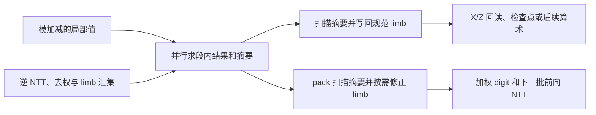

# 精确 NTT 与归约

CUDA Stage1 和 Stage2 共用 Goldilocks 域算术、根表与正逆变换调度。Stage1 在完整梅森模数上计算单个点坐标的乘积，Stage2 使用 Kronecker 槽计算多项式乘积并逐系数归约。

## Stage1 已知因子与梅森承载

梅森任务可保留原始 $M=2^p-1$ 作为 GPU 算术模数，同时令 $C=M/K$ 为实际目标，$K$ 为 worktodo 中已知因子的乘积。默认配置 `ntt_allow_known_factors = 1` 允许这条路径；0 关闭其选型。输入须保留 $k=1,b=2,c=-1,p$ 和已知因子元数据，并验证 $C\mid M$。GPU 算法切片按 $C$ 的位宽匹配，NTT 长度、系数界和显存准入按 $p$ 计算。见 [模数资格](../../include/ecm/stage1/ntt_target.h)。

投影 $\mathbb Z/M\mathbb Z\to\mathbb Z/C\mathbb Z$ 保持加、减、乘和平方。因此，主机构造出的曲线常量、初始坐标和字典可以从 $C$ 提升为 $M$ 中的整数代表，GPU 按原 NTT 路径计算，回读后再投影到 $C$。这些输入在 $C$ 上对应原曲线和 sigma。

所有求逆和因子分类使用 $C$。这包括主机构造、主机仿射字典、GPU 字典乘积树根的逆元、末点归一化和异常点的 x-only 重放。GPU 字典的乘积树升降仍在 $M$ 上运行，根逆元在 $C$ 上求得，下降后得到的坐标投影到 $C$ 仍满足批量归一化关系。已知因子不会作为目标模数中的新因子返回。单纯在发布时过滤因子无法代替这些求逆边界的处理。见 [Stage1 workflow](../../src/ecm/stage1/cuda/ntt/workflow.cpp)、[GPU 字典](../../src/ecm/stage1/cuda/ntt/ladder.cu)。

保存点、checksum、因子验证和结果 JSON 继续使用实际目标 $C$，已知因子保留为任务元数据。Stage2 读取的也是 $C$ 上的归一化点。检查点身份额外绑定承载指数，快照以 $p$ 位规范整数编码。生产调优行分别记录 `target_bits` 和 `arithmetic_bits`，只合并两个位宽都相容的完整曲线样本。

## Stage1 分段进位与 pack 融合

Edwards 和 Montgomery PARAM0 共用 x-only 阶梯。每个标量 bit 分三批计算乘积，批次之间要做模加减、规范化以及下一批的 digit 打包。宽位宽时，一个 CTA 处理整条 residue 会让每个线程串行处理多个 limb。分段路径将连续 256 个 32-bit limb 分给一个 CTA，每个线程处理一个 limb，末段按实际位宽屏蔽填充位。点公式、NTT 长度和逆变换保持同一合同。阶梯与检查点边界见 [Stage1 架构](STAGE1.md#唯一执行分派与-gpu-主机流程)。

### 局部结果与跨段回卷

模减使用 \(a+(M-b)\equiv a-b\pmod M\)，逐 limb 对右操作数取补后复用加法。对于 weighted 乘积，逆变换后的系数先去权并汇入各 limb 的未进位和 \(s_i\)。中间的完整 limb 用 \(v_i=(s_i\bmod 2^{32})+\lfloor s_{i-1}/2^{32}\rfloor\) 转移多位高部，最高 limb 按实际位宽截断并回卷到最低 limb。此后剩下的是同一种一位进位问题。

设第 \(i\) 个 limb 宽 \(w_i\)，掩码 \(m_i=2^{w_i}-1\)，接收本轮进位前的局部值为 \(v_i\)。该 limb 的传递函数 \(f_i(c)=[v_i+c>m_i]\) 只有三种状态。

- \(v_i<m_i\) 时终止进位，输出 0。
- \(v_i=m_i\) 时传播输入进位。
- \(v_i>m_i\) 时产生进位，输出 1。

段内用 warp ballot 和共享摘要找到每个 limb 之前的最后一个非传播项。CTA 写出以输入进位 0 为假设的局部结果，同时记录全段的传递函数以及从段首到第一个非传播 limb 的长度，包含该 limb。实际段输入进位为 1 时，修正只需给这个前缀的每个局部 limb 加一，再按各自掩码截断。前缀之后的输出与段输入无关。

消费者在 64 段以内用一个 warp 依次扫描至多两组，每组 32 段。65–128 段用一个 warp 负责一组，在共享内存发布各组的传递函数。每个 lane 先查本组前缀，遇到全传播前缀就按环形向前查组摘要，直到遇到生成或截断。整个残数最多覆盖 1048576 位。全体段的传递函数为常数时，该常数就是从高端回卷到首段的进位。全传播时，输入 0 会保留 \(M=2^p-1\) 的编码，选择输入 1 可使所有有效 limb 回到 0。每曲线每槽需要 \(4\lceil p/8192\rceil\) bytes 摘要，设备工作区按槽数和活跃曲线数计入显存预算。

### 写回与下一批打包

只供下一批打包的中间值可以保留段内结果。pack 对源 limb 按需修正，再提取 digit 并施加权重。digit 跨越 limb 或段边界时，两个来源分别查各自的修正范围。x-only 阶梯可延迟只供下一批打包使用的模加减、平方项 \(\mathrm{DiffSq}\) 和融合乘加项 \(BB+A_{24}E\)。还要参与普通模算术的输出和每步的两组 X/Z 都走独立写回。

原生 Edwards 2XY 分别归约四个乘积时，倍点将 \(E=2XY\)、\(H=X^2-Y^2\) 和 \(F=X^2+Y^2-2Z^2\) 留给下一次 pack。计算 \(F\) 之前仍写回规范的 \(G=X^2+Y^2\) 和 \(2Z^2\)。第一层频域融合时，四路输出都可留给 pack。非零 NAF 列中的 \(Y\pm X\) 和最后一批只供打包使用的加减项也可延迟。全组输出都由 pack 消费时，省去整个写回 kernel。点坐标在每列结束时完成进位，GPU 字典、回读和检查点由此获得规范整数。 [实测](../performance/STAGE1_MERSENNE_NTT.md#原生-edwards-延迟进位)

加权变换在 \(p>114688\) 时启用分段进位。原生 Edwards 的 8192 点加权路径在 98,305–114,688 位、每批至少 32 条曲线时也启用分段进位，并在共享内存预算内将去权、limb 汇集和段内进位合并到同一内核。5120 点在 \(p\ge106497\) 时各批量均可提前启用，2560／5120 点单曲线从 \(p=53249\) 起可提前启用。线性变换在 \(p>262144\) 时启用同一分段进位。它先对逆变换的系数做 digit 进位，再按 \(2^p\equiv1\bmod M\) 合并乘积的高低两半。预算容不下摘要时使用单块归约。混合 radix-5 或单曲线可在 pack 中解析进位，二次幂多曲线独立写回。见 [宽位宽归约剖析](../performance/STAGE1_MERSENNE_NTT.md#gpu1-宽位宽归约热点) 和 [归约对照](../performance/STAGE1_MERSENNE_NTT.md#加权归约与-16384-点单曲线调优)，以及 [双卡实测](../performance/STAGE1_MERSENNE_NTT.md#8192-点-edwards-批量归约)。

### 短加权乘积的 warp 归约

加权 NTT 长度最多 64 点、承载指数最多 1024 位且未启用分段进位时，一个 warp 完成一个乘积的梅森归约。每个 lane 将去权系数写入本 warp 的共享内存，再按位区间汇集一个 32 位 limb。低位 limb 同时汇集越过第 $p$ 位的系数片段，最高 limb 的进位回到最低 limb。相邻 limb 的多位进位转移后，warp 投票标出终止或产生进位的 limb，每个 lane 据此求出自己的输入进位。所有 limb 都传递进位时，输出规范零。

每个块处理同一输出坐标的至多四条曲线。归约直接写入点坐标槽，省去一组全局 limb 和的写入、读回以及一次 kernel 启动。Montgomery PARAM0 的末批乘积沿用原有标量位决定的坐标槽。见 [warp 归约](../../kernels/cuda/stage1_ntt_segments.cuh)、[乘积调度](../../src/ecm/stage1/cuda/ntt/ladder.cu) 和 [吞吐实测](../performance/STAGE1_MERSENNE_NTT.md#短加权乘积归约)。

### 单曲线融合归约

2560 点单曲线在 \(p\ge53249\)、5120 点单曲线在 \(p\ge106497\) 时，去权、limb 汇集和段内扫描共用一个 CTA。每个 lane 从逆变换系数求本 limb 的和，warp 内用 shuffle 取得前一 limb 的高部。warp 首 lane 直接从输入系数重算前一 limb，包含段之间的邻接值。最低 limb 单独读取最高两 limb，计算模 \(2^p-1\) 的回卷。普通 limb 只扫描本区间，低两 limb 还检查回卷区间，短模数另处理第二次回卷。

融合后直接生成段内结果与摘要。需规范化的输出由独立写回消费摘要，只供下一次 pack 的槽由 pack 解析。每步三批乘法各少一次独立汇集 kernel 和一次 limb 和的全局中转。实现见 [段进位内核](../../kernels/cuda/stage1_ntt_segments.cuh) 与 [批次调度](../../src/ecm/stage1/cuda/ntt/ladder.cu)。

### 原生 Edwards 的共享去权缓存

每个 256-limb CTA 先合作去权并缓存当前段及前一 limb 所需的连续系数。正常位置的 limb 汇集和 warp 首 lane 的进位使用同一缓存。低两 limb 的循环项及最低 limb 需要的高端系数从逆变换缓冲直接读取。这样每段内的相邻 limb 不必反复对同一系数乘逆权，而且不生成全局 limb 和中间表。跨段进位及规范化写回沿用现有规则。缓存大于 16 KiB 时使用原归约路径。启用条件和收益见 [两卡加权归约对照](../performance/STAGE1_MERSENNE_NTT.md#原生-edwards-共享去权缓存)。

原生 Edwards 的加权长度达到 2560 时，可按计划的整数系数上界缩短 limb 汇集的扫描范围。设 $K=\operatorname{bit\_length}(U)$，启用 2XY 频域组合时统一取 $K=\operatorname{bit\_length}(4U)$。起点为 $b$ 的系数只可能覆盖到 $b+K-1$，因此对于起点为 $lo$ 的 limb，每个回卷区间的起始索引从第一个 $b\ge\max(0,lo-63)$ 改为第一个 $b\ge\max(0,lo-K+1)$。主机生成的索引表同时供共享缓存和普通归约使用。计算不出足够紧的界时沿用 64 位覆盖范围。日志 `stage1_ntt_plan.dataflow` 的 `0x20000` 位表示使用了缩短范围。[索引表](../../src/ecm/stage1/cuda/ntt/weighted.cuh) · [双卡实测](../performance/STAGE1_MERSENNE_NTT.md#宽档去权系数的扫描范围)

## Stage1 加权卷积的无符号系数界

原生 Edwards 2XY 按规范残数乘积的系数界选择长度，NAF 字典构建使用同一界。对于 $p$ 位操作数、长度 $L$，第 $i$ 个 digit 的位宽为 $\lceil p(i+1)/L\rceil-\lceil pi/L\rceil$。平均 bpw 是 $p/L$，计划日志和配置上限按最大位宽 $\lceil p/L\rceil$ 检查。共有 $p\bmod L$ 个长 digit，其余为短 digit。M65521／2560 平均为 25.5941 bpw，由 1039 个 25 位和 1521 个 26 位 digit 组成。

字典归一化遇到非单位投影分母时可在点乘前检出真因子。见 [M16319 的配对验证](NAF.md#m16319-在字典归一化时检出因子) 和 [GPU 建表与显存预算](../performance/STAGE1_MERSENNE_NTT.md#奇数倍点字典与显存)。

设 $g=\gcd(p,L)$、$H=L/g$、$R=(p\bmod L)/g$、$d=2^{\lfloor p/L\rfloor}$、$A=d-1$，用 $z=[R>0]$。短 digit 上界为 $A$，长 digit 为 $A+d$。将二者沿循环槽配对，再乘去权因子 1 或 2。对槽编号按分数余量重排后，系数包络随余量非增，最大值在槽零：

$$
U=g\big[(2H-1)A^2+(2R-z)2Ad+(z+2\max(0,2R-H-1))d^2\big].
$$

按项从 $q-1$ 扣除，乘计数前先除法检查溢出。$U<q$ 即可用一个 Goldilocks 余数恢复整数系数。后续 32 位 limb 汇集用去权系数的覆盖范围定位输入，再做梅森折叠和进位。建表还检查 $L$ 可整除 $(q-1)/192$，以构造满足 $\rho^L=2^p$ 的加权根。

原生 Edwards 选择 weighted 且长度为 0 时，按长度递增检查二次幂和支持的 radix-5。候选须满足 $L\le p$、最大 bpw 不超过 31 及用户上限、tile 能在二次幂子变换中执行，并通过系数界。跳过不合格短档后选择第一个通过的长度。强制指定不合格长度时报错。随 $p$ 变化的实际 digit 分布会使准入有间隙。

`ntt_tight_weighted_bound` 默认开启。卷积和长度都为自动时，原生 Edwards 先检查只有收紧界才能准入的短计划。其余形状由常规选型处理，使用 x-only 标定的计划均按保守界准入。若 Edwards 的显式长度只满足无符号界，异常 x-only 重放重新推导长度。启动日志的 $U$ 取执行计划实际使用的整数包络。保守包络为松弛差值预留双倍乘积空间，融合乘加启用时另计加数。 [系数代码](../../src/ecm/stage1/cuda/ntt/weighted.cuh) · [选长代码](../../src/ecm/stage1/cuda/ntt/ladder.cu) · [双卡实测](../performance/STAGE1_MERSENNE_NTT.md#双卡加权自动选长矩阵)

### Edwards 2XY 第一层频域融合

设 $D$ 为各 digit 取最大值的向量，它表示梅森模数 $M=2^p-1$。记 $C=D*D$ 为它的加权循环卷积。对每个去权后的系数，规范输入的 $X^2$、$Y^2$、$Z^2$ 和 $XY$ 均在 $[0,C]$ 内。频域逐点生成四路输出。

$$
E=2XY,\qquad F=X^2+Y^2+2(C-Z^2),\qquad G=X^2+Y^2,\qquad H=X^2+C-Y^2.
$$

$E$、$G$、$H$ 的去权系数至多为 $2U$，$F$ 至多为 $4U$，且所有系数非负。$C$ 在回卷后代表 $M^2$，因此在模 $M$ 下为零。程序只在 $U\le\lfloor(q-1)/4\rfloor$ 时组合四路频谱，可直接用现有无符号归约。启用后，日志用乘积上界的四倍作为 `U`。

批次初始化打包并变换 $D$，逐点平方得到共享偏置频谱，占 $8L$ 字节。倍点对 $X,Y,Z$ 做三次前向，对 $E,F,G,H$ 做四次逆向。组合频谱省去第一层的两批整数加减，分段计划可将四路进位交给下一次 pack。该路径要求原生 Edwards 加权卷积、紧界、warp 逆向 tile 和足够的显存。系数界外仍用原长度分别归约四个乘积，再做整数加减。

128、256 和 512 点的单 tile 计划在逆变换读入时直接计算频域坐标。每个 CTA 按输出坐标读取原始 $X,Y,Z$ 频谱的相邻系数并计算所需的乘积，即刻进入 warp 逆变换。四个坐标合计每个频点使用 8 次域乘，省下每列一次频域组合 kernel 和四路中间频谱的全局写回。其余形状用独立组合 kernel，每个频点的 4 次域乘由四路输出共用。两条路径遵守同一个 $4U<q$ 上界。`stage1_ntt_plan.dataflow` 的 `0x10000` 位表示逆变换直接计算坐标。[组合内核](../../kernels/cuda/stage1_ntt_dataflow.cuh) · [逆变换与调度](../../src/ecm/stage1/cuda/ntt/ladder.cu) · [双卡实测](../performance/STAGE1_MERSENNE_NTT.md#逆变换读入时组合倍点频谱)

原生 Edwards 的加权计划在变换长度至少 8192、采用 12 层 warp 输入 tile 且至少 24 条曲线时，使用固定的宽逆向 tile。每个 warp 先完成六层，随后三组 radix-4 从第 6、8、10 层进入，最后一组直接写出。蝶形共享索引与旋转因子偏移使用编译期常量，仍用 512 线程、32 KiB 共享内存和原有频谱布局。频域组合的输出与普通逐点乘积共用这一调度。`stage1_ntt_plan.dataflow` 的 `0x40000` 位表示启用。[双卡实测](../performance/STAGE1_MERSENNE_NTT.md#12-层固定逆向-tile)

原生 Edwards 的加权计划在变换长度至少 5120、采用独立的 10 层 warp 前向 tile 且至少 24 条曲线时，将 tile 大小和前向层数固定在编译期。第一组 radix-4 从全局输入直接读入，第二组从共享内存读入，末六层由 warp 完成。频谱排列与通用 tile 相同。日志 `stage1_ntt_plan.dataflow` 的 `0x80000` 位表示启用。[前向实测](../performance/STAGE1_MERSENNE_NTT.md#10-层固定前向-tile)

## Stage1 radix-5 PFA

加权 Stage1 在 \(L=5W\)、\(W=2^k\) 的变换上使用 PFA 分解。选 \(r\in\{1,2,3,4\}\) 使 \(1+rW\equiv0\pmod 5\)，用 \(n=(1+rW)i+Wj\bmod L\) 表示系数序号。两个因子互素，五点 DFT 和 \(W\) 点 NTT 因此可以独立执行。频点按相同置换排列，逐点乘加保持原有卷积含义。

输入置换合入加权 pack，逆置换合入五点逆变换的写回。每个线程拥有同一列 \(i=n\bmod W\) 的五个值，只在本线程的共享内存槽中轮换，保持各平面的全局读写连续。不同线程的逆变换写回互不相交，因此可以原位执行。256 线程块使用 10 KiB 动态共享内存。每个方向省去 \(4W\) 次 Goldilocks 域乘，长度 10240 时两张旋转因子表合计少用 128 KiB 设备内存。实现与调度见 [radix-5 内核](../../kernels/cuda/stage1_ntt_radix5.cuh) 和 [Stage1 NTT ladder](../../src/ecm/stage1/cuda/ntt/ladder.cu)。

## Stage1 前向 tile

对于独立 pack 后至少九层的 tile，每个线程读取第一组 radix-4 的四个操作数，在寄存器中完成首两层 DIF，再将结果写入共享内存。块同步后继续剩余 DIF 和 warp 尾层。这样省去原始数据的共享写入、首组读取和一次块同步。混合 radix-5 的各二次幂平面使用同一索引合同。

直接 pack 到单 tile 且有至少 24 条活跃曲线时，按层数选择。1 层直接完成两点蝶形，启用 warp 尾层的 5／6 层在一个 warp 内直接变换并写出，7 层先做一层 DIF 再进入 warp。2–4 和 8–10 层保留共享 pack，并使用 \(\max(32,\min(256,2^{t-1}))\) 个线程。读入融合的块宽使用上限 512。`stage1_ntt_plan` 分别记录前向和逆向的线程数及动态共享内存。见 [前向内核](../../kernels/cuda/stage1_ntt_dataflow.cuh)、[剩余 DIF 层](../../src/ecm/cuda/ntt/device/tile_pass.cuh) 和 [实测](../performance/STAGE1_MERSENNE_NTT.md#前向-tile-与进位)。

## Stage1 逐点乘加与逆变换 tile

逐点乘加与首段逆变换融合在 `inverse_product_tile`。同一个 grid 的不同块按输出编号选择输入指针。CUDA 计算能力 7.0 起，`__grid_constant__` 允许动态索引直接读取只读 grid 参数，省去每线程的输入指针表副本。较早的 CUDA 目标使用按值传参。[CUDA 参数说明](https://docs.nvidia.com/cuda/archive/13.2.2/cuda-programming-guide/05-appendices/cpp-language-extensions.html)

加权路径把长度归一化 \(L^{-1}\) 乘入逆权重表。逆变换对统一缩放是线性的，因而可以先做未缩放的逆变换，再由 `weighted_limb_sums` 对每个系数一次性应用 \(L^{-1}\) 和逆权重。PFA 与二次幂形状均使用完整卷积长度 \(L\)。线性卷积继续在逆变换 tile 入口缩放。见 [权重表与 limb 汇集](../../src/ecm/stage1/cuda/ntt/weighted.cuh) 和 [批次调度](../../src/ecm/stage1/cuda/ntt/ladder.cu)。

启用 warp 尾段且 tile 至少有六层时，Stage1 逆变换以 64 个系数为一组。每个 lane 从对齐地址读取相邻的两个频谱系数，在寄存器中完成逐点乘加与六层 DIT。lane `j` 的两个结果对应组内 `j` 和 `j+32`。六层 tile 直接写回，动态共享内存为 0。更大 tile 只把六层结果写入共享内存，经过一次块同步，再执行余下的 DIT。逆向块线程数为 \(\min(512,2^{t-1})\)，其中 \(t\) 是 tile 层数。计划日志分别列出前向和逆向块宽与动态共享内存。见 [频谱成对读取](../../kernels/cuda/stage1_ntt_dataflow.cuh)、[剩余 DIT 层](../../src/ecm/cuda/ntt/device/tile_pass.cuh) 和 [吞吐对照](../performance/STAGE1_MERSENNE_NTT.md#逆向-warp-输入融合与块宽)。

融合逐点乘加的 warp 输入路径在 12 层 tile 及至少 24 条活跃曲线的 10 层 tile 中直接写出最后一组 radix-4 DIT。每组蝶形独立读取四个共享内存输入，计算后写到输出 tile 的四个四分区。前一组蝶形的块同步保证输入就绪，末组省掉共享写回、同步和再读。线性与加权卷积使用相同的输出排列，并按各自规则缩放和归约。见 [末级直写调度](../../src/ecm/cuda/ntt/device/tile_pass.cuh) 与 [实测](../performance/STAGE1_MERSENNE_NTT.md#逆向-tile-末级直写)。

完整的 2–32 点二次幂逆变换可在一个 warp 的子组内结束。每线程对相邻两个频点乘加，交换寄存器中的蝶形输入，再写出该子组的两半结果。一个块负责一条曲线在一个输出上的逆变换。活跃批量达到 64 时，同一块处理两条曲线，有两个输出的阶段仍可发射至少 64 块。每组使用 `L/2` 个线程，动态共享内存为 0。尾块的 ballot 掩码只包含有效子组。单曲线 16 点以及线性 32 点采用共享内存 tile。见 [短逆变换内核](../../kernels/cuda/stage1_ntt_dataflow.cuh#L174) 与 [设备调度](../../src/ecm/stage1/cuda/ntt/ladder.cu#L432)。

## 数学合同

域素数 q=2⁶⁴−2³²+1，支持长度 L=2ᵏ、k≤32 的单位根。项目以精确整数 NTT 实现系数多项式乘法，不依赖浮点误差控制。Goldilocks 模数 q 与待分解整数 N、算术承载 M 相互独立。

Stage2 将 S-bit 系数放入足够宽的 Kronecker 槽。最大 operand 含 A 个系数时，slot_bits=2S+max(1,⌈log₂A⌉)；实际 shape query 决定 digit 宽 b、slot_words、补零与 L。执行端由 `choose_cfg` 核定各项。

每个整数卷积系数须满足 Lterms·(2ᵇ−1)²<q，随后按 b-bit digit 精确进位。槽位上界和 carry 检查防止循环卷积别名、丢失高位及系数串槽。强制 digit 宽同样必须通过精确性检查。

## 一次多项式乘法

1. 按形状将 A/B 系数 pack 到 digit 工作区，补零到 L。
2. A、B 正向 NTT；使用 tile 与 outer 多 pass，按同一索引/根布局。
3. pointwise 乘法、逆归一化与 inverse 结合，结果写回 A 工作区。
4. carry 将域系数重建为普通整数 digit。
5. 按槽提取乘积系数，S4 归约到 [0,M)，返回后续树/fold/下降。

工作量约为三次 O(L log₂L) 变换加 O(L) pointwise/carry、pack 和系数归约。每 butterfly 的访存/指令取决于融合层数、shared 布局和根缓存；该渐近式不能直接换算 GPU 周期数。

独立生产程序默认使用pack/zero融合：`pack_zero=true`，可用false或`--pack-zero 0`关闭；共享及 Worker TOML 用法见[配置参考](../ECM_TOML_REFERENCE.zh-CN.md#pack_zero)。普通上传、resident gather及reverse-B按最终digit地址一次覆盖完整工作区，融合有效digit写入与所有补零；无需额外设备数据数组，不改变数学NTT或carry/归约。驱动把解析值传入曲线及tune子进程，底层探针仍使用显式`NTT_S4_PACK_ZERO=0|1`。索引合同、两卡450条正式曲线、复测和默认资格统一见[准备与同步](../performance/STAGE2_PREPARATION.md#packzero-融合路径)，共享内核位于[s4_input_pack.cuh](../../src/ecm/stage2/cuda/device/pack.cuh)。

## Carry 的完整 digit 检查

Carry 后仍读取全部 digit，累加超出基数的数量，并维护最大 digit 位高；前面异步调用留下的非零诊断不能清空。检查不改变 carry 轮数、NTT长度、数学乘法或GMP样本。

块内汇总提供标量64位共享原子控制和32位warp／块分层归约。生产每块256线程；每块坏值数最多256，位高最多64，局部32位精确足够，最终全局累加和最大值仍为64位。后者使用256 bytes静态共享内存、一次块同步，没有新增设备全局数组或主机传输。内部诊断变量`NTT_CARRY_RESIDUAL_MODE=0|1`分别选择控制／紧凑汇总，默认0；它不属于TOML配置。数学边界见[检查归约](../reference/ECM_STAGE2_BIT_COMPLEXITY.md#12-carry完整检查的局部汇总)。

独立NTT吞吐表只测变换及pointwise，不测carry检查，因此上述选择不拆分NTT性能表。严格环境匹配下完整ECM测量保留该环境身份。算术资格、完整曲线及默认策略统一见[carry与oracle准备](../performance/STAGE2_PREPARATION.md#carry检查与oracle快照准备)。

## 当前算术与调度

生产使用固定 PTX Goldilocks 归约和 canonical 减法。2⁶⁴≡2³²−1 mod q 将 128-bit 乘积折成少量显式进位链；规范范围保证专用减法成立。后端由编译身份确定；可移植tune摘要默认允许忽略backend条件复用，跨后端时间不能据此声明为本机实测。旧.cprof保持独立的严格后端合同。

tile 在 shared 中融合若干层，outer 按 radix/pass 分解大变换，缓存前向/逆向 pass 与 radix 根表。生产使用自动 coop 选择；显式 radix 比较需要开发引擎。outer V 收窄、展开、逆 scale 移位及 carry/check 融合仍有可选实验实现，不能把局部结果当作默认收益。

自动表另提供默认关闭的 k21–23 M6 实验开关 `NTT_FUSE_MID_COOP=1`，限定4060 Laptop及当前tile/warp/compact条件。它与任意 radix 覆盖不同，显存模型与执行共用同一计划描述；条件、验证和完整曲线结果见[outer性能](../performance/NTT_OUTER.md)。

`NTT_FUSE_JOINT=1` 默认关闭，在相同受支持条件下包含中段M6，并选k23 tile11/M6、k25 tile12/M7；其他长度不变。当前1428算子样本与80条固定D曲线仅显示约0.19%的额外矩阵收益，未启用默认。[准备与同步报告](../performance/STAGE2_PREPARATION.md)说明默认关闭的 `NTT_HOST_TRACE=1` 诊断范围，以及后续pack/补零融合的证据。

Stage2 NTT 性能表的字段、计时边界、tile 级数、外层 radix 与处理趟数，以及摘要如何影响 D/P 选型，统一见 [NTT 性能摘要表](AUTO_B2.md#ntt-性能摘要表)。Stage2 的这项调优用于校准成本。Stage1 的批量和形状调优见 [批量调优与显存](../usage/TUNE.md#生产选型)。

Tensor Core 的整数拆分路线有独立实验实现，未成为生产默认。仅满足小字长 FHE 模数的库不能直接替换 Goldilocks64/多精度 carry 管线；适配参考见 [算法资料](../reference/ECM_ALGORITHMS.md)。

Stage2 的 Kronecker 槽需要完整线性卷积。Stage1 IBDWT 利用 \(2^p\equiv1\pmod{2^p-1}\) 在单个梅森余数内回卷，Stage2 只在各多项式系数的 S4 归约内使用这个等式。可选 `weighted_ntt` 在直接设备打包时写出首层 DIF 的普通与加权两半，两个前向 NTT 跳过该层。末层 DIT 同时去权和合并，现有逆变换的归一化提供重建所需的除以二。该后端借用当前 NTT 计划的根表，沿用工作区、carry 和 S4；ECM tune 将两种后端的整曲线样本分开。推导与 GPU1 对照见 [Stage2 根加权 NTT](../performance/NTT_OUTER.md#根加权半长卷积)。

加权模式下，实验环境变量 `NTT_S4_HALF_INVERSE=1` 对 \(k\ge24\) 尝试半长计划的逆向分解。候选须保持 tile 大小、支持扩一位后的 radix，且 outer 趟数不得增加。最高一趟 DIT 扩一位并融合两半合并，前向计划与 pack 根表沿用原方案。逆向表和暂存容量按实际计划计算，ECM tune 单独记录该实验条件。 [逆向实测](../performance/NTT_OUTER.md#nsight-分项与半长逆向计划)

当前独立实验提供Tensor64及稀疏有符号根的Tensor40，两者在生产outer/根表上比较完整变换和卷积，另提供Graph提交诊断。它们未接入运行或tune选型；已测长度、batch、算术资格与负收益见[Tensor NTT性能](../performance/NTT_TENSOR.md)，精确分解见[数学资料](../reference/TENSOR_NTT_MATH.md#有符号稀疏根与-dft8-分解)。

实验另有96-bit重构及64-register约束入口N96r64，完整GMP和同卡CUDA/Tensor双流对照已通过。两任务使用私有A/B与只读根表，Systems确认内核重叠，Compute按整个应用范围采集；当前仍慢于同工作量的纯CUDA控制。该探针不代表生产已支持多曲线并发，详见[单卡并发](../performance/NTT_TENSOR.md#单卡cuda--tensor并发与96-bit候选)。

## S4 系数归约

通用 M 使用已归一化除数与 2-by-1 reciprocal 长除法，直接求乘积系数余数。主乘减量级由双重消去降为约 W² 的主项，加商估计、校正和位移；真实数量由槽长度决定，不是所有输入恰好 W²。

M=2ˢ−1 时使用 2ˢ≡1 mod M 的折叠归约；点 Montgomery 乘法还需处理 R⁻¹ 对应的旋转/表示转换。承载模式保证 M 能被目标 N 整除，所有因子语义仍在 N 上处理。

普通S4提供`reduce_backend=auto|scalar|coop32`，默认auto。8193…16384实际算术bits可由一个warp协作处理一个系数：共享归一化除数和余数，可分别减去商乘积的低／高词，或先合并qN对应字及乘积进位，再一次执行余数借位前缀。两者保留相同2-by-1商估计、商校正、全源槽位检查和紧凑输出；auto以配对完整曲线选择。小位宽、精确梅森归约保留原内核。乘积工作量仍为平方复杂度，没有减少NTT长度、系数数或商位数，也没有新增显式设备数组或传输。

动态共享内存为`8[W+(T/32)(2W+4)]` bytes／block，T为线程块大小；默认T=128，可诊断64／96／128。它属于SM片上资源，不是NTT arena预算。ECM成本强制隔离实际后端、线程块和内核身份，NTT表共用；性能与边界见[S4归约报告](../performance/STAGE2_S4_REDUCTION.md)，推导见[数学资料](../reference/ECM_STAGE2_BIT_COMPLEXITY.md#11-精确长除法的-warp-协作组织)。

S4 形状常量按 slot_bits/slot_words/b 缓存，不能只用 slot_bits 作为身份。首次形状强制验证 96 窗口；普通批次的 canonical counter 和异步 oracle 路径必须排空，错误不可被日志等级屏蔽。

## 缓冲与分块

NTT pool 保留最大工作区容量，shape 小缓冲/表按键缓存。非导出 digit 的正常 pool 路径，inverse 后 B 无读者，carry 输出 Q 可借用 B；物理 A/B 为两份，Q 不拥有第三份。非适用路线保持独立 Q 或按次分配。

默认 S4 请求按 batch 预算执行整数减半分块，并保留至少一个 slice；因此 soft batch cap 不保证单请求一定能放入预算。grid.y 超过设备上限时继续物理拆分，模型与执行须使用相同 inner batch。分块改变内存与 launch，不改变数学请求集合。

短 NTT 的实验性分块选型见 [Auto B2 / tune](AUTO_B2.md#短-ntt-批处理选型实验选项)。它使用同长度 batch 表和完整尾批估算，并同步驱动请求/NTT/S4内存规划，默认关闭。[固定 D 冻结实验](../STAGE2_SHORT_NTT_BATCH_DRAFT.md)未显示稳定收益；较小batch的独立NTT吞吐优势不能覆盖整条S4流水线的成本。

短NTT还提供默认关闭的Graph提交缓存，环境变量 `NTT_SHORT_GRAPH=1` 显式启用。每项两个Graph合并A/B forward与融合inverse，重放仍在原默认流；仅借用稳定workspace与已缓存根表，在其释放/增长/驱逐前使缓存失效。它不改变pack、carry、S4、分块或数学NTT数，驱动Graph内部内存另于NTT payload账本。固定D小/大P、普通/承载、不同batch及owner回退的完整验证和限制，统一见[Graph性能](../performance/NTT_GRAPH.md)。当前完整曲线未显示稳定收益，不自动部署。

### 实际运行的长度与运算量

生产 Stage2 通过 `ntt_length_counts=1` 开启按长度计数，默认 0，关闭时不采集或输出长度表；CLI `--ntt-counts 0|1` 覆盖选定 worker 的 TOML。Edwards/Montgomery 使用相同入口。实验引擎不支持此选项，开启时报错。

开启后每条曲线结束输出 `ntt_count_table` 表，按长度升序列出 length、log2、convolutions、forward、inverse、total。每个 batch 成员独立计数，每次卷积含两个正向与一个逆向，因此 forward=2·convolutions、inverse=convolutions、total=3·convolutions。Graph 重放和物理分块不改变数学变换数；它不是 CUDA kernel 启动数。表显式开启后在 quiet 控制台也输出，正常日志中保留一份。

加权后端继续按等价的全长卷积请求计入长度表，另用 `weighted_ntt` 记录实际执行的加权卷积数。

兼容行 `ntt_length_counts: log2_length:num_of_ntt` 按 k 升序列出 **L=2ᵏ 的独立数学变换数**；debug 另输出按长度的卷积数。消费旧直方图的分析工具仍可读取此行，新运行需要显式开启上述选项。

同一张表的 `ntt_work` 汇总卷积数、数学变换数、S4分块数及下列逻辑工作量。对各长度的卷积数 cₖ：

- transforms=3·Σcₖ。
- elements=3·Σ(cₖ·2ᵏ)：全部正向/逆向处理的元素总数。
- logical_radix2_butterflies=(3/2)·Σ(cₖ·2ᵏ·k)：等价 radix2 蝶形数量；融合 radix 实际指令数不等于此数。

计数包含经过多项式层的 F/G 树、inverse、fold和下降请求；不包含底层算术自检内部独立发起的变换，也不含 Stage1。每个生产 worker 进程处理一条曲线，多曲线 save 逐条输出各自的表，每条都包含本曲线初始化，不是整份 save 的累计表。缓存工作区容量、batch×length 与单条长度分别记录，不能互相替代。

计数器使用主机固定 33 档数组，在已完成的多项式调用处更新，不增加设备计数、显存分配、CUDA event 或同步。关闭时在进入长度分档前返回。计数采集成本属于原生 Stage2 时间；结束表的格式化/输出发生在主计算计时结束后，另用进程墙钟检查该部分。

0.32.0 在 GPU1 RTX4060 Laptop 上固定 B1=50000、B2=27,015,978,990、D=180180、普通余因子模式，383/10232-bit 输入的开关各测 5 次，交替顺序、首轮保留。383-bit 原生 Stage2 中位秒数关闭/开启为 0.525023/0.532992（+1.52%）；10232-bit 为 47.844802/47.763551（−0.17%）。配对变化分别为 −1.97%…+2.87%、−0.42%…+0.11%，未显示稳定损失，不能据此保证所有规模零开销。包含结束输出的进程墙钟中位数分别为 1.349713/1.246619 秒、48.772801/48.782988 秒，也保留全部原始样本。

该开关对照未固定或采集 GPU 功率/时钟，CPU 基准在后台运行，不与其他固定频率实验混合。程序 SHA256=`908b51f96416679e58242b20a47e69456724d4e0e0719f4390485ae2aadc06a3`；构建、输入、13 项功能门禁、原始样本及汇总位于 `data/experiments/stage2_ntt_counts_20261017/`。`perf_01` 的小输入 10 次均完整；同批大输入首次因缺少目标元数据而在结果发布时报错，未计入耗时样本，原证据保留；补齐原指数/已知因子后的 `perf_02` 完成大输入 10 次。汇总为 `analysis_01/summary.json`。开关检查入口是 [test_stage2_ntt_counts.py](../../tools/test/test_stage2_ntt_counts.py)，性能复现入口是 [bench_stage2_ntt_counts.py](../../tools/bench/bench_stage2_ntt_counts.py)；大余因子需用 `--study` 携带已经验证的目标元数据。

## 代码入口与依据

- [shape.cpp](../../src/ecm/cuda/ntt/shape.cpp)：`choose_cfg`、`ntt_shape_query`、exactness 与形状缓存。
- [runtime.h](../../src/ecm/cuda/ntt/runtime.h)、[runtime.cpp](../../src/ecm/cuda/ntt/runtime.cpp)：私有主机接口、Arena、根表、分配/回退、forward/inverse 和乘法执行；[graph.cpp](../../src/ecm/cuda/ntt/graph.cpp)：Graph 捕获、重放与失效；[checks.cpp](../../src/ecm/cuda/ntt/checks.cpp)：GMP、workspace、寿命、容量与协作 outer 检查。
- [ntt_launch.h](../../src/ecm/cuda/ntt/launch.h)、[transform_kernels.cu](../../src/ecm/cuda/ntt/device/transform_kernels.cu)：中立启动接口与唯一 NTT 设备编译单元；`transform.cuh`、`tile.cuh`、`outer_coop.cuh`、`carry.cuh`、`carry_partial.cuh` 分别维护基础变换、融合 tile/outer 和 carry。运行时后端常量在设备所属编译单元上传，不引入 RDC。
- [goldilocks.cuh](../../src/ecm/cuda/arithmetic/goldilocks/goldilocks.cuh)、[goldilocks_reduce.cuh](../../src/ecm/cuda/arithmetic/goldilocks/goldilocks_reduce.cuh)、[goldilocks_ptx.cuh](../../src/ecm/cuda/arithmetic/goldilocks/goldilocks_ptx.cuh)、[goldilocks_sub.cuh](../../src/ecm/cuda/arithmetic/goldilocks/goldilocks_sub.cuh)、[goldilocks_tile.cuh](../../src/ecm/cuda/arithmetic/goldilocks/goldilocks_tile.cuh)：域算术和可复用 tile 原语；设备闭包不包含 GMP 或 ECM 主机流程。
- [s4_reduce.cuh](../../src/ecm/stage2/cuda/device/s4_reduce.cuh)、[stage2_scalar.cuh](../../src/ecm/stage2/cuda/stage2_scalar.cuh)：S4 长除法与梅森归约；[模块职责及实验边界](STAGE2.md#cuda-模块边界)。
- 独立 NTT/carry/outer/cuFFT 候选位于 `tools/experiments/cuda/ntt_variants/`，Tensor 候选位于 `tools/experiments/cuda/ntt_tensor/`；GMP oracle 和夹具位于 `tools/test/`。使用生产 NTT 的探针显式链接同一源清单或经身份验证的对象，保留各自默认流 ABI。
- [内存模型](MEMORY.md)、[性能结论](../performance/STAGE2.md)、[tune 合同](AUTO_B2.md)。
- 固定资料：[GPUOWL NTT](../reference/GPUOWL_NTT.md)、[Goldilocks 证明](../reference/GOLDILOCKS_ARITHMETIC.md)、[开源库分析](../reference/GPU_NTT_LIBRARIES.md)。
