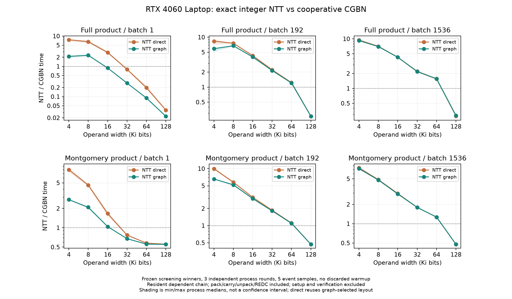
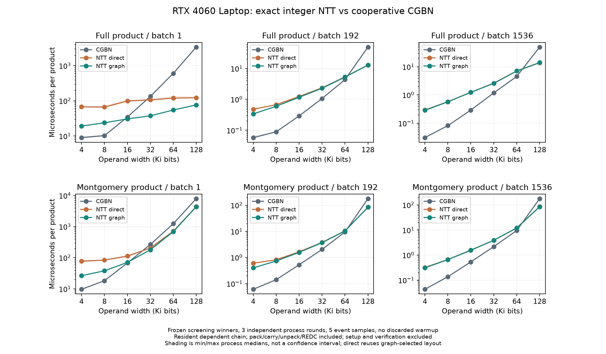

# GPU整数NTT与CGBN乘法的交叉点

**在RTX4060 Laptop、GPU驻留依赖链的本组实测中，单整数完整乘积在16K容器首次由NTT Graph胜出，普通模乘在32K首次胜出；192／1536批量则两类运算都到128K采样点才胜出。** 64K与128K之间没有继续定位精确临界点。这里1K=1024 bits，结论只覆盖采样点和本页实现，不作为普适阈值。

常用4K～16K批量仍由CGBN明显领先，因此**生产Stage1／Stage2点算术默认保持不变**。32K以上是独立探针扩展，不表示生产容器或save支持范围扩大。本页不测试完整ECM曲线，也不把整数乘法结论用于替换Stage2多项式NTT。

数学、精确性和复杂度见[整数NTT交叉条件](../reference/CGBN_SQUARE.md#整数ntt与朴素乘法的交叉条件)，逐行平方的另一项实验见[专用平方性能](CGBN_SQUARE.md#逐行三角形平方与redc扫描)。

## 输入、实现与计时

日期2026-11-02至03；GPU1 RTX4060 Laptop、24SM／8GiB、驱动610.88、CUDA13.3、sm89。没有改动GPU设置，GPU0未参与。正式整数复测及逐行平方性能共有4993条遥测，全部SM时钟1500MHz；利用率≥20%的1000条也均为1500MHz，不据此宣称恒定功耗。各调用前后执行已有进程白名单门禁。

两侧使用相同的确定性输入、完整乘积和反馈状态，分别测：

- **完整乘积**：s-bit输入，完整2s-bit输出，高低半XOR反馈到下一次乘法，避免测成截断乘法。
- **普通模乘**：同一奇模数\(N=2^{s-6}-189\)，原Montgomery radix \(R=2^s\)，返回唯一规范代表。NTT先生成完整乘积，再调用原CGBN REDC；基线为原融合`mont_mul`。

CGBN使用TPB128、MAX_ROTATION1，在各位宽可选的TPI8／16／32中筛选；4K测8／16，8K～32K测16／32，64K／128K测32。最终各格的CGBN优选均为4K用TPI16，其余用TPI32。**这是独立算子的结果，不改变生产点核的TPI策略**；点核还持有其他坐标和临时数。

NTT链接当前生产Goldilocks transform及carry-cone模块。紧凑打包，不使用多项式系数之间的预留间隔；最高有效digit位数由精确性上界选择，进位采用6轮高度缩减及精确二进制链处理。每次乘法重新计算两个forward，pointwise／逆长度缩放合入inverse，然后进位、解包；模乘另接REDC。递推虽然保持第二操作数不变，未使用其频谱缓存，评价的是这一通用安排。

| s bits | digit bits | digit数 | 整数NTT length |
|---:|---:|---:|---:|
| 4096 | 28 | 147 | 512 |
| 8192 | 27 | 304 | 1024 |
| 16384 | 27 | 607 | 2048 |
| 32768 | 26 | 1261 | 4096 |
| 65536 | 26 | 2521 | 8192 |
| 131072 | 25 | 5243 | 16384 |

先筛选CGBN TPI及NTT Graph tile6／9／12（不超过实际log2 length），再冻结每格参数，交错三个独立进程轮次，每进程5个event样本，先取进程中位数、再取三轮中位数。没有预热或丢弃首样本。直接NTT复用Graph所选布局，用于观察提交差异，不称为独立调优后的直接路径。

批量为1／192／1536，分别递推32／8／2次；表中时间是每批每次乘法的摊销值。CGBN整个依赖链在一个kernel中完成，NTT保留多kernel安排；没有为公平而拆散CGBN。Graph捕获整条链并单次提交，构建不执行一次隐藏的计算预热。

事件包括打包、transform、进位、解包及必要的REDC，排除分配、表／Graph构建、初始拷贝、结果回读和GMP。准备成本另存；`graph_seconds`是`setup_seconds`的子集，不能相加。这是驻留算术比较，**不是包含CPU/GPU传输的单次应用调用**。

## 独立复测

小于1表示NTT更快；上排为完整乘积，下排为普通模乘。横轴为容器位宽，两轴均为对数。阴影是三个进程中位数的min/max，不是置信区间；连线不表示中间位宽已经测过。

下表为NTT Graph／CGBN时间比：

| 容器 | 完整乘积 B=1 | B=192 | B=1536 | 普通模乘 B=1 | B=192 | B=1536 |
|---|---:|---:|---:|---:|---:|---:|
| 4K | 2.136 | 5.884 | 9.215 | 2.739 | 6.582 | 7.202 |
| 8K | 2.329 | 6.737 | 6.967 | 2.084 | 5.198 | 4.795 |
| 16K | **0.883** | 4.009 | 4.242 | 1.043 | 2.980 | 2.907 |
| 32K | **0.280** | 2.151 | 2.181 | **0.676** | 1.815 | 1.794 |
| 64K | **0.090** | 1.207 | 1.562 | **0.556** | 1.096 | 1.266 |
| 128K | **0.022** | **0.260** | **0.284** | **0.552** | **0.469** | **0.478** |

单整数16K完整乘积为34.624→30.560 µs，约−11.7%；但16K普通模乘仍慢约4.3%。192／1536批量在16K的完整乘积慢约4.0／4.2倍，不能把单整数延迟收益当成整卡吞吐收益。

代表批量192的绝对时间如下，单位ms／批／次，左为CGBN、右为NTT Graph：

| 容器 | 完整乘积 | 普通模乘 |
|---|---:|---:|
| 8K | 0.017024→0.114688 | 0.027136→0.141056 |
| 16K | 0.055808→0.223744 | 0.100992→0.300928 |
| 32K | 0.203904→0.438528 | 0.391552→0.710528 |
| 64K | 0.835968→1.009152 | 1.814144→1.987200 |
| 128K | 9.483264→2.466688 | 34.410751→16.142719 |

128K／1536批量为完整乘积76.601853→21.727232 ms、普通模乘276.018677→131.817475 ms，约3.53／2.09倍吞吐。128K完整乘积的直接提交为21.284865 ms，略快于Graph；大任务中不应强制假定Graph总能提速。

Graph主要改善短链的提交空隙。例如16K单整数完整乘积，直接NTT尚未胜出，Graph已小幅领先；192／1536批量中两条NTT曲线接近，因为设备工作占比更高。准备成本和其他全部样本保留在汇总，未用最快路径覆盖被测直接路径。

## 为什么交叉点随批量变化

CGBN将单个整数分配给最多32个线程，并可在整个递推期间保留寄存器状态；较大批量提供更多独立线程组。NTT让一个整数使用更多线程，但需要多个变换和全局数组。对常用位宽，Goldilocks域运算、重排和额外kernel工作超过了减少整数部分积带来的收益。

管理员NCU另对**192个整数、一次完整乘积**诊断；缓存／时钟控制均为none，采集时间不进入正常成绩。NTT使用直接提交，分别汇总6个（8K）／9个（128K）互不重叠的运算kernel；表构建、校验及回读不计入。基线各为一个完整CGBN kernel。

| 位宽／实现 | warp执行指令 | local读sectors | local写sectors |
|---|---:|---:|---:|
| 8K CGBN | 985,728 | 0 | 0 |
| 8K NTT | 9,268,992 | 0 | 0 |
| 128K CGBN | 226,482,624 | 269,023,488 | 65,479,680 |
| 128K NTT | 178,100,736 | 0 | 0 |

8K NTT指令约为CGBN的9.4倍，与较大批量回退一致。CGBN到64K的完整乘积／模乘已用255寄存器、每线程local544／1208 bytes；128K为255寄存器、local2144／2600 bytes。128K的大量实际local访问说明，**测得的交叉同时包含CGBN资源边界**，不能只归因于\(s^2\)和\(s\log s\)的渐近比较。

local sector是32-byte局部访存计数，不等于DRAM或PCIe流量；多个访问可能命中缓存。NCU导出的DRAM byte／Kbyte／Mbyte列已按各自SI单位转换后保存，未直接相加不同单位，也未把仪器化时间与event成绩合并。上述数据支持额外指令和local访问的判断，不能精确分摊各因素对墙钟的贡献。

## 工作量、内存及传输

令B为批量、s为容器bits、\(n=s/32\)、c为digit数、L为NTT长度、f为单个forward的pass数：

- CGBN完整乘积主工作为\(\Theta(Bn^2)\)；普通融合模乘还包含朴素REDC。TPI改变线程分配和常数，不把该路径变成Karatsuba。
- NTT每次为两次forward和一次inverse，主工作\(\Theta(BL\log L)\)；另计打包／进位／解包。普通模乘仍接\(\Theta(Bn^2)\)的REDC，总体没有因此成为准线性模乘。
- 缓存表已准备时，每次完整NTT乘积发射\(3f+3\)个kernel，普通模乘再加1个。当前6轮carry-cone不省略最高位和长二进制进位链；其最坏额外扫描边界见固定数学资料。
- 两侧共同显式数组约\(4(5Bn+n)\) bytes；NTT再增加\(24BL\) bytes及不随B重复的表。保护区／诊断另有少量固定空间；CGBN编译器local空间不包含在这个显式分配式中，不能将其当进程峰值。
- 初始化H2D为\((2B+1)s/8\) bytes；每event样本前D2D复位\(Bs/8\)，样本后产品及反馈D2H共\(3Bs/8\)，另有保护区／不可变输入和NTT尾部诊断。CPU预期数据与验算同样排除出event计时。

例如128K／B=1536，显式共同数组约120MiB，NTT附加三个数组576MiB，再加表、保护区和编译器／驱动资源；这些是同时持有的指定数组容量，未宣称其和等于实测进程峰值。准备和Graph成本只有在重复调用中摊销后才适用图中的交叉判断。

## 正确性、代码与证据

完整乘法资格集253次调用，其中220次GMP／反馈／保护区检查通过、33次高半故障注入正确拒绝。另有195次参数筛选和324次独立复测，复测共1620个event样本，每个样本均核对完整输出。512／65536的memcheck和synccheck各覆盖CGBN、直接NTT、Graph及两类运算，共24次0错误；128K通过GMP与保护区检查，未宣称已完成其他GPU或生产曲线资格。

探针为`tools/test/cgbn_ntt_multiply_probe.cu`：`:39`为CGBN依赖链，`:64`紧凑打包，`:85`解包／宽反馈，`:92`原REDC包装，`:182`完整NTT提交。生产模块入口为`src/ecm/cuda/ntt/runtime.cpp:602`的forward、`:657`的inverse及`device/carry.cuh:174`的carry-cone。构建、采集和分析见[工具说明](../../tools/bench/README_CGBN_NTT_MULTIPLY.md)。复用模块通过过期源码、对象和ABI三个拒绝检查，没有绕过旧生产构建的依赖门禁。

原始证据根目录`data/experiments/cgbn_ntt_crossover_20261103/`：`check_matrix`／`screen`／`final`为512～64K资格和4K～64K性能，`wide128`为128K扩展；`sanitizer_*`、`ncu_integer*_v2`为仪器化检查，`bin`冻结exe／DLL／源依赖／对象哈希。所有位宽基于0.57.17源码，实验提交不增加版本；身份以各清单SHA256为准。

汇总和图表在`data/benchmarks/cgbn_ntt_crossover_20261103/`及`data/figures/cgbn_ntt_crossover_20261103/`。公开附件只保留审核后的图；原始实验和失败准备目录由Git忽略，未删除。

## TODO

- 若目标仍为4K～16K的多曲线吞吐，优先优化CGBN／梅森点算术和点公式融合，不直接用本整数NTT替换点核中的每次模乘。
- 若继续整数NTT，研究短长度单kernel融合、可复用操作数频谱和低成本进位／解包；需要降低总指令及数组往返，再独立复测交叉点。
- 对需要精确临界值的设备，补测NTT长度跳变两侧，而不是在当前稀疏采样间作光滑插值。
- 若考虑生产接入，补完整点公式／曲线、准备成本摊销、显存预算和其他GPU资格；普通REDC的二次成本须单独优化。
