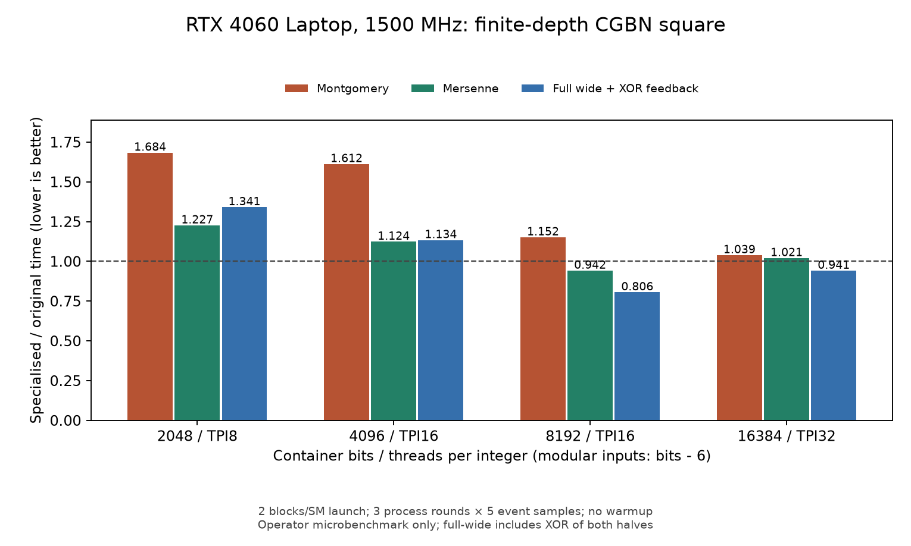

# CGBN专用平方的4060 Laptop验证

0.57.16提供共享的有限深度分块平方，并由独立CUDA探针验证；**Stage1和Stage2生产调用仍使用原算术路径**。普通Montgomery模平方未达到替换条件。完整宽平方的局部收益不能直接转换为Stage1收益，梅森归约也必须单独比较。

数学、部分积公式、CGBN原实现及padding边界见[专用平方资料](../reference/CGBN_SQUARE.md)。开发中尝试的其他组织和保留证据见[开发草稿](../development/CGBN_SQUARE_DRAFT.md)。

## 实现与适用边界

共享入口为`src/ecm/cuda/arithmetic/cgbn/square.cuh`的`square_wide_split<Depth>`和`mont_square_split<Depth>`。两个半宽平方在互不重叠的半线程组执行，交叉乘积使用完整线程组，随后精确合并进位；不修改第三方CGBN。

展开要求无CGBN padding、每线程limb数为偶数、TPI≥8。否则直接回退原CGBN运算。请求深度2时，TPI8实际只能展开1层，TPI16／32展开2层。子环境继承原TPB、MAX_ROTATION、SHM_LIMIT和CONSTANT_TIME参数。

该原语不增加全局／共享工作缓冲，但会增加寄存器存活量；“没有额外工作缓冲”不等于资源占用相同。宽平方支持输入与输出低半别名，模平方支持原地覆盖；Montgomery包装保留原R、原REDC及唯一规范代表\([0,N)\)。

Stage1 Montgomery和Edwards的平方入口分别为`src/ecm/stage1/montgomery/cuda/arithmetic.cuh:358`和`src/ecm/stage1/edwards/cuda/point.cuh:33`。Stage2协作点字段位于`src/ecm/stage2/cuda/device/point_coop_field.cuh:45`；其梅森折叠在`:19`。这些生产入口尚未调用新原语，也没有新增INI／TOML选项。

## 实验口径

测量日期2026-11-02，基于0.57.15源码；具体二进制、对象及依赖哈希保存在每组`bin/manifest.json`和`summary.json`，不以主程序版本代替探针身份。设备为GPU1 RTX4060 Laptop、24SM／8GiB，驱动610.88、CUDA13.3／sm89，TPB128、MAX_ROTATION1。12组正式性能汇总共有3355条遥测，SM时钟均为1500MHz；功耗不是恒定值，也未通过这些短事件估计算术内核的平均功耗。GPU0未参与；未改动显卡功耗／时钟。

普通模数为确定性随机奇数，实际位数为容器位宽减6；梅森模数为\(2^{b-6}-1\)。宽平方使用完整b位输入。模平方都计算同一Montgomery表示下的递推。宽平方在两次平方之间把高／低半XOR后反馈，确保每一步完整乘积都参与后续结果；该线性XOR成本也包含在两侧计时中。

每组采用同一二进制内切换实现，三个独立进程轮次交错顺序，每进程保留5个CUDA event样本，先取进程中位数、再取三轮中位数。不使用预热轮次，首个样本也保留。事件仅包围设备递推，排除分配、主机GMP、传输、进程和上下文初始化。它不是完整Stage1／Stage2时间。

测量三种批量：1个整数的依赖延迟、发射2 block/SM的原生批量、4096个整数的吞吐。原生批量为TPI8／16／32对应768／384／192个整数，每整数递推32次；单整数递推128次，4096批量递推4次。发射数量不代表实际驻留。

## 完整结果与解释

图中小于1表示专用平方更快。普通模平方以原融合CGBN `mont_sqr`为基准；梅森模平方以原Stage2协作梅森平方为基准；宽平方以完整CGBN宽平方为基准。三组基准不同，不能把各柱的绝对高度当成三类算子的绝对速度比较。

下表为原生批量、每整数32次递推的批次中位毫秒；括号是专用实现相对原实现的时间变化，负值才是收益。

| 容器bits／TPI | 普通模平方：原→分块 | 梅森模平方：原→分块 | 完整宽平方＋XOR：原→分块 |
|---|---:|---:|---:|
| 2048／8 | 0.278400→0.468800（+68.4%） | 0.340864→0.418144（+22.7%） | 0.225472→0.302368（+34.1%） |
| 4096／16 | 0.477824→0.770336（+61.2%） | 0.503328→0.565632（+12.4%） | 0.428832→0.486432（+13.4%） |
| 8192／16 | 1.664736→1.916960（+15.2%） | 1.286144→1.211456（−5.8%） | 1.315168→1.059840（−19.4%） |
| 16384／32 | 3.265728→3.394112（+3.9%） | 1.846368→1.885024（+2.1%） | 1.867456→1.758208（−5.8%） |

1个整数及4096整数的各轮中位数也保留在正式汇总，未用最快批量覆盖其他批量。8192的宽平方收益没有完整保留到梅森模平方；16384宽平方稍快但梅森模平方稍慢。因此既不能使用“位宽越大越有利”的阈值，也不能仅按宽平方结果替换归约后的算子。

8192-bit/TPI16的普通模平方由管理员Nsight Compute 2026.2.1补充诊断：384个整数、递推4次，原融合／分块加独立REDC分别为221.280／258.208 µs，执行warp指令约8.561／12.372百万，寄存器94／150，local和shared均为0。部分积减少后，总指令仍增加约44.5%，与独立计时的回退一致。NCU采集不与正常事件成绩合并，不凭occupancy数值单独解释原因。

这支持优先研究**乘积与REDC的联合组织、跨线程数据交换和中间值存活期**。当前实现只替换宽乘积再接独立REDC，不能继承原融合实现的性能。专用宽平方适合继续作为梅森等轻归约路径的候选，但仍须完整点核和整曲线验证。

## 正确性和复现

探针`tools/test/cgbn_square_probe.cu`对完整输出逐词比较GMP，同时检查输入／模数未改变以及前后canary。覆盖0、1、N−1、全1、交替位、跨limb边界和随机输入；比较一次及多次递推、原地／非原地、整组和尾组。

容器边界包含1792/TPI8、8320/TPI16及9216/TPI32：分别覆盖奇数limb数、padding和Stage1实际8192-bit输入可能进入的9216容器。它们验证的是回退正确性，不作为展开方案的性能收益。

资格集包含626次通过的GMP／保护区检查和38次被正确拒绝的故障注入，共664次调用。故障注入包括最终输出翻bit，以及宽平方第一步高半独立翻bit后继续递推；必须以算术不一致退出。旧的低半反馈宽平方结果保留原字节，但不用于完整宽平方成绩。模平方每次归约都使用两半，不受该基准问题影响。

Compute Sanitizer对8192-bit分块宽平方的memcheck／synccheck、同档分块Montgomery平方及8320-bit padding回退的memcheck均报告0错误，证据为`sanitizer02/`。这些检查的仪器化耗时不参加性能表。

显式命名管道下的memcheck／synccheck也报告0错误，证据为`sanitizer_namedpipes_mem/`及`sanitizer_namedpipes_sync/`。

构建入口为`tools/build/test/build_cgbn_square_probe.ps1`，采集为`tools/bench/bench_cgbn_square.py`，汇总和绘图为`tools/bench/analyze_cgbn_square.py`。构建参数Bits／Tpi决定容器和线程组；Modes可缩短编译。主要模式为0原融合、1通用宽平方＋REDC、3原宽平方、7分块深度2＋REDC、8分块宽平方、13／14原／分块梅森平方。5／6用于深度1；2／4和9…12仅为开发草稿中对照实验。

采集器支持`--suite sanitizer`、显式`--sanitizer`路径和`--sanitizer-tool memcheck|synccheck`。Windows仅给工具及被测子进程设置`NV_COMPUTE_SANITIZER_LOCAL_CONNECTION_OVERRIDE=named-pipes`，使用本地命名管道；不添加防火墙规则、不设置系统环境变量。NVIDIA工具的本地TCP通信可能触发被测exe的防火墙提示，不能将该提示等同于算术程序自身需要网络；工具支持的传输见[NVIDIA环境变量说明](https://docs.nvidia.com/compute-sanitizer/ComputeSanitizer/index.html#environment-variables)。

证据根目录为`data/experiments/cgbn_square_20261102/`；正式汇总为`data/benchmarks/cgbn_square_20261102/summary.json`，图表原件在`data/figures/cgbn_square_20261102/`。`final_*`保留有效模平方成绩，`raw_*`为高低半反馈修正后的宽平方成绩，`boundary_check*`为边界回退检查，`ncu8192/`为管理员诊断。原始目录由Git忽略，不能用正文代替其分发。

## 待验证

- 针对普通模平方融合对称部分积与REDC，在同样的规范返回值和R下重新比较，不能只减少理论MAC。
- 对宽平方有收益的形状，验证完整xDBL／ladder、寄存器限制、Stage1短时s/curve及Stage2固定D整曲线；未通过前不加入默认或运行时tune。
- 扩大TPI／位宽邻域及其他设备覆盖；检查不同模数余量、梅森位数和padded适配器R修正，不按单一位宽阈值自动启用。
