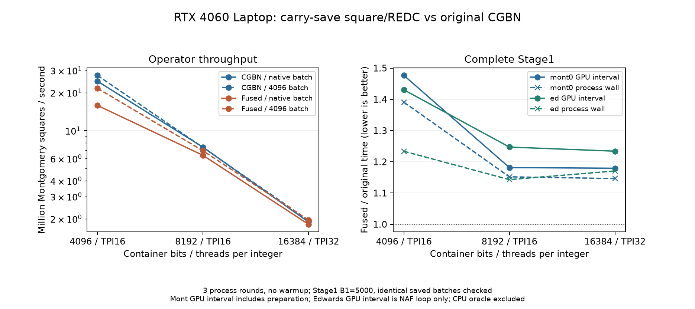
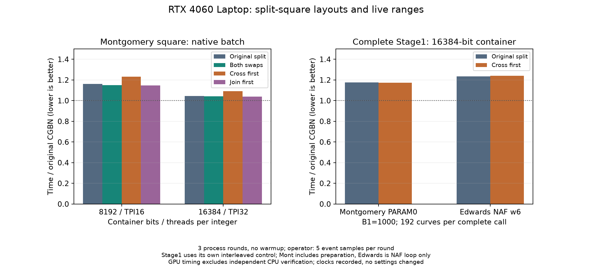

# CGBN专用平方的4060 Laptop验证

共享的有限深度分块平方及其REDC装配融合变体均已验证；**Stage1和Stage2默认仍使用原算术路径**。普通Montgomery模平方及完整Stage1的融合实验未达到替换条件。完整宽平方的局部收益不能直接转换为Stage1收益，梅森归约也必须单独比较。

数学、部分积公式、CGBN原实现及padding边界见[专用平方资料](../reference/CGBN_SQUARE.md)。开发中尝试的其他组织和保留证据见[开发草稿](../development/CGBN_SQUARE_DRAFT.md)。

## 实现与适用边界

共享入口为`src/ecm/cuda/arithmetic/cgbn/square.cuh`的`square_wide_split<Depth>`和`mont_square_split<Depth>`。两个半宽平方在互不重叠的半线程组执行，交叉乘积使用完整线程组，随后精确合并进位；不修改第三方CGBN。

展开要求无CGBN padding、每线程limb数为偶数、TPI≥8。否则直接回退原CGBN运算。请求深度2时，TPI8实际只能展开1层，TPI16／32展开2层。子环境继承原TPB、MAX_ROTATION、SHM_LIMIT和CONSTANT_TIME参数。

该原语不增加全局／共享工作缓冲，但会增加寄存器存活量；“没有额外工作缓冲”不等于资源占用相同。宽平方支持输入与输出低半别名，模平方支持原地覆盖；Montgomery包装保留原R、原REDC及唯一规范代表\([0,N)\)。

Stage1 Montgomery和Edwards的平方入口分别为`src/ecm/stage1/montgomery/cuda/arithmetic.cuh`的`mont_sqr_normalized`和`src/ecm/stage1/edwards/cuda/point.cuh`的`sqr`。它们通过`src/ecm/cuda/arithmetic/cgbn/stage1_square.cuh`选择构建时实现，并在原位置规范化一次。Stage2协作点字段位于`src/ecm/stage2/cuda/device/point_coop_field.cuh:45`；其梅森折叠在`:19`，没有接入新的普通REDC实验。

Stage1的CMake实验项`ECM_CGBN_SQUARE_BACKEND=0|1`默认0：0调用原CGBN，1调用低半carry-save／高半预合并的融合变体。候选构建另用`ECM_CGBN_SQUARE_LAYOUT=0..3`选择分块数据布局，默认0，含义见下文。通过本机构建脚本Extra传入，生成独立构建身份；默认分支不包含候选模板或运行时选择。它们不是INI／TOML或运行时tune键，不改曲线、R、save或checkpoint格式。WMAD私有安排仅用于支持的编译后端；非WMAD、padding、奇数limb等情况回退原CGBN。其他设备尚未资格验证。

## 实验口径

测量日期2026-11-02，基于0.57.15源码；具体二进制、对象及依赖哈希保存在每组`bin/manifest.json`和`summary.json`，不以主程序版本代替探针身份。设备为GPU1 RTX4060 Laptop、24SM／8GiB，驱动610.88、CUDA13.3／sm89，TPB128、MAX_ROTATION1。12组正式性能汇总共有3355条遥测，SM时钟均为1500MHz；功耗不是恒定值，也未通过这些短事件估计算术内核的平均功耗。GPU0未参与；未改动显卡功耗／时钟。

普通模数为确定性随机奇数，实际位数为容器位宽减6；梅森模数为\(2^{b-6}-1\)。宽平方使用完整b位输入。模平方都计算同一Montgomery表示下的递推。宽平方在两次平方之间把高／低半XOR后反馈，确保每一步完整乘积都参与后续结果；该线性XOR成本也包含在两侧计时中。

每组采用同一二进制内切换实现，三个独立进程轮次交错顺序，每进程保留5个CUDA event样本，先取进程中位数、再取三轮中位数。不使用预热轮次，首个样本也保留。事件仅包围设备递推，排除分配、主机GMP、传输、进程和上下文初始化。它不是完整Stage1／Stage2时间。

测量三种批量：1个整数的依赖延迟、发射2 block/SM的原生批量、4096个整数的吞吐。原生批量为TPI8／16／32对应768／384／192个整数，每整数递推32次；单整数递推128次，4096批量递推4次。发射数量不代表实际驻留。

## 完整结果与解释

图中小于1表示专用平方更快。普通模平方以原融合CGBN `mont_sqr`为基准；梅森模平方以原Stage2协作梅森平方为基准；宽平方以完整CGBN宽平方为基准。三组基准不同，不能把各柱的绝对高度当成三类算子的绝对速度比较。

下表为原生批量、每整数32次递推的批次中位毫秒；括号是专用实现相对原实现的时间变化，负值才是收益。

| 容器bits／TPI | 普通模平方：原→分块 | 梅森模平方：原→分块 | 完整宽平方＋XOR：原→分块 |
|---|---:|---:|---:|
| 2048／8 | 0.278400→0.468800（+68.4%） | 0.340864→0.418144（+22.7%） | 0.225472→0.302368（+34.1%） |
| 4096／16 | 0.477824→0.770336（+61.2%） | 0.503328→0.565632（+12.4%） | 0.428832→0.486432（+13.4%） |
| 8192／16 | 1.664736→1.916960（+15.2%） | 1.286144→1.211456（−5.8%） | 1.315168→1.059840（−19.4%） |
| 16384／32 | 3.265728→3.394112（+3.9%） | 1.846368→1.885024（+2.1%） | 1.867456→1.758208（−5.8%） |

1个整数及4096整数的各轮中位数也保留在正式汇总，未用最快批量覆盖其他批量。8192的宽平方收益没有完整保留到梅森模平方；16384宽平方稍快但梅森模平方稍慢。因此既不能使用“位宽越大越有利”的阈值，也不能仅按宽平方结果替换归约后的算子。

8192-bit/TPI16的普通模平方由管理员Nsight Compute 2026.2.1补充诊断：384个整数、递推4次，原融合／分块加独立REDC分别为221.280／258.208 µs，执行warp指令约8.561／12.372百万，寄存器94／150，local和shared均为0。部分积减少后，总指令仍增加约44.5%，与独立计时的回退一致。NCU采集不与正常事件成绩合并，不凭occupancy数值单独解释原因。

这支持研究**乘积与REDC的联合组织、跨线程数据交换和中间值存活期**。这里的模式7只替换宽乘积再接独立REDC，不能继承原融合实现的性能。专用宽平方适合继续作为梅森等轻归约路径的候选，但仍须完整点核和整曲线验证。

## 正确性和复现

探针`tools/test/cgbn_square_probe.cu`对完整输出逐词比较GMP，同时检查输入／模数未改变以及前后canary。覆盖0、1、N−1、全1、交替位、跨limb边界和随机输入；比较一次及多次递推、原地／非原地、整组和尾组。

容器边界包含1792/TPI8、8320/TPI16及9216/TPI32：分别覆盖奇数limb数、padding和Stage1实际8192-bit输入可能进入的9216容器。它们验证的是回退正确性，不作为展开方案的性能收益。

本节分块宽平方／模平方资格集包含626次通过的GMP／保护区检查和38次被正确拒绝的故障注入，共664次调用。故障注入包括最终输出翻bit，以及宽平方第一步高半独立翻bit后继续递推；必须以算术不一致退出。旧的低半反馈宽平方结果保留原字节，但不用于完整宽平方成绩。模平方每次归约都使用两半，不受该基准问题影响。

Compute Sanitizer对8192-bit分块宽平方的memcheck／synccheck、同档分块Montgomery平方及8320-bit padding回退的memcheck均报告0错误，证据为`sanitizer02/`。这些检查的仪器化耗时不参加性能表。

显式命名管道下的memcheck／synccheck也报告0错误，证据为`sanitizer_namedpipes_mem/`及`sanitizer_namedpipes_sync/`。

构建入口为`tools/build/test/build_cgbn_square_probe.ps1`，采集为`tools/bench/bench_cgbn_square.py`，汇总和绘图为`tools/bench/analyze_cgbn_square.py`。构建参数Bits／Tpi决定容器和线程组；Modes可缩短编译。主要模式为0原融合、1通用宽平方＋REDC、3原宽平方、7分块深度2＋REDC、8分块宽平方、13／14原／分块梅森平方。5／6用于深度1；2／4和9…12仅为开发草稿中对照实验。

采集器支持`--suite sanitizer`、显式`--sanitizer`路径和`--sanitizer-tool memcheck|synccheck`。Windows仅给工具及被测子进程设置`NV_COMPUTE_SANITIZER_LOCAL_CONNECTION_OVERRIDE=named-pipes`，使用本地命名管道；不添加防火墙规则、不设置系统环境变量。NVIDIA工具的本地TCP通信可能触发被测exe的防火墙提示，不能将该提示等同于算术程序自身需要网络；工具支持的传输见[NVIDIA环境变量说明](https://docs.nvidia.com/compute-sanitizer/ComputeSanitizer/index.html#environment-variables)。

证据根目录为`data/experiments/cgbn_square_20261102/`；正式汇总为`data/benchmarks/cgbn_square_20261102/summary.json`，图表原件在`data/figures/cgbn_square_20261102/`。`final_*`保留有效模平方成绩，`raw_*`为高低半反馈修正后的宽平方成绩，`boundary_check*`为边界回退检查，`ncu8192/`为管理员诊断。原始目录由Git忽略，不能用正文代替其分发。

## 平方装配与REDC融合的完整Stage1资格

`src/ecm/cuda/arithmetic/cgbn/square_redc.cuh`保留两个对角平方和交叉项，让低半交叉项直接进入REDC的unaligned累加器。模式15分别注入两个高半流，模式16先合并高半；Stage1实验项1使用模式16的安排。它省去完整低半平方的装配进位，但没有将全部乘积生成改成CIOS逐行交错。原理及下一种逐行扫描的数学条件见[固定资料](../reference/CGBN_SQUARE.md#进位保留表示与redc装配融合)。

### 工况、计时与输入

2026-11-02，GPU1 RTX4060 Laptop、24SM、8GiB，驱动610.88、CUDA13.3、sm89；未更改显卡设置。正式算子和Stage1合计记录2827条遥测，其中GPU利用率≥20%的1426条均为1500MHz；全记录另有25条210MHz空闲样本。GPU1使用已有进程白名单门禁，GPU0外部任务未操作，不宣称整个平台隔离。编译、CPU独立验算和管理员NCU均不进入正常性能样本。

算子使用同二进制切换0原CGBN／7分块＋独立REDC／16融合，三进程轮次、每进程5个event样本，无预热，按两层中位数汇总。输入为容器减6 bits的确定性随机奇模数；统计1个整数、原生2 block/SM批量及4096整数批量。

完整Stage1读取已有矩阵的精确余因子：M4001→3600 bits、M8011→7995 bits、M16319→16272 bits，对应4096／8192／16384容器，TPI16／16／32；每批384／384／192条曲线，TPB128、48 blocks。构建仅包含三档以控制编译时间，这三个输入的容器与当前完整实例表匹配。B1=5000，sigma从20260922连续生成，Montgomery PARAM0使用ladder，Edwards使用w6 NAF、doubling4。每格原／融合分别编译，交错3轮，没有在同一个点核内加入运行时分支，避免共用较差的寄存器分配。

下列Stage1二进制启动标识为0.57.16，包含本页的候选源码；交付源码版本0.57.17。其身份以冻结SHA256和源码／对象清单为准：

| 构建 | exe SHA256 |
|---|---|
| 默认CGBN | `39f40e027630cbe707837ed56f3eb856e1413f149e1d5298ef09595ab9a9841f` |
| 装配融合 | `9c05bd2149f6be36767a894003f55d01bace1b8aa39f52fc62a380b15e7af867` |

### 吞吐与完整曲线结果

吞吐单位为百万次规范Montgomery平方／秒，包含对应算法的归约与校正，不含GMP／拷贝。原生批量每整数递推32次，4096批量递推4次。不同位宽的原生批量不同，不能用单批次数替代整数平方吞吐。

| 容器／TPI | 原生批量：原→融合，M次/s | 4096批量：原→融合，M次/s | 原生批量耗时变化 |
|---|---:|---:|---:|
| 4096／16 | 24.604→15.815 | 27.336→21.627 | +55.6% |
| 8192／16 | 7.390→6.367 | 7.346→6.917 | +16.1% |
| 16384／32 | 1.889→1.809 | 1.946→1.952 | +4.4% |

16384／4096批量的约0.3%局部差异不作为收益资格。模式7→16的原生批次中位毫秒分别为4096的0.768288→0.776960、8192的1.946080→1.929856、16384的3.382272→3.395456；只减少装配开销没有补上与原CGBN的差距。

完整Stage1每次都完成B1并输出save，未使用进度投影。GPU列的Montgomery采用原生`gputime`，包含准备及事件区间内的主机间隙；Edwards采用`loop_gpu_ms`，排除字典／准备。两模型GPU列不相加；整进程墙钟列都包括初始化、GPU、GCD和存档，排除事后的独立验算。数值均为3次中位数、秒／批：

| N bits／模型 | GPU区间：原→融合 | GPU变化 | 进程墙钟：原→融合 |
|---|---:|---:|---:|
| 3600／Mont0 | 1.150060→1.698080 | +47.7% | 1.474182→2.050010 |
| 3600／Edwards | 0.933124→1.334709 | +43.0% | 1.666393→2.055857 |
| 7995／Mont0 | 3.848410→4.547180 | +18.2% | 4.577396→5.272740 |
| 7995／Edwards | 3.240578→4.041654 | +24.7% | 5.343940→6.108192 |
| 16272／Mont0 | 7.204780→8.497690 | +17.9% | 8.114674→9.302564 |
| 16272／Edwards | 6.086722→7.511615 | +23.4% | 8.669558→10.149962 |

摊销GPU秒／曲线为GPU区间除以批量曲线数，不是单曲线串行延迟。例如7995-bit的Mont0为0.010022→0.011842 s/curve，Edwards为0.008439→0.010525 s/curve；完整数值保留在汇总JSON。

这些是B1=5000的小界限实测，不是生产B1=10e6…260e6的完成时间或外推。六格均回退，不设自动位宽阈值，不加入运行时tune或生产默认。

### 额外成本的证据

8192-bit独立算子NCU中，0／7／16分别执行约8.561／12.396／12.423百万warp指令，寄存器94／150／168，没有local／shared。装配融合的总指令仍比原CGBN高约45%，峰值也没有下降；减少数学部分积没有直接减少最终执行工作。

完整点核的寄存器／栈帧为下表，格式为原→融合、每线程。栈帧是静态资源，不等同于实际local访问量或DRAM流量：

| 容器 | Mont0寄存器／栈帧bytes | Edwards NAF寄存器／栈帧bytes |
|---|---|---|
| 4096 | 123／48→128／216 | 148／32→167／32 |
| 8192 | 209／48→255／168 | 255／48→255／144 |
| 16384 | 205／48→255／152 | 255／48→255／160 |

管理员NCU另测7995-bit、8192容器、384条Mont0曲线、B1=100的首个算术launch：原／融合warp指令为3,034,038,257／3,742,837,144（约+23.4%），local读扇区12,288／9,655,296，local写扇区5,376／2,235,912。两侧save整批相同。这里的32-byte扇区是local访问计数，不能直接当作DRAM或PCIe传输量；该采集时间不参加B1=5000表。

计数支持额外指令、寄存器压力和局部访存共同抵消收益，尚不能把整条曲线的回退比例精确分摊给每一项。优先目标应是乘积生产阶段的线程重排／存活期和真正的逐行乘积－REDC联合扫描，而非继续给装配融合增加运行时选项。

### 正确性与证据位置

当前融合资格集为224次通过的GMP／canary调用和10次正确拒绝的故障注入，覆盖512／TPI8的最小偶数limb、4096、8192、16384及1792奇数limb／8320 padding回退。8192融合的memcheck和synccheck均0错误，工具显式使用命名管道。完整Stage1为36次调用、11,520条save记录，每个输入／模型的全部记录在两实现与各轮之间相同；六组各独立验算首尾，共12个CPU参考点。重复样本不是额外的ECM覆盖。

新证据根目录为`data/experiments/cgbn_square_redc_20261102/`：`check*_v3`、`perf*_v3`、`stage1_matrix01`、`ncu8192_v3`、`ncu_stage1_8192`及`sanitizer_*_v3`分别保留算术、吞吐、真实Stage1、算子／点核诊断与检查。初始失败构建、模式15的回退及CLI预检样本保留，不混入正式统计。Stage1的bin包含manifest、CMakeCache、compile_commands及sources.zip。

汇总与图表原件分别在`data/benchmarks/cgbn_square_redc_20261102/`、`data/figures/cgbn_square_redc_20261102/`。复用入口为`tools/bench/bench_stage1_square.py`和`tools/bench/analyze_cgbn_square_redc.py`，前者接收两份独立构建和精确输入计划，后者从完整结果重算；同一构建不手工重标身份。数学递推的960次整数抽样在`cios_math.json`，不计作未实现CUDA扫描方案的资格。

## 分块布局与存活期验证

布局参数只改变数据交换和运算顺序，保留深度、部分积、REDC、R及输出规范化。`square.cuh`的`square_cross_inputs`、`square_join_diagonal`和`square_split_parts`为共同入口；`square_redc.cuh`接收相同布局参数。

| 构建layout／探针mode | 安排 |
|---|---|
| 0／16 | 原gather、先两个子平方，再交叉乘法 |
| 1／17 | 对角块转置：每位置4次shuffle改为1次 |
| 2／18 | 再加入交叉输入转置：每位置4次shuffle改为3次 |
| 3／19 | 布局2基础上先计算交叉乘积，改变临时值存活期 |
| 仅探针／23 | 子平方合并完成后才捕获交叉输入；只允许与输入分离的局部对角缓冲 |

模式23在`tools/experiments/cuda/cgbn_square/join_first.cuh`隔离，不是合法的Stage1构建布局，也不能用于通用原地宽平方。完整宽平方模式20／21分别对应布局3／2；梅森模式22对应布局3，本组只验证其正确性，没有新的梅森性能资格。

### 算子、指令与真实Stage1

测量日期2026-11-02，GPU1 RTX4060 Laptop、驱动610.88、CUDA13.3／sm89，TPB128、MAX_ROTATION1；没有调整任何GPU设置，GPU0未参与。六组算子与两组Stage1共记录3636条遥测，3615条为1500MHz、21条为空闲210MHz；利用率≥20%的489条均为1500MHz。不据此宣称恒定功耗。正式算子均为三进程轮次、每进程5个event样本，先后两层中位数、无预热；同一算子表内切换同一二进制。

下表采用`joinfirst_perf*`原生批量，每整数32次递推，单位ms。完整的1整数依赖延迟、4096批量、布局1及宽平方结果保留在汇总，不用最快批量覆盖其他批量。

| 容器／TPI／整数数 | 原CGBN | 布局0 | 布局2 | 布局3 | 无别名先合并 |
|---|---:|---:|---:|---:|---:|
| 8192／16／384 | 1.666272 | 1.935552 | 1.918048 | 2.053472 | 1.911008 |
| 16384／32／192 | 3.254880 | 3.400256 | 3.388960 | 3.557344 | 3.386688 |

先合并相对布局0缩短约1.27%／0.40%，仍比原CGBN慢14.7%／4.0%；不足以作为生产启用依据。16384、4096批量的布局0／2／先合并为8.393120／8.399872／8.404000 ms，原CGBN8.397632 ms，没有稳定收益。完整宽平方的独立对照中，16384原生批量布局0→2为1.745280→1.734752 ms（约−0.60%），布局3为1.829952 ms；不能把这类小差异推广到模平方。

管理员NCU单独诊断8192／384整数／4次递推，时钟和cache控制均关闭，结果不进入上述正常计时：

| mode | 0原CGBN | 16布局0 | 18布局2 | 19布局3 |
|---|---:|---:|---:|---:|
| warp执行指令数 | 8,561,430 | 12,422,532 | 12,265,860 | 13,966,224 |
| 每线程寄存器 | 94 | 168 | 162 | 154 |

布局2只降低约1.26%的融合指令；布局3虽然寄存器更少，却比布局0多约12.4%的执行指令。因此不能按shuffle或寄存器的单项下降推断总时间改善。

完整Stage1采用M16319的精确16272-bit余因子、16384容器／TPI32／TPB128、192条曲线、B1=1000、sigma从20260922连续生成。Montgomery PARAM0使用ladder；Edwards为w6 NAF／doubling4。布局0／3各与原CGBN交错三轮，共24次完成调用，均完整输出save。计时定义同上节：Mont GPU含准备，Ed GPU仅NAF循环；CPU独立验算排除。

| 模型 | 布局0：原→候选GPU秒／批 | 布局3：原→候选GPU秒／批 | 各自相对原CGBN |
|---|---:|---:|---:|
| Mont0 | 1.460500→1.717070 | 1.456420→1.710720 | +17.57%／+17.46% |
| Edwards | 1.220442→1.505958 | 1.220725→1.515213 | +23.39%／+24.12% |

按各自基线归一后，布局3相对布局0的Mont差约−0.09%、Ed约+0.59%，不认定收益。真实16384点核的寄存器／栈帧bytes为Mont原205／48、布局0为255／152、布局3为255／176；Ed原255／48、布局0为255／160、布局3为255／152。减少独立算子寄存器没有解除点核的255寄存器压力，栈帧也没有一致下降；这里的栈帧不是实际local流量。

原／布局0复用上一资格集冻结二进制，SHA256分别为`39f40e02…9841f`／`9c05bd21…af867`，启动标识0.57.16；布局3为0.57.17、SHA256 `3b8d7cce91700ff4c6b902ea959a152a705d133ad3031a9845373e2cad3be188`。采集器用显式sources.zip逐项核对旧构建依赖，继续验证exe与对象哈希，没有把旧构建重标为当前源码。布局3只构建16384一档，原／布局0包含4096、8192、16384；实际执行的容器和几何一致，但模块包大小不同，**不能将整进程启动墙钟差异归因为算术收益**。本组B1=1000与上节B1=5000也不混合统计。

### 资格、证据与结论

布局资格集为482次GMP／不可变输入／canary通过和36次正确拒绝的故障注入；包括完整宽数高半反馈、原地／非原地、尾组、512／TPI8最小偶数limb，以及8064／TPI16的纯padding回退。8064每线程16limb仍为偶数，单独隔离padding条件。宽平方入口用编译期约束拒绝无别名实验布局，补测模式23在512／TPI8的最小容器。CPU另核对5208个交换映射位置，不计为CUDA资格。模式18／19／23在8192的memcheck和synccheck共6次全部0错误，子进程显式使用命名管道。

24次Stage1的4608条save记录全部配对一致；两组矩阵各验算首尾，合计8次CPU参考比较、4个唯一点，不当作新增ECM覆盖。结论是：保留当前原CGBN默认，布局实验不接INI或运行时tune；单纯改变此处分块生产顺序尚不足以补上普通模平方及点核差距。

证据根目录为`data/experiments/cgbn_square_layout_20261102/`，`check*`／`joinfirst_check*`为算术资格、`perf*`／`raw*`／`joinfirst_perf*`为算子、`stage1_layout0`／`stage1_layout3`为真实Stage1、`ncu8192`及`sanitizer_*`为仪器化检查；静态资源在`stage1_resources.json`及对应cuobjdump原文。工具`tools/bench/analyze_cgbn_square_layout.py`从这些证据生成`data/benchmarks/cgbn_square_layout_20261102/`和`data/figures/cgbn_square_layout_20261102/`。实验提交不增加主版本；构建身份仍按冻结清单区分。

## 待验证

- 针对普通模平方实现真正的逐行对称部分积／REDC扫描；先解决三角形工作在lane之间的分配与进位，再做同R的GMP和端到端资格。
- 分块重排／顺序变体已无合格端到端收益。若继续该方向，需先提出可减少总执行工作或实际溢出的新映射，再以原CGBN和完整Stage1验收，不增加只有指标下降的运行时选项。
- 对梅森轻归约中的宽平方收益，继续验证完整xDBL／ladder及Stage2固定D整曲线；不能把普通REDC实验或独立宽平方成绩替代这些资格。
- 扩大TPI／位宽邻域及其他设备覆盖；检查不同模数余量、梅森位数和padded适配器R修正，不按单一位宽阈值自动启用。
