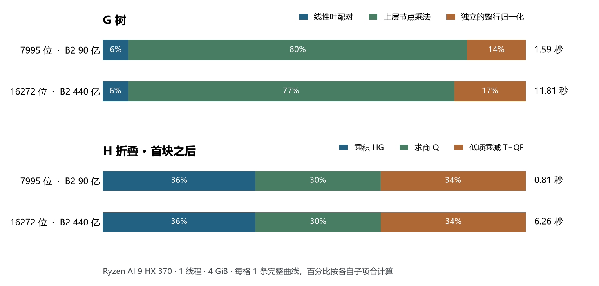
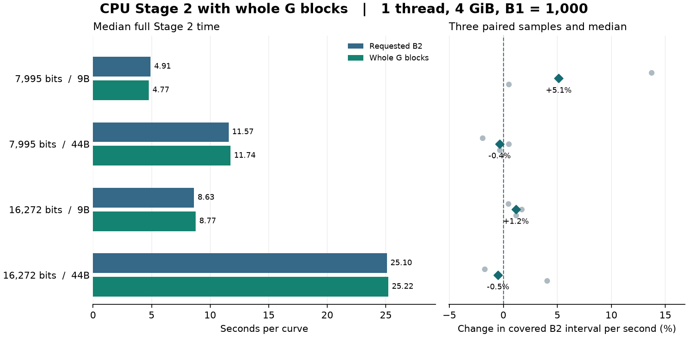
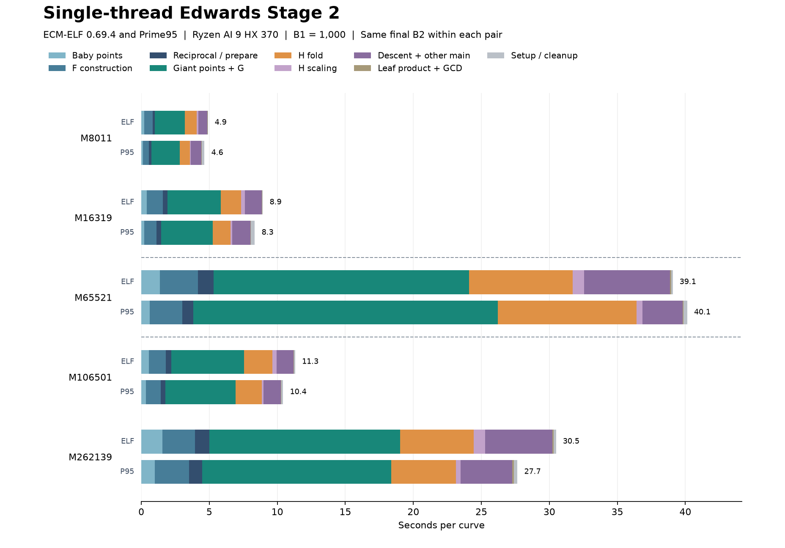
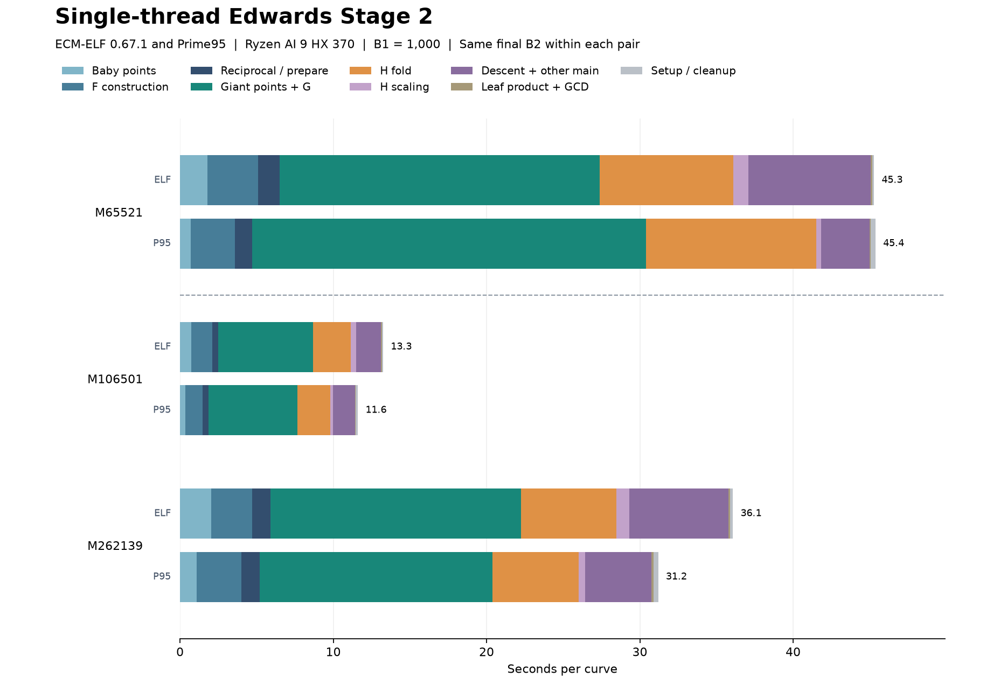
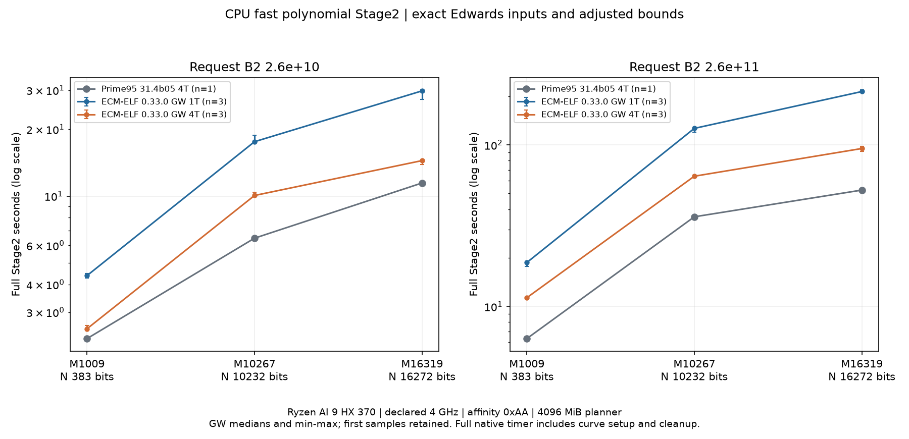
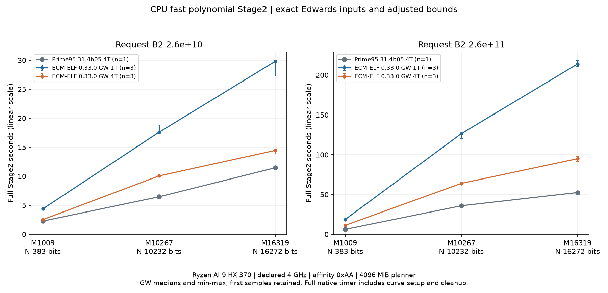

# CPU GW 多项式 Stage2 性能

## 0.69.6 G 树与 H 折叠



原算法的两条分层诊断曲线中，G 树上层节点乘法占 G 树子项合计的 77%–80%，单独的整行归一化占 14%–17%，叶配对约占 6%。上层节点时间包含 polymult 内部执行的系数变换。H 的三项耗时接近。7995 位、90 亿在首块之后共折叠三次，HG、求商、低项乘减分别为 0.292、0.238、0.278 秒。16272 位、440 亿共折叠九次，三项分别为 2.259、1.858、2.147 秒。图上的百分比只按各组子项计，排除首块 G−F 和外层开销。分层诊断 DLL 指纹为 `dd13fb8b8408a21d`。每条诊断曲线单独运行一次，以下 A/B 计时关闭这些子项探针。

同一份 Edwards σ=26、B1=1000 存档在每格使用相同的实际 B2、D/P、系数 FFT 和 G 块数。主矩阵是 Ryzen AI 9 HX 370 的单个物理核（逻辑 CPU 1），GWNUM 31.6，系数 FFT 和 polymult 均使用 AVX-512。每个进程的规划预算和 Windows Job 提交量硬限均为 4096 MiB。各候选使用同一份 0.69.5 CPU 主程序，只替换相邻 DLL，基线 DLL 指纹为 `b6552c5605c8dd0f`。关闭 tune 和附加 GMP 校验后，从曲线重构计时到引擎清理。每项按正反次序各测一次，以同轮候选相对基线的时间变化取中位数，负值表示缩短。计时期间避让编译，未锁频，未采集功耗或温度。[逐条阶段、配对与二进制 SHA-256](../../data/benchmarks/stage2-cpu-0696-hotspots.json) · [冻结程序、输入命令和日志](../../data/experiments/cpu_stage2_quartets/)

| 实际位数 | 请求 B2 | 实际 B2 | D/P | FFT | 满块数 | G 四根一组，G 树变化 | 仅预变换 F，H 折叠变化 | H 循环卷积，H 折叠变化 |
|---:|---:|---:|---|---:|---:|---:|---:|---:|
| 7995 | 90 亿 | 9,189,104,924 | 150150/14400 | 512 | 4 | −4.4% | −5.6% | −2.1% |
| 7995 | 440 亿 | 44,475,466,034 | 330330/31680 | 512 | 4 | −1.8% | −6.4% | −1.8% |
| 16272 | 90 亿 | 9,189,104,924 | 150150/14400 | 896 | 4 | +1.6% | −2.1% | +1.9% |
| 16272 | 440 亿 | 45,026,876,894 | 210210/20160 | 896 | 10 | −1.0% | +4.9% | −0.4% |

单独测试带符号叶系数时，DLL 指纹为 `9537afde58298f7b`，正式 0.69.6 DLL 为 `3b916bc25e058b00`。带符号的 G 叶系数在 giant 归一化时生成。每对根直接做一次系数乘法和一次加法。原 16k 位、440 亿的整曲线有 245741 次 polymult 调用，这条路径省去 100800 次一阶多项式相乘。替代它们的系数乘法仍计入 G 树时间。下表是这一项单独与基线的两轮配对。八对 G 树耗时全部降低，四格的进程提交量中位数变化均小于 1 MiB。四舍五入前计算百分比。

| 实际位数 | 请求 B2 | G 树中位秒，原 → 新 | G 树配对变化 | 整曲线中位秒，原 → 新 | 整曲线配对变化 |
|---:|---:|---:|---:|---:|---:|
| 7995 | 90 亿 | 1.631 → 1.548 | −5.0% | 4.830 → 4.650 | −3.7% |
| 7995 | 440 亿 | 4.173 → 3.911 | −6.0% | 12.128 → 11.567 | −4.3% |
| 16272 | 90 亿 | 2.918 → 2.830 | −3.0% | 8.734 → 8.746 | +0.1% |
| 16272 | 440 亿 | 11.178 → 10.615 | −5.0% | 25.087 → 24.241 | −3.4% |

把多层 G 节点合并限制在 256 KiB 的连续小片内，四格的 G 树配对时间分别降低 7.0%、3.1%、7.6%、3.0%。90 亿两格的整曲线分别缩短 4.1%、3.5%，440 亿两格分别多用 0.3%、0.4%。这次分片对照使用原始叶算法；其收益能否与带符号叶叠加仍待验证。

单独预变换 F 在四格分别增加 124、265、214、286 MiB 峰值提交量，包含准备工作的整曲线配对变化为 −3.8%、−0.5%、+0.3%、+5.8%。H 循环卷积使用原有工作区，16k 位、440 亿的折叠中位数由 5.961 秒降至 5.938 秒，两对整曲线分别快 1.8% 和慢 1.4%。四根一组与两种 H 候选还分别做了组合测试，该格整曲线配对变化为 +1.6% 和 +1.8%。这些结果不足以启用 F 缓存或改变 H 的正式折叠算法。[算法与验证方法](../development/CPU_STAGE2_PLAN_SELECTION.md#0696-的-g-树和-h-折叠实验)

### 正式 DLL 的线程与内存对照

正式 0.69.6 与 0.69.5 各测两条完整曲线，第二轮反序，两个版本均按相同实际边界凑整。4T 绑定逻辑 CPU 1、3、5、7。表中秒数为中位数，峰值取该版本在同一格两条曲线中较大的进程提交量。1 GiB 的 16272 位与 4 GiB 的 262139 位均使用分段 F 树，分别保留顶部五次和四次分裂。

| 位数 | 请求 B2 | 实际 B2 | 线程 / MiB | D/P | G 树秒，原 → 新 | 整曲线秒，原 → 新 | 整曲线配对变化 | 峰值 MiB，原 / 新 |
|---:|---:|---:|---:|---|---:|---:|---:|---:|
| 7995 | 9,000,000,000 | 9,189,104,924 | 1 / 4096 | 150150/14400 | 1.633 → 1.554 | 4.809 → 4.694 | -2.4% | 1105 / 1105 |
| 16272 | 44,000,000,000 | 45,026,876,894 | 4 / 4096 | 210210/20160 | 4.241 → 4.060 | 11.618 → 11.324 | -2.5% | 2737 / 2736 |
| 16272 | 44,000,000,000 | 44,108,003,939 | 1 / 1024 | 120120/11520 | 17.133 → 16.721 | 35.720 → 35.269 | -1.3% | 890 / 889 |
| 262139 | 120,000,000 | 172,987,814 | 1 / 4096 | 30030/2880 | 3.915 → 3.764 | 18.107 → 17.800 | -1.7% | 3399 / 3399 |

另取 16272 位、90 亿、4T / 4 GiB，在相同实际 B2=9,189,104,924 和 D/P=150150/14400 下比较两种链接方式。正式 DLL 与静态 gwpoly 的三个 GMP 叶投影均通过核对，FFT 长度均为 896，最大舍入误差同为 0.17540381。关闭额外校验后各做两次反序计时，DLL 中位 3.661 秒，静态 3.690 秒。262139 位的带 GMP 运行使用 15360 点 FFT，两个满块共 5760 个 giant 点，最大舍入误差为 0.06844。同机另编译屏蔽 AVX-512 的资格 DLL，复测 7995 位、90 亿、1T。系数 FFT 报告 FMA3、长度 512，polymult 也报告 FMA3，三个 GMP 叶投影均通过，最大舍入误差为 0.00390625。该次用于验证指令分派。

复测单格可用下文的 `bench_cpu_stage2_blocks.py`。指定 `--baseline` 为 0.69.5 程序，`--exe` 为 0.69.6 程序，固定 `--d`，并将 `--b2` 设为表内实际 B2。该界限已经填满末块，两个版本覆盖相同的点；选择 `--exponents 16319 --d 210210 --b2 45026876894 --cpus 1 --memory-mib 4096` 可复测最后一格。归档的主矩阵仍使用 90 亿和 440 亿的原请求，两个版本均显式开启凑整。

## 0.69.5 整块 B2 的覆盖量和耗时



Ryzen AI 9 HX 370，Windows x64、GWNUM 31.6，Edwards σ=26、B1=1000。两档输入分别为 M8011 / 80111（7995 位）、M16319 / 270811405193137（16272 位）。同一格的各次运行读取同一份 Stage1 存档。图与主表使用单线程、4 GiB，固定逻辑 CPU 1；2T 和 4T 分别固定 1/3、1/3/5/7。准入预算和 Windows Job 单进程提交量硬限使用同一数值，峰值按进程提交量统计。CPU 避让编译，未锁频或测量温度、功耗。主表和线程／预算对照均关闭额外校验和 tune 采样，使用自动 D 和空剖面。系数 FFT 与外层 polymult 均报告 AVX-512，0.69.4／0.69.5 的 DLL 指纹分别为 cda7116f91262c05、b6552c5605c8dd0f。计时从曲线重构至引擎清理，排除启动进程、读档和发布。

主表每格先用凑整版运行一次带 GMP 叶投影的完整曲线，再轮换 0.69.4、0.69.5 原 B2 和 0.69.5 凑整三种运行，正式计时各三次。秒数为中位数。单位时间覆盖量取 (实际 B2−B1)/秒；同一轮先除以精确请求版的覆盖量，再跨轮取中位数。该指标衡量数值区间，因子命中概率随因子大小和曲线群阶变化。[逐次计时与阶段明细](../../data/benchmarks/stage2-cpu-0695-blocks.json) · [原始日志、构建和哈希](../../data/experiments/cpu_stage2_roundblocks/) · [同请求的 Prime95 工作行](../../tools/benchmarks/prime95/worktodo_ecm2_cpu_stage2_round_b1000.txt)

| 余因子位数 | 请求 B2 | 凑整后实际 B2 | D/P，块数 | 0.69.4 秒 | 0.69.5 原 B2 秒 | 0.69.5 凑整秒 | 凑整后每秒覆盖量变化 |
|---:|---:|---:|---|---:|---:|---:|---:|
| 7995 | 9,000,000,000 | 9,189,104,924 | 150150/14400，4 块 | 4.758 | 4.915 | 4.774 | +5.12% |
| 7995 | 44,000,000,000 | 44,475,466,034 | 330330/31680，4 块 | 11.700 | 11.571 | 11.738 | -0.35% |
| 16272 | 9,000,000,000 | 9,189,104,924 | 150150/14400，4 块 | 8.786 | 8.626 | 8.767 | +1.16% |
| 16272 | 44,000,000,000 | 45,026,876,894 | 210210/20160，10 块 | 28.218 | 25.097 | 25.217 | -0.49% |

两档 90 亿的 giant 点数均为 56415 → 57600。440 亿下，7995 位为 125366 → 126720，16272 位为 197002 → 201600。四格的 G 块数均与原请求相同。

同为 16272 位、请求 B2=440 亿，改变线程数或预算后重新自动选 D。1T／4 GiB 沿用主表三对样本，其余每格两对、次序反转。峰值取同一格计时样本中最大的单进程提交量。

| 线程 | 预算 | D/P，块数 | 凑整后实际 B2 | 原 B2 → 凑整（秒） | 提交峰值（MiB，原 B2／凑整） | 每秒覆盖量变化 |
|---:|---:|---|---:|---:|---:|---:|
| 1 | 4096 MiB | 210210/20160，10 块 | 45,026,876,894 | 25.097 → 25.217 | 2734／2734 | -0.49% |
| 2 | 4096 MiB | 210210/20160，10 块 | 45,026,876,894 | 14.332 → 16.032 | 2735／2735 | -8.46% |
| 4 | 4096 MiB | 210210/20160，10 块 | 45,026,876,894 | 11.586 → 11.618 | 2737／2737 | +2.07% |
| 1 | 1024 MiB | 120120/11520，30 块 | 44,108,003,939 | 35.575 → 35.905 | 889／889 | -0.67% |

两档 90 亿的三对样本均提高了单位时间覆盖量。7995 位样本的增幅从 0.49% 到 13.70%，而同 FFT 的前期独立实验中位数接近零。两档 440 亿的配对结果均跨过零。复测这组固定边界基线时须显式关闭凑整。16272 位、440 亿的精确请求从 0.69.4 的 1024 点 FFT 降到新版的 896 点，两版配对耗时降低 9.86%；同一新版内开关凑整均为 896 点。新版该格的 G 建树与 H 折叠阶段中位耗时之和占整曲线中位耗时的 68.2%，其余三格约 50%–54%。

降至 1 GiB 后，完整 F 树改为保留顶部五次分裂的分段树。凑整只能多覆盖 0.25%，两对样本的每秒覆盖量均略降。4 GiB 的 2T 两对分别下降 6.20%、10.71%，4T 分别变化 +4.42%、−0.27%。同一 1T／4 GiB 条件下另测 262139 位、原 B2=1.2 亿的明显短尾，两块从 3996 点补至 5760 点，一对样本中每秒覆盖量提高 18.73%。单曲线本身仍多用 3.33 秒。[H 缩放、FFT 选型的隔离对照和 262k 位验证](../development/CPU_STAGE2_PLAN_SELECTION.md#0695-整块边界h-缩放和-fft-选型)。

复测可复用已有文件 m8011.save、m16319.save。首次准备时，给 Edwards Stage1 的标准输入分别传入 (2^8011−1)/80111 和 (2^16319−1)/270811405193137，使用 sigma=26、1 条曲线、B1=B2=1000，在同一目录保存这两个文件。下例指定该目录与所用物理核的逻辑线程。默认运行这四个组合，先检查每档的一条完整曲线，再进行无校验的交替计时。可用 `--baseline` 加入旧版，`--exponents`、`--b2`、`--cpus` 和 `--memory-mib` 改变矩阵。输出目录须为新目录。

```powershell
python tools/bench/bench_cpu_stage2_blocks.py --exe build_stage2_local/ecm_stage2.exe --saves data/experiments/cpu_stage2_frows/inputs --cpus 1 --memory-mib 4096 --output data/experiments/stage2-blocks-repeat
```

## 0.69.4 的 8k 至 262k 位 CPU 配对



| 实际位数（梅森指数） | 实际 B2 | D/P，块数（ECM-ELF ／ Prime95） | 0.69.3 秒 | 0.69.4 秒 | Prime95 秒 | 新版比旧版少用时¹ | 新版／Prime95¹ | 新版快于 Prime95 |
|---|---:|---|---:|---:|---:|---:|---:|---:|
| 7995（8011） | 9,189,029,850 | 两者 150150/14400，4 | 5.002 | 4.896 | 4.646 | 2.3% | 1.055 | 0/5 |
| 16272（16319） | 9,189,029,850 | 两者 150150/14400，4 | 9.136 | 8.934 | 8.346 | 2.4% | 1.068 | 0/5 |
| 65482（65521） | 8,270,171,910 | 120120/11520，6 ／ 90090/8640，10 | 39.831 | 39.073 | 40.138 | 2.4% | 0.990 | 3/3 |
| 106478（106501） | 459,428,970 | 两者 30030/2880，5 | 11.581 | 11.316 | 10.430 | 2.3% | 1.084 | 0/3 |
| 262139（262139） | 459,428,970 | 两者 30030/2880，5 | 31.445 | 30.496 | 27.655 | 3.0% | 1.107 | 0/3 |

¹ 秒数取各程序的整曲线中位数。改善率和相对 Prime95 的耗时比先在同一轮相除，再跨轮取中位数。0.69.4 在全部 19 组单线程配对中都快于 0.69.3。

| 实际位数 | 4T 旧版中位秒 | 4T 新版中位秒 | 4T 逐对少用时 | 新版快于旧版 | 4T 峰值提交量（旧 → 新，MiB） |
|---|---:|---:|---:|---:|---:|
| 7995 | 2.321 | 2.198 | 3.8% | 3/3 | 1223 → 1107 |
| 16272 | 3.927 | 3.746 | 3.6% | 3/3 | 2106 → 1904 |

7995 位和 16272 位使用相同的四个满 G 块、57600 个 giant 点，系数 FFT 长度分别为 512 和 896。完整 F 树的峰值提交量分别从 1221 降到 1105 MiB、从 2103 降到 1902 MiB。两档的 baby 阶段中位数分别从 0.260 降至 0.209 秒、从 0.504 降至 0.389 秒。两档相对 Prime95 的代表样本差距中，初次 F 建树分别多用 0.177、0.307 秒，H 折叠分别多用 0.109、0.211 秒；这两个位宽的分段重建耗时均为零。

设备为 Ryzen AI 9 HX 370、Windows x64。ECM-ELF 使用 0.69.3 DLL `4cf63ab30cb1971c` 和 0.69.4 DLL `cda7116f91262c05`，两版均为 GWNUM 31.6，系数 FFT 和 polymult 在五档都实际使用 AVX-512。两版从同一 Edwards σ=26、B1=1000 存档运行到 Prime95 日志中的实际 B2；计时包括重构、初始化、主循环、GCD 和清理，排除读档、发布和附加校验。Prime95 31.6 build 1 以相同余因子和曲线起算，取 Stage2 初始化、主循环和 GCD 三项之和。每根堆积柱取该程序按总耗时排序后居中的一条完整曲线；下降与其余主循环按墙钟差额计算。各阶段均互不重叠。

1T 固定逻辑 CPU 1，预热后轮换两个版本和 Prime95 的执行顺序。7995、16272 位各五组三方配对，另三档各三组。1T 使用自动选 D，关闭 tune 采样并使用空剖面。两档 4T 固定相同的 D/P，绑定逻辑 CPU 1、3、5、7，正反顺序交替，各三对。每个 ECM-ELF 进程的规划预算和 Windows Job 提交量硬限均为 4096 MiB；Prime95 的 `Memory=4096` 为配置预算。采集避让编译，未锁频或测量有效频率、温度和功耗。[Prime95 工作行](../../tools/benchmarks/prime95/worktodo_ecm2_cpu_stage2_b1000.txt) · [原始记录及复算脚本](../../data/experiments/cpu_stage2_frows/) · [配对明细与二进制哈希](../../data/benchmarks/stage2-cpu-0694-pairs.json)

65482 位采用分段 F 树。ECM-ELF 选择六个 G 块，Prime95 选择十个。图中 giant 点加 G 树、H 折叠两项，ECM-ELF 分别省 3.65、2.56 秒，末端下降及其余主循环多用 3.36 秒。262139 位两边同为五块；ECM-ELF 的下降阶段中位数从 5.529 降至 4.919 秒，其中重建用去 1.749 秒。与 Prime95 的代表样本相比，余下差距主要在下降及其余主循环（1.16 秒）、H 折叠（0.68 秒）、baby 点（0.57 秒）和 H 缩放（0.48 秒）。两档分段树的进程峰值提交量在新旧版本间基本相同。隔层保留的固定 D 实验及阶段内计时见 [F 树与 baby 差分链实验](../development/CPU_STAGE2_PLAN_SELECTION.md#0694-的-f-树与-baby-差分链)。

五档的 Prime95 输入见工作行文件。复测时在独立目录设置 `AllowLowB1=1`、`MontgSigma=0`、`MontgStage1=0`、`PolyVerbose=1`、`CoresPerWorker=1`。例如 7995 位的 Stage1 标准输入为 `(2^8011-1)/80111`，ECM-ELF 续算参数为 `--exponent 8011 --known-factor 80111 --b2 9189029850 --memory-mib 4096`；16272 位分别换为指数 16319 和已知因子 270811405193137。单线程用 `--threads 1 --d 0`，四线程用 `--threads 4 --d 150150`。[构建和读档用法](../usage/EDWARDS_CPU_STAGE2.md)

## 0.67.1 单线程与 Prime95 配对



| 梅森指数／实际 B2 | ECM-ELF D/P、块数 | Prime95 D/P、块数 | ECM-ELF 中位秒 | Prime95 中位秒 | 逐对耗时比中位数¹ | ECM-ELF 较快 |
|---|---|---|---:|---:|---:|---:|
| 65521／8,270,171,910 | 120120/11520，6 | 90090/8640，10 | 45.277 | 45.372 | 1.016 | 2/5 |
| 106501／459,428,970 | 30030/2880，5 | 30030/2880，5 | 13.253 | 11.605 | 1.118 | 0/5 |
| 262139／459,428,970 | 30030/2880，5 | 30030/2880，5 | 36.072 | 31.200 | 1.143 | 0/5 |

¹ 每对取 ECM-ELF 秒数除以 Prime95 秒数，再取五对中位数。图中每条堆积柱来自该程序整曲线用时居中的一次运行，分项保留同一条曲线的计时边界。“下降及其余主循环”从主循环墙钟扣除 G、折叠、缩放和叶积，避免重复计入 Prime95 的切片外推值。M65521 的差异小于样本波动。该点 ECM-ELF 的 G 和折叠合计约节省 7.22 秒，末端下降及其余主循环多用约 4.83 秒。在 M262139 的 4.87 秒中位耗时差中，下降及其余主循环多 2.12 秒，giant 加 G 树多 1.13 秒，baby 点多 0.95 秒。后续应在相同 D 下比较按行保存 F、降低重建次数与 baby 点的生成成本。[逐对耗时和阶段明细](../../data/benchmarks/stage2-cpu-0671-pairs.json)

Ryzen AI 9 HX 370，Windows x64，两边均使用一个线程，绑定逻辑 CPU 1。Edwards σ=26、B1=1000，M65521 和 M106501 分别剥离已知因子 790298445919、15975151，M262139 取完整梅森数。Prime95 31.6 build 1 从本地工作行运行，配置内存 4096 MB，取日志中的初始化、主循环和 Stage2 GCD 之和。ECM-ELF 0.67.1 通过本地 DLL `0fd8728d57b1b33e`（GWNUM 31.6）从对应存档续算到 Prime95 的实际 B2，使用自动 D、无已学习样本的只读 tune。计时含重构至清理，排除读档、预检与发布。内部预算和 Windows Job 单进程提交量上限均为 4096 MiB，三档最大实测提交量依次为 3402、2526、3399 MiB。Prime95 的 4096 MB 为配置预算。各档先预热一对，再交替先后顺序跑五对完整 NF；采集期间避让编译，未锁频，未采样有效频率、温度或功耗。[工作行](../../tools/benchmarks/prime95/worktodo_ecm2_stage2_wide_b1000.txt) · [原始日志及采集脚本](../../data/experiments/cpu_stage2_four_steps/) · [四项改动的隔离实验及 4 GiB 核验](../development/CPU_STAGE2_PLAN_SELECTION.md#0671-四项改动的隔离测量)

本页记录本地 DLL 与静态 `gwpoly` 的配对测试，以及 0.33.0 的 Prime95 对照。它从 Edwards Stage1 文本 save 直接继续，使用 GWNUM/polymult 的多线程快速多项式算术。使用与构建见 [CPU Stage2](../usage/EDWARDS_CPU_STAGE2.md)，数学见 [多项式 Stage2](../reference/ECM_STAGE2_MATH.md)，保留的开发证据见 [草稿](../development/CPU_GW_POLY_STAGE2_DRAFT.md)。共享底层算术库不等于具有 Prime95 的全部功能或相同性能。

0.66.1 在 Ryzen AI 9 HX 370 上的单线程、四线程实测覆盖 13 个 Edwards 余因子，与两张 GPU 及 Prime95 的逐点结果见 [Stage2 全位宽图表](STAGE2.md#edwards-全位宽对照)。B1 小于 D/2 时的小素数检查优化、新旧 DLL 配对与其余候选见 [CPU/CUDA 小规模对照](STAGE2.md#0661-cpu-与-cuda-小规模对照)。

宽位 CPU 规划新增 D=10920、43890 两个候选，仍按 FFT 安全余量和内存预算复核。4 GiB、固定四个物理核心的 M58631 独立样本，自动 D 从 34650 改为 43890，整曲线 46.958 → 37.717 秒，进程峰值工作集 2435 → 2952 MiB。[选型实验、二进制身份与适用范围](../development/CPU_STAGE2_PLAN_SELECTION.md)

## Giant 点、G 树和 H 折叠

M262139 在 0.66.8、D/P=13860/1440、B2=1.2 亿时生成 8658 个 giant 点，构造 7 个 G 块。1T 诊断中，播种、递推和批归一化分别为 0.058、2.513、1.843 秒。GWNUM 计数分别为 4229、138525、103833 次系数 FFT。主循环的 G 树与 H 折叠另耗 5.412、5.037 秒。播种只占 giant 阶段约 1%，递推和归一化才是这组几何的主要成本。[基线诊断](../../data/experiments/stage2_cpu_hotspots/262139_120000000_13860_1_profile_10/run.log)

- **Giant 点。** 差分链直接写最终坐标槽，后继点复用已经变换的坐标。梅森承载在 AVX-512/FMA3 上用融合乘减计算差分加法。归一化在前向遍历时用前缀分母积乘入分子，逆向遍历使用对应的逆积完成 `X/Z`。每个线程只用一个 GW 数保存当前前缀或逆积，原始分母留给非单位检测。该方法同时用于 baby 点的归一化。[CPU 点算术](../../src/ecm/stage2/cpu/gwpoly.cpp#L317)
- **G 树。** 归一化后的横坐标已在 G 系数区中，叶对用隐含首项 `−1` 的短乘生成首一二次因子，各层原地合并。旧代码的 G 建树在该诊断中记录 183407 次系数 FFT。均匀分组将根乘法从 1024×416 改成 720×720，G 树两对中位数 5.266 → 5.491 秒。强制所有层批归一化的一对为 5.172 → 5.277 秒，两项均保留在实验数据中。[叶对与逐层合并](../../src/ecm/stage2/cpu/gwpoly.cpp#L430) · [孤立对照](../../data/experiments/stage2_cpu_hotspots/summary.json)
- **H 折叠。** 首个满块直接计算低 P 项 `G−F`。之后用 G 工作区和 H 分别存储 `HG` 的低段和高段，商覆盖高段，低半乘减再覆盖 H。输入长度为 1 的尾块可直接将高段当作商。独立一对实验的折叠为 4.983 → 3.580 秒，进程峰值工作集 2041 → 1875 MiB。[CPU 折叠](../../src/ecm/stage2/cpu/gwpoly.cpp#L234) · [Prime95 的分段原地折叠](../../.refactor/p95v3106b01.source/ecm.cpp#L9458)

对同一条 1.2 亿的诊断输入，新的递推和归一化 FFT 分别为 103841 和 60578 次，近似从每点 16、12 次降到 12、7 次。两段耗时为 1.747、0.979 秒。归一化沿用整张前缀表的候选也做了 60578 次 FFT，用时 1.333 秒。单槽方案同时减少前缀数组的读写。G 建树 FFT 为 181784 次。H 折叠做了 69188 次 FFT，比基线的 66321 次多，折叠时间从 5.037 降至 3.566 秒。FFT 计数无法表示外层多项式 FFT、活跃系数数组和访存的总成本。每个诊断构建各跑了一条曲线，整曲线性能另用无探针构建测量。[新诊断日志](../../data/experiments/stage2_cpu_hotspots/262139_120000000_13860_1_finalprobe_40/run.log) · [保留前缀表的候选](../../data/experiments/stage2_cpu_hotspots/262139_120000000_13860_1_fullprofile_30/run.log)

正式配对使用 Ryzen AI 9 HX 370、GWNUM 31.6、4096 MiB 规划预算和之前的 Edwards save，B1=1000、sigma=26。1T 绑定逻辑 CPU 1，4T 绑定 1/3/5/7，采集期间避让编译。两侧固定相同 D/P、FFT、B2、giant 数及块数，分别使用 0.66.8 DLL `0e7b52c2995e0baf` 和 0.66.9 DLL `8465a59a47a965c9`。功耗和有效频率未采集。表内时间取各侧中位数，工作集取各侧进程峰值的最大值。整曲线包含重构、初始化、求因子与清理，排除读档和发布。[逐次数据](../../data/experiments/stage2_cpu_hotspots/summary.json) · [构建哈希](../../data/experiments/stage2_cpu_hotspots/sha256.json)

| 指数、线程、配对数 | B2 | D/P | Giant（秒） | G 树（秒） | H 折叠（秒） | 整曲线（秒） | 进程峰值工作集（MiB） |
|---|---:|---|---:|---:|---:|---:|---:|
| M262139，1T，2 对 | 459428970 | 13860/1440 | 16.956 → 10.593 | 19.944 → 20.090 | 20.105 → 14.545 | 64.215 → 52.420 | 2041 → 1757 |
| M65521，1T，1 对 | 2000000000 | 43890/4320 | 5.098 → 3.113 | 8.632 → 8.373 | 7.243 → 5.593 | 26.603 → 22.604 | 2822 → 2439 |
| M225287，4T，1 对 | 450000000 | 16170/1680 | 4.918 → 3.300 | 6.769 → 6.756 | 5.530 → 3.450 | 22.040 → 17.530 | 1989 → 1716 |

0.66.9 正式构建通过 37 项回归。复合环多项式自检复用生产折叠入口，并核对首满块、后续满块、短块和单根块的完整 GMP 投影。另在 M262139、D=13860、B2=2000 万、4T 上，用独立整数 Montgomery 梯形校验首个满块与 3 根尾块的 19 个坐标，同时校验整条曲线的三处 GMP 投影。[回归记录](../../data/experiments/stage2_cpu_hotspots/regression/summary.json) · [坐标校验脚本](../../data/experiments/stage2_cpu_hotspots/giant/xcheck.py)

M262139 另按 Prime95 的 D/P=30030/2880 和实际 B2=459428970 各测一条完整 NF。1T 绑定逻辑 CPU 1。Windows Job Object 强制执行 4096 MiB 单进程提交量上限，内部规划器参数设为 9200 MiB 以允许该几何。两版均用 AVX-512、FFT 长度 15360，处理 15299 点及 6 块。进程提交量与工作集是两种内存指标。[0.66.8 硬上限记录](../../data/experiments/stage2_cpu_hotspots/cap_30030_baseline_1/cap.json) · [0.66.9 硬上限记录](../../data/experiments/stage2_cpu_hotspots/cap_30030_v0669_1/cap.json)

| 指标 | 0.66.8 | 0.66.9 |
|---|---:|---:|
| Giant 点（秒） | 7.764 | 4.717 |
| G 树（秒） | 10.473 | 10.265 |
| H 折叠（秒） | 8.486 | 6.303 |
| 整曲线（秒） | 42.611 | 37.045 |
| 峰值提交量（MiB） | 4072 | 3545 |
| 峰值工作集（MiB） | 4069 | 3543 |

在相同几何下，0.66.9 的 giant 点加 G 树为 14.982 秒，比历史 Prime95 的 13.668 秒多 1.314 秒。H 折叠多 1.334 秒。整曲线仍相差 9.397 秒，F 初始化、H 缩放和分段下降值得继续分解。两边分别构造 6 块和 5 块，不能从秒数推导相同点集的纯内核差异。0.66.9 在相同系统硬上限下另跑一条开启三点 GMP 投影的全长曲线，三点均通过，峰值提交量为 3546 MiB。该轮 0.66.9 的生产准入使用固定八段估值。[Prime95 阶段表](STAGE2.md#宽位单线程阶段耗时) · [全长 GMP 校验](../../data/experiments/stage2_cpu_hotspots/cap_30030_v0669_1_check/run.log)

## 原地合并 G 树

0.66.8 的 CPU G 树在一个 P+1 槽缓冲区内逐层合并。首一多项式乘法允许输出覆盖输入，各并发任务只写自己节点的区间；奇数尾无需搬运。构建分段 F 树的子树根时也直接转移系数存储。下表比较 0.66.7 DLL `f55b0736116fd2e3` 与 0.66.8 DLL `0e7b52c2995e0baf`。两边固定相同 D/P、FFT、树策略和请求 B2，各两条完整 NF，按 AB/BA 执行。耗时取各侧中位数，工作集取各侧最大进程峰值。[Prime95 原地节点乘法](../../.refactor/p95v3106b01.source/ecm.cpp#L9396) · [逐次用时与峰值](../../data/experiments/stage2_cpu_inplace/ab_summary.json)

| 指数、线程 | B2 | D/P | 整曲线（秒），原 → 新 | 建树（秒），原 → 新 | 峰值工作集（MiB），原 → 新 |
|---|---:|---|---:|---:|---:|
| M65521，1T | 20 亿 | 43890/4320 | 27.598 → 26.685 | 12.000 → 10.942 | 2949 → 2822 |
| M225287，4T | 4.5 亿 | 16170/1680 | 22.361 → 21.266 | 9.141 → 7.725 | 2153 → 1989 |
| M262139，1T | 1.2 亿 | 13860/1440 | 22.718 → 22.681 | 8.254 → 7.599 | 2210 → 2041 |

本机为 Ryzen AI 9 HX 370，GWNUM 31.6，Windows x64。使用宽位矩阵的 Edwards save，B1=1000、sigma=26、4096 MiB，1T 固定逻辑 CPU 1，4T 限于 1/3/5/7，采集避让编译，频率与功耗未采样。整曲线计时包含重构、规划、算术、GCD 和清理。M262139 的两对整曲线一快一慢，中位数接近持平。发布配置通过 37 项回归，包含 1T/4T 的奇数尾、批归一化、已知因子和中断；M262139、D=13860、B2=400 万另以 1T/4T 各验证三处独立 GMP 投影。[发布配置回归](../../data/experiments/stage2_cpu_inplace/regression/summary.json) · [全宽阶段对照](STAGE2.md#宽位单线程阶段耗时)

## 宽位 G 树与固定操作数

Ryzen AI 9 HX 370，GWNUM 31.6，外层 polymult 和系数 FFT 均使用 AVX-512。复用宽位矩阵的 Edwards save 和已知因子，B1=1000、sigma=26、预算 4096 MiB。1T 绑定逻辑 CPU 5，4T 绑定 1/3/5/7，同一时间只跑一条曲线，轮询避让编译。功耗、有效时钟及温度未采样。整曲线秒数取引擎从曲线重构到算术检查及清理的墙钟，排除读档、进程启动和发布。建树与折叠均已计入整曲线。[输入矩阵](STAGE2.md#cpu-宽位分区矩阵)

**0.66.7 紧凑 G 树。** 归一化后，G 的每个节点都是首一多项式。度为 d 的节点只需存低 d 项，所以 n 个真实根在任一中间层都只占 n 个槽。先将叶子两两相乘，层间轮换缓冲区，输出树根时写入最高项 1。两个满块缓冲区从各 2P 个 GW 数降为各 P+1 个。下表比较 0.66.6 基线与正式 DLL `f55b0736116fd2e3` 或候选 DLL `47619578c32b6a68`。每对独立运行，轮换先后，自动 D、FFT、F 树策略和 giant 范围在每对内相同。耗时取各侧中位数，工作集取各侧最大的进程峰值。[逐次配对](../../data/experiments/stage2_cpu_tree_fold/paired_summary.json) · [存档与二进制 SHA-256](../../data/experiments/stage2_cpu_tree_fold/sha256.json)

| 输入、新版、对数 | B2 | D/P · G 块数 | 整曲线（秒），原 → 新 | 建树（秒），原 → 新 | 进程峰值（MiB），原 → 新 |
|---|---:|---|---:|---:|---:|
| M262139，1T 正式，2 对 | 4.5 亿 | 13860/1440 · 23 | 76.511 → 75.260 | 29.937 → 27.122 | 2466 → 2210 |
| M65521，1T 正式，3 对 | 20 亿 | 43890/4320 · 11 | 32.401 → 30.607 | 14.440 → 13.234 | 3148 → 2949 |
| M262139，1T 候选，2 对 | 4.5 亿 | 13860/1440 · 23 | 74.884 → 71.423 | 28.888 → 26.448 | 2466 → 2210 |
| M65521，1T 候选，2 对 | 20 亿 | 43890/4320 · 11 | 32.212 → 31.560 | 14.339 → 13.184 | 3148 → 2949 |
| M225287，4T 候选，2 对 | 4.5 亿 | 16170/1680 · 17 | 23.092 → 22.691 | 10.005 → 8.852 | 2403 → 2153 |

M65521 正式版三对分别快 6.23%、3.64%、6.24%。M262139 的候选两对均快约 4–5%，正式版第一对慢 2.57%，反向顺序第二对快 5.71%。正式版两对的建树和进程峰值都下降，折叠中位数从 22.476 增到 23.489 秒，整曲线加速幅度仍待更多样本确认。M262139 的历史 Prime95 单线程用时 27.648 秒，实际 B2=459428970、D/P=30030/2880，日志报告构造 5 次 PolyG。ECM-ELF 仍需 23 块，正式版整曲线中位用时为其 2.72 倍。两边实际 B2 和绑核不同。[Prime95 日志与计时口径](STAGE2.md#prime95-单线程差距)

正式 DLL `f55b0736116fd2e3` 通过全部 37 项 CPU 回归。1T 和 4T 自检均覆盖 509 根的奇数尾，该形状在下一层恰有 128 个任务，触发批归一化。M262139、D=13860、B2=400 万另以 1T、4T 各核对三处独立 GMP 投影。小位宽另用完整 M127、sigma=17、B1=1000、B2=10 亿、512 MiB、1T 测五对：系数 FFT 为 FMA3 长度 32，外层为 AVX-512，整曲线中位数 0.494 → 0.485 秒，五对均缩短。[发布配置回归](../../data/experiments/stage2_cpu_tree_fold/v0667_regression/summary.json) · [正式版逐次测量](../../data/experiments/stage2_cpu_tree_fold/paired_summary.json)

**G 树逐层计时。** 固定 D 的 1T 诊断 DLL（`a683236a84ec1cc7`）逐层记录节点乘法和该层的批归一化。M262139、B2=4.5 亿、D/P=13860/1440 的 23 个 G 块共用约 25.74 秒完成这些层操作；11 层中单层累计 1.69–3.17 秒，最慢层占约 12%。M65521、B2=20 亿、D/P=60060/5760 的 6 个块，13 层合计约 7.95 秒。两项各测一条，层计时排除了线性叶准备、F 树构造及其他外层开销。结果支持同时减少各层写入量。[原始分层与逐曲线汇总](../../data/experiments/stage2_cpu_tree_fold/summary.json)

**固定 D 的两个独立实验。** 每格三次完整 NF，交替三个 DLL 的运行顺序，取各自中位数。下表中的两个候选都从 0.66.6 基线单独构建。直接叶对候选用 `xy` 与 `−(x+y)` 生成二次多项式的低两项；预变换候选在连续满块复用 F 和倒数的频域表示。[逐次命令与日志](../../data/experiments/stage2_cpu_tree_fold/)

| 指数、B2、D/P（1T） | 基线整曲线（秒） | 直接叶对：整曲线／建树（秒） | 预变换：整曲线／折叠（秒） |
|---|---:|---:|---:|
| M65521，20 亿，34650/3600 | 33.548 | 32.633／13.608 | 32.739／8.474 |
| M262139，1.2 亿，9240/960 | 29.310 | 28.471／10.330 | 29.023／7.168 |

两行基线建树分别为 14.624、11.865 秒，折叠为 9.026、7.489 秒。预变换令进程峰值工作集中位数分别从 2428 增至 2850 MiB、从 2540 增至 2991 MiB。分层诊断所用的两组较大几何各已规划约 3921 MiB，预算余量不足以启用双操作数缓存。该候选保留为实验；可进一步单独计量只缓存 F 或倒数时的准备成本、额外峰值与回本块数。基线、直接叶对、预变换 DLL 标识依次为 `99456e237f73b9b2`、`e8859db9d7d51d6b`、`1be210e814965875`。

## 0.66.6 折叠低半乘减

每个 G 块合入后需要低 P 项余式 `T − QF`。polymult 用一次 FNMADD 生成这些系数；F 的首一项只对 P 次及更高次有贡献，低半乘积只传入 P 个系数。选型、B2 和树策略均沿用 0.66.5。数学自检覆盖整除、非零余式、非满 G 块和独立 GMP Horner。[CPU 求余](../../src/ecm/stage2/cpu/gwpoly.cpp) · [Prime95 对应折叠](../../.refactor/p95v3106b01.source/ecm.cpp#L9474)

同一台 HX 370，GWNUM 31.6，4096 MiB，B1=1000、sigma=26，沿用下节相同绑定、编译避让、时钟及计时口径。基线 DLL 为 9fa1e4b4a573dbb5，融合 DLL 为 99456e237f73b9b2。三个重复的条件交替基线／候选顺序，表取各侧中位数；生产 B2 两行各追加一对，先候选后基线。每对都完成两条 NF。折叠列包含在整曲线计时内。

| 指数、线程 | B2 | 配对轮数 | 整曲线（秒），原 → 新 | 折叠（秒），原 → 新 |
|---|---:|---:|---:|---:|
| M65521，1T | 20 亿 | 3 | 30.312 → 29.829 | 8.210 → 7.623 |
| M262139，1T | 1.2 亿 | 3 | 27.218 → 26.845 | 6.930 → 6.876 |
| M262139，1T | 4.5 亿 | 1 | 72.838 → 71.997 | 21.747 → 20.495 |
| M225287，4T | 4.5 亿 | 1 | 23.657 → 23.051 | 6.051 → 5.275 |

M262139、4.5 亿的单线程持出样本中，建树 28.14 秒、折叠 20.50 秒、点生成 18.96 秒、下降 4.14 秒。对照 Prime95 在上调实际 B2 后的 27.648 秒，仍相差约 2.60 倍。[逐次测量](../../data/experiments/stage2_cpu_fold/summary.json) · [发布配置回归](../../data/experiments/stage2_cpu_fold/v0666_regression/summary.json)

## 0.66.5 分段重建 F 树

Ryzen AI 9 HX 370、GWNUM 31.6、4096 MiB。使用宽位矩阵相同的 Edwards save、B1=1000、sigma=26 和请求 B2，比较 0.66.4 与分段重建候选。每侧两次独立 NF，顺序 AB/BA，取整曲线秒数中位数。1T 固定逻辑线程 5，4T 使用 1/3/5/7，采集期间避让编译。沿用机器时钟设置，未测功耗。基线 DLL 为 aa86c2b2f7acfe76，实验 DLL 为 28dc725818ab0d99；正式 0.66.5 DLL 为 9fa1e4b4a573dbb5，增加布局日志。工作集列是两次中较大的 Windows 进程峰值。

| 指数／线程 | B2 | G 块数 | 原 → 新耗时（秒） | 原 → 新峰值工作集（MiB） |
| --- | ---: | ---: | ---: | ---: |
| M65521／1T | 80 亿 | 43 → 24 | 107.235 → 82.391 | 3148 → 2481 |
| M262139／1T | 4.5 亿 | 36 → 23 | 89.555 → 73.910 | 3086 → 2466 |
| M262139／4T | 4.5 亿 | 36 → 23 | 37.240 → 31.195 | 3089 → 2470 |

M262139 单线程从 D=10920、P=1152 改为 D=13860、P=1440。点计算 23.72 → 19.05 秒、建树 34.89 → 27.88 秒、折叠 28.22 → 22.57 秒、下降 2.49 → 4.15 秒，均为两次中位数。子树重建增加的下降时间小于少建 13 个 G 块带来的收益。M65521 从 43890/4320 改为 60060/5760。两组均保持原 B2，没有凑整。Prime95 在 M262139 上单线程用 27.648 秒，实际 B2 上调到 459428970；当前 ECM-ELF 用时约为其 2.67 倍。[原始测量](../../data/experiments/stage2_cpu_rebuild/summary.json) · [Prime95 日志对照](STAGE2.md#prime95-单线程差距) · [预算算法](../usage/EDWARDS_CPU_STAGE2.md)

正式二进制在独立 M225287 单线程样本（4.5 亿，各一次）由 69.413 降至 56.270 秒。回归共 37 项，包含同一 D 强制预算触发完整／分段树、GMP 三点投影、因子与停止检查；M262139 另以 D=13860、B2=400 万通过三点投影。[回归汇总](../../data/experiments/stage2_cpu_rebuild/v0665_regression/summary.json)

## 0.66.0 指令集与提前初始化

Windows x64，Ryzen AI 9 HX 370，MSVC Release，GWNUM 31.6，本地 DLL 构建 `6bbf348cf243d3a4`。两组输入都是 Edwards AM、sigma=17、B1=1000 的 Stage1 save，4 线程，预算 512 MiB，进程继承亲和性，未锁频或采样功耗。每个输入先对三种构建分别跑一次 GMP 三点校验，再交替测 DLL 和静态版各 5 条完整 NF。下表为中位秒数。整曲线包含曲线重构、GW 初始化、算术和清理，排除进程启动、读档和发布；init 是整曲线中的子区间。

| 输入 | B2 | D | DLL 整曲线 | 静态整曲线 | DLL init | 实际系数 FFT |
| --- | ---: | ---: | ---: | ---: | ---: | --- |
| M127 | 10⁹ | 60060 | 0.6562 | 0.6481 | 0.3194 | FMA3，长度 32 |
| M2203 | 10⁸ | 30030 | 0.2281 | 0.2397 | 0.1383 | AVX-512，长度 128 |

两组默认外层 polymult 均为 AVX-512。对静态资格构建设置 `CL=/DECM_GWPOLY_TEST_NO_AVX512` 后，两组的外层 polymult 和系数 FFT 均选 FMA3，原始 save、D、B2 和 GMP 检查均相同。这项测试在同一台机器上限制 GWNUM 和 polymult 可用的指令，没有使用第二台物理 AVX2 主机。原始逐曲线数据、三份 EXE 及 DLL 的 SHA-256 在 `data/experiments/cpu_stage2_queue_066/release_isa/summary.json`。

GPU 队列可在上一条曲线使用设备时，提前在主机验证下一条记录、读取调优信息。CPU 队列在读档时已经重建 Edwards 的 A24，执行时核对记录指纹并复用 A24。上表的 init 还包括依赖当前 Q 的 baby 点、F 树、倒数以及工作区分配，这些都会消耗 CPU 和内存带宽。两组 init 占整曲线时间约 49% 和 61%；这个比例不能直接用作可节省时间。

当前保留串行曲线和曲线内多线程。值得单独试验的是在相同 N、承载形式、D、FFT 安全余量和线程预算下复用只读几何或已验证 FFT 计划。验证用同一多曲线 save，对比整队列吞吐量和单进程峰值内存，并检查逐曲线结果、停止与恢复。双工作区并发预建整个 F 树的收益仍待该对照确认。[GW 初始化边界](../../src/ecm/stage2/cpu/gwpoly.cpp) · [GPU 曲线预取与准入](../../src/ecm/stage2/task.cpp)

## 0.65.0 本地 DLL 与静态链接

同一 Ryzen AI 9 HX 370、Windows x64，MSVC 19.51 Release，亲和性 `0xAA`，单曲线、512 MiB 规划预算。固定输入为完整梅森数、Edwards AM、sigma=17、B1=1000，均从保存的完成点开始。每格先由两个版本各执行一次三点 GMP 乘积校验，再交替执行各 10 次普通完整 NF，保留全部正式样本。下表为单曲线中位秒数，包含曲线重构、GW 初始化、算术、GCD、检查和引擎清理。读档、进程/DLL 加载和发布另属外层。CPU 功耗、有效时钟和温度未采样。

| 输入 | B2 | D / P | 线程 | 静态 / s | DLL / s | DLL / 静态 |
| --- | ---: | ---: | ---: | ---: | ---: | ---: |
| M127 | 1,000,000,000 | 60060 / 5760 | 1 | 0.6656 | 0.6627 | 0.996 |
| M127 | 1,000,000,000 | 60060 / 5760 | 4 | 0.5367 | 0.5329 | 0.993 |
| M2203 | 100,000,000 | 30030 / 2880 | 1 | 0.2640 | 0.2611 | 0.989 |
| M2203 | 100,000,000 | 30030 / 2880 | 4 | 0.2064 | 0.2047 | 0.992 |

这四格均满足第一阶段 DLL/静态 ≤1.03 的中位耗时目标。小幅差值包含运行波动。M127 的系数 FFT 为 FMA3、长度 32，M2203 为 AVX-512、长度 128，二者的 polymult 均选择 AVX-512。两侧加载相同版本的 GWNUM 31.6，动态版加载的 DLL 构建指纹为 `9bb169d41d5438f0`。每个汇总保存静态 EXE、动态 EXE、GMP DLL、GWNUM DLL、输入 save 的 SHA256 和逐次观测，目录内附冻结二进制。Prime95 同机复测属于下一阶段。[M127 证据](../../data/experiments/cpu_stage2_dll_065/m127_final/summary.json) · [M2203 证据](../../data/experiments/cpu_stage2_dll_065/m2203_final/summary.json) · [配对采集器](../../tools/bench/compare_cpu_stage2_gw.py)

## 0.33.0 与 Prime95 历史对照

正式范围 36/36 次完成，全部为完整 NF；12 个单元各 n=3，没有丢弃首轮。下表为完整 Stage2 的中位秒数，最小/最大值保留在图及 CSV 中。Prime95 每格 n=1。

| M 指数 | N 位数 | 实际 B2 | Prime95 4T / s | GW 1T / s | GW 4T / s | 实测 1T/4T | GW 4T/Prime95 |
|---:|---:|---:|---:|---:|---:|---:|---:|
| 1009 | 383 | 27,015,978,990 | 2.279 | 4.381 | 2.524 | 1.74× | 1.11× |
| 1009 | 383 | 278,982,814,110 | 6.317 | 18.686 | 11.315 | 1.65× | 1.79× |
| 10267 | 10232 | 27,015,978,990 | 6.460 | 17.577 | 10.060 | 1.75× | 1.56× |
| 10267 | 10232 | 273,142,759,890 | 35.871 | 126.512 | 63.976 | 1.98× | 1.78× |
| 16319 | 16272 | 27,015,978,990 | 11.455 | 29.779 | 14.447 | 2.06× | 1.26× |
| 16319 | 16272 | 264,004,751,010 | 52.502 | 213.929 | 94.962 | 2.25× | 1.81× |

四线程相对本实现单线程的加速为 1.65–2.25 倍；四线程耗时为 Prime95 历史四线程的 1.11–1.81 倍。此范围下已经有实际多线程收益，但仍慢约 10.8%–80.9%，不能宣称达到 Prime95 性能。单次历史对照没有误差估计，不能将这些差距外推到所有 CPU、B1 或 B2。





GW 单线程 CPU 时间/进程墙钟中位值为 0.978–0.996；四线程为 2.49–3.14。占用比表示使用的 CPU 时间，不等于有效加速。四线程单进程峰值工作集的逐格中位值为 763.7–3287.0 MiB；没有相加组件峰值，也不将 4096 MiB 规划预算当成实测内存。36 次正常误差检查全部通过，记录的最大舍入误差约 0.22175，门限保持 0.40。


实际几何也不同。下表的低/高仅指前表的两档请求 B2，实际配对仍使用前表精确界限；FFT 是每系数 GW 算术长度，不是外层多项式次数。

| M 指数 | B2 档 | GW D | GW P | GW FFT | Prime95 P | Prime95 FFT |
|---:|:---:|---:|---:|---:|---:|---:|
| 1009 | 低 | 240240 | 23040 | 128 | 20160 | 64 |
| 1009 | 高 | 630630 | 60480 | 128 | 63360 | 64 |
| 10267 | 低 | 240240 | 23040 | 640 | 20160 | 640 |
| 10267 | 高 | 240240 | 23040 | 640 | 46080 | 640 |
| 16319 | 低 | 180180 | 17280 | 896 | 20160 | 896 |
| 16319 | 高 | 180180 | 17280 | 896 | 37440 | 896 |

高档 10232/16272 位输入分别处理 50/85 个 G 块，低档为 5/9 个；原始分项显示 G 树和模 F 折叠是主要优化对象。F 树存储、D/P 选型、固定操作数预变换及下降调度都可能影响完整成本。需要固定几何与预算的独立对照才能归因，不能只按 FFT 长度、线程数或单个算子时间推断全部差距。

汇总为 `data/benchmarks/cpu_gw_poly_stage2_20261017/final_01/summary.json`、`cells.csv`；耗时两坐标图及资源图由[版本化绘图工具](../../tools/bench/README_STAGE2_VERSION.md)重绘为数字版本标注，PNG 副本位于相邻 attachments 目录，另有 SVG；原始图表保留。图表已核对标签、计时边界、样本数及内存口径。

## 输入与环境

输入取自 [Edwards 精确输入基准](EDWARDS_STAGE2.md) 的已独立验证 Stage1 save：M1009/M10267/M16319 对应的实际余因子 N 分别为 383/10232/16272 位，sigma=26、B1=50000。N 由原 M 剥离已知因子精确恢复，不是完整的原梅森数。两档请求 B2 为 2.6×10^10、2.6×10^11；测量采用 Prime95 日志中的实际调整值。CPU 的 1T/4T 条件与 Prime95 匹配相同 N、sigma、B1 和实际 B2，不按近似位宽配对。

CPU 为 Ryzen AI 9 HX 370、Windows 11，用户声明固定 4 GHz，亲和性 `0xAA`（逻辑 CPU 1/3/5/7）。当前 CPU 测量使用 1/4 线程，各格三次，保留首轮并逐轮交替线程顺序；曲线串行。4096 MiB 为规划预算，不是进程内存硬限制。没有固定或采样 CPU 功耗、温度和有效时钟，也没有隔离全部系统后台负载，不能由频率声明推出全部环境严格相同。

Prime95 参考为 31.4b05、4 线程、4 GHz，日志报告可用内存 4096 MB，每格历史样本 n=1。用户确认此前 3.1 GHz 的说明仅影响本轮 ECM-ELF 原型试跑，Prime95 `4Core@4GHz` 历史数据仍按 4 GHz 记录。原型耗时不进入本页统计，不按频率或线程比例换算。旧 libecm 参考矩阵保持停止，不与本页新后端样本混合。

版本为 ECM-ELF 0.33.0，GWNUM 31.6，GMP Zen3 DLL；MSVC 14.51.36231、Release `/O2`、静态 CRT。GWNUM 算术上下文在点任务中逐线程克隆，polymult 对大乘法使用 helper 线程；CPU 时间/墙钟占用与 1T/4T 实际加速分别报告。

## 计时与验证

- 本后端：从重构曲线开始，包含 GW 初始化、FFT/D 规划、点序列、全部多项式、GCD、检查及资源清理结束；不包含读档、进程启动和结果发布。另存进程墙钟与 CPU 时间。
- Prime95：初始化、主计算、最终 GCD 三个互斥计时之和，不能只取 Stage2 complete 的主计算时间。
- inner init/main 和 points/trees/folds/descent 仅用于诊断。它们不包含全部外层设置与清理，不是关闭的总时间账本，不能重复加到 native 时间中。

性能运行关闭额外 `--gw-check`，保留正常 GW 错误和 maxerr≤0.40 检查。每次核对输入元数据、实际后端、完成状态和真因子合法性；提前出因子的调用保留但不混入完整 NF 统计。正确性独立使用复合环 Horner、非零余式、多块 fold、三处 GMP 直接乘积、已知 Stage2 因子与真实停止回归，不把无因子运行本身当成算术正确的充分证据。

## 证据与复现

正式版本为 ECM-ELF **0.33.0**，由冻结源码版本头及运行结果核对。完整依赖与实际调用参数随原始证据保存，不用当前同名程序推定冻结版本。

证据根目录 `data/experiments/cpu_gw_poly_stage2_20261017/`：

- `fixed4g_01/` 保存正式逐调用日志、结果、CPU 占用和单进程峰值工作集，冻结 EXE/DLL、GW 库、链接的 libecm 静态库、项目源码与头文件、原参考计划、save 和收集脚本。依赖清单随冻结研究保存。
- `frequency_clarification.json` 记录用户频率澄清；原型和失败证据保持原文，不覆盖。
- `validation_05/` 有 31 项 GW 后端门禁通过，与正式计时使用同一冻结 EXE，包含 GPU1 save 交接、10232/16272 位实际余因子的完整 GMP 投影，以及 M347、B2=2.6×10^12 的四线程完整投影校验。此大 B2 数学资格不外推到 16272 位性能；10^15 是整数规划参数边界，没有完成同规模实跑。
- `libecm_regression_01/` 有 39 项未启用 GW 的 CPU 流程门禁通过，保留 auto/NTT/plain 路径；同一正式 GW 二进制也在 `legacy_in_gw_build_01/` 通过 NTT/plain 两项续算检查。

复现入口为 [采集与绘图工具](../../tools/bench/README_CPU_GWPOLY_STAGE2.md)。原始研究已核对冻结输入与逐条结果；当前重绘复用已验收汇总，不重跑 CPU。数据和图表在忽略的 data 目录，公共 Git 不包含用户身份、AID 或真实结果校验值。

0.33.0 的对照使用单次读档入口。当前 GUI 与 worktodo 支持整曲线层级恢复；曲线内部恢复与舍入错误后自动扩 FFT 重算仍待实现。上述对照向其他设备、预算、一般模数、生产 B1 与大位宽 B2≥10^12 的外推需要独立验收。[CPU 队列与恢复](../usage/EDWARDS_CPU_STAGE2.md#worktodo停止与跨后端续算)
