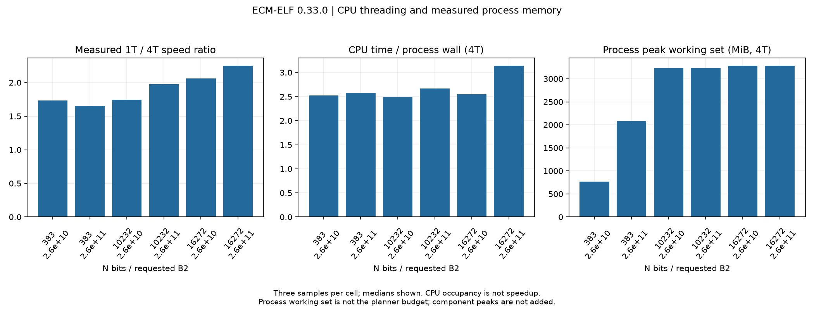

# CPU GW 多项式 Stage2 性能

本页记录本地 DLL 与静态 `gwpoly` 的配对测试，以及 0.33.0 的 Prime95 对照。它从 Edwards Stage1 文本 save 直接继续，使用 GWNUM/polymult 的多线程快速多项式算术。使用与构建见 [CPU Stage2](../usage/EDWARDS_CPU_STAGE2.md)，数学见 [多项式 Stage2](../reference/ECM_STAGE2_MATH.md)，保留的开发证据见 [草稿](../development/CPU_GW_POLY_STAGE2_DRAFT.md)。共享底层算术库不等于具有 Prime95 的全部功能或相同性能。

## 0.66.0 指令集与提前初始化

Windows x64，Ryzen AI 9 HX 370，MSVC Release，GWNUM 31.6，本地 DLL 构建 `6bbf348cf243d3a4`。两组输入都是 Edwards AM、sigma=17、B1=1000 的 Stage1 save，4 线程，预算 512 MiB，进程继承亲和性，未锁频或采样功耗。每个输入先对三种构建分别跑一次 GMP 三点校验，再交替测 DLL 和静态版各 5 条完整 NF。下表为中位秒数。整曲线包含曲线重构、GW 初始化、算术和清理，排除进程启动、读档和发布；init 是整曲线中的子区间。

| 输入 | B2 | D | DLL 整曲线 | 静态整曲线 | DLL init | 实际系数 FFT |
| --- | ---: | ---: | ---: | ---: | ---: | --- |
| M127 | 10⁹ | 60060 | 0.6562 | 0.6481 | 0.3194 | FMA3，长度 32 |
| M2203 | 10⁸ | 30030 | 0.2281 | 0.2397 | 0.1383 | AVX-512，长度 128 |

两组默认外层 polymult 均为 AVX-512。对静态资格构建设置 `CL=/DECM_GWPOLY_TEST_NO_AVX512` 后，两组的外层 polymult 和系数 FFT 均选 FMA3，原始 save、D、B2 和 GMP 检查均相同。这项测试在同一台机器上限制 GWNUM 和 polymult 可用的指令，没有使用第二台物理 AVX2 主机。原始逐曲线数据、三份 EXE 及 DLL 的 SHA-256 在 `data/experiments/cpu_stage2_queue_066/release_isa/summary.json`。

GPU 队列可在上一条曲线使用设备时，提前在主机验证下一条记录、读取调优信息。CPU 队列在读档时已经重建 Edwards 的 A24，执行时核对记录指纹并复用 A24。上表的 init 还包括依赖当前 Q 的 baby 点、F 树、倒数以及工作区分配，这些都会消耗 CPU 和内存带宽。两组 init 占整曲线时间约 49% 和 61%；这个比例不能直接用作可节省时间。

当前保留串行曲线和曲线内多线程。值得单独试验的是在相同 N、承载形式、D、FFT 安全余量和线程预算下复用只读几何或已验证 FFT 计划。验证用同一多曲线 save，对比整队列吞吐量和单进程峰值内存，并检查逐曲线结果、停止与恢复。双工作区并发预建整个 F 树的收益仍待该对照确认。[GW 初始化边界](../../src/ecm/stage2/cpu/gwpoly.cpp) · [GPU 曲线预取与准入](../../src/ecm/stage2/task.cpp)

## 0.65.0 本地 DLL 与静态链接

同一 Ryzen AI 9 HX 370、Windows x64，MSVC 19.51 Release，亲和性 `0xAA`，单曲线、512 MiB 规划预算。固定输入为完整梅森数、Edwards AM、sigma=17、B1=1000，均从保存的完成点开始。每格先由两个版本各执行一次三点 GMP 乘积校验，再交替执行各 10 次普通完整 NF，保留全部正式样本。下表为单曲线中位秒数，包含曲线重构、GW 初始化、算术、GCD、检查和引擎清理。读档、进程/DLL 加载和发布另属外层。CPU 功耗、有效时钟和温度未采样。

| 输入 | B2 | D / P | 线程 | 静态 / s | DLL / s | DLL / 静态 |
| --- | ---: | ---: | ---: | ---: | ---: | ---: |
| M127 | 1,000,000,000 | 60060 / 5760 | 1 | 0.6656 | 0.6627 | 0.996 |
| M127 | 1,000,000,000 | 60060 / 5760 | 4 | 0.5367 | 0.5329 | 0.993 |
| M2203 | 100,000,000 | 30030 / 2880 | 1 | 0.2640 | 0.2611 | 0.989 |
| M2203 | 100,000,000 | 30030 / 2880 | 4 | 0.2064 | 0.2047 | 0.992 |

这四格均满足第一阶段 DLL/静态 ≤1.03 的中位耗时目标。小幅差值包含运行波动。M127 的系数 FFT 为 FMA3、长度 32，M2203 为 AVX-512、长度 128，二者的 polymult 均选择 AVX-512。两侧加载相同版本的 GWNUM 31.6，动态版加载的 DLL 构建指纹为 `9bb169d41d5438f0`。每个汇总保存静态 EXE、动态 EXE、GMP DLL、GWNUM DLL、输入 save 的 SHA256 和逐次观测，目录内附冻结二进制。Prime95 同机复测属于下一阶段。[M127 证据](../../data/experiments/cpu_stage2_dll_065/m127_final/summary.json) · [M2203 证据](../../data/experiments/cpu_stage2_dll_065/m2203_final/summary.json) · [配对采集器](../../tools/bench/compare_cpu_stage2_gw.py)

## 0.33.0 与 Prime95 历史对照

正式范围 36/36 次完成，全部为完整 NF；12 个单元各 n=3，没有丢弃首轮。下表为完整 Stage2 的中位秒数，最小/最大值保留在图及 CSV 中。Prime95 每格 n=1。

| M 指数 | N 位数 | 实际 B2 | Prime95 4T / s | GW 1T / s | GW 4T / s | 实测 1T/4T | GW 4T/Prime95 |
|---:|---:|---:|---:|---:|---:|---:|---:|
| 1009 | 383 | 27,015,978,990 | 2.279 | 4.381 | 2.524 | 1.74× | 1.11× |
| 1009 | 383 | 278,982,814,110 | 6.317 | 18.686 | 11.315 | 1.65× | 1.79× |
| 10267 | 10232 | 27,015,978,990 | 6.460 | 17.577 | 10.060 | 1.75× | 1.56× |
| 10267 | 10232 | 273,142,759,890 | 35.871 | 126.512 | 63.976 | 1.98× | 1.78× |
| 16319 | 16272 | 27,015,978,990 | 11.455 | 29.779 | 14.447 | 2.06× | 1.26× |
| 16319 | 16272 | 264,004,751,010 | 52.502 | 213.929 | 94.962 | 2.25× | 1.81× |

四线程相对本实现单线程的加速为 1.65–2.25 倍；四线程耗时为 Prime95 历史四线程的 1.11–1.81 倍。此范围下已经有实际多线程收益，但仍慢约 10.8%–80.9%，不能宣称达到 Prime95 性能。单次历史对照没有误差估计，不能将这些差距外推到所有 CPU、B1 或 B2。

GW 单线程 CPU 时间/进程墙钟中位值为 0.978–0.996；四线程为 2.49–3.14。占用比表示使用的 CPU 时间，不等于有效加速。四线程单进程峰值工作集的逐格中位值为 763.7–3287.0 MiB；没有相加组件峰值，也不将 4096 MiB 规划预算当成实测内存。36 次正常误差检查全部通过，记录的最大舍入误差约 0.22175，门限保持 0.40。

实际几何也不同。下表的低/高仅指前表的两档请求 B2，实际配对仍使用前表精确界限；FFT 是每系数 GW 算术长度，不是外层多项式次数。

| M 指数 | B2 档 | GW D | GW P | GW FFT | Prime95 P | Prime95 FFT |
|---:|:---:|---:|---:|---:|---:|---:|
| 1009 | 低 | 240240 | 23040 | 128 | 20160 | 64 |
| 1009 | 高 | 630630 | 60480 | 128 | 63360 | 64 |
| 10267 | 低 | 240240 | 23040 | 640 | 20160 | 640 |
| 10267 | 高 | 240240 | 23040 | 640 | 46080 | 640 |
| 16319 | 低 | 180180 | 17280 | 896 | 20160 | 896 |
| 16319 | 高 | 180180 | 17280 | 896 | 37440 | 896 |

高档 10232/16272 位输入分别处理 50/85 个 G 块，低档为 5/9 个；原始分项显示 G 树和模 F 折叠是主要优化对象。F 树存储、D/P 选型、固定操作数预变换及下降调度都可能影响完整成本。需要固定几何与预算的独立对照才能归因，不能只按 FFT 长度、线程数或单个算子时间推断全部差距。

汇总为 `data/benchmarks/cpu_gw_poly_stage2_20261017/final_01/summary.json`、`cells.csv`；耗时两坐标图及资源图由[版本化绘图工具](../../tools/bench/README_STAGE2_VERSION.md)重绘为数字版本标注，PNG 副本位于相邻 attachments 目录，另有 SVG；原始图表保留。图表已核对标签、计时边界、样本数及内存口径。

## 输入与环境

输入取自 [Edwards 精确输入基准](EDWARDS_STAGE2.md) 的已独立验证 Stage1 save：M1009/M10267/M16319 对应的实际余因子 N 分别为 383/10232/16272 位，sigma=26、B1=50000。N 由原 M 剥离已知因子精确恢复，不是完整的原梅森数。两档请求 B2 为 2.6×10^10、2.6×10^11；测量采用 Prime95 日志中的实际调整值。CPU 的 1T/4T 条件与 Prime95 匹配相同 N、sigma、B1 和实际 B2，不按近似位宽配对。

CPU 为 Ryzen AI 9 HX 370、Windows 11，用户声明固定 4 GHz，亲和性 `0xAA`（逻辑 CPU 1/3/5/7）。当前 CPU 测量使用 1/4 线程，各格三次，保留首轮并逐轮交替线程顺序；曲线串行。4096 MiB 为规划预算，不是进程内存硬限制。没有固定或采样 CPU 功耗、温度和有效时钟，也没有隔离全部系统后台负载，不能由频率声明推出全部环境严格相同。

Prime95 参考为 31.4b05、4 线程、4 GHz，日志报告可用内存 4096 MB，每格历史样本 n=1。用户确认此前 3.1 GHz 的说明仅影响本轮 ECM-ELF 原型试跑，Prime95 `4Core@4GHz` 历史数据仍按 4 GHz 记录。原型耗时不进入本页统计，不按频率或线程比例换算。旧 libecm 参考矩阵保持停止，不与本页新后端样本混合。

版本为 ECM-ELF 0.33.0，GWNUM 31.6，GMP Zen3 DLL；MSVC 14.51.36231、Release `/O2`、静态 CRT。GWNUM 算术上下文在点任务中逐线程克隆，polymult 对大乘法使用 helper 线程；CPU 时间/墙钟占用与 1T/4T 实际加速分别报告。

## 计时与验证

- 本后端：从重构曲线开始，包含 GW 初始化、FFT/D 规划、点序列、全部多项式、GCD、检查及资源清理结束；不包含读档、进程启动和结果发布。另存进程墙钟与 CPU 时间。
- Prime95：初始化、主计算、最终 GCD 三个互斥计时之和，不能只取 Stage2 complete 的主计算时间。
- inner init/main 和 points/trees/folds/descent 仅用于诊断。它们不包含全部外层设置与清理，不是关闭的总时间账本，不能重复加到 native 时间中。

性能运行关闭额外 `--gw-check`，保留正常 GW 错误和 maxerr≤0.40 检查。每次核对输入元数据、实际后端、完成状态和真因子合法性；提前出因子的调用保留但不混入完整 NF 统计。正确性独立使用复合环 Horner、非零余式、多块 fold、三处 GMP 直接乘积、已知 Stage2 因子与真实停止回归，不把无因子运行本身当成算术正确的充分证据。

## 证据与复现

正式版本为 ECM-ELF **0.33.0**，由冻结源码版本头及运行结果核对。完整依赖与实际调用参数随原始证据保存，不用当前同名程序推定冻结版本。

证据根目录 `data/experiments/cpu_gw_poly_stage2_20261017/`：

- `fixed4g_01/` 保存正式逐调用日志、结果、CPU 占用和单进程峰值工作集，冻结 EXE/DLL、GW 库、链接的 libecm 静态库、项目源码与头文件、原参考计划、save 和收集脚本。依赖清单随冻结研究保存。
- `frequency_clarification.json` 记录用户频率澄清；原型和失败证据保持原文，不覆盖。
- `validation_05/` 有 31 项 GW 后端门禁通过，与正式计时使用同一冻结 EXE，包含 GPU1 save 交接、10232/16272 位实际余因子的完整 GMP 投影，以及 M347、B2=2.6×10^12 的四线程完整投影校验。此大 B2 数学资格不外推到 16272 位性能；10^15 是整数规划参数边界，没有完成同规模实跑。
- `libecm_regression_01/` 有 39 项未启用 GW 的 CPU 流程门禁通过，保留 auto/NTT/plain 路径；同一正式 GW 二进制也在 `legacy_in_gw_build_01/` 通过 NTT/plain 两项续算检查。

复现入口为 [采集与绘图工具](../../tools/bench/README_CPU_GWPOLY_STAGE2.md)。原始研究已核对冻结输入与逐条结果；当前重绘复用已验收汇总，不重跑 CPU。数据和图表在忽略的 data 目录，公共 Git 不包含用户身份、AID 或真实结果校验值。

当前限制是无曲线内部恢复、无错误自动扩 FFT 重算，且 GUI/队列尚未接入。FFT/D 联合选型、静态 D 规划、F 树存储、固定操作数的频域复用与下降并行度仍有优化空间；其他设备、预算、一般模数、生产 B1 与大位宽 B2≥10^12 需要单独验收。
