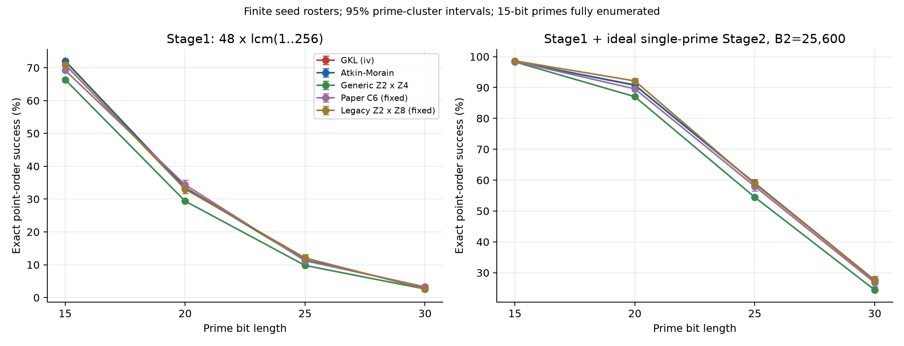
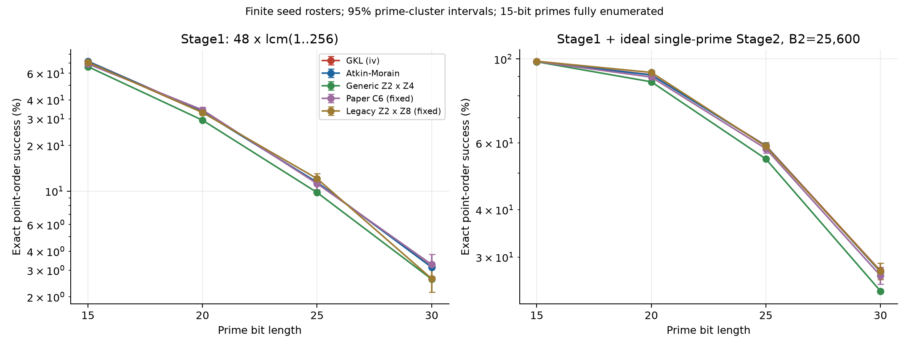
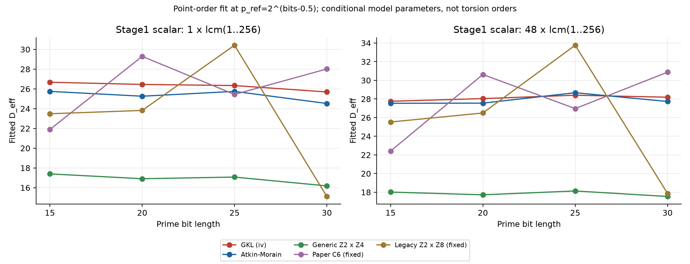
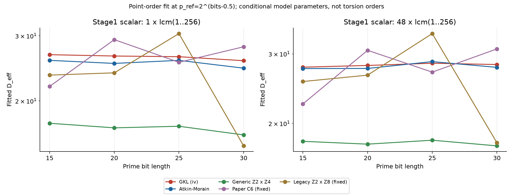
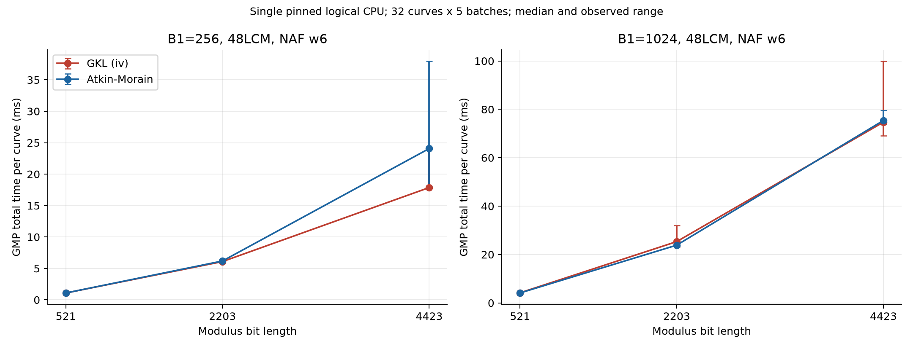
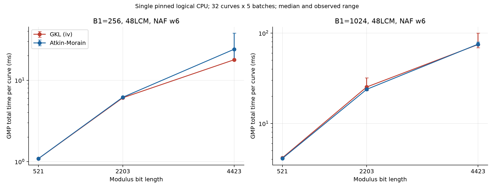
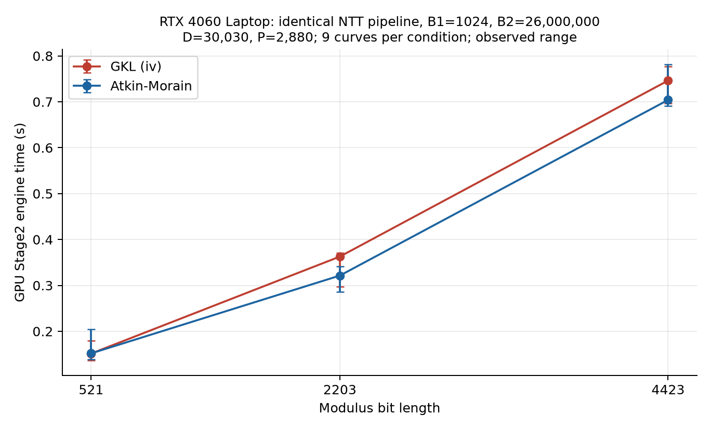
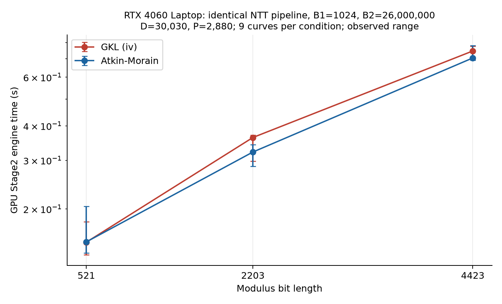

# GKL family (iv)：正确性、成功率与性能

已实现 GKL17 family (iv) 的独立 GMP 构造、a=−1 的窗口 NAF Stage1 原型，以及向现有 CUDA NTT Stage2 传入显式 a24 的实验接口。构造和末点已通过独立 PARI 对照，GPU Stage2 已实际找回已知因子。当前结果**没有证明它相对现有 Atkin–Morain 有稳定的单位时间收益**，因此生产 `curve=ed` 仍使用原构造。

本页描述实验版本 1.0.0，宿主源码版本 0.52.3；GPU Stage2 复用的已编译引擎版本为 0.52.2。证据目录为 `data/experiments/ecm_friendly_iv_20261024/`，统计汇总为 `data/benchmarks/ecm_friendly_iv_20261024/summary.json`。文中 IV 指新族，AM 指本仓库实际 Atkin–Morain 构造；二者的相同整数种子不定义相同曲线。

## 整体结果

- 4,197,800 组曲线／素数输入中，4,197,307 组构造可用；其余 493 组单列，未当作 NF。IV 和 AM 在 30-bit 样本中的平均群阶 v2 分别为 5.3336、5.3363，通用 Z2×Z4 对照为 4.6653。
- B1=256、B2=25,600、48LCM 下，30-bit 素数的 Stage1 命中为 IV 3.1570%、AM 3.1367%；含理想单大素数 Stage2 为 27.5916%、27.4319%。配对差异均未达到本页的 95% 区间判据。
- 同条件的 Stage1 点阶拟合 D_eff 为 IV 28.19、AM 27.73；B1=1024 时变为 31.48、31.13。它们是有条件的模型拟合值，不能作为与 B1 无关的族常数。
- 原生 CPU 与 GPU Stage2 的计时范围存在明显波动。没有据此把某个中位数优势写成稳定提速，也没有把 GMP 原型吞吐标作生产 GPU Stage1 性能。

## 有理挠点与“免费因子”

详细数学背景见[参数化与成功率](../architecture/ECM_PARAMETERIZATIONS.md#7-gkl17-family-ivprmers--iv163-与-gpu-论文的关系)及[原论文 §2.3](<../paper/Parametrizations for Families of ECM-Friendly Curves.pdf>)。在非退化、有良好约化的条件下：

| 构造 | Q 上挠子群 | 挠点总数 | 最大有理挠点阶 | 群阶必含的因子 |
|---|---|---:|---:|---|
| 当前 AM，a=1 | Z/2×Z/8 | 16 | 8 | 16 |
| GKL IV，a=−1 | Z/2×Z/4 | 8 | 4 | 16；其中因子 8 由有理挠群保证，额外因子 2 来自族的模 p 性质 |
| 通用 GKL Z2×Z4 | Z/2×Z/4 | 8 | 4 | 8 |

AM 的 16 个挠点按**精确阶**分为：1 阶 1 个、2 阶 3 个、4 阶 4 个、8 阶 8 个；没有 16 或 32 阶有理点。IV 则为 1、3、4 个，分别具有阶 1、2、4。计数对象是光滑射影模型，不能只枚举有限仿射坐标。

AM 提供的是 `16 | #E(F_p)`，不是“起点阶一定含 16”，也不自动提供 3、5 等奇因子。例：sigma=1、p=537026561 时，AM 群阶为 537020944，起点阶为 67127618；群阶能被 16 整除，不能被 32 或 3 整除，起点阶的 2 部分只有 2。IV 的 m=1 在同一 p 下群阶为 537061264，同样不能被 32 或 3 整除。

`E(F_p)` 含完整的二挠点，通常不是循环群；点阶与群阶必须分别计算。标量 48 的额外因子 3 来自程序选择，而不是 AM 有理三挠点的证明。若起点阶是 r，生产标量消去该点的充要条件为

$$
r\mid48\operatorname{lcm}(1,\ldots,B_1)
\quad\Longleftrightarrow\quad
\frac r{\gcd(r,48)}\mid\operatorname{lcm}(1,\ldots,B_1).
$$

IV 的 `16/3` 与通用族的 `14/3` 是跨好素数的平均 `v2(#E)`；它们不表示固定的有理挠群，也不能令 `D_eff=2^(16/3)`。即使计算 `2^(平均 v2)`，所得也只是群阶 2 部分的几何均值，不是普适整除因子或 ECM 成功率。

## 构造与正确性

新构造取辅助曲线 `r²=s³−s²−9s+9` 上的 `[m](5,8)`，由 `t=(4s+4)/(r−4)` 使用论文表 1 第 4 行的有理函数生成 e 和起点，目标系数为 `a=−1,d=−e⁴`。`m` 直接使用正 uint64，不采用 PrMers 的 1…100 重映射，也不冒用旧 Edwards sigma。

原生入口为 [ecm_gkl_iv_curve.h](../../src/ecm/curve/gkl_iv.h)，精确有理参考为 [friendly_curves.py](../../tools/ecm_prob/friendly_curves.py)，独立 PARI 模型为 [friendly_curves.gp](../../tools/ecm_prob/friendly_curves.gp)。m=1 黄金值为 `t=6,e=15/8,P=(28/195,3152/3495)`。所有构造检查分母、非奇异性及曲线方程；模逆失败时区分真因子和退化，未硬编码论文表格的禁用参数集合。

原生辅助曲线采用整数同构 `x=9s−3,y=27r`，得到 `y²=x³−756x+4320` 和基点 `(42,216)`，通过 Jacobian 倍点避免辅助曲线每步求逆。目标曲线先转 Montgomery，再保留其 B 扭转身份转 Weierstrass；独立点阶计算没有擅自令 B=1。

实际验证包括：

- 7 项有理身份、映射、禁用参数与幂光滑判定测试。
- 110 个原生构造样例：覆盖两个族、5 个素数及 `2^53±1`、`2^64−1` 等种子；109 个可用样例逐字段与 PARI 一致，1 个退化与 PARI 一致；其中 60 个另与 Python 精确有理数参考核对。
- 96 个独立末点对照，覆盖 B1=256/1024、LCM/48LCM；两个小素数下旧 AM 扩展坐标异常使用原始点 X/Z ladder 重放后通过，未将无效投影点当作命中。
- 160 个复合模数构造测试中返回的 110 个因子均满足 `1<f<N` 和 `f | N`。
- PARI 在 m=1、2、3 上确认 IV 的有理挠群为 `[8,[4,2]]`，AM 为 `[16,[8,2]]`；另核对两个固定论文对照。最终宿主构建证据为 `native_validation_final/validation.json`。

真实 GPU Stage2 用 `N=537033121×(2^127−1)`、B1=256、B2=25,600、D=210。m=sigma=1 时，PARI 分别给出 IV 起点阶 33566172、AM 起点阶 67125842；48LCM 后剩余素数分别为 593、281。两族均实际找回因子 **537033121**，各通过 672 个 selftest、183 项 checked，bad=0。CPU Stage1 已检查归一化分母为单位，因子没有从 Stage1 结果冒充而来。证据为 `gpu_validation_02/validation.json`。

## 成功率与 D_eff

### 取样与计数口径

每个条件使用相同素数集合。IV 和 AM 各固定种子 1…100，通用族使用 100 个正 t，排除满足其他额外平方条件的子族；另保留论文 C6 和旧工具 Z2×Z8 各一条固定曲线。这两条固定曲线不能代表一个族的平均值。

| 素数位宽 | 实测素数数 | 该位宽全部素数数 | 方式 |
|---:|---:|---:|---|
| 15 | 1,612 | 1,612 | 全量 |
| 20 | 4,096 | 38,635 | 无放回均匀抽样 |
| 25 | 4,096 | 985,818 | 无放回均匀抽样 |
| 30 | 4,096 | 26,207,278 | 无放回均匀抽样 |

随机种子 20261024；所有采样素数由 PARI `isprime` 复核。每个可用样例独立求完整群阶 n 和原始点阶 r，检查 Hasse 界、`r | n` 及理论群阶整除性。分母不可用、参数映射失败和坏约化共 493 组，单列后从命中率分母排除。它们在真实复合模数构造中可能暴露因子，本页没有将其添加为分解成功。

令 `S=c·lcm(1…B1)`，c=1 或 48。Stage1 命中严格按 `r | S`；Stage1+2 数学命中按 `r/gcd(r,S)=1`，或该余数为 `(B1,B2]` 内的**一个素数（指数为 1）**。例如两个大素数或大素数平方不能算入。这是理想单大素数 Stage2 判据，不包含 Brent–Suyama 额外命中，也不是完整 GPU 因子产出率。一个合数的多个因子同时命中时，还需处理 GCD=N。

误差以**素数为相关簇**，同时保留同一素数上的 100 个固定种子，并采用有限总体修正。比较 IV/AM 时使用配对簇估计。15-bit 已遍历全部素数，其固定样本描述值不另加素数抽样误差；所有区间均不覆盖“更换任意种子取样方式”的不确定性。

### 命中率

下表统一 B1=256、B2=25,600、48LCM；完整 B1=256/1024、两种标量及固定对照均保留在汇总 JSON/CSV。

| p 位宽 | IV Stage1 | AM Stage1 | 通用族 Stage1 | IV Stage1+2 | AM Stage1+2 |
|---:|---:|---:|---:|---:|---:|
| 15 | 72.0976% | 71.9909% | 66.3879% | 98.4125% | 98.3960% |
| 20 | 33.5548% | 33.3926% | 29.3920% | 90.8392% | 90.7220% |
| 25 | 11.4038% | 11.4402% | 9.7817% | 59.0507% | 58.9585% |
| 30 | 3.1570% | 3.1367% | 2.6172% | 27.5916% | 27.4319% |






30-bit、48LCM 下，IV/AM 的 Stage1 比值为 **1.00646**，95% 区间 `[0.98231,1.03061]`；Stage1+2 比值为 **1.00582**，区间 `[0.99887,1.01277]`。B1=1024 时两个比值为 1.00302 和 1.00092，区间也包含 1。因此当前样本无法确认对生产 AM 有正收益。

相同 30-bit、B1=256 改为原始 LCM 时，Stage1+2 比值为 1.01392，95% 区间 `[1.00684,1.02101]`，表明标量约定确实会影响比较。这个结果不能被写成生产 48LCM 的收益，也不是逐项复现论文 15–63-bit 的全部实验。

### D_eff 的含义和拟合值

使用仓库现有 `fit_delta` 的局部 Dickman 模型，令 `p_ref=2^(bits−0.5)`，以**Stage1 点阶命中率**反解 delta，`D_eff=exp(delta)`。它不是用群阶除以挠群大小得到的商，也不是按群阶平均 v2 推出的常数。下表 B1=256：

| p 位宽 | IV，LCM | AM，LCM | IV，48LCM | AM，48LCM | 通用族，48LCM |
|---:|---:|---:|---:|---:|---:|
| 15 | 26.68 | 25.75 | 27.76 | 27.54 | 18.02 |
| 20 | 26.45 | 25.26 | 28.04 | 27.55 | 17.72 |
| 25 | 26.34 | 25.75 | 28.40 | 28.67 | 18.13 |
| 30 | 25.69 | 24.53 | 28.19 | 27.73 | 17.55 |






B1=1024、30-bit、48LCM 下，IV/AM 的 D_eff 为 31.48/31.13。基准点近似、素数分布、有限种子、B1 和乘子均会影响拟合；这些值适合本轮条件内的对比，尚不适合直接替换生产的大位宽成功率常数。旧固定 Z2×Z8 曲线的 D≈26.4 也不能直接冠名为现有 AM 全族的常数。

## 性能

### CPU Stage1 原型

AMD Ryzen AI 9 HX 370，Windows 11；进程固定逻辑 CPU1，无并行 benchmark。CPU 4GHz 沿用用户确认的设置，本轮未独立测量有效频率。GMP 使用 `third_party/gmp-zen3/dist`，MSVC 14.51.36231 `/O2`。主数据为 `cpu_performance_02/timings.json`：每个条件每族 32 曲线×5 批，交替两族批次顺序，不丢弃首批。此前 16×3 的试跑保留在 `cpu_performance_01/`，不与主数据混合。

模数为 M521/M2203/M4423；两族均使用 48LCM、w6 NAF、16 个正奇数倍字典及负点。计时从构造开始，包含字典、标量主循环、末点方程/扩展坐标检查及局部清理，排除进程启动、标量/NAF 一次性生成。原型没有使用生产 CPU 的 SIMD 路径、仿射字典优化，也没有使用生产 GPU 的省 T 倍点，因此只比较本原型内部的两族。

下表为每批平均每曲线耗时的中位数，方括号为 5 批实测最小/最大值；比值小于 1 表示 IV 本轮较快。

| 位宽 | B1 | IV，ms/曲线 | AM，ms/曲线 | IV/AM 中位数比 |
|---:|---:|---:|---:|---:|
| 521 | 256 | 1.087 [1.086, 1.111] | 1.089 [1.086, 1.111] | 0.999 |
| 521 | 1024 | 4.165 [4.112, 4.309] | 4.104 [4.077, 4.166] | 1.015 |
| 2203 | 256 | 6.087 [6.054, 6.111] | 6.180 [6.158, 6.324] | 0.985 |
| 2203 | 1024 | 25.323 [23.136, 32.040] | 23.855 [23.338, 25.944] | 1.062 |
| 4423 | 256 | 17.864 [17.814, 24.147] | 24.067 [18.078, 37.971] | 0.742 |
| 4423 | 1024 | 74.707 [69.053, 99.917] | 75.396 [73.763, 79.609] | 0.991 |






原型两族倍点均为 4M+4S；字典缓存乘 d 后，AM 加法 9M，IV 加法 8M。B1=256 时每曲线主循环分别为 1918M+1468S、1868M+1468S；B1=1024 时为 7767M+5940S、7564M+5940S。省下的是 NAF 非零列的一次乘法，不能据此宣称整个 Stage1 快 1/9；a=−1 的取负/归约等开销仍存在。

部分条件范围较宽，4423-bit/B1=256 的中位数差异尤其不能作为 25.8% 稳定提速。宿主机仍有 GPU0 生产任务，未建立独占整机的计时条件；原始波动完整保留，没有筛掉较慢样本来改善结论。

### GPU Stage2 接续

RTX 4060 Laptop GPU1，驱动 610.88，CUDA 13.3.73，现有 0.52.2 NTT 引擎；GPU0 保持生产任务。GPU 功耗上限查询返回 N/A，未锁 GPU 时钟。固定 B1=1024、B2=26,000,000、D=30,030、P=2,880、867 个 giant 点，普通模数路径，不启用 relocation 或运行时 tune。

每个位宽每族种子 1…3，各运行 3 轮，共 9 条曲线；交替两族顺序，不丢弃首轮。所有曲线 NF，强制算术检查 bad=0。表内为 `metrics.total_seconds` 的中位数及范围，边界为引擎初始化/树与 tail/checks，排除 CPU Stage1、进程启动、入口规划及 CUDA 上下文首次启动；完整 API 墙钟另存原始 JSON，不能和该嵌套计时相加。

| 位宽 | IV，秒/曲线 | AM，秒/曲线 | IV/AM 中位数比 |
|---:|---:|---:|---:|
| 521 | 0.1515 [0.1364, 0.1795] | 0.1519 [0.1386, 0.2047] | 0.998 |
| 2203 | 0.3628 [0.2976, 0.3704] | 0.3214 [0.2857, 0.3415] | 1.129 |
| 4423 | 0.7464 [0.6961, 0.7772] | 0.7041 [0.6911, 0.7820] | 1.060 |






GPU Stage2 接收的是同一曲线的 Montgomery x 和显式 `a24=1/(1+d)`；AM 则为 `1/(1−d)`。两族共用相同 NTT 多项式管线，IV 没有减少 D/P、giant 点或变换长度。本次部分中位数反而较慢，且范围重叠，未证明 Stage2 有性能收益。GPU Stage1 的 a=−1 专用内核吞吐尚未测量。

## 复用与后续验证

构建原生实验程序：

```powershell
powershell -File tools/build/test/build_ecm_friendly_probe.ps1 -Build build_ecm_friendly_probe
```

可加 `-WithStage2 -BackendBuild build_stage2_local` 复用本地 Stage2 后端对象，只重编实验宿主入口并重新链接；该构建不编译 CUDA 源文件，后端必须与当前头文件 ABI 匹配。独立验收入口为 `tools/test/test_ecm_friendly_native.py`、`tools/test/test_ecm_friendly_gpu.py`，均用 `--probe --gp --output` 指定程序、PARI 和新的证据目录；GPU 测试默认设备 1。

群阶扫描、计时和图表分别由 `tools/bench/bench_ecm_friendly.py`、`tools/bench/bench_ecm_friendly_native.py`、`tools/bench/analyze_ecm_friendly.py` 维护。扫描显式指定 `--gp --output`；计时以 `--mode cpu|gpu`、`--probe --output` 选择路径，GPU 计时还必须记录 `--backend-version`。分析指定 `--input --cpu --gpu --output --figures`；可用 `--summary` 复用已验收的群阶统计后更新计时图。脚本默认输出不写 docs；正式引用图另复制到本页同目录的 attachments。

当前生产 CLI、结果格式和 save 重建仍按原 AM 身份运行。本实验不生成冒用旧 METHOD 或 PARAM0 的存档；Stage2 通过独立 API 接续。若继续生产接入，需定义新曲线族身份、save/ckpt 重建、a=−1 GPU Stage1 及其异常点处理。概率验证还需扩展到更大目标因子与实际生产 B1/B2，随后才能判断完整单位时间因子产出收益。

[开发草稿](../development/ECM_FRIENDLY_IV_DRAFT.md)按仓库规则保留，不自动清理。
