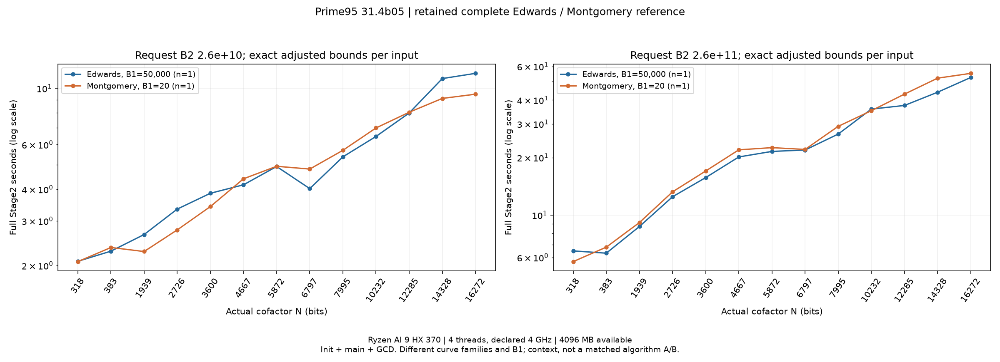
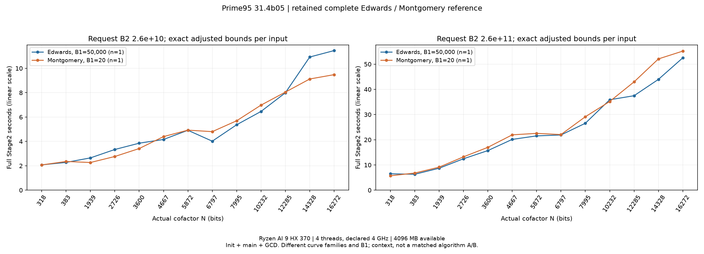
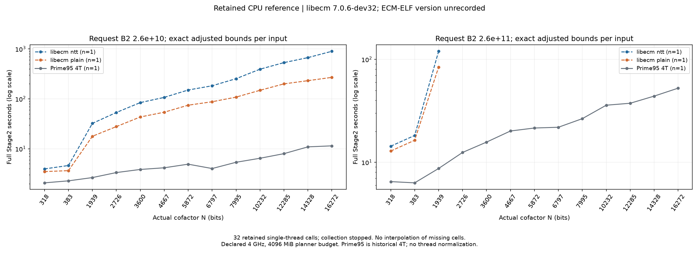
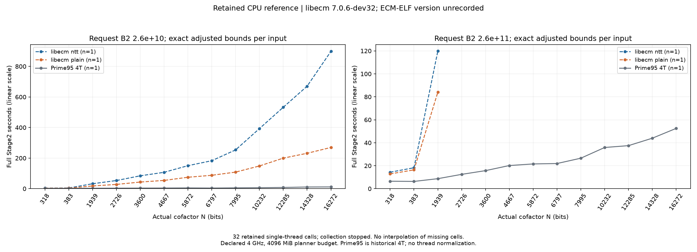

# Stage2 精确输入与 Prime95 / CPU 参考

当前 GPU 全范围性能集中在 [Stage2 性能](STAGE2.md)，本页维护输入身份、Prime95 完整参考和保留的 CPU 样本。CPU GW 多线程后端另见 [GW 多项式性能](CPU_GWPOLY_STAGE2.md)。各组保持原始设备、版本和计时边界，不按频率、线程或 B2 比例换算。

## Prime95 全范围参考

Prime95 31.4b05、Ryzen AI 9 HX 370、Windows 11、四线程，用户确认固定 4 GHz；日志报告可用内存 4096 MB。四份完整屏幕日志分别覆盖 Edwards/Montgomery 与两档请求 B2，每个曲线族 13 个目标、26 个条件，每格 n=1。下表单位秒，为初始化、主计算、最终 GCD 之和；Stage2 complete 的 Total time 仅为主计算。

Edwards 的 B1=50000，Montgomery 的 B1=20；这两列是不同曲线族及不同 Stage1 标量的上下文参考，不能用来证明某种模型更快。低/高档分别请求 B2=2.6×10^10 / 2.6×10^11，实际界限见下一节。

| M 指数 | 实际 N 位数 | Edwards 低档 | Edwards 高档 | Montgomery 低档 | Montgomery 高档 |
|---:|---:|---:|---:|---:|---:|
| 503 | 318 | 2.078 | 6.494 | 2.072 | 5.706 |
| 1009 | 383 | 2.279 | 6.317 | 2.356 | 6.794 |
| 2003 | 1939 | 2.650 | 8.712 | 2.271 | 9.138 |
| 3001 | 2726 | 3.339 | 12.468 | 2.764 | 13.229 |
| 4001 | 3600 | 3.855 | 15.709 | 3.416 | 17.006 |
| 5003 | 4667 | 4.163 | 20.148 | 4.397 | 21.956 |
| 6011 | 5872 | 4.916 | 21.538 | 4.926 | 22.538 |
| 7001 | 6797 | 4.021 | 21.901 | 4.803 | 22.062 |
| 8011 | 7995 | 5.367 | 26.545 | 5.695 | 29.134 |
| 10267 | 10232 | 6.460 | 35.871 | 6.978 | 35.184 |
| 12511 | 12285 | 7.991 | 37.475 | 8.047 | 42.966 |
| 14401 | 14328 | 10.927 | 43.960 | 9.124 | 52.078 |
| 16319 | 16272 | 11.455 | 52.502 | 9.480 | 55.172 |

CPU 历史单次样本没有误差估计，也未采集有效频率或功耗计数器。4 GHz 为用户声明；不能将设置频率等同于每个时刻的有效频率。图中的对数纵轴和分类横轴用于呈现完整范围，不表示位宽之间线性插值。

## 较大 B2 的 Prime95 历史参考

另保留 2026-10-09 的三档 B2 数据，包含 2.6×10^12 档位。只按完整整数 N 和请求档位关联，六格目标为 M2003/(4007·6588622714946609) 与 M8011/80111。CPU 仍为 Ryzen AI 9 HX 370、Prime95 31.4b05、主线程及三个 polymult helper；这份较早会话未记录可用的有效时钟或功耗，不能套用后一次 4 GHz 声明。CPU B1=100000，sigma 与 GPU 的 B1=20 参考不同，实际 B2 也有上调。因此它是较大范围的实现参考，不能作为相同曲线严格 A/B。

单位秒，init+main+GCD 的均值±样本标准差；保留全部慢样本，原会话有 PRP/系统后台负载。n 为完整曲线次数；同组实际 B2 略有不同的情况保留范围。

| N bits | 请求 B2 | CPU 实际 B2 | n | Prime95 / s |
|---:|---:|---:|---:|---:|
| 1939 | 26,000,000,000 | 27,016,084,095 | 2 | 2.472±0.011 |
| 1939 | 260,000,000,000 | 278,983,159,455 | 3 | 11.649±2.742 |
| 1939 | 2,600,000,000,000 | 2,681,769,525,435 | 3 | 42.537±6.521 |
| 7995 | 26,000,000,000 | 27,015,978,990–27,016,084,095 | 4 | 6.110±0.116 |
| 7995 | 260,000,000,000 | 273,142,759,890–273,143,015,145 | 4 | 29.620±1.005 |
| 7995 | 2,600,000,000,000 | 2,681,768,759,670–2,681,769,525,435 | 4 | 109.987±4.481 |

冻结输入、屏幕记录和完整整数配对在 `data/prime95_ecm_20261009/` 与 `data/experiments/stage2_n_scaling_20261009_2400/prime95_comparison/`；对应 GPU 的两种频率全范围结果在[性能总览](STAGE2.md#montgomery-全范围参考)。不将此组与上面的严格 Edwards 两档矩阵混合统计。

## 输入身份与实际 B2

实际模数是剥离已知因子的余因子：

\[
N=(2^p-1)/\prod_i f_i.
\]

恢复工具关联正式结果的完成记录和已知因子，逐项验证整除。Edwards 三条当前比较路径必须匹配完整 N、sigma、B1 和实际 B2，不能只按原指数、近似位宽或请求档位配对。相同 B2 表示声明的覆盖界限相同；不同实现的多项式布局、尾部覆盖及执行工作量仍可能不同。

| M 指数 p | 实际 N 位数 | sigma | 低档实际 B2 | 高档实际 B2 |
|---:|---:|---:|---:|---:|
| 503 | 318 | 26 | 27,015,978,990 | 278,982,814,110 |
| 1009 | 383 | 26 | 27,015,978,990 | 278,982,814,110 |
| 2003 | 1939 | 27 | 27,015,978,990 | 278,982,814,110 |
| 3001 | 2726 | 26 | 27,015,978,990 | 278,982,814,110 |
| 4001 | 3600 | 26 | 27,015,978,990 | 273,142,759,890 |
| 5003 | 4667 | 26 | 27,015,978,990 | 273,142,759,890 |
| 6011 | 5872 | 26 | 27,567,389,850 | 273,142,759,890 |
| 7001 | 6797 | 26 | 27,015,978,990 | 273,142,759,890 |
| 8011 | 7995 | 26 | 27,015,978,990 | 273,142,759,890 |
| 10267 | 10232 | 26 | 27,015,978,990 | 273,142,759,890 |
| 12511 | 12285 | 26 | 27,015,978,990 | 273,142,759,890 |
| 14401 | 14328 | 26 | 27,015,978,990 | 273,142,759,890 |
| 16319 | 16272 | 26 | 27,015,978,990 | 264,004,751,010 |

每个 Edwards 输入使用 B1=50000 的同一份 CPU 标量 `48·lcm(1…B1)` Stage1 完成点。13 份 save 已由独立 Montgomery x-only ladder 验证；Stage2 读取后不重做 Stage1、不再次乘 48。准备耗时排除在所有 Stage2 指标之外。普通余因子直接在 N 上计算；承载使用原指数 p 对应的 M=2^p−1，并在目标 N 上解释单位性、GCD 和因子。

Prime95 原始参考在 `D:/code/GIMPS/p95v3104b05.win64/4Core@4GHz/`；导入后的完整身份、精确整数、实际 B2 和来源行保存在 `data/experiments/edwards_stage2_reference_20261017/matrix_01/plan.json`。本页不公开账户、AID 或运行结果校验值。

## libecm CPU 保留样本

保留 libecm 7.0.6-dev32 的 NTT/plain 两后端共 32 次单线程完整 NF 调用：低档覆盖全部 13 个目标，高档只覆盖 M503/M1009/M2003，各单元 n=1。采集已停止，缺测处不补点、不插值。本轮 0.38.4 只复测 GPU，未重新运行 CPU。

这份历史 ECM-ELF 二进制没有记录可用的数字版本号，图表明确标为版本未记录。4096 MiB 是 libecm 规划预算，线程上限 1，亲和性限制到逻辑 CPU 1/3/5/7。用户确认固定 4 GHz，没有有效时钟遥测。计时从构造曲线到完整 libecm 返回，包含构造，不包含读档、进程启动和 JSON 发布。

CPU 初段曾与结果门禁、计数器开发及开销检查的后台负载重叠，保留全部原样本，不据此筛除首轮。四线程 Prime95 是历史参考，不能由其推导 libecm 单线程加速比。两后端可能选择不同多项式规划；`--threads` 上限也不能替代实际并行收益测量。当前可用的 GWNUM/polymult 多线程路径有独立的 [0.33.0、1T/4T 实测](CPU_GWPOLY_STAGE2.md)。

## 计时、正确性与证据

GPU 主指标为 `stage2_full_wall.total=init+main`，包含引擎内必需 NTT/S4 检查、baby/F 树、inverse、主循环、下降、GCD 及检查收尾。排除 Stage1、进程启动、外层选 D 和计时前 Montgomery/xADD 预检。GPU 三次显示中位数及 min/max，范围不是置信区间。init/main 的互斥口径集中见 [性能总览](STAGE2.md#计时与环境)。

进程墙钟另存，包含启动、计时外工作及最多 250 ms 的退出观察延迟，不能据差值精确估计启动开销。各模块嵌套计时不能重复相加；组件峰值不能相加为进程显存峰。

13 份末点的独立验证证明输入准备；逐调用元数据、正常算术自检和 GMP 抽样用于检查性能运行。完整 NF 本身不能证明所有叶值正确。目标环完整叶、非单位回退及承载投影的数学合同见 [Stage2 数据与检查](../architecture/STAGE2.md#数据与检查)。

原始参考与停止说明保存在 `data/experiments/edwards_stage2_reference_20261017/`：GPU 完整范围 156 次，CPU 参考 32 次，另有一条主动中断的 CPU 调用不计时。原计划包含 CPU 的 312 次矩阵仍未完成，不将其改写为完成。汇总在 `data/benchmarks/edwards_stage2_reference_20261017/gpu_final_02/`；本页图片由 [版本化绘图工具](../../tools/bench/README_STAGE2_VERSION.md)重新绘制，旧原始图和记录保留。

输入准备、旧研究复现见 [精确输入工具](../../tools/bench/README_EDWARDS_STAGE2_REFERENCE.md)；当前数字版本 GPU 复测及严格范围审计见 [版本化测量](../../tools/bench/README_STAGE2_VERSION.md)。NTT 长度计数器的定义与可选开关见 [NTT](../architecture/NTT.md)，计数不是 kernel launch 数。
