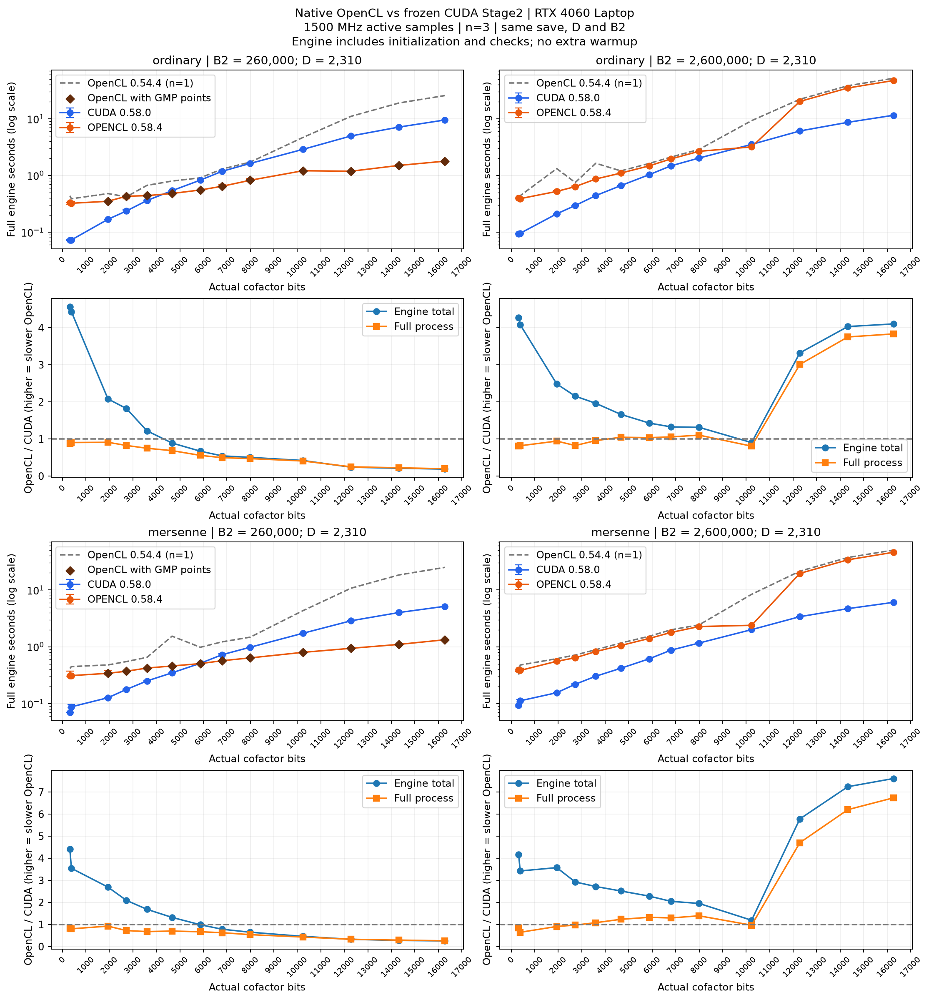
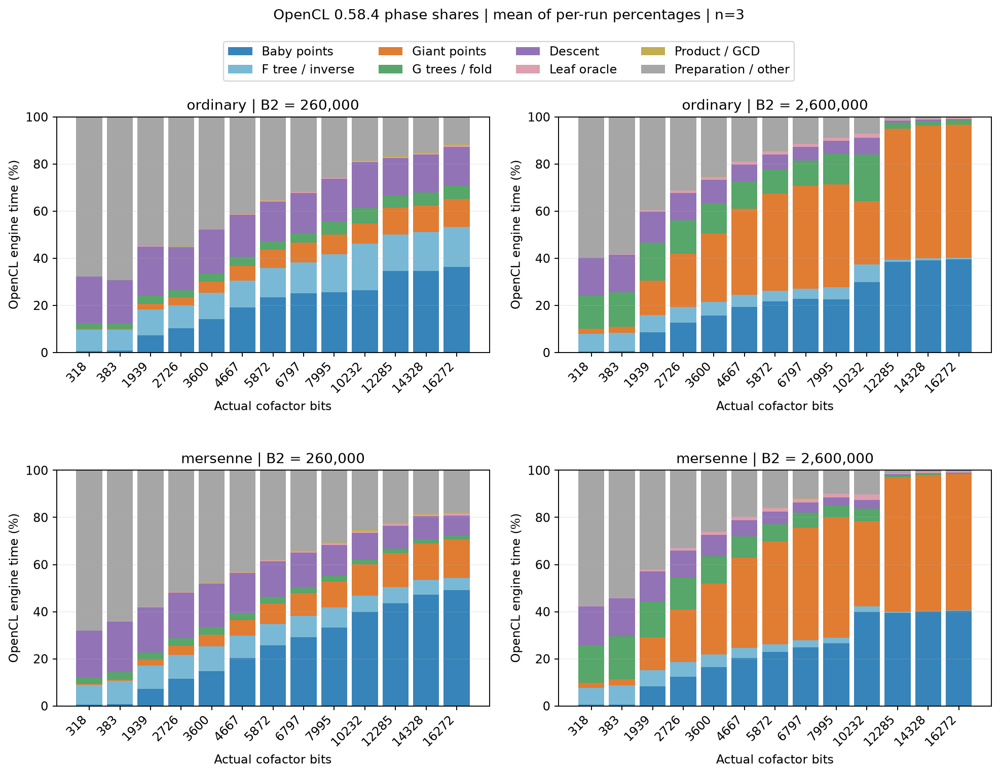

# 原生 OpenCL Stage2：性能与 CUDA 基准

## 宽位 GMP 点递推

同一 RTX 4060 Laptop／Ryzen AI 9 HX 370、驱动 610.88、B2=260 万的固定 D 快速矩阵中，宽位混合路径在 CPU 生成 baby 与 giant，余下的多项式运算仍在 OpenCL GPU。下表每格为 **0.58.4 OpenCL 默认 / 0.58.5 OpenCL 默认 / 冻结 CUDA 0.58.0** 的完整引擎秒数，均为同一批 save 的独立调用、每格三遍中位数。

| 实际 N bits | 普通，s | 梅森承载，s |
|---:|---:|---:|
| 10232 | 3.183 / 1.699 / 3.525 | 2.386 / 0.870 / 2.003 |
| 12285 | 20.188 / 1.578 / 6.080 | 19.590 / 0.990 / 3.388 |
| 14328 | 34.822 / 1.984 / 8.639 | 33.976 / 1.144 / 4.691 |
| 16272 | 47.198 / 2.398 / 11.510 | 46.125 / 1.314 / 6.058 |

0.58.5 同一二进制只切换 GMP 点算法时，四档普通独立 ladder 的完整引擎为 3.204、3.728、4.998、6.381 s；递推为 1.698、1.554、1.983、2.401 s（各 n=2）。换用 D=1260、P=144、B2=90 万、716 个 giant，10232／16272 bits 分别由 2.171／3.757 降到 1.294／1.798 s。新默认的形状边界与合数分母恢复规则见[OpenCL 点计划](../architecture/OPENCL.md#opencl-运行时点计划)。

主表固定 D=2310/P=240、1127 个 giant、B1=50000、sigma=26，普通和承载都在真实余因子上生成点。预算 512/64/640 MiB，关闭运行时学习与额外预热，计入引擎初始化及必需校验。日期 2026-11-04，0.58.5 worker SHA-256 前缀 `5161907509e9`；独立复测的非零 GPU 负载遥测均为 1500 MHz，采样功耗 8.08…12.03 W，CPU 未定频。38 项 worker 检查含稀疏奇数 baby、多窗口和非单位重算后命中 257；同形状实测曲线核对了输入、结果、NTT 次数和 GMP 检查字数。原始证据在 `data/experiments/opencl_large_0585/{screen5,second_geometry,hold5_ordinary,hold5_mersenne,gate5}/`，对应数据在 `data/benchmarks/opencl_large_0585/fast.csv`。

## 全位宽双档 B2 与运行时调优

冻结 OpenCL 0.58.4 默认与 CUDA 0.58.0 的完整 13 档对照如下。小档对 11 个中高位宽使用 GMP 点，大档所有位宽均在 GPU 上生成点。固定 D 后，baby 保持 240 个，giant 从 114 增至 1127，G 多项式从 1 个增至 5 个，fold 从 0 增至 4 次。大档超出免调优混合计划的 100…114 个 giant 范围。[点计划与适用条件](../architecture/OPENCL.md#opencl-运行时点计划)

### 同输入完整引擎中位数

每格为 **OpenCL / CUDA，单位秒**。同一格的两后端各运行三遍。两档共 13 位宽 × 2 个 B2 × 普通／承载 × 2 后端 × 3 遍，312 条完整 NF。以实际余因子 N 的位数为横轴，普通和承载始终使用同一份 save。13 格合计为各格中位数之和。

| 实际 N bits | 26 万普通 | 26 万承载 | 260 万普通 | 260 万承载 |
|---:|---:|---:|---:|---:|
| 318 | 0.331 / 0.072 | 0.311 / 0.070 | 0.397 / 0.093 | 0.389 / 0.093 |
| 383 | 0.323 / 0.073 | 0.311 / 0.088 | 0.389 / 0.095 | 0.383 / 0.112 |
| 1939 | 0.350 / 0.168 | 0.341 / 0.127 | 0.522 / 0.210 | 0.555 / 0.155 |
| 2726 | 0.430 / 0.236 | 0.371 / 0.177 | 0.635 / 0.295 | 0.640 / 0.219 |
| 3600 | 0.440 / 0.361 | 0.422 / 0.250 | 0.865 / 0.441 | 0.824 / 0.303 |
| 4667 | 0.480 / 0.539 | 0.459 / 0.348 | 1.100 / 0.662 | 1.053 / 0.418 |
| 5872 | 0.554 / 0.826 | 0.505 / 0.511 | 1.473 / 1.031 | 1.401 / 0.613 |
| 6797 | 0.644 / 1.183 | 0.568 / 0.725 | 1.955 / 1.474 | 1.785 / 0.871 |
| 7995 | 0.821 / 1.629 | 0.637 / 0.982 | 2.663 / 2.027 | 2.271 / 1.163 |
| 10232 | 1.209 / 2.876 | 0.797 / 1.727 | 3.183 / 3.525 | 2.386 / 2.003 |
| 12285 | 1.187 / 4.969 | 0.940 / 2.869 | 20.188 / 6.080 | 19.590 / 3.388 |
| 14328 | 1.502 / 7.128 | 1.101 / 4.010 | 34.822 / 8.639 | 33.976 / 4.691 |
| 16272 | 1.784 / 9.494 | 1.328 / 5.153 | 47.198 / 11.510 | 46.125 / 6.058 |
| **13 格合计** | **10.053 / 29.555** | **8.090 / 17.036** | **115.389 / 36.081** | **111.377 / 20.089** |

小档普通在 4667 bits 首次快于同轮 CUDA；承载在 5872 bits 接近持平。大档的普通／承载 OpenCL 与 CUDA 耗时合计之比分别为 **3.20／5.54**。大档普通路线只有 10232 bits 的 OpenCL 快于 CUDA（3.183 / 3.525 s），承载路线 13 档均为 CUDA 更快。两档均冻结默认计划，体现工作量与点后端同时变化的影响。

上、下两组分别是普通和承载，列为 B2。菱形表示 GMP 点；误差棒为同格三遍的范围。蓝色比值线低于 1 表示 OpenCL 引擎更快，橙色比值线包括外层读取和启动。虚线耗时是冻结 OpenCL 0.54.4 在相同 save、D/P、B2 下的单遍参考。[线性刻度](attachments/opencl_tune_0584_bounds_linear.png)

### 大档阶段占比

16272 bits 普通路线的 baby／giant 占比从小档的 36.2%／11.9% 变为大档的 **39.5%／56.6%**；大档承载分别为 **40.4%／57.9%**。点在真实 N 上生成，普通与承载的多项式算术模数不同。每条曲线用互斥阶段时长除以完整引擎时长，再对三遍取平均。初始化、准备及剩余开销列为 other；内嵌的点内核时间不重复堆积。

10232 bits 的设备点触发短标量合批，单次 giant 提交使用 564 对种子；其余 12 个位宽的普通／承载日志均未启用这条配对路径。普通引擎在 10232→12285 bits 由 3.183 增至 20.188 s。12285／14328／16272 bits 的点内核事件时间占引擎的中位数分别为 92.4%／94.4%／95.1%。这些事件嵌套于 baby／giant 阶段。该组同时改变了位宽和点调度，不能仅用位宽的平方项解释差距；扩大 GMP 点或配对种子适用范围仍需同位宽的强制后端对照。

### 点后端与免调优默认的依据

在 0.58.3 同一二进制上，固定 D=2310、P=240、B2=260000 做普通路线 CPU／设备点对照，每侧三遍。1939…16272 bits 的 11 个实测位宽，CPU 点在每一格的最慢一遍仍快于设备点的最快一遍。318 bits 的引擎中位数由 0.316 变为 0.312 s，383 bits 则由 0.324 变为 0.332 s，故两格维持设备默认。第二形状 D=1260、P=144、B2=125000、101 个 giant，1939／7995／10232／16272 bits 的设备点→CPU 点分别为 0.370→0.319、1.372→0.630、2.088→0.894、22.379→1.322 s。免调优范围只针对该 CPU/GPU 组合及有限点数；未覆盖的短形状由本机实测决定。[配置边界与选择逻辑](../architecture/OPENCL.md#opencl-运行时点计划)

0.58.4 另固定梅森承载，仅切换设备点／混合默认。1939、7995、16272 bits 的引擎中位数分别为 0.421→0.391、1.378→0.684、22.834→1.280 s（各三遍）。1939 bits 两侧样本范围有重叠，后二者三遍范围完全分离。16272 bits 这一组仅改变点的生成位置，费时的宽位短列表在本机 CPU 上更合算。

在 0.58.4 上以 M10267 同一个 save 重放，普通和承载各自按 CPU、设备、CPU、设备学习两遍，第五条均复用 CPU。普通两方案均值为 1.212／2.283 s，第五条 1.250 s；承载为 0.803／1.941 s，第五条 0.800 s。普通、承载在 profile 内各有独立记录。学习用于决定点后端，计时与上表独立；重复同一 save 不增加 ECM 数学覆盖。

**实验条件与证据。** 2026-11-04，Ryzen AI 9 HX 370、RTX 4060 Laptop、驱动 610.88，CPU 未定频。小／大档 B2=260000／2600000，B1=50000，M2003 的 sigma=27，其余为 26。固定 D=2310、P=240，arena/batch/fold 为 512/64/640 MiB。两档复用同一份原生 OpenCL 0.58.4 worker 和同一份 CUDA 0.58.0 worker，SHA-256 前缀分别为 `36ef0562c2ca`／`66380ae71350`。同格三次交错执行、无额外预热，关闭运行时学习。引擎时间含初始化、GCD 及必需校验，排除 Stage1、外层队列读档和进程启动。每次检查 GPU1 外部进程并核对输入、结果与二进制。小档遥测 420 个非零负载样本均为 1500 MHz，瞬时功耗 1.59…11.06 W；大档 1725 个非零负载样本均为 1500 MHz，瞬时功耗 1.53…13.28 W。两档均为固定几何的快速实验。

原始证据位于 `data/experiments/opencl_tune_0584/full_small/` 和 `full_large/`（同级）；点对照与学习在同级 `screen/`、`mid/`、`geometry/`、`carrier_check/`、`learned/`，worker 门禁在 `gate/verification.json`。逐格中位数、极值、点来源及阶段占比分别见 `data/benchmarks/opencl_tune_0584/both/` 中的 `cells.csv`、`pairs.csv`、`phase_shares.csv`。用矩阵报告脚本对两次完整运行分别传入 `--run` 可重建双档图；它会校验原始数据、设备和冻结资源的一致性，并拒绝重复档位。[报告与绘图脚本](../../tools/bench/report_opencl_cuda_stage2.py)

## 短标量点生成与 CUDA 差距

相同 10232-bit 余因子、B2=260 万的 0.58.2 代表调用中，OpenCL 点内核为 6.848 s，整个坐标生成 6.878 s，两者相差约 30 ms。baby（含归一化）2.859 s、giant 4.218 s，G 树与 fold 0.641 s、下降 0.234 s。配对 CUDA 的 baby ladder/affine 为 0.811/0.087 s，giant 为 1.667 s，G 树与 fold 为 0.235/0.061 s。两后端内部计时边界不同，但单靠优化树或传输无法消除 OpenCL 的点内核成本。

OpenCL 的一个工作项负责一个独立 ladder 或一段连续点。对 W 个 64-bit limbs，单次 Montgomery 模乘包含完整乘积和归约，各有 W² 次主循环乘加。10232 bits 对应 W=160，合计 51200 次 limb 乘加，另有进位和校正；这个数是源码操作数，不能换算为同数目的 GPU 周期。独立点重复 ladder 的成本随位宽放大，单纯把同样多的工作分成更多设备命令也会延长墙钟。[点内核](../../src/ecm/opencl/resources/stage2/points.cl)

以下在 0.58.2 的同一二进制和同一 save 上，仅改变点命令和 giant 算法。RTX 4060 Laptop、驱动 610.88，固定 D=2310、P=240，240 个 baby、1127 个 giant，输入参数见下文。每种组合执行两遍，第二遍反转顺序。表中为中位数，时间单位秒。最长命令列为每条曲线内最长点命令的中位数。

| 点提交 | Giant 算法 | 引擎 | baby 阶段 | giant 点内核 | 最长点命令 |
|---|---|---:|---:|---:|---:|
| 原有自适应 | 独立 ladder | 8.401 | 2.849 | 4.033 | 0.887 |
| 原有自适应及递推窗口 | 相邻种子 | 5.058 | 2.848 | 0.713 | 0.886 |
| 固定 chunk=1152、window=1200 | 独立 ladder | 4.448 | 0.952 | 1.987 | 1.987 |
| 固定 chunk=1152、window=1200 | 相邻种子 | 3.146 | 0.954 | 0.713 | 0.920 |

前两行的 giant 提交数也随算法改变。隔离提交次数时应比较最后两行：均为一条 baby 和一条 giant 命令。相邻种子一次 ladder 同时给出两个连续点，1127 个独立入口降为 564 对种子，本形状段长为 2。此时 giant 点内核仍从 1.987 降至 0.713 s。baby 仍逐点执行相同标量的 ladder，一次发齐后其阶段从约 2.85 降至 0.95 s，说明短列表采用 16 点起步并逐次翻倍，反复支付了宽位点计算的延迟。上述归因来自 OpenCL 设备事件与固定工作量对照，未测硬件 occupancy 或显存带宽。

小位宽的限制不同。1939-bit、B2=26 万的新版配对样本（repeat=1）中，OpenCL 完整引擎 0.381 s，点内核仅 0.063 s。选形阶段 0.105 s，包含首次设备枚举、模数设置及预算规划；该次下降为 0.071 s。CUDA 同次完整引擎 0.169 s，下降 0.022 s。OpenCL 程序构建 API 记录 0.028 s，已包含在引擎内。因此小任务优先拆测初始化和下降，高位宽任务优先看点生成。[初始化入口](../../src/ecm/stage2/opencl/engine.cpp) · [设备枚举与程序构建](../../src/ecm/opencl/ntt/runtime.cpp)

### 独立完整曲线验证

0.58.3 使用自动计划，按可用预算分别提交 baby、giant，边界和手动覆盖见[点生成架构](../architecture/OPENCL.md#点生成归一化与-gcd)。2026-11-04 在同卡使用本页的六格普通余因子、arena/batch/fold=512/64/640 MiB，逐格各后端三遍、交替顺序、无额外 warmup。CUDA 固定为 0.58.0。下表为 `stage2_full_wall.total` 中位数，包括引擎内初始化和校验，不含 Stage1 和外层进程启动。

| N bits | B2 | 0.58.2 OpenCL | 0.58.3 OpenCL | 同轮 CUDA |
|---:|---:|---:|---:|---:|
| 1939 | 260000 | 0.389 | 0.395 | 0.172 |
| 1939 | 2600000 | 0.525 | 0.538 | 0.207 |
| 4667 | 260000 | 0.714 | 0.687 | 0.538 |
| 4667 | 2600000 | 1.087 | 1.102 | 0.665 |
| 10232 | 260000 | 4.247 | 2.270 | 2.908 |
| 10232 | 2600000 | 8.496 | 3.158 | 3.534 |
| 六格合计 | | 15.457 | **8.150** | **8.024** |

六格合计下降 47.3%，同轮 OpenCL/CUDA 为 1.016。前四格没有启用新计划，其点内核中位数变化均小于 1 ms。10232-bit 两格的点内核分别为 1.463/1.630 s，完整引擎均快于这里的固定 D CUDA 对照；本次未重新搜索 CUDA D/P。在 B2=260 万时，G 树与 fold、下降仍分别需要 0.618、0.229 s，已占完整引擎约 20%、7%，是进一步缩小差距时值得分开测量的两段。各百分比按相应计时口径估计。

原始证据在 `data/experiments/opencl_giant_0583/`。同版本四设置见 `screen/`，独立 CUDA 矩阵见 `qual/`，父进程计时及二进制、save 和资源摘要附于目录中。两组 500 ms 遥测的非零负载采样均为 1500 MHz，瞬时功耗范围分别为 2.63–11.77 W 和 2.30–13.27 W。每次提交前仅放行已授权的 Codex 界面上下文。已核对普通路径的点数、D/P、NTT 长度计数、GMP 检查字数、坐标回读量及结果一致。[对照脚本](../../tools/bench/bench_opencl_stage2_variants.py)

### 换 D 与位宽边界复测

在同一 0.58.3 程序内只切换 `ECM_OPENCL_SHORT_POINT_BATCH`：0 为原有宽位计划，未设置为自动。换用 D=1260、P=144、B2=900000，716 个 giant，普通模数，PARAM0、B1=20、sigma=26 的独立 Stage1 归一化点。测试模数依次为 (2¹²⁷−1)⁶⁵、2⁹⁶⁸⁹−1、(2¹²⁷−1)⁸¹，其中两个素数幂是用于覆盖边界的构造输入。每格每侧三次，沿用相同设备、预算和引擎计时口径。

| 实际 N bits | W | 原计划 s | 自动 s | 自动路径实测 |
|---:|---:|---:|---:|---|
| 8255 | 129 | 4.659 | 1.860 | 2 次提交，358 对 giant 种子 |
| 9689 | 152 | 6.105 | 2.456 | 2 次提交，358 对 giant 种子 |
| 10287 | 161 | 7.186 | 7.127 | 两侧均为 8 次提交，独立 ladder |

18 次完整 NF 的 N、结果、NTT 计数及取样覆盖已核对。此组忙时采样均为 1500 MHz、1.85–10.98 W。证据在同一实验目录的 `holdout_verified/`。计时工具对普通结果的 N、完整梅森结果的 exponent 均与 save 中的模数做精确比较。生产 worker 另通过 35 项检查，包括正因子、非单位恢复、显式禁用、预算错误及队列重排续跑，见 `gate/verification.json`。此范围尚无生产大 B2、大 P、其他 GPU 或长期功耗变化下的计时资格。

## 生产 worker 快速对照

RTX 4060 Laptop 8 GiB，驱动 610.88。2026-11-04 使用相同 Edwards save，B1=50000，M2003 的 sigma=27，M5003、M10267 的 sigma=26。以下均为实际余因子位宽，普通模数，D=2310、P=240，arena/batch/fold=512/64/640 MiB。两档快速 B2 的 giant 点数为 114、1127。每次运行一条完整曲线，按重复轮次反转后端顺序。设备设置未改，三轮中非零利用率采样均为 1500 MHz，只有 0.58.2 一条 1% 利用率记录为 210 MHz。非零利用率下采到的瞬时功耗为 1.78–13.40 W。每条曲线只放行已核对的 Codex 界面上下文。

单位为秒，取 `stage2_full_wall.total` 的逐格中位数，含引擎内初始化、JIT 和检查，不含 Stage1、外层进程启动和结果发布。0.58.0 各格 n=2，0.58.1 和 0.58.2 各格 n=3，对应轮次的 CUDA 对照始终为冻结的 0.58.0。无额外 warmup、无样本剔除。新 OpenCL 内核首次运行会有驱动编译开销，10232-bit 首次 build API 在 0.58.1 为 8.75 s，0.58.2 为 8.34 s。

| 实际 N bits | B2 | CUDA 0.58.0 | OpenCL 0.58.0 | OpenCL 0.58.1 | OpenCL 0.58.2 |
|---:|---:|---:|---:|---:|---:|
| 1939 | 260000 | 0.177 | 0.418 | 0.421 | 0.389 |
| 1939 | 2600000 | 0.209 | 0.508 | 0.511 | 0.525 |
| 4667 | 260000 | 0.544 | 0.709 | 0.726 | 0.714 |
| 4667 | 2600000 | 0.667 | 1.149 | 1.122 | 1.087 |
| 10232 | 260000 | 2.873 | 4.606 | 4.522 | 4.247 |
| 10232 | 2600000 | 3.524 | 9.167 | 9.076 | 8.496 |
| 六格合计 | | 7.992 | 16.557 | 16.378 | 15.457 |

独立 ladder 和链的初始双种子都使用固定差分基点。若普通输入 Z 的完整值为 1，其 Montgomery 表示即 R mod N，xADD 省掉一次乘以该值的 Montgomery 乘法；任意射影基点和链中滚动差分保留完整公式。六格合计少 1.08%，10232-bit 两格的点 kernel 从 3.741/7.532 s 降至 3.691/7.448 s。低位宽完整引擎变化在几十毫秒内，不能据此宣称每格都提速。[点内核](../../src/ecm/opencl/resources/stage2/points.cl)

0.58.2 将 CUDA 已使用的 Montgomery 基点复用到 OpenCL，每个不同的 (X,Z,A24) 在设备上转换一次。六格引擎合计相对 0.58.1 下降 **5.62%**，相对 0.58.0 下降 **6.64%**。10232-bit 两格的点内核降至 **3.386/6.848 s**。其中 B2=260 万一格，每条曲线准备两个基点，共上传 7680 bytes，准备内核约 0.017 s；点生成总 H2D 从 45496 降至 18616 bytes，D2H 仍为 3499520 bytes。三轮该格的 OpenCL 引擎中位数为 9.167、9.076、8.496 s。收益没有覆盖所有输入：1939-bit、B2=260 万一格的点内核从 0.117 降至 0.108 s，但引擎反而从 0.508 增至 0.525 s。这里比较独立进程的三组样本，不能据此确定这个小额回退的原因。[点常量和计算量](../architecture/OPENCL.md#点生成归一化与-gcd) · [CUDA 基点输入](../../src/ecm/stage2/cuda/points.cpp)

证据位于 `data/experiments/opencl_backend_058/{base,affine,prepared}/`。各目录的 `completed.json` 冻结 exe、内核资源和设备身份，`measurements.jsonl` 附父进程耗时和结果摘要，`gpu.csv` 为 500 ms 遥测。共 96 次 NF，实际 N/B2/D/P、承载、因子、bad_factors、invariant 与来源摘要均检查。三轮 CUDA 六格合计为 7.992/7.976/8.003 s。最终一轮 OpenCL 对 CUDA 的同轮引擎耗时比为 **1.93**。仅覆盖本卡的三个普通余因子和两个快速 B2。[复现工具](../../tools/bench/bench_opencl_cuda_stage2.py)

0.58.2 在同卡通过 32 项生产检查，覆盖正因子、非单位恢复、普通与承载运算、队列停止和重排续跑，以及不同点窗口下的缓存复用。127-bit 点探针另比较了 644 个结果字，通过 26 项边界检查，包括只改变基点的一项、拒绝非法输入后复用，以及高 limb 非零的 Z。结果见同一实验目录的 `gate2/verification.json` 和 `prepared_probe127.json`。

## 冻结双档基准结论

当前源码默认启用已验证的 NVIDIA 宽位反馈；4060 Laptop 的短标量范围可自动使用递推，其他形状由显式开关控制，见[宽位与递推验证](#宽位升档与连续巨步验证)。下列完整三遍基准对应冻结 **OpenCL 0.54.3 默认设备点**与 **CUDA 0.54.0**，RTX4060 Laptop、1500MHz。13个精确余因子、两档快速B2、普通／承载各三遍，共 **312次完整NF**。全范围逐格表与两种坐标图集中在 [Stage2全位宽快速矩阵](STAGE2.md#opencl-与-cuda全位宽快速矩阵)。

- 普通26格引擎中位数合计：OpenCL **1251.730716 s**，CUDA **69.738635 s**，比值 **17.95**。
- 承载26格合计：OpenCL **1245.283201 s**，CUDA **41.230204 s**，比值 **30.20**。
- 两种类型共52格的完整父进程合计：OpenCL **2509.276154 s**，CUDA **149.477380 s**。固定成本不可忽略；父进程与引擎不能相加，也不能将其比值互相替代。

宽位差距主要在点生成；梅森承载只改变多项式算术，没有消除真实N上的点计算。大NTT、生产B2和自动D/P仍需独立验证，不能将固定D快速矩阵的比值推广为所有生产任务的倍率。

## 条件、身份与计时边界

- 日期2026-10-30；Windows11、MSVC14.51.36231、Ryzen AI9 HX370，CPU未定频。驱动610.88；共同GMP DLL。GPU0有外部负载，不参与测量。
- RTX4060 Laptop，CUDA1/OpenCL1。设备号为本机枚举结果。500ms遥测15761条：1500MHz：15751条、1890MHz：10条；非零利用率：1500MHz：15439条。没有修改频率／功耗／驱动，也没有同时编译或运行本任务的其他GPU测试。遥测不是逐周期保证，不作能效推断。
- 13个真实Edwards save，B1=50000；M2003 sigma27，其余sigma26。N为剥除已知因子后的实际余因子，318～16272 bits；始终读取save中的真实曲线参数。
- B2=260000／2600000，固定D2310/P240，F补齐256叶、giant114／1127、G批1／5。普通与显式M指数承载分开计时，关闭自动承载、运行时学习及短校准。
- arena512、batch64、fold640 MiB。OpenCL arena是owned-buffer预算，CUDA arena管理NTT工作区，不能直接当作等额总显存；program/context/驱动不计入OpenCL账本。fold640是共享配置记录，OpenCL不使用CUDA独立fold预算，统一受owned预算约束。
- 每后端52格、各n=3；无额外warmup、不丢首轮，驱动磁盘缓存未清空。反转后端和类型次序。相同Stage1点的重放不增加独立ECM覆盖。
- CUDA使用冻结Goldilocks PTX后端3、add/sub1、outer unroll0、split-compile8；OpenCL为原生CL1.2整数流水线。版本与资源均固定。

引擎取 `stage2_full_wall.total`，包括各自规划、初始化、自检和主计算，不含Stage1。OpenCL包含context/程序准备和GMP叶哨兵；CUDA部分设备规划在引擎外。父进程另覆盖save校验、外层规划、子进程、发布和退出观察。init/main组成并不等同于同一个算子的微基准。

| 组件 | 版本 | SHA256 |
|---|---|---|
| OpenCL exe | 0.54.3 | `bc09f7b833879615c9f5b9ccd3e361bf62c172fe625b03686a97744f17e6d147` |
| CUDA exe | 0.54.0 冻结基准 | `e24de9c753d50ad8642bc69984374e768da60b6f4235f955358fcee7bf28b5e0` |
| 共同GMP DLL | 本机构建 | `969f0e96ac587dedfecf611ca3442fc7211f9218f1a553214c83548dcdbcfd6e` |

## 完整曲线比较

[完整52格数据、对数／线性图及读图说明](STAGE2.md#opencl-与-cuda全位宽快速矩阵)为主对照；各字段取n=3中位数，min/max保留。两种类型不混为实际自动选择的吞吐，普通与承载的不同算术位宽分别保留。

### 较大P与长giant范围

以下为2026-10-29另一会话的相同冻结二进制／GPU／1500MHz对照，每侧每格n=3，共12次完整NF。两行各与对应CUDA配对；不把不同save、B1、D/P和会话的结果混入52格合计。

| 实际bits | B2 | D / P | OpenCL引擎 s | CUDA引擎 s | 引擎比值 | 父进程比值 |
|---:|---:|---:|---:|---:|---:|---:|
| 7995 | 26000000 | 30030 / 2880 | 7.597959 | 3.493355 | 2.17 | 1.78 |
| 1939 | 2600000000 | 30030 / 2880 | 9.647183 | 0.840237 | 11.48 | 5.52 |

- 7995-bit：有效Montgomery PARAM0 save，sigma26、B1=20，P2880，giant867，最大NTT2²³；arena1536、batch64、fold640 MiB。该N与主矩阵相同，但曲线和B1不同，后端之间使用相同save。
- 1939-bit：主矩阵同一Edwards save，sigma27、B1=50000，P2880，giant86582、G批31、总点89462，最大NTT2²⁰；arena512、batch64、fold640 MiB。

长giant调用中CUDA已使用分段chain／设备种子；重复0的giant约0.097 s，OpenCL为6.298157 s。OpenCL仍对重标定后的每个标量执行独立ladder。OpenCL该调用点kernel为5.789973 s、G树/fold为1.417534 s、下降为0.676929 s；这些算子边界仍包含其他工作，不能把引擎总差额全部归于chain或NTT。

## 冻结基准的主要成本

### 宽位点生成

代表样本为冻结0.54.3的M16319、实际16272 bits、B2=2600000、普通模式的引擎中位数对应调用（repeat=0）。下面都是同一次调用的字段；嵌套时间不能逐行相加。

| 字段 | 秒 | 边界 |
|---|---:|---|
| 完整引擎 | 425.240593 | init=78.670932，main=346.569661 |
| 点kernel | 422.862703 | 设备事件，占引擎99.44%；嵌套于coordinates |
| 点coordinates | 422.921591 | 含提交、等待、上传、回读与导入 |
| 点取样／CPU归一化／seed | 0.133216／0.245426／0.005358 | 嵌套于baby/giant |
| F树及逆多项式 | 0.302693 | 含提交、检查和等待 |
| G树/fold | 0.848998 | 不含giant点和叶oracle |
| scaled下降 | 0.283539 | 含叶子回读 |
| 叶oracle／最终积和GCD | 0.152123／0.010377 | CPU墙钟 |
| program build API | 0.022847 | 嵌套于引擎，非额外总成本 |

该调用点数1367、命令86，chunk16、group32，最长点命令6.495450 s。上传537256、坐标下载5577360 bytes仅为点模块传输，不能当作完整Stage2流量。coordinates与kernel的差额不能解释整条宽位曲线的差距。

>8192-bit默认chunk16的单条命令只有一个32工作项组、至多16个有效工作项，且主机在提交下一条前等待完成。这是静态并行组织不足的依据；GPU-util=100%不表示已填满全部24个设备计算单元。没有用硬件计数器测量实际SM占用、spill或cache miss，不把这些尚未测量的细节写成已确认原因。该边界属于Stage2 OpenCL点策略，与Stage1的TPI选择无关。

本样本owned-buffer峰45433072 bytes（43.33MiB），不含program/context/驱动私有资源。Job CPU为423.046875 s、完整父进程425.493621 s，约0.99个CPU核当量；Job commit峰1796.38MiB，既不是物理内存也不是显存。不能将这些不同口径直接相加。

### 点算法与NTT的成本边界

令w=⌈N_bits/64⌉、I=⌊B2/D⌋+2。当前每个非零设备ladder标量k约需 `10+11⌊log₂k⌋` 次Montgomery乘法，含转换；SOS主体每次约2w²次64-bit MAC。giant使用iD·Q=i·(D·Q)，一次构造并检查[D]Q后缩短标量，总量仍为O(w²I log I)。种子不可逆必须先提取因子。

CUDA的分段chain在段内每个新点使用一次xADD，主体为O(w²I)，另有种子和异常恢复；长giant对照已覆盖该路径。OpenCL承载仅改变多项式算术，点仍在真实N上计算。不同D、点数、位宽和段长不得合并拟合纯N²规律。

每次OpenCL乘法后仍回读verdict/carry并等待。令NTT长度L=2ᵏ、tile=2ᵗ，一次卷积批调用的NTT kernel数为3(k−t+1)，逻辑变换数才是3×batch。t=min(8,k)，L=2²³时48次NTT提交；每slice主数组逻辑读写量约 `[48(k−t+1)+8]×L` bytes，不含根表及pack/carry/S4，也不等于实测DRAM流量。F/G/下降墙钟含同步和检查，不能全部称为NTT设备时间。

## 宽位升档与连续巨步验证

当前0.54.4默认`WIDE_AUTO=1`、`GIANT_CHAIN=0`。宽位反馈仅作用于NVIDIA、真实N的129～256个64-bit limbs，遵守POINT_AUTO及手动chunk/group锁定；其他位宽、CPU点和厂商资格保持。宽位策略从16点尝试32，再逐步到256点，依据真实命令成本回退，不增加warmup；它没有1秒硬时限。使用方法及全部环境变量见 [性能对照开关](../usage/STAGE2.md#opencl-性能对照开关)。

### 同二进制四设置

2026-10-30、RTX4060 Laptop、GPU1/OpenCL1；CPU／驱动／GMP同冻结基准。原型0.54.4 SHA256=`205391046dd97f48826a13952aaeba8e8166ecf553b461c6bd2f8198a18f4014`，全部设置共享这一二进制及资源；无额外warmup，不丢首轮。legacy=(wide0,chain0)，wide=(1,0)，chain=(0,1)，joint=(1,1)。wide在≤8192 bits不生效；该区间wide/joint的非点耗时差异不能归因于未启用的算法。

三种快速输入同主矩阵Edwards save、B1=50000、D2310/P240、arena512 MiB；长giant使用同一1939-bit save、D30030/P2880；较大P使用7995-bit Montgomery PARAM0、sigma26、B1=20、D30030/P2880、arena1536 MiB。batch64/fold640 MiB与前述条件一致。各设置各格n=3，共60次NF，严格核对相同save、NTT工作、原始GMP覆盖、点数和坐标下载量。

单位s，为完整引擎中位数；min/max在图和派生CSV中保留。最后一列正值表示联合设置减少耗时，负值表示增加。

| N bits / B2 / P | legacy | wide | chain | joint | 联合减少 |
|---|---:|---:|---:|---:|---:|
| 1939 / 2600000 / 240 | 0.603706 | 0.583166 | 0.578027 | 0.582438 | +3.5% |
| 7995 / 2600000 / 240 | 2.820309 | 2.817320 | 2.163508 | 2.808475 | +0.4% |
| 10232 / 2600000 / 240 | 65.642293 | 9.196749 | 14.304305 | 5.612769 | +91.4% |
| 1939 / 2600000000 / 2880 | 9.528081 | 10.228473 | 5.683180 | 4.955666 | +48.0% |
| 7995 / 26000000 / 2880 | 7.504985 | 8.192979 | 7.625724 | 7.604680 | -1.3% |

10232-bit的点事件为63.890774／7.527466／12.609397／3.906431 s，点命令86／9／16／5。仅wide没有减少独立ladder的模乘数，下降主要来自提交组织；chain同时改变算法和并行工作项组织，不能把完整收益全部归为单次模乘效率。joint最长点命令约0.975 s，不能据此保证更宽N或生产B2也小于1秒。

长giant的点事件5.921305→1.528091 s、命令118→35；较大P为4.733289→4.122680 s，但完整曲线区间重叠，联合中位数略慢，不能声明全输入稳定提速。该冻结版本的 giant chain 默认关闭。三批遥测分别为：factorial 680条；全部{1500: 676, 1890: 4}；非零利用率{1500: 618}；long_giant 181条；全部{1500: 176, 1890: 5}；非零利用率{1500: 164}；large_p 182条；全部{1500: 174, 1890: 8}；非零利用率{1500: 156}。字典键单位MHz；1890MHz样本为零利用率。

### 固定提交大小的算法对照

同一原型二进制，POINT_AUTO=0、chunk3072、window3840、wide0，仅chain0／1不同；三种快速save、B2=2600000、D2310/P240、arena512 MiB，各n=3，共18次NF。每曲线两次点提交、点数1367、G批、NTT工作及独立检查相同。实际活跃工作项数仍随段数变化，这是递推算法的组织成本，不能解释为硬件指令吞吐微基准。

| N bits | 普通完整 s | 递推完整 s | 普通点事件 s | 递推点事件 s |
|---:|---:|---:|---:|---:|
| 1939 | 0.561891 | 0.573969 | 0.082604 | 0.080356 |
| 7995 | 2.994083 | 2.142627 | 1.962930 | 1.118480 |
| 10232 | 4.836165 | 3.443630 | 3.199409 | 1.807505 |

10232-bit的giant种子从1127次独立ladder减为564个相邻双种子段，正常路径无恢复；全曲线点坐标下载量保持3499520 bytes。额外的Z积/GCD有成本，计入完整曲线及coordinates，未从结果中扣除。1939-bit完整耗时未改善，进一步说明不能以模乘数下降代替完整测量。遥测：97条；全部{1500: 94, 1890: 3}；非零利用率{1500: 79}。

### 默认与联合设置的全位宽单遍验证

最终默认worker SHA256=`dd827cd5d3f0cad1869ba359c5d3efe245872dae88c65189b8c882fa185dc648`；与四设置原型同为0.54.4，身份不同，未混合统计。最终仅改变宽位开关默认值，低层四个探针exe及OpenCL资源与已验证原型完全相同。默认全位宽104次NF与原型显式联合104次NF均经独立审计；跨研究还核对save摘要、D/P、NTT计数、checked_words、点数和坐标下载量不变。完整默认图及宽位表见 [Stage2性能](STAGE2.md#默认0544与显式递推验证)。

默认矩阵遥测：1101条；全部{1500: 1096, 1890: 5}；非零利用率{1500: 1007}。联合单遍矩阵遥测983条：1500MHz 970、1890MHz 11、210MHz 2；非零利用率777条1500MHz、2条210MHz。210MHz样本对应99／100%滚动利用率读数，不能据此确认内核执行频率；保留原始读数，不声称该批逐周期固定1500MHz。单遍扩展包含首次context/JIT成本，例如12285-bit普通低B2的program build API约7.46 s；不丢慢样本，不将它与承载差额全部解释为算术收益。

### 算术与队列验收

GPU、显式CPU点、AMD生产门禁各32项，最终默认另32项GPU门禁，均通过。127／8191／16384-bit点算子分别比较620／22410／33034个words，各25项guard检查；NTT回归检查84810个算术值、593904个往返words、593904个卷积words、496个直接DFT words及215个guard，bad均0。原始非单位不计为已比较输出；生产夹具实际触发一次整命令恢复并正确报告因子257。保留原始[iD]Q取样和完整叶哨兵，未删减检查来换取性能。

显式递推用一次ladder得到相邻两点，段内以最后点加基点、以前一相邻点作差分。令正种子的标量位数为L、段长m≥2，只计Montgomery乘法调用，上述冻结的 0.54.4 实现中段成本约11L＋8m−15，独立ladder每点11L−1。0.58.2 的基点准备按基点计费；正标量的独立 ladder 含一次初始倍点、L−1 轮 xDBL/xADD 及两次坐标转出，仿射差分为 10L−3 次，一般差分为 11L−4 次。首标量0、末段、种子转换及异常恢复须另按实现处理。该公式不是周期数；固定段长仍有种子成本，不能将整个算法直接宣称为严格O(B2)。实现入口为 [点生成器](../../src/ecm/stage2/opencl/engine.cpp)、[反馈策略](../../src/ecm/stage2/opencl/point_plan.h)、[连续点接口](../../src/ecm/stage2/opencl/points.cpp)及[点内核](../../src/ecm/opencl/resources/stage2/points.cl)。

证据位于 `data/experiments/opencl_giant_chain_20261030/`：`candidate01/`为显式开关原型，`candidate02/`为最终默认；`factorial/`、`long_giant/`、`large_p/`、`fixed_commands/`、`broad_joint/`、`final_default_matrix/`保存完整记录，派生表同名保存于 `data/benchmarks/opencl_giant_chain_20261030/`。数据均由Git忽略，文档分发须另附。生产B2、自动D/P、其他NVIDIA设备、Intel、AMD递推性能和紧显存边界尚未验收；不从快速矩阵外推生产时长。

## 自动点执行计划

默认`ECM_OPENCL_POINT_AUTO=1`、`ECM_OPENCL_WIDE_AUTO=1`。常规反馈限定NVIDIA、真实目标N为9…128个64-bit limbs；129…256 limbs采用上节的宽位渐进策略。两者要求group32且没有显式chunk/group覆盖；CPU点和其他厂商维持原资格与分块。该计划不选择CPU点，也不读取CUDA tune资料。

以下1秒模型仅描述9…128 limbs的常规策略；宽位采用上节相对成本门限。首条命令使用原初始化chunk。后续仅从实际完成的点命令学习；没有额外warmup或重复校准点。令b为命令最大标量位数、q为有效点数、U为设备compute units，估算提交轮数为 `v=ceil(ceil(q/32)/U)`；保留最大的 `c=T_kernel/(b×v)`。下一命令预测`1.15×c×b_next≤1s`才允许升档，上限为`max(seed,min(4096,32U))`；设备规模不足以超过seed时不升档。小于一个完整工作组的样本不参与训练。该轮数是规划模型，不是实测occupancy；1秒仅为升档门限，首命令及回退命令仍使用原批量，不保证硬时限。

自动窗口优先取`lcm(G_batch,点上限)`，超过坐标额度则取额度内的整G批，至多65536点；随后按原G边界构树与检查。每条设备命令升档前还按当前owned-buffer余额检查索引及X/Z向量payload，保留原seed能够容纳的请求。没有提高预算，也不把该余额当作设备free memory或全卡多worker预算。

**同二进制A/B**：0.54.3，SHA256=`bc09f7b833879615c9f5b9ccd3e361bf62c172fe625b03686a97744f17e6d147`；legacy为AUTO=0，default不覆盖环境，manual768为AUTO=0、chunk768、window4080。设备／CPU／GMP与本页A/B相同，GPU为1500MHz，未调整显卡设置。各格n=3完整NF、无额外warmup、不丢首轮，父进程时间也保留。主矩阵223条500ms遥测中219条1500MHz、4条1890MHz均为0%利用率；所有非零利用率样本均1500MHz。大P169条、8191-bit70条与16384-bit99条均为1500MHz。

318/1939/4667/7995-bit仍使用原Edwards save、B1=50000；D2310、P240、两B2为260000／2600000，arena512、batch64、fold640 MiB。主矩阵共72条NF，全部逐格核对save身份、NTT计数、点数、坐标下载量与原始GMP checked_words相同。八格引擎中位数之和为legacy **11.662182 s**、default **9.734287 s**、manual768 **9.710380 s**；默认减少约16.5%，与手动设置的矩阵总和差约0.25%。该和不代表任意生产曲线的统一加速比。

| 输入 | B2 | legacy引擎 s | 默认引擎 s | 手动768引擎 s | 默认减少 |
|---|---:|---:|---:|---:|---:|
| 1939 bits，P240 | 2600000 | 0.824579 | 0.764361 | 0.745767 | 7.3% |
| 4667 bits，P240 | 2600000 | 1.870508 | 1.402659 | 1.372543 | 25.0% |
| 7995 bits，P240 | 2600000 | 4.471287 | 3.015644 | 2.993788 | 32.6% |
| 8191 bits，P240 | 2600000 | 4.764276 | 3.127920 | 3.147123 | 34.3% |
| 7995 bits，P2880 | 26000000 | 13.371597 | 7.588982 | 6.877481 | 43.2% |
| 1939 bits，P2880 | 2600000000 | 21.170231 | 9.590188 | 未测 | 54.7% |

各字段分别取n=3中位数。8191-bit使用既有Mont save首记录，B1=1000、sigma20260922；实际参数来自记录，文件名不控制sigma。7995-bit大P为前述有效Mont save、B1=20、sigma26，arena1536 MiB。1939-bit长giant对照使用原Edwards save，B1=50000、sigma27、arena512 MiB，最大NTT2²⁰；先测一遍，再补两遍，全部保留。表中不同输入不能合并拟合纯位宽规律。

小P宽位默认实际选择768点、3840点窗口，点提交6→3次，7995-bit点kernel中位数3.228998→1.759094 s。大P默认16→7次、点kernel10.439977→4.628997 s；手动768为6次／3.968405 s。首条保守命令使剩余baby点多出一条尾命令，默认完整引擎仍比手动设置慢约10.3%，这项差距保留，不把自动计划称为全局最优。大P当前owned-buffer峰仍为275517488 bytes；没有据此推断进程总显存不变。

1939-bit长giant范围共89462点，其中giant86582、G批31。默认自动选择768点／11520点窗口，设备点命令373→118次，点kernel17.251998→5.790642 s。两侧NTT长度计数、原始GMP覆盖和44373152 bytes坐标下载一致；没有以减少运算或检查换取54.7%的完整时间收益。两批遥测合计185条均1500MHz。该B2仍低于常见生产上界，不能替代生产全矩阵。

图上排为完整引擎，下排为其中嵌套的点kernel；误差棒为min/max。8191-bit仅测高B2，不能填补为低B2数据。低B2单G批通常不改变点命令，完整时间仍有准备波动；不承诺每格都加速。

318-bit高B2初始n=3的完整引擎中位数为0.564385→0.629049 s；该输入自动计划未启用，点kernel约0.00736 s、6条命令均相同。追加n=5对照为0.601790→0.631737 s，约5%差距；两侧范围0.462158…0.670488／0.563040…0.675239 s重叠，主要差异在初始化，主计算中位数0.131860／0.132607 s。准备时间仍待更空闲宿主条件核查，原始两批均保留，未用复测替换主矩阵。

**0.54.3宽位与CPU点对照**：N=2¹⁶³⁸⁴−15、有效GMP-ECM PARAM0 save、B1=20、sigma26、B2=300、D30/P4、共16点，n=3。AUTO=0／当时默认分别8.046733／8.097050 s，均保持chunk16、4条点命令，点kernel约7.445 s；最长命令约2.253 s。显式CPU点模式完整中位数0.577957 s、点坐标计算约0.016 s，均得到NF。该对照未应用0.54.4宽位策略，不代表当前默认耗时；它是极小P样例，不能据此固定全范围CPU分流阈值。CPU路径的点来源和检查结构不同，未混入要求checked_words完全相同的自动计划矩阵。更宽位private资源及CPU/GPU分流继续优先研究。

0.54.3在GPU1设备点、显式CPU点、AMD各通过23项生产门禁，共69项，新增自动范围、手动锁定、非法开关及N607→M1214承载。点探针验证8191 bits／16522 words及6组计划边界检查；NTT快速回归84810域值、593904 roundtrip words、593904卷积words、215门禁，bad均0。它们与原有更大组件资格分别记录，不混报计数。

依据：[PointPlan](../../src/ecm/stage2/opencl/point_plan.h#L14)、[真实点反馈及账本准入](../../src/ecm/stage2/opencl/engine.cpp#L165)、[窗口接入](../../src/ecm/stage2/opencl/engine.cpp#L275)、[设备计算单元查询](../../src/ecm/opencl/ntt/runtime.cpp#L61)。原始证据在`data/experiments/opencl_point_plan_20261029/`的`matrix/`、`large_p/`、`edge8191/`、`fallback16384/`、`cpu16384/`、`recheck318/`、`longer_giant_{screen,repeat}/`和三份`verification_*/`；原型初筛另存`screen7995/`。派生统计为`data/benchmarks/opencl_point_plan_20261029/audited/`。前序快照与本版本构建／资源身份各自保留，不改写前序证据。

[同输入变体测量](../../tools/bench/bench_opencl_stage2_variants.py)使用本节三种环境配置；[点计划统计与图](../../tools/bench/report_opencl_point_plan.py)接受多次`--run DIR --out NEW --figure NEW.png`，先校验二进制、结果、输入／工作量及重复数。其他NVIDIA设备、长标量命令时限、Intel与全卡并发预算尚未完成性能资格验证。

## CPU分流与多曲线的适用范围

当前可以显式选择CPU点，随后继续使用OpenCL多项式；AMD超过512 bits采用该资格回退。NVIDIA 当前可按本机默认或运行时 OpenCL profile 选择 CPU 点；生产队列没有自动多曲线调度。更宽位小P的0.54.3 CPU对照见上节，不能据此设定全范围切换阈值。

同卡多进程需要同时评价整组curves/s、单曲线延迟、CPU核当量和同时资源峰。独立context增加的program/驱动资源不在owned-buffer预算中；当前全局ABI和可变kernel参数也不能直接多线程并发调用。

0.54.1冻结并发实验的输入、吞吐与资源证据保留在 `data/experiments/opencl_concurrency_20261029/` 和[研究草稿](../development/OPENCL_STAGE2_CONCURRENCY_DRAFT.md)。当前0.54.4默认未重新做并发验收，该数据只作探索参考；后续并发方案须与当前默认的串行基线比较。

## 正确性与适用范围

- 本轮三遍冻结基准312次、默认单遍104次、联合单遍104次、同二进制及固定提交对照78次，共598次完整NF。结果逐项核对实际N、save摘要、D/P/B2、二进制身份、状态、invariant与bad_factors；不同输入、n和快照不合并成统一加速比。其他日期的对照另列。
- 0.54.4设备点、显式CPU点、AMD gfx1150各32项生产门禁通过，最终默认另32项GPU门禁通过。正命中、非单位恢复、参数／预算拒绝、普通／承载、队列停止／重排，以及计划锁定均覆盖；算术words、guard及快照资格集中见[算术与队列验收](#算术与队列验收)。
- 逐G批首／中／末从原Q、完整iD独立重算，整曲线叶哨兵和严格因子整除验证保持。扩大坐标窗口不会减少原G批取样覆盖。
- OpenCL支持独立exe、现有文本save、ECMSTAGE2队列和曲线级进度；尚未接入Auto B2/tune、自动承载比较、relocation或 CUDA Graph。完整发布包收录两个 OpenCL worker。
- 当前A/B仅覆盖一个NVIDIA设备，最大NTT2²³；不等于Intel、其他驱动、设备丢失、16384-bit长标量、生产大B2或预算边界的完整资格。AMD宽位设备点限制保持。

## 证据与复现

全位宽基准原始证据为 `data/experiments/opencl_full_matrix_20261030/quick_13/`，共312次；派生数据为 `data/benchmarks/opencl_full_matrix_20261030/quick_13_{log,linear}_v2/`，其中 `cells.csv`、`pairs.csv`、`opencl_components.csv` 和 `summary.json` 保存耗时、检查和遥测摘要。输入、二进制／资源、构建manifest、命令、结果JSONL和日志均冻结。主图为 `data/figures/opencl_full_matrix_20261030_{log,linear}_v2.png`。

较大P／长giant匹配证据另在 `data/experiments/opencl_latest_cuda_20261029/{large_p,longer_giant}/`，各6次；相应派生表在 `data/benchmarks/opencl_latest_cuda_20261029/`。该目录的 `ab_complete/` 是先前8格快速对照，不混入本页13位宽的合计。默认计划与关闭／手动设置使用上节另一次同二进制研究，仍单列。所有原始数据位于Git忽略目录，分发文档时须另附证据。

- [完整A/B脚本](../../tools/bench/bench_opencl_cuda_stage2.py)：指定 `--opencl-build DIR --cuda-build DIR --inputs DIR --out NEW --allow-version-difference --carrier-modes ordinary,mersenne --exponents 503,1009,2003,3001,4001,5003,6011,7001,8011,10267,12511,14401,16319`；两B2、D和预算保持默认。较大P增加 `--exponents 8011 --d 30030 --b2 26000000 --arena-mb 1536`；长giant改为 `--exponents 2003 --d 30030 --b2 2600000000`。`--resume`只续测未入账项，并核验已有记录及冻结配置。
- [A/B统计及图](../../tools/bench/report_opencl_cuda_stage2.py)：`--run DIR --out NEW --figure NEW.png`，核对日志／结果摘要、冻结资源、save、后端身份、形状和重复数；频率从遥测提取，图例显式保留后端版本。
- [命名变体](../../tools/bench/bench_opencl_stage2_variants.py)、[点计划统计](../../tools/bench/report_opencl_point_plan.py)：用于同二进制默认／关闭／手动计划，不能与不同频率或不同save直接配比。
- [点编译／等待探针](../../tools/experiments/opencl/point_codegen.py)、[多曲线测量](../../tools/bench/bench_opencl_curve_concurrency.py)、[吞吐与资源统计](../../tools/bench/report_opencl_curve_concurrency.py)：独立实验工具，不自动修改生产调度或内核。
- [构建](../../tools/build/build_stage2_opencl_local.ps1)、[完整探针构建](../../tools/build/test/build_opencl_stage2_ntt.ps1)、[生产门禁](../../tools/test/check_opencl_stage2_worker.py)。

代码入口：[点选择及原始样本](../../src/ecm/stage2/opencl/engine.cpp#L96)、[反馈及payload准入](../../src/ecm/stage2/opencl/engine.cpp#L165)、[PointPlan](../../src/ecm/stage2/opencl/point_plan.h#L14)、[工作组与同步](../../src/ecm/stage2/opencl/points.cpp#L37)、[SOS与ladder](../../src/ecm/opencl/resources/stage2/points.cl#L21)、[程序缓存](../../src/ecm/opencl/ntt/runtime.cpp#L248)、[NTT pass](../../src/ecm/opencl/ntt/runtime.cpp#L342)、[强制乘法检查](../../src/ecm/stage2/opencl/polynomial.cpp#L151)、[树内shape批处理](../../src/ecm/stage2/opencl/arithmetic.cpp#L128)、[CUDA chain](../../src/ecm/stage2/cuda/points.cpp#L338)。

功能和专家开关见 [OpenCL架构](../architecture/OPENCL.md#生产-stage2-入口)、[Stage2使用](../usage/STAGE2.md#opencl-性能对照开关)。[实施草稿](../development/OPENCL_STAGE2_PERFORMANCE_DRAFT.md)与[点计划研究草稿](../development/OPENCL_STAGE2_CONCURRENCY_DRAFT.md)保留待用户处理。

## TODO

1. 扩大 giant chain 的生产 B2、设备及紧预算验证，分别检查最长命令和完整曲线回退。
2. 扩展反馈式chunk／窗口到更多设备和长标量；减少保守首命令和尾批成本，验证长命令时限与全卡资源准入。
3. 基于当前默认重新测量CPU点分流、有界多曲线及共享context批处理；分别报告吞吐与延迟，先解决全局重入和总预算。
4. 剖析NTT/S4、准备和同步：尝试有界verdict窗口、tile/outer组织及自适应等待，不删除检查、不向每个短命令固定增加1ms延迟。
5. 补齐生产大B2、预算边界、Intel及更多驱动的正确性和性能资格。
