# Stage1 性能依据

## 口径与当前策略

CUDA Montgomery 默认 ladder、TPB128、按容器选择 TPI，分档寄存器；PRAC 默认不编译。GPU Edwards 默认窗口 NAF。已测局部最佳不能扩大到其他位宽/设备或直接替换默认。

共享CGBN专用平方和carry-save装配融合均为显式构建实验，默认保持原CGBN。4060 Laptop的三容器、Mont0／Edwards完整B1=5000对照均未获得收益；逐批save、独立CPU验算、算子吞吐与真实点核NCU见[专用平方验证](CGBN_SQUARE.md#平方装配与redc融合的完整stage1资格)。

完整曲线 wall、GPU kernel 时间、批量摊销 s/curve 和短时投影分别报告。生产 B1=10e6…260e6 的短时采样按完整/窗口工作比投影，排除冷准备、最终归一化/save；checkpoint 不算已完成曲线。

重复实验采用预热及相反或交错顺序，保留完整矩阵、失败样本和原始日志。CGBN 主矩阵每个条件测一批，NTT 主矩阵每个条件测三批。管理员 NCU 会重放，采集时间不计作吞吐。Nsight Systems 的自身事件间隙不等于整卡空闲比例。

## Stage1 NTT 与 CGBN 和 Prime95 对比

图例按 RTX 4070 Ti、RTX 4060 Laptop、Prime95 排列。4070 Ti 的 NTT 用绿色，CGBN 用蓝色。4060 Laptop 的当前 NTT 用红色，历史 NTT 用渐浅的紫色虚线，CGBN 用橙色。Prime95 为黑色。最新版本为实线，旧版本为虚线。横轴为各后端实际使用的算术位宽，纵轴为折算到 B1=1,000,000 的批量摊销秒／曲线。每张图左侧放大 16500 位以内的范围，右侧显示 NTT 的完整范围。

### Edwards

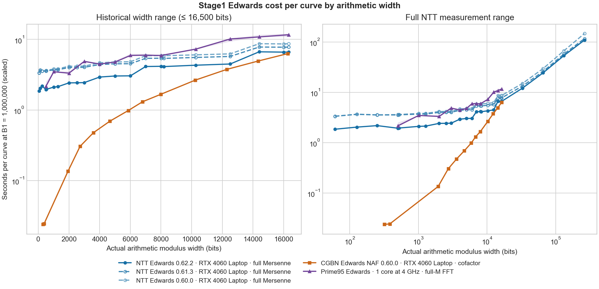

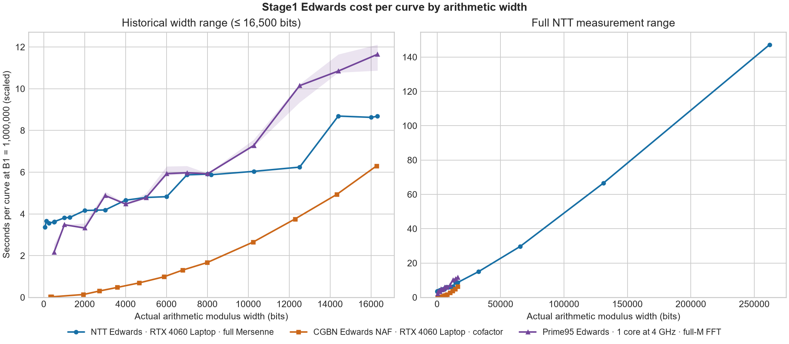

M16319 在 RTX 4070 Ti 上由 0.62.3 的 2.62 降至 0.62.4 的 **1.45 秒／曲线**。同指数的 CGBN NAF 余因子为 16272 位，耗时 1.49 秒／曲线，Prime95 单核为 11.65 秒／曲线。RTX 4060 Laptop 0.62.2 的 NTT 为 6.63 秒／曲线。主图的 M262139 在两张卡上均采用 30 条、16384 点加权 NTT，分别为 **108.90** 和 **28.48 秒／曲线**。4070 Ti 在额外的 1–128 条穷举中选到 45 条，实测为 **28.06 秒／曲线**。见 [代表位宽穷举](#代表位宽穷举)。

### Montgomery PARAM0

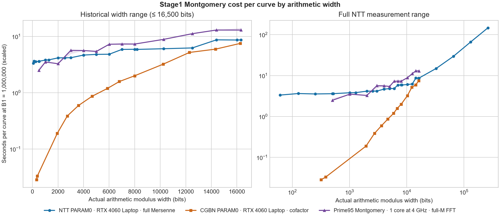

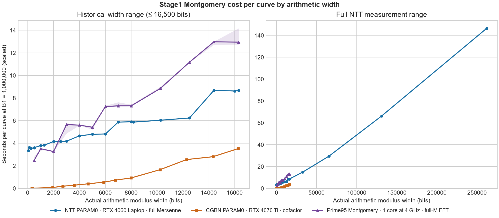

M16319 在 RTX 4070 Ti 上由 0.62.3 的 2.61 降至 0.62.4 的 **1.45 秒／曲线**。同指数的 CGBN PARAM0 耗时 1.71 秒／曲线，Prime95 单核为 12.95 秒／曲线。RTX 4060 Laptop 0.62.2 的 NTT 为 6.62 秒／曲线。M262139 在 4060 Laptop 和 4070 Ti 上分别为 **108.45** 和 **28.35 秒／曲线**。

### 样本与计时

- **RTX 4070 Ti NTT** 在 2610 MHz 上比较相同的 29 个完整梅森数（61–262139 位）。0.62.4 在 1–128 条范围自适应搜索，0.62.3 穷举 1–32 条。各版本用获选计划实测每种曲线三次，B1=1024 用于 M61、M127 和超过 20000 位的输入，其余用 B1=10000。两版都取阶梯 CUDA event 区间。见 [RTX 4070 Ti 全位宽矩阵](#rtx-4070-ti-全位宽矩阵)。
- **NTT 0.62.2** 使用 GPU1 RTX 4060 Laptop，覆盖 61–262139 位的 26 个完整梅森模数。每个指数重新测量 1–32 条曲线，在调优候选中选实测吞吐最高的计划。两种曲线复用计划，各跑三次真实 Stage1，取 ladder 的 CUDA event，排除准备、回读和发布。
- **RTX 4060 Laptop 历史 NTT** 与本卡 0.62.2 共用 26 个指数、B1 和阶梯计时边界，每指数各测三次。Edwards 最早一版是 0.60.0，Montgomery 是 0.59.9。跨版本曲线体现各版本的实现、计划和并行数。
- **CGBN 0.62.3** 使用两张 GPU，在相同的 13 个 318–16272 位余因子上按曲线族各测一批。两种曲线都采用主循环设备计时。见 [CGBN 两卡对照](#cgbn-两卡对照)。
- **Prime95** 使用 4.0 GHz 单核原生 Stage1 计时。Edwards 覆盖 29 个指数，Montgomery 覆盖历史的 13 个指数，每指数三次。历史数据 B1=1,000,000，Edwards 补测按各指数的 B1 归一化。图中按完整梅森指数定位，GWNUM 仍用原始 `k,b,n,c` 设置。日志未记录精确程序版本。见 [CPU 基准和补测](#prime95-单核基准与-b1-外推)。

GPU 用实际批次时间除以参加设备主循环的曲线数，再乘 `1,000,000 / B1`。NTT 排除曲线构造、初始化、末点回读、GCD 和发布。阴影覆盖两张 GPU 各自最新的 NTT 和 Prime95 三次样本的最小至最大值。RTX 4060 Laptop 的 0.62.2 相对 0.61.3，两类曲线各 26 个指数的中位耗时均下降，降幅中位数分别为 Montgomery **32.5%** 和 Edwards **32.8%**。4060 Laptop 上，PARAM0 的 NTT 在 M12511 和 M16319 的折算耗时较低，Edwards 的 13 个共有指数均以 CGBN 耗时较低。见 [RTX 4060 Laptop NTT 全位宽矩阵](STAGE1_MERSENNE_NTT.md#最佳配置全位宽矩阵) 与 [历史 Prime95 单核基准](#prime95-单核基准与-b1-外推)。

固定形状对照分别测量短逆变换、前向读入融合、块宽和进位的收益。0.62.3 另有 2560／5120 点归约与 16384 点单曲线调优的专项复测。见 [短逆变换](STAGE1_MERSENNE_NTT.md#短逆变换)、[前向 tile 与进位](STAGE1_MERSENNE_NTT.md#前向-tile-与进位)、[0.62.3 专项复测](STAGE1_MERSENNE_NTT.md#加权归约与-16384-点单曲线调优) 和 [同卡模平方对照](STAGE1_MERSENNE_NTT.md#同卡完整模平方与-prpll)。

绘图时，`--ntt` 读取 `data/experiments/stage1_forward_tile_0622/{mont,ed}/summary.json`。两个 `--previous-ntt` 分别读取 `stage1_ntt_segments/` 与 `stage1_unified_4060_0600/` 的同曲线报告。`--overlay-ntt` 读取 `stage1_ntt_128_0624/{mont,ed}128/` 的同曲线报告，以及 `stage1_4070ti_0623/` 的同曲线主矩阵和混合长度补测。`--comparison` 与 `--overlay-cgbn` 分别读取 `data/benchmarks/stage1_cgbn_curve_cost_0623/` 下的 GPU1 和 GPU0 同曲线汇总。Edwards 用 `--prime95-stage1` 读入补测工作行及日志。两类绘图 CSV 分别在 `data/figures/stage1_prime95_wide_20261112/ed/` 和 `data/figures/stage1_ntt_128_0624/mont0/`。见 [对比图脚本](../../tools/bench/plot_stage1_ntt_best.py)。

## Edwards 与 Montgomery 的 Stage1 耗时差

同一张卡上，对相同输入、B1 和批量计算 `100 × (Edwards 主循环耗时 / Montgomery PARAM0 主循环耗时 − 1)`。负值表示 Edwards 耗时较少。CGBN 横轴为剥除已知因子后的余因子位宽，NTT 横轴为完整梅森模数的位宽。

### CGBN 两卡对照

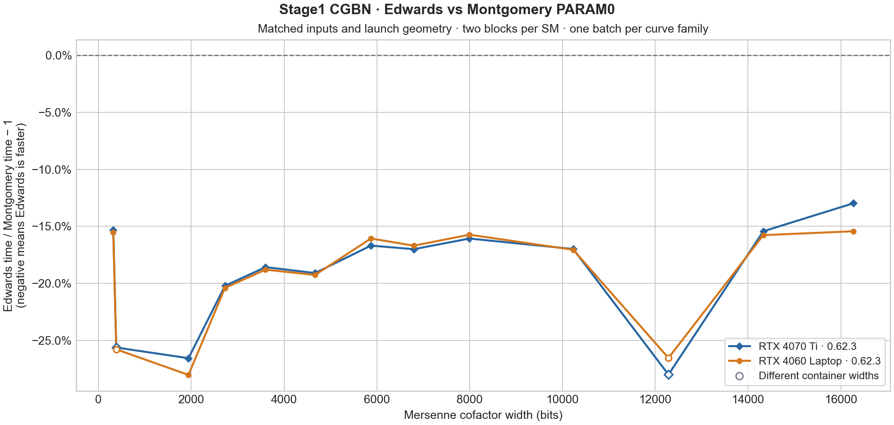

2026-11-12，两卡用同一份 ECM-ELF 0.62.3 测量版（CUDA 13.3.73、sm89、MSVC 14.51.36231、驱动 610.88），各测 13 个 318–16272 位余因子。每张卡先短跑预热两种曲线，再按指数交替安排 Edwards 和 PARAM0，正式测量每种曲线、每个输入一批。两卡均为 TPB128、每 SM 发射两个 block。同一张卡的两种曲线使用相同的 TPI、B1、批量和初始 sigma。按 TPI 4／8／16／32，B1 依次为 1,000,000／200,000／50,000／10,000。4070 Ti 批量为 3840／1920／960／480，4060 Laptop 为 1536／768／384／192。

Edwards 取原有 `loop_gpu_ms`，Montgomery 在测量版中另记每次主循环发射前后的 CUDA event 并求和。两者都排除初始化、Edwards 字典、回读、GCD 和发布。早期 4060 的全局 `gputime` 仍可从 `data/experiments/stage1_unified_4060_0600/cgbn/` 复算。见 [Edwards 计时](../../src/ecm/stage1/edwards/cuda/edwards_runtime.inl#L119) 与 [Montgomery 发射位置](../../src/ecm/stage1/montgomery/cuda/runtime.cu#L645)。

CGBN 的 Edwards 用 NAF w6 和 HWCD，每列倍点，只在非零列读取预计算字典并做加点。以 B1=1,000,000 为例，1,442,106 列中有 205,953 次加点。PARAM0 运行 Montgomery x-only ladder。M1009 的 Edwards／PARAM0 容器为 384／512 位，M12511 为 12288／13312 位。图中的空心点标记这两个容器不同的输入，耗时差也包含容器宽度的影响。见 [Edwards NAF 主循环](../../src/ecm/stage1/edwards/cuda/naf.cuh#L73) 与 [Suyama 阶梯](../../src/ecm/stage1/montgomery/cuda/arithmetic.cuh#L1007)。

在全部输入上 Edwards 耗时都较少。4070 Ti 少 **13.0%–28.0%**，中位数少 **17.0%**。4060 Laptop 少 **15.4%–28.0%**，中位数少 **17.1%**。容器位宽相同的 11 组，耗时降幅中位数分别为 17.0% 和 16.7%。

表中耗时为主循环设备时间除以实际批量，再折算到 B1=1,000,000，单位为秒／曲线。

| 指数 | 余因子位宽 | 实测 B1 | 批量 4070 Ti／4060 Laptop | 4070 Ti Edwards／PARAM0 | 4060 Laptop Edwards／PARAM0 |
|---:|---:|---:|---:|---:|---:|
| 503 | 318 | 1,000,000 | 3,840／1,536 | 0.005500／0.006494 | 0.023885／0.028270 |
| 1009 | 383 | 1,000,000 | 3,840／1,536 | 0.005624／0.007562 | 0.024438／0.032930 |
| 2003 | 1939 | 200,000 | 1,920／768 | 0.031725／0.043202 | 0.135139／0.187776 |
| 3001 | 2726 | 50,000 | 960／384 | 0.070295／0.088107 | 0.305214／0.383402 |
| 4001 | 3600 | 50,000 | 960／384 | 0.109791／0.134839 | 0.476803／0.587173 |
| 5003 | 4667 | 50,000 | 960／384 | 0.159605／0.197272 | 0.693136／0.858494 |
| 6011 | 5872 | 50,000 | 960／384 | 0.226654／0.272051 | 0.993936／1.184139 |
| 7001 | 6797 | 50,000 | 960／384 | 0.298918／0.360142 | 1.306516／1.568364 |
| 8011 | 7995 | 50,000 | 960／384 | 0.383124／0.456470 | 1.672664／1.984858 |
| 10267 | 10232 | 10,000 | 480／192 | 0.606120／0.730142 | 2.640145／3.182958 |
| 12511 | 12285 | 10,000 | 480／192 | 0.851749／1.183030 | 3.783275／5.150366 |
| 14401 | 14328 | 10,000 | 480／192 | 1.145714／1.354777 | 4.968195／5.898260 |
| 16319 | 16272 | 10,000 | 480／192 | 1.491098／1.713363 | 6.315766／7.468060 |

每 200 ms 采样，以下统计取 GPU 利用率至少 50% 的样本。4070 Ti 的 1126 个样本均为 2610 MHz，板功耗 19.07–193.31 W，功率上限读数 285 W。4060 Laptop 的 2571 个样本中有 2568 个为 1500 MHz，其余为 225 MHz，板功耗 2.38–26.83 W。52 个批次均完成，48,384 条保存记录的模数、坐标范围及校验值通过检查，两卡重合的 13,824 个保存点逐条一致。运行日志、遥测、测量版及 `verification.json` 位于 `data/experiments/stage1_cgbn_curve_cost_0623/`。

### NTT 两卡对照

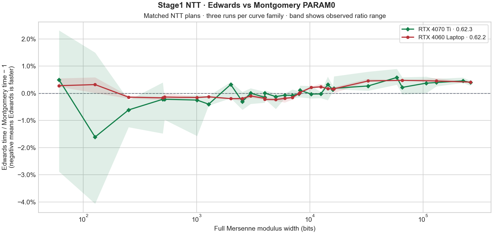

RTX 4070 Ti 使用 0.62.3 的 29 个指数，RTX 4060 Laptop 使用 0.62.2 的 26 个指数。同卡、同指数的两种曲线复用相同的卷积类型、变换长度、digit 位宽、pass、Graph 参数和批量。每种曲线取三次设备计时的中位数。阴影以 Edwards 最短／Montgomery 最长和 Edwards 最长／Montgomery 最短给出样本比值范围。55 组中有 **54 组的中位耗时差在 ±0.65% 内**。4070 Ti 的 M127 为 −1.61%，样本比值范围为 −4.06% 至 +1.50%。两张卡的有符号差异中位数分别约为 +0.01% 和 −0.05%。

Edwards 仍用 Atkin–Morain 构造曲线与初始点，主机用 `u = (1+y)/(1−y)` 转为 Montgomery x 坐标。Suyama PARAM0 直接准备自己的 Montgomery 初始点和曲线系数。两种初始状态随后都交给同一个 x-only 二进制阶梯。每步的差分加、倍点、NTT 乘法和进位执行同一套设备代码。曲线构造、归一化、因子检查和保存均在图用的阶梯计时之外。见 [Edwards 映射和 NTT 入口](../../src/ecm/stage1/montgomery/cuda/ntt/workflow.cpp#L88) 与 [共享阶梯步](../../src/ecm/stage1/montgomery/cuda/ntt/ladder.cu#L751)。

本批 Montgomery 使用 `lcm(1…B1)`，Edwards 使用其 48 倍。B1=1024 时两者分别执行 1478 与 1484 步，Edwards 多约 0.41%。B1=10000 时分别为 14446 与 14451 步，多约 0.035%。例如 M262139 的整段 Edwards 耗时在两张卡上分别多约 0.40% 与 0.41%，按各自步数归一化后差异均小于 0.01%。见 [标量构造](../../src/ecm/stage1/montgomery/cuda/ntt/workflow.cpp#L144)。

百分比图的 `--cgbn` 读取 `data/experiments/stage1_cgbn_curve_cost_0623/{gpu0,gpu1}/`。每个 `--ntt-pair` 按 Montgomery、Edwards 顺序传入同卡的两份 `summary.json`，分别使用 4060 的 0.62.2 矩阵、4070 Ti 的 0.62.3 主矩阵和 radix-5 补测。逐点数据 `cgbn_curve_delta.csv` 和 `ntt_curve_delta.csv` 保存在 `data/benchmarks/stage1_cgbn_curve_cost_0623/`。见 [百分比绘图脚本](../../tools/bench/plot_stage1_curve_cost.py) 与 [CGBN 工作行生成器](../../tools/bench/prepare_stage1_gpu_matrix.py)。

## 探寻最佳曲线并行数量

设 `B` 为曲线数，`T(B)` 为固定阶梯步数的整批设备耗时。追求吞吐量时选实测 `B/T(B)` 最大的批量。95% 档取达到峰值吞吐 95% 的最小实测批量。关心单批返回时间时直接比较 `T(B)`。

### RTX 4070 Ti 全位宽矩阵

ECM-ELF 0.62.4 在 RTX 4070 Ti 12 GiB 上重测 29 个 61–262139 位完整梅森数，包含 2560／5120／10240 点的 radix-5。每个指数用原生调优在 1–128 条范围比较线性和加权候选。每个候选先预热 100 步，再取三次 192 步样本的中位数。达到停止倍增的条件时会交替复测。本轮自适应搜索每个指数实际测了 21–34 个不同批量。Edwards 与 PARAM0 各按获选计划运行三次实际 Stage1。M251 的 Edwards 有两条曲线在构造时已找到因子，127 条中有 125 条进入阶梯，图表按 125 条摊销。

构建为 Windows CUDA 13.3.73、sm89、MSVC 14.51.36231。自适应调优和生产矩阵的 2478 个 GPU 利用率至少 50% 的遥测样本均为 2610 MHz，板功耗 17.90–246.19 W，功率上限读数 285 W。174 个生产批次逐组复核 20,676 条曲线结果，两个曲线族各有 898 条与 0.62.3 同 sigma 的记录，均一致。日志中的因子均通过整除检查。生产中显式分配和可用显存差值的较大值最高为 104 MiB，出现在 M131071 的 88 条 Edwards 批次。

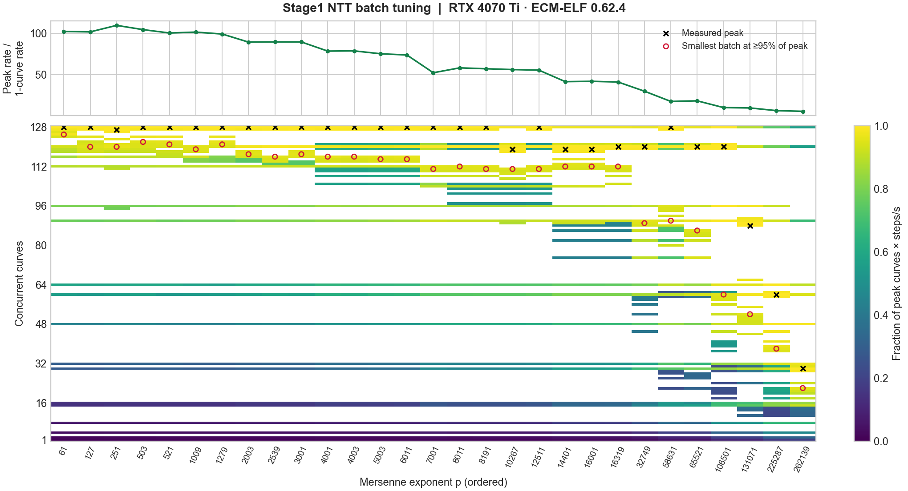

热图将每个指数的实测峰值设为 1，留白表示未采样。29 个指数中有 18 个在 128 条达到自适应搜索峰值，另 8 个在 119–127 条。M131071、M225287、M262139 的峰值批量依次为 88、60、30 条。相对 0.62.3 在 1–32 条内的实测峰值，阶梯吞吐倍率为 1.003–3.507 倍，中位数 **2.21 倍**。真实 Edwards 的每曲线设备耗时降幅中位数为 **54.7%**。

| 指数 | 峰值卷积／长度／正向层 | 峰值／95% 批量 | 95% 档占峰值 | Edwards µs／条／步 |
|---:|---|---:|---:|---:|
| 61 | weighted／2／`1` | 128／125 | 98.36% | 0.241 |
| 251 | linear／32／`5` | 127／120 | 96.30% | 0.265 |
| 1009 | weighted／64／`6` | 128／119 | 95.06% | 0.284 |
| 7001 | weighted／512／`9` | 128／111 | 95.10% | 0.629 |
| 16319 | weighted／1024／`10` | 120／112 | 95.36% | 1.005 |
| 58631 | weighted／2560／`r5+9` | 128／90 | 95.25% | 3.008 |
| 65521 | weighted／4096／`12` | 120／86 | 95.02% | 4.081 |
| 106501 | weighted／5120／`r5+10` | 120／60 | 95.58% | 5.783 |
| 131071 | weighted／8192／`3+10` | 88／52 | 95.70% | 9.413 |
| 225287 | weighted／10240／`r5+11` | 60／38 | 96.07% | 12.022 |
| 262139 | weighted／16384／`2+12` | 30／22 | 95.89% | 19.653 |

短变换可用更多曲线补足同批独立工作。大变换中单条曲线已有多个 tile 和较多归约工作，继续加曲线的边际收益下降。M106501 的 60 条已达峰值的 95.58%，调优窗口的整批时间比 120 条少 47.7%。M262139 的 30 条已接近饱和，扩大批量范围后，Edwards 的实测摊销耗时仅比 0.62.3 少约 0.1%。

0.62.4 的逐指数和逐批量数据在 `data/benchmarks/stage1_ntt_128_0624/`，原始调优表、生产日志、端点及遥测在 `data/experiments/stage1_ntt_128_0624/`。0.62.3 的 1–32 条历史矩阵和固定布局复测仍可从 `data/benchmarks/stage1_4070ti_0623/` 复算。见 [0.62.3 批量图](attachments/stage1-ntt-4070ti-0623-batches.png)、[矩阵采集脚本](../../tools/bench/bench_stage1_ntt_best.py) 和 [设备矩阵分析脚本](../../tools/bench/analyze_stage1_ntt_device_matrix.py)。

#### 代表位宽穷举

0.62.4 在同一 RTX 4070 Ti 对三个指数逐一测量 1–128 条。每个指数的线性和加权后端各有 128 个批量记录，预热、计时与选型口径同主矩阵。每个穷举赢家用真实 Edwards Stage1 跑三次，278 条与自适应批次同 sigma 的保存点逐条一致。GPU 利用率至少 50% 的 5931 个遥测样本均为 2610 MHz，板功耗 21.18–242.44 W，功率上限读数 285 W。宽档调优期间 GPU1 也运行了正确性测试。

| 指数 | 自适应峰值批量 | 穷举峰值／95% 批量 | 穷举峰值（曲线步／秒） | 自适应／穷举吞吐 |
|---:|---:|---:|---:|---:|
| 61 | 128 | 128／121 | 4,197,272 | 100.07% |
| 16319 | 120 | 120／114 | 992,589 | 99.30% |
| 262139 | 30 | 45／26 | 51,678 | 98.62% |

前两档峰值批量相同，生产摊销耗时相差不到 0.12%。M262139 的穷举调优耗时 1532 秒，自适应用 114 秒。45 条的三次真实 Edwards 设备计时折算后为 28.05–28.10 秒／曲线，30 条为 28.46–28.50 秒／曲线。两个获选批量在调优窗口中的显存峰值分别为 102 和 68 MiB。主矩阵和热图采用同一轮自适应结果，三个穷举结果单独保存在 `data/experiments/stage1_ntt_128_0624/exhaustive_ed/`。

### RTX 4060 Laptop 固定长度批量扫描

RTX 4060 Laptop GPU1、版本 0.58.11，对每个 `L` 独立扫描 1–8 条曲线。先用 B1=13 从 tile 6／8／10／12（超过 k 时截断、去重）筛每个批量，再用 B1=41、57 个 ladder 步、窗口 16 做复测。复测每格 2 个进程、每进程 3 个设备 event 样本，两轮反向遍历曲线数。176 个筛选进程与 96 个复测进程都与 GMP 核对。200 ms 遥测中利用率至少 20% 的 207 个样本均为 1500 MHz，整卡功耗 1.76–11.59 W、60–67 °C。原始记录在 `data/experiments/stage1_mersenne_ntt_20261109/` 的 `batches_final/summary.json` 和 `batch_gpu1_telemetry.csv`。计时边界见 [GPU1 算术探针实测](STAGE1_MERSENNE_NTT.md#gpu1-算术探针实测)。

这轮历史扫描的六档均是 **1 条最低批次延迟、8 条最高吞吐**。当前生产范围和显存预算见 [批量调优与显存](STAGE1_MERSENNE_NTT.md#批量调优与显存)。

| L | 模数位宽 | b | 1／4／8 条批次 ms | 8 条吞吐 / 单条 | 达 8 条吞吐 90% 的最小批量 | 延迟不超单条 1.25 倍的最大批量 |
|---:|---:|---:|---:|---:|---:|---:|
| 512 | 4003 | 28 | 3.730／3.873／4.257 | 7.01× | 8 | 8 |
| 1024 | 8191 | 27 | 4.622／4.960／6.174 | 5.99× | 8 | 6 |
| 2048 | 16001 | 27 | 6.420／8.285／10.824 | 4.75× | 8 | 3 |
| 4096 | 32749 | 26 | 10.593／17.018／23.292 | 3.64× | 7 | 2 |
| 8192 | 65521 | 26 | 24.726／38.858／54.472 | 3.63× | 7 | 1 |
| 16384 | 131071 | 25 | 60.960／109.868／165.832 | 2.94× | 6 | 1 |

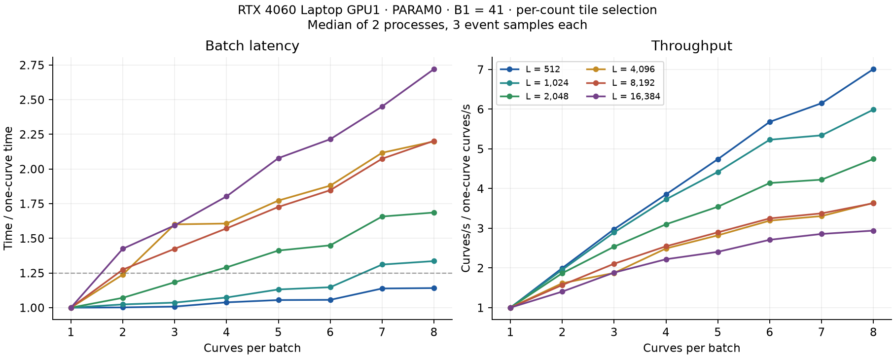

纵轴为归一化吞吐：批次吞吐 `B/T(B)` 除以**同一 NTT 长度**的单曲线吞吐 `1/T(1)`，即 `B·T(1)/T(B)`。各条线在 `B=1` 时均为 1；8 条时 `L=512` 为 7.01，`L=16384` 为 2.94。批次耗时中位数见上表。

曲线数增加的是同一 stream 中每个算术阶段的 `grid.y`。每位的三个 forward 批量是 `4B / 5B / 2B`，inverse 是 `4B / 4B / 2B`。一次 tile pass 的块数等于该次变换数乘 `L/2^t`。例如 `L=512,t=9`，第一层单曲线只有 4 块，8 条可给 32 块，让 24 SM 有更多独立工作；`L=16384,t=12` 时这一层单曲线已经有 16 块。较大的 L 还提高每条曲线的显存流量和归约工作，扩批的边际收益更小。较小 tile 增加块数但可能多一次 outer pass；因此 tile 也需按 `(L,B)` 筛选。比如 `L=2048` 的实测 1 条选 t=8，8 条选 t=11。

对最长的 `L=16384` 另以相同模数、B1=256、362 个 ladder 步复测（各 1 进程、3 样本，均核对 GMP）。1／6／7／8 条的批次为 148.333／346.801／398.682／448.982 ms，吞吐分别为 6.74／17.30／17.56／17.82 条/秒。6 条已达 8 条吞吐的 **97.1%**，批次延迟少 **22.8%**，适合作为该长度的折中；仍要最高吞吐时选 8 条。该复测的 18 个高利用率（≥20%）遥测点为 1500 MHz、3.24–21.69 W、62–66 °C，证据见 `batches_long_l16384/`。

复现批量扫描可用 `tools/bench/bench_stage1_mersenne_ntt.py --mode batches --rounds 2`，同时指定 `--probe` 与新 `--output` 路径。最长档的一曲线平均每步由 B1=41 的约 1.07 ms 变为 B1=256 的约 0.410 ms，两次计时合并了 Graph 尾部和中间操作数等成本。绘图参数 `--input` 指向扫描的 `summary.json`，`--output` 指向 `data/figures/` 下的 PNG。见 [批量吞吐绘图脚本](../../tools/bench/plot_stage1_ntt_batch_throughput.py)。

### RTX 4060 Laptop 各 NTT 长度的每步耗时

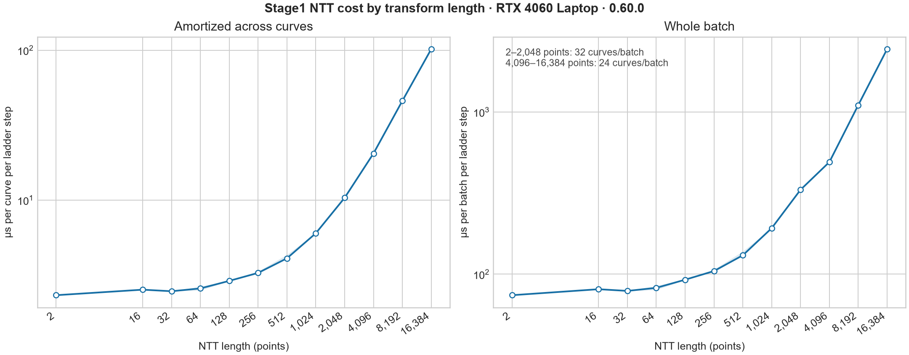

`iter` 是一次二进制阶梯步，对应一个标量 bit，每条活跃曲线各执行一次。整批每步为 `1000 × device_ms / steps`，再除以实际批量得到单曲线摊销值，单位均为微秒。图用 0.60.0 Edwards 的 26 个完整梅森指数、12 个 NTT 长度，B1 为 1024 或 10000。每个指数的设备 event 先取三次中位数，同一 NTT 长度再对各指数等权取中位数。阴影覆盖该长度的全部实测样本。RTX 4060 Laptop 的 582 个利用率至少 50% 的遥测点均为 1500 MHz，板功耗 2.85–34.76 W。

长度 512 时为 **4.09 µs/iter/曲线**，整批 32 条为 **130.76 µs/iter**。长度 16384 时为 **101.60 µs/iter/曲线**，整批 24 条为 **2.44 ms/iter**。长度 4096 起批量从 32 降至 24，左图的摊销耗时同时反映变换成本和批量变化。

统计表在 `data/benchmarks/stage1_ntt_radix5_0601/by-length.csv`。复现用 `--input` 读取 `data/experiments/stage1_unified_4060_0600/ed_ntt/summary.json`，用 `--figure`、`--steps-figure` 和 `--csv` 指定输出。见 [按长度统计和绘图脚本](../../tools/bench/plot_stage1_ntt_iter_cost.py)。

## RTX4070 Ti 全范围 Stage1 对比

2026-10-24 的测量覆盖同一组 **13 个梅森余因子、318–16272 bits**。GPU Edwards 为 **ECM-ELF 0.52.0**，Montgomery PARAM0 为 **0.52.2**，每模型、每输入各测一批（n=1）；Prime95 两类构造各有 **39 个有效单核样本**（每输入 n=3），CPU 由用户确认固定为 4.0 GHz。

Edwards 继续使用独立的主循环计时。新增 Montgomery 日志只有**包含初始化的全局计时**，因此作为单列参考，保留其真实边界。统一折算至 B1=1e6 后，Edwards 主循环成本为 **0.006198–1.704841 秒/曲线**，Montgomery 含初始化参考为 **0.012868–3.525354 秒/曲线**。两者不是同边界的算法性能比较，也不是端到端时间。

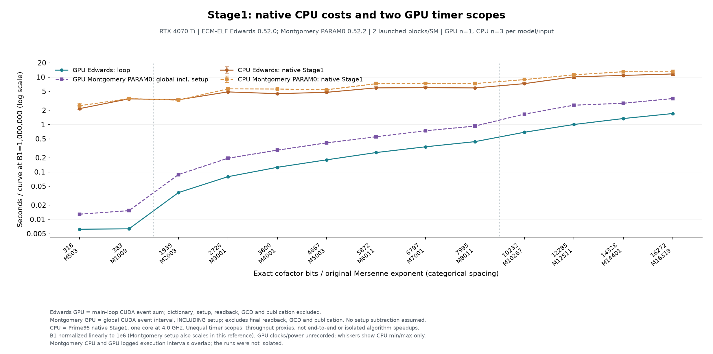

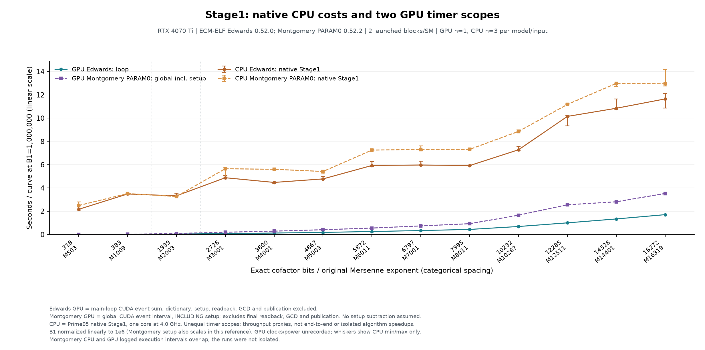

### 输入与工况

GPU START 工作行中的已知因子逐项通过整除验证，计算出的实际 N 位宽与原生 GPU 输出相符，并与 CPU 原工作行的分解目标一致。本节历史图的横轴使用目标余因子位宽。Prime95 的 ECM 参考源码用 `setN` 剥除已知因子以确定因子检查目标，GWNUM 的主循环仍按原始 `k,b,n,c` 建立 FFT。因此实际算术位宽对比图将 Prime95 放在完整梅森指数处。CPU screen 日志未记录已知因子列表及精确二进制版本。参见本地 Prime95 31.06b01 `ecm.cpp:1199,1220,6885,7208` 和 [按算术位宽对比](#stage1-ntt-与-cgbn-和-prime95-对比)。

两次 GPU 测量均使用 device 0、RTX4070 Ti、60 SM、TPB128、120 个 block，即发射 2 block/SM；实际驻留仍受资源约束。Edwards 为 NAF w6、HWCD 倍点，Montgomery 为 Suyama PARAM0。TPI4/8/16/32 对应 B1=1e6/2e5/5e4/1e4，批量为 3840/1920/960/480。不同构造使用各自的进位余量，容器不强制相同：M1009 的 Edwards/Montgomery 为 **384/512 bits**，M12511 为 **12288/13312 bits**；不能把这些点的差异全部归因于点运算公式。

Montgomery 原生运行日志直接记录卡名和 SM 数；Edwards 的 device 0 由分析时设备枚举对应到同一张 RTX4070 Ti，枚举时驱动为 610.88，完整设备身份保存在忽略的证据目录。**运行时 GPU 频率、功耗及其他并发负载未记录**。另外，Montgomery CPU 日志的执行时段约为 17:33–17:40，GPU 为 17:34–17:40，二者重叠；这是现有工况参考，不宣称隔离运行。精确 CPU 型号和 Prime95 版本未写入这两份 CPU 日志。

### 计时边界与完整矩阵

| 路径 | 采用计时 | 包含与排除 |
| --- | --- | --- |
| GPU Edwards | `loop_gpu_ms` | NAF 主循环每次发射前后 CUDA event 区间累计；排除字典、初始化、切片后坐标回读/导入、主机回调、GCD、save 和结果发布 |
| GPU Montgomery PARAM0 | `gputime` | 从 `global_start` 到末次切片 `stop` 的 CUDA event 区间；包含标量传输、曲线初始化、分配/准备及期间的主机提交间隙，排除末次结果回读、GCD、save 和结果发布 |
| CPU Prime95 | `Stage 1 complete ... Total time` | 原生 Stage1 时间，包含字典等 Stage1 工作；排除 Stage2 及整进程启动 |

实现依据为 Edwards 的 `src/ecm/stage1/edwards/cuda/edwards_runtime.inl:96–123`、`workflow.cpp:225`，以及 Montgomery 的 `src/ecm/stage1/montgomery/cuda/runtime.cu:194,673–674,763`。`GPU Edwards NAF` 汇总行是在主循环结束后输出，不能用它到 save 行的墙钟间隔代表主循环。CUDA event 区间不称 profiler 的纯 kernel 时间；嵌套的 `api_seconds` 不重复相加。

按实测批量 C、B1 和所选计时 T 计算 `GPU秒/曲线@1e6 = T / C × (1e6/B1)`。后 11 组是线性外推。**Montgomery 的该折算会同时放大固定准备开销**，不是扣除初始化后的主循环成绩，也不是在目标 B1 重测的总时间；没有用日志秒级时间戳估计并扣除准备成本。

| M 指数 | N bits | 实测 B1 | 曲线/批 | Ed 主循环秒/批 | Mont 全局秒/批 | Ed 秒/曲线@1e6 | Mont 秒/曲线@1e6 |
| ---: | ---: | ---: | ---: | ---: | ---: | ---: | ---: |
| 503 | 318 | 1,000,000 | 3,840 | 23.802016 | 49.413900 | 0.006198 | 0.012868 |
| 1009 | 383 | 1,000,000 | 3,840 | 24.240707 | 58.623500 | 0.006313 | 0.015267 |
| 2003 | 1939 | 200,000 | 1,920 | 14.076281 | 33.736000 | 0.036657 | 0.087854 |
| 3001 | 2726 | 50,000 | 960 | 3.808978 | 9.331060 | 0.079354 | 0.194397 |
| 4001 | 3600 | 50,000 | 960 | 6.007012 | 13.830800 | 0.125146 | 0.288142 |
| 5003 | 4667 | 50,000 | 960 | 8.648950 | 19.705300 | 0.180186 | 0.410527 |
| 6011 | 5872 | 50,000 | 960 | 12.308746 | 26.525200 | 0.256432 | 0.552608 |
| 7001 | 6797 | 50,000 | 960 | 16.276028 | 35.425700 | 0.339084 | 0.738035 |
| 8011 | 7995 | 50,000 | 960 | 20.898027 | 44.541500 | 0.435376 | 0.927948 |
| 10267 | 10232 | 10,000 | 480 | 3.298233 | 7.962240 | 0.687132 | 1.658800 |
| 12511 | 12285 | 10,000 | 480 | 4.804200 | 12.262400 | 1.000875 | 2.554667 |
| 14401 | 14328 | 10,000 | 480 | 6.415296 | 13.484000 | 1.336520 | 2.809167 |
| 16319 | 16272 | 10,000 | 480 | 8.183239 | 16.921700 | 1.704841 | 3.525354 |

两模型 13 个实测批次的计时之和分别为 **152.767714 秒（Edwards 主循环）**、**341.763300 秒（Montgomery 全局）**，只是不同 B1/批量的事件时间求和。各输入折算至 B1=1e6 后的一曲线成本之和分别为 **6.194114**、**13.775634 秒**。

### GPU 型号与 CPU 等效核心数

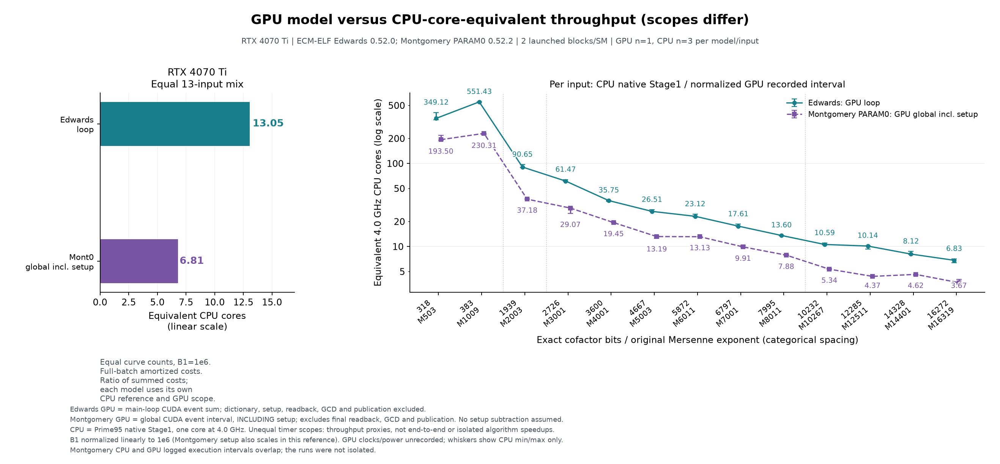

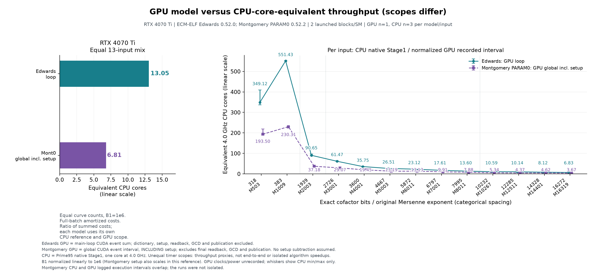

各构造使用自己的 Prime95 单核中位数作分子：`K = CPU秒/曲线@1e6 ÷ GPU折算秒/曲线@1e6`。每个数据点标注对应的等效核心数，保留两位小数，文字颜色与曲线一致。Edwards 逐输入为 **6.83–551.43 核**，Montgomery 含初始化参考为 **3.67–230.31 核**。范围线只表示 CPU 三个样本的 min/max，不包含尚未测量的 GPU 波动，不是置信区间。

左图采用明确的等输入组合：13 个输入在 B1=1e6 下各占相同曲线数量，GPU 保持本次满批次摊销成本。按 `K_mix = Σ CPU中位秒/曲线 ÷ Σ GPU折算秒/曲线`，得到 **RTX4070 Ti Edwards 主循环 ≈ 13.05 个本次 4 GHz CPU 核心**（80.838/6.194114），**Montgomery 含初始化参考 ≈ 6.81 核**（93.781/13.775634）。不对逐输入倍率作算术平均；这些数字不是只提交 13 条单曲线时的延迟，也不是多核 CPU 实测扩展比。两条路径的计时边界、版本和运行时段不同，不能用 13.05/6.81 声称算法加速倍数。

M503/M1009 的 Edwards 容器和批量相同，主循环时间接近；CPU 却分别采用 FMA3/32 和 AVX-512/128，因此等效核数可相差很大。大位宽的 Edwards 约 6.83–10.59 核，Montgomery 参考约 3.67–5.34 核；小位宽的数百核结果不能当成整张卡的固定等价。

### 证据与复现

Edwards 来源为 `tools/benchmarks/stage1/screen_e.log`，Montgomery 为 `screen_m1.log`。后者开头附带同一批旧 Edwards 记录，**只提取后半部 0.52.2 的 13 个 PARAM0 任务**，不重复计数。26 个 GPU 样本均有完整批次 save 和结果发布；Edwards 的队列中断发生于第 13 批发布之后，Montgomery 记录完成 13 个任务。页眉的全局 `param3` 默认值不代替各任务的曲线选择，实际以 typed save、`queue_save` 及原生 GPU 输出核对。

| 数据 | 原始快照、参考快照与设备枚举 | 逐项汇总、来源行号与 CSV |
| --- | --- | --- |
| Edwards 0.52.0 | `data/experiments/stage1_gpu_0_52_0_20261024/ed_4070ti_01/` | `data/benchmarks/stage1_gpu_0_52_0_20261024/ed_4070ti_01/` |
| Montgomery 0.52.2 | `data/experiments/stage1_gpu_0_52_2_20261024/mont0_4070ti_02/` | `data/benchmarks/stage1_gpu_0_52_2_20261024/mont0_4070ti_02/` |

每个汇总目录包含 `summary.json` 和 `comparison.csv`；新对比图 PNG/SVG 位于 `data/figures/stage1_gpu_0_52_2_20261024/mont0_4070ti_02/`，正文引用 PNG 副本置于本页 `attachments/`。核对范围为因子整除、输入身份、容器/进位余量、TPI/批量、计时及完成记录，没有据此宣称独立末点数学验算。

[analyze_stage1_gpu.py](../../tools/bench/analyze_stage1_gpu.py) 不启动 GPU 计算。Edwards 复算可使用默认 `screen_e.log` 与旧 CPU 汇总；新增 Montgomery 和两模型对比图从仓库根目录运行：

```powershell
python tools/bench/analyze_stage1_gpu.py --model mont0 `
  --log tools/benchmarks/stage1/screen_m1.log `
  --cpu data/benchmarks/stage1_prime95_mont_20261024/summary.json `
  --device-map data/experiments/stage1_gpu_0_52_0_20261024/ed_4070ti_01/device-map.csv `
  --sm-count 60 `
  --evidence data/experiments/stage1_gpu_0_52_2_20261024/mont0_4070ti_02 `
  --output data/benchmarks/stage1_gpu_0_52_2_20261024/mont0_4070ti_02 `
  --figures data/figures/stage1_gpu_0_52_2_20261024/mont0_4070ti_02 `
  --compare data/benchmarks/stage1_gpu_0_52_0_20261024/ed_4070ti_01/summary.json `
  --attachments docs/performance/attachments
```

**待验证**：Montgomery 独立主循环计时、4060 Laptop 全范围测量、隔离运行的重复样本及运行时 GPU 工况。保留当前计时实现，本次仅分析现有日志。

## Prime95 单核基准与 B1 外推

历史 13 档的两类曲线均为 B1=1,000,000、4.0 GHz 单核，每输入 3 个有效计时。日志将 worker 绑定到逻辑 CPU 1，并报告 AMD Zen 架构。精确 CPU 型号、Prime95 版本及 CPU 功耗未记录。Montgomery 是日志中的曲线构造名称，Suyama sigma 与 PARAM0 的对应参照 Prime95 `ecm.cpp:4960–4961,7359`。

Edwards 的 M4001 使用补测 curve 2、3、4，按用户指定排除 curve 1 的 **4.995 秒**预热；原日志中该输入直接恢复 Stage2，没有 Stage1 计时。其余 12 组保留全部三次完成计时，合计 **39 个有效样本、1 个排除预热**。Montgomery 全部 13×3=**39 个有效样本**，不额外丢弃 curve 1。任务完成行中的曲线总数不代替实测样本数。

下表单位为秒/曲线，取原生 Stage1 中位数和实测 min…max；两类曲线的 FFT 档位逐输入一致。其曲线 sigma 不同，不宣称同一条曲线的端点配对。

| M 指数 | 原任务余因子 bits | Stage1 FFT | Ed 中位数 | Ed min…max | Mont 中位数 | Mont min…max |
| ---: | ---: | --- | ---: | --- | ---: | --- |
| 503 | 318 | FMA3 / 32 | 2.164 | 2.089…2.540 | 2.490 | 2.457…2.814 |
| 1009 | 383 | AVX-512 / 128 | 3.481 | 3.480…3.483 | 3.516 | 3.418…3.524 |
| 2003 | 1939 | AVX-512 / 128 | 3.323 | 3.265…3.548 | 3.266 | 3.265…3.288 |
| 3001 | 2726 | AVX-512 / 256 | 4.878 | 4.873…5.062 | 5.651 | 4.863…5.774 |
| 4001 | 3600 | AVX-512 / 256 | 4.474 | 4.405…4.496 | 5.603 | 5.581…5.629 |
| 5003 | 4667 | AVX-512 / 256 | 4.777 | 4.743…4.988 | 5.416 | 5.210…5.504 |
| 6011 | 5872 | AVX-512 / 384 | 5.929 | 5.841…6.278 | 7.253 | 7.253…7.326 |
| 7001 | 6797 | AVX-512 / 384 | 5.971 | 5.918…6.299 | 7.311 | 7.233…7.629 |
| 8011 | 7995 | AVX-512 / 384 | 5.921 | 5.887…5.945 | 7.315 | 7.267…7.421 |
| 10267 | 10232 | AVX-512 / 512 | 7.279 | 7.223…7.562 | 8.856 | 8.842…9.006 |
| 12511 | 12285 | AVX-512 / 640 | 10.146 | 9.346…10.223 | 11.175 | 11.160…11.226 |
| 14401 | 14328 | AVX-512 / 768 | 10.846 | 10.774…11.646 | 12.980 | 12.720…13.003 |
| 16319 | 16272 | AVX-512 / 768 | 11.649 | 10.870…12.115 | 12.949 | 12.742…14.178 |

两组成本随 FFT 档位呈分段变化，不拟合成严格按位宽递增的曲线。Edwards M503 的 max/min−1 为 21.6%，Montgomery M3001 约为 18.7%，均保留原始离散。13 个输入的 CPU 中位数之和为 Edwards **80.838 秒**、Montgomery **93.781 秒**，只描述本次组合，不能排除不同运行时段与并发负载的影响。

B1 按用户指定的线性关系外推，**不是对应 B1 的重新实测，也不是多 B1 拟合**：

\[
T_{\rm CPU}(B_1)=T_{\rm CPU}(10^6)\frac{B_1}{10^6}.
\]

B1=11e6/44e6 分别乘以 11/44；例如 M16319 的 Edwards 为 **128.139/512.556 秒**，Montgomery 为 **142.439/569.756 秒**。完整 13 输入的两档外推均保存在各自 `summary.csv`、`summary.json`；这里只沿 B1 外推，不跨位宽插值，也不按频率修正其他历史 GPU/CPU 样本。

| 曲线 | 原始输入（`tools/benchmarks/prime95/`） | 原始快照 | 统计与外推 |
| --- | --- | --- | --- |
| Edwards | `screen_stage1_1e6.log`、`补充4001移动到原文件忽略curve1预热.log` | `data/experiments/stage1_prime95_20261024/` | `data/benchmarks/stage1_prime95_20261024/` |
| Montgomery | `screen_stage1_mont_1e6.log` | `data/experiments/stage1_prime95_mont_20261024/` | `data/benchmarks/stage1_prime95_mont_20261024/` |

计时读取原生 `Stage 1 complete ... Total time`，排除 Stage2 初始化、主循环及 GCD，也不是整进程墙钟。Prime95 参考源码 `ecm.cpp:7420,7682` 显示其 Stage1 范围覆盖指数/字典处理、主循环、末点检查及向 Montgomery 的转换，曲线初始构造在前。日志显示后续 Stage2 会自动扩大 B2，相关时间不加入本表。

### Edwards 扩展矩阵

2026-11-12 的 `tools/benchmarks/prime95/screen_ed_matrix.log` 覆盖 16 个新指数、48 个原生 Stage1 计时。单 worker 绑定逻辑 CPU 1，沿用 4.0 GHz 单核工况。工作行均为 B2=B1，计时截止于 `Stage 1 complete`，其后的独立 Stage1 GCD 单列在日志中。版本和功耗未记入日志。用 `1000000 / B1` 分别缩放三条计时，取中位数和最小／最大值绘图。6 次发现因子的日志值均整除相应梅森数，补跑样本按不同 sigma 计入。

| 指数 | B1 | Stage1 FFT | 中位秒／曲线 | 折算秒／曲线 @ B1=100 万 |
|---:|---:|---|---:|---:|
| 61 | 5,000,000 | Barrett FMA3／32 | 20.062 | 4.012 |
| 127 | 5,000,000 | Barrett FMA3／32 | 22.629 | 4.526 |
| 251 | 5,000,000 | Barrett FMA3／32 | 28.340 | 5.668 |
| 521 | 3,000,000 | FMA3／32 | 5.500 | 1.833 |
| 1279 | 3,000,000 | AVX-512／128 | 7.908 | 2.636 |
| 2539 | 3,000,000 | AVX-512／128 | 7.713 | 2.571 |
| 4003 | 2,000,000 | AVX-512／256 | 7.598 | 3.799 |
| 8191 | 1,500,000 | AVX-512／384 | 7.888 | 5.259 |
| 16001 | 1,000,000 | AVX-512／768 | 9.623 | 9.623 |
| 32749 | 400,000 | AVX-512／1536 | 7.908 | 19.770 |
| 58631 | 200,000 | AVX-512／3072 | 8.606 | 43.030 |
| 65521 | 200,000 | AVX-512／3072 | 8.698 | 43.490 |
| 106501 | 100,000 | AVX-512／5120 | 7.586 | 75.860 |
| 131071 | 75,000 | AVX-512／7168 | 8.353 | 111.373 |
| 225287 | 50,000 | AVX-512／10752 | 9.528 | 190.560 |
| 262139 | 50,000 | AVX-512／12800 | 11.108 | 222.160 |

M61–M251 使用 Barrett，三个档位的中位时间为 20.062–28.340 秒。其余 13 档为 5.500–11.108 秒。全部 48 次的原生 Stage1 时间合计 541.449 秒。Edwards 主图由本轮 16 点加原 13 点组成，Montgomery 主图使用原 13 点。补测绘图数据在 `data/figures/stage1_prime95_wide_20261112/ed/comparison.csv`，通过 `--prime95-stage1 WORKTODO SCREEN_LOG` 复算。见 [补测工作行与工况](../../tools/benchmarks/prime95/README.md#stage1-主图补测矩阵)。

复算入口为 [analyze_prime95_stage1.py](../../tools/bench/analyze_prime95_stage1.py)，Edwards 保持原补测及预热排除参数；Montgomery 使用 `--curve-type Montgomery`，指定各自输出目录以保留独立证据：

```powershell
python tools/bench/analyze_prime95_stage1.py --cpu-ghz 4.0 `
  --log tools/benchmarks/prime95/screen_stage1_mont_1e6.log `
  --curve-type Montgomery `
  --evidence-dir data/experiments/stage1_prime95_mont_20261024 `
  --output data/benchmarks/stage1_prime95_mont_20261024 `
  --figures data/figures/stage1_prime95_mont_20261024
```

### 匹配 GPU 工作行

[prepare_stage1_gpu_matrix.py](../../tools/bench/prepare_stage1_gpu_matrix.py) 为每张卡生成两类曲线、每条件一次的 `ECMSTAGE1=` 工作行，保存点前缀 `e_` / `m0_` 选择构造，文件名末尾提供 B1；B2=B1、skip_curves=0，不自动续算 Stage2。分别按实际余因子位宽与设备元数据的进位余量选择最小可用容器，Edwards/Montgomery 为 1/6 bits，不共用容器结果。

TPB128，批量 `C=2×SM数×(TPB/TPI)`：4070 Ti（60 SM）为 3840/1920/960/480，4060 Laptop（24 SM）为 1536/768/384/192，分别对应 TPI4/8/16/32。独立配置、工作行及生成计划位于 `data/experiments/stage1_gpu_tpi_2blocks_sm_20261024/{rtx4070ti,rtx4060_laptop}/`；当前 GPU 测量覆盖与计时限制以[本页完整矩阵](#rtx4070-ti-全范围-stage1-对比)为准。生成只查询程序/设备元数据，不启动 ECM 计算；原始日志与结果不进入公共 Git。

## CPU Stage1 算术对照

### CPU IFMA 和差复用与 PRAC

ECM-ELF 0.62.15，Windows，Ryzen AI 9 HX 370，MSVC 14.51.36231 和 GMP 6.3.0 Zen3。生产对照固定逻辑 CPU 1，一次八条曲线（sigma=26…33），定期检查点关闭。未独立采样频率和功耗。每格取三次交错运行的中位数，单位为从进程启动至退出的秒／八曲线批。

下表三种运行使用相同的输入与缓存。分开计算和差的 ladder 来自同一版的对照构建。两个 ladder 和 PRAC 都得到相同的归一化末点，54 批的 432 条记录逐条相符。此矩阵无因子和二进制重放。

| 输入 | B1=B2 | 分开计算和差的 ladder | 复用和差的 ladder | PRAC（缓存命中） |
| --- | ---: | ---: | ---: | ---: |
| M521 | 100,000 | 0.341 | 0.306 | 0.305 |
| M1279 | 100,000 | 0.811 | 0.773 | 0.741 |
| M2203 | 50,000 | 0.932 | 0.881 | 0.857 |
| M4253 | 20,000 | 1.087 | 1.046 | 0.992 |
| M11213 | 7,500 | 1.891 | 1.832 | 1.711 |
| M16057 | 4,000 | 1.880 | 1.846 | 1.694 |

复用和差的 ladder 整批耗时降低 1.8%–10.3%。PRAC 在 M521 基本持平，其余五档在此基础上降低 2.7%–8.2%。另一组关闭缓存、`B1=B2=100000` 的对照中，M521 的 PRAC 计算段为 0.22 秒，梯形法为 0.25 秒，计入建计划后整进程为 0.356 对 0.335 秒。M4001 命中因子触发复核，PRAC 加重放约 8.97 秒，对照 ladder 约 4.63 秒。冷启动对照使用分开计算和差的 ladder。默认采用复用和差的 ladder，PRAC 由 `cpu_mont_chain = "prac"` 显式启用。

Edwards 的成对模加减在独立八曲线对照的六档（521–16001 位）降低中位耗时 0.4%–2.7%。这组数据固定逻辑 CPU 6，NAF w8，B1 随位宽为 120000、65000、20000、10000、3000、1100。每条件六个计时样本，含 NAF 编码、点乘和结果导出，曲线与字典预先准备。六档的 54 个对照进程均得到相同的八路投影坐标和 GCD。生产进程对照中，六档变化为约慢 0.9% 至快 3.9%。

生产回归另核对 56 条 Montgomery 记录，覆盖素数幂边界、`lcm=1|12`、梅森折叠、强制 REDC 和命中重放。PRAC 自身中断续跑与旧版 ladder 向新版恢复各通过八条曲线。两线程命中样本的 16 条存档也一致。

原始墙钟与存档见 `data/experiments/cpu_stage1_prac_06215/` 的 `fused-hot/`、`matrix/`、`correctness-final/` 和 `config-final-2/`。Edwards 独立点乘证据见 `data/experiments/cpu_stage1_edwards_addsub/timing.json`。点乘链和恢复格式见 [Stage1 架构](../architecture/STAGE1.md#cpu-执行与共享主机准备)。

### avx-ecm 单核对照

对照 [独立版 avx-ecm `118e015`](../reference/AVX_ECM.md) 与 ECM-ELF 0.62.14。Windows 主机为 Ryzen AI 9 HX 370，两者固定逻辑 CPU 1，本轮未独立采样实际频率或功耗。输入为完整梅森数，十档覆盖 127–4093 位。`B1=B2=100000`，各档每路径运行三次，主矩阵交错运行，32 位掩码修正随后单独补测。52 位与 ECM-ELF IFMA 每批 8 条（sigma=26…33），32 位每批 16 条（sigma=26…41）。Montgomery 对照均使用 Suyama PARAM0 和未乘额外挠子因子的素数幂标量。ECM-ELF Edwards 使用 NAF w8，提供不同曲线构造下的吞吐参考。

avx-ecm 用 GCC 15.2 `-O3 -march=znver5` 构建，链接与 ECM-ELF 相同的 GMP 6.3.0 Zen3 DLL。Windows 构建修改了字符串声明及 64 位 GMP 接口，独立克隆保留原样。两份实验构建另行标记。一份只将 52 位 IFMA 的载体识别上限从 2047 位放宽到 4096 位，另一份只修正 32 位梅森加减的两处掩码。ECM-ELF 使用 MSVC 14.51.36231，关闭指数缓存和周期检查点。

左图使用 avx-ecm 原生日志的 Stage1 时间，从曲线构造完成后开始，至最终 GCD 和 save 写入前结束。右图统一使用进程启动至退出的墙钟。avx-ecm 在启动时筛至 \(10^8\)，与本次 B1 无关，计入右图。两图均按实际曲线数摊销，点为三次中位数，误差线为最小到最大实测值。只绘制通过存档和因子校验的 avx-ecm 档位。

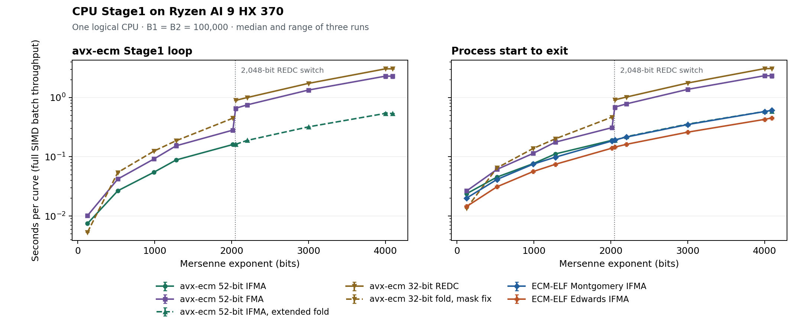

原版梅森路径中，52 位 IFMA 的 Stage1 循环吞吐是 52 位 FMA 的 1.36–1.75 倍。跨过 2048 位后，原版 IFMA 通用 REDC 未通过校验。M4001 上，通过校验的原版 52 位 FMA REDC 为 2.335 秒／曲线，扩展识别版 52 位 IFMA 折叠为 0.582。后者与 ECM-ELF Montgomery 的 0.580 基本持平。ECM-ELF Edwards 为 0.428，较该扩展版少约 26.5% 墙钟。FMA REDC 与 IFMA 折叠的差值同时含指令路径和归约方式的变化。

扩展识别版与 ECM-ELF Montgomery 在 2053–4093 位的五个墙钟中位数相差不超过 4.1%。修正掩码后，32 位梅森内核仅在 M127 的采样点领先 52 位 IFMA，Stage1 循环为 0.0053 对 0.0075 秒／曲线。在 M521–M2017 的四个采样点，32 位用时为 52 位 IFMA 的约 2.0–2.8 倍。16 lane 的优势在这些档位抵不过 32 位算术的开销。

用 ECM-ELF PARAM0 对拍 1,320 条存档，覆盖 32 位构建的全部 16 条 lane，比较可逆分母的仿射 X、不可逆分母的 GCD 和报告因子。原版 32 位梅森路径有 120 条奇数索引 lane 与参考结果不符，修正掩码后 240 条全部通过。原版 52 位 IFMA REDC 在本次五个 2K 以上输入的 120 条记录均不符。另以独立 Python 整数梯在 `B1=1000` 完成 120 项检查，复现 M991、M4001 在 sigma 26 的已知因子 8218291649、24007。

原始日志、Stage1 存档与验证结果位于 `data/experiments/avx_ecm_4k/`。本地构建脚本、补丁和编译日志位于 `data/experiments/avx_ecm_build_probe/`。单次测试示例为 `avx-ecm-ifma52.exe "2^991-1" 8 100000 1 100000 26`，应在独立目录运行，因为上游以追加方式写 `save_b1.txt`。从仓库根目录用 [绘图脚本](../../tools/bench/plot_avx_ecm_stage1.py) 复现对照图。

```powershell
$bench = 'data/experiments/avx_ecm_4k'
python tools/bench/plot_avx_ecm_stage1.py "$bench/matrix/bench.json" `
  "$bench/matrix/verification.json" --supplement "$bench/maskfix/bench.json"
```

### 单核 Edwards 16K 矩阵

ECM-ELF 0.62.13 与 Prime95 31.7b1 在同一台 Windows 主机上交错运行。Ryzen AI 9 HX 370 固定逻辑 CPU 1，沿用 4.0 GHz 设置，未独立采样频率和功耗。14 档输入均为完整梅森数，指数从 127 到 16319 位。B1=B2=100,000，各档每种路径三次，关闭指数缓存和周期检查点。Prime95 与 GMP 单条均为 sigma=26，IFMA 每批跑 sigma=26…33。ECM-ELF 使用 MSVC 14.51.36231 与 GMP Zen3，固定宽度 GMP 及 IFMA 均用 NAF w8。

图中 Prime95 取原生 Stage1 墙钟，ECM-ELF 取从进程启动到退出的墙钟，含指数生成、曲线构造、GCD 和 save 发布。IFMA 批次耗时除以 8 表示吞吐量对应的秒／曲线。点为中位数，误差线为最小到最大实测值。GMP 的固定宽度上限为 10240 位，之后由 Edwards `mpz` 二进制点乘接管，图中以蓝色虚线单列。两幅图使用同一批数据。

IFMA 实线使用 0.62.13 自动分派，橙色虚线使用同一版直接折叠并关闭 Karatsuba 的本地对照构建。对照仅将共享 IFMA 算术的两处分派深度固定为 0，其余链接对象相同。竖线标出 Karatsuba 模乘从 4213 位启用、平方从 8165 位启用。低于 4213 位时两线复用原实测样本，因此重合。从 M4253 起，两个构建在同一位宽各交错跑三次，逐批比较 save。图中的宽位 GMP 样本来自显式 `scalar`，自 0.62.14 起此模式需显式选择。

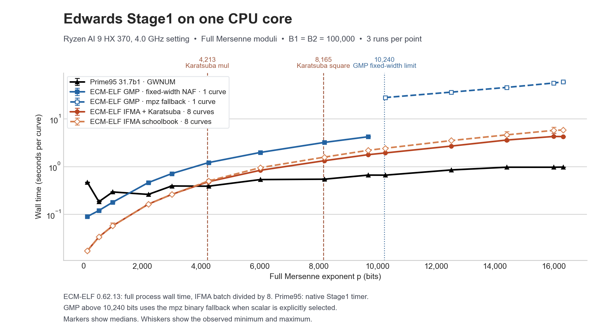

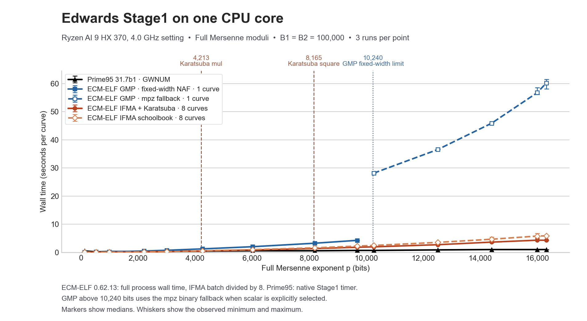

以图中的计时口径计算，GMP 单曲线在 M991 仍为 Prime95 的 1.64 倍，到 M2203 已落后。IFMA 八曲线吞吐在 M3001 约为 Prime95 的 1.50 倍，M4253 降到 0.81 倍。GMP 从 M9689 的 4.254 秒上升到 M10267 的 28.155 秒，两个样本跨过固定宽度 NAF 的上限。最大档 M16319 的 Prime95、GMP、IFMA 分别为 0.983、60.206、4.284 秒／曲线。

Karatsuba 在九档交错对照中将 IFMA 批次墙钟中位数降低 3.5%–27.0%。M4253 仅启用 Karatsuba 模乘，降幅为 3.5%。M8191 同时启用模乘与平方，降幅为 15.8%。M16319 从 5.868 降至 4.284 秒／曲线。

原三路矩阵共采集 126 个计时样本。42 组 sigma=26 的 GMP 与 IFMA 存档一致，三条路径在该 sigma 下的因子结果一致。ECM-ELF 报告的 40 组不同指数、sigma 和因子组合均通过整除核对。Karatsuba 对照另采集 54 批，432 条存档按位宽和 sigma 核对一致。

原始三路矩阵和 IFMA 对照分别位于 `data/experiments/stage1_cpu_16k_06213/matrix/` 与 `data/experiments/stage1_cpu_16k_06213/karatsuba_ab/`。从仓库根目录运行 [绘图脚本](../../tools/bench/plot_stage1_cpu.py) 可复现两图。

```powershell
python tools/bench/plot_stage1_cpu.py data/experiments/stage1_cpu_16k_06213/karatsuba_ab/paired.json `
  --ecm-version 0.62.13 --prime95-version 31.7b1 --output data/figures/stage1_cpu_16k_06213
```

### 0.62.7 的单核 Edwards 对照

Ryzen AI 9 HX 370，Windows，两个程序都固定到逻辑 CPU 1，各用一个 worker。沿用 4.0 GHz 设置，未独立采样频率或功耗。ECM-ELF 0.62.7 使用 MSVC 14.51.36231 本机构建、GMP Zen3、Edwards NAF w8，关闭指数缓存和周期检查点。Prime95 31.7b1 使用 Edwards 与 AVX-512 GWNUM。输入为完整的 M991、M2203、M4253、M8191，B1=B2=100,000。单曲线均固定 sigma=26，IFMA 每批使用 sigma=26…33。每格交错运行三次，取中位数。

Prime95 列取原生日志的 Stage1 墙钟时间。ECM-ELF 列取进程启动到退出的墙钟时间，含指数、字典、GCD 和 save 发布。IFMA 整批耗时除以 8 得到吞吐量对应的秒／曲线，单条曲线随整批完成。相对吞吐以 Prime95 每曲线耗时除以 ECM-ELF 每曲线耗时计算。

| 输入 | Prime95 FFT 长度 | Prime95 Stage1（秒／曲线） | GMP 标量（秒／曲线） | IFMA（秒／8 曲线） | IFMA（秒／曲线） | 相对吞吐 标量／IFMA |
|---|---:|---:|---:|---:|---:|---:|
| M991 | 128 | 0.287 | 0.173 | 0.559 | 0.070 | 1.65×／4.11× |
| M2203 | 128 | 0.269 | 0.466 | 1.513 | 0.189 | 0.58×／1.42× |
| M4253 | 256 | 0.397 | 1.228 | 4.203 | 0.525 | 0.32×／0.76× |
| M8191 | 384 | 0.548 | 3.290 | 14.419 | 1.802 | 0.17×／0.30× |

标量单曲线在 1K 档领先，从 2K 档起 Prime95 更快。IFMA 八曲线吞吐在 1K 和 2K 档领先，从 4K 档起 Prime95 更快。实测只将交叉范围定位在 991–2203 位和 2203–4253 位。在本机 GMP 构建中，M991 的 16 个 64 位 limb 使用基础乘法，较大的三个输入已进入 GMP 的 Toom 分派。因此曲线反映的是 GMP 整数乘法加梅森折叠的整体表现。

将 B1=B2 提高到 300,000 后，2K 和 4K 各复测三次。按三个路径统一的进程 CPU 时间计，M2203 的 Prime95／标量／IFMA 分别为 0.938／1.203／0.529 秒每曲线，M4253 为 1.328／3.594／1.578 秒每曲线。该口径涵盖启动和结果输出，两个位宽的排序与上表相同。原始记录在 `data/experiments/stage1_cpu_0627/paired_b1_300k/`。

同一个 sigma=26 的 ECM-ELF 标量和 IFMA save 记录逐位宽一致。M991 的三个程序路径均在 Stage1 找到同一个因子，已用模幂核对整除。原始工作行、Prime95 日志、ECM-ELF 日志、save 及进程 CPU 时间保存在 `data/experiments/stage1_cpu_0627/paired_final/`。

### 八路 IFMA 的模乘、平方与归约

Ryzen AI 9 HX 370，Windows，固定逻辑 CPU 1，沿用 4.0 GHz 设置，未独立采样频率及功耗。MSVC 14.51.36231 与本机 GMP Zen3。以下微基准以一条向量指令的八个 lane 对应八条曲线，时间为每批一次模运算。阶段探针从共享 IFMA 源码生成带计时点的副本，另计无计时点的原生函数。插桩会改变指令调度，分段值只用于定位热点。探针先将输出与原生函数逐 limb 对拍。复现入口见 [IFMA 分段探针构建脚本](../../tools/build/test/build_cpu_stage1_ifma_phases.ps1)。

0.62.12 的梅森折叠路径在 1K 档对归约尾部更敏感，8K 档已主要受乘积累加限制。平方的三角形翻倍、对角项和进位在同一个循环内完成。一般奇数模数走 CIOS，内层乘积与消元融合，标记结果记录融合段总耗时。该路径的平方仍走 CIOS 通用乘法。

每种运算重复 11 组，每组 24,000 次。下表为中位数，单位 µs／八路批。乘积、进位和折叠使用插桩值，原生耗时使用无插桩路径。折叠含高位折回、回卷及规范化。M991 模乘的插桩总时间比原生高约 34%，短算子的分段数字不宜直接作为原生延迟。

| 输入 | 运算 | 原生总耗时 | 乘积累加 | 进位（平方含对角项） | 折叠 |
|---|---|---:|---:|---:|---:|
| M991 | 模乘 | 0.329 | 0.221 | 0.137 | 0.071 |
| M991 | 平方 | 0.273 | 0.135 | 0.067 | 0.071 |
| M2203 | 模乘 | 1.188 | 0.957 | 0.298 | 0.135 |
| M2203 | 平方 | 0.802 | 0.510 | 0.148 | 0.135 |
| M4253 | 模乘 | 3.883 | 3.426 | 0.571 | 0.247 |
| M4253 | 平方 | 2.338 | 1.755 | 0.285 | 0.247 |
| M8191 | 模乘 | 13.534 | 12.629 | 1.106 | 0.471 |
| M8191 | 平方 | 7.477 | 6.369 | 0.554 | 0.468 |

CIOS 对同一批完整梅森输入强制走 Montgomery 归约，原生模乘／平方在四档约为 0.48、2.03、7.12、25.77 µs。带标记的融合段占总计时约 75%–96%。见 `data/experiments/stage1_cpu_ifma_phases/phase_baseline.csv`。

直接折叠 A/B 使用相同学校乘法和平方累加，比较折叠实现。每格预热 300 次，随后 25,000 步依赖链，交错采集七次，核对链末点后取中位数。

| 输入 | 模乘原版 → 直接折叠（µs／批） | 平方原版 → 直接折叠（µs／批） |
|---|---:|---:|
| M991 | 0.347 → 0.297 | 0.291 → 0.232 |
| M2203 | 1.188 → 1.132 | 0.802 → 0.736 |
| M4253 | 3.887 → 3.776 | 2.310 → 2.197 |
| M8191 | 13.517 → 13.298 | 7.457 → 7.240 |

模乘降幅为 1.6%–14.4%，平方为 2.9%–20.2%。另用相同插桩探针按旧／新／新／旧采集，每版共 14 组，每组 5,000 次。模乘归约尾部从四档的 73、137、248、477 ns 降至 40、74、134、251 ns，平方结果相近。新折叠的回卷和全一判断已部分合入同一趟。原始 CSV 为 `data/experiments/stage1_cpu_ifma_phases/phase_{old,new}_ab{1,2}.csv`。

直接折叠经 16 档位宽、12,416 次 lane 模乘／平方与 GMP 对拍，覆盖 52 位边界、全一结果归零、近模数以及 262139 位宽乘积。原始数据在 `data/experiments/stage1_ifma_20261113/` 的 `fold_ab.log` 与 `fold_verify.log`。

### IFMA Karatsuba 的位宽分派

两层 Karatsuba 与学校乘法使用同一版直接折叠。每格预热 100 次，计时 3,500 步依赖链，三种深度轮换顺序采集九次，比较中位数及链末点。输入在八个 lane 独立生成。GMP 对拍覆盖普通满宽、稀疏、近模数、原位操作和全一结果归零。下面的“采用”列为 0.62.13 的分派结果。探针与生产共用 Karatsuba 子乘积实现。见 [Karatsuba 探针](../../tools/bench/mers_karatsuba.cpp) 和 `data/experiments/stage1_ifma_20261113/karatsuba_matrix_direct_fold.log`。

| 输入 | 52 位 limbs | 模乘学校乘法 → 采用（µs／批） | 平方对称累加 → 采用（µs／批） |
|---|---:|---:|---:|
| M991 | 20 | 0.290 → 0.290 | 0.231 → 0.231 |
| M2203 | 43 | 1.131 → 1.131 | 0.735 → 0.735 |
| M4253 | 82 | 3.783 → 3.579 | 2.197 → 2.197 |
| M8191 | 158 | 13.501 → 10.549 | 7.368 → 6.834 |
| M12511 | 241 | 31.516 → 22.252 | 16.328 → 14.093 |
| M16319 | 314 | 51.885 → 35.986 | 26.757 → 21.357 |

乘法从 82 limbs 启用，平方从 158 limbs 启用，两者上限均为 316 limbs。平方原路径已经利用上三角对称性，因此要更宽时才抵消子乘积合成与带符号进位的开销。M4253 与 M8191 的每 context 额外暂存分别为 16,384 与 30,976 字节。最宽分派档增加 61,440 字节。316 limbs 以上使用学校乘法和对称平方，一般奇数模数使用 CIOS。见边界扫描 `data/experiments/stage1_ifma_20261113/karatsuba_sweep.log`。

### 完整 CPU Stage1 八曲线批次

对照本地 0.62.12 与 0.62.13，沿用上述主机和固定核心。Edwards w8 与 Montgomery PARAM0 都执行八曲线、sigma 26…33、B2=B1、单 worker，关闭指数缓存与周期检查点。每格每版五次，交替先后顺序。墙钟从进程启动到退出，含指数准备、曲线构造、GCD 和 save 发布。下表比较直接折叠与 Karatsuba 的合计效果。

| 输入 | B1 | Edwards 秒／批 | 墙钟降幅 | Montgomery 秒／批 | 墙钟降幅 |
|---|---:|---:|---:|---:|---:|
| M991 | 100,000 | 0.541 → 0.475 | 12.2% | 0.698 → 0.626 | 10.4% |
| M2203 | 60,000 | 0.883 → 0.839 | 5.0% | 1.178 → 1.139 | 3.4% |
| M4253 | 24,000 | 1.050 → 1.005 | 4.3% | 1.400 → 1.316 | 6.0% |
| M8191 | 8,000 | 1.193 → 0.997 | 16.4% | 1.532 → 1.277 | 16.7% |

80 批的 save 在各组内一致，Montgomery 比较时忽略时间戳。M8191 的两类八曲线批次均从 0.62.12 检查点恢复，0.62.13 的最终 save 与不中断运行一致。生产分派另通过 13 个 IFMA 位宽、208 项 GMP 对拍，覆盖阈值两侧和宽位回退。原始日志和样本见 `data/experiments/stage1_ifma_20261113/` 下的 `stage1_ab/`、`resume_8191/` 和 `field_check_karatsuba.log`。

### 按需 T 与标量折叠

Ryzen AI 9 HX 370，Windows，单 worker，以进程亲和性固定逻辑 CPU 1，沿用 4.0 GHz 设置。CPU 功耗和实际频率未另行采样。GMP 为本机 Zen3 构建，MSVC 14.51.36231。完整梅森数、sigma 从 26 起，Edwards w8，B2=B1。每格每版三次，以 AB／BA／AB 交错。下表是 Windows 进程 CPU 时间中位数，含建表、GCD 与发布。save 中的曲线身份、坐标和校验值逐组一致。

| 输入 | B1 | CPU 路径／曲线数 | 按需 T 前后 CPU 秒／批 | 降幅 |
|---|---:|---|---:|---:|
| M4423 | 20,000 | Edwards 标量／1 | 0.781 → 0.703 | 10.0% |
| M4423 | 20,000 | Edwards IFMA／8 | 1.125 → 1.047 | 6.9% |
| M9689 | 12,000 | Edwards 标量／1 | 1.641 → 1.453 | 11.4% |
| M9689 | 12,000 | Edwards IFMA／8 | 2.672 → 2.328 | 12.9% |

按需 T 对照使用 ECM-ELF 0.62.4 CUDA worker 的 CPU 路径和 0.62.5 OpenCL worker 的 CPU 路径。两档 IFMA 位宽都在延迟进位的安全范围内。标量折叠使用相同本机构建方式对照 0.62.5 与 0.62.6，每格一条曲线。原始日志和样本在 `data/experiments/stage1_cpu_0625/pinned/`。

| 输入 | B1 | CPU 路径 | 启用折叠前后 CPU 秒／曲线 | 降幅 |
|---|---:|---|---:|---:|
| M4423 | 20,000 | Edwards | 0.703 → 0.297 | 57.8% |
| M4423 | 20,000 | Montgomery PARAM0 | 0.906 → 0.391 | 56.9% |
| M9689 | 12,000 | Edwards | 1.422 → 0.563 | 60.4% |
| M9689 | 12,000 | Montgomery PARAM0 | 1.797 → 0.703 | 60.9% |

在 M61、M127 上另以补测 Prime95 的原 B1=B2=5,000,000 各运行三次 Edwards。0.62.6 完整进程墙钟中位数为 1.217、1.310 秒，包含启动、曲线构造、Stage1 和 save。Prime95 的原生 Stage1 为 20.062、22.629 秒，FFT 均为 Barrett FMA3／32。用这两个较宽的 ECM-ELF 计时分别相除，得到约 16.5、17.3 倍。两边使用各自的 sigma 和点乘调度。这个比值适用于这两个小模数的实测条件。

0.62.7 的独立 [算术回归](../../tools/test/cpu_stage1_field_check.cpp) 核对了 18 档 2–10240 位的 14,400 次标量模运算，以及 106496–262139 位四档的八路 IFMA 模乘与平方。标量对拍覆盖模加、模减、模乘、平方、原位输出及跨 limb 的进借位。证据见 `data/experiments/stage1_cpu_0627/field_check.log`。M127 的 Edwards 标量、Edwards 八路 IFMA 和 Montgomery 标量均在 0.62.5 写入中断检查点，再由 0.62.6 恢复，save 与不中断运行逐条一致。证据见 `data/experiments/stage1_cpu_0625/verify_resume_r3/`。

### CPU 加权 NTT 算术探针

同核测试单素数域 IFMA 加权循环 NTT。每格预热 100 步，重置后计时 30,000 个有依赖的模运算，三次交错取中位数。NTT 计入逐次打包、乘法或平方、去权、进位和回卷。GWNUM 31.6 以其原生表示完成同一算术链，整数导入导出放在计时窗口外。两边均核对最终余数。另做 512 次独立 GMP 模乘／平方对拍。

| 输入 | NTT／GWNUM 长度 | NTT／GWNUM 模乘（µs） | NTT／GWNUM 模平方（µs） |
|---|---:|---:|---:|
| M6011 | 320／384 | 3.688／0.623 | 2.726／0.435 |
| M12511 | 640／640 | 7.499／1.012 | 5.444／0.687 |

本探针为完整模运算对照。候选的耗时为 GWNUM 的 5.9–7.9 倍。证据为 `data/experiments/stage1_cpu_0625/weighted_ntt_probe.log`。见 [加权 NTT 实验与复现](../development/CPU_STAGE1_NTT_DRAFT.md)。

#### AVX-512 蝶形与布局对照

Windows 上的 Ryzen AI 9 HX 370 固定逻辑 CPU 1。编译使用 MSVC 14.51.36231 和 `/O2`，参考使用 GMP Zen3、GWNUM 31.6 及 ECM-ELF 0.62.15 生产 IFMA 模算术。未独立采样频率与功耗。七档完整梅森数覆盖 4001–65521 位，使用 320–5120 点的 PFA 加权卷积。每档测普通模乘、平方、固定一侧频谱的模乘，各测 1／2／4／8 条独立依赖链。每格预热 100 步并重置输入，交错取三次中位数。16K 以内每链每次测 2000 步，其余测 700 步。整段计时不含计划构建、输入导入、输出导出与固定操作数的预变换，NTT 自身每步的打包、回卷和写回均计入。常规优先级运行有明显波动，整段图采用单独的 `AboveNormal` 复测并保留三次样本范围。分项图来自此前单独采集的原版分项数据。

NTT 的 YMM 与 ZMM 分别在 lane 内处理四个或八个相邻系数。多链测试在同一核上交错执行，各链依次调用同一个计划。GWNUM 同样依次推进各链。生产 IFMA 一次运行八个 SIMD lane，未占用的 lane 填零，吞吐只按活跃链数摊销。IFMA 自动使用实际位宽对应的乘法和平方分派，32K／64K 样本走宽位学校乘法。图中 `µs/op` 为批次时间除以有效操作数，单链点同时给出实际延迟。

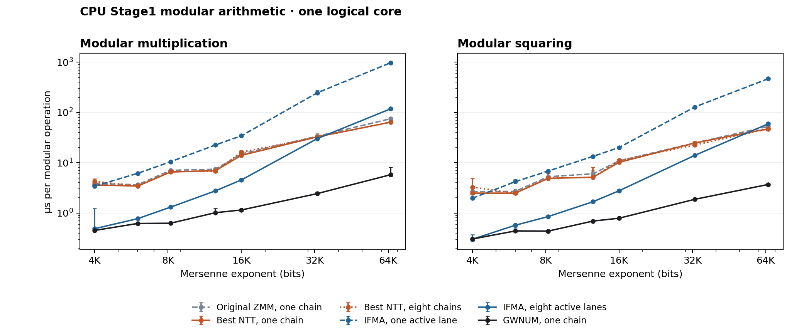

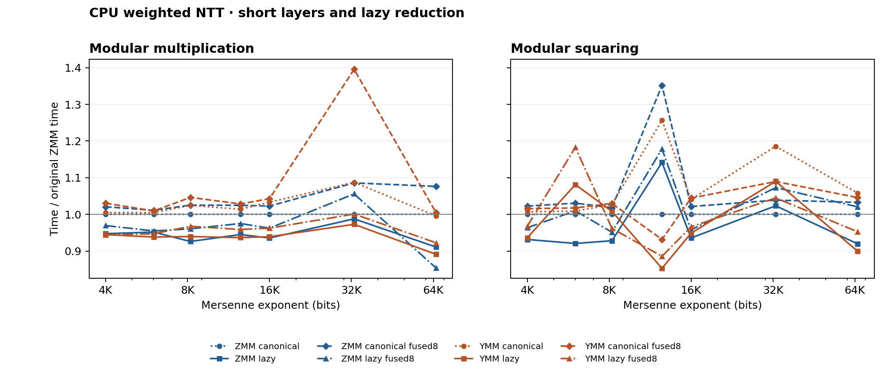

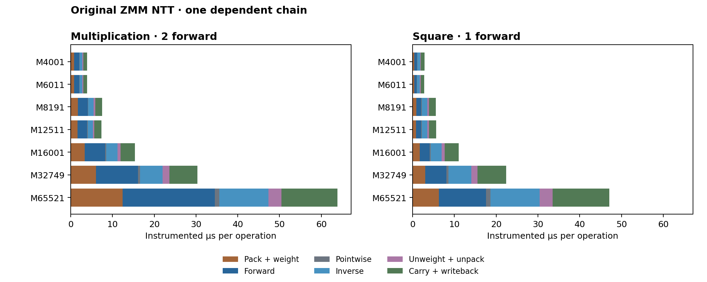

复测的 21 个单链条件中，单独启用 lazy 后，ZMM 有 17 格改善、中位降幅 **5.5%**，YMM 有 20 格改善、中位降幅 **8.3%**，分别以各自的逐层规范归约为基线。在 lazy 上叠加 8 点短层融合，中位耗时反而增加 ZMM **3.2%**、YMM **1.7%**。YMM 与 ZMM 的逐层 lazy 互有胜负，个别档的样本重叠或波动较大。8 点路径作为可复测候选保留。

以下是八链吞吐，单位为 µs/op。NTT 取每档实测最快的实现。M32749 只有固定一侧频谱的 NTT 路径快于满八路 IFMA（21.99 对 28.84 µs/op），普通模乘和平方仍由 IFMA 领先。M65521 的三种运算均由 NTT 领先 IFMA。单链 NTT 与 GWNUM 仍有约 5.5–13.5 倍的耗时差距。GWNUM 计数确认普通模乘每次执行三次变换，平方和固定一侧频谱的模乘各执行两次。

| 输入 | 普通模乘 NTT／IFMA／GWNUM | 平方 NTT／IFMA／GWNUM |
| --- | ---: | ---: |
| M6011 | 3.46／0.77／0.64 | 2.49／0.57／0.49 |
| M12511 | 6.80／2.76／1.04 | 5.12／1.68／0.71 |
| M32749 | 32.47／30.17／2.53 | 22.49／14.05／1.75 |
| M65521 | 64.21／118.35／5.88 | 47.09／59.51／3.92 |

分项数据另测，使用原版 ZMM 单链。前向与逆向包含各自的 PFA 五点层，合计占模乘分项耗时的 48%–53%，平方约 44%–49%。M65521 的模乘分项中，两次前向为 22.09 µs，逆向 11.81 µs，打包乘权 12.44 µs，进位与写回 13.42 µs。单次操作内的六个区间分别累计，时钟开销包含在各区间，图中用时不与关闭计时器的整段成绩相加。原始结果保存在 `data/experiments/cpu_stage1_ntt_round1/`。见 [构建、复现与后续工作](../development/CPU_STAGE1_NTT_DRAFT.md#第一轮复现)。

## Edwards NAF 窗口短测

窗口语义、CPU 与 CUDA 的字典布局及当前支持范围见 [Edwards NAF](../architecture/NAF.md)。本节记录各窗口的实测性能。

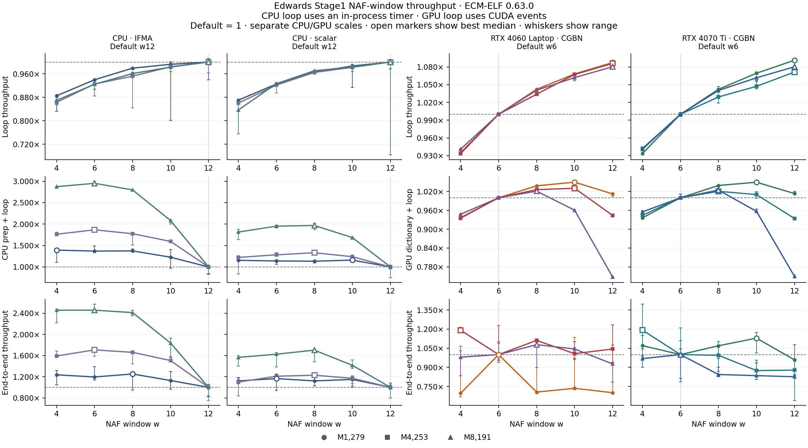

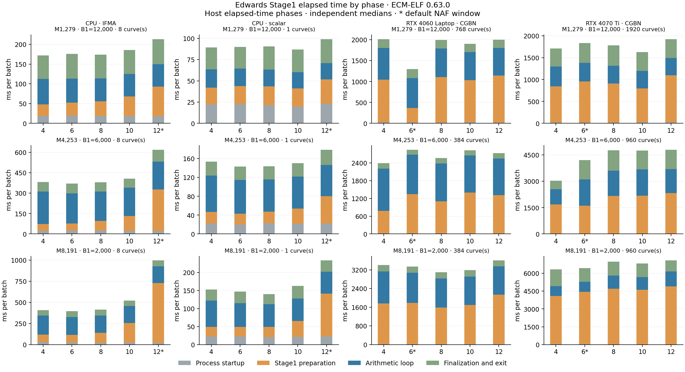

### 窗口选取

CPU 的六组主循环中位数都以 **w12** 最快。w10 与 w12 的循环吞吐相差约 0.8%–1.8%，字典却只有四分之一。短任务用 **w6–8** 更合适。IFMA 在 M1279、M4253、M8191 的整批最短中位数分别为 w8、w6、w6，其中 M8191 的 w4 与 w6 只差 0.1 ms。GMP 标量分别为 w6、w8、w8。M8191 的 IFMA 从 w12 改到 w6，主循环从 197 ms 升至 213 ms，初始化却从 708 ms 降至 90 ms，整批墙钟从 995 ms 降至 405 ms。更大的 B1 能摊薄准备成本，本轮没有测量生产 B1 的最佳窗口。

两张 GPU 的主循环均由 **w12** 给出最快中位数。w12 的字典是 w6 的 64 倍，短任务的选择以同一批的「字典 CUDA event + 主循环 CUDA event」为依据。单独启动的墙钟还受 WDDM 下的初始化和回读波动影响。表中提升为相对默认 w6 的吞吐提升，两项 CUDA event 先逐批相加再取中位数。

| GPU | 模数 | 最快窗口 | 设备时间 w6 → 最快，ms/批 | 吞吐提升 | 字典 w6 → 最快，MiB |
|---|---|---:|---:|---:|---:|
| RTX 4060 Laptop | M1279 | 10 | 707.4 → 673.8 | 5.0% | 7.5 → 120 |
| RTX 4060 Laptop | M4253 | 10 | 1329.9 → 1290.7 | 3.0% | 13.5 → 216 |
| RTX 4060 Laptop | M8191 | 8 | 1297.8 → 1271.0 | 2.1% | 24 → 96 |
| RTX 4070 Ti | M1279 | 10 | 420.6 → 400.7 | 5.0% | 18.75 → 300 |
| RTX 4070 Ti | M4253 | 8 | 794.7 → 778.7 | 2.0% | 33.75 → 135 |
| RTX 4070 Ti | M8191 | 8 | 775.2 → 756.7 | 2.4% | 60 → 240 |

两卡的 M1279 用 w10 最快，w8 距其约 1%，字典只有 w10 的四分之一。M4253 的 w8／w10 在两卡的样本范围均有重叠。4060 Laptop 在 M8191 改用 w12，主循环约快 8%，设备总时间却从 1.298 秒升至 1.735 秒，字典单独占约 32%。显存宽裕的短任务可用 **w8** 作为通用起点，显存紧张时用 w6。

### 输入与计时

2026-11-14，ECM-ELF 0.63.0 本地测量版，CUDA 13.3、sm89、MSVC 14.51.36231、驱动 610.88。Ryzen AI 9 HX 370 固定逻辑 CPU 1，使用单线程，IFMA 每批 8 条、GMP 标量每批 1 条。GPU0 为 RTX 4070 Ti，GPU1 为 RTX 4060 Laptop。CGBN 使用 HWCD 倍点、TPB128，每 SM 发射两个 block。利用率至少 50% 时，4070 Ti 的 39 个遥测样本为 2610 MHz、17.86–147.22 W，4060 Laptop 的 163 个样本为 1500 MHz、11.11–26.16 W。CPU 实际频率和功耗未采集。

| 完整模数 | B1 | CGBN 容器／TPI | 4070 Ti 曲线／批 | 4060 Laptop 曲线／批 |
|---|---:|---:|---:|---:|
| M1279 | 12,000 | 1280／8 | 1920 | 768 |
| M4253 | 6,000 | 4608／16 | 960 | 384 |
| M8191 | 2,000 | 8192／16 | 960 | 384 |

每组固定 sigma 起点 20260922，扫描 w4、6、8、10、12。每设备、位宽先预跑默认窗口一次，再交错跑三轮，每个窗口各三批。每批启动独立进程，关闭指数缓存和周期检查点，正常发布 Stage1 save。吞吐是曲线数除以耗时，再除以同后端、位宽的默认窗口吞吐。折线取中位耗时，误差线展示三批的实测范围。

- **启动**从创建进程前开始，到采集器读到程序版本行。
- **初始化**从版本行到主循环入口，包含模数、标量、曲线、上下文、NAF 编码及字典。CPU 入口用进程内主循环耗时和结束日志倒推，GPU 入口取字典完成日志。
- **运行**在 CPU 用进程内计时，到最终坐标导出和 GCD 之前。在 GPU 耗时分解图用字典完成至算术 API 返回的墙钟，包含回读和同步。吞吐图的 GPU 主循环用 CUDA event 累计值，排除字典和最终回读。
- **收尾**到进程退出为止，包括主循环边界之后的 GCD、归一化、存档和结果发布，以及进程清理。柱图各阶段独立取中位数，叠加高度可能与整批墙钟中位数略有出入。

共完成 180 个正式样本和 12 个预跑。86,448 条存档记录通过模数、B1、sigma、状态及校验值核对。四条路径按重合的 `(模数, sigma)` 对拍了 3,840 个末点，并用独立 Montgomery x-only 整数梯验算了其中 12 个首尾点。原始 `run.log`、逐行时间、存档、遥测和 `report.json` 位于 `data/experiments/stage1_naf_windows_0630/short_matrix/`。中位数及取值范围在 `data/benchmarks/stage1_naf_windows_0630/window_medians.csv`。

采集和绘图需 Python、psutil 和 matplotlib。从仓库根目录运行，指定尚未创建的采集输出目录。CPU 主循环用本地测量版的 `ECM_EDWARDS_NAF_TIMING=1` 计时，采集器自动设置。

```powershell
python tools/bench/bench_stage1_naf_windows.py --exe build_stage1_local/ecm_cuda.exe `
  --output data/experiments/stage1_naf_windows_0630/retest
python tools/bench/plot_stage1_naf_windows.py `
  --input data/experiments/stage1_naf_windows_0630/short_matrix/report.json `
  --output-dir data/figures/stage1_naf_windows_0630
```

### 常用 B1 的编码开销

在 Ryzen AI 9 HX 370 的逻辑 CPU 1 上直接计时 ECM-ELF 0.63.1 工作区的原编码函数（MSVC 14.51，`/O2`），每格三次取中位数。编码计时包含输出分配，标量构造或加载、GPU 上传和点乘另计。CGBN 的两张位图合计为 `8 × (floor((L+32)/32)+1)` 字节，在主机和设备各有一份。主机编码时还暂存约 `L/8` 字节的标量导出。CPU 原路径每个活跃 IFMA 批次或 GMP 曲线各持一份约 `4L` 字节的 `int` 数组。下表是编码缓冲区大小，进程内存与显存峰值另计。

| B1 | 标量位数 | CGBN 打包 w6／w8／w12（ms） | 打包每份（MiB） | CPU 稠密 w6／w8／w12（ms） | 稠密每份（MiB） |
|---:|---:|---:|---:|---:|---:|
| 11,000,000 | 15,869,679 | 31.6／24.8／18.1 | 3.78 | 113／112／118 | 60.54 |
| 44,000,000 | 63,477,246 | 125.7／99.7／70.2 | 15.13 | 445／480／532 | 242.15 |
| 260,000,000 | 375,102,581 | 726.7／642.2／452.2 | 89.43 | 2844／2785／2713 | 1430.90 |

点字典的成本可用与 B1 无关的固定批量单独测量。8191 位上，CPU IFMA 八路的 w6／w8／w12 准备耗时为 51／102／1161 ms，持久字典占 0.46／1.85／29.63 MiB；GMP 单曲线约 6／11／106 ms，两份点表合计 0.14／0.55／8.75 MiB。CPU 数据每格五次取中位数，IFMA 包含曲线生成、字典及仿射归一化，GMP 包含同样的准备工作和首次点运算。用上面的 GPU 短测，4060 Laptop 的 384 条曲线需要 23／45／555 ms，字典占 24／96／1536 MiB；4070 Ti 的 960 条需要 29／40／344 ms，字典占 60／240／3840 MiB。GPU 用字典 CUDA event，包含准备核内的点坐标转换。

按 w6 的原始打包格式模拟磁盘缓存，三个 B1 的热文件读入加 FNV-1a 扫描分别为 5.2／21.2／116.6 ms，较重新编码少约 26／105／610 ms 每批。探针刚写完文件即读取，冷读和完整格式校验未测。每个窗口覆盖三档 B1 需约 108 MiB 磁盘空间。证据见 `data/experiments/naf_encoding_common_b1/`。

当前 CPU 任务只分配一份序列。w12、B1=11e6／44e6／260e6 时，`int16_t` 稠密序列为 30.27／121.07／715.45 MiB，打包位图为 3.78／15.13／89.43 MiB。相同 Ryzen 逻辑核上各测三次，稠密／打包准备中位数为 0.115／0.113、0.455／0.451、3.496／3.278 秒。最大 B1 的试验与编译并行，耗时波动较大。另用 w8 在 M1279（B1=40000）和 M8191（B1=5000）各测五次完整算术，GMP 和 IFMA 的打包与稠密末点一致，耗时中位数变化在 ±0.5% 内。原始结果位于 `data/experiments/cpu_naf_reuse_direct/bench.csv`。生产选择与内存预算见 [Stage1 架构](../architecture/STAGE1.md#cpu-模算术与点运算)。

用 0.63.1 的 sm89 三容器验证构建在 M8191 上跑固定 sigma 的 16 曲线队列。B1=100 时，`naf_memory_mb = 16` 将 CPU IFMA 从两路 worker、w12 调整为一路 worker、w9，`naf_memory_mb = 1` 将 RTX 4060 Laptop 的 CGBN 从 w12 调整为 w5。两条路径均完成原批量，与 GMP 及独立整数梯对拍一致。B1=10000 的单曲线验证覆盖了降级后的安全停止、内存不足时保留队列和检查点，以及解除限制后按已存窗口继续计算。见 [验收脚本](../../tools/test/test_edwards_naf_memory.py) 与 `data/experiments/edwards_naf_config_final/`。

### 长任务的窗口选择

点运算公式及常用 B1 的实际列数与非零数见 [Edwards NAF 算术成本](../architecture/NAF.md#点字典与执行成本)。

比较 w10 与 w12 时，用相同位宽和批量的整批主循环时间。设 w12 的循环比 w10 快 `r=1−Tloop12/Tloop10`，多出的字典准备时间为 `ΔD`，则 w10 的主循环超过 `ΔD/r` 后，w12 才预计占优。用本页短测估计，1279／4253／8191 位 CGBN 在两卡的门槛约为 1–2／4–8／14–24 秒每批；CPU IFMA 八路约为 6／19／50 秒每批，GMP 单曲线约为 0.4／1.8／4.5 秒。这些是同形状外推，完整大 B1 未复测。

生产口径是数百条曲线、吞吐折算数十秒／曲线，整批约上万秒。每批只编码一次，点字典一次为所有曲线各建一份。对比窗口时将编码和建表的整批时间差除以曲线数，再和摊销主循环的时间差相加。以 8191 位的 4060 Laptop、384 条曲线、整批 10,000 秒为例，B1=260e6 的 w12 主机编码约 0.45 秒，字典 CUDA event 约 0.56 秒，分别摊销约 1.2／1.4 ms 每曲线。这两项合计约占整批的 0.01%。按短测循环比值估算，w12 对 w10 节省约 1.7% 的整批循环，量级为 170 秒。这是固定批量的估算，完整生产 B1 未复测。

在这个长任务口径下，若 w12 能在原批量下放入预算，CGBN 优先试 w12，再用运行日志对比 w10 的实测主循环吞吐。若 w12 迫使减少批量，比较两个批量的曲线／秒。8191 位上 w12 的字典为 w10 的四倍，4060 Laptop 的 384 曲线约用 1.50 GiB，4070 Ti 的 960 曲线约用 3.75 GiB。预算有限时从 w10 或 w8 开始。GMP 长单曲线可先试 w12，8191 位 IFMA 八路整批的估计门槛约为 50 秒。

以 8191 位、B1=260e6 为例，加上编码和点状态后，4060 Laptop 的 384 曲线在 w10／w12 需要约 502／1710 MB，4070 Ti 的 960 曲线约需 1114／4134 MB。若请求 w12、配置 `naf_memory_mb = 512` 且设备空闲预算充足，前者会选 w10，后者会选 w8。

另用 ECM-ELF 0.63.1 的 sm89 三容器构建在 GPU1 RTX 4060 Laptop 上测实际单曲线。M8191、B1=100000、sigma=20260922、HWCD、8192/TPI16，关闭周期检查点，w8／w10／w12 各交错运行三次，九个存档末点一致。利用率至少 50% 的 124 个遥测点均为 1500 MHz、8.26–9.16 W。CUDA event 字典加主循环的中位数依次为 **43.463／42.490／42.046 秒**。w12 的 4 MiB 字典比 w10 的 1 MiB 多花约 276 ms，主循环省约 720 ms，合计省 444 ms（1.0%）。同形状估算 w10 到 w12 的门槛为约 16 秒主循环，其他位宽或设备需重新测量。证据见 `data/experiments/edwards_naf_config_single_8191/summary.json`。

## CUDA Edwards 倍点 HWCD 与 2XY

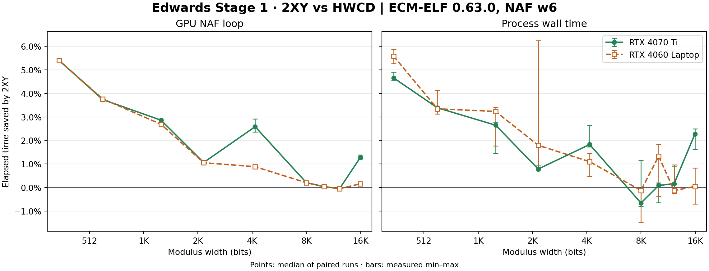

2XY 的主循环收益从 347 位的 **5.4%** 降到 8191 位的约 **0.2%**。M12511 上两卡的主循环都约慢 **0.05%**，整批墙钟有快有慢。曲线在 4253 位和 16319 位仍有局部上升，因此单凭位宽无法确定收益。8K 起端到端收益大多落在配对波动内。

M16319 在 4070 Ti 的三对复测中，主循环中位时间从 **36.416 s** 降至 **35.970 s**，配对省时中位数 **1.28%**，范围 **1.22%–1.39%**。4060 Laptop 在同位宽省 **0.16%**。两卡整批墙钟的配对省时中位数分别为 **2.27%** 和 **0.05%**。图中 4070 Ti 该格采用三对复测，初次三对另保留。初次有一批 HWCD 在运行中出现功耗和片长突变，主循环 48.670 s，同轮 2XY 为 35.887 s，表面省时 26.27%。后两对只有 1.35% 和 1.52%。突变来源未确定。

两条路径在同一个 CGBN NAF 核内计算相同的点。2XY 直接求 $E=2XY$，HWCD 用 $(X+Y)^2-X^2-Y^2$ 求 $E$。默认的 CGBN 模平方调用相同的 Montgomery 乘法核心，2XY 在每列省去两次模减。按 32 位 limb 数 $n$ 估算，模加减的工作量随 $n$ 线性增长，CGBN 朴素 Montgomery 模乘约随 $n^2$ 增长。这个量级关系解释了加减节省为何可能被宽位模乘摊薄。实际运行还受容器、TPI、指令安排和寄存器占用影响。见 [NAF 架构](../architecture/NAF.md#点字典与执行成本) 和 [CGBN 模平方与模乘入口](../../third_party/cgbn/include/cgbn/impl_cuda.cu#L1027)。

如果构建启用专用平方，粗略的单次倍点省时为 $T_S-T_M+2T_{\mathrm{sub}}$。平方比乘法快得足以抵消两次模减时，HWCD 也可能更快。该式按算子时间相加，只用于判断量级。

独立算子探针使用相同的 CGBN 域函数、容器和发射几何，在七个位宽上分别测模加、模减、模乘和模平方。每核每条链 10,000 次相依运算，先预跑一轮，再按正反顺序各类交错测五次，取 CUDA event 除以批量操作数的中位数。两卡的模减／模乘成本均从 347 位的 **38% 左右**，降到 8191 位的 **1.3% 左右**、16319 位的 **0.28% 左右**。这与宽位下加减节省被模乘摊薄一致，也说明 4070 Ti 在 M16319 的 1.28% 收益无法由孤立模减成本直接预测。探针记录与源码位于 `data/experiments/stage1_edwards_doubling/field-gpu*-verified.csv` 和 `field_probe.cu`。探针本身未另采功耗。

### 测试条件

使用 ECM-ELF 0.63.0 的全容器本地构建。CUDA 13.3.73、sm89、MSVC 14.51.36231，Windows WDDM 驱动 610.88。该构建与当前工作区的 NAF 倍点、域算术和 CGBN 模算术源码一致。整进程计时适用于该构建的主机切片策略。两张卡独立采集，部分批次同时运行。

| 完整模数 | $B_1$ | 容器／TPI | 4070 Ti 曲线／批 | 4060 Laptop 曲线／批 |
|---|---:|---:|---:|---:|
| M347 | 1,000,000 | 384／4 | 3840 | 1536 |
| M607 | 500,000 | 768／8 | 1920 | 768 |
| M1279 | 250,000 | 1280／8 | 1920 | 768 |
| M2203 | 120,000 | 2560／16 | 960 | 384 |
| M4253 | 80,000 | 4608／16 | 960 | 384 |
| M8191 | 50,000 | 8192／16 | 960 | 384 |
| M10267 | 50,000 | 11264／32 | 480 | 192 |
| M12511 | 50,000 | 13312／32 | 480 | 192 |
| M16319 | 50,000 | 16384／32 | 480 | 192 |

固定 NAF w6、TPB128，每 SM 发射两个 block，sigma 从 20260922 连续取值，关闭周期检查点、指数缓存以及 Stage2 交接。每卡每个输入各跑三对，按 HWCD／2XY 与相反顺序交替，保留首轮。左图取主循环 CUDA event 累计时间，排除字典、最终回读及发布。右图从启动独立进程计至退出，包含初始化、字典、运算和存档。每点先逐对算 $100(1-T_{2XY}/T_{HWCD})$，再取中位数，正值表示 2XY 省时，误差线是三对的全范围。

2026-11-14 采集。主矩阵在 GPU 利用率至少 50% 的遥测点中，4070 Ti 为 2610 MHz、22.26–188.85 W（中位数 178.39 W），4060 Laptop 为 1500 MHz、9.01–26.17 W（中位数 25.50 W）。M16319 复测的 4070 Ti 为 2610 MHz、23.02–181.01 W（中位数 177.15 W）。

两卡共完成 108 批及 6 批复测。103,680 条存档记录通过模数、B₁、sigma、校验值及因子整除核对。按模数和 sigma 对拍的 12,000 个不同结果完全一致，其中 1,064 个为因子记录。另用独立 Montgomery x-only 整数梯验证 16 个归一化末点和 2 个 M16319 因子的分母 GCD。原始日志、存档、遥测、报告和独立验算位于 `data/experiments/stage1_edwards_doubling/`，逐位宽配对统计见 `data/benchmarks/stage1_edwards_doubling/paired.csv`。

采集器和绘图脚本从仓库根目录运行。每张卡的采集需要一个全新的目录。

```powershell
$worker = 'build_stage1_local_c869d1f184d3b595/ecm_cuda.exe'
$out = 'data/experiments/stage1_edwards_doubling_retest'
python tools/bench/bench_stage1_edwards_doubling.py --exe $worker --device 0 --output "$out/run_4070ti"
python tools/bench/bench_stage1_edwards_doubling.py --exe $worker --device 1 --output "$out/run_4060"
python tools/bench/bench_stage1_edwards_doubling.py --exe $worker --device 0 --bits 16319 --output "$out/recheck_4070ti_m16319"
python tools/bench/plot_stage1_edwards_doubling.py --input "$out/run_4070ti/report.json" "$out/run_4060/report.json" `
  --replace "$out/recheck_4070ti_m16319/report.json" `
  --output-dir data/figures/stage1_edwards_doubling_retest `
  --summary data/benchmarks/stage1_edwards_doubling_retest/paired.csv
```

## GPU Edwards NAF 按需导出与字典预乘

0.59.7 的 NAF 只在检查点、安全停止和完成时导出普通坐标。奇倍点字典以 `dT` 替代 `T`，每个非零列少一次模乘，字典大小仍为四个域元素每项。GPU1 RTX 4060 Laptop，驱动 610.88，CUDA 13.3 / sm89，使用仅含 5120 位容器的同配置 0.59.6 和 0.59.7 本机构建。两版均用 TPI16、TPB128、B1=12000、窗口 6、HWCD，从 sigma=20260922 起跑，关闭周期检查点。每条件每版三次，交替启动，取中位数。GPU 利用率至少 50% 的遥测样本为 1500 MHz、7.59–17.21 W、44–52 °C。

| 输入 | 曲线数 | 算术入口 0.59.6 → 0.59.7（秒） | 算术入口降幅 | 进程 wall 降幅 |
|---|---:|---:|---:|---:|
| M1279 | 16 | 2.492 → 2.417 | 2.99% | 1.32% |
| M1279 | 128 | 2.550 → 2.407 | 5.59% | 4.49% |
| M4423 | 128 | 2.497 → 2.412 | 3.44% | 1.26% |

算术入口包含 NAF 编码、字典、切片、坐标导出及进度回调。每组的切片数中位数均为 26，导出从每片一次降至整批一次。18 次运行的 Stage1 save 逐字节一致。该对照同时包含两项优化。原始记录见 `data/experiments/edwards_stage1_snapshot_dt_0597/comparison/`。运行边界见 [Stage1 架构](../architecture/STAGE1.md#gpu-edwards)。

## GPU Edwards 主机等待与自适应切片

Edwards binary/NAF 使用阻塞设备等待，并按约 100 ms 目标调整切片。正数 API 参数允许固定切片。NAF 在检查点、停止和完成边界按需导出坐标。实现、边界和停止语义见 [Stage1 架构](../architecture/STAGE1.md#gpu-edwards)。以下为原等待策略的独立对照。

### 工况与证据

GPU1 RTX4060 Laptop，Windows 11 10.0.26200 / WDDM、驱动 610.88，Ryzen AI 9 HX 370；CUDA 13.3.73、MSVC 14.51.36231、sm89、Zen3 GMP。未调整时钟、功耗或优先级，有效 CPU 频率未独立测量，GPU0 原有工作保留。正式性能采集在全部编译及前置正确性检查结束后进行，GPU1 无其他本轮任务并发。

SM 遥测为 1500 MHz，功率上限查询 N/A。功耗记录有一个 590.01 W 的明显异常值，原样保留，因此本轮不据该接口作功耗或能耗比较，也不声称进程峰值。正常与异常遥测均在原报告中，不能通过删掉异常值来宣称功率预算。

输入固定为完整 M1279 / B1=500000 / 每批64条，及完整 M9689 / B1=10000 / 每批768条，sigma 分别为17…80与17…784，48·lcm、w6、HWCD。仅作本地数学与性能测试，未提交结果。两种输入分别使用 1280/TPI8、10240/TPI32、TPB128。每种模式 3 次，交错顺序且不丢弃首轮；下表各列分别取中位数，吞吐变化按同输入原路径墙钟中位数计算。样本范围不是置信区间，不能扩展为生产 B1=260e6、数小时稳定性或其他设备的性能保证。

原始根目录为 `data/experiments/stage1_host_wait_20261018/`；汇总为 `data/benchmarks/stage1_host_wait_20261018/probe_summary.json` 与 `native_summary.json`。探索校准因与编译重叠不纳入正式结论，保留于 `long_*` 及诊断草稿中。

### 同一模板的等待控制

使用同一实际生产模板，测试包装器仅改变主机等待和切片参数；1280/10240 两个探针的 SHA256 前缀分别为 `7185cf016f3c`、`9c7ab95e1ae8`。原始目录为 `formal_m1279_c64_b5e5/`、`formal_m9689_c768_b1e4/`，完整构建身份在 `formal_sources/`。

计时从生产模板入口到返回，包含分配、字典、主循环和回读，排除上下文、指数/NAF 编码、CPU 曲线构造及最终坐标导出。API 包装器自身有计时成本，结果用于归因，完整程序结论见下一表。原结束事件位置保持不变；CUDA event 区间可能含提交间隙，不视作 profiler 纯核时间。

| 输入 | 等待与切片 | 算术调用秒 | 平均 CPU 核心 | 相对原路径吞吐 |
| --- | --- | ---: | ---: | ---: |
| M1279 | 忙等，固定256 | 25.8760 | 0.9897 | +0.00% |
| M1279 | 阻塞，固定256 | 26.4602 | 0.0566 | -2.21% |
| M1279 | 阻塞，自适应 | 25.1107 | 0.0050 | +3.05% |
| M9689 | 忙等，固定256 | 20.9978 | 0.9878 | +0.00% |
| M9689 | 阻塞，固定256 | 21.0232 | 0.0141 | -0.12% |
| M9689 | 阻塞，自适应 | 21.3272 | 0.0395 | -1.54% |

M1279 的片数由 2819 降至 253；排除首五片和短尾后的片时间中位数约 8.92 → 100.00 ms。M9689 的片数由 57 增至 204，稳态片时间约 366.96 → 99.87 ms。后者增加了普通坐标回读与导入次数，因此自适应响应目标具有实际代价。单独固定片阻塞的 M9689 时间范围与忙等重叠，0.12% 的中位数差不能视为稳定退化。全部18次的四坐标在各输入内部逐字一致，不变量通过。

### 未插桩生产程序完整批次

基线 ECM-ELF 0.38.0 SHA256 前缀 `07a26b7b5d84`，候选 0.38.4 为 `dfa287226ba0`；GMP 相同。候选按正式 local 构建规则编入 512/768/1280/10240 四档，用于本轮验证，不代表全发布架构已验收。每个模式各3次，按 A/B、B/A、A/B 执行。独立目录、空提交身份、禁用定期 checkpoint、每次使用新的指数缓存路径；B2=B1。

墙钟与 CPU 使用 Windows `GetProcessTimes` 的进程创建至退出区间，含启动、曲线/标量准备、回调、完成检查点、GCD/归一化、save 和结果发布。CPU 单位为逻辑核心比例；不与内层模板或 CUDA event 时间相加。全部存档记录经字段、sigma 顺序、checksum、因子整除及跨二进制/重复一致性检查，完整进程测量中不额外运行 CPU 梯形参考。

| 输入 | 原程序秒/批 | 0.38.4秒/批 | CPU核心：原 → 新 | 吞吐变化 |
| --- | ---: | ---: | ---: | ---: |
| M1279 | 26.3644 | 25.7695 | 0.9915 → 0.0267 | +2.31% |
| M9689 | 29.4120 | 29.8997 | 0.9377 → 0.2549 | -1.63% |

M1279 墙钟范围：原 26.2329…26.6859 秒，新 25.7328…26.5028 秒。

M9689 墙钟范围：原 28.9426…30.5284 秒，新 29.1763…30.0343 秒。

两组范围均有重叠，三样本中位数只描述本机此次工况；主要收益是释放 GPU 等待期间的 CPU，不能承诺统一加速。万位大批量的 CPU 曲线构造与归一化仍明显，因此全进程平均占用约0.25核，高于该输入GPU模板区间约0.04核。尚未做 CPU 能耗测量。

复现使用 `tools/bench/diagnose_stage1_host_wait.py --primary-only --adaptive-candidate` 进行三路控制，完整程序使用 `tools/bench/bench_stage1_host_wait.py --baseline ... --candidate ... --exponent ... --b1 ... --curves ... --output ...`；两个工具都要求新输出目录，GPU 固定为1。构建、完整命令、恢复门禁和当前限制见[主机等待草稿](../development/GPU_STAGE1_HOST_WAIT_DRAFT.md#0384-等待及切片优化)。临时草稿保留，由用户决定后续处理。

## CUDA CGBN 切片深度与低 CPU 模式

主测使用 M4423、B1=100,000、B2=0、128 条曲线，sigma 从 26 连续取值。两张卡是 RTX 4070 Ti 和 RTX 4060 Laptop，Windows WDDM 驱动 610.88，CUDA 13.3.73，sm_89、4608 位容器、TPI16、TPB128。Edwards 使用 NAF w6 和 HWCD。Montgomery 使用 PARAM0、LCM=12，分别跑 ladder 和 PRAC 7 档，PRAC 寄存器上限 168、目标片长 100 ms。当前默认三片滚动，低 CPU 模式默认关闭。两项的配置方式见 [TOML 配置参考](../ECM_TOML_REFERENCE.zh-CN.md#cuda_slice_depth)。

### 2、3、8 片的提交开销

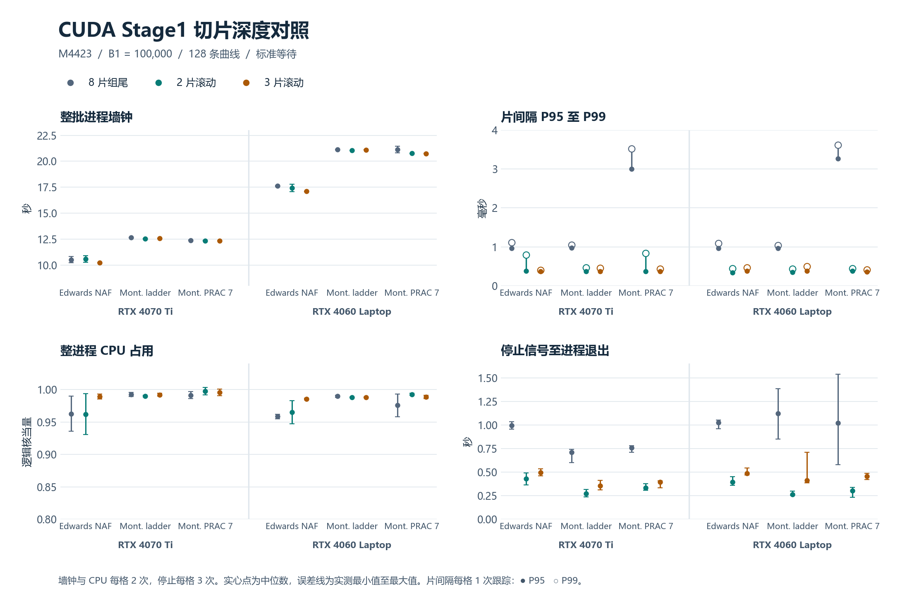

- 八片组尾等待在六组中的片间隔 P99 为 1.041～3.618 ms。两片滚动降至 0.430～0.836 ms，三片为 0.402～0.494 ms。
- 两片和三片的整批墙钟中位数在 Montgomery 各组相差不到 0.06 s。Edwards 在两张卡上用三片比两片少约 0.33～0.37 s，每格两次。
- 停止延迟中位数在六组中均以两片最短，范围为 0.263～0.429 s，三片为 0.356～0.497 s，八片为 0.710～1.121 s。标准等待下，三种深度的整进程 CPU 占用中位数均接近一个逻辑核。

墙钟和 CPU 每格两次，使用无 profiler 的完整进程，CPU 核当量为 Windows 进程 user 与 kernel CPU 时间之和除以启动至退出的墙钟。片间隔每格一次 Nsight Systems GPU 跟踪，按相邻算术切片内核的结束和开始时间计算，P95/P99 采用最近秩。停止每格三次，在进度约 35% 后按不同偏移触发 Windows 停止事件，计到进程退出。八片使用冻结构建 SHA-256 `e2974128cd1369d6734245448135b6f8261ef278e98ae59f5a09240317bba722`，两片和三片共用候选构建 `d2214296248847ea75b83f449dcfd825166ae80198df0a1101dbbfeebdf31460`，算术内核对象哈希一致。跟踪中的负载功耗中位数约为 4070 Ti 58～61 W、4060 Laptop 15～16 W。

### 阻塞等待的 CPU 占用与吞吐

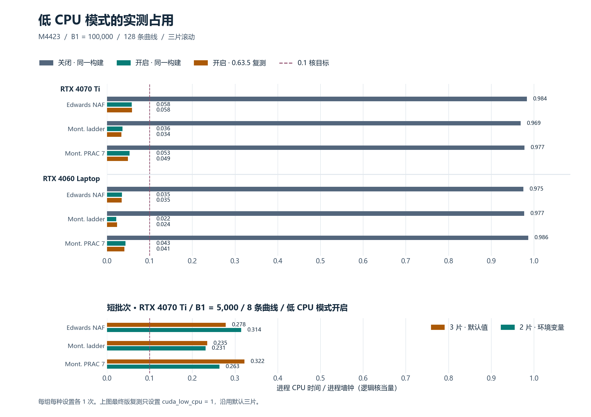

每张卡每种算法在三片下各跑一次开关对照，关闭周期检查点。平均 CPU 占用从 **0.969～0.987 核降至 0.022～0.058 核**，六组存档摘要一致。标记为 `0.63.5` 的实验构建每格仅开启低 CPU 模式的复测为 **0.024～0.058 核**。B1=5,000、8 条曲线的短任务开启后整进程仍为 0.23～0.32 核，启动、准备和发布在短批次中的占比更高。

开关对照和 RTX 4070 Ti 短批次使用同一预发布构建 SHA-256 `692419fc1172ca369f7fbcd046c3802c94e5d69f5dbb3ffdc017a5f0a31d7528`。开关对照的负载功耗中位数为 4070 Ti 59.5～61.9 W、4060 Laptop 15.0～16.1 W。标记为 `0.63.5` 的复测构建为 `4aa8ce74f4c9f2a68a0b896839d68c7b623c0466075bb2ee76181403b651fe62`，分别为 59.3～61.2 W、15.0～16.0 W。

#### 同构建交错复测

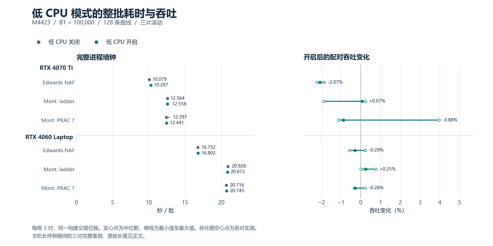

开关两组使用同一冻结构建，实验二进制自报 `0.64.0`，SHA-256 为 `56aaeb8ecf14b1d7586489723e7715e5a052439bc003c9a38dbcbf62259a1bb6`。同卡串行、两卡可并行，采用默认三片，关闭周期检查点。每张卡、每种算法交错开关三对。墙钟从进程启动计到退出。绝对吞吐为 128 除以每种设置的墙钟中位数。相对吞吐先对每对计算 `关时长 / 开时长 − 1`，再取三对中位数。

| GPU | 算法 | 整批秒（关 → 开） | 曲线/秒（关 → 开） | 配对吞吐变化中位数 |
| --- | --- | ---: | ---: | ---: |
| RTX 4070 Ti | Edwards NAF | 10.079 → 10.287 | 12.70 → 12.44 | −2.07% |
| RTX 4070 Ti | Montgomery ladder | 12.564 → 12.558 | 10.19 → 10.19 | +0.07% |
| RTX 4070 Ti | Montgomery PRAC 7 | 12.397 → 12.441 | 10.33 → 10.29 | −0.88% |
| RTX 4060 Laptop | Edwards NAF | 16.752 → 16.802 | 7.64 → 7.62 | −0.29% |
| RTX 4060 Laptop | Montgomery ladder | 20.926 → 20.873 | 6.12 → 6.13 | +0.25% |
| RTX 4060 Laptop | Montgomery PRAC 7 | 20.716 → 20.745 | 6.18 → 6.17 | −0.28% |

RTX 4070 Ti 的 Edwards NAF 三对均变慢，每批多 0.190～0.229 s，吞吐下降 1.85%～2.22%。算术入口的配对耗时增量中位数为 0.173 s，日志中的切片内核累计时间只差 0.2～1.5 ms。主机等待和补片时机可能影响入口墙钟，仍在队列里的切片可以覆盖部分唤醒时间。要量出片间空泡，需要对开关两种模式单独跟踪 GPU 时间戳。

其余五组的吞吐变化中位数均在 1% 以内。4070 Ti 的 PRAC 单对仍在 −1.12% 至 +3.96% 间波动。4060 Laptop 的 Edwards NAF 本次三对墙钟差为 −0.038～+0.097 s，早先单次的 +0.515 s 未复现。36 个纳入对照的样本存档末点逐组一致。CPU 占用由关闭时的 0.959～1.002 核降至 0.020～0.062 核。负载采样功耗中位数为 4070 Ti 57.4～62.1 W、4060 Laptop 15.1～16.4 W，实测 SM 时钟分别为 2610 MHz 和 1500 MHz。

第一轮同一时段有三个关闭模式样本出现主机侧长停顿。4070 Ti PRAC 整批 221.854 s，其中累计内核 11.707 s。4060 Laptop 的 ladder 和 PRAC 分别为 45.528 s 和 177.344 s。停顿期间两张卡的日志均有多秒空档，原因未确认。图表使用这三组的完整补测对。若保留原对，4070 Ti PRAC 的吞吐变化中位数为 +3.96%，4060 Laptop 的 ladder 和 PRAC 四舍五入后的中位数与补测口径相同。原始报告和日志均保留。

原始样本在 `data/experiments/prac-execution-4070ti-20261114/`。绘图读取 `rolling-summary.json`、`configured-{standard,blocking,final}-wall-gpu{0,1}/results.json`、短测的 `configured-{default,legacy}-wall-gpu0/results.json`，以及复测的 `configured-throughput-{paired,supplement}-gpu{0,1}/results.json`。停止恢复、跟踪样本筛选及完整记录见 [开发草稿](../development/GPU_STAGE1_SLICE_PIPELINE_DRAFT.md#两片与三片滚动提交)。图表用下列命令生成，正文引用 PNG 副本。 [绘图脚本](../../tools/bench/plot_stage1_cuda_slices.py)

```powershell
python tools/bench/plot_stage1_cuda_slices.py --input-dir data/experiments/prac-execution-4070ti-20261114 --output-dir data/figures/stage1_cuda_slices_20261114
```

## GPU Edwards 细分实例三曲线族对照

当前Edwards使用[32档最小可用容器](../architecture/STAGE1.md#gpu-edwards)，核函数和七组实例化文件位于 `kernels/cuda/`，保留17408档上限。以下为同一新exe的Edwards NAF、Montgomery PARAM0与PARAM3完整批次成本，不比较曲线族的因子发现概率。

### 条件与计时

GPU1 RTX4060 Laptop、24 SM、UUID `GPU-8a67b1f8-ef1c-3177-a822-813a7ac2224d`，驱动610.88、CUDA13.3、MSVC14.51.36231、sm89、无PTX。exe SHA256=`fa8b903e9186dada7055e61176fff237411b575c4707a04541f5cc50e15ad3eb`，产品源码对应实例扩展提交 `ec47b0c`。构建为通用Montgomery域、TPB128、resident/PRAC关闭，保留当前分档寄存器策略。

输入为完整 `M_p=2^p−1`，B1=10000、每批768条、sigma起点20260922。Edwards采用48·lcm、w6、HWCD；Montgomery采用lcm与ladder。每组排除一次设备预热，再交错/反序采集三次正式样本；每次是新进程，CUDA上下文/模块加载仍计入。完整进程wall包含启动、标量/曲线准备、GPU、GCD/归一化及save，排除独立CPU末点核对。此边界不能与嵌套的算术入口或CUDA event区间相加。

硬件设置保持原值。利用率≥50%的457个离散遥测点中，SM均为1500MHz，观测功耗8.90…26.51W、温度57…68°C，功耗上限查询N/A；不声明锁频或55W。利用率窗口与瞬时功耗不同步；这一批的温度与采样条件不能直接合并到下文冻结参考。

### 完整进程成本


左面板为秒/批的对数轴；右面板把每个样本除以同位宽PARAM3的进程中位数，越低表示成本越小。实心点为中位数，空心点保留全部三次正式样本，误差线仅是实测最小值至最大值，不是置信区间。[矢量图](../../data/figures/edwards_fine_tiers_20261016/comparison.svg)。

| 输入 | Edwards NAF 秒/批 | PARAM0 秒/批 | PARAM3 秒/批 | NAF/PARAM3成本比 | Edwards容器/TPI | Montgomery容器/TPI |
| --- | ---: | ---: | ---: | ---: | --- | --- |
| M347 | 0.9537 | 0.6228 | 0.6062 | 1.573 | 384/4 | 384/4 |
| M677 | 1.1098 | 0.6719 | 0.6457 | 1.719 | 768/8 | 768/8 |
| M991 | 1.1686 | 0.8531 | 0.7538 | 1.550 | 1024/8 | 1024/8 |
| M2203 | 2.5931 | 2.6388 | 1.8226 | 1.423 | 2560/16 | 2560/16 |
| M4003 | 5.7542 | 4.6686 | 3.7624 | 1.529 | 4096/16 | 4096/16 |
| M8191 | 16.6265 | 20.3712 | 16.5450 | 1.005 | 8192/16 | 9216/32 |

前五个输入的容器/TPI已经一致；8191位按Edwards一位余量使用8192/TPI16，Montgomery按六位余量使用9216/TPI32。不同曲线构造、状态坐标、切片和准备开销仍存在，不能把整进程比值解释为纯点公式代价。表值除以768仅是批量摊销值，不是单曲线串行耗时。

本矩阵前五个位宽的NAF中位成本为PARAM3的1.423…1.719倍。M8191为1.005倍，NAF范围16.4140…16.7420秒与PARAM3范围16.5397…16.5563秒重叠，所测完整成本接近。M347/M677的NAF范围分别为0.6381…1.0394、0.7084…1.6228秒，新进程离散明显；不把三次中位数视为稳定算法倍数。M2203的NAF与PARAM0范围也重叠，不能据中位数微小差异宣布稳定领先。

本表不与下文不同exe的七档数据相除来宣称细分容器的独立加速比例，也不外推生产B1、常驻队列吞吐、其他设备或全局最优TPI/窗口。

### 验收、证据与复现

完整[验收记录](../development/GPU_EDWARDS_FINE_TIERS_DRAFT.md#2026-10-16完整正确性门禁)覆盖32档、131组探针/537条逻辑曲线组合、70条CLI检查、旧V1/V2跨容器恢复及Stage2交接。正式性能采集还核对每条记录和重复稳定性，首尾曲线用独立整数梯形计算；六个位宽共4608条Edwards归一化记录与冻结七档NAF逐字节一致，汇总为 `data/benchmarks/edwards_fine_tiers_20261016/endpoint_identity_01.json`。

正式采集共72个完整批次：54个正式样本、18个排除的预热。原始证据为 `data/experiments/edwards_fine_tiers_20261016/bench_01/`，审计汇总为 `data/benchmarks/edwards_fine_tiers_20261016/comparison_01/summary.json` 和 `comparison.csv`；汇总SHA256=`158da9ec62537d18a2a59f9fb0ee3c8b2d48e9420d32aad0e961640fdd0f8665`。程序/GMP、源与工具快照、编译命令、设备遥测、日志和save摘要均保留。审计同时核对新Edwards实例清单、实际编入档位及两种Montgomery的原日志几何信息。

采集入口为[批次基准](../../tools/bench/bench_edwards_gpu_stage1.py)，完整参数保存在原始 `summary.json` 的 `command`。审计输出须使用新目录；以下示例重新审计同份原始证据并重绘，不重新运行GPU：

```powershell
python tools/bench/analyze_edwards_gpu_stage1.py `
  --evidence data/experiments/edwards_fine_tiers_20261016 --suite bench_01 `
  --output data/benchmarks/edwards_fine_tiers_20261016/comparison_new
python tools/bench/plot_edwards_gpu_stage1.py --comparison `
  --input data/benchmarks/edwards_fine_tiers_20261016/comparison_new/summary.json `
  --output-dir data/figures/edwards_fine_tiers_20261016 `
  --manifest data/benchmarks/edwards_fine_tiers_20261016/plots_new.json
```

图表以Python/matplotlib生成，输入、脚本和图表摘要记录于 `plots_01.json`。图和汇总按规则保存在Git忽略的 `data/`，新工作区需要取得相同证据后生成；Git维护脚本与文档。

## GPU Edwards 初始基准与 NAF 对照

以下为冻结七档容器版本的初始基准和NAF/窗口对照；当前32档构建及三曲线族成本见上节。它们保留各自构建与计时条件，不表示当前程序的绝对性能。

### 输入、设备与计时

GPU1 RTX4060 Laptop、24 SM、UUID `GPU-8a67b1f8-ef1c-3177-a822-813a7ac2224d`，驱动 610.88、CUDA13.3、MSVC14.51.36231、sm89、无 PTX。输入均为完整 `M_p=2^p−1`，B1=10000、sigma 起点 20260922。主矩阵每批 768 条；窗口/倍点矩阵每批 128 条。Edwards 用 48·lcm，Montgomery PARAM0/3 用 lcm；同 sigma 表示各自曲线族的确定性种子，不表示同一条曲线。这些数据比较实现成本，不比较找到因子的概率或单因子总成本。

每组先运行一次不计入统计的设备预热，再交错/反序运行三次正式样本。每次均为新进程，CUDA 上下文及模块加载仍计入；整批完成后才采样结束。进程 wall 包含进程启动、指数/曲线构造、GPU、GCD/归一化及 save，排除独立 CPU 末点核对。Edwards 的 `arithmetic api_seconds` 另覆盖完整点乘入口，边界见[实现](../architecture/STAGE1.md#gpu-edwards)。CUDA event 区间不是 profiler 的纯 kernel 时间，不能与上述嵌套 wall 相加。

保持原硬件设置。利用率≥50%的 1132 个离散采样点中，SM 均为1500MHz，观测功耗8.71…27.90W、温度70…78°C；功耗上限查询返回 N/A，不声明55W或锁频。利用率采样窗口与瞬时功耗并非严格同步。这批数据不与历史1800MHz/55W样本合并。

### 优化前的三曲线族成本

下表为完整进程秒/批的三次中位数，批量768。每曲线摊销值为表值÷768；不是单曲线串行耗时或峰值吞吐。


图中横轴按输入分组，纵轴为对数秒/批。实心点是中位数，空心点保留三次正式样本，误差线仅表示实测最小值至最大值，不是置信区间；后续耗时图沿用此约定。M8191 灰底组使用独立补建的原算法程序，不能与其他构建拼成优化加速比。[矢量图](../../data/figures/edwards_naf_20261016/initial.svg)。

| 输入 | Edwards 二进制 | Montgomery PARAM0 | Montgomery PARAM3 | Edwards 容器/TPI | Montgomery 容器/TPI |
| --- | ---: | ---: | ---: | --- | --- |
| M347 | 1.0412 | 0.7407 | 0.7488 | 512/4 | 384/4 |
| M677 | 1.2414 | 0.9110 | 0.8507 | 1024/8 | 768/8 |
| M991 | 2.0503 | 1.0725 | 1.0091 | 1024/8 | 1024/8 |
| M2203 | 7.8158 | 2.3166 | 1.9861 | 4096/16 | 2560/16 |
| M4003 | 8.3948 | 4.9636 | 4.0369 | 4096/16 | 4096/16 |
| M8191 | 26.5794 | 20.6843 | 17.4349 | 8192/32 | 9216/32 |

前五行使用优化前 exe SHA256=`3777416c9026027c88d2d56f78e6fbfa28a3886a7d78aa25ce9a500b66a534cb`。M8191 使用同一冻结原算法源码、包含所需9216实例的 exe=`cfa6c4d675a33fddca72797254c02ff2170593c2a7507d1d78c5e8000cbb5dde`。Montgomery 需预留六位进位，8191 位不能使用8192容器。两份构建及样本分别保存在 `bench_initial_01/`、`bench_initial_wide_01/`：前者原报告complete=false，审计明确只采用五个完整范围；8191位的完整资格由后者提供。未完成记录不计正式样本。

容器和 TPI 不同，尤其 M2203 的4096与2560，不能将成本差距全部归因于曲线公式。原算法跨构建/采样批次也存在时间差异，优化比例另用下面的同一 exe 配对数据。

### 同一 exe 的 binary/NAF 配对

exe SHA256=`d853b4ce80c78853a4fdafa5f3ad3abc51cbe267cd5231c64d2a523e299f9a89`，原13个CUDA对象与前五行基线逐字节相同，新增独立NAF模块。仅切换 Edwards binary/NAF，曲线、标量、容器、批量和保存合同相同；NAF 为窗口6、HWCD倍点。每批所有归一化记录在两种模式间相同。计时变化包含稀疏加法、按需生成T、设备算术域跨片保留及只回传四坐标的共同收益。


两面板分别将每个样本除以**同位宽、同一计时边界的 binary 中位数**，虚线为1，越低表示耗时越小；标注为中位数耗时变化。归一化让各位宽的收益与离散可直接比较，绝对秒数见下表。算术入口嵌套在完整进程内，两个面板不能相加；M991 的范围重叠在图中保留。[矢量图](../../data/figures/edwards_naf_20261016/paired_naf.svg)。

| 输入 | binary 秒/批 | NAF 秒/批 | wall 降幅 | 算术入口秒 binary→NAF |
| --- | ---: | ---: | ---: | --- |
| M347 | 1.0060 | 0.8466 | 15.8% | 0.8389→0.6839 |
| M677 | 2.0284 | 1.7999 | 11.3% | 1.7931→1.5595 |
| M991 | 1.9627 | 1.8670 | 4.9% | 1.7031→1.5952 |
| M2203 | 8.3400 | 5.3243 | 36.2% | 7.7581→4.7173 |
| M4003 | 8.3451 | 5.3988 | 35.3% | 7.1778→4.2313 |
| M8191 | 26.2992 | 17.1940 | 34.6% | 23.0279→13.9288 |

这些是三次中位数。M991的binary范围1.2384…2.1979秒、NAF范围1.7704…1.8745秒重叠，微小收益尚未超出实测离散；没有剔除偏快或偏慢样本。M2203/M4003/M8191 的完整批次为1.53…1.57倍、算术入口为1.64…1.70倍；不将两者相乘或相加。

### 窗口与倍点形式

同一新版exe，B1=10000、批量128、HWCD倍点。下表为字典与主循环 CUDA event 区间之和的三次中位数（秒），包含可能的首次加载/发射间隙。不同窗口组分别采集，完整进程排序受准备及冷启动离散影响。

| 输入 | w=6 | w=8 | w=10 | w=12 |
| --- | ---: | ---: | ---: | ---: |
| M347 | 0.4064 | 0.3945 | 0.3901 | 0.4100 |
| M2203 | 1.4017 | 1.3506 | 1.3405 | 1.4018 |
| M8191 | 3.3671 | 3.2583 | 3.2202 | 3.3745 |


左、中面板按同位宽的 w6 中位数归一化，各用独立纵轴；event 面板放大局部差异，完整进程面板显示准备及启动离散。右面板为 M8191、128条曲线的**字典逻辑分配量**，由容器字节数×曲线数×4坐标×2^(w−2) 得到，依据为 [`run_naf`](../../src/ecm/stage1/edwards/cuda/edwards_runtime.inl) 第11行起的分配公式，不是进程显存峰值。窗口组分别采集，折线仅连接所测离散配置。[矢量图](../../data/figures/edwards_naf_20261016/windows.svg)。

这批event区间以w10较小，不能据此宣称所有B1/批量的最佳窗口或全局改默认。M8191的w6/w10完整进程中位数为4.7432/4.5841秒，字典从8MiB增长到128MiB；w12为512MiB且完整进程升至5.1838秒。默认仍为6，允许显式2..12；生产B1和更多批次的标定仍待验证。

早期低 $B_1$ 的倍点配对数据保留在原始证据目录。两张卡上更长的完整批次见 [HWCD 与 2XY 配对基准](#cuda-edwards-倍点-hwcd-与-2xy)。

### 证据与复现

原始证据根目录为 `data/experiments/edwards_naf_20261016/`；汇总为 `data/benchmarks/edwards_naf_20261016/final_02/summary.json` 和 `initial.csv`。共192个完整批次：144个正式样本、48个预热；采集器冒烟和缺档失败不计入。每份数据保存exe/GMP摘要、源快照、编译命令、设备信息、遥测、日志及save摘要；采集核对每条记录/重复稳定性，首尾曲线用独立整数梯形核对，同曲线的binary/NAF整批记录逐条相等。审计重查范围、样本数、文件/源身份、几何形状、窗口/倍点选择、原日志计时与嵌套关系；四种私有元数据损坏均拒绝，原始证据未修改。

复现工具为[完整批次采集](../../tools/bench/bench_edwards_gpu_stage1.py)、本机冻结原算法构建脚本 `tools/build/dev/build_edwards_initial_baseline.ps1`（不随仓库分发）及[证据审计](../../tools/bench/analyze_edwards_gpu_stage1.py)。NAF全档、V1/V2恢复、大B1及Stage2交接正确性见[验收记录](../development/GPU_EDWARDS_STAGE1_NAF_DRAFT.md)。B1=1e6/1e7只有正确性验收，本表不外推生产B1、其他设备、连续队列吞吐或Auto B2成本资格。

四组图由[绘图脚本](../../tools/bench/plot_edwards_gpu_stage1.py)直接读取上述审计汇总生成，没有重新采集 GPU 数据。需要 Python 3.10+ 和 matplotlib，从仓库根目录执行：

```powershell
python tools/bench/plot_edwards_gpu_stage1.py `
  --input data/benchmarks/edwards_naf_20261016/final_02/summary.json `
  --output-dir data/figures/edwards_naf_20261016 `
  --manifest data/benchmarks/edwards_naf_20261016/plots_01.json
```

脚本先核对144个正式样本、48个排除的预热、矩阵范围、缓存统计、曲线参数和配对构建身份，再输出4组 PNG/SVG。输入汇总 SHA256=`edcc591d52c683c10447386e5b2a12e8d00cc6249be40d6b7a027f9e49acbe53`；`plots_01.json` 记录完整输入/脚本/图表摘要、各组 exe 身份、环境版本及归一化口径。绘图核对记录 `plot_validation_01.json` 验证全部样本点在坐标范围内、归一化比值与审计一致、36个窗口正式样本的字典分配与原日志一致、7项损坏输入均拒绝，以及8个输出重复生成时摘要相同；四组图均已查看排版。原始证据不作修改。图和汇总位于 Git 忽略的 `data/`；新工作区需取得同份审计汇总后再生成，Git 维护脚本与说明。

## CPU Montgomery 的 GWNUM 31.6 对照

ECM-ELF 0.63.0，GWNUM 31.6 静态链接原型，Windows x64、Ryzen AI 9 HX 370、MSVC 14.51.36231、GMP 6.3.0 Zen3。单 worker 固定逻辑 CPU 1，GWNUM 计划用一个算术线程，频率和功耗未独立采样。输入为完整梅森数，所有后端均用 PARAM0 二进制 ladder、`lcm=1`、从 sigma=26 开始，关闭定时检查点和指数缓存。每格取三次交错运行的中位数。单位为 worker 曲线阶段的秒／批，包含曲线构造及计划初始化，从指数准备完成后计至全部曲线算完，另记录进程端到端墙钟。每次均核对归一化存档和因子。

| 指数 | B1 | 曲线／批 | GMP | IFMA | GWNUM |
| ---: | ---: | ---: | ---: | ---: | ---: |
| 521 | 60000 | 1 | 0.05 | 0.13 | 0.19 |
| 521 | 60000 | 8 | 0.42 | 0.17 | 2.15 |
| 2203 | 30000 | 1 | 0.17 | 0.47 | 0.19 |
| 2203 | 30000 | 8 | 1.41 | 0.54 | 1.37 |
| 4253 | 12000 | 1 | 0.19 | 0.57 | 0.10 |
| 4253 | 12000 | 8 | 1.58 | 0.64 | 0.73 |
| 8191 | 8000 | 1 | 0.36 | 1.10 | 0.10 |
| 8191 | 8000 | 8 | 2.77 | 1.13 | 0.62 |
| 12511 | 3000 | 1 | — | 0.84 | 0.07 |
| 12511 | 3000 | 8 | — | 0.89 | 0.43 |
| 65521 | 500 | 1 | — | 5.47 | 0.07 |

单曲线在 4253 位起的已测输入上 GWNUM 更快。八曲线同核运行时，4253 位仍由 IFMA 略领先，8191 和 12511 位的 GWNUM 吞吐分别约为 IFMA 的 1.8 和 2.1 倍。短测不能确定连续位宽的切换点。65521 位是单曲线宽位补测，GWNUM 的 0.07 s 已接近日志的 0.01 s 显示精度，进程墙钟中位数为 0.127 s（IFMA 为 5.539 s）。原始样本及计时口径见 `data/experiments/cpu_stage1_gwnum_0630/single-core-final/bench.json`，正确性与恢复证据见同目录 `correctness-final/report.json`。构建方式见 [本地 GWNUM](../usage/BUILD.md#cpu-stage1-本地-gwnum-316)。

## 已测 PRAC 范围

RTX4060 Laptop、24 SM、sm89、N=2^4423−1、4608/TPI16、lcm、TPB128 的显式实验中，批量1536、cap168、目标切片50ms 为已测有效配置。TPI32/cap128 能改善某些受限批量的资源或局部吞吐，但没有超过该范围最佳吞吐。

在终结规则专用体的冻结对照中，目标50ms、每配置4次短时前缀，得到：

| B1 | 参考 PRAC s/curve | 专用体 s/curve | 时间变化 |
| --- | ---: | ---: | ---: |
| 10e6 | 5.063071 | 5.050395 | −0.250% |
| 260e6 | 132.510655 | 132.178987 | −0.250% |

这是速度投影的中位数，未计完整曲线墙钟。冻结专用二进制 SHA=`464f124878ab755fba5e698f26962c15a1425c7bc0f4de83ed85e8df773d2b88`；108 条采样矩阵完整，GPU 忙时 SM=1800MHz。后续共享 DBL 的配对测试保持 TPI16/cap168/50ms 为最佳范围，不能把此表当作不同二进制的最新完整性能。

当前可复现选项、源码和采样脚本见 [实现](../architecture/STAGE1.md)、[bench_cuda_prac.py](../../tools/bench/bench_cuda_prac.py)、[bench_stage1_tpi_matrix.py](../../tools/bench/bench_stage1_tpi_matrix.py)。证据在 `data/experiments/stage1_rule_sentinel_*`、`stage1_shared_dbl_*`；基准必须同时记录实际 exe SHA、variant、TPI、寄存器、C 和切片策略。

## 资源与瓶颈

4608/TPI16 PRAC 的一个自然分配样本为172 regs、实际176，TPB128 时寄存器最多容纳2 blocks/SM；cap168 可容纳3。强制 TPI32 样本为109/112 regs、4 blocks/SM，但同时减小每 block 曲线数、增加 padding/跨 lane 成本，端到端未因此更快。

已采集的 natural/168/TPI32 achieved occupancy 为16.34%/19.37%/27.12%，issue active约30.60%/30.93%/38.93%。这些 profiler 值说明资源权衡，不能独立证明瓶颈成因或加速比例。DRAM 吞吐很低，主要成本仍在依赖多精度算术、发射与局部存储/调度。

normalized PRAC 按 ADD=A、DBL=D 统计：ADD=4M+2S，DBL=3M+2S；若平方与乘法同价，工作权重为6A+5D。该权重用于投影，不代表固定 GPU 周期。

## 限制与后续

PRAC表对应1800MHz/55W条件；GPU Edwards本轮条件见上文，保持分开记录。不同批次、驱动、采样窗口和构建的点不能直接拼成新的加速比。

对通用默认的改变仍需更多位宽、曲线族、设备和完整 B1 验证；现阶段优化优先级及其他未完成工作见 [TODO](../TODO.md)。

## 收尾与输入归一化

0.53.3 的 Windows 实测 CPU 为 AMD Ryzen AI 9 HX 370 w/ Radeon 890M，GPU 为 RTX 4070 Ti、driver 610.88、285 W power limit；输入 N=2^p−1，p=521/10267，B1=100，1000 曲线，sigma=100000，Montgomery PARAM0 与 Edwards，exp_cache=off、定期 checkpoint 关闭。锁修复阶段构建与完整归一化构建分别每格 2 个新进程样本，采用 ABBA 顺序，共 24 个计时样本；完整二进制 SHA、原始逐进程数据、GPU 时钟/负载/功耗与构建方式见[验收记录](../web/stage1-fourth-refactor-review-20261025.html#implementation-result)及 `data/experiments/stage1_fourth_refactor_20261026/qualification_final/summary.json`。这不是与旧 30 秒问题版本的对照。

父进程收到 save 完成行至 results 行，新结果文件为 0.123–0.257 s；在 10000 行历史、备份及 Montgomery P95 同步配置下为 0.276–0.284 s。results 至 queue done 单独记录；两段相邻，不重复累计内部嵌套计时。候选进程峰值约 136–202 MiB，每 20 ms 读取 Windows PeakWorkingSetSize；长历史组约 143–162 MiB，不与设备 payload 或其他进程相加。这些输入未出现约 30 秒固定收尾等待；小样本不足以证明归一化具有稳定百分比提速。

门禁覆盖实际 worker 的 23 组输入/队列合同、P95 103 项回归、确定性跨进程 writer、两种 CUDA 曲线的停止恢复，以及 CPU/CUDA Stage2 在混合历史上的追加。OpenCL 完整构建及其 CPU/query 路径通过，本轮未测 OpenCL 算术核；POSIX/Android 运行未验收。
