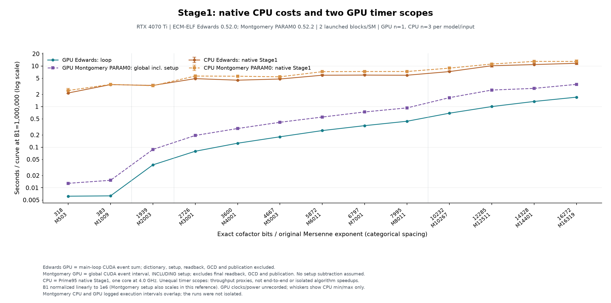
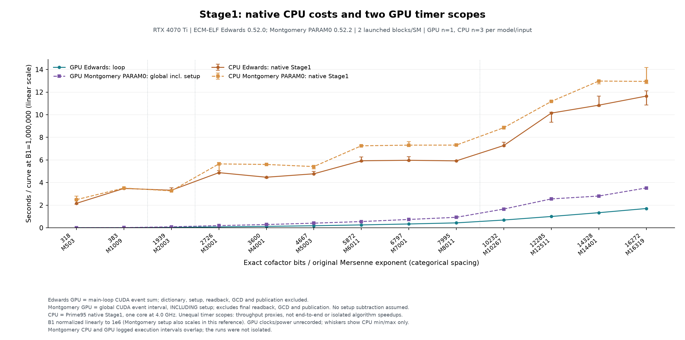
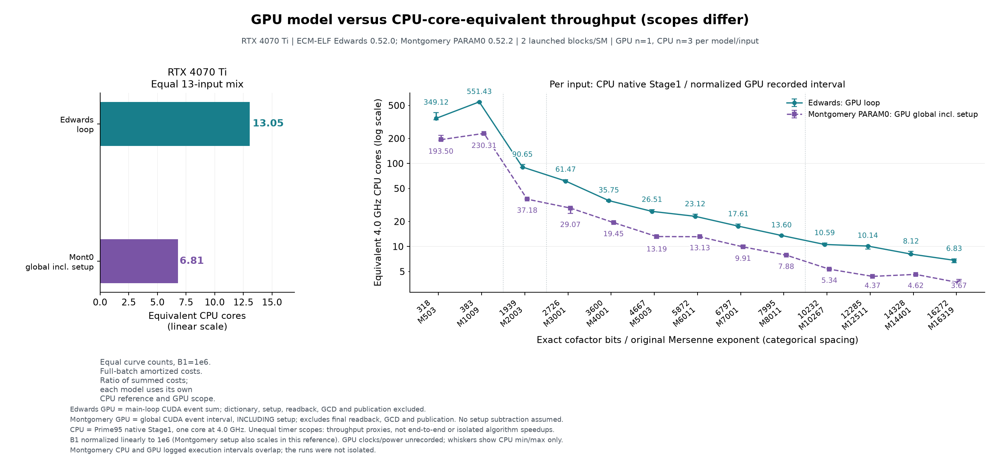
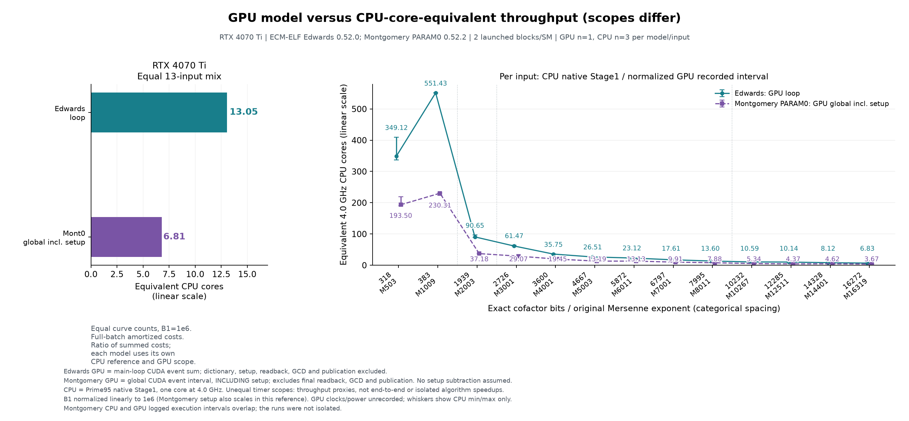

# Stage1 性能依据

## 口径与当前策略

CUDA Montgomery 默认 ladder、TPB128、按容器选择 TPI，分档寄存器；PRAC 默认不编译。GPU Edwards 默认窗口 NAF。已测局部最佳不能扩大到其他位宽/设备或直接替换默认。

完整曲线 wall、GPU kernel 时间、批量摊销 s/curve 和短时投影分别报告。生产 B1=10e6…260e6 的短时采样按完整/窗口工作比投影，排除冷准备、最终归一化/save；checkpoint 不算已完成曲线。

重复实验采用预热及相反/交错顺序，并保留完整矩阵、失败和原始日志；下列单次 GPU 矩阵按用户指定不重复，不提供波动估计。管理员 NCU 会重放，采集时间不作吞吐；Nsight Systems 的自身事件间隙不等于整卡空闲比例。

## RTX4070 Ti 全范围 Stage1 对比

2026-10-24 的测量覆盖同一组 **13 个梅森余因子、318–16272 bits**。GPU Edwards 为 **ECM-ELF 0.52.0**，Montgomery PARAM0 为 **0.52.2**，每模型、每输入各测一批（n=1）；Prime95 两类构造各有 **39 个有效单核样本**（每输入 n=3），CPU 由用户确认固定为 4.0 GHz。

Edwards 继续使用独立的主循环计时。新增 Montgomery 日志只有**包含初始化的全局计时**，因此作为单列参考，保留其真实边界。统一折算至 B1=1e6 后，Edwards 主循环成本为 **0.006198–1.704841 秒/曲线**，Montgomery 含初始化参考为 **0.012868–3.525354 秒/曲线**。两者不是同边界的算法性能比较，也不是端到端时间。





### 输入与工况

GPU START 工作行中的已知因子逐项通过整除验证；计算出的实际 N 位宽与原生 GPU 输出相符，并与 CPU 原工作行的目标一致。CPU screen 日志不打印已知因子列表，因此 CPU 输入身份的证据范围是原工作行，不能单凭 screen 日志证明执行时剥离了这些因子。

两次 GPU 测量均使用 device 0、RTX4070 Ti、60 SM、TPB128、120 个 block，即发射 2 block/SM；实际驻留仍受资源约束。Edwards 为 NAF w6、HWCD 倍点，Montgomery 为 Suyama PARAM0。TPI4/8/16/32 对应 B1=1e6/2e5/5e4/1e4，批量为 3840/1920/960/480。不同构造使用各自的进位余量，容器不强制相同：M1009 的 Edwards/Montgomery 为 **384/512 bits**，M12511 为 **12288/13312 bits**；不能把这些点的差异全部归因于点运算公式。

Montgomery 原生运行日志直接记录卡名和 SM 数；Edwards 的 device 0 由分析时设备枚举对应到同一张 RTX4070 Ti，枚举时驱动为 610.88，完整设备身份保存在忽略的证据目录。**运行时 GPU 频率、功耗及其他并发负载未记录**。另外，Montgomery CPU 日志的执行时段约为 17:33–17:40，GPU 为 17:34–17:40，二者重叠；这是现有工况参考，不宣称隔离运行。精确 CPU 型号和 Prime95 版本未写入这两份 CPU 日志。

### 计时边界与完整矩阵

| 路径 | 采用计时 | 包含与排除 |
| --- | --- | --- |
| GPU Edwards | `loop_gpu_ms` | NAF 主循环每次发射前后 CUDA event 区间累计；排除字典、初始化、切片后坐标回读/导入、主机回调、GCD、save 和结果发布 |
| GPU Montgomery PARAM0 | `gputime` | 从 `global_start` 到末次切片 `stop` 的 CUDA event 区间；包含标量传输、曲线初始化、分配/准备及期间的主机提交间隙，排除末次结果回读、GCD、save 和结果发布 |
| CPU Prime95 | `Stage 1 complete ... Total time` | 原生 Stage1 时间，包含字典等 Stage1 工作；排除 Stage2 及整进程启动 |

实现依据为 Edwards 的 `src/ecm/edwards_stage1/cuda/edwards_runtime.inl:96–123`、`workflow.cpp:225`，以及 Montgomery 的 `src/ecm/montgomery_stage1/cuda/runtime.cu:194,673–674,763`。`GPU Edwards NAF` 汇总行是在主循环结束后输出，不能用它到 save 行的墙钟间隔代表主循环。CUDA event 区间不称 profiler 的纯 kernel 时间；嵌套的 `api_seconds` 不重复相加。

按实测批量 C、B1 和所选计时 T 计算 `GPU秒/曲线@1e6 = T / C × (1e6/B1)`。后 11 组是线性外推。**Montgomery 的该折算会同时放大固定准备开销**，不是扣除初始化后的主循环成绩，也不是在目标 B1 重测的总时间；没有用日志秒级时间戳估计并扣除准备成本。

| M 指数 | N bits | 实测 B1 | 曲线/批 | Ed 主循环秒/批 | Mont 全局秒/批 | Ed 秒/曲线@1e6 | Mont 秒/曲线@1e6 |
| ---: | ---: | ---: | ---: | ---: | ---: | ---: | ---: |
| 503 | 318 | 1,000,000 | 3,840 | 23.802016 | 49.413900 | 0.006198 | 0.012868 |
| 1009 | 383 | 1,000,000 | 3,840 | 24.240707 | 58.623500 | 0.006313 | 0.015267 |
| 2003 | 1939 | 200,000 | 1,920 | 14.076281 | 33.736000 | 0.036657 | 0.087854 |
| 3001 | 2726 | 50,000 | 960 | 3.808978 | 9.331060 | 0.079354 | 0.194397 |
| 4001 | 3600 | 50,000 | 960 | 6.007012 | 13.830800 | 0.125146 | 0.288142 |
| 5003 | 4667 | 50,000 | 960 | 8.648950 | 19.705300 | 0.180186 | 0.410527 |
| 6011 | 5872 | 50,000 | 960 | 12.308746 | 26.525200 | 0.256432 | 0.552608 |
| 7001 | 6797 | 50,000 | 960 | 16.276028 | 35.425700 | 0.339084 | 0.738035 |
| 8011 | 7995 | 50,000 | 960 | 20.898027 | 44.541500 | 0.435376 | 0.927948 |
| 10267 | 10232 | 10,000 | 480 | 3.298233 | 7.962240 | 0.687132 | 1.658800 |
| 12511 | 12285 | 10,000 | 480 | 4.804200 | 12.262400 | 1.000875 | 2.554667 |
| 14401 | 14328 | 10,000 | 480 | 6.415296 | 13.484000 | 1.336520 | 2.809167 |
| 16319 | 16272 | 10,000 | 480 | 8.183239 | 16.921700 | 1.704841 | 3.525354 |

两模型 13 个实测批次的计时之和分别为 **152.767714 秒（Edwards 主循环）**、**341.763300 秒（Montgomery 全局）**，只是不同 B1/批量的事件时间求和。各输入折算至 B1=1e6 后的一曲线成本之和分别为 **6.194114**、**13.775634 秒**。

### GPU 型号与 CPU 等效核心数





各构造使用自己的 Prime95 单核中位数作分子：`K = CPU秒/曲线@1e6 ÷ GPU折算秒/曲线@1e6`。每个数据点标注对应的等效核心数，保留两位小数，文字颜色与曲线一致。Edwards 逐输入为 **6.83–551.43 核**，Montgomery 含初始化参考为 **3.67–230.31 核**。范围线只表示 CPU 三个样本的 min/max，不包含尚未测量的 GPU 波动，不是置信区间。

左图采用明确的等输入组合：13 个输入在 B1=1e6 下各占相同曲线数量，GPU 保持本次满批次摊销成本。按 `K_mix = Σ CPU中位秒/曲线 ÷ Σ GPU折算秒/曲线`，得到 **RTX4070 Ti Edwards 主循环 ≈ 13.05 个本次 4 GHz CPU 核心**（80.838/6.194114），**Montgomery 含初始化参考 ≈ 6.81 核**（93.781/13.775634）。不对逐输入倍率作算术平均；这些数字不是只提交 13 条单曲线时的延迟，也不是多核 CPU 实测扩展比。两条路径的计时边界、版本和运行时段不同，不能用 13.05/6.81 声称算法加速倍数。

M503/M1009 的 Edwards 容器和批量相同，主循环时间接近；CPU 却分别采用 FMA3/32 和 AVX-512/128，因此等效核数可相差很大。大位宽的 Edwards 约 6.83–10.59 核，Montgomery 参考约 3.67–5.34 核；小位宽的数百核结果不能当成整张卡的固定等价。

### 证据与复现

Edwards 来源为 `tools/benchmarks/stage1/screen_e.log`，Montgomery 为 `screen_m1.log`。后者开头附带同一批旧 Edwards 记录，**只提取后半部 0.52.2 的 13 个 PARAM0 任务**，不重复计数。26 个 GPU 样本均有完整批次 save 和结果发布；Edwards 的队列中断发生于第 13 批发布之后，Montgomery 记录完成 13 个任务。页眉的全局 `param3` 默认值不代替各任务的曲线选择，实际以 typed save、`queue_save` 及原生 GPU 输出核对。

| 数据 | 原始快照、参考快照与设备枚举 | 逐项汇总、来源行号与 CSV |
| --- | --- | --- |
| Edwards 0.52.0 | `data/experiments/stage1_gpu_0_52_0_20261024/ed_4070ti_01/` | `data/benchmarks/stage1_gpu_0_52_0_20261024/ed_4070ti_01/` |
| Montgomery 0.52.2 | `data/experiments/stage1_gpu_0_52_2_20261024/mont0_4070ti_02/` | `data/benchmarks/stage1_gpu_0_52_2_20261024/mont0_4070ti_02/` |

每个汇总目录包含 `summary.json` 和 `comparison.csv`；新对比图 PNG/SVG 位于 `data/figures/stage1_gpu_0_52_2_20261024/mont0_4070ti_02/`，正文引用 PNG 副本置于本页 `attachments/`。核对范围为因子整除、输入身份、容器/进位余量、TPI/批量、计时及完成记录，没有据此宣称独立末点数学验算。

[analyze_stage1_gpu.py](../../tools/bench/analyze_stage1_gpu.py) 不启动 GPU 计算。Edwards 复算可使用默认 `screen_e.log` 与旧 CPU 汇总；新增 Montgomery 和两模型对比图从仓库根目录运行：

```powershell
python tools/bench/analyze_stage1_gpu.py --model mont0 `
  --log tools/benchmarks/stage1/screen_m1.log `
  --cpu data/benchmarks/stage1_prime95_mont_20261024/summary.json `
  --device-map data/experiments/stage1_gpu_0_52_0_20261024/ed_4070ti_01/device-map.csv `
  --sm-count 60 `
  --evidence data/experiments/stage1_gpu_0_52_2_20261024/mont0_4070ti_02 `
  --output data/benchmarks/stage1_gpu_0_52_2_20261024/mont0_4070ti_02 `
  --figures data/figures/stage1_gpu_0_52_2_20261024/mont0_4070ti_02 `
  --compare data/benchmarks/stage1_gpu_0_52_0_20261024/ed_4070ti_01/summary.json `
  --attachments docs/performance/attachments
```

**待验证**：Montgomery 独立主循环计时、4060 Laptop 全范围测量、隔离运行的重复样本及运行时 GPU 工况。保留当前计时实现，本次仅分析现有日志。

## Prime95 单核基准与 B1 外推

CPU 两类曲线均为 B1=1,000,000、4.0 GHz 单核，每输入 3 个有效计时。日志将 worker 绑定到逻辑 CPU 1，并报告 AMD Zen 架构；精确 CPU 型号、Prime95 版本及 CPU 功耗未记录，不从当前安装程序推定。Montgomery 是日志中的曲线构造名称；Suyama sigma 与 PARAM0 的对应参照 Prime95 `ecm.cpp:4960–4961,7359`，不由名称推断所有内部算术选项。

Edwards 的 M4001 使用补测 curve 2、3、4，按用户指定排除 curve 1 的 **4.995 秒**预热；原日志中该输入直接恢复 Stage2，没有 Stage1 计时。其余 12 组保留全部三次完成计时，合计 **39 个有效样本、1 个排除预热**。Montgomery 全部 13×3=**39 个有效样本**，不额外丢弃 curve 1。任务完成行中的曲线总数不代替实测样本数。

下表单位为秒/曲线，取原生 Stage1 中位数和实测 min…max；两类曲线的 FFT 档位逐输入一致。其曲线 sigma 不同，不宣称同一条曲线的端点配对。

| M 指数 | 原任务余因子 bits | Stage1 FFT | Ed 中位数 | Ed min…max | Mont 中位数 | Mont min…max |
| ---: | ---: | --- | ---: | --- | ---: | --- |
| 503 | 318 | FMA3 / 32 | 2.164 | 2.089…2.540 | 2.490 | 2.457…2.814 |
| 1009 | 383 | AVX-512 / 128 | 3.481 | 3.480…3.483 | 3.516 | 3.418…3.524 |
| 2003 | 1939 | AVX-512 / 128 | 3.323 | 3.265…3.548 | 3.266 | 3.265…3.288 |
| 3001 | 2726 | AVX-512 / 256 | 4.878 | 4.873…5.062 | 5.651 | 4.863…5.774 |
| 4001 | 3600 | AVX-512 / 256 | 4.474 | 4.405…4.496 | 5.603 | 5.581…5.629 |
| 5003 | 4667 | AVX-512 / 256 | 4.777 | 4.743…4.988 | 5.416 | 5.210…5.504 |
| 6011 | 5872 | AVX-512 / 384 | 5.929 | 5.841…6.278 | 7.253 | 7.253…7.326 |
| 7001 | 6797 | AVX-512 / 384 | 5.971 | 5.918…6.299 | 7.311 | 7.233…7.629 |
| 8011 | 7995 | AVX-512 / 384 | 5.921 | 5.887…5.945 | 7.315 | 7.267…7.421 |
| 10267 | 10232 | AVX-512 / 512 | 7.279 | 7.223…7.562 | 8.856 | 8.842…9.006 |
| 12511 | 12285 | AVX-512 / 640 | 10.146 | 9.346…10.223 | 11.175 | 11.160…11.226 |
| 14401 | 14328 | AVX-512 / 768 | 10.846 | 10.774…11.646 | 12.980 | 12.720…13.003 |
| 16319 | 16272 | AVX-512 / 768 | 11.649 | 10.870…12.115 | 12.949 | 12.742…14.178 |

两组成本随 FFT 档位呈分段变化，不拟合成严格按位宽递增的曲线。Edwards M503 的 max/min−1 为 21.6%，Montgomery M3001 约为 18.7%，均保留原始离散。13 个输入的 CPU 中位数之和为 Edwards **80.838 秒**、Montgomery **93.781 秒**，只描述本次组合，不能排除不同运行时段与并发负载的影响。

B1 按用户指定的线性关系外推，**不是对应 B1 的重新实测，也不是多 B1 拟合**：

\[
T_{\rm CPU}(B_1)=T_{\rm CPU}(10^6)\frac{B_1}{10^6}.
\]

B1=11e6/44e6 分别乘以 11/44；例如 M16319 的 Edwards 为 **128.139/512.556 秒**，Montgomery 为 **142.439/569.756 秒**。完整 13 输入的两档外推均保存在各自 `summary.csv`、`summary.json`；这里只沿 B1 外推，不跨位宽插值，也不按频率修正其他历史 GPU/CPU 样本。

| 曲线 | 原始输入（`tools/benchmarks/prime95/`） | 原始快照 | 统计与外推 |
| --- | --- | --- | --- |
| Edwards | `screen_stage1_1e6.log`、`补充4001移动到原文件忽略curve1预热.log` | `data/experiments/stage1_prime95_20261024/` | `data/benchmarks/stage1_prime95_20261024/` |
| Montgomery | `screen_stage1_mont_1e6.log` | `data/experiments/stage1_prime95_mont_20261024/` | `data/benchmarks/stage1_prime95_mont_20261024/` |

计时读取原生 `Stage 1 complete ... Total time`，排除 Stage2 初始化、主循环及 GCD，也不是整进程墙钟。Prime95 参考源码 `ecm.cpp:7420,7682` 显示其 Stage1 范围覆盖指数/字典处理、主循环、末点检查及向 Montgomery 的转换，曲线初始构造在前。日志显示后续 Stage2 会自动扩大 B2，相关时间不加入本表。

复算入口为 [analyze_prime95_stage1.py](../../tools/bench/analyze_prime95_stage1.py)，Edwards 保持原补测及预热排除参数；Montgomery 使用 `--curve-type Montgomery`，指定各自输出目录以保留独立证据：

```powershell
python tools/bench/analyze_prime95_stage1.py --cpu-ghz 4.0 `
  --log tools/benchmarks/prime95/screen_stage1_mont_1e6.log `
  --curve-type Montgomery `
  --evidence-dir data/experiments/stage1_prime95_mont_20261024 `
  --output data/benchmarks/stage1_prime95_mont_20261024 `
  --figures data/figures/stage1_prime95_mont_20261024
```

### 匹配 GPU 工作行

[prepare_stage1_gpu_matrix.py](../../tools/bench/prepare_stage1_gpu_matrix.py) 为每张卡生成两类曲线、每条件一次的 `ECMSTAGE1=` 工作行，保存点前缀 `e_` / `m0_` 选择构造，文件名末尾提供 B1；B2=B1、skip_curves=0，不自动续算 Stage2。分别按实际余因子位宽与设备元数据的进位余量选择最小可用容器，Edwards/Montgomery 为 1/6 bits，不共用容器结果。

TPB128，批量 `C=2×SM数×(TPB/TPI)`：4070 Ti（60 SM）为 3840/1920/960/480，4060 Laptop（24 SM）为 1536/768/384/192，分别对应 TPI4/8/16/32。独立配置、工作行及生成计划位于 `data/experiments/stage1_gpu_tpi_2blocks_sm_20261024/{rtx4070ti,rtx4060_laptop}/`；当前 GPU 测量覆盖与计时限制以[本页完整矩阵](#rtx4070-ti-全范围-stage1-对比)为准。生成只查询程序/设备元数据，不启动 ECM 计算；原始日志与结果不进入公共 Git。

## GPU Edwards 主机等待与自适应切片

当前 0.38.4 Edwards binary/NAF 使用阻塞设备等待，并按约 100 ms 目标调整切片；正数 API 参数仍允许固定切片。实现、边界和停止语义以 [Stage1 架构](../architecture/STAGE1.md#gpu-edwards) 为准。阻塞等待不会减少点运算量，吞吐差异取决于同步、回读及提交频率；增加 B1 而保持片长不会自动消除这些开销的占比。

### 工况与证据

GPU1 RTX4060 Laptop，Windows 11 10.0.26200 / WDDM、驱动 610.88，Ryzen AI 9 HX 370；CUDA 13.3.73、MSVC 14.51.36231、sm89、Zen3 GMP。未调整时钟、功耗或优先级，有效 CPU 频率未独立测量，GPU0 原有工作保留。正式性能采集在全部编译及前置正确性检查结束后进行，GPU1 无其他本轮任务并发。

SM 遥测为 1500 MHz，功率上限查询 N/A。功耗记录有一个 590.01 W 的明显异常值，原样保留，因此本轮不据该接口作功耗或能耗比较，也不声称进程峰值。正常与异常遥测均在原报告中，不能通过删掉异常值来宣称功率预算。

输入固定为完整 M1279 / B1=500000 / 每批64条，及完整 M9689 / B1=10000 / 每批768条，sigma 分别为17…80与17…784，48·lcm、w6、HWCD。仅作本地数学与性能测试，未提交结果。两种输入分别使用 1280/TPI8、10240/TPI32、TPB128。每种模式 3 次，交错顺序且不丢弃首轮；下表各列分别取中位数，吞吐变化按同输入原路径墙钟中位数计算。样本范围不是置信区间，不能扩展为生产 B1=260e6、数小时稳定性或其他设备的性能保证。

原始根目录为 `data/experiments/stage1_host_wait_20261018/`；汇总为 `data/benchmarks/stage1_host_wait_20261018/probe_summary.json` 与 `native_summary.json`。探索校准因与编译重叠不纳入正式结论，保留于 `long_*` 及诊断草稿中。

### 同一模板的等待控制

使用同一实际生产模板，测试包装器仅改变主机等待和切片参数；1280/10240 两个探针的 SHA256 前缀分别为 `7185cf016f3c`、`9c7ab95e1ae8`。原始目录为 `formal_m1279_c64_b5e5/`、`formal_m9689_c768_b1e4/`，完整构建身份在 `formal_sources/`。

计时从生产模板入口到返回，包含分配、字典、主循环和回读，排除上下文、指数/NAF 编码、CPU 曲线构造及最终坐标导出。API 包装器自身有计时成本，结果用于归因，完整程序结论见下一表。原结束事件位置保持不变；CUDA event 区间可能含提交间隙，不视作 profiler 纯核时间。

| 输入 | 等待与切片 | 算术调用秒 | 平均 CPU 核心 | 相对原路径吞吐 |
| --- | --- | ---: | ---: | ---: |
| M1279 | 忙等，固定256 | 25.8760 | 0.9897 | +0.00% |
| M1279 | 阻塞，固定256 | 26.4602 | 0.0566 | -2.21% |
| M1279 | 阻塞，自适应 | 25.1107 | 0.0050 | +3.05% |
| M9689 | 忙等，固定256 | 20.9978 | 0.9878 | +0.00% |
| M9689 | 阻塞，固定256 | 21.0232 | 0.0141 | -0.12% |
| M9689 | 阻塞，自适应 | 21.3272 | 0.0395 | -1.54% |

M1279 的片数由 2819 降至 253；排除首五片和短尾后的片时间中位数约 8.92 → 100.00 ms。M9689 的片数由 57 增至 204，稳态片时间约 366.96 → 99.87 ms。后者增加了普通坐标回读与导入次数，因此自适应响应目标具有实际代价。单独固定片阻塞的 M9689 时间范围与忙等重叠，0.12% 的中位数差不能视为稳定退化。全部18次的四坐标在各输入内部逐字一致，不变量通过。

### 未插桩生产程序完整批次

基线 ECM-ELF 0.38.0 SHA256 前缀 `07a26b7b5d84`，候选 0.38.4 为 `dfa287226ba0`；GMP 相同。候选按正式 local 构建规则编入 512/768/1280/10240 四档，用于本轮验证，不代表全发布架构已验收。每个模式各3次，按 A/B、B/A、A/B 执行。独立目录、空提交身份、禁用定期 checkpoint、每次使用新的指数缓存路径；B2=B1。

墙钟与 CPU 使用 Windows `GetProcessTimes` 的进程创建至退出区间，含启动、曲线/标量准备、回调、完成检查点、GCD/归一化、save 和结果发布。CPU 单位为逻辑核心比例；不与内层模板或 CUDA event 时间相加。全部存档记录经字段、sigma 顺序、checksum、因子整除及跨二进制/重复一致性检查，完整进程测量中不额外运行 CPU 梯形参考。

| 输入 | 原程序秒/批 | 0.38.4秒/批 | CPU核心：原 → 新 | 吞吐变化 |
| --- | ---: | ---: | ---: | ---: |
| M1279 | 26.3644 | 25.7695 | 0.9915 → 0.0267 | +2.31% |
| M9689 | 29.4120 | 29.8997 | 0.9377 → 0.2549 | -1.63% |

M1279 墙钟范围：原 26.2329…26.6859 秒，新 25.7328…26.5028 秒。

M9689 墙钟范围：原 28.9426…30.5284 秒，新 29.1763…30.0343 秒。

两组范围均有重叠，三样本中位数只描述本机此次工况；主要收益是释放 GPU 等待期间的 CPU，不能承诺统一加速。万位大批量的 CPU 曲线构造与归一化仍明显，因此全进程平均占用约0.25核，高于该输入GPU模板区间约0.04核。尚未做 CPU 能耗测量。

复现使用 `tools/bench/diagnose_stage1_host_wait.py --primary-only --adaptive-candidate` 进行三路控制，完整程序使用 `tools/bench/bench_stage1_host_wait.py --baseline ... --candidate ... --exponent ... --b1 ... --curves ... --output ...`；两个工具都要求新输出目录，GPU 固定为1。构建、完整命令、恢复门禁和当前限制见[主机等待草稿](../development/GPU_STAGE1_HOST_WAIT_DRAFT.md#0384-等待及切片优化)。临时草稿保留，由用户决定后续处理。

## GPU Edwards 细分实例三曲线族对照

当前Edwards使用[32档最小可用容器](../architecture/STAGE1.md#gpu-edwards)，核函数和七组实例化文件位于 `kernels/cuda/`，保留17408档上限。以下为同一新exe的Edwards NAF、Montgomery PARAM0与PARAM3完整批次成本，不比较曲线族的因子发现概率。

### 条件与计时

GPU1 RTX4060 Laptop、24 SM、UUID `GPU-8a67b1f8-ef1c-3177-a822-813a7ac2224d`，驱动610.88、CUDA13.3、MSVC14.51.36231、sm89、无PTX。exe SHA256=`fa8b903e9186dada7055e61176fff237411b575c4707a04541f5cc50e15ad3eb`，产品源码对应实例扩展提交 `ec47b0c`。构建为通用Montgomery域、TPB128、resident/PRAC关闭，保留当前分档寄存器策略。

输入为完整 `M_p=2^p−1`，B1=10000、每批768条、sigma起点20260922。Edwards采用48·lcm、w6、HWCD；Montgomery采用lcm与ladder。每组排除一次设备预热，再交错/反序采集三次正式样本；每次是新进程，CUDA上下文/模块加载仍计入。完整进程wall包含启动、标量/曲线准备、GPU、GCD/归一化及save，排除独立CPU末点核对。此边界不能与嵌套的算术入口或CUDA event区间相加。

硬件设置保持原值。利用率≥50%的457个离散遥测点中，SM均为1500MHz，观测功耗8.90…26.51W、温度57…68°C，功耗上限查询N/A；不声明锁频或55W。利用率窗口与瞬时功耗不同步；这一批的温度与采样条件不能直接合并到下文冻结参考。

### 完整进程成本


左面板为秒/批的对数轴；右面板把每个样本除以同位宽PARAM3的进程中位数，越低表示成本越小。实心点为中位数，空心点保留全部三次正式样本，误差线仅是实测最小值至最大值，不是置信区间。[矢量图](../../data/figures/edwards_fine_tiers_20261016/comparison.svg)。

| 输入 | Edwards NAF 秒/批 | PARAM0 秒/批 | PARAM3 秒/批 | NAF/PARAM3成本比 | Edwards容器/TPI | Montgomery容器/TPI |
| --- | ---: | ---: | ---: | ---: | --- | --- |
| M347 | 0.9537 | 0.6228 | 0.6062 | 1.573 | 384/4 | 384/4 |
| M677 | 1.1098 | 0.6719 | 0.6457 | 1.719 | 768/8 | 768/8 |
| M991 | 1.1686 | 0.8531 | 0.7538 | 1.550 | 1024/8 | 1024/8 |
| M2203 | 2.5931 | 2.6388 | 1.8226 | 1.423 | 2560/16 | 2560/16 |
| M4003 | 5.7542 | 4.6686 | 3.7624 | 1.529 | 4096/16 | 4096/16 |
| M8191 | 16.6265 | 20.3712 | 16.5450 | 1.005 | 8192/16 | 9216/32 |

前五个输入的容器/TPI已经一致；8191位按Edwards一位余量使用8192/TPI16，Montgomery按六位余量使用9216/TPI32。不同曲线构造、状态坐标、切片和准备开销仍存在，不能把整进程比值解释为纯点公式代价。表值除以768仅是批量摊销值，不是单曲线串行耗时。

本矩阵前五个位宽的NAF中位成本为PARAM3的1.423…1.719倍。M8191为1.005倍，NAF范围16.4140…16.7420秒与PARAM3范围16.5397…16.5563秒重叠，所测完整成本接近。M347/M677的NAF范围分别为0.6381…1.0394、0.7084…1.6228秒，新进程离散明显；不把三次中位数视为稳定算法倍数。M2203的NAF与PARAM0范围也重叠，不能据中位数微小差异宣布稳定领先。

本表不与下文不同exe的七档数据相除来宣称细分容器的独立加速比例，也不外推生产B1、常驻队列吞吐、其他设备或全局最优TPI/窗口。

### 验收、证据与复现

完整[验收记录](../development/GPU_EDWARDS_FINE_TIERS_DRAFT.md#2026-10-16完整正确性门禁)覆盖32档、131组探针/537条逻辑曲线组合、70条CLI检查、旧V1/V2跨容器恢复及Stage2交接。正式性能采集还核对每条记录和重复稳定性，首尾曲线用独立整数梯形计算；六个位宽共4608条Edwards归一化记录与冻结七档NAF逐字节一致，汇总为 `data/benchmarks/edwards_fine_tiers_20261016/endpoint_identity_01.json`。

正式采集共72个完整批次：54个正式样本、18个排除的预热。原始证据为 `data/experiments/edwards_fine_tiers_20261016/bench_01/`，审计汇总为 `data/benchmarks/edwards_fine_tiers_20261016/comparison_01/summary.json` 和 `comparison.csv`；汇总SHA256=`158da9ec62537d18a2a59f9fb0ee3c8b2d48e9420d32aad0e961640fdd0f8665`。程序/GMP、源与工具快照、编译命令、设备遥测、日志和save摘要均保留。审计同时核对新Edwards实例清单、实际编入档位及两种Montgomery的原日志几何信息。

采集入口为[批次基准](../../tools/bench/bench_edwards_gpu_stage1.py)，完整参数保存在原始 `summary.json` 的 `command`。审计输出须使用新目录；以下示例重新审计同份原始证据并重绘，不重新运行GPU：

```powershell
python tools/bench/analyze_edwards_gpu_stage1.py `
  --evidence data/experiments/edwards_fine_tiers_20261016 --suite bench_01 `
  --output data/benchmarks/edwards_fine_tiers_20261016/comparison_new
python tools/bench/plot_edwards_gpu_stage1.py --comparison `
  --input data/benchmarks/edwards_fine_tiers_20261016/comparison_new/summary.json `
  --output-dir data/figures/edwards_fine_tiers_20261016 `
  --manifest data/benchmarks/edwards_fine_tiers_20261016/plots_new.json
```

图表以Python/matplotlib生成，输入、脚本和图表摘要记录于 `plots_01.json`。图和汇总按规则保存在Git忽略的 `data/`，新工作区需要取得相同证据后生成；Git维护脚本与文档。

## GPU Edwards 初始基准与 NAF 对照

以下为冻结七档容器版本的初始基准和NAF/窗口对照；当前32档构建及三曲线族成本见上节。它们保留各自构建与计时条件，不表示当前程序的绝对性能。

### 输入、设备与计时

GPU1 RTX4060 Laptop、24 SM、UUID `GPU-8a67b1f8-ef1c-3177-a822-813a7ac2224d`，驱动 610.88、CUDA13.3、MSVC14.51.36231、sm89、无 PTX。输入均为完整 `M_p=2^p−1`，B1=10000、sigma 起点 20260922。主矩阵每批 768 条；窗口/倍点矩阵每批 128 条。Edwards 用 48·lcm，Montgomery PARAM0/3 用 lcm；同 sigma 表示各自曲线族的确定性种子，不表示同一条曲线。这些数据比较实现成本，不比较找到因子的概率或单因子总成本。

每组先运行一次不计入统计的设备预热，再交错/反序运行三次正式样本。每次均为新进程，CUDA 上下文及模块加载仍计入；整批完成后才采样结束。进程 wall 包含进程启动、指数/曲线构造、GPU、GCD/归一化及 save，排除独立 CPU 末点核对。Edwards 的 `arithmetic api_seconds` 另覆盖完整点乘入口，边界见[实现](../architecture/STAGE1.md#gpu-edwards)。CUDA event 区间不是 profiler 的纯 kernel 时间，不能与上述嵌套 wall 相加。

保持原硬件设置。利用率≥50%的 1132 个离散采样点中，SM 均为1500MHz，观测功耗8.71…27.90W、温度70…78°C；功耗上限查询返回 N/A，不声明55W或锁频。利用率采样窗口与瞬时功耗并非严格同步。这批数据不与历史1800MHz/55W样本合并。

### 优化前的三曲线族成本

下表为完整进程秒/批的三次中位数，批量768。每曲线摊销值为表值÷768；不是单曲线串行耗时或峰值吞吐。


图中横轴按输入分组，纵轴为对数秒/批。实心点是中位数，空心点保留三次正式样本，误差线仅表示实测最小值至最大值，不是置信区间；后续耗时图沿用此约定。M8191 灰底组使用独立补建的原算法程序，不能与其他构建拼成优化加速比。[矢量图](../../data/figures/edwards_naf_20261016/initial.svg)。

| 输入 | Edwards 二进制 | Montgomery PARAM0 | Montgomery PARAM3 | Edwards 容器/TPI | Montgomery 容器/TPI |
| --- | ---: | ---: | ---: | --- | --- |
| M347 | 1.0412 | 0.7407 | 0.7488 | 512/4 | 384/4 |
| M677 | 1.2414 | 0.9110 | 0.8507 | 1024/8 | 768/8 |
| M991 | 2.0503 | 1.0725 | 1.0091 | 1024/8 | 1024/8 |
| M2203 | 7.8158 | 2.3166 | 1.9861 | 4096/16 | 2560/16 |
| M4003 | 8.3948 | 4.9636 | 4.0369 | 4096/16 | 4096/16 |
| M8191 | 26.5794 | 20.6843 | 17.4349 | 8192/32 | 9216/32 |

前五行使用优化前 exe SHA256=`3777416c9026027c88d2d56f78e6fbfa28a3886a7d78aa25ce9a500b66a534cb`。M8191 使用同一冻结原算法源码、包含所需9216实例的 exe=`cfa6c4d675a33fddca72797254c02ff2170593c2a7507d1d78c5e8000cbb5dde`。Montgomery 需预留六位进位，8191 位不能使用8192容器。两份构建及样本分别保存在 `bench_initial_01/`、`bench_initial_wide_01/`：前者原报告complete=false，审计明确只采用五个完整范围；8191位的完整资格由后者提供。未完成记录不计正式样本。

容器和 TPI 不同，尤其 M2203 的4096与2560，不能将成本差距全部归因于曲线公式。原算法跨构建/采样批次也存在时间差异，优化比例另用下面的同一 exe 配对数据。

### 同一 exe 的 binary/NAF 配对

exe SHA256=`d853b4ce80c78853a4fdafa5f3ad3abc51cbe267cd5231c64d2a523e299f9a89`，原13个CUDA对象与前五行基线逐字节相同，新增独立NAF模块。仅切换 Edwards binary/NAF，曲线、标量、容器、批量和保存合同相同；NAF 为窗口6、HWCD倍点。每批所有归一化记录在两种模式间相同。计时变化包含稀疏加法、按需生成T、设备算术域跨片保留及只回传四坐标的共同收益。


两面板分别将每个样本除以**同位宽、同一计时边界的 binary 中位数**，虚线为1，越低表示耗时越小；标注为中位数耗时变化。归一化让各位宽的收益与离散可直接比较，绝对秒数见下表。算术入口嵌套在完整进程内，两个面板不能相加；M991 的范围重叠在图中保留。[矢量图](../../data/figures/edwards_naf_20261016/paired_naf.svg)。

| 输入 | binary 秒/批 | NAF 秒/批 | wall 降幅 | 算术入口秒 binary→NAF |
| --- | ---: | ---: | ---: | --- |
| M347 | 1.0060 | 0.8466 | 15.8% | 0.8389→0.6839 |
| M677 | 2.0284 | 1.7999 | 11.3% | 1.7931→1.5595 |
| M991 | 1.9627 | 1.8670 | 4.9% | 1.7031→1.5952 |
| M2203 | 8.3400 | 5.3243 | 36.2% | 7.7581→4.7173 |
| M4003 | 8.3451 | 5.3988 | 35.3% | 7.1778→4.2313 |
| M8191 | 26.2992 | 17.1940 | 34.6% | 23.0279→13.9288 |

这些是三次中位数。M991的binary范围1.2384…2.1979秒、NAF范围1.7704…1.8745秒重叠，微小收益尚未超出实测离散；没有剔除偏快或偏慢样本。M2203/M4003/M8191 的完整批次为1.53…1.57倍、算术入口为1.64…1.70倍；不将两者相乘或相加。

### 窗口与倍点形式

同一新版exe，B1=10000、批量128、HWCD倍点。下表为字典与主循环 CUDA event 区间之和的三次中位数（秒），包含可能的首次加载/发射间隙。不同窗口组分别采集，完整进程排序受准备及冷启动离散影响。

| 输入 | w=6 | w=8 | w=10 | w=12 |
| --- | ---: | ---: | ---: | ---: |
| M347 | 0.4064 | 0.3945 | 0.3901 | 0.4100 |
| M2203 | 1.4017 | 1.3506 | 1.3405 | 1.4018 |
| M8191 | 3.3671 | 3.2583 | 3.2202 | 3.3745 |


左、中面板按同位宽的 w6 中位数归一化，各用独立纵轴；event 面板放大局部差异，完整进程面板显示准备及启动离散。右面板为 M8191、128条曲线的**字典逻辑分配量**，由容器字节数×曲线数×4坐标×2^(w−2) 得到，依据为 [`run_naf`](../../src/ecm/edwards_stage1/cuda/edwards_runtime.inl) 第11行起的分配公式，不是进程显存峰值。窗口组分别采集，折线仅连接所测离散配置。[矢量图](../../data/figures/edwards_naf_20261016/windows.svg)。

这批event区间以w10较小，不能据此宣称所有B1/批量的最佳窗口或全局改默认。M8191的w6/w10完整进程中位数为4.7432/4.5841秒，字典从8MiB增长到128MiB；w12为512MiB且完整进程升至5.1838秒。默认仍为6，允许显式2..12；生产B1和更多批次的标定仍待验证。

倍点配对使用w8、批量128。HWCD（GPU内部编号4）与采用Prime95算法5代数形式的2XY路径（编号5）交错运行：M347/M2203/M8191 的event区间中位数为0.4031→0.3758、1.3490→1.3362、3.2551→3.2511秒，分别降低约6.8%/0.95%/0.12%。完整进程样本范围重叠，未据此切换全局默认。Prime95 `undoc.txt` 的算法6说明过期，同版源码已废弃6；CGBN没有模拟算法5的FFT复合指令，依据见[数学参考](../reference/ECM_EDWARDS_MATH.md#21-prime95-倍点算法编号与-fft-条件)。


各样本除以同位宽、同一计时边界的 HWCD 中位数。右面板放大 event 比值变化：大位宽的局部差异很小，M8191 两路径的 event 范围也重叠；左面板完整进程范围三个位宽均重叠。百分比不是不确定性估计，不能由此宣称稳定的端到端收益。[矢量图](../../data/figures/edwards_naf_20261016/doubling.svg)。

### 证据与复现

原始证据根目录为 `data/experiments/edwards_naf_20261016/`；汇总为 `data/benchmarks/edwards_naf_20261016/final_02/summary.json` 和 `initial.csv`。共192个完整批次：144个正式样本、48个预热；采集器冒烟和缺档失败不计入。每份数据保存exe/GMP摘要、源快照、编译命令、设备信息、遥测、日志及save摘要；采集核对每条记录/重复稳定性，首尾曲线用独立整数梯形核对，同曲线的binary/NAF整批记录逐条相等。审计重查范围、样本数、文件/源身份、几何形状、窗口/倍点选择、原日志计时与嵌套关系；四种私有元数据损坏均拒绝，原始证据未修改。

复现工具为[完整批次采集](../../tools/bench/bench_edwards_gpu_stage1.py)、[冻结原算法构建](../../tools/build/test/build_edwards_initial_baseline.ps1)及[证据审计](../../tools/bench/analyze_edwards_gpu_stage1.py)。NAF全档、V1/V2恢复、大B1及Stage2交接正确性见[验收记录](../development/GPU_EDWARDS_STAGE1_NAF_DRAFT.md)。B1=1e6/1e7只有正确性验收，本表不外推生产B1、其他设备、连续队列吞吐或Auto B2成本资格。

四组图由[绘图脚本](../../tools/bench/plot_edwards_gpu_stage1.py)直接读取上述审计汇总生成，没有重新采集 GPU 数据。需要 Python 3.10+ 和 matplotlib，从仓库根目录执行：

```powershell
python tools/bench/plot_edwards_gpu_stage1.py `
  --input data/benchmarks/edwards_naf_20261016/final_02/summary.json `
  --output-dir data/figures/edwards_naf_20261016 `
  --manifest data/benchmarks/edwards_naf_20261016/plots_01.json
```

脚本先核对144个正式样本、48个排除的预热、矩阵范围、缓存统计、曲线参数和配对构建身份，再输出4组 PNG/SVG。输入汇总 SHA256=`edcc591d52c683c10447386e5b2a12e8d00cc6249be40d6b7a027f9e49acbe53`；`plots_01.json` 记录完整输入/脚本/图表摘要、各组 exe 身份、环境版本及归一化口径。绘图核对记录 `plot_validation_01.json` 验证全部样本点在坐标范围内、归一化比值与审计一致、36个窗口正式样本的字典分配与原日志一致、7项损坏输入均拒绝，以及8个输出重复生成时摘要相同；四组图均已查看排版。原始证据不作修改。图和汇总位于 Git 忽略的 `data/`；新工作区需取得同份审计汇总后再生成，Git 维护脚本与说明。

## 已测 PRAC 范围

RTX4060 Laptop、24 SM、sm89、N=2^4423−1、4608/TPI16、lcm、TPB128 的显式实验中，批量1536、cap168、目标切片50ms 为已测有效配置。TPI32/cap128 能改善某些受限批量的资源或局部吞吐，但没有超过该范围最佳吞吐。

在终结规则专用体的冻结对照中，目标50ms、每配置4次短时前缀，得到：

| B1 | 参考 PRAC s/curve | 专用体 s/curve | 时间变化 |
| --- | ---: | ---: | ---: |
| 10e6 | 5.063071 | 5.050395 | −0.250% |
| 260e6 | 132.510655 | 132.178987 | −0.250% |

这是速度投影的中位数，未计完整曲线墙钟。冻结专用二进制 SHA=`464f124878ab755fba5e698f26962c15a1425c7bc0f4de83ed85e8df773d2b88`；108 条采样矩阵完整，GPU 忙时 SM=1800MHz。后续共享 DBL 的配对测试保持 TPI16/cap168/50ms 为最佳范围，不能把此表当作不同二进制的最新完整性能。

当前可复现选项、源码和采样脚本见 [实现](../architecture/STAGE1.md)、[bench_cuda_prac.py](../../tools/bench/bench_cuda_prac.py)、[bench_stage1_tpi_matrix.py](../../tools/bench/bench_stage1_tpi_matrix.py)。证据在 `data/experiments/stage1_rule_sentinel_*`、`stage1_shared_dbl_*`；基准必须同时记录实际 exe SHA、variant、TPI、寄存器、C 和切片策略。

## 资源与瓶颈

4608/TPI16 PRAC 的一个自然分配样本为172 regs、实际176，TPB128 时寄存器最多容纳2 blocks/SM；cap168 可容纳3。强制 TPI32 样本为109/112 regs、4 blocks/SM，但同时减小每 block 曲线数、增加 padding/跨 lane 成本，端到端未因此更快。

已采集的 natural/168/TPI32 achieved occupancy 为16.34%/19.37%/27.12%，issue active约30.60%/30.93%/38.93%。这些 profiler 值说明资源权衡，不能独立证明瓶颈成因或加速比例。DRAM 吞吐很低，主要成本仍在依赖多精度算术、发射与局部存储/调度。

normalized PRAC 按 ADD=A、DBL=D 统计：ADD=4M+2S，DBL=3M+2S；若平方与乘法同价，工作权重为6A+5D。该权重用于投影，不代表固定 GPU 周期。

## 限制与后续

PRAC表对应1800MHz/55W条件；GPU Edwards本轮条件见上文，保持分开记录。不同批次、驱动、采样窗口和构建的点不能直接拼成新的加速比。

对通用默认的改变仍需更多位宽、曲线族、设备和完整 B1 验证；现阶段优化优先级及其他未完成工作见 [TODO](../TODO.md)。

## 收尾与输入归一化

0.53.3 的 Windows 实测 CPU 为 AMD Ryzen AI 9 HX 370 w/ Radeon 890M，GPU 为 RTX 4070 Ti、driver 610.88、285 W power limit；输入 N=2^p−1，p=521/10267，B1=100，1000 曲线，sigma=100000，Montgomery PARAM0 与 Edwards，exp_cache=off、定期 checkpoint 关闭。锁修复阶段构建与完整归一化构建分别每格 2 个新进程样本，采用 ABBA 顺序，共 24 个计时样本；完整二进制 SHA、原始逐进程数据、GPU 时钟/负载/功耗与构建方式见[验收记录](../web/stage1-fourth-refactor-review-20261025.html#implementation-result)及 `data/experiments/stage1_fourth_refactor_20261026/qualification_final/summary.json`。这不是与旧 30 秒问题版本的对照。

父进程收到 save 完成行至 results 行，新结果文件为 0.123–0.257 s；在 10000 行历史、备份及 Montgomery P95 同步配置下为 0.276–0.284 s。results 至 queue done 单独记录；两段相邻，不重复累计内部嵌套计时。候选进程峰值约 136–202 MiB，每 20 ms 读取 Windows PeakWorkingSetSize；长历史组约 143–162 MiB，不与设备 payload 或其他进程相加。这些输入未出现约 30 秒固定收尾等待；小样本不足以证明归一化具有稳定百分比提速。

门禁覆盖实际 worker 的 23 组输入/队列合同、P95 103 项回归、确定性跨进程 writer、两种 CUDA 曲线的停止恢复，以及 CPU/CUDA Stage2 在混合历史上的追加。OpenCL 完整构建及其 CPU/query 路径通过，本轮未测 OpenCL 算术核；POSIX/Android 运行未验收。
