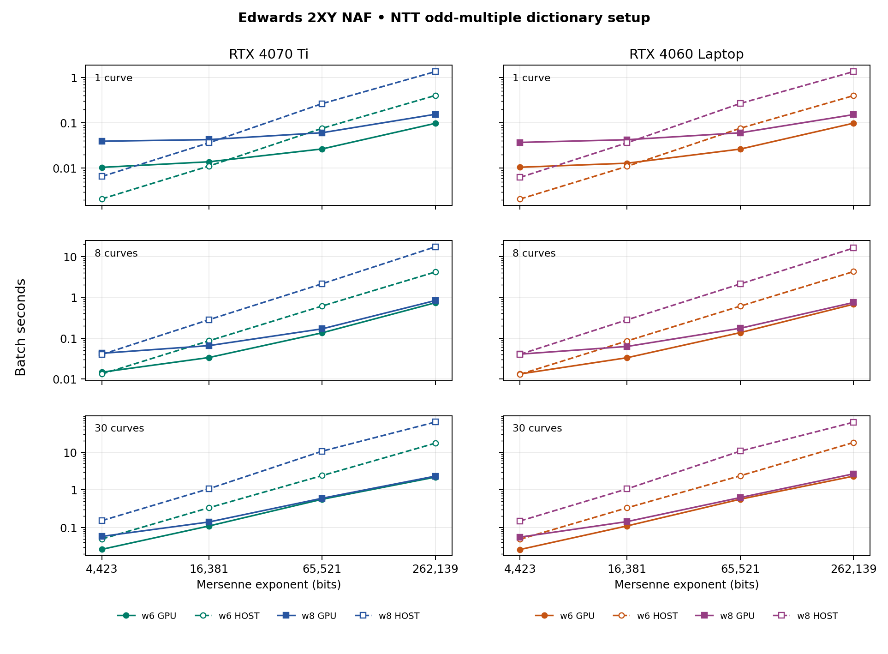
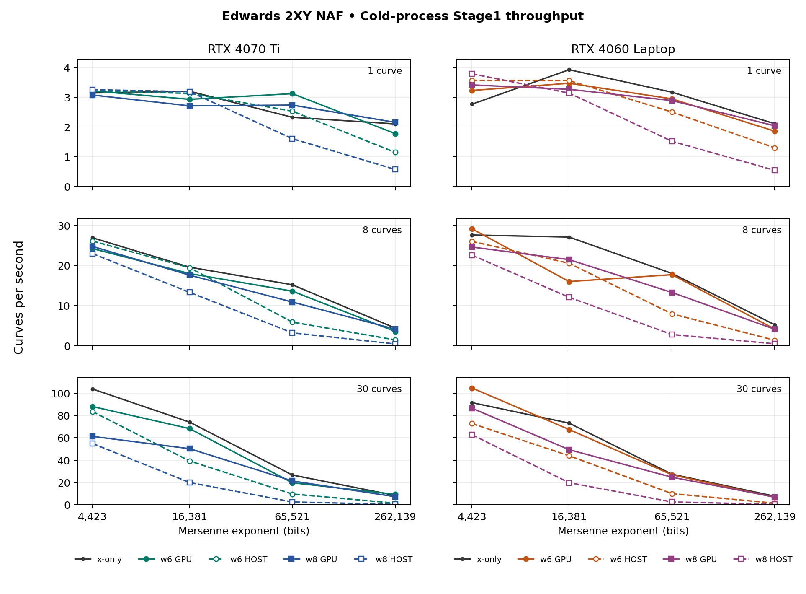
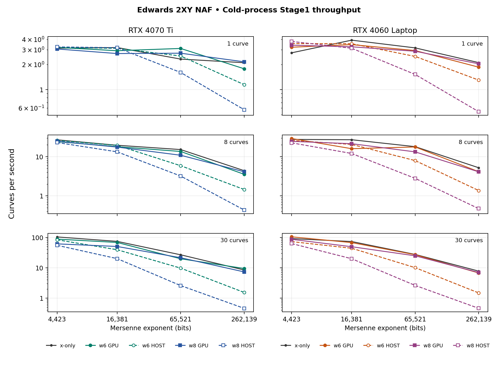
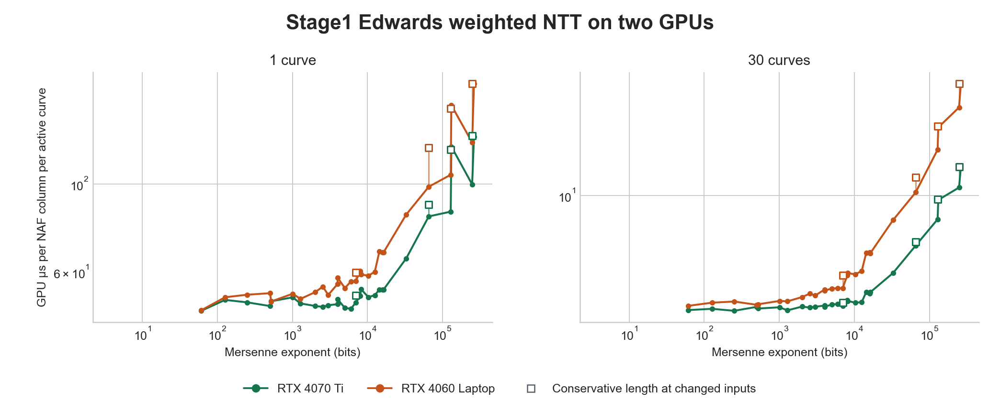
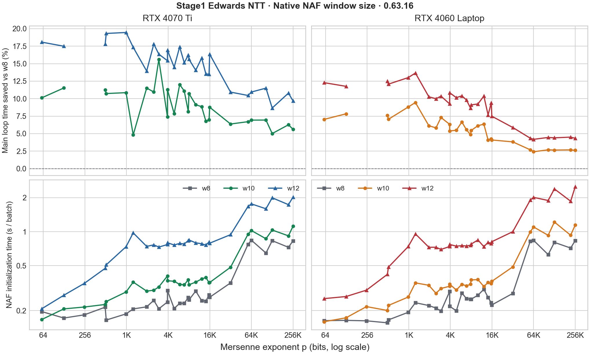
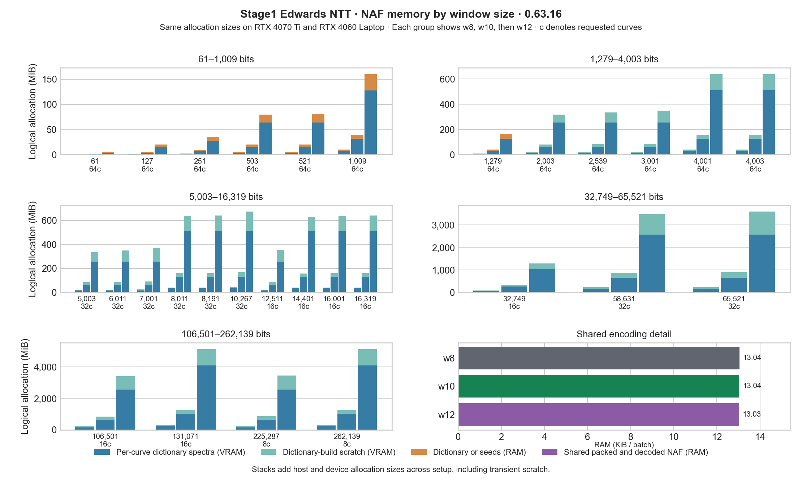
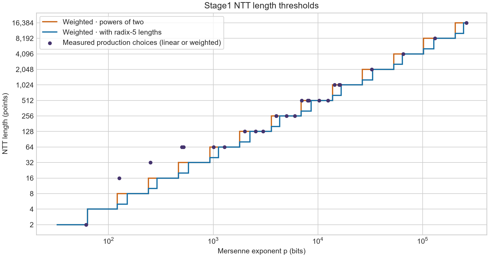
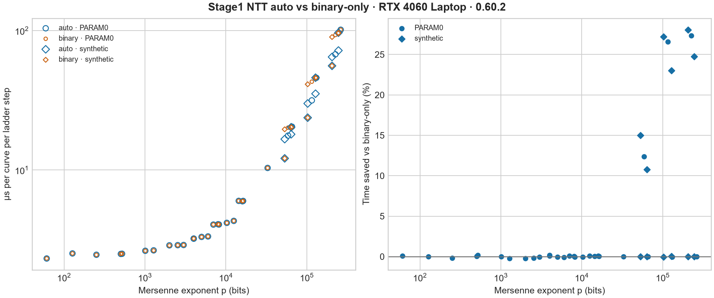
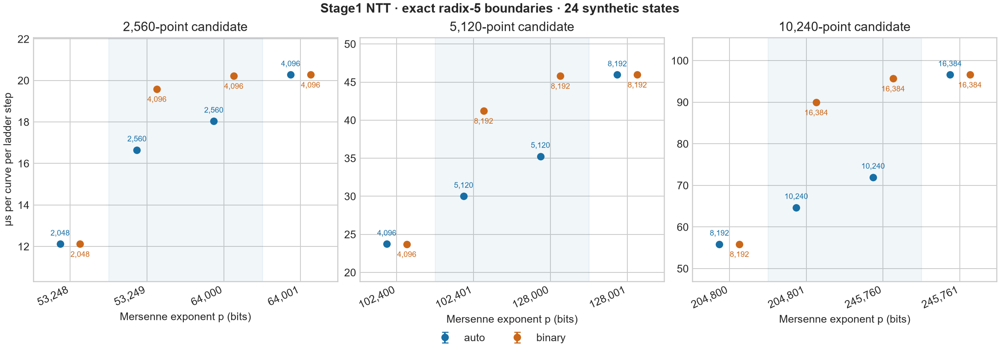
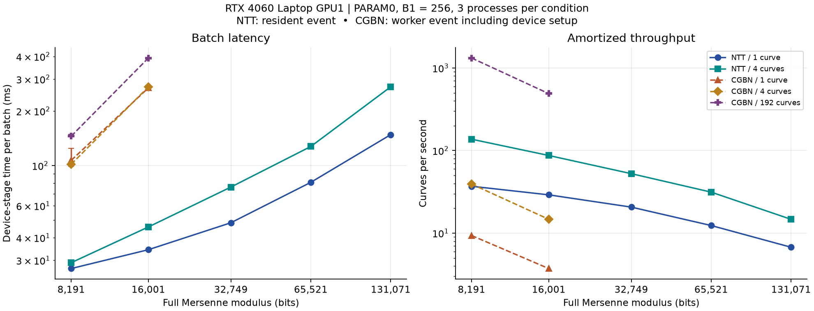

# 少曲线全宽 NTT Stage1

CUDA Stage1 的 NTT 后端可对完整梅森模数 `M=2^p−1` 运行 Suyama Montgomery PARAM0 和 Atkin–Morain Edwards。两种曲线共用设备上的 x-only 阶梯，一条曲线也会将同层的独立乘法一起提交。GPU1 RTX 4060 Laptop 上，8191／16001 位的 PARAM0 单曲线设备阶段短于本机 CGBN 对照。该对照的 CGBN 批量提高到 192 条后，CGBN 的吞吐更高。

生产入口接受完整 `2^p−1`，或有原始梅森元数据的已知因子任务，单批运行 1–128 条曲线。CUDA 默认策略在实际模数位宽达到 16384 且符合 NTT 条件时选择 NTT，也可显式启用。队列会按可用显存和调优结果拆分任务。PARAM0 使用 `lcm(1…B1)` 或 `12·lcm(1…B1)`，Edwards 使用 `48·lcm(1…B1)`，可走默认 x-only 阶梯或显式窗口的原生 2XY NAF。独立算术探针可输出未归一化的 X/Z 与 GMP 对拍。生产入口复用曲线构造、save、结果账本和 Stage2 交接。配置见 [Stage1 用法](../usage/STAGE1.md#cuda-全宽-ntt)。

## 批量调优与显存

`--tune ntt` 分别搜索线性与加权后端。每个候选在原缓冲上预热 100 个 ladder 步，再重置起点，对 192 步正式样本取 CUDA event 计时中位数。批量从 1 倍增至 128，吞吐增益低于 5% 时交替复测当前和前一批量，确认后停止倍增。补测相邻区间和上限档，并按设备 SM 数采样典型整波批量，再检查峰值与 95% 阈值附近。推荐档是达到该后端实测峰值吞吐 95% 的最小实测档。自动计划比较默认 tile 和较小 tile，显式指定 tile 或 profile 时比较指定配置。调优保留最大批量的参考末点，逐次核对重合曲线，主机端末点缓存随最大批量线性增长。

生产中的变换计划 `auto` 查兼容 NTT 形状和活跃批量，缺档时预热后短测 128 步。共享 `[ntt]` 调优行用 `batch × ladder_steps / device_seconds` 保存吞吐。调优墙钟时间还包括初始化、Graph 构建、预热、回读和末点对照。

自动拆批用同一张表的 `benchmark_kind = "stage1_runtime"` 样本独立选批量。条件包括设备、目标及算术位宽、曲线、标量倍数、B1、NAF 窗口及兼容计划。冷启动可用合成表的推荐批量，没有记录时从 64 条起步并按显存裁剪。余量允许时用不同批量执行真实、互不重叠的曲线。计划优先比较两次以上的实测档，选择达到这些档位峰值吞吐 95% 的最小档。样本记录真实有效曲线数、物理批量、设备主循环 `iter_per_s` 和 `curves_per_s`。后者从标量准备算到结果归一化，排除合成试跑和最终文件发布。恢复的部分批次不参与完整批量的排名。补齐新增的真实曲线与同批其他曲线一起计入合格样本。表结构见 [NTT 性能摘要表](../architecture/AUTO_B2.md#ntt-性能摘要表)。

以活跃批量 B、指数 p、NTT 长度 L 计，主数组需要 `88·B·L + 92·B·ceil(p/32)` 字节，此外还有标量、NTT 常量表和加权表。申请前核算显式分配，Graph 上传后及同步执行后用 `cudaMemGetInfo` 采样空闲显存差；两者较大值写为 `peak_bytes`。观测值以 CUDA 上下文就绪后的空闲显存为基准，受同设备其他进程和驱动分配粒度影响。

### GPU1 验证

0.64.4 在 RTX 4060 Laptop（GPU1）验证已知因子承载。M15919 剥除 1782929 后为 15899 位，B1=64，每条件两条曲线。Edwards x-only、NAF w6 主机字典、NAF w8 GPU 字典，以及 PARAM0 的线性和加权后端，均与直接在余因子上执行的 CGBN 和独立整数参考一致。M65 剥除 31 后，PARAM0 的 sigma 30、31 均发布新因子 8191。另用 244 位梅森数承载 61 位目标，B1=1024，130 条曲线的中断续跑与连续执行保存点一致。配置开关、调优表双位宽、known-factors 元数据、checksum 和 Stage2 交接也通过回归。每条件一次，原始记录位于 `data/experiments/stage1_ntt_known_factors/final_0644/`，入口为 [已知因子验收](../../tools/test/test_stage1_ntt_known_factors.py)。

2026-11-17 在 RTX 4060 Laptop（GPU1、8 GiB，驱动 610.88，测试前 SM 频率 1500 MHz）验证 0.64.1 开发构建的任务拆批。CUDA 13.3、sm_89、MSVC 14.51。输入为 M4423、Edwards 2XY NAF w6，B1=1024，交接 B2=4096，连续 sigma 从 20260922 开始。每轮用空的 tune 文件起跑整项 1000 条，逐批日志和汇总保存在 `data/experiments/stage1_ntt_task_batches/`。

使用空调优表的一次运行依次执行 `64, 32, 96, 48, 128, 128, 64, 128, 128, 128, 56` 条，进程墙钟为 5.84 秒。五次 128 条批的平均约为 102.5 万曲线步／秒和 369.3 曲线／秒。后续任务从调优表选用 128 条起跑，在完成第一批后中断第二批。以列 262 恢复时，调度按检查点复用偏移 128 和批量 128。改写为 `cgbn[]` 的自动策略仍沿用先前的 NTT 后端。恢复和连续运行保存点逐字节一致，四个代表末点还与独立 CPU 参考一致。两次运行各产生一份 1000 条曲线的 NF 汇总和一条 Stage2 交接。

直接运行 129 条自动拆成 64、64、1。M65 因子夹具发布两条独立的 F 记录。CUDA Stage2 0.64.0 实际消费了 1000 条交接中的最后一条曲线（sigma 20261921）。原始日志和汇总见 `verified/`，回归入口为 [队列验收脚本](../../tools/test/test_stage1_ntt_task_batches.py)。

在同一张 GPU、同一组 M4423 参数和 0.64.1 开发构建上，请求 131 条并打开 `ntt_pad_batch`，调优表选用 128 条，实际完成两个整批共 256 条。`.save`、NF 汇总、`finished` 和 Stage2 交接均记录 256 条。另一轮在补齐后的尾批第 262 列停止，将开关改为 0 后恢复，仍得到相同的 256 条保存记录。CUDA Stage2 实际处理了最后一条新增曲线（sigma 20261177）。各场景运行一次，原始记录位于 `data/experiments/stage1_ntt_task_batches/real_tail_0641/`。

0.62.4 在 RTX 4060 Laptop 上用独立整数阶梯核对了 M4423 的 128 条 Edwards 和 PARAM0。Edwards 覆盖 CGBN、linear、weighted、radix-5 和 `auto`，PARAM0 覆盖 linear 和 weighted。生产验收还对照了 65／128 条中断与不中断的保存点，在 bit 128 切换卷积后续算，并检查 Stage2 队列交接。65 条的短逆变换覆盖尾块仅一条有效曲线的情况。M251 的 Edwards 批次有 126／128 条进入阶梯，跨字的非连续曲线位图也通过恢复对照。调优表可记录并重新加载 128 条的结果，超过 128 条的运行被拒绝。记录位于 `data/experiments/stage1_ntt_128_0624/{verify_production,verify_sparse_mask,verify_tune_r2}/`。见 [RTX 4070 Ti 全位宽吞吐](STAGE1.md#rtx-4070-ti-全位宽矩阵)。

历史 0.59.6 本机构建使用 CUDA 13.3 / sm89，计时采用当时的调优流程。GPU1 为 8 GiB RTX 4060 Laptop，驱动 610.88。完整自适应扫描覆盖 61–262139 位的 13 个代表指数。三组对照用相同的点、候选参数和计时口径，分别执行一次自适应搜索和 1–32 穷举。调优中 GPU 利用率至少 50% 的遥测样本为 1500 MHz、3.40–41.62 W、45–60 °C。表中数字依次为自适应／穷举，批量栏为峰值 → 95% 推荐。

| 指数 | 搜索耗时（秒） | linear 批量 | weighted 批量 |
|---:|---:|:---|:---|
| 8191 | 4.10／10.80 | 32 → 24／30 → 24 | 32 → 28／30 → 29 |
| 32749 | 9.33／24.29 | 24 → 23／24 → 23 | 32 → 23／30 → 24 |
| 131071 | 33.25／98.27 | 12 → 12／12 → 12 | 24 → 18／24 → 18 |

自适应使用 48–56 次计划测量，穷举使用 128 次，墙钟时间节省 61.6–66.2%。六组峰值吞吐为独立穷举值的 98.4–100.1%。两个 weighted 推荐比穷举的 95% 档少一条，独立穷举对这两档都测得约 94.8%。推荐阈值以各轮实测峰值为基准。

生产复验使用相同的 13 个指数，PARAM0、B1=64、sigma 从 26 起，每个指数测 1／32 条。复用已生成的 tune，分别与固定 linear 和 weighted 交替对测，每个条件各三次，取 ladder 的 CUDA event 中位数。活跃遥测样本为 1500 MHz、9.09–30.55 W、52–59 °C。26 个条件中 `auto` 选 linear 10 次、weighted 16 次。相对每个条件中较快的固定后端，`auto` 最多慢 3.79%（M127 单曲线）。相对固定 linear，各条件的设备耗时降幅中位数为 10.26%。312 次运行逐条比较保存点、因子和校验和，全部一致。

M4423、B1=32 的 16／32 条 PARAM0 保存点在两个后端均通过独立 Python 验算。M32749、B1=64 的同批量两组 X/Z 也与 GMP 一致。M9689、B1=4096 的两个批次在 bit 128/5924 中断，从 linear 换到 weighted 后续算。最后的 save 与不中断运行一致，Stage2 队列正常生成。M262139 的 16／32 条调优测得 linear 显存增量为 58／114 MiB，weighted 为 36／70 MiB。对应显式分配为 55.66／111.16 MiB 和 34.22／67.72 MiB。将预算设为 96 MiB 后，32 条 linear 被准入检查排除，32 条 weighted 仍成功测量。

原始结果和设备遥测位于 `data/experiments/stage1_ntt_batch_tune_0596/`，其中 `measured/matrix/tune.json` 为历史测量。复测入口见 [CUDA 全宽 NTT](../usage/STAGE1.md#cuda-全宽-ntt)、[设备对测](../../tools/bench/compare_stage1_ntt.py) 和 [生产验收](../../tools/test/test_stage1_ntt_production.py)。

## 最佳配置全位宽矩阵

2026-11-12 使用 ECM-ELF 0.62.2（CUDA 13.3.73、sm89、MSVC 14.51.36231）和 GPU1 RTX 4060 Laptop 8 GiB 测量 PARAM0 和 Edwards。输入为 26 个完整梅森数，覆盖 61–262139 位。其中 13 个沿用历史基准的指数，另外 13 个覆盖 Stage1 NTT 的调优形状。

每个指数从空 tune 对可用的 linear 和 weighted 计划穷举 1–32 条曲线，比较默认 tile 与较小 tile。候选预热 100 步后，按 `iter_per_s` 选择实测吞吐最高的行。PARAM0 和 Edwards 共用设备阶梯，锁定同一组计划，两种曲线各自运行三次真实 Stage1。每次核对实际长度、digit 位宽、tile、pass、warp 和批量。

实测 B1 为 1024（指数小于 128 或大于 20000）或 10000（其余）。sigma 从 20260922 起按批量连续分配，三次运行使用相同输入。`stage1_ntt_timing.device_ms` 取 ladder 的 CUDA event 区间，曲线构造、准备、回读、因子检查和发布另行执行。用 `device_ms / (1000 × 曲线数) × (1,000,000 / B1)` 折算至共同 B1。图中点为三次中位数，阴影覆盖最小至最大样本。折算沿用历史 Stage1 的线性口径。

26 个指数中，22 个选中 weighted，4 个选中 linear。14 档选中 32 条，12 档选中 30 条。M131071 和 M262139 使用分段进位与独立写回。下表所列计划均为 weighted、16-bit digit、warp 尾部、16 步 Graph。耗时以 0.61.3 → 0.62.2 表示，各版本使用自己的实测最优计划与并行数。

| 指数 | 长度 | tile 层数 | 曲线 | PARAM0 秒／曲线（折算） | Edwards 秒／曲线（折算） |
| ---: | ---: | ---: | ---: | ---: | ---: |
| 16319 | 1024 | 10 | 30 | 7.77 → 6.62 | 7.77 → 6.63 |
| 32749 | 2048 | 11 | 30 | 13.27 → 12.05 | 13.32 → 12.11 |
| 65521 | 4096 | 12 | 30 | 25.92 → 24.30 | 26.06 → 24.42 |
| 131071 | 8192 | 12 | 30 | 57.03 → 53.13 | 57.26 → 53.38 |
| 262139 | 16384 | 12 | 30 | 116.23 → 108.45 | 116.72 → 108.90 |

同一条件三次测量的全幅波动最多为中位数的 0.36%。GPU 利用率至少 50% 的遥测点均为 1500 MHz。PARAM0 调优及实测的板功耗为 9.39–45.11 W，温度为 56–75 °C。Edwards 实测为 11.48–42.29 W、62–68 °C。

156 个批次逐组复核 sigma、保存点或因子及校验值，三次结果一致。日志中的因子均整除对应的完整梅森数。两种曲线各有 777 个与 0.61.3 重合的保存点或因子，均逐条一致。调优表复核了各后端的 1–32 条记录和获选计划。

原始调优表、三轮日志、save、遥测和汇总保存在 `data/experiments/stage1_forward_tile_0622/{mont,ed}/`，逐条复核见同级 `verification.json`。0.61.3 对照在 `data/experiments/stage1_ntt_segments/{mont,ed}/`。复测可运行 `python tools/bench/bench_stage1_ntt_best.py --exe <ecm_cuda.exe> --device 1 --exhaustive-batches --output <新实验目录>`。Edwards 传入 `--curve ed --reuse-tune <同一设备的 NTT 汇总>` 复用计划并独立测量。见 [矩阵采集脚本](../../tools/bench/bench_stage1_ntt_best.py)、[绘图脚本](../../tools/bench/plot_stage1_ntt_best.py) 和 [三后端比较图](STAGE1.md#stage1-ntt-与-cgbn-和-prime95-对比)。

RTX 4070 Ti 的全位宽矩阵、两张卡的批量吞吐和按长度统计见 [Stage1 性能](STAGE1.md#探寻最佳曲线并行数量)。

## 实现与正确性

线性后端对 p 位操作数选择最大整数 digit 宽度 b，令 `c=ceil(p/b)`，要求 `c·(2^b−1)^2 < 2^64−2^32+1`。变换长度 `L=nextpow2(2c+1)`，所以 Goldilocks 单模数足以精确恢复每个卷积系数，不会把线性卷积误做循环卷积。生产 NTT 模块处理 forward、点乘／逆缩放、inverse 和进位；其输入打包是完整整数，独立于 Stage2 的多项式槽宽和 D/P。

进位后的乘积按实际第 p 位拆成低半和高半。用 `2^p≡1 (mod M)` 折叠成一份残数，末 limb 即使不足 32 位也以实际位宽传播。每个 limb 将输入进位映射为 kill、propagate 或 generate；warp 票选加块内前缀求出回卷进位，全 propagate 的和 M 归一为 0。减法复用同一运算：`a−b ≡ a+(M−b)`。整个模乘没有 CGBN REDC，也没有中间值经 PCIe 传给 GMP。

标量按二进制 ladder 扫描，起始寄存 `[1]P` 和 `[2]P`。每位计算一组 xDBL 和 xADD，共四次平方和六次乘法，按依赖拆成三层：第一层同时算平方及交叉项并共享输入频谱，第二层算两平方、倍点的 X 及 `a24·E`，第三层完成两点的 Z。每位实际变换为 11 次 forward、10 次 inverse，分别组织为三层批处理；`a24` 和差点仿射 x 的频谱只生成一次。第二批生成的 `E=AA−BB` 频谱直接供第三批使用。逆向首个 tile 直接读取各乘积的输入频谱，平方复用同一次读取。Graph 可移植配置默认使用 16 位窗口，余数用独立短图；标量索引在设备上更新，无逐位回读。直接提交用相同算法。

默认 Edwards 路径在主机完成构造和映射，设备复用 x-only 阶梯。小长度可减少逆变换同步与块宽，大长度可按 GPU 波次和显存带宽选批量。共享阶梯保持 `[k]P`、`[k+1]P` 的差点为 `P`，每位都更新这对点。`edwards_naf_window_bits = 0` 使用此路径。原生 2XY NAF 需要显式指定窗口，见下节。

实现见 [ladder](../../src/ecm/stage1/montgomery/cuda/ntt/ladder.cu#L159)，其中 [回卷与规范化](../../src/ecm/stage1/montgomery/cuda/ntt/ladder.cu#L96) 与 [独立 GMP 整曲线对照](../../tools/test/stage1_mersenne_ntt.cpp#L27) 分别负责设备归约和验算。显式驻留数组规模为 `11·8·B·L + 23·4·B·ceil(p/32)` 字节，另有标量、缓存表、Graph、CUDA 上下文等；这不是进程峰值。

- 32／33／64／65／8192／8193／262144 位人工状态：覆盖对齐与非对齐边界、全宽进位、减法为零，直接与 Graph 的两组 X/Z 完全一致，并与 GMP 一致。
- 8193 位人工状态的直接与 Graph 路径通过 Compute Sanitizer memcheck 和 synccheck，均为 0 errors，日志见 `sanitizer_local/`。
- `M65`、B1=40：sigma=11 在 Stage1 得到真因子 `253921=31×8191`；sigma=12 构造即得 `31`。探针另查曲线判别式；生产路径沿用 CGBN 的构造检查。两者都会剔除已命中的构造槽并保留其余曲线的 sigma 身份。
- 32749 位，起始 sigma=4294967311，4 条曲线通过 GMP 核对。所有 NTT 计时样本先核对跨样本输出，再核对 GMP 的两个 X/Z 点。8191／16001 位的 1／4 曲线在 CGBN 独立保存点上再做一次归一化 x 核对。

### 原生 Edwards NAF 的参考数据流

实验路径使用 2XY 倍点，先从 X、Y、Z 的三份频谱计算并分别归约 `X²、Y²、Z²、XY`，再在模数域组合 E、F、G、H。零列累计 7F+7I。非零列将 `T=E·H` 并入倍点的输出批次，再根据数字符号使用常驻的四份仿射字典频谱，额外需要 8F+8I。连续零列用预捕获的二次幂长度 Graph 提交，非零列直接提交。所有逆变换均只归约单个非负乘积，继续使用既有线性或加权卷积系数界。驻留的规范整数 X/Y/Z 使用独立的 NAF 列检查点，完成后映射为原 Edwards save 的 `(Z+Y)/(Z−Y)`。原生路径需要显式窗口。卷积配置为 `auto` 时仍复用 x-only 形状调优，本节基准固定使用 weighted。

参考探针以精确整数验证原生 Edwards 的 signed-window 公式、暂存 `(X,Y,Z)` 后的续算、最终 Montgomery x 坐标及 GCD。零列仅运行两层 HWCD 倍点，共 `4S+3M`。非零列先补算 `T=E·H`，随后从仿射字典取点。归一化后固定点 `Zq=1`，省去一个坐标乘法。加点输出仅保留 `X,Y,Z`，下一列倍点用不到旧 `T`，因此再省一个乘法。每个非零列增加 `8M`，含加点前的 `T`。`S`、`M` 分别为模平方和模乘。

每个字典项只需存 `xq`、`yq`、`d·xq·yq`、`xq+yq` 四份频谱。设 `A=X·xq`、`B=Y·yq`、`C=T·d·xq·yq`，正数字用 `S=(X+Y)·(xq+yq)`，从 `S−A−B`、`Z−C`、`Z+C`、`B−A` 组合输出。负数字用 `S=(Y−X)·(xq+yq)`，改用 `B−A−S`、`Z+C`、`Z−C`、`B+A`。两种符号共用同一份字典频谱，符号处理留在模数域的加减层。

`F`、`I` 分别为单次前向和逆向变换。2XY 主循环每列平均各需 `7+8ρ` 次，`ρ` 是非零列占比，长标量约为 `1/(w+1)`。当前 x-only 的松弛差值路径每位 `10F+10I`。下表按 `B1=12000` 的真实标量计数。

| 窗口 | 非零列／总列 | 模平方与模乘合计／列 | 前向／列 | 逆向／列 |
|---:|---:|---:|---:|---:|
| 6 | 2479／17285 | 8.15 | 8.15 | 8.15 |
| 8 | 1908／17285 | 7.88 | 7.88 | 7.88 |
| 10 | 1576／17278 | 7.73 | 7.73 | 7.73 |
| 12 | 1334／17285 | 7.62 | 7.62 | 7.62 |

#### 奇数倍点字典与显存

GPU 建表时，主机上传各曲线的仿射 `x,y,d`。设备保留 `[2]P` 的频谱，生成 `P,3P,…,(2^(w−1)−1)P`，并为各曲线的投影分母 `Z` 建乘积树。主机回读根积做 GMP 求逆。逆根传回后，设备用父节点的逆乘上相邻分母积，逐层得到各叶节点的逆，再归一化并写出四份供 NAF 列使用的频谱。生成序列、遍历乘积树和读取归一化输入时，独立的坐标平面由一次 kernel 搬运。主机路径由 GMP 生成仿射字典，再上传生成相同布局的频谱。对测可用 `ECM_EDWARDS_NTT_DICTIONARY=host|gpu` 固定后端。

记 GPU 发射的曲线数为 `B`、请求曲线数为 `C`、NTT 长度为 `N`、每个残数的 limb 数为 `W=ceil(p/32)`，字典项数为 `K=2^(w−2)`。驻留频谱占 `32NBK` 字节。GPU 构建另需 `16BKW` 字节临时显存，其中投影 X/Y 和 Z 乘积树各占一半，建表后释放。这两项计入 `naf_memory_mb`。整个 NTT 另检查显存预算。主机建表要保留 `16CKW` 字节的仿射表，GPU 建表在主机只保留 `12CW` 字节的种子。2560 点、30 条曲线时，w6／w8／w10／w12 的驻留频谱分别需 37.5／150／600／2400 MiB。见 [运行时的字典构建](../../src/ecm/stage1/montgomery/cuda/ntt/ladder.cu#L930)。

根积的 GCD 若为真因子，直接登记。若 GCD 等于整个模数，只回读异常曲线的叶节点逐项检查。仍无法分出真因子时，该曲线交给 x-only 重放。字典后端不进入检查点标识，检查点记录 NAF 列游标及规范整数点，续跑重新建表。若 GPU 临时缓冲超出字典或总显存预算，而字典频谱和基础缓冲仍能容纳，自动模式改由主机构建并保持原有发射曲线布局。

若基线每位平均耗时为 `t_binary`，原生 Edwards 的两种列分别为 `t_zero` 和 `t_add`，建表为 `T_dict`，则需满足 `L × [t_binary − ((1−ρ)t_zero + ρ t_add)] > T_dict` 才有整批收益。这里 `L` 为标量位数，忽略最高位的常数差。依赖层的 GPU 利用率和字典访存会改变实际交叉点。

`python tools/test/test_edwards_ntt_naf_reference.py` 在窗口 3／6／8／10／12 上核对 30 个普通末点、17 个末点 GCD 因子、3 个字典归一化因子和 5 个整模退化样本。字典归一化遇到整模 GCD 时逐项拆查，无法分离真因子则将该曲线交给 x-only。见 [原生 Edwards NAF 参考探针](../../tools/test/test_edwards_ntt_naf_reference.py)。

#### 0.63.16 建表交叉点

下表给出相同输入下主机建表 → GPU 建表的整批 NAF 初始化中位数，单位为秒。B1=4096，起始 sigma 为 26。每个条件和后端在两卡各测三批，每批启动新进程，固定加权 NTT 长度、Graph 上限 16 和曲线数，轮换测试顺序。计时口径、时钟和工具链见 [窗口矩阵](#原生-edwards-ntt-窗口矩阵)。

| 输入 | 窗口 | 曲线数 | RTX 4070 Ti，秒 | RTX 4060 Laptop，秒 |
|---|---:|---:|---:|---:|
| M521 | 12 | 16 | 0.288 → 0.753 | 0.260 → 0.620 |
| M2003 | 12 | 16 | 0.540 → 0.737 | 0.498 → 0.638 |
| M2003 | 12 | 64 | 1.605 → 0.791 | 1.571 → 0.692 |
| M3001 | 12 | 64 | 2.877 → 0.707 | 2.825 → 0.738 |
| M4001 | 8 | 1 | 0.155 → 0.190 | 0.127 → 0.156 |
| M4001 | 8 | 32 | 0.298 → 0.204 | 0.273 → 0.244 |
| M24593 | 12 | 1 | 1.212 → 0.747 | 1.174 → 0.658 |
| M32749 | 12 | 4 | 7.468 → 0.744 | 7.644 → 0.713 |

窄模数或单曲线时，GMP 较短的整数模乘抵得过串行建表，GPU 则仍有变换和提交开销。并行曲线增加后，GPU 能把同一步的点运算摊到更多曲线上。22 个条件的强制 GPU 配对样本中，0.63.16 合并坐标搬运后，CUDA 字典阶段的耗时降幅中位数为 16.31%／15.49%。原始样本保存在 `data/experiments/stage1_ntt_naf_init_06316/paired/gpu{0,1}/`。

自动选型在 32768 位及以上使用 GPU。在更小位宽，只让 w8 及以上进入 GPU 候选。其门槛为 24576 位的任意批量，或 6144 位及以上至少 8 条，或 3500 位及以上至少 32 条（w10–w12 为至少 16 条），或 2000 位及以上至少 64 条。配置或总显存预算仅容得下驻留字典时，自动回退主机。见 [选型实现](../../src/ecm/stage1/montgomery/cuda/ntt/workflow.cpp#L162)。

两条 M65521 曲线在 w6、2560 点、3 MB 字典预算下自动回退，显存中仍保留 2621440 字节的频谱。w8、14 MiB 总显存上限也复现回退，保存点与强制 GPU 一致。M16319 的 w12 以及普通末点样本通过主机与 GPU 的双向断点恢复。见 [原生 NAF 生产回归](../../tools/test/test_stage1_ntt_production.py)。

#### 两卡字典矩阵

同一 0.63.8 开发构建（CUDA 13.3.73、sm89、MSVC 19.51.36260、驱动 610.88）在 RTX 4070 Ti 与 RTX 4060 Laptop 上测量 x-only、2XY w6 和 2XY w8。每卡按 1／8／30 条曲线对照 GMP 和 GPU 字典。M4423／M16381 使用 B1=512，M65521／M262139 使用 B1=256。sigma 从 26 起，固定 weighted、Graph 上限 16，关闭指数缓存、周期检查点及 Stage2 交接。每格交替三批，取中位数。两卡采集有重叠。

建表时间为主机曲线准备和字典打包，加上设备字典阶段墙钟近似值。设备区间用 CUDA event 计量，包含上传、频谱生成及等待 GMP 根逆的时间，日志中的根逆耗时为该区间的子项。主循环时间单独取 CUDA event，冷进程吞吐为批量除以从进程创建到正常退出的墙钟。显存取运行记录的显式分配和观测增量中的较大值。

30 条曲线批次的建表中位数如下。表中的 GMP 路径也在 GPU 生成字典频谱。

| 指数 | 4070 Ti w6，秒 | 4070 Ti w8，秒 | 4060 Laptop w6，秒 | 4060 Laptop w8，秒 |
|---:|---:|---:|---:|---:|
| 4423 | 0.050 → 0.026 | 0.153 → 0.058 | 0.049 → 0.026 | 0.150 → 0.056 |
| 16381 | 0.335 → 0.110 | 1.072 → 0.140 | 0.334 → 0.110 | 1.064 → 0.144 |
| 65521 | 2.399 → 0.564 | 10.673 → 0.600 | 2.376 → 0.566 | 10.732 → 0.626 |
| 262139 | 17.437 → 2.188 | 63.470 → 2.324 | 18.175 → 2.320 | 62.887 → 2.671 |

两卡在 65521／262139 位的全部窗口和批量中，GPU 的字典阶段均较短。M262139 的 30 条 w8 约快 27.3／23.5 倍，各批的 GMP 根逆约 0.31 秒。冷进程吞吐由 0.46／0.46 提高到 7.29／6.96 曲线／秒，x-only 为 8.43／7.73 曲线／秒。该条件的主循环分别从 x-only 的 220／830 ms 缩短到 w8 的 176／641 ms。字典构建期间的显存峰值估计由 1026 MiB 增至 1260 MiB，临时缓冲在进入主循环前释放。4423／16381 位的小批量有 GPU 建表退化。







360 个批次共校验 4680 条保存记录。两种窗口和字典后端均与 x-only 逐条一致，两卡间的 180 对存档也逐条一致。GPU 利用率至少 50% 的遥测中，4070 Ti 为 2610 MHz、16.82–68.79 W（18 点），4060 Laptop 为 1500 MHz、8.21–32.95 W（81 点）。

M262139、30 条另测 B1=4096，按相同配置在每卡交替跑 x-only、GPU 字典 w6 和 w8 各两批。4070 Ti 的冷进程墙钟依次为 6.53／6.23／6.36 秒，w6 较 x-only 吞吐高 4.85%。4060 Laptop 为 16.58／14.51／14.19 秒，w8 吞吐高 16.85%。w8 的主循环分别缩短 18.30% 和 21.36%。12 批末点全部与各卡 x-only 一致，补测未单独记录遥测。见 `data/experiments/edwards_ntt_2xy/dictionary-b1-4096/`。

GPU1 正确性覆盖 w2、w6、w8，linear／weighted 及 radix-5。M55 建表得到因子 881，M65 末点得到 31，M35 的 x-only 重放确认恒等结果。M4253、B1=4096、四曲线在第 130 列停止，改用 weighted 续算后与完整运行的末点和 Stage2 交接一致，错误窗口及 x-only 恢复被拒绝。证据见 `data/experiments/edwards_ntt_2xy/gpu-dictionary-check-final/`。

原始日志、存档、汇总及遥测位于 `data/experiments/edwards_ntt_2xy/dictionary-matrix-final/`。复测用 [字典矩阵采集器](../../tools/bench/bench_stage1_ntt_dictionary.py)，指定 `--exe` 与 `--output`。汇总目录传入 [绘图工具](../../tools/bench/plot_stage1_ntt_dictionary.py) 的 `--input`。

## 加权循环卷积

`ntt_convolution = "weighted"` 复用同一个 Goldilocks 域和点公式。对于受支持的长度 `L`，整数的第 j 个 digit 从 `e_j=ceil(p·j/L)` 位开始。域内取 `ρ^L=2^p`，打包时乘权 `2^e_j/ρ^j`。当 `i+j=k+mL`，循环卷积逆权重后的指数差为 `e_i+e_j−e_k−mp`，取值为 0 或 1。因此在无符号 digit 下，以 `2L·(2^ceil(p/L)−1)^2 < Q` 保证每个整数系数可由一个域余数精确恢复。

每个块将所需的系数逆权重后暂存在共享内存，并按原位偏移汇入 32 位 limb。利用 `2^p≡1` 汇入越过模数位宽的部分。先转移多位进位，再归一化窄顶 limb 并回卷，最后复用一位进位扫描。对最短的模数，64 位系数可能跨越两次边界，汇入时覆盖对应的三个区间。保存点和检查点的 X/Z 仍为规范整数。实现见 [权重与系数汇入](../../src/ecm/stage1/montgomery/cuda/ntt/weighted.cuh)。

0.59.3 在 RTX 4060 Laptop GPU1（CUDA 13.3 / sm89，驱动 610.88）使用两种后端的自动档对测。输入为完整梅森模数、PARAM0、LCM、sigma 从 11 起。每条件交替运行三次，取设备 event 中位数。计时含阶梯和提交间隔，排除曲线与指数准备、Graph 构建、末点回读和结果发布。B1=256 的设备活跃样本均为 1500 MHz、7.48–18.72 W、64–70 °C，未调频或设定功耗上限。

| 位宽 | 线性 → 加权长度 | 1 条 ms | 4 条 ms | 8 条 ms |
|---:|---:|---:|---:|---:|
| 4003 | 512 → 256 | 21.27 → 21.93 | 22.55 → 22.73 | 25.47 → 24.48 |
| 8191 | 1024 → 512 | 25.27 → 23.80 | 27.48 → 24.89 | 33.92 → 27.59 |
| 16001 | 2048 → 1024 | 33.79 → 28.07 | 40.24 → 29.67 | 53.63 → 35.22 |
| 32749 | 4096 → 2048 | 49.43 → 37.27 | 68.37 → 40.30 | 95.69 → 52.53 |
| 65521 | 8192 → 4096 | 77.79 → 58.52 | 125.04 → 66.07 | 187.39 → 91.37 |
| 131071 | 16384 → 8192 | 143.64 → 84.62 | 262.45 → 115.22 | 418.27 → 176.01 |

在 B1=4096 的 32749、65521 位各 1、4 条曲线复测中，加权后端的设备耗时降低 13.5–39.4%。该组活跃样本为 1500 MHz、10.52–20.56 W、66–69 °C。加权后端在 4003 位的单曲线和四曲线分别慢约 3.1% 和 0.8%。原始记录在 `data/experiments/stage1_ntt_weighted_0593/`，复测使用 [compare_stage1_ntt.py](../../tools/bench/compare_stage1_ntt.py)。

在相同 GPU1、输入和计时口径下，0.59.5 的共享内存归约融合相对 0.59.4 加权后端，在 B1=256 的 18 条件全部缩短设备耗时，改善中位数 2.07%，范围 0.98–3.43%。B1=4096 的四条件改善 0.94–2.67%。另将 9689 位输入显式设为 8192 点以覆盖密集 1–2 bit digit，B1=20 时 1／4 条曲线分别改善 6.08%／15.73%。0.59.5 的加权后端与 0.59.1 的线性后端直接交替对测时，131071 位、B1=256、八曲线从 435.55 ms 降到 171.73 ms。样本和功耗见 [开发记录](../development/STAGE1_NTT_OPTIMIZATION_DRAFT.md#0595-融合加权系数归约)。

### 短加权长度的初测

M65521／2560 点按实际分布的 25／26 位 digit 计数，最坏系数约为 $0.742432q$，统一使用最大 digit 的估计约为 $1.25q$。两臂均用 0.63.13 的同一开发构建、GPU1 RTX 4060 Laptop、CUDA 13.3.73／sm89、驱动 610.88、w8、Graph 上限 16、sigma 从 26 起、GPU 建表。各格交错测三对。两组采样中 GPU 利用率至少 50% 的 92 点均为 1500 MHz，功耗为 2.97–40.17 W。

| 指数 | 长度 | B1 | 曲线数 | 主循环，ms／批 | 主循环变化 | 进程墙钟，s |
| ---: | ---: | ---: | ---: | ---: | ---: | ---: |
| 65521 | 4096 → 2560 | 512 | 1 | 92.362 → 72.479 | −21.53% | 0.392 → 0.358 |
| 65521 | 4096 → 2560 | 512 | 30 | 298.791 → 235.274 | −21.26% | 1.230 → 1.148 |
| 65521 | 4096 → 2560 | 4096 | 1 | 728.160 → 572.831 | −21.33% | 1.004 → 0.839 |
| 65521 | 4096 → 2560 | 4096 | 30 | 2372.129 → 1869.217 | −21.20% | 3.293 → 2.804 |
| 128509 | 8192 → 5120 | 512 | 1 | 117.202 → 77.768 | −33.65% | 0.451 → 0.397 |
| 128509 | 8192 → 5120 | 512 | 30 | 670.375 → 461.699 | −31.13% | 2.355 → 2.102 |
| 248021 | 16384 → 10240 | 512 | 1 | 133.825 → 94.881 | −29.10% | 0.507 → 0.455 |
| 248021 | 16384 → 10240 | 512 | 30 | 1315.729 → 902.729 | −31.39% | 4.694 → 4.191 |

主循环按 CUDA event 计时，排除准备、GPU 建表、回读和发布。进程墙钟包含这些阶段。短形状采用 radix-5 PFA，部分条件也改用已有的分段或融合归约，因此表中是整套形状的收益。48 批的保存点逐条一致。M65521 的 GMP 平方、主机字典直接提交和 GPU 字典 Graph、从线性到 2560 点加权的断点续跑均通过。2560 点通过 Compute Sanitizer 的 `memcheck` 和 `synccheck`。原始记录位于 `data/experiments/stage1_ntt_weighted_bound_06312/`。 [准入与回放](../usage/STAGE1.md#cuda-全宽-ntt) · [逐槽上界](../development/GPU_NTT_NEXT_OPTIMIZATION_DRAFT.md#3-先算能缩多少长度再换算术后端)

### 双卡加权自动选长矩阵

0.63.13 在 GPU0 RTX 4070 Ti 与 GPU1 RTX 4060 Laptop 并行跑同一矩阵。沿用 61–262139 位的 26 个基准指数，补 M128509 和 M248021。均用 B1=512、原生 Edwards 2XY、w8、Graph 上限 16、起始 sigma 26、1／30 条曲线。测试固定 `ntt_convolution = "weighted"`。24 个同长度指数每格运行三次共同计划，另外四个指数在同一二进制上交替对照显式保守长度和自动选出的长度，各三次。共有 384 批、112 个设备／输入／批量组合，保存点、因子和曲线状态逐条相符，包括跨卡对照。活跃遥测按利用率至少 50% 取样，4070 Ti 为 2610 MHz、29.75–105.26 W（16 点），4060 Laptop 为 1500 MHz、3.93–40.84 W（82 点）。



图中的圆点为自动长度，方框为四个变更指数的保守长度。单位为主循环 CUDA event 时间除以 NAF 列数及实际活跃曲线数，排除准备、建表、回读和发布。下表为批次主循环耗时减幅，两列数据分别对应 1 条和 30 条曲线。

| 指数 | NTT 长度 | 新最大 bpw | 4070 Ti，1／30 条 | 4060 Laptop，1／30 条 |
| ---: | ---: | ---: | ---: | ---: |
| 7001 | 512 → 256 | 28 | 4.0%／5.6% | 5.0%／18.6% |
| 65521 | 4096 → 2560 | 26 | 6.7%／5.9% | 20.3%／21.4% |
| 128509 | 8192 → 5120 | 26 | 30.3%／27.1% | 32.0%／31.0% |
| 248021 | 16384 → 10240 | 25 | 24.6%／28.0% | 29.0%／31.4% |

两卡的自动分派一致。用 B1=20、单曲线逐条检查以下限界。强制不合格短档均被拒绝且未生成 save，令 `ntt_length = 0` 后，两卡均跳过短档并得到与显式保守长度相同的保存点。每档还测了靠近界内的一个指数。

| 界内指数 | 短长度 | 界内 $U/q$ | 越界指数 | 越界 $U/q$ | 越界时选长／最大 bpw |
| ---: | ---: | ---: | ---: | ---: | ---: |
| 66047 | 2560 | 0.999268 | 66067 | 1.009033 | 4096／17 |
| 129533 | 5120 | 0.999145 | 129539 | 1.000610 | 8192／16 |
| 253951 | 10240 | 0.999817 | 253969 | 1.002014 | 16384／16 |

M262139 强制 10240 点也被拒绝（$U/q=2.997314$），自动选 16384 点。M65521 的 2560 点要求最大 26 bpw，配置上限 25 时自动回到 4096 点，允许 26 时选 2560 点。指定 10 层 tile 也选 4096 点，因为 2560 点中的二次幂子变换只有 9 层。两卡另对 32 和 262144 位支持端点做 GMP 平方对拍，分别用 2 和 16384 点，均通过。矩阵、逐次日志和回退记录在 `data/experiments/stage1_ntt_weighted_matrix_06313/matrix-final/`，逐项报告为 `data/benchmarks/stage1_ntt_weighted_matrix_06313/matrix.csv`。 [系数与进位合同](../architecture/NTT.md#stage1-加权卷积的无符号系数界)

### 原生 Edwards 延迟进位

0.63.14 与 0.63.13 固定同一加权计划对照。使用完整梅森模数、原生 Edwards 2XY、NAF w8、Graph 上限 16 和起始 sigma 26。两卡均为 CUDA 13.3.73／sm89、驱动 610.88。每格三对交替运行并取主循环 CUDA event 中位数，排除字典、Graph 准备及回读。两卡合计 256 批，包含延长 B1、额外复测和 A/A 对照。同一输入的存档点和曲线状态逐条一致。整卡利用率至少 50% 的样本中，4070 Ti 为 2610 MHz、24.79–209.80 W（184 点），4060 Laptop 为 1500 MHz、6.65–40.22 W（343 点）。

表中为批次主循环耗时减幅，正值表示吞吐提高。每格依次给出 B1=512 和 B1=4096。

| 指数／NTT 长度 | 活跃曲线 | 4070 Ti | 4060 Laptop |
| --- | ---: | ---: | ---: |
| 65521／2560 | 1 | 7.56%／5.25% | 8.51%／6.57% |
| 106531／5120 | 1 | 7.59%／6.34% | 4.83%／5.64% |
| 106531／5120 | 8 | 7.79%／7.24% | 3.73%／3.86% |
| 106531／5120 | 30 | 3.44%／4.17% | 1.13%／1.15% |
| 225287／10240 | 1 | 6.51%／7.67% | 4.91%／8.59% |
| 225287／10240 | 30 | 3.00%／1.97% | 1.01%／1.02% |
| 262139／16384 | 1 | 1.46%／3.58% | 1.62%／2.18% |

4070 Ti 的 M106531 长测初轮波动较大，表中对应 1／30 曲线的长测值取五对复测。初轮单曲线样本约 522–861 ms，A/A 两组中位数也相差 1.36%。较短的 512 点对照、2560 点的 30 曲线和 16384 点的 30 曲线均沿用原数据流。原始记录在 `data/experiments/stage1_ntt_edwards_deferred_carry_06314/`。 [进位和打包方式](../architecture/NTT.md#写回与下一批打包)

GPU1 对 M106531／5120 点的 747 列各采一条 Nsight Systems 2026.1.3 轨迹。1／30 曲线的进位写回都从 3403 次降至 2490 次。30 曲线的写回累计耗时从 39.96 ms 降到 31.55 ms，pack 从 46.18 ms 增到 49.72 ms。轨迹用于归因，表中收益取独立的无剖析对测。M65521 单曲线直接提交及 M106531 八曲线 Graph 均通过 `memcheck` 和 `synccheck`。M65521 在第 130／5929 列停止，使用 2560 点延迟进位计划续算，与完整运行的存档一致，Stage2 交接通过。Montgomery PARAM0 的加权与线性样例也分别完成存档对照。

### 原生 Edwards 2XY 第一层频域融合

两张卡同时对照 0.63.14 和 0.63.15。两版使用同一完整梅森模数、固定 weighted 长度、Edwards 2XY NAF w8、Graph 上限 16 和起始 sigma 26。每格两版各三次交替运行，取主循环 CUDA event 中位数，排除准备、字典、Graph 构建、末点回读和发布。环境为 CUDA 13.3.73／sm89、驱动 610.88。

以下为 B1=512 的主循环耗时减幅。同一单元格依曲线数顺序列出，各次运行的存档点和曲线状态逐条一致。

| 指数／NTT 长度 | 曲线数 | RTX 4070 Ti | RTX 4060 Laptop |
| --- | --- | ---: | ---: |
| 4003／256 | 1／30 | 3.68%／7.21% | 10.74%／8.53% |
| 8191／512 | 1／30／128 | 6.71%／6.25%／7.58% | 9.68%／6.78%／6.26% |
| 58631／2560 | 1／30 | 10.57%／6.67% | 9.10%／7.77% |
| 106531／5120 | 1／8／30／128 | 9.86%／9.89%／9.11%／8.58% | 11.39%／9.99%／8.86%／8.68% |
| 225287／10240 | 1／30 | 12.11%／8.30% | 11.54%／8.55% |
| 262139／16384 | 1／30 | 11.18%／5.19% | 8.03%／5.72% |

同为 2560 点，M63487 的 $4U/q=0.999268$，仍可启用，两卡单曲线分别缩短 12.27% 和 12.01%。M63493 的 $4U/q=1.002197$，M65521 的 $4U/q=2.969726$，两卡均保持原长度并回退到分别归约。三个未启用融合的对照格主循环差值在 −1.27% 至 +1.68% 之间。 [系数界和偏置](../architecture/NTT.md#edwards-2xy-第一层频域融合)

B1=4096 在每卡复验八个条件。5120 点的 30／128 曲线批次在 4070 Ti 缩短 9.42%／8.44%，在 4060 Laptop 缩短 8.93%／8.69%。16384 点 30 曲线分别缩短 5.06%／5.71%。256 点 30 曲线的 4070 Ti 初测只减少 1.45%，五对复测减少 6.19%。在 5120 点 128 曲线条件下，包含启动、建表和发布的进程墙钟在两卡分别由 10.287 s 降至 10.027 s、由 20.826 s 降至 19.676 s。

合计 334 批。两卡的对应样本存档逐字节一致。整卡利用率至少 50% 的样本中，4070 Ti 为 2610 MHz、29.51–246.42 W（222 点），4060 Laptop 为 1500 MHz、3.78–45.85 W（782 点）。在 4070 Ti 上，M63487 直接提交和 M106531 八曲线 Graph 通过 `memcheck` 与 `synccheck`。生产回归还在 M63487 的第 130／5929 列停止，切到 2560 点的融合计划续算，存档与完整运行一致并完成 Stage2 交接。明细、长测及工具日志位于 `data/experiments/stage1_ntt_edwards_2xy_frequency_06315/`。

#### 逆变换读入时组合倍点频谱

沿用 0.63.17 的 Stage1 主程序对象，在同一实验程序中比较独立频域组合和逆变换直接读入。两侧固定完整梅森模数、weighted 长度、Graph16、原生 Edwards NAF w8 和起始 sigma 26。标为「补测」的档位各测三对，其余各五对，交替先后顺序。表中减幅取每对主循环 CUDA event 相对减幅的中位数，正数表示直接读入更快。该区间排除曲线构造、NAF 和字典准备、结果回读及发布。

| 指数／NTT 长度 | 曲线数 | B1 | 批次组 | RTX 4070 Ti | RTX 4060 Laptop |
| --- | ---: | ---: | --- | ---: | ---: |
| M2003／128 | 128 | 16384 | 补测 | 5.90% | 1.74% |
| M4003／256 | 1 | 8192 | 补测 | 9.78% | 9.08% |
| M4003／256 | 30 | 16384 | 补测 | 8.49% | 6.03% |
| M4003／256 | 128 | 24576 | 主测 | 6.71% | 1.65% |
| M8191／512 | 1 | 8192 | 补测 | 10.40% | 6.92% |
| M8191／512 | 30 | 16384 | 主测 | 9.35% | 2.16% |
| M8191／512 | 64 | 16384 | 补测 | 6.56% | 2.34% |
| M8191／512 | 128 | 16384 | 主测 | 6.05% | 0.45% |
| M106531／5120 | 30 | 4096 | 主测 | 0.87% | −0.70% |
| M262139／16384 | 1 | 4096 | 主测 | 2.09% | −0.75% |
| M262139／16384 | 30 | 2048 | 主测 | −0.12% | −0.94% |
| M65521／2560，超出组合界 | 30 | 1024 | 主测 | −0.34% | 0.22% |

0.63.19 在 256 和 512 点的单 tile 加权计划中使用直接读入。512 点 128 曲线在 4060 Laptop 上的差异接近采样波动。宽档继续使用独立频域组合，超出 $4U<q$ 的 M65521／2560 对照继续用整数加减。所有 200 批均核对同条件的存档校验值、末点、因子和状态。CUDA 13.3.73／sm89、MSVC 14.51.36231、驱动 610.88。GPU 利用率至少 50% 时，4070 Ti 为 2610 MHz、28.13–238.92 W（307 点），4060 Laptop 为 1500 MHz、2.92–40.91 W（704 点）。原始日志、编译输出和汇总在 `data/experiments/stage1_next_optimization/` 的 `frequency_ab/` 和 `frequency_narrow/`。[数据流及系数界](../architecture/NTT.md#edwards-2xy-第一层频域融合)

##### 128 点的逆向线程块

0.63.20 将直接读入扩展到 128 点的单 tile 加权计划。用基于 0.63.19 的同一 sm89 实验程序跑四组，分别开关直接读入和 32 线程 CTA。固定 weighted 128、w8、Graph16、起始 sigma 26，每格每组运行三批并轮换顺序。下表是相对 64 线程、独立组合基线的配对主循环 CUDA event 减幅的中位数，正数表示更快。计时排除曲线和字典准备、结果回读及发布。

| 指数 | 曲线数 | B1 | 4070 Ti 直接读入 | 4060 Laptop 直接读入 | 4070 Ti 仅改 32 线程 | 4060 Laptop 仅改 32 线程 |
| --- | ---: | ---: | ---: | ---: | ---: | ---: |
| M2003 | 1 | 8192 | 6.59% | 5.62% | −3.03% | −6.01% |
| M2003 | 30 | 16384 | 7.89% | 6.03% | −1.79% | −4.80% |
| M2003 | 128 | 16384 | 8.09% | 2.80% | −1.73% | −1.22% |
| M1279 | 30 | 16384 | 5.54% | 7.09% | −1.34% | −3.69% |
| M1279 | 128 | 16384 | 10.05% | 1.78% | 0.83% | −1.09% |
| M2539 | 30 | 16384 | 6.67% | 6.30% | −1.67% | −4.03% |
| M2539 | 128 | 16384 | 8.54% | 1.84% | −0.06% | −2.92% |

生产使用 64 线程。直接读入与 32 线程叠加后，4060 Laptop 有两格慢于基线。168 批的 sigma、因子、状态、保存点和校验值在组间一致。实验用 CUDA 13.3.73、MSVC 14.51.36231、驱动 610.88。整卡利用率至少 50% 时，4070 Ti 为 2610 MHz、37.37–70.37 W（218 点），4060 Laptop 为 1500 MHz、3.93–19.63 W（339 点）。日志与汇总在 `data/experiments/stage1_tile_and_spans/ab/gpu{0,1}/short/`。

用独立构建的 0.63.19 与 0.63.20 在 4060 Laptop 上复测 M2003，沿用全位宽矩阵的 128 条曲线、B1=40960、w12 和 128 点计划。三对样本的主循环配对减幅中位数为 3.26%，两侧的主循环中位数分别为 4.697 s 和 4.544 s。保存点、因子及状态一致。两卡另外用 B1=20、sigma 26 验证 M3433 启用 128 点读入融合，M3457 在同长度自动回退。两种分派的保存点都与整数参考一致。复测明细和遥测在 `data/experiments/stage1_tile_and_spans/production_ab/gpu1/`。

### 原生 Edwards NTT 窗口矩阵

0.63.16 在 RTX 4070 Ti 与 RTX 4060 Laptop 上测试 29 个完整梅森模数，覆盖 61–262139 位。每个指数固定加权 NTT 长度、Graph 上限 16 及 8–64 条请求批量，建表后端按当前规则自动选择。B1=4096，起始 sigma 为 26。每个窗口测三批并轮换次序。

B1=4096 时，w8、w10、w12 分别执行 5931、5926、5923 列，非零列为 657、539、458。非零列少了约 18% 和 30%，减少了字典加点和对应的直接提交。零列仍由 Graph 批量执行。三种窗口的字典项数分别为 64、256、1024，构建成本和驻留显存随表项增长。见 [字典显存公式](#奇数倍点字典与显存)。

图的上半部分比较同一 GPU 发射曲线数下，w10／w12 相对 w8 的主循环耗时降幅，取 CUDA event 中位数。M251 的三个窗口分别发射 63／61／55 条，增益图略去这一档，初始化和内存图保留。下半部分给出整批 **NAF 初始化时间**，单位为秒。计时始于已构造 Stage1 标量、进入 NAF 编码准备前，止于 Graph 上传及初始化 stream 同步完成。指数生成、进程启动、主循环、结果回读和存档发布均在区间之外。GPU 字典阶段和其中的 GMP 根逆是子区间。

原始数据将初始化墙钟拆成五项。`encoding_seconds` 包含共享的打包 NAF 准备与展开。`curve_setup_seconds` 是按 sigma 构造曲线和基点。`host_points_seconds` 是 GMP 奇数倍点及归一化。`device_dictionary_seconds` 是设备字典阶段的墙钟，含上传、生成频谱及 GPU 建表所需的根逆往返。`other_seconds` 含显存准入、NTT 选型、缓冲初始化和 Graph 准备。五项相加为初始化时间。`root_inverse_seconds` 是设备字典阶段的子项。主机字典曲线数与设备曲线槽位分别记录，同一条曲线可在两个阶段计数。建表模型使用每曲线的字典项数，主循环模型使用 NAF 总列数与非零列数。



在两卡各 28 个可比位宽上，w10、w12 主循环均快于 w8。4070 Ti 的降幅中位数分别是 **8.81%／15.52%**，4060 Laptop 是 **5.52%／9.61%**。

三个窗口在相同的 22 档使用 GPU，另 7 档用主机。后端切换出现在 M1279 和 M2003 之间，两档都请求 64 条曲线。w12 的 NAF 初始化在 4070 Ti 从 0.976 秒降到 0.741 秒，4060 Laptop 从 0.956 秒降到 0.728 秒。旧图 16K–64K 区间的下降来自原有的 32768 位建表阈值。新矩阵中的 M16319、M32749 和 M58631 都使用 GPU 建表。

以 4070 Ti 的 M2003／w12 初始化中位数对应的样本为例，编码占 0.000084 秒，曲线准备占 0.013266 秒，设备字典阶段占 0.559008 秒，其余准备占 0.168744 秒。主机路径的 M1279／w12 则花了 0.753032 秒在 GMP 构点，另用 0.032136 秒上传并生成频谱。将编码和字典拆开，可在相同 $B_1$ 与窗口下直接比较两种字典的成本。

每个位宽的三根柱依次为 w8、w10、w12，横轴同时标出请求曲线数。柱内分为按曲线存储的驻留频谱、GPU 建表临时缓冲、主机仿射表或种子，以及批内共享的主机 NAF 编码。$B_1=4096$ 时打包和展开的编码合计约 13.0 KiB，与指数、sigma 和曲线数无关。堆叠表示各缓冲的逻辑容量，涵盖主机 RAM、设备 VRAM 及只在建表期间存在的缓冲。进程峰值显存另见原始日志。

例如 M262139 的 8 条曲线使用 16384 点。w8／w10／w12 的常驻频谱分别为 256／1024／4096 MiB，建表临时显存为 64／256／1024 MiB。每加两位窗口，两项均增至四倍，每批共享的 NAF 编码仍约 13.0 KiB。



M16319 在 w10、w12 下会在归一化阶段提前发现因子。两窗口在 0.63.16 使用 GPU 建表，字典阶段命中的曲线仍占其原发射槽位。此前主机建表在发射前剔除这些曲线，因此旧矩阵的主循环曲线数和摊销口径不同。见 [M16319 的输入及逐项复算](../architecture/NAF.md#m16319-在字典归一化时检出因子)。

共采集 522 批，两卡的 261 对存档逐字节一致，新旧矩阵的 522 对同条件存档也逐字节一致。构建使用 CUDA 13.3.73／sm89、MSVC 14.51.36231、驱动 610.88。整卡利用率至少 50% 的遥测中，4070 Ti 为 2610 MHz、33.13–138.79 W（296 点），4060 Laptop 为 1500 MHz、9.20–29.33 W（673 点）。逐批日志、遥测和存档保存在 `data/experiments/stage1_ntt_naf_init_06316/matrix/gpu{0,1}/`，按秒记录的 522 行数据在 `matrix/samples.csv`。绘图时将 `matrix` 目录传给 [窗口矩阵绘图脚本](../../tools/bench/plot_stage1_ntt_windows.py)。

0.63.15 的补测可用于观察长 B1 和生产批量的主循环趋势。M4001 用 256 点、128 曲线、B1=10000 和起始 sigma 20260922，每种方案每卡测三批。4070 Ti 的 w12 主循环比 x-only 快 **5.30%**，w10 慢 **2.99%**。4060 Laptop 的 w12 相对 w8 省 **7.29%**。

长 B1 复测每窗口在每卡各测两批。M65521 用 2560 点、16 曲线和 B1=65536。相对 w8，w10 在 4070 Ti 和 4060 Laptop 的冷进程耗时分别降低 **4.70%／2.76%**，w12 分别降低 **2.73%／1.39%**。w12 的主循环更短，w10 较少的建表时间使它在此 B1 下整批更快。

M262139 用 16384 点、B1=8192。30 曲线的 w10 主循环在两卡缩短 **2.84%／2.46%**。按实测 8 曲线显存线性估算，w12 跑 30 条需要约 18.8 GiB，超过两卡容量。将 w12 降到两卡都可运行的 8 条后，主循环按曲线摊销比 30 条的 w8 慢 **55.74%／9.42%**。

### 主机曲线构造与线程数

0.63.17 用 RTX 4060 Laptop 固定上一矩阵的 Edwards 计划、B1、sigma 和批量，交替测 0.63.16 与 0.63.17 的主机构造。每格三批，表中为中位数，单位为整批秒数。旧版为串行。新版计时包括排序、分工与写回。测量止于主机曲线及基点就绪，字典和 GPU 主循环另计。构建使用 CUDA 13.3.73／sm89、MSVC 14.51.36231、驱动 610.88；本项比较未单独采样 CPU 时钟及功耗。

| 输入 | 曲线数 | NAF 窗口 | 0.63.16 | 0.63.17 单线程 | 2 线程 | 4 线程 | 8 线程 | 自动 |
| --- | ---: | ---: | ---: | ---: | ---: | ---: | ---: | ---: |
| M4001 | 128 | 12 | 0.156 | 0.060 | 0.031 | 0.017 | 0.013 | 0.060（1） |
| M16319 | 128 | 12 | 1.331 | 0.305 | 0.163 | 0.084 | 0.059 | 0.091（4） |
| M65521 | 128 | 10 | 10.801 | 2.288 | 1.177 | 0.643 | 0.394 | 0.640（4） |
| M262139 | 30 | 10 | 12.381 | 4.155 | 2.065 | 1.203 | 0.787 | 1.224（4） |

每个输入的曲线结果在旧版和新版各线程档间逐条一致。另用 CPU 探针对拍非连续 53 位 sigma。在 M65521、48 曲线下，旧构造一批为 8.105 秒，新版单线程、4 线程、8 线程各三批的中位数为 2.485、0.671、0.416 秒。该条件检验了前缀复用机会较少的情形。原始版本对照在 `data/experiments/stage1_setup_06317/setup-comparison/`，CPU 探针在同级 `cpu_profile/`。见 [初始化流程与分段计时](../architecture/STAGE1.md#cuda-edwards-ntt-主机曲线初始化)。

#### 参数映射的批量求逆

将四次模逆合为一次，并把 $d$ 与 $1-d$ 的单位性检查并入乘积。用 Ryzen AI 9 HX 370 的逻辑 CPU 2 固定单核，对照 0.63.17 原构造和采用同一求逆策略的离线原型。连续 sigma 从 20260922 起，非连续组用同值作固定随机数种子。两侧均开启 sigma 前缀复用和适用的梅森折叠，计时从批次构造到导出 Montgomery 初值和 Edwards 字典种子，排除指数、建表和 GPU 计算。每格三对交替运行，单位为整批秒数。减幅取配对中位数。编译用 MSVC 14.51 `/O2` 和 GMP 6.3.0，CPU 频率及功耗未单独采样。

| 输入 | sigma | 曲线数 | 0.63.17 | 批量求逆原型 | 耗时减少 |
| --- | --- | ---: | ---: | ---: | ---: |
| M4001 | 连续 | 128 | 0.0775 | 0.0645 | 17.41% |
| M16319 | 连续 | 120 | 0.3723 | 0.2754 | 26.04% |
| M65521 | 连续 | 120 | 3.0484 | 2.2049 | 27.84% |
| M262139 | 连续 | 30 | 5.4244 | 3.7798 | 30.32% |
| M65521 | 非连续 53 位 | 16 | 1.4139 | 1.1821 | 10.43% |

原型的 5,148 个小模数样本中有 551 个乘积不可逆，逐项回退后全部与原构造一致。随后用 0.63.19 的实现对拍 5,176 个小模数、宽模数及边界 sigma 样本，状态、因子和导出坐标均一致。原始数据在 `data/experiments/stage1_next_optimization/host_inverses/`。[批量求逆与异常顺序](../architecture/STAGE1.md#cuda-edwards-ntt-主机曲线初始化)

#### 固定生产计划复测

在 RTX 4060 Laptop 上，用 0.63.17 阶梯 B1 矩阵的固定计划和同一批连续 sigma（从 20260922 起）交替复测 0.63.17 和 0.63.19。每档三对，共 24 批，存档逐条一致。主机构造列为 `stage1_ntt_edwards_setup` 的整批时间中位数，GPU 列为 `stage1_ntt_timing.device_ms` 的配对减幅中位数。0.63.19 验证构建只编入 512 位 CGBN 档，测量均走全宽 NTT。进程墙钟另留在原始数据里。

| 输入 | NTT 长度／曲线数／窗口 | B1 | 主机线程 | 构造时间，ms | 构造减幅 | GPU 主循环减幅 |
| --- | --- | ---: | ---: | ---: | ---: | ---: |
| M4001 | 256／128／w12 | 32768 | 1 | 78.43 → 64.97 | 17.28% | 1.38% |
| M8191 | 512／128／w12 | 16384 | 4 | 58.88 → 50.25 | 15.16% | 0.25% |
| M65521 | 2560／128／w10 | 3072 | 4 | 782.17 → 585.51 | 25.14% | 0.00% |
| M262139 | 16384／30／w10 | 2048 | 4 | 1478.26 → 1074.87 | 27.75% | −0.02% |

CUDA 13.3.73／sm89、MSVC 14.51.36231、驱动 610.88。GPU 利用率至少 50% 的 392 个遥测点均为 1500 MHz，板功耗为 3.16–40.50 W。两张卡均通过 0.63.19 的生产回归，包括 512 点 Graph 与直接提交的末点一致性、同输入 1024 点参考、独立整数对拍、非安全长度拒绝、字典预算回退、检查点续算和 Stage2 交接。正式样本在 `data/experiments/stage1_next_optimization/production_ab/`，回归日志在同级 `production_final_gpu{0,1}/`。[生产回归脚本](../../tools/test/test_stage1_ntt_production.py)

### 阶梯 B1 的主循环计时

先固定曲线、sigma、批量、NAF 窗口及完整 NTT 计划。由短测的主循环中位数 $t_s$ 和输入 $B_{1,s}$，估算 $B_1^*=5\,\mathrm{s}\cdot B_{1,s}/t_s$。在 $\{1,1.25,1.5,1.75\}\cdot2^k$ 中选择预计时间最接近 5 秒的一档。时间边界仍用 `stage1_ntt_timing.device_ms`。曲线构造、字典和回读另记。常规采集可用 `--target-main-seconds 5`，根据当前固定计划的一批短测选择正式 B1。见 [Stage1 基准采集器](../../tools/bench/bench_stage1_ntt_best.py)。

0.63.17 对照逐卡单独运行。每个条件按短／长、长／短交替测五对，记录实际 B1、设备时间、设备发射曲线数、标量列数、原生 NAF 的非零列数。比较设备时间的变异系数（样本标准差除以均值）以及折算吞吐 $C\,B_1/(10^6 t)$，其中 $C$ 为实际设备曲线数。另以每曲线每列时间检查标量密度与 B1 外推的差异。同一条件同一 B1 的存档要求逐条相同。见 [主机初始化](../architecture/STAGE1.md#cuda-edwards-ntt-主机曲线初始化)。

| GPU | 输入 | 短 → 阶梯 B1 | 主循环中位数，秒 | 耗时 CV | 折算吞吐 CV | 折算吞吐变化 |
| --- | --- | --- | --- | --- | --- | ---: |
| 4070 Ti | M127 | 1024 → 98304 | 0.049 → 4.697 | 2.070% → 0.221% | 2.019% → 0.221% | +1.17% |
| 4070 Ti | M8191 | 10000 → 49152 | 1.056 → 5.164 | 1.543% → 0.830% | 1.534% → 0.829% | +1.23% |
| 4070 Ti | M65521 | 1024 → 10240 | 0.470 → 4.686 | 0.544% → 0.585% | 0.543% → 0.584% | +0.07% |
| 4070 Ti | M262139 | 1024 → 6144 | 0.841 → 5.043 | 0.087% → 0.273% | 0.087% → 0.272% | +0.04% |
| 4060 Laptop | M127 | 1024 → 49152 | 0.099 → 4.704 | 2.224% → 0.489% | 2.190% → 0.489% | +0.99% |
| 4060 Laptop | M8191 | 10000 → 16384 | 2.699 → 4.431 | 0.061% → 0.342% | 0.061% → 0.340% | −0.21% |
| 4060 Laptop | M65521 | 1024 → 3072 | 1.667 → 4.999 | 0.025% → 0.017% | 0.025% → 0.017% | +0.04% |
| 4060 Laptop | M262139 | 1024 → 2048 | 2.400 → 4.786 | 0.028% → 0.018% | 0.028% → 0.018% | +0.27% |

吞吐变化取各对长／短比值的中位数。阶梯组中位时间落在 4.43–5.16 秒，八个条件的耗时 CV 均低于 1%。M127 的短测波动最大，两卡延长后明显收敛。已有较低波动的短测延长后也可能略升，示例见 4060 Laptop 的 M8191。折算吞吐变化在 −0.21% 至 +1.23% 之间，每列成本变化在 −0.99% 至 +0.38% 之间。短测用于估算 B1，正式报告使用阶梯组的五次样本。比较同一输入的多个计划时，固定同一档 B1。

整卡利用率至少 50% 的遥测中，4070 Ti 为 2610 MHz、23.79–246.23 W（349 点），4060 Laptop 为 1500 MHz、4.69–43.08 W（479 点）。80 批原始日志、存档、逐次 CSV 和汇总在 `data/experiments/stage1_setup_06317/b1-comparison/gpu{0,1}/`。

两卡的 Edwards 和 PARAM0 全位宽复测采用同一阶梯 B1 口径。各档沿用实测计划，按卡和曲线分别校准 B1，结果见 [Stage1 NTT 与 CGBN 和 Prime95 对比](STAGE1.md#stage1-ntt-与-cgbn-和-prime95-对比)。

## Stage1 点公式的数据流

生产 Edwards NTT 在曲线构造后映射到 Montgomery x 坐标，与 PARAM0 共用阶梯。每步有三批前向 `4+5+2`（复用松弛 `E` 时为 `4+4+2`），三批逆向 `4+4+2`。固定的 `A24` 和 `x(P)` 按曲线保留频谱，第二批的 `E` 跨第三批复用。

Prime95 31.06b01 的 `ecm.cpp` 约 2020–2160 行在原生 Edwards 公式中使用 `GWMUL_FFT_S*` 保留操作数，`gwmulmuladd5` 和 `gwmulmulsub5` 合并乘积，`GWMUL_STARTNEXTFFT` 让适用的多趟 GWNUM 计划在写出乘法结果时开始下一次 FFT。`gwnum/gwnum.h` 以 FFT 状态和未归一化加法的余量限制这些组合。对于本项目的单域 Goldilocks NTT，可迁移的是操作数生命周期、线性组合和边界融合。将未经进位的乘积频谱继续串乘会扩大整数系数，需重新证明精确性。

本地 gpuowl 的 `src/Gpu.cpp` 中 `Gpu::square` 保留 `LEAD_WIDTH`，让下一次平方从 `fftMidIn` 开始。`carryFused` 执行进位并输出下一轮需要的宽度方向表示。`src/cl/fftp.cl` 把权重、首个宽度方向变换和布局写出放在一起，覆盖浮点和 GF31/GF61 路径。PrMers 内置 Aevum 的 `third_party/aevum/src/Gpu.cpp` 中 `regPrepare` 与 `regMulPreparedStep` 把固定操作数的频谱保留和同一进位交接扩到乘法，当前守卫要求短进位与非 PFA。本项目在宽位宽由 pack 消费段进位摘要，在短变换中把 pack 和单 tile 变换合为一次 kernel。

### 生产数据流

设 \(E=AA-BB\)，且 \(B=2^b-1\) 为 digit 上界。记 \(T\) 为现行系数界里的项数，linear 为输入 digit 数，weighted 为 \(2L\)。日志 `stage1_ntt_plan` 的 `dataflow` 是实际生效项目的位掩码。

- **1 · 融合乘加。** 在点乘之后、缩放和逆变换之前加上第二批已有的 \(\widehat{BB}\)，直接输出 \(BB+A_{24}E\)。启用条件为 \(TB^2+B<Q\)，若同时使用松弛 `E`，则乘积项改用 \(2T\)。
- **2 · 复用松弛差的频谱。** weighted 路径在逆变换的乘积入口生成 \(\widehat{AA}+\widehat M-\widehat{BB}\)，同时保留到第三批。\(M=2^p-1\) 的 digit 全为各自的最大值，因此 \(AA+(M-BB)\) 可逐 digit 表示，每个 digit 非负且至多 \(2B\)。守卫要求 \(2TB^2<Q\)。每步少一次前向变换。整批共用 \(\widehat M\)，增加 \(8L\) bytes，与批量无关。计划预算容不下这张表时使用规范差。
- **4 · 坐标直写。** 第二、三批乘法的进位归约直接写入规范 X/Z 槽。第一批之前已读取旧坐标。每步省掉一次坐标复制 kernel，回读和 checkpoint 继续使用相同的整数槽。
- **8 · 打包融合前向变换。** 当二次幂 NTT 无外层 pass 时，CTA 直接把 digit 打包到共享内存并完成 tile。每步省三次独立 pack 启动和中间 digit 的全局访存。混合 radix-5 的 pack 同时完成五点 DFT 和 [PFA 置换](../architecture/NTT.md#stage1-radix-5-pfa)。
- **16 · 进位缓存。** weighted 且 \(p\le65536\) 时，乘积归约用共享内存保存每个 limb 的低 32 位，并在寄存器中保存进位状态，前缀扫描后直接使用。每 CTA 用 \(1024\lceil\lceil p/32\rceil/256\rceil\) bytes 动态共享内存，生产上限为 8 KiB。更宽时收益随批量和形状波动，共享内存用量也会限制同时驻留的线程块数。[CUDA Programming Guide](https://docs.nvidia.com/cuda/cuda-programming-guide/02-basics/writing-cuda-kernels.html#kernel-launch-and-occupancy)
- **32 · 分段进位。** weighted 且 \(p>114688\) 时启用，模加减和乘积归约按 256 个 limb 分段。5120 点各批量从 \(p=106497\) 起启用，2560／5120 点单曲线从 \(p=53249\) 起可提前启用。
- **64 · pack 解析进位。** 分段路径在 radix-5 或单曲线、且未使用单 tile pack 融合时启用。部分进位修正由 pack 直接完成。原理及检查点边界见 [NTT 架构](../architecture/NTT.md#stage1-分段进位与-pack-融合)。
- **4096 · 融合去权与段内进位。** 当 2560／5120 点加权变换满足单曲线准入时，乘积归约在同一个 kernel 中生成段内结果和摘要。见 [单曲线融合归约](../architecture/NTT.md#单曲线融合归约)。
- **8192 · 短逆变换。** 无外层 pass 的 2–32 点变换可在 warp 子组内完成逆向。活跃批量达到 64 时，一块处理两个曲线输出。见 [短逆变换实测](#短逆变换)。
- **16384 · 共享去权缓存。** 原生 Edwards 2XY NAF 的加权计划可在段内共享去权系数，并融合 limb 汇集与段内进位。5120 点计划要求 \(p\ge106497\) 且至少 8 条活跃曲线。其余形状沿用 \(p>114688\) 的宽位分段入口。共享缓存上限为 16 KiB。此时同时记录位 4096，参见 [实测](#原生-edwards-共享去权缓存)。
- **131072 · 收紧去权系数范围。** 原生 Edwards 加权计划在长度至少 2560 且执行计划的整数系数上界少于 64 位时，按该位数定位 limb 汇集的开始位置。参见 [实测](#宽档去权系数的扫描范围)。
- **262144 · 固定 12 层逆向 tile。** 原生 Edwards 加权计划使用 12 层 warp 输入 tile、NTT 长度至少 8192、批量至少 24 条曲线时启用。参见 [实测](#12-层固定逆向-tile)。
- **524288 · 固定 10 层前向 tile。** 原生 Edwards 加权计划使用独立的 10 层 warp 前向 tile、NTT 长度至少 5120、批量至少 24 条曲线时启用。参见 [实测](#10-层固定前向-tile)。

生产和调优共用这些条件。探针的 `--dataflow auto` 使用同一规则，`--dataflow 0` 为控制，数值位掩码可单独对照。见 [阶梯](../../src/ecm/stage1/montgomery/cuda/ntt/ladder.cu)、[分段进位](../../kernels/cuda/stage1_ntt_segments.cuh) 和 [打包融合](../../kernels/cuda/stage1_ntt_dataflow.cuh)。

### 原生 Edwards 共享去权缓存

使用同一 0.63.9 版本的基线和开发构建对测。两者均用 CUDA 13.3.73、sm89、MSVC 19.51.36260、驱动 610.88。两卡以完整梅森模数、B1=512、w8、weighted、Graph 上限 16 和起始 sigma 26，对 1／8／30 曲线各交替运行三批。计时取主循环 CUDA event 区间的中位数，排除建表、Graph 构建和回读。GPU 利用率至少 50% 的采样中，4070 Ti 为 2610 MHz、27.85–68.88 W（24 点），4060 Laptop 为 1500 MHz、9.65–35.28 W（68 点）。两卡采集有重叠。

| 指数 | NTT 长度 | 曲线 | 4070 Ti 主循环，ms | 4060 Laptop 主循环，ms |
|---:|---:|---:|---:|---:|
| 106531 | 5120 | 8 | 88.68 → 84.99 | 164.28 → 155.29 |
| 106531 | 5120 | 30 | 155.10 → 144.16 | 440.18 → 440.43 |
| 131071 | 8192 | 1 | 97.11 → 89.33 | 121.17 → 118.23 |
| 131071 | 8192 | 30 | 211.00 → 202.63 | 663.89 → 664.68 |
| 229003 | 10240 | 1 | 78.97 → 71.45 | 97.72 → 93.81 |
| 229003 | 10240 | 30 | 253.95 → 243.78 | 864.35 → 860.61 |

在相同条件下强制对 M53281／M65521 启用缓存，主循环变慢 1.5%–11.2%，因此最终两个形状沿用原路径。M106531 的单曲线也沿用已有的融合归约。4060 Laptop 的 30 曲线在获选的宽位三档变化均小于 0.5%。补测的 16384 点单曲线在两卡分别缩短 4.86%／8.30%，30 曲线分别缩短 2.26%／增加 0.15%。这些结果反映选定的 NTT 计划和批量。

筛选、边界补测和最终选型共 432 批，配对的保存点和校验值逐条一致。独立 GMP 探针覆盖 32／63 位回卷、8191／8192／8193 位的段边界及 262144 位对齐上限，并验证 65536 点 1-bit digit 在共享缓存超限时能够回退。GPU1 通过原生 NAF 因子、异常重放、线性到加权续跑和 Stage2 交接验证。原始日志和遥测在 `data/experiments/edwards_weighted_carry_0639/{matrix-cache,matrix-wide-boundaries,matrix-final}/`。见 [共享去权缓存原理](../architecture/NTT.md#原生-edwards-的共享去权缓存)。

#### 宽档去权系数的扫描范围

与上面的 128 点实验共用基于 0.63.19 的同一实验程序，固定原生 Edwards weighted、w8、Graph16 和起始 sigma 26。每格基线和候选各三批并轮换顺序。表中取配对主循环 CUDA event 减幅的中位数，正数表示更快。$K$ 是实际执行计划中去权系数的位数上限。

| 指数／NTT 长度 | 曲线数 | B1 | $K$ | RTX 4070 Ti | RTX 4060 Laptop |
| --- | ---: | ---: | ---: | ---: | ---: |
| M58631／2560 | 30 | 6144 | 61 | 1.43% | 0.40% |
| M65521／2560，未启用 | 30 | 2048 | 64 | 0.35% | 0.16% |
| M106531／5120 | 30 | 4096 | 58 | 1.07% | 0.61% |
| M225287／10240 | 30 | 3072 | 61 | 0.45% | 0.17% |
| M262139／16384 | 1 | 8192 | 49 | 0.09% | 1.00% |
| M262139／16384 | 30 | 2048 | 49 | 1.11% | 1.29% |

M262139 的每路输出所需检查的系数项从 47515 项降到 40961 项，减少 13.8%。该计数来自索引表，实际显存流量取决于缓存与复用。64 位控制组的路径相同，约 0.2%–0.4% 的差异提供了本次采样波动的参考。72 批的 sigma、因子、状态、保存点和校验值在组间一致。独立整数检查使用 67 个计划、每个计划三种系数输入，比对每个 limb 的汇集结果及最终模值。整卡利用率至少 50% 时，4070 Ti 为 2610 MHz、34.28–238.84 W（110 点），4060 Laptop 为 1500 MHz、9.26–41.07 W（313 点）。日志与汇总在 `data/experiments/stage1_tile_and_spans/ab/gpu{0,1}/wide/`。[归约索引推导](../architecture/NTT.md#原生-edwards-的共享去权缓存)

4060 Laptop 的 0.63.19／0.63.20 构建复测也覆盖 M262139，沿用 16384 点、30 条曲线、B1=2048、w10。三对样本的主循环配对减幅中位数为 1.33%，两侧的主循环中位数分别为 4.793 s 和 4.730 s，保存点、因子及状态一致。短档与宽档的复测统一使用 Graph16 和起始 sigma 26，活跃遥测为 1500 MHz、2.94–40.63 W（187 点）。两卡的 0.63.20 生产回归还验证了宽档启用条件、NAF 中断续算和 Stage2 交接。复测及回归证据在 `data/experiments/stage1_tile_and_spans/{production_ab,production_final_gpu0,production_final_gpu1}/`。

### 12 层固定逆向 tile

以 0.63.20 同一 sm89 实验程序交替测量固定 12 层和通用内核。使用完整梅森模数、原生 Edwards 2XY NAF w8、weighted、Graph16 和起始 sigma 26。每格三对，取配对主循环 CUDA event 减幅的中位数，正数表示更快。主循环计时排除曲线构造、字典和 Graph 准备以及结果回读。首轮测试用 CUDA 13.3.73、MSVC 14.51.36231、驱动 610.88。GPU 利用率至少 50% 时，4070 Ti 为 2610 MHz、36.12–242.91 W（129 点），4060 Laptop 为 1500 MHz、5.05–40.95 W（365 点）。

| 指数／NTT 长度 | 曲线数 | B1 | RTX 4070 Ti | RTX 4060 Laptop |
| --- | ---: | ---: | ---: | ---: |
| M262139／16384 | 1 | 8192 | −0.75% | 1.28% |
| M262139／16384 | 30 | 2048 | 1.36% | 1.49% |
| M131071／8192 | 30 | 4096 | 0.86% | 1.48% |

RTX 4070 Ti 补测启用边界。M196613／8192 的 24 曲线在 B1=3072 和 12288 时分别缩短 1.26% 和 0.47%，长测主循环约 4.9 s。M250007／16384 的 64 曲线、B1=1536 缩短 1.22%。各三对，沿用首轮配置与配对口径，整卡活跃采样为 2610 MHz、16.02–249.84 W（140 点）。首轮与补测共 90 批，保存点、因子和状态对拍一致。

另用 Nsight Systems 2026.1.3 在 4060 Laptop 上对 M262139／16384、30 曲线、B1=512 每侧采一条。1660 次逆向 tile 累计从 334.013 ms 降至 316.193 ms，缩短 5.34%。同一 CUDA event 区间从 1251.518 ms 降至 1234.204 ms，缩短 1.38%。两份存档逐字节一致。

0.63.21 在 8192 点及以上、12 层 warp 输入、至少 24 条曲线的原生加权 Edwards 计划中启用。编译期固定共享索引和旋转因子偏移，保留末级 radix-4 直写。两卡回归验证 23／24 曲线的分派边界、Graph 和直接提交的整数末点，以及续算与 Stage2 交接。

用 0.63.20 和 0.63.21 独立构建各复测三对，沿用 30 曲线、Graph16、w8 和起始 sigma 26。4060 Laptop 上的 M262139／16384、B1=2048 主循环从 4832.600 ms 降至 4761.153 ms，配对减幅中位数为 1.50%。4070 Ti 上的 M229003／20480 radix-5 混合计划、B1=1024，从 738.934 ms 降至 728.415 ms，配对减幅为 1.40%。存档和因子结果一致。整卡活跃采样在两卡上分别为 1500 MHz、2.19–41.04 W（90 点）和 2610 MHz、23.17–179.38 W（19 点）。实测计划、日志、轨迹及存档在 `data/experiments/stage1_wide_tile_06320/`。[逆向调度](../architecture/NTT.md#edwards-2xy-第一层频域融合)

### 10 层固定前向 tile

0.63.22 在采用独立 10 层 warp 前向 tile、变换长度至少 5120、批量至少 24 条曲线的原生 Edwards 加权计划中启用。sm89 实验构建中，每线程寄存器从 40 降至 38，两侧均无溢出，线程块和动态共享内存配置一致。 [前向调度](../architecture/NTT.md#edwards-2xy-第一层频域融合)

以同一 0.63.21 实验程序做配对对照。固定完整梅森模数、原生 Edwards 2XY NAF w8、weighted、Graph16、30 条曲线和起始 sigma 26。每格每组各三批并轮换顺序，取配对主循环 CUDA event 减幅的中位数，排除曲线构造、字典、Graph 准备和读回。M106531／5120 用 B1=4096，4070 Ti 和 4060 Laptop 的主循环分别缩短 **1.71%** 和 **2.05%**。4070 Ti 补测 M225287／10240、B1=3072，缩短 **1.60%**。实测用 CUDA 13.3.73、MSVC 14.51.36231、驱动 610.88。筛选与补测中，GPU 利用率至少 50% 的样本里，4070 Ti 为 2610 MHz、30.28–248.33 W（312 点），4060 Laptop 为 1500 MHz、5.21–41.68 W（500 点）。

Nsight Systems 2026.1.3 在 4070 Ti 上用 M106531／5120、B1=512 每侧采一条。1660 次前向 tile 的累计时间从 24.742 ms 降至 23.034 ms，缩短 6.90%。同段主循环从 140.414 ms 降至 138.562 ms，缩短 1.32%。两份存档逐字节一致。原始日志、剖析和汇总位于 `data/experiments/stage1_forward_06321/`。

用 0.63.21 和 0.63.22 独立构建各复测三对，固定 10 层、30 条曲线、Graph16、w8 和起始 sigma 26。4070 Ti 的 M122011／8192、B1=4096，主循环中位数从 1593.486 ms 降至 1565.996 ms，配对减幅中位数为 1.51%。4060 Laptop 的 M225287／10240、B1=3072 从 4900.013 ms 降至 4805.409 ms，配对减幅为 1.93%。整卡活跃采样分别为 2610 MHz、41.94–179.06 W（27 点），以及 1500 MHz、8.89–38.68 W（86 点）。两组存档和因子结果一致。双卡回归覆盖 23／24 曲线分派、Graph／直接提交、精确末点、断点续算和 Stage2 交接。

### 逆向 tile 末级直写

0.63.12 的 Stage1 warp 输入路径让 12 层 tile 和至少 24 条活跃曲线的 10 层 tile 直接写出末组 radix-4 DIT。GPU1 RTX 4060 Laptop，完整梅森模数，原生 Edwards 2XY NAF、w8、weighted、Graph 上限 16、起始 sigma 26。与 0.63.11 交替跑，每侧每格三批。主循环 CUDA event 包含 747 列（B1=512），排除字典、Graph 创建、回读和发布。利用率至少 50% 的 38 个采样点均为 1500 MHz，板功耗为 8.48–41.03 W。

| 指数 | NTT／tile 层 | 曲线 | 末级直写 | 0.63.11 → 0.63.12，ms／批 | 耗时变化 |
| ---: | ---: | ---: | :---: | ---: | ---: |
| 8191 | 512／9 | 1 | 关 | 43.868 → 44.316 | +1.02% |
| 8191 | 512／9 | 30 | 关 | 64.053 → 63.273 | −1.22% |
| 106531 | 5120／10 | 1 | 关 | 79.372 → 78.913 | −0.58% |
| 106531 | 5120／10 | 30 | 开 | 439.617 → 435.254 | −0.99% |
| 262139 | 16384／12 | 1 | 开 | 133.822 → 132.441 | −1.03% |
| 262139 | 16384／12 | 30 | 开 | 1325.858 → 1312.603 | −1.00% |

0.63.11 的 16384 点／30 曲线，前逆 tile 合计占 kernel 时间 49.3%，outer 占 12.5%；5120 点单曲线则以 carry 为主，约占 42.9%。两档 30 曲线的独立 Nsight 对照中，5120 点的逆向 tile 从 107.26 降至 103.09 ms（−3.89%），16384 点从 362.84 降至 349.32 ms（−3.73%）。开发期配对、B1=4096 复验及分项计时见 [第一轮剖析](../development/GPU_NTT_NEXT_OPTIMIZATION_DRAFT.md#第一轮-gpu1-剖析与候选筛选)。最终逐次计时与轨迹位于 `data/experiments/stage1_ntt_first_round_06311/{split-ab,systems-split}/`，分项汇总见同目录的 `round1-summary.json`。

六组 Edwards 对测的保存点和校验值逐条一致。独立 Edwards 验证覆盖已知因子、断点从 linear 切到 weighted 续跑及 Stage2 交接。Montgomery PARAM0 在 M106531、M262139 的线性／加权对照中另核对 36 条保存点。两档 Edwards 加权直写通过 Compute Sanitizer 的 `memcheck` 和 `synccheck`。证据位于同目录的 `qualification-split/` 和 `split-06312-variants/`。

### GPU1 宽位宽归约热点

RTX 4060 Laptop（GPU1），CUDA 13.3.73、sm89。0.61.3 开发期间的探针以 0.61.2 生产规则为基线，交替对照分段进位及 pack 融合。24 组位宽／tile／批量各测三次，输入为确定性合成 X/Z、参数和标量，固定加权长度与 16 步 Graph。预热 100 步后重置状态，以 CUDA event 计 256 或 384 步，排除初始化和校验回读。GPU 利用率 ≥50% 的遥测为 1500 MHz、2.00–36.71 W、45–58 °C。

| 指数位宽 | 加权长度 | 曲线 | 0.61.2 | 分段进位 | 分段＋pack |
| ---: | ---: | ---: | ---: | ---: | ---: |
| 65537 | 4096 | 24 | 18.657 | 20.196 | 20.265 |
| 115201 | 5120 | 24 | 30.487 | 29.440 | **28.838** |
| 131071 | 8192 | 24 | 43.804 | **40.221** | 40.628 |
| 225287 | 10240 | 1 | 187.924 | 137.732 | **134.584** |
| 225287 | 10240 | 24 | 63.003 | 54.437 | **53.452** |
| 262139 | 16384 | 1 | 350.540 | 205.484 | **204.360** |
| 262139 | 16384 | 24 | 95.347 | **80.890** | 81.834 |

表中为 µs／阶梯步／曲线。生产规则在覆盖的 115201–262139 位省时 **5.41%–41.70%**。相对单独分段，两个混合长度的 pack 融合再省 **1.81%–2.29%**。二次幂批量 8 或 24 时，pack 融合增加 **0.37%–1.17%**。

Nsight Systems 2026.1.3 逐节点追踪只累计计时区间的 kernel。模加减包含其独立写回，乘积进位包含多位进位预处理和段归约。由 pack 解析的修正计入 pack 列。下表用「0.61.2 → 0.61.3」，单位同上。

| 指数位宽 | 曲线 | 模加减 | limb 汇集 | 乘积进位 | pack |
| ---: | ---: | ---: | ---: | ---: | ---: |
| 225287 | 1 | 28.21 → 6.34 | 14.50 → 14.42 | 50.18 → 17.60 | 17.41 → 18.76 |
| 225287 | 24 | 7.03 → 2.84 | 6.83 → 6.81 | 12.54 → 7.11 | 5.55 → 6.27 |
| 262139 | 1 | 68.04 → 6.68 | 18.01 → 17.87 | 106.93 → 18.29 | 10.92 → 14.42 |
| 262139 | 24 | 10.26 → 4.96 | 10.13 → 10.12 | 16.68 → 8.45 | 5.73 → 5.70 |

216 个计时样本的端点逐词与控制一致。另有 45 组独立 GMP 用例，覆盖单段、跨段边界、混合长度、262144 位上限、Graph／直接提交和双向续跑。原始样本与脚本位于 `data/experiments/stage1_ntt_segments/`，分项表与消融在 `data/benchmarks/stage1_ntt_segments/`。前一轮短变换、坐标直写和进位缓存的结果见 [0.61.2 开发记录](../development/STAGE1_NTT_OPTIMIZATION_DRAFT.md#0612-归约写回与打包热点)。

### 混合 radix-5 吞吐与寄存器

0.61.5 的 weighted 混合长度默认采用共享内存版 PFA。CUDA 13.3，GPU1 RTX 4060 Laptop 8 GiB，SM 固定 1500 MHz，活跃样本整卡功耗中位数约 31.6 W。固定下列长度与 tile，Graph 每组 16 个阶梯步，预热 100 步，交替测量 3 次并取中位数。计时为 256 或 512 步的 CUDA event 时间除以曲线数和步数，单位 µs／曲线／阶梯步。

| 指数 \(p\) | NTT 长度 | tile bits | 单曲线 旋转因子 → PFA | 12 曲线 旋转因子 → PFA | 30 曲线 旋转因子 → PFA |
|---:|---:|---:|---:|---:|---:|
| 58631 | 2560 | 9 | 95.66 → 92.52 | 19.61 → 19.25 | 16.45 → 16.22 |
| 115201 | 5120 | 10 | 102.82 → 99.52 | 31.36 → 30.74 | 28.28 → 27.71 |
| 225287 | 10240 | 11 | 133.72 → 130.96 | 56.21 → 54.98 | 52.96 → 51.78 |
| 256001 | 20480 | 12 | 194.71 → 190.37 | 97.91 → 95.57 | 96.99 → 95.39 |

8 个多曲线条件的每曲线耗时减少 1.44%–2.39%，对应吞吐提高 1.46%–2.45%。直接在全局地址上置换会使这 8 格慢 3.4%–6.7%。每个条件的阶梯终点摘要一致。GMP 独立检查覆盖卷积系数、模平方及 carry 边界，并验证 Graph、直接启动和跨数据流续跑。原始日志和样本在 `data/experiments/fft_ntt_20261111/pfa_shared/` 与同级 `gmp_*`。

用 NVCC 文件级 `-maxrregcount=32/48` 对同一 ladder 编译单元复测了两个指数的 1／12／30 曲线，每格 3 次。上限 32 使 radix-5 逆核由 40 降至 32 个寄存器，并引入每线程各 8 B 的 spill store 和 load。声明 `__launch_bounds__` 的归约核维持 40 个寄存器。上限 48 的整步中位数改善均不足 0.7%，继续使用编译器默认上限。原始记录见 `data/experiments/fft_ntt_20261111/registers/` 和同级 `resources_*.txt`。[CUDA 编译器寄存器选项](https://docs.nvidia.com/cuda/cuda-compiler-driver-nvcc/#maxrregcount-amount-maxrregcount)

### 逆变换参数栈与批量吞吐

逐点乘加与逆变换 tile 共享的输入指针表改用只读 grid 参数。CUDA 13.3 `sm_89` 的 `ptxas` 报告显示，每线程栈由 96 B 降至 0 B。测试设备、Graph、预热和计时口径同上，每格交替测 3 次。该组未独立采样功耗。混合长度两侧均使用 PFA，共 9 格，阶梯终点一致。

| 指数 \(p\) | NTT 长度 | tile bits | 单曲线 旧 → 新 | 12 曲线 旧 → 新 | 30 曲线 旧 → 新 |
|---:|---:|---:|---:|---:|---:|
| 58631 | 2560 | 9 | 92.76 → 87.96 | 19.27 → 16.29 | 16.22 → 13.61 |
| 225287 | 10240 | 11 | 130.96 → 126.30 | 54.98 → 52.79 | 51.78 → 50.01 |
| 262139 | 16384 | 11 | 205.91 → 198.62 | 87.37 → 84.32 | 83.66 → 80.88 |

30 曲线在三档的吞吐分别提高 19.1%、3.5%、3.4%。计算能力 7.0 及以上的目标启用该参数优化。使用 CUDA 11.8 验证了 `compute_50` PTX、`sm_60` 和 `sm_75` 内核编译，GPU 正确性与吞吐测试在 `sm_89` 上执行。原始样本和编译记录在 `data/experiments/fft_ntt_20261111/grid_const/`、`grid_const_build.log` 和 `cuda118_final.log`。

最终版通过 Montgomery 与 Edwards 的生产入口、tune、16／32 曲线和续跑测试。独立 GMP 对拍覆盖四档混合长度和 16384 点二次幂，2560 点的 Compute Sanitizer `memcheck` 与 `synccheck` 均为零错误。验证日志在 `data/experiments/fft_ntt_20261111/` 下的 `production_final.log`、`tune_final.log`、`gmp_final_*` 和 `*_final.log`。

### Tile 剖析与逆变换缩放

在 GPU1 RTX 4060 Laptop（8 GiB，SM 1500 MHz）对 0.61.5 加权数据流做了 8 组 Nsight Systems CUDA Graph node 剖析。每格一条轨迹，固定 tile、1／30 曲线、128 阶梯步，Graph16。下表是 30 曲线时占已记录 kernel 时间的比例，排除准备、回读和 kernel 之间的空档。`pack + PFA` 包含 pack 和独立五点逆变换，`tile` 包含前向 tile 和融合逐点运算的首段逆变换，carry 包含 limb 汇集和后续进位。

| 指数 \(p\) | NTT 长度 | tile bits | pack + PFA | tile | 外层变换 | carry |
|---:|---:|---:|---:|---:|---:|---:|
| 32749 | 2048 | 10 | 8.4% | 54.1% | 12.5% | 25.0% |
| 58631 | 2560 | 9 | 16.2% | 50.8% | 0.0% | 32.9% |
| 225287 | 10240 | 10 | 15.5% | 45.9% | 8.0% | 30.5% |
| 262139 | 16384 | 11 | 6.9% | 50.0% | 14.6% | 28.5% |

单曲线时热点随形状改变。2560 点的 carry 占 43.8%，16384 点的外层变换占 30.3%。128 步窗口内，四个单曲线条件首末 kernel 之间的累计空档约 0.89–1.30 ms。轨迹未独立采样功耗。原始 SQLite 和汇总在 `data/experiments/fft_ntt_20261112/profile/`。

0.61.6 将 [逆变换的长度缩放并入逆权重表](../architecture/NTT.md#stage1-逐点乘加与逆变换-tile)。同卡、固定长度与 tile、Graph16，预热 100 步，再以 256 或 384 阶梯步交替测 3 次。活跃样本整卡功耗中位数约 33.3 W。以下是 30 曲线的 CUDA event 中位数，单位 µs／曲线／阶梯步。

| 指数 \(p\) | 长度 | tile bits | 0.61.5 算术 | 0.61.6 算术 |
|---:|---:|---:|---:|---:|
| 32749 | 2048 | 10 | 9.827 | 9.664 |
| 58631 | 2560 | 9 | 13.618 | 13.450 |
| 115201 | 5120 | 10 | 25.647 | 25.231 |
| 225287 | 10240 | 10 | 53.097 | 52.288 |
| 262139 | 16384 | 11 | 79.943 | 78.679 |
| 256001 | 20480 | 12 | 93.209 | 91.504 |

12／30 曲线的加权吞吐提高 **0.88%–1.91%**，单曲线提高 **0.12%–1.36%**。两档 linear 的六格对照变化小于 0.18%。全部 24 格的阶梯终点摘要一致。配对数据和遥测在 `data/experiments/fft_ntt_20261112/scale_ab/`。

最终版通过 Montgomery 与 Edwards 生产入口、tune 和 16／32 曲线续跑。GMP 对拍覆盖六档 weighted 的进位与模平方，以及一档 linear 的进位。2560 点的 Compute Sanitizer `memcheck` 和 `synccheck` 均为零错误。CUDA 11.8 编译覆盖 `compute_50` PTX、`sm_60` 和 `sm_75`。验证日志与 `scale_ab/` 同级。

### 逆向 warp 输入融合与块宽

0.61.7 将 Stage1 的逐点乘加与首六层逆变换直接接在寄存器中，并缩小不足 1024 系数的逆向 tile 线程块。对照使用同一二进制关闭该路径，算术为 0.61.6。RTX 4060 Laptop GPU1（8 GiB，SM 1500 MHz），固定长度、tile、Graph16，预热 100 步，计时 256–512 步。每格交替测 3 次并取 CUDA event 中位数。整卡活跃样本功耗中位数为完整扫描 32.7 W、小 tile 扫描 14.7 W。

| 卷积 | 指数 \(p\) | NTT 长度 | tile 层数 | 逆向块线程 | 30 曲线耗时，µs／曲线／阶梯步 | 吞吐增幅 |
|---|---:|---:|---:|---:|---:|---:|
| weighted | 1021 | 64 | 6 | 32 | 1.797 → 1.611 | 11.53% |
| weighted | 4003 | 256 | 8 | 128 | 2.331 → 2.125 | 9.74% |
| weighted | 8191 | 512 | 9 | 256 | 3.024 → 2.920 | 3.56% |
| weighted | 32749 | 2048 | 10 | 512 | 9.662 → 9.503 | 1.68% |
| weighted | 58631 | 2560 | 9 | 256 | 13.484 → 12.854 | 4.90% |
| weighted | 115201 | 5120 | 10 | 512 | 25.255 → 24.840 | 1.67% |
| weighted | 225287 | 10240 | 10 | 512 | 52.339 → 51.501 | 1.63% |
| weighted | 262139 | 16384 | 11 | 512 | 78.776 → 77.617 | 1.49% |
| weighted | 256001 | 20480 | 12 | 512 | 91.666 → 90.463 | 1.33% |
| linear | 32749 | 4096 | 11 | 512 | 21.210 → 20.935 | 1.32% |
| linear | 262139 | 32768 | 12 | 512 | 223.724 → 221.934 | 0.81% |

合计 33 个条件的阶梯终点一致。1／12／30 曲线的吞吐分别提高 **0.35%–3.30%／1.04%–4.24%／0.81%–11.53%**。单独关闭全部 warp 尾段时，2560、10240、16384 点的 30 曲线耗时均较原 warp 路径增加。

Nsight Systems 每格各取一条 Graph node 轨迹。只累计计时段内 128 步的 384 次逆向 tile，1021、58631 和 225287 位的这部分设备时间分别为 **1.90 → 1.18 ms、14.09 → 11.57 ms、49.33 → 46.77 ms**。这些轨迹的逆向 kernel 均为 40 寄存器／线程。驱动拒绝 Nsight Compute 的硬件计数器访问，bank conflict 数未实测。配对样本、SASS、资源清单和时间线在 `data/experiments/fft_ntt_20261112_tile/`。

生产 0.61.6 和 0.61.7 另在同卡以完整梅森模数、连续 sigma 从 26 起、固定 weighted 形状和 Graph16 交替各跑三次。设备时间只计完整阶梯，排除初始化、结果回读与存档。活跃样本整卡功耗中位数为 14.1 W。每条曲线的 Stage1 存档末点一致，校验值通过独立计算。原始记录在同目录的 `production_ab/`。

| 生产曲线 | 指数 \(p\) | B1 | 长度／tile 层数 | 曲线数 | 阶梯步 | 整批设备时间，ms | 吞吐增幅 |
|---|---:|---:|---:|---:|---:|---:|---:|
| Montgomery PARAM0 | 4003 | 10000 | 256／8 | 30 | 14446 | 1015.065 → 925.437 | 9.68% |
| Edwards | 58631 | 1000 | 2560／9 | 30 | 1443 | 583.947 → 558.330 | 4.59% |
| Montgomery PARAM0 | 225287 | 512 | 10240／10 | 12 | 742 | 496.441 → 489.608 | 1.40% |

生产入口、tune、16／32 曲线续跑均通过。GMP 独立对拍覆盖八档 weighted 的进位和模平方，以及 4096 点 linear 的进位。64 点和 2560 点的 Compute Sanitizer `memcheck`、`synccheck` 均为零错误。CUDA 11.8 的 `compute_50` PTX、`sm_60` 和 `sm_75` 完成内核编译验证。

### 短逆变换

0.62.4 的完整 2–32 点逆变换在 warp 子组中融合逐点乘加和全部 DIT 层。128 条批量时每块处理两个曲线输出。原路径每个曲线输出占一个 512 线程块，新路径按长度使用 2–32 个线程且无需共享内存。见 [短逆变换内核与调度](../architecture/NTT.md#stage1-逐点乘加与逆变换-tile)。

RTX 4070 Ti 以同一 0.62.4 探针对 6 个线性和加权形状测试 1、16、32、65、128 条。每格保持相同点、变换参数和 Graph16，先预热 100 步，再以 CUDA event 计 384 步，两条路径交错各测三次。两轮各 30 格，末点均完全一致。32 条批量在两轮中的整段耗时减少 1.23%–7.08%，128 条减少 **10.34%–19.89%**，两轮中位降幅分别为 **14.16%** 和 **15.36%**。单曲线的 16 点加权和 32 点线性对照在两轮之间由慢转快，默认采用共享内存 tile。复测中 GPU 利用率至少 50% 的 11 个遥测样本均为 2610 MHz，板功耗 14.44–46.35 W，功率上限读数 285 W。原始数据和复测遥测位于 `data/experiments/stage1_ntt_128_0624/short_inverse_ab*.csv`。

### 前向 tile 与进位

0.62.2 的候选筛选使用标识为 0.62.1 的诊断构建，在 GPU1 RTX 4060 Laptop 固定变换形状和 Graph16。合成输入预热 100 步，计时 128–384 步，每格交替三次，表中取 CUDA event 的中位数。单位为 µs／曲线／阶梯步，排除准备、回读与发布。三组筛选共 948 次计时，利用率至少 50% 的遥测点均为 1500 MHz，板功耗为 8.47–43.86 W。

| 指数 \(p\) | NTT 长度／tile 层数 | 曲线数 | 前向改动 | 每步耗时 | 耗时变化 |
|---:|---:|---:|---|---:|---:|
| 61 | 2／1 | 30 | 打包并直接做两点蝶形 | 1.540 → 1.334 | −13.4% |
| 127 | 8／3 | 30 | 缩小线程块 | 1.754 → 1.536 | −12.4% |
| 1021 | 64／6 | 30 | 打包并在 warp 内完成 | 1.617 → 1.524 | −5.8% |
| 4003 | 256／8 | 30 | 缩小线程块 | 2.147 → 2.041 | −4.9% |
| 8191 | 512／9 | 30 | 缩小线程块 | 2.923 → 2.863 | −2.0% |
| 58631 | 2560／9 | 30 | 读入与首两层 DIF 融合 | 12.860 → 12.244 | −4.8% |
| 262139 | 16384／12 | 1 | 读入与首两层 DIF 融合 | 193.296 → 187.624 | −2.9% |

Nsight Systems 2026.1.3 独立采集 8 条轨迹，每条统计计时区间内 128 步的 CUDA Graph 节点。64、2560 和 16384 点对照的前向 tile 分别为 12.68 → 9.26、95.29 → 75.97、46.24 → 40.66 µs／批／步。前两组各 30 条曲线，最后一组单曲线。16384 点优化后，逆向 tile 和 outer 分别占已记录 kernel 时间的 28.4% 与 18.8%。轨迹用于分项，整步吞吐采用独立 CUDA event 对照。

生产版本 0.61.7 和 0.62.2 在同卡固定长度、tile、Graph16、曲线数和连续 sigma，交替各测三次。七组覆盖 61–262139 位、B1=256 或 1024、单曲线及 27／30 曲线。整条阶梯的设备耗时减少 1.7%–17.5%。例如 30 条 PARAM0 在 M521 从 70.55 降至 62.68 ms，30 条 Edwards 在 M58631 从 142.39 降至 135.33 ms，单曲线 PARAM0 在 M106501 从 40.10 降至 33.08 ms。42 个批次的保存点与校验值逐组一致。GPU 利用率至少 50% 的采样点均为 1500 MHz，板功耗为 9.42–31.14 W。日志、save 和 CSV 在 `production_ab/`。

0.62.2 的五个 2560／5120 点单曲线边界样本在同一前向路径上提前分段进位并让 pack 消费摘要，每步耗时减少 1.8%–16.1%。106497 位、5120 点的轨迹中，carry 从 25.59 降至 15.41 µs／步，模加减从 14.15 降至 5.19 µs／步，pack 与五点变换合计增加 1.65 µs／步。去权与 limb 汇集单独耗时 12.62 µs／步。当前启用范围见下节。

40 项独立 GMP 对拍覆盖线性、二次幂加权和混合变换，并核对 Graph、直接提交和跨路径续跑。64 点和 2560 点的 `memcheck`、`synccheck` 均为零错误。生产入口另校验两类曲线的因子、末点、校验和及 16／32 曲线恢复。原始样本、验证日志与轨迹位于 `data/experiments/stage1_forward_tile_0622/`。默认路径见 [前向 tile 架构](../architecture/NTT.md#stage1-前向-tile)。

## 加权归约与 16384 点单曲线调优

0.62.3 的专项试验在 GPU1 RTX 4060 Laptop 8 GiB、CUDA 13.3.73、sm89、MSVC 14.51.36231 上执行。归约候选使用标识为 0.62.2 的诊断构建，16384 点布局筛选使用标识为 0.62.1 的诊断构建并显式启用 0.62.2 数据流，Nsight 轨迹用 0.62.3 最终内核复测。诊断采集固定 NTT 形状和 Graph16，用同一组合成点预热 100 步，计时 160–384 步，确认轮交替测三次。单步结果为 CUDA event 中位数，批量样本除以实际曲线数。GPU 活跃时 SM 为 1500 MHz，诊断采集板功耗为 9.50–43.66 W。

### 加权归约

直接融合去权、limb 汇集与段内进位后，2560 点的三个单曲线样本每步耗时减少 3.0%–4.3%，5120 点的三个样本减少 0.8%–1.7%。在 262139 位、16384 点样本上直接融合使单曲线和 30 曲线耗时分别增加 3.9% 和 8.6%。分段共享内存缓存与缩短回卷扫描也做了对照。缓存的收益随形状波动，单独缩短回卷的变化为 −0.25% 至 +0.40%。生产直接融合只用于两档混合长度的合格单曲线。见 [单曲线融合归约](../architecture/NTT.md#单曲线融合归约)。

5120 点另以原先未分段的路径为对照，在 106497–114688 位的 21 个多曲线测试条件中，独立汇集加提前分段进位使每步耗时减少 1.8%–12.4%。106497 位、30 曲线从 25.795 降至 23.988 µs／曲线／步。2560 点、30 曲线提前分段则从 12.226 增至 12.859 µs／曲线／步。

Nsight Systems 2026.1.3 的单曲线轨迹各记录 128 阶梯步，每步少 3 个 Graph kernel 节点。去权、汇集与段内进位的 kernel 时间合计，2560 点从 19.93 降至 17.32 µs／步，5120 点从 21.24 降至 20.68 µs／步。跨段写回单独计时，两档均相差不到 0.06 µs／步。

### 16384 点布局搜索

三个指数各筛 40 种去重后的实际布局，覆盖 tile 层数与外层融合上限。随后以同一基线和入围布局复测，30 曲线对照使用同一组参数。表内单位为 µs／曲线／阶梯步。基线是正向 `2+12`，候选 `2+2+10` 将四个外层拆成两个 2 层 pass。

| 指数 \(p\) | 卷积 | 单曲线 `2+12` → `2+2+10` | 30 曲线 `2+12` → `2+2+10` |
|---:|---|---:|---:|
| 196613 | linear | 326.669 → 325.824 | 109.507 → 116.331 |
| 212993 | weighted | 189.957 → 186.864 | 74.307 → 80.823 |
| 262139 | weighted | 187.912 → 184.755 | 75.103 → 81.764 |

加权单曲线减少 1.6%–1.7%，30 曲线增加约 8.8%。生产的 16384 点加权单曲线自动调优比较这两套布局，按实测用时保存最快计划。批量与 linear 继续走各自的候选搜索。见 [调优与配置](../usage/STAGE1.md#cuda-全宽-ntt)。

262139 位单曲线的 Graph 轨迹显示，正逆 tile 合计从 93.27 降至 55.20 µs／步，outer 从 34.92 增至 69.51 µs／步。两项合计减少 3.48 µs／步。每趟 tile 的动态共享内存从 32 KiB 降至 8 KiB。

### 生产阶梯对照

两版 worker 使用相同的指数、起始 sigma 20260922、加权卷积和 Graph16。归约每组交替测三次，布局两组每套计划测五次。设备时间取完整阶梯 CUDA event 的中位数，曲线构造、变换准备、回读、检查与发布另计。布局两组在 0.62.3 内换计划，同形状的 0.62.2 对照相差小于 0.01%。GPU 利用率至少 50% 的 311 个遥测点均为 1500 MHz，板功耗为 9.90–33.61 W。

| 曲线 | 指数 \(p\) | NTT 长度 | 曲线数 | B1 | 设备耗时（ms／批） | 耗时变化 |
|---|---:|---:|---:|---:|---:|---:|
| Edwards | 58631 | 2560 | 1 | 1024 | 121.940 → 116.895 | −4.14% |
| PARAM0 | 106501 | 5120 | 1 | 1024 | 135.075 → 133.589 | −1.10% |
| PARAM0 | 106501 | 5120 | 4 | 1024 | 250.600 → 227.624 | −9.17% |
| PARAM0 | 106501 | 5120 | 30 | 512 | 574.471 → 534.235 | −7.00% |
| Edwards | 225287 | 16384 | 1 | 2048 | 556.705 → 546.311 | −1.87% |
| PARAM0 | 262139 | 16384 | 1 | 2048 | 554.197 → 544.994 | −1.66% |

8192 点单曲线、10240 点单曲线和 30 曲线、16384 点 30 曲线的同形状对照变化均小于 0.04%。78 次运行的存档末点逐组一致，校验值按各自曲线格式独立重算。另通过 48 项 GMP 对拍、Compute Sanitizer 的 `memcheck`、`synccheck`、`racecheck`，以及生产的因子、16／32 曲线断点续跑和 Stage2 交接测试。`--tune ntt --bits 262139` 在本次 16384 点定长扫描中为单曲线选出 `2+2+10`，为峰值批量 24 条选出 `2+12`。清空 tune 的短调优和后续读取 tune 均选中单曲线计划，显式 `outer_max=4` 选出 `2+12`。

原始证据在 `data/experiments/stage1_gather_outer_0623/`。`gather_candidates/`、`gather_edges/`、`batch_boundaries/`、`wrap_only/` 和 `search_baseline/` 保存筛选数据，`nsight_0623/profile.csv` 保存分项时间，`production_ab/runs.csv` 保存生产对照，`tune_final/` 保存调优表和使用日志，`production_validation.log` 与 `check_gmp_final.log` 保存正确性结果。

## 长度、pass 和 GPUOWL 形状

### 指数位宽与变换长度的阶梯



阶梯按 `L≤p` 与保守系数界求每个整数位宽的最短安全加权长度。蓝线允许自动候选中的混合长度，橙线只允许二次幂。散点为 0.60.0 生产矩阵的实际选型，包含 linear 和 weighted。图中混合档分别覆盖 53249–64000 位（2560 点）、102401–128000 位（5120 点）和 204801–245760 位（10240 点）。原生 Edwards 用收紧界扩大的范围见[双卡加权自动选长矩阵](#双卡加权自动选长矩阵)，生产 `auto` 选型见 [Stage1 使用](../usage/STAGE1.md)。

#### NTT and transform sizes

区间包含两端。表中是 0.60.2 在 `ntt_length=0`、`ntt_bpw=0`、`ntt_tile=0` 时各卷积后端推导的长度。20480 点混合长度可显式指定。`auto` 会按实测比较候选。

| Exponent p range (linear) | Exponent p range (IBDWT) | N | Structure |
| ---: | ---: | ---: | :--- |
| — | 32–62 | 2 | $2^1$ |
| — | 63–120 | 4 | $2^2$ |
| 32–93 | 121–240 | 8 | $2^3$ |
| 94–210 | 241–464 | 16 | $2^4$ |
| 211–450 | 465–928 | 32 | $2^5$ |
| 451–899 | 929–1,792 | 64 | $2^6$ |
| 900–1,827 | 1,793–3,584 | 128 | $2^7$ |
| 1,828–3,556 | 3,585–6,912 | 256 | $2^8$ |
| 3,557–7,140 | 6,913–13,824 | 512 | $2^9$ |
| 7,141–13,797 | 13,825–26,624 | 1,024 | $2^{10}$ |
| 13,798–27,621 | 26,625–53,248 | 2,048 | $2^{11}$ |
| — | 53,249–64,000 | 2,560 | $5\times2^9$ |
| 27,622–53,222 | 64,001–102,400 | 4,096 | $2^{12}$ |
| — | 102,401–128,000 | 5,120 | $5\times2^{10}$ |
| 53,223–106,470 | 128,001–204,800 | 8,192 | $2^{13}$ |
| — | 204,801–245,760 | 10,240 | $5\times2^{11}$ |
| 106,471–204,775 | 245,761–262,144 | 16,384 | $2^{14}$ |
| 204,776–262,144 | — | 32,768 | $2^{15}$ |

### 加权 radix-5

加权卷积支持 `L=5·2^k`（`9≤k≤12`）。打包与首层 radix-5 DIF 融合，再用现有运行时处理五段 `2^k` 变换。点乘按整个 `L` 缩放，逆向完成二次幂 DIT 后按原顺序合并 radix-5 输出，继续使用现有逆权重和 limb 归约。`ntt_length=0` 时，`weighted` 使用满足约束的较短长度，`auto` 比较两种加权形状和 linear。20480 点可显式指定。见 [radix-5 内核](../../kernels/cuda/stage1_ntt_radix5.cuh) 和 [CUDA 全宽 NTT](../usage/STAGE1.md#cuda-全宽-ntt)。

2026-11-09 在 GPU1 RTX 4060 Laptop（CUDA 13.3、sm89、驱动 610.88）用 0.60.1 对 13 个指数交替比较两种加权长度。每组各三次，PARAM0、B1=256、24 条曲线、Graph 16，取 ladder CUDA event 除以实际步数和批量。GPU 利用率至少 50% 的样本中，SM 为 1500 MHz，功耗 9.83–34.33 W（中位 17.24 W），温度 45–55 °C。78 批次的同输入存档及校验值一致。

| 指数 p | 二次幂 → 混合长度 | µs/iter/曲线 | 耗时下降 |
|---:|---:|---:|---:|
| 58631 | 4096 → 2560 | 20.14 → 17.64 | 12.41% |
| 115201 | 8192 → 5120 | 43.01 → 31.57 | 26.60% |
| 225287 | 16384 → 10240 | 93.06 → 67.63 | 27.33% |

其余九个缩短长度的对照慢 8.93%–135.16%。在 M262139 上显式增至 20480 点作为对照，慢 15.26%。原始数据在 `data/experiments/stage1_ntt_radix5_0601/`，统计表在 `data/benchmarks/stage1_ntt_radix5_0601/radix5-vs-binary.csv`。

### 0.60.2 全位宽复测与精确边界

2026-11-09 在 GPU1 RTX 4060 Laptop 使用 ECM-ELF 0.60.2（CUDA 13.3、sm89、驱动 610.88）复测历史 26 个指数，另加三个混合档的代表指数与 12 个边界点。实际 PARAM0 输入使用 B1=1024 或 10000，批量为 24 或 32。每个混合档分别测起点前一位、起点、终点和终点后一位。精确边界用同版生产选型器与阶梯内核执行 24 条合成状态、1478 步，固定活跃批量，省去生产任务的周期检查。合成样本在图和 CSV 中单独标记。

每个位宽先用 `auto` 生成独立 tune。纯二次幂对照取同批量、同次调优中吞吐最高的线性或加权二次幂计划。完成短测后，交替启动 `auto` 和固定二次幂各三次，确认 `auto` 命中缓存并记录实际长度。指标为 `1000 × ladder device_ms / (steps × 活跃批量)` 的中位数。246 个计时样本的同输入存档或合成末点摘要一致。GPU 利用率至少 50% 的遥测样本中，SM 为 1500 MHz，功耗 6.46–41.91 W（中位数 22.85 W），温度 46–60 °C。





三个混合档的起点和终点都选中混合长度。每个区间前后相邻一位均选回二次幂，与对照的长度相同。

| 边界指数 p | `auto` 长度 | 纯二次幂长度 | `auto` µs/iter/曲线 | 纯二次幂 µs/iter/曲线 | 耗时下降 |
| ---: | ---: | ---: | ---: | ---: | ---: |
| 53,249 | 2,560 | 4,096 | 16.65 | 19.59 | 14.98% |
| 64,000 | 2,560 | 4,096 | 18.04 | 20.22 | 10.77% |
| 102,401 | 5,120 | 8,192 | 30.00 | 41.22 | 27.22% |
| 128,000 | 5,120 | 8,192 | 35.26 | 45.81 | 23.03% |
| 204,801 | 10,240 | 16,384 | 64.70 | 89.94 | 28.06% |
| 245,760 | 10,240 | 16,384 | 71.98 | 95.67 | 24.77% |

三个实际 PARAM0 代表指数也选中混合长度。58631、115201 和 225287 位的每步耗时分别由 20.14、43.02、93.05 降至 17.65、31.58、67.61 µs/iter/曲线，节省 12.39%、26.60%、27.33%。其余 32 个条件的两路中位数差在 0.24% 以内。

原始日志、逐位宽 tune 和样本在 `data/experiments/stage1_ntt_auto_matrix_0602/verified/`，统计表在 `data/benchmarks/stage1_ntt_auto_matrix_0602/by-width.csv`。复现入口见 [边界探针构建](../../tools/build/test/build_stage1_ntt_auto_probe.ps1)、[采集脚本](../../tools/bench/bench_stage1_ntt_auto_matrix.py)和 [绘图脚本](../../tools/bench/plot_stage1_ntt_auto_matrix.py)。

### 二次幂内核形状

线性后端的自动计划先从 31 到 16 找满足精确性不等式的最大整数 b，再取最小满足 `L≥2c+1` 的二次幂。两段 c-digit 乘积最多有 `2c−1` 个非零卷积系数；`2c+1` 是实现预留的零尾，供进位与提取。以 8191 位为例，b=27、c=304、`L=1024`。长度只随模数位宽和精确性条件变化；B1、曲线数、Graph 窗口和 tile 都不改变 L。Stage2 多项式 packing 的槽宽模型不用于这里。

设 `k=log2 L`，Goldilocks 域的正向根取 `ω=7^((Q−1)/L) mod Q`；逆根为 `ω⁻¹`。每个频域位置存一个 64 位域元素。每次正向用 DIF，逆向用 DIT，沿同一内部频域排列做点乘，因此不单独做一次全局位倒序。`tile=t` 是最后 t 层的融合尺寸，单块处理 `2^t` 个元素，占 `8·2^t` 字节动态 shared memory；现有实验中 tile block 为 512 线程。此前的 `k−t` 层拆成 outer pass，实验限制每个 outer 最多融合 4 层，radix 最大 16；根表按形状缓存。tile 内用 shared radix-4/2 与 warp shuffle 尾部，逆向 tile 同时完成点乘与 `L⁻¹` 缩放。正向 `outer→tile`，逆向 `tile→outer`；当 `t=k` 时，每个方向只需一个 tile pass。见 [计划](../../src/ecm/cuda/ntt/runtime.cpp#L345)、[变换调度](../../src/ecm/cuda/ntt/runtime.cpp#L602)及 [tile](../../src/ecm/cuda/ntt/device/tile.cuh#L157)。

GPUOWL/PRPLL 以 `W:M:H` 三个维度定义形状。`NWORDS=2WMH` 是整数 word 数，`ND=WMH` 是复数或扩域元素数，每个元素装两个 word。平均 `bpw=p/NWORDS`，实际分为相邻的大小字，IBDWT 权重让卷积在梅森模数上直接循环。`bestFits()` 按 `minBpw` 和 `maxBpw` 筛选形状，再参考 `tune.txt`。最小形状 `256:1:256` 为 131072 个整数 word。各算术类型的最低指数与上下限来源见 [GPUowl NTT](../reference/GPUOWL_NTT.md)。

| 阶段 | ECM-ELF 本实验 | GPUOWL/PRPLL 本地副本 |
|---|---|---|
| 前端 | 定宽补零或变宽加权打包，先做外层 DIF | `fftP` 加大小字权重并做 width 正向 |
| 中端 | 可选 outer pass 融合高位层；shared/warp tile 完成最内层；inverse tile 融合频域乘积与缩放 | `fftMiddleIn` 做中间方向、twiddle 和转置；`tailSquare` / `tailMul` 做 height 正向、配对运算、height 逆向；`fftMiddleOut` 逆中段与转置。本地部分奇数 MIDDLE 可用 PFA |
| 后端 | 逆 outer，线性后端按第 p 位折叠，加权后端逆权重并回卷，最终输出规范整数坐标 | `fftW` 及 carry 路径逆 width、逆权重、按类型做舍入或 CRT、回卷进位。连续平方可用 `carryFused` 输出下一轮已完成 width 正向的状态 |
| 数域 | 单 Goldilocks 素域，按整系数上界保证精确恢复 | 可选 FP64、GF61、GF31/GF61 与浮点混合等；按类型走扩域根、CRT 和/或浮点舍入 |

两者都融合多层 butterfly、缓存 twiddle、尽量减少显存往返，也可以减少提交开销。本实验的 Graph 减少提交，跨点运算依赖层仍回到规范整数；GPUOWL 的 `LEAD_WIDTH`/`LEAD_MIDDLE` 是实际数据状态，能跳过已经计算的变换阶段。不要把两边同名 `tail`、`bpw` 或长度数字当成同一单位。细节与本地源文件索引见 [GPUOWL NTT](../reference/GPUOWL_NTT.md)。

### 同卡完整模平方与 PRPLL

采用相同的完整梅森模数，测一次 `x ← x² mod (2ᵖ−1)` 的墙钟时间，包含打包、变换、逐点平方、逆变换及 carry 归约。GPU1 RTX 4060 Laptop 固定 1500 MHz，活跃样本整卡功耗中位数约 18.6 W。两程序交替，每格 3 次取中位数。ECM-ELF 用包含 0.61.5 加权算术的独立探针和 Graph16，预热 100 次、计时 2000 次。PRPLL `v8.0-683-g481d11ae` 用 CUDA FP32 `53:256:1:256:202`，原生 PRP 计时含 380 次模平方与块间的一次校验乘法。表中 PRPLL 的形状使用 131072 个整数 word。[PRPLL `timePRP` 源码](https://github.com/gwoltman/gpuowl/blob/481d11ae/src/Gpu.cpp)

| 指数 \(p\) | PRPLL FP32 单路，µs／次 | ECM-ELF 长度 | ECM-ELF 单路，µs／次 | ECM-ELF 24 路，µs／次／路 |
|---:|---:|---:|---:|---:|
| 225287 | 88.1 | 10240 | 35.21 | 5.19 |
| 225287 | 88.1 | 16384 | 56.97 | 7.90 |
| 262139 | 86.8 | 16384 | 56.37 | 7.99 |

PRPLL 在两个指数上的样本范围分别为 86.1–89.0 和 86.3–92.9 µs。这个对照覆盖两套实现可共同执行的 FP32 小指数区间。GPUowl 类型 1／2／4 的最短形状从 393,216 位起，超出 ECM-ELF 生产 Stage1 NTT 的 262,144 位上限。表中 24 路列用于读出 ECM-ELF 的批吞吐，点公式的阶梯步另行计时。原始样本、PRPLL 日志及 NVML 数据在 `data/experiments/fft_ntt_20261111/square_grid/`。[GPUowl 最短原生形状复测](../reference/GPUOWL_NTT.md#最短原生形状复测)

## 生产路径选型实测

0.59.1 的 `ecm_cuda` 本地构建使用 CUDA 13.3 / sm_89。测试设备为 GPU1 RTX 4060 Laptop（24 SM、8 GiB，驱动 610.88），未调整频率或功耗上限。200 ms 采样中，利用率至少 20% 的 1795 个样本均为 1500 MHz，设备功耗为 1.78–43.28 W，温度为 62–75 °C。驱动未报告功耗上限。

使用完整 `2^p−1`、B1=256、LCM、连续 sigma 从 11 起，每档测 1、4、8 条曲线。先在固定 Graph 窗口下筛 tile 和外层融合宽度，再用最快两组测试 16／32 位窗口与 warp 尾层。每个进入复测的配置含基线均取 3 个独立进程的设备 event 中位数，共 240 个初筛和 1023 个复测进程。计时从设备缓冲区和 Graph 就绪开始，包含阶梯、变换、归约和提交间隔，排除曲线与标量准备、Graph 构建、末点回读和发布。每个候选的 save 与 CPU 标量或独立 GMP 参考逐条核对 sigma、X 和 checksum。

下表为 ms/批，箭头右侧是自动表实际采用的配置耗时。基线为最多 12 层的 tile、外层上限 4、16 位窗口和启用 warp 尾层。候选中位数至少降低 3% 才替换基线。65536 是同一最大位宽输入的显式补零长度。

| NTT 长度 | p | 1 条 | 4 条 | 8 条 |
|---:|---:|---:|---:|---:|
| 8 | 61 | 18.11 | 18.09 | 18.40 |
| 16 | 127 | 18.54 | 18.67 | 18.89 |
| 32 | 251 | 19.43 | 19.59 | 19.89 |
| 64 | 521 | 19.45 | 19.58 | 20.10 |
| 128 | 1279 | 20.06 | 20.41 | 21.37 |
| 256 | 2539 | 21.36 | 21.61 | 23.08 |
| 512 | 4003 | 23.14 | 24.00 | 26.45 |
| 1024 | 8191 | 27.36 | 29.35 | 35.76 |
| 2048 | 16001 | 38.52 → **34.56** | 43.09 | 56.92 |
| 4096 | 32749 | 61.67 → **48.71** | 72.88 → **69.95** | 102.17 |
| 8192 | 65521 | 89.16 → **79.53** | 132.14 → **127.91** | 196.64 |
| 16384 | 131071 | 148.46 | 271.38 | 440.34 |
| 32768 | 262139 | 329.74 | 633.39 | 1064.08 |
| 65536 | 262139 | 407.77 | 921.39 | 1716.67 |

| NTT 长度 | 活跃曲线 | tile 层数 | outer 上限 | Graph 窗口 | warp 尾层 | 耗时降低 |
|---:|---:|---:|---:|---:|:---:|---:|
| 2048 | 1 | 8 | 4 | 32 | 开 | 10.3% |
| 4096 | 1 | 8 | 4 | 16 | 开 | 21.0% |
| 4096 | 4 | 10 | 4 | 16 | 开 | 4.0% |
| 8192 | 1 | 10 | 2 | 32 | 开 | 10.8% |
| 8192 | 4 | 10 | 4 | 32 | 开 | 3.2% |

这些内置线性档按 RTX 4060 Laptop、NTT 长度和批量使用。2、3、5、6、7 条在有数据时复用下文短标量探针的 tile 选型，其余条件使用便携配置。可固定 `ntt_convolution = "linear"`、`ntt_profile = 1` 比较基线，或显式设置 `ntt_*`。最优项随曲线数和标量规模变化，表内结论限于已测条件和候选。

生产验收覆盖大小写和数字算法选择、Graph／直接提交、64 位 sigma、CGBN 保存点、构造与末点因子、无效形状拒绝、实际中断后换参数恢复，以及无因子任务的 Stage2 交接。命令见 [验收脚本](../../tools/test/test_stage1_ntt_production.py)。运行时档位见 [profiles.h](../../src/ecm/stage1/montgomery/cuda/ntt/profiles.h)。

调参可运行 [bench_stage1_ntt_production.py](../../tools/bench/bench_stage1_ntt_production.py)，指定 `--exe`、独立探针 `--probe` 和新的 `--output`；额外长度可指定 `--length` 并用 `--reuse-oracle` 复用已校验的同输入参考。原始数据位于 `data/experiments/stage1_ntt_production_0591/` 的 `tuning/`、`tuning_wide/`、`tuning_65536/`，汇总在 `data/benchmarks/stage1_ntt_production_0591.json`。

## GPU1 算术探针实测

RTX 4060 Laptop、24 SM、8 GiB、驱动 610.88，NTT 实验源码版本 0.58.11、CUDA 13.3.73／sm89；CGBN 使用本机保留的 0.57.11 worker。GPU0 未参与。没有修改设备频率或功耗设置；主矩阵以 200 ms 间隔记录整卡遥测，利用率≥20% 的 98 个样本为 1500 MHz、2.34–14.71 W、61–68 °C，功耗上限查询 N/A。功耗是设备采样值，不能当作单次曲线功耗。

下表使用完整 `2^p−1`，B1=256、LCM、sigma 从 11 开始；标量去掉最高 1 后有 362 位。NTT 先以单曲线在 B1=41 筛 tile，再对同位宽的 1／4 曲线使用同一 tile。每格 3 个独立进程，NTT 每进程 3 个 event 样本，CGBN 每进程 1 个；不丢弃首样本。表中单位 ms/批，先取每个进程中位数，再取三个进程中位数。

| p | NTT 长度 / digit 位宽 | NTT 1 条 | NTT 4 条 | CGBN 1 条 | CGBN 4 条 | CGBN 192 条 |
|---:|---:|---:|---:|---:|---:|---:|
| 8191 | 1024 / 27 | 27.046 | 29.134 | 106.850 | 101.737 | 145.319 |
| 16001 | 2048 / 27 | 34.360 | 45.864 | 268.389 | 271.823 | 392.180 |
| 32749 | 4096 / 26 | 48.387 | 76.149 | — | — | — |
| 65521 | 8192 / 26 | 80.860 | 127.491 | — | — | — |
| 131071 | 16384 / 25 | 148.197 | 272.128 | — | — | — |



NTT event 包含驻留点乘、打包、变换、进位、折叠及 Graph 窗口之间的空隙；排除初始曲线、CUDA 初始化、频谱／Graph 准备、结果回读和 GMP。CGBN 的 `gputime` 是原 worker 的全局 event，包含设备准备和切片间隔，但不含最终 save。因此两列适合比较各自设备阶段，不能当作纯 kernel 或完整应用墙钟的等边界倍率。原始数据另留 NTT 准备、回读、CPU 验算及两条路径的进程墙钟；GMP 是正确性参考，未作为 CPU 性能基线。

四曲线使 NTT 相对一曲线的摊销吞吐提高约 2.18–3.71 倍，代价是批次延迟增加。8191／16001 位的 CGBN 192 曲线分别约 **0.757／2.043 ms/曲线**，仍低于 NTT 四曲线的 **7.283／11.466 ms/曲线**。直接提交的 8191／32749 位单曲线中位数为 112.380／159.892 ms；相同形状的 Graph 降至 27.046／48.387 ms。32749 位、B1=5000、7210 个 ladder 步的单曲线 event 中位数为 **0.906 s**（一进程、三样本）。以上没有测出 16K 以上的 CGBN 整曲线交叉点。

为减少准备成本在短任务中的权重，另用 B1=5000、sigma=11 复测单曲线。8191 位 NTT／CGBN 为 **0.533／1.737 s**，16001 位为 **0.665／5.139 s**。取样和计时边界与主矩阵相同，各条件的归一化点仍一致。B1=256 观察到的单曲线延迟优势在这组更长标量上仍成立。

## 参考与下一步

- 延迟归一化、频谱保留和后续 pack 融合见 [Stage1 点公式的数据流](#stage1-点公式的数据流)。
- GPUOWL 本地 `.refactor/gpuowl/src/fftbpw.h` 和 `src/cl/carryutil.cl` 用有效位宽、舍入误差门槛和进位来约束 iBDWT。加权循环后端已采用单 Goldilocks 域和整数系数界。可在相同 ECM 输入上继续验证混合 radix 与变换状态复用，再比较其他数域或浮点重构。
- 完整梅森模数可直接按第 p 位回卷。对已剔除因子的余因子，可研究把模余因子构造的值提升到完整梅森承载环，再按实际余因子验证/GCD。通用整数需要独立归约。PRAC 的整曲线成本仍待评估。

## 复现

```powershell
pwsh -NoProfile -File tools/build/test/build_stage1_mersenne_ntt.ps1
build_dev/stage1_mersenne_ntt/stage1_mersenne_ntt.exe 1 32749 5000 11 1 3 8 16 print-x
python tools/bench/bench_stage1_mersenne_ntt.py --probe build_dev/stage1_mersenne_ntt/stage1_mersenne_ntt.exe --output data/experiments/stage1_mersenne_ntt_check
```

参数依次为设备、指数、B1、首 sigma、曲线数、样本数、tile、Graph 窗口；窗口 0 为直接提交，`print-x` 可省略。采集器 `--mode bench --cgbn <worker.exe>` 可复测矩阵。证据目录 `data/experiments/stage1_mersenne_ntt_20261109/`，主矩阵为 `matrix_final/summary.json`，长标量对照为 `long_compare/summary.json`；正确性见 `qualify_final/`，设备遥测见 `gpu1_telemetry_final.csv`。[开发草稿](../development/STAGE1_MERSENNE_NTT_DRAFT.md)保留本轮实现与验证记录。

完整模平方可用 `tools/build/test/build_stage1_ntt_auto_probe.ps1` 构建诊断程序。固定 weighted、10240 点、tile 11、外层宽度 4 和 Graph16 的单路命令如下。输出 `wall_ms` 除以迭代数给出模平方时间，批量测量再除以并行数。可用同一输入运行 `stage1_mersenne_ntt --weighted --length 10240 --dataflow 487 --check-squares 1 225287` 做 GMP 对拍。

```powershell
build_dev/stage1_ntt_auto_probe/stage1_ntt_auto_probe.exe 1 225287 1 2000 data/experiments/unused.toml 1 10240 0 11 4 16 1 --square
```
