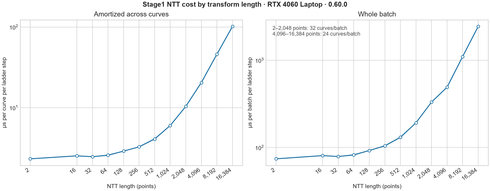
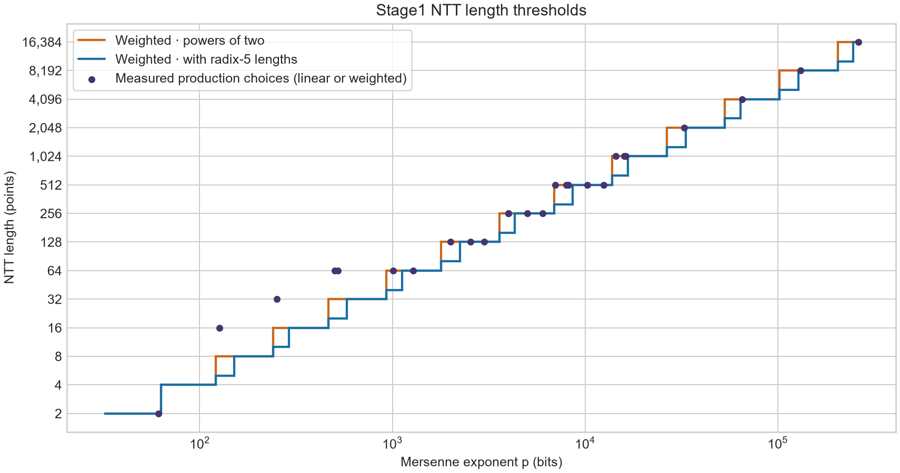
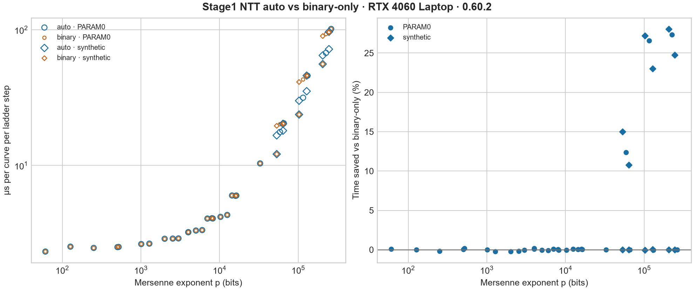
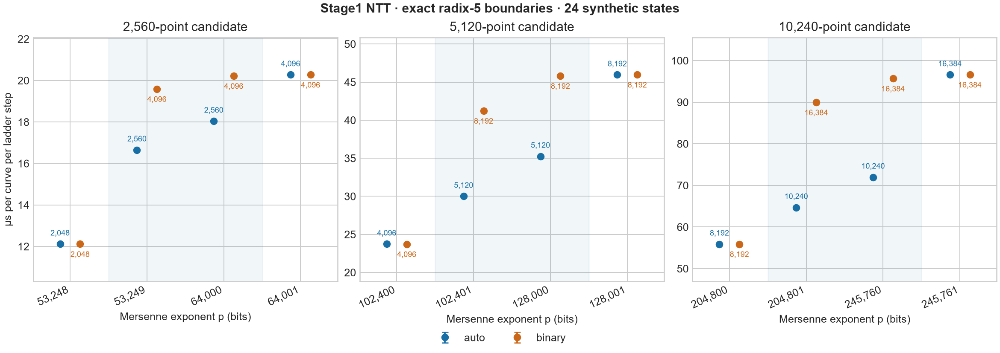
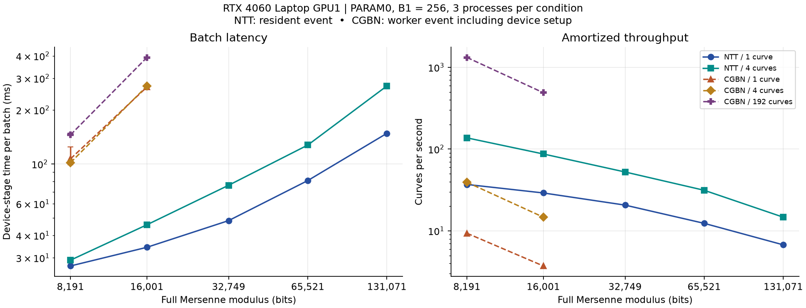
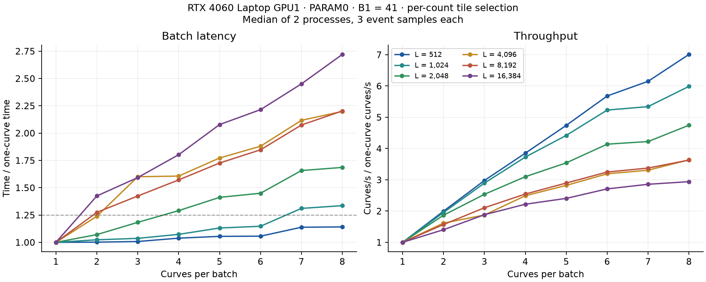

# 少曲线全宽 NTT Stage1

CUDA Stage1 的 NTT 后端可对完整梅森模数 `M=2^p−1` 运行 Suyama Montgomery PARAM0 和 Atkin–Morain Edwards。两种曲线共用设备上的 x-only 阶梯，一条曲线也会将同层的独立乘法一起提交。GPU1 RTX 4060 Laptop 上，8191／16001 位的 PARAM0 单曲线设备阶段短于本机 CGBN 对照。该对照的 CGBN 批量提高到 192 条后，CGBN 的吞吐更高。

生产入口由 `gpu_algorithm = "ntt"` 启用，接受完整 `2^p−1` 和 1–32 条曲线。PARAM0 使用 `lcm(1…B1)` 或 `12·lcm(1…B1)`，Edwards 使用 `48·lcm(1…B1)` 并在 Montgomery 模型上计算。独立算术探针仍可输出未归一化的 X/Z，用于与 GMP 对拍。生产入口复用曲线构造、save、结果账本和 Stage2 交接。配置见 [Stage1 用法](../usage/STAGE1.md#cuda-全宽-ntt)。

## 批量调优与显存

`--tune ntt` 分别搜索线性与加权后端。每个候选在原缓冲上预热 100 个 ladder 步，再重置起点，对 192 步正式样本取 CUDA event 计时中位数。先测 1、2、4、8、16、32。吞吐增益低于 5% 时交替复测当前和前一批量，确认后停止倍增。补测停止点相邻的两个区间，并用上限档探查后续是否回升，再检查峰值和 95% 阈值附近。推荐档是达到该后端**实测**峰值吞吐 95% 的最小实测档。自动计划比较默认 tile 和较小 tile，显式指定 tile 或 profile 时比较指定配置。

生产 `auto` 查兼容 NTT 形状和活跃批量，缺档则预热后短测 128 步。共享 `[ntt]` 行用 `batch × ladder_steps / device_seconds` 保存吞吐。调优墙钟时间还包括初始化、Graph 构建、预热、回读和末点对照。表结构及 Stage2 吞吐口径见 [NTT 性能摘要表](../architecture/AUTO_B2.md#ntt-性能摘要表)。

以活跃批量 B、指数 p、NTT 长度 L 计，主数组需要 `88·B·L + 92·B·ceil(p/32)` 字节，此外还有标量、NTT 常量表和加权表。申请前核算显式分配，Graph 上传后及同步执行后用 `cudaMemGetInfo` 采样空闲显存差；两者较大值写为 `peak_bytes`。观测值以 CUDA 上下文就绪后的空闲显存为基准，受同设备其他进程和驱动分配粒度影响。

### GPU1 验证

历史 0.59.6 本机构建使用 CUDA 13.3 / sm89，计时采用当时的调优流程。GPU1 为 8 GiB RTX 4060 Laptop，驱动 610.88。完整自适应扫描覆盖 61–262139 位的 13 个代表指数。三组对照用相同的点、候选参数和计时口径，分别执行一次自适应搜索和 1–32 穷举。调优中 GPU 利用率至少 50% 的遥测样本为 1500 MHz、3.40–41.62 W、45–60 °C。表中数字依次为自适应／穷举，批量栏为峰值 → 95% 推荐。

| 指数 | 搜索耗时（秒） | linear 批量 | weighted 批量 |
|---:|---:|:---|:---|
| 8191 | 4.10／10.80 | 32 → 24／30 → 24 | 32 → 28／30 → 29 |
| 32749 | 9.33／24.29 | 24 → 23／24 → 23 | 32 → 23／30 → 24 |
| 131071 | 33.25／98.27 | 12 → 12／12 → 12 | 24 → 18／24 → 18 |

自适应使用 48–56 次计划测量，穷举使用 128 次，墙钟时间节省 61.6–66.2%。六组峰值吞吐为独立穷举值的 98.4–100.1%。两个 weighted 推荐比穷举的 95% 档少一条，独立穷举对这两档都测得约 94.8%。推荐阈值以各轮实测峰值为基准。

生产复验使用相同的 13 个指数，PARAM0、B1=64、sigma 从 26 起，每个指数测 1／32 条。复用已生成的 tune，分别与固定 linear 和 weighted 交替对测，每个条件各三次，取 ladder 的 CUDA event 中位数。活跃遥测样本为 1500 MHz、9.09–30.55 W、52–59 °C。26 个条件中 `auto` 选 linear 10 次、weighted 16 次。相对每个条件中较快的固定后端，`auto` 最多慢 3.79%（M127 单曲线）。相对固定 linear，各条件的设备耗时降幅中位数为 10.26%。312 次运行逐条比较保存点、因子和校验和，全部一致。

M4423、B1=32 的 16／32 条 PARAM0 保存点在两个后端均通过独立 Python 验算。M32749、B1=64 的同批量两组 X/Z 也与 GMP 一致。M9689、B1=4096 的两个批次在 bit 128/5924 中断，从 linear 换到 weighted 后续算。最后的 save 与不中断运行一致，Stage2 队列正常生成。M262139 的 16／32 条调优测得 linear 显存增量为 58／114 MiB，weighted 为 36／70 MiB。对应显式分配为 55.66／111.16 MiB 和 34.22／67.72 MiB。将预算设为 96 MiB 后，32 条 linear 被准入检查排除，32 条 weighted 仍成功测量。

原始结果和设备遥测位于 `data/experiments/stage1_ntt_batch_tune_0596/`，其中 `measured/matrix/tune.json` 为历史测量。复测入口见 [CUDA 全宽 NTT](../usage/STAGE1.md#cuda-全宽-ntt)、[设备对测](../../tools/bench/compare_stage1_ntt.py) 和 [生产验收](../../tools/test/test_stage1_ntt_production.py)。

## 最佳配置全位宽矩阵

2026-11-12 使用 ECM-ELF 0.62.2（CUDA 13.3.73、sm89、MSVC 14.51.36231）和 GPU1 RTX 4060 Laptop 8 GiB 测量 PARAM0 和 Edwards。输入为 26 个完整梅森数，覆盖 61–262139 位。其中 13 个沿用历史基准的指数，另外 13 个覆盖 Stage1 NTT 的调优形状。

每个指数从空 tune 对可用的 linear 和 weighted 计划穷举 1–32 条曲线，比较默认 tile 与较小 tile。候选预热 100 步后，按 `iter_per_s` 选择实测吞吐最高的行。PARAM0 和 Edwards 共用设备阶梯，锁定同一组计划，两种曲线各自运行三次真实 Stage1。每次核对实际长度、digit 位宽、tile、pass、warp 和批量。

实测 B1 为 1024（指数小于 128 或大于 20000）或 10000（其余）。sigma 从 20260922 起按批量连续分配，三次运行使用相同输入。`stage1_ntt_timing.device_ms` 取 ladder 的 CUDA event 区间，曲线构造、准备、回读、因子检查和发布另行执行。用 `device_ms / (1000 × 曲线数) × (1,000,000 / B1)` 折算至共同 B1。图中点为三次中位数，阴影覆盖最小至最大样本。折算沿用历史 Stage1 的线性口径。

26 个指数中，22 个选中 weighted，4 个选中 linear。14 档选中 32 条，12 档选中 30 条。M131071 和 M262139 使用分段进位与独立写回。下表所列计划均为 weighted、16-bit digit、warp 尾部、16 步 Graph。耗时以 0.61.3 → 0.62.2 表示，各版本使用自己的实测最优计划与并行数。

| 指数 | 长度 | tile 层数 | 曲线 | PARAM0 秒／曲线（折算） | Edwards 秒／曲线（折算） |
| ---: | ---: | ---: | ---: | ---: | ---: |
| 16319 | 1024 | 10 | 30 | 7.77 → 6.62 | 7.77 → 6.63 |
| 32749 | 2048 | 11 | 30 | 13.27 → 12.05 | 13.32 → 12.11 |
| 65521 | 4096 | 12 | 30 | 25.92 → 24.30 | 26.06 → 24.42 |
| 131071 | 8192 | 12 | 30 | 57.03 → 53.13 | 57.26 → 53.38 |
| 262139 | 16384 | 12 | 30 | 116.23 → 108.45 | 116.72 → 108.90 |

同一条件三次测量的全幅波动最多为中位数的 0.36%。GPU 利用率至少 50% 的遥测点均为 1500 MHz。PARAM0 调优及实测的板功耗为 9.39–45.11 W，温度为 56–75 °C。Edwards 实测为 11.48–42.29 W、62–68 °C。

156 个批次逐组复核 sigma、保存点或因子及校验值，三次结果一致。日志中的因子均整除对应的完整梅森数。两种曲线各有 777 个与 0.61.3 重合的保存点或因子，均逐条一致。调优表复核了各后端的 1–32 条记录和获选计划。

原始调优表、三轮日志、save、遥测和汇总保存在 `data/experiments/stage1_forward_tile_0622/{mont,ed}/`，逐条复核见同级 `verification.json`。0.61.3 对照在 `data/experiments/stage1_ntt_segments/{mont,ed}/`。复测可运行 `python tools/bench/bench_stage1_ntt_best.py --exe <ecm_cuda.exe> --device 1 --exhaustive-batches --output <新实验目录>`。Edwards 传入 `--curve ed --reuse-tune <同一设备的 NTT 汇总>` 复用计划并独立测量。见 [矩阵采集脚本](../../tools/bench/bench_stage1_ntt_best.py)、[绘图脚本](../../tools/bench/plot_stage1_ntt_best.py) 和 [三后端比较图](STAGE1.md#stage1-ntt-与-cgbn-和-prime95-对比)。

### 各 NTT 长度的每步耗时



`iter` 是一次二进制阶梯步，对应一个标量 bit，每条活跃曲线各执行一次。整批每步为 `1000 × device_ms / steps`，再除以实际批量得到单曲线摊销值，单位均为微秒。这里使用生产运行的实际步数，无需按 B1 外推。每个指数先取三次中位数，同一 NTT 长度再对各指数等权取中位数。阴影覆盖该长度的全部实测样本。Edwards 和 PARAM0 共用阶梯后端，图用 0.60.0 的 Edwards 生产样本代表这 12 个长度。

长度 512 时为 **4.09 µs/iter/曲线**，整批 32 条为 **130.76 µs/iter**。长度 16384 时为 **101.60 µs/iter/曲线**，整批 24 条为 **2.44 ms/iter**。长度 4096 起批量从 32 降至 24，左图的摊销耗时同时反映变换成本和批量变化。

统计表在 `data/benchmarks/stage1_ntt_radix5_0601/by-length.csv`。复现用 `--input` 读取 `data/experiments/stage1_unified_4060_0600/ed_ntt/summary.json`，用 `--figure`、`--steps-figure` 和 `--csv` 指定输出。见 [按长度统计和绘图脚本](../../tools/bench/plot_stage1_ntt_iter_cost.py)。

## 实现与正确性

线性后端对 p 位操作数选择最大整数 digit 宽度 b，令 `c=ceil(p/b)`，要求 `c·(2^b−1)^2 < 2^64−2^32+1`。变换长度 `L=nextpow2(2c+1)`，所以 Goldilocks 单模数足以精确恢复每个卷积系数，不会把线性卷积误做循环卷积。生产 NTT 模块处理 forward、点乘／逆缩放、inverse 和进位；其输入打包是完整整数，独立于 Stage2 的多项式槽宽和 D/P。

进位后的乘积按实际第 p 位拆成低半和高半。用 `2^p≡1 (mod M)` 折叠成一份残数，末 limb 即使不足 32 位也以实际位宽传播。每个 limb 将输入进位映射为 kill、propagate 或 generate；warp 票选加块内前缀求出回卷进位，全 propagate 的和 M 归一为 0。减法复用同一运算：`a−b ≡ a+(M−b)`。整个模乘没有 CGBN REDC，也没有中间值经 PCIe 传给 GMP。

标量按二进制 ladder 扫描，起始寄存 `[1]P` 和 `[2]P`。每位计算一组 xDBL 和 xADD，共四次平方和六次乘法，按依赖拆成三层：第一层同时算平方及交叉项并共享输入频谱，第二层算两平方、倍点的 X 及 `a24·E`，第三层完成两点的 Z。每位实际变换为 11 次 forward、10 次 inverse，分别组织为三层批处理；`a24` 和差点仿射 x 的频谱只生成一次。第二批生成的 `E=AA−BB` 频谱直接供第三批使用。逆向首个 tile 直接读取各乘积的输入频谱，平方复用同一次读取。Graph 可移植配置默认使用 16 位窗口，余数用独立短图；标量索引在设备上更新，无逐位回读。直接提交用相同算法。

实现见 [ladder](../../src/ecm/stage1/montgomery/cuda/ntt/ladder.cu#L159)，其中 [回卷与规范化](../../src/ecm/stage1/montgomery/cuda/ntt/ladder.cu#L96) 与 [独立 GMP 整曲线对照](../../tools/test/stage1_mersenne_ntt.cpp#L27) 分别负责设备归约和验算。显式驻留数组规模为 `11·8·B·L + 23·4·B·ceil(p/32)` 字节，另有标量、缓存表、Graph、CUDA 上下文等；这不是进程峰值。

- 32／33／64／65／8192／8193／262144 位人工状态：覆盖对齐与非对齐边界、全宽进位、减法为零，直接与 Graph 的两组 X/Z 完全一致，并与 GMP 一致。
- 8193 位人工状态的直接与 Graph 路径通过 Compute Sanitizer memcheck 和 synccheck，均为 0 errors，日志见 `sanitizer_local/`。
- `M65`、B1=40：sigma=11 在 Stage1 得到真因子 `253921=31×8191`；sigma=12 构造即得 `31`。探针另查曲线判别式；生产路径沿用 CGBN 的构造检查。两者都会剔除已命中的构造槽并保留其余曲线的 sigma 身份。
- 32749 位，起始 sigma=4294967311，4 条曲线通过 GMP 核对。所有 NTT 计时样本先核对跨样本输出，再核对 GMP 的两个 X/Z 点。8191／16001 位的 1／4 曲线在 CGBN 独立保存点上再做一次归一化 x 核对。

## 加权循环卷积

`ntt_convolution = "weighted"` 复用同一个 Goldilocks 域和点公式。对于受支持的长度 `L`，整数的第 j 个 digit 从 `e_j=ceil(p·j/L)` 位开始。域内取 `ρ^L=2^p`，打包时乘权 `2^e_j/ρ^j`。当 `i+j=k+mL`，循环卷积逆权重后的指数差为 `e_i+e_j−e_k−mp`，取值为 0 或 1。因此在无符号 digit 下，以 `2L·(2^ceil(p/L)−1)^2 < Q` 保证每个整数系数可由一个域余数精确恢复。

每个块将所需的系数逆权重后暂存在共享内存，并按原位偏移汇入 32 位 limb。利用 `2^p≡1` 汇入越过模数位宽的部分。先转移多位进位，再归一化窄顶 limb 并回卷，最后复用一位进位扫描。对最短的模数，64 位系数可能跨越两次边界，汇入时覆盖对应的三个区间。保存点和检查点的 X/Z 仍为规范整数。实现见 [权重与系数汇入](../../src/ecm/stage1/montgomery/cuda/ntt/weighted.cuh)。

0.59.3 在 RTX 4060 Laptop GPU1（CUDA 13.3 / sm89，驱动 610.88）使用两种后端的自动档对测。输入为完整梅森模数、PARAM0、LCM、sigma 从 11 起。每条件交替运行三次，取设备 event 中位数。计时含阶梯和提交间隔，排除曲线与指数准备、Graph 构建、末点回读和结果发布。B1=256 的设备活跃样本均为 1500 MHz、7.48–18.72 W、64–70 °C，未调频或设定功耗上限。

| 位宽 | 线性 → 加权长度 | 1 条 ms | 4 条 ms | 8 条 ms |
|---:|---:|---:|---:|---:|
| 4003 | 512 → 256 | 21.27 → 21.93 | 22.55 → 22.73 | 25.47 → 24.48 |
| 8191 | 1024 → 512 | 25.27 → 23.80 | 27.48 → 24.89 | 33.92 → 27.59 |
| 16001 | 2048 → 1024 | 33.79 → 28.07 | 40.24 → 29.67 | 53.63 → 35.22 |
| 32749 | 4096 → 2048 | 49.43 → 37.27 | 68.37 → 40.30 | 95.69 → 52.53 |
| 65521 | 8192 → 4096 | 77.79 → 58.52 | 125.04 → 66.07 | 187.39 → 91.37 |
| 131071 | 16384 → 8192 | 143.64 → 84.62 | 262.45 → 115.22 | 418.27 → 176.01 |

在 B1=4096 的 32749、65521 位各 1、4 条曲线复测中，加权后端的设备耗时降低 13.5–39.4%。该组活跃样本为 1500 MHz、10.52–20.56 W、66–69 °C。加权后端在 4003 位的单曲线和四曲线分别慢约 3.1% 和 0.8%。原始记录在 `data/experiments/stage1_ntt_weighted_0593/`，复测使用 [compare_stage1_ntt.py](../../tools/bench/compare_stage1_ntt.py)。

在相同 GPU1、输入和计时口径下，0.59.5 的共享内存归约融合相对 0.59.4 加权后端，在 B1=256 的 18 条件全部缩短设备耗时，改善中位数 2.07%，范围 0.98–3.43%。B1=4096 的四条件改善 0.94–2.67%。另将 9689 位输入显式设为 8192 点以覆盖密集 1–2 bit digit，B1=20 时 1／4 条曲线分别改善 6.08%／15.73%。0.59.5 的加权后端与 0.59.1 的线性后端直接交替对测时，131071 位、B1=256、八曲线从 435.55 ms 降到 171.73 ms。样本和功耗见 [开发记录](../development/STAGE1_NTT_OPTIMIZATION_DRAFT.md#0595-融合加权系数归约)。

## Stage1 点公式的数据流

生产 Edwards NTT 在曲线构造后映射到 Montgomery x 坐标，与 PARAM0 共用阶梯。每步有三批前向 `4+5+2`（复用松弛 `E` 时为 `4+4+2`），三批逆向 `4+4+2`。固定的 `A24` 和 `x(P)` 按曲线保留频谱，第二批的 `E` 跨第三批复用。

Prime95 31.06b01 的 `ecm.cpp` 约 2020–2160 行在原生 Edwards 公式中使用 `GWMUL_FFT_S*` 保留操作数，`gwmulmuladd5` 和 `gwmulmulsub5` 合并乘积，`GWMUL_STARTNEXTFFT` 让适用的多趟 GWNUM 计划在写出乘法结果时开始下一次 FFT。`gwnum/gwnum.h` 以 FFT 状态和未归一化加法的余量限制这些组合。对于本项目的单域 Goldilocks NTT，可迁移的是操作数生命周期、线性组合和边界融合。将未经进位的乘积频谱继续串乘会扩大整数系数，需重新证明精确性。

本地 gpuowl 的 `src/Gpu.cpp` 中 `Gpu::square` 保留 `LEAD_WIDTH`，让下一次平方从 `fftMidIn` 开始。`carryFused` 执行进位并输出下一轮需要的宽度方向表示。`src/cl/fftp.cl` 把权重、首个宽度方向变换和布局写出放在一起，覆盖浮点和 GF31/GF61 路径。PrMers 内置 Aevum 的 `third_party/aevum/src/Gpu.cpp` 中 `regPrepare` 与 `regMulPreparedStep` 把固定操作数的频谱保留和同一进位交接扩到乘法，当前守卫要求短进位与非 PFA。本项目在宽位宽由 pack 消费段进位摘要，在短变换中把 pack 和单 tile 变换合为一次 kernel。

### 生产数据流

设 \(E=AA-BB\)，且 \(B=2^b-1\) 为 digit 上界。记 \(T\) 为现行系数界里的项数，linear 为输入 digit 数，weighted 为 \(2L\)。日志 `stage1_ntt_plan` 的 `dataflow` 是实际生效项目的位掩码。

- **1 · 融合乘加。** 在点乘之后、缩放和逆变换之前加上第二批已有的 \(\widehat{BB}\)，直接输出 \(BB+A_{24}E\)。启用条件为 \(TB^2+B<Q\)，若同时使用松弛 `E`，则乘积项改用 \(2T\)。
- **2 · 复用松弛差的频谱。** weighted 路径在逆变换的乘积入口生成 \(\widehat{AA}+\widehat M-\widehat{BB}\)，同时保留到第三批。\(M=2^p-1\) 的 digit 全为各自的最大值，因此 \(AA+(M-BB)\) 可逐 digit 表示，每个 digit 非负且至多 \(2B\)。守卫要求 \(2TB^2<Q\)。每步少一次前向变换。整批共用 \(\widehat M\)，增加 \(8L\) bytes，与批量无关。计划预算容不下这张表时使用规范差。
- **4 · 坐标直写。** 第二、三批乘法的进位归约直接写入规范 X/Z 槽。第一批之前已读取旧坐标。每步省掉一次坐标复制 kernel，回读和 checkpoint 继续使用相同的整数槽。
- **8 · 打包融合前向变换。** 当二次幂 NTT 无外层 pass 时，CTA 直接把 digit 打包到共享内存并完成 tile。每步省三次独立 pack 启动和中间 digit 的全局访存。混合 radix-5 的 pack 同时完成五点 DFT 和 [PFA 置换](../architecture/NTT.md#stage1-radix-5-pfa)。
- **16 · 进位缓存。** weighted 且 \(p\le65536\) 时，乘积归约用共享内存保存每个 limb 的低 32 位，并在寄存器中保存进位状态，前缀扫描后直接使用。每 CTA 用 \(1024\lceil\lceil p/32\rceil/256\rceil\) bytes 动态共享内存，生产上限为 8 KiB。更宽时收益随批量和形状波动，共享内存用量也会限制同时驻留的线程块数。[CUDA Programming Guide](https://docs.nvidia.com/cuda/cuda-programming-guide/02-basics/writing-cuda-kernels.html#kernel-launch-and-occupancy)
- **32 · 分段进位。** weighted 且 \(p>114688\) 时启用，模加减和乘积归约按 256 个 limb 分段。5120 点各批量从 \(p=106497\) 起启用，2560／5120 点单曲线从 \(p=53249\) 起可提前启用。
- **64 · pack 解析进位。** 分段路径在 radix-5 或单曲线、且未使用单 tile pack 融合时启用。部分进位修正由 pack 直接完成。原理及检查点边界见 [NTT 架构](../architecture/NTT.md#stage1-分段进位与-pack-融合)。
- **4096 · 融合去权与段内进位。** 当 2560／5120 点加权变换满足单曲线准入时，乘积归约在同一个 kernel 中生成段内结果和摘要。见 [单曲线融合归约](../architecture/NTT.md#单曲线融合归约)。

生产和调优共用这些条件。探针的 `--dataflow auto` 使用同一规则，`--dataflow 0` 为控制，数值位掩码可单独对照。见 [阶梯](../../src/ecm/stage1/montgomery/cuda/ntt/ladder.cu)、[分段进位](../../kernels/cuda/stage1_ntt_segments.cuh) 和 [打包融合](../../kernels/cuda/stage1_ntt_dataflow.cuh)。

### GPU1 宽位宽归约热点

RTX 4060 Laptop（GPU1），CUDA 13.3.73、sm89。0.61.3 开发期间的探针以 0.61.2 生产规则为基线，交替对照分段进位及 pack 融合。24 组位宽／tile／批量各测三次，输入为确定性合成 X/Z、参数和标量，固定加权长度与 16 步 Graph。预热 100 步后重置状态，以 CUDA event 计 256 或 384 步，排除初始化和校验回读。GPU 利用率 ≥50% 的遥测为 1500 MHz、2.00–36.71 W、45–58 °C。

| 指数位宽 | 加权长度 | 曲线 | 0.61.2 | 分段进位 | 分段＋pack |
| ---: | ---: | ---: | ---: | ---: | ---: |
| 65537 | 4096 | 24 | 18.657 | 20.196 | 20.265 |
| 115201 | 5120 | 24 | 30.487 | 29.440 | **28.838** |
| 131071 | 8192 | 24 | 43.804 | **40.221** | 40.628 |
| 225287 | 10240 | 1 | 187.924 | 137.732 | **134.584** |
| 225287 | 10240 | 24 | 63.003 | 54.437 | **53.452** |
| 262139 | 16384 | 1 | 350.540 | 205.484 | **204.360** |
| 262139 | 16384 | 24 | 95.347 | **80.890** | 81.834 |

表中为 µs／阶梯步／曲线。生产规则在覆盖的 115201–262139 位省时 **5.41%–41.70%**。相对单独分段，两个混合长度的 pack 融合再省 **1.81%–2.29%**。二次幂批量 8 或 24 时，pack 融合增加 **0.37%–1.17%**。

Nsight Systems 2026.1.3 逐节点追踪只累计计时区间的 kernel。模加减包含其独立写回，乘积进位包含多位进位预处理和段归约。由 pack 解析的修正计入 pack 列。下表用「0.61.2 → 0.61.3」，单位同上。

| 指数位宽 | 曲线 | 模加减 | limb 汇集 | 乘积进位 | pack |
| ---: | ---: | ---: | ---: | ---: | ---: |
| 225287 | 1 | 28.21 → 6.34 | 14.50 → 14.42 | 50.18 → 17.60 | 17.41 → 18.76 |
| 225287 | 24 | 7.03 → 2.84 | 6.83 → 6.81 | 12.54 → 7.11 | 5.55 → 6.27 |
| 262139 | 1 | 68.04 → 6.68 | 18.01 → 17.87 | 106.93 → 18.29 | 10.92 → 14.42 |
| 262139 | 24 | 10.26 → 4.96 | 10.13 → 10.12 | 16.68 → 8.45 | 5.73 → 5.70 |

216 个计时样本的端点逐词与控制一致。另有 45 组独立 GMP 用例，覆盖单段、跨段边界、混合长度、262144 位上限、Graph／直接提交和双向续跑。原始样本与脚本位于 `data/experiments/stage1_ntt_segments/`，分项表与消融在 `data/benchmarks/stage1_ntt_segments/`。前一轮短变换、坐标直写和进位缓存的结果见 [0.61.2 开发记录](../development/STAGE1_NTT_OPTIMIZATION_DRAFT.md#0612-归约写回与打包热点)。

### 混合 radix-5 吞吐与寄存器

0.61.5 的 weighted 混合长度默认采用共享内存版 PFA。CUDA 13.3，GPU1 RTX 4060 Laptop 8 GiB，SM 固定 1500 MHz，活跃样本整卡功耗中位数约 31.6 W。固定下列长度与 tile，Graph 每组 16 个阶梯步，预热 100 步，交替测量 3 次并取中位数。计时为 256 或 512 步的 CUDA event 时间除以曲线数和步数，单位 µs／曲线／阶梯步。

| 指数 \(p\) | NTT 长度 | tile bits | 单曲线 旋转因子 → PFA | 12 曲线 旋转因子 → PFA | 30 曲线 旋转因子 → PFA |
|---:|---:|---:|---:|---:|---:|
| 58631 | 2560 | 9 | 95.66 → 92.52 | 19.61 → 19.25 | 16.45 → 16.22 |
| 115201 | 5120 | 10 | 102.82 → 99.52 | 31.36 → 30.74 | 28.28 → 27.71 |
| 225287 | 10240 | 11 | 133.72 → 130.96 | 56.21 → 54.98 | 52.96 → 51.78 |
| 256001 | 20480 | 12 | 194.71 → 190.37 | 97.91 → 95.57 | 96.99 → 95.39 |

8 个多曲线条件的每曲线耗时减少 1.44%–2.39%，对应吞吐提高 1.46%–2.45%。直接在全局地址上置换会使这 8 格慢 3.4%–6.7%。每个条件的阶梯终点摘要一致。GMP 独立检查覆盖卷积系数、模平方及 carry 边界，并验证 Graph、直接启动和跨数据流续跑。原始日志和样本在 `data/experiments/fft_ntt_20261111/pfa_shared/` 与同级 `gmp_*`。

用 NVCC 文件级 `-maxrregcount=32/48` 对同一 ladder 编译单元复测了两个指数的 1／12／30 曲线，每格 3 次。上限 32 使 radix-5 逆核由 40 降至 32 个寄存器，并引入每线程各 8 B 的 spill store 和 load。声明 `__launch_bounds__` 的归约核维持 40 个寄存器。上限 48 的整步中位数改善均不足 0.7%，继续使用编译器默认上限。原始记录见 `data/experiments/fft_ntt_20261111/registers/` 和同级 `resources_*.txt`。[CUDA 编译器寄存器选项](https://docs.nvidia.com/cuda/cuda-compiler-driver-nvcc/#maxrregcount-amount-maxrregcount)

### 逆变换参数栈与批量吞吐

逐点乘加与逆变换 tile 共享的输入指针表改用只读 grid 参数。CUDA 13.3 `sm_89` 的 `ptxas` 报告显示，每线程栈由 96 B 降至 0 B。测试设备、Graph、预热和计时口径同上，每格交替测 3 次。该组未独立采样功耗。混合长度两侧均使用 PFA，共 9 格，阶梯终点一致。

| 指数 \(p\) | NTT 长度 | tile bits | 单曲线 旧 → 新 | 12 曲线 旧 → 新 | 30 曲线 旧 → 新 |
|---:|---:|---:|---:|---:|---:|
| 58631 | 2560 | 9 | 92.76 → 87.96 | 19.27 → 16.29 | 16.22 → 13.61 |
| 225287 | 10240 | 11 | 130.96 → 126.30 | 54.98 → 52.79 | 51.78 → 50.01 |
| 262139 | 16384 | 11 | 205.91 → 198.62 | 87.37 → 84.32 | 83.66 → 80.88 |

30 曲线在三档的吞吐分别提高 19.1%、3.5%、3.4%。计算能力 7.0 及以上的目标启用该参数优化。使用 CUDA 11.8 验证了 `compute_50` PTX、`sm_60` 和 `sm_75` 内核编译，GPU 正确性与吞吐测试在 `sm_89` 上执行。原始样本和编译记录在 `data/experiments/fft_ntt_20261111/grid_const/`、`grid_const_build.log` 和 `cuda118_final.log`。

最终版通过 Montgomery 与 Edwards 的生产入口、tune、16／32 曲线和续跑测试。独立 GMP 对拍覆盖四档混合长度和 16384 点二次幂，2560 点的 Compute Sanitizer `memcheck` 与 `synccheck` 均为零错误。验证日志在 `data/experiments/fft_ntt_20261111/` 下的 `production_final.log`、`tune_final.log`、`gmp_final_*` 和 `*_final.log`。

### Tile 剖析与逆变换缩放

在 GPU1 RTX 4060 Laptop（8 GiB，SM 1500 MHz）对 0.61.5 加权数据流做了 8 组 Nsight Systems CUDA Graph node 剖析。每格一条轨迹，固定 tile、1／30 曲线、128 阶梯步，Graph16。下表是 30 曲线时占已记录 kernel 时间的比例，排除准备、回读和 kernel 之间的空档。`pack + PFA` 包含 pack 和独立五点逆变换，`tile` 包含前向 tile 和融合逐点运算的首段逆变换，carry 包含 limb 汇集和后续进位。

| 指数 \(p\) | NTT 长度 | tile bits | pack + PFA | tile | 外层变换 | carry |
|---:|---:|---:|---:|---:|---:|---:|
| 32749 | 2048 | 10 | 8.4% | 54.1% | 12.5% | 25.0% |
| 58631 | 2560 | 9 | 16.2% | 50.8% | 0.0% | 32.9% |
| 225287 | 10240 | 10 | 15.5% | 45.9% | 8.0% | 30.5% |
| 262139 | 16384 | 11 | 6.9% | 50.0% | 14.6% | 28.5% |

单曲线时热点随形状改变。2560 点的 carry 占 43.8%，16384 点的外层变换占 30.3%。128 步窗口内，四个单曲线条件首末 kernel 之间的累计空档约 0.89–1.30 ms。轨迹未独立采样功耗。原始 SQLite 和汇总在 `data/experiments/fft_ntt_20261112/profile/`。

0.61.6 将 [逆变换的长度缩放并入逆权重表](../architecture/NTT.md#stage1-逐点乘加与逆变换-tile)。同卡、固定长度与 tile、Graph16，预热 100 步，再以 256 或 384 阶梯步交替测 3 次。活跃样本整卡功耗中位数约 33.3 W。以下是 30 曲线的 CUDA event 中位数，单位 µs／曲线／阶梯步。

| 指数 \(p\) | 长度 | tile bits | 0.61.5 算术 | 0.61.6 算术 |
|---:|---:|---:|---:|---:|
| 32749 | 2048 | 10 | 9.827 | 9.664 |
| 58631 | 2560 | 9 | 13.618 | 13.450 |
| 115201 | 5120 | 10 | 25.647 | 25.231 |
| 225287 | 10240 | 10 | 53.097 | 52.288 |
| 262139 | 16384 | 11 | 79.943 | 78.679 |
| 256001 | 20480 | 12 | 93.209 | 91.504 |

12／30 曲线的加权吞吐提高 **0.88%–1.91%**，单曲线提高 **0.12%–1.36%**。两档 linear 的六格对照变化小于 0.18%。全部 24 格的阶梯终点摘要一致。配对数据和遥测在 `data/experiments/fft_ntt_20261112/scale_ab/`。

最终版通过 Montgomery 与 Edwards 生产入口、tune 和 16／32 曲线续跑。GMP 对拍覆盖六档 weighted 的进位与模平方，以及一档 linear 的进位。2560 点的 Compute Sanitizer `memcheck` 和 `synccheck` 均为零错误。CUDA 11.8 编译覆盖 `compute_50` PTX、`sm_60` 和 `sm_75`。验证日志与 `scale_ab/` 同级。

### 逆向 warp 输入融合与块宽

0.61.7 将 Stage1 的逐点乘加与首六层逆变换直接接在寄存器中，并缩小不足 1024 系数的逆向 tile 线程块。对照使用同一二进制关闭该路径，算术为 0.61.6。RTX 4060 Laptop GPU1（8 GiB，SM 1500 MHz），固定长度、tile、Graph16，预热 100 步，计时 256–512 步。每格交替测 3 次并取 CUDA event 中位数。整卡活跃样本功耗中位数为完整扫描 32.7 W、小 tile 扫描 14.7 W。

| 卷积 | 指数 \(p\) | NTT 长度 | tile 层数 | 逆向块线程 | 30 曲线耗时，µs／曲线／阶梯步 | 吞吐增幅 |
|---|---:|---:|---:|---:|---:|---:|
| weighted | 1021 | 64 | 6 | 32 | 1.797 → 1.611 | 11.53% |
| weighted | 4003 | 256 | 8 | 128 | 2.331 → 2.125 | 9.74% |
| weighted | 8191 | 512 | 9 | 256 | 3.024 → 2.920 | 3.56% |
| weighted | 32749 | 2048 | 10 | 512 | 9.662 → 9.503 | 1.68% |
| weighted | 58631 | 2560 | 9 | 256 | 13.484 → 12.854 | 4.90% |
| weighted | 115201 | 5120 | 10 | 512 | 25.255 → 24.840 | 1.67% |
| weighted | 225287 | 10240 | 10 | 512 | 52.339 → 51.501 | 1.63% |
| weighted | 262139 | 16384 | 11 | 512 | 78.776 → 77.617 | 1.49% |
| weighted | 256001 | 20480 | 12 | 512 | 91.666 → 90.463 | 1.33% |
| linear | 32749 | 4096 | 11 | 512 | 21.210 → 20.935 | 1.32% |
| linear | 262139 | 32768 | 12 | 512 | 223.724 → 221.934 | 0.81% |

合计 33 个条件的阶梯终点一致。1／12／30 曲线的吞吐分别提高 **0.35%–3.30%／1.04%–4.24%／0.81%–11.53%**。单独关闭全部 warp 尾段时，2560、10240、16384 点的 30 曲线耗时均较原 warp 路径增加。

Nsight Systems 每格各取一条 Graph node 轨迹。只累计计时段内 128 步的 384 次逆向 tile，1021、58631 和 225287 位的这部分设备时间分别为 **1.90 → 1.18 ms、14.09 → 11.57 ms、49.33 → 46.77 ms**。这些轨迹的逆向 kernel 均为 40 寄存器／线程。驱动拒绝 Nsight Compute 的硬件计数器访问，bank conflict 数未实测。配对样本、SASS、资源清单和时间线在 `data/experiments/fft_ntt_20261112_tile/`。

生产 0.61.6 和 0.61.7 另在同卡以完整梅森模数、连续 sigma 从 26 起、固定 weighted 形状和 Graph16 交替各跑三次。设备时间只计完整阶梯，排除初始化、结果回读与存档。活跃样本整卡功耗中位数为 14.1 W。每条曲线的 Stage1 存档末点一致，校验值通过独立计算。原始记录在同目录的 `production_ab/`。

| 生产曲线 | 指数 \(p\) | B1 | 长度／tile 层数 | 曲线数 | 阶梯步 | 整批设备时间，ms | 吞吐增幅 |
|---|---:|---:|---:|---:|---:|---:|---:|
| Montgomery PARAM0 | 4003 | 10000 | 256／8 | 30 | 14446 | 1015.065 → 925.437 | 9.68% |
| Edwards | 58631 | 1000 | 2560／9 | 30 | 1443 | 583.947 → 558.330 | 4.59% |
| Montgomery PARAM0 | 225287 | 512 | 10240／10 | 12 | 742 | 496.441 → 489.608 | 1.40% |

生产入口、tune、16／32 曲线续跑均通过。GMP 独立对拍覆盖八档 weighted 的进位和模平方，以及 4096 点 linear 的进位。64 点和 2560 点的 Compute Sanitizer `memcheck`、`synccheck` 均为零错误。CUDA 11.8 的 `compute_50` PTX、`sm_60` 和 `sm_75` 完成内核编译验证。

### 前向 tile 与进位

0.62.2 的候选筛选使用标识为 0.62.1 的诊断构建，在 GPU1 RTX 4060 Laptop 固定变换形状和 Graph16。合成输入预热 100 步，计时 128–384 步，每格交替三次，表中取 CUDA event 的中位数。单位为 µs／曲线／阶梯步，排除准备、回读与发布。三组筛选共 948 次计时，利用率至少 50% 的遥测点均为 1500 MHz，板功耗为 8.47–43.86 W。

| 指数 \(p\) | NTT 长度／tile 层数 | 曲线数 | 前向改动 | 每步耗时 | 耗时变化 |
|---:|---:|---:|---|---:|---:|
| 61 | 2／1 | 30 | 打包并直接做两点蝶形 | 1.540 → 1.334 | −13.4% |
| 127 | 8／3 | 30 | 缩小线程块 | 1.754 → 1.536 | −12.4% |
| 1021 | 64／6 | 30 | 打包并在 warp 内完成 | 1.617 → 1.524 | −5.8% |
| 4003 | 256／8 | 30 | 缩小线程块 | 2.147 → 2.041 | −4.9% |
| 8191 | 512／9 | 30 | 缩小线程块 | 2.923 → 2.863 | −2.0% |
| 58631 | 2560／9 | 30 | 读入与首两层 DIF 融合 | 12.860 → 12.244 | −4.8% |
| 262139 | 16384／12 | 1 | 读入与首两层 DIF 融合 | 193.296 → 187.624 | −2.9% |

Nsight Systems 2026.1.3 独立采集 8 条轨迹，每条统计计时区间内 128 步的 CUDA Graph 节点。64、2560 和 16384 点对照的前向 tile 分别为 12.68 → 9.26、95.29 → 75.97、46.24 → 40.66 µs／批／步。前两组各 30 条曲线，最后一组单曲线。16384 点优化后，逆向 tile 和 outer 分别占已记录 kernel 时间的 28.4% 与 18.8%。轨迹用于分项，整步吞吐采用独立 CUDA event 对照。

生产版本 0.61.7 和 0.62.2 在同卡固定长度、tile、Graph16、曲线数和连续 sigma，交替各测三次。七组覆盖 61–262139 位、B1=256 或 1024、单曲线及 27／30 曲线。整条阶梯的设备耗时减少 1.7%–17.5%。例如 30 条 PARAM0 在 M521 从 70.55 降至 62.68 ms，30 条 Edwards 在 M58631 从 142.39 降至 135.33 ms，单曲线 PARAM0 在 M106501 从 40.10 降至 33.08 ms。42 个批次的保存点与校验值逐组一致。GPU 利用率至少 50% 的采样点均为 1500 MHz，板功耗为 9.42–31.14 W。日志、save 和 CSV 在 `production_ab/`。

0.62.2 的五个 2560／5120 点单曲线边界样本在同一前向路径上提前分段进位并让 pack 消费摘要，每步耗时减少 1.8%–16.1%。106497 位、5120 点的轨迹中，carry 从 25.59 降至 15.41 µs／步，模加减从 14.15 降至 5.19 µs／步，pack 与五点变换合计增加 1.65 µs／步。去权与 limb 汇集单独耗时 12.62 µs／步。当前启用范围见下节。

40 项独立 GMP 对拍覆盖线性、二次幂加权和混合变换，并核对 Graph、直接提交和跨路径续跑。64 点和 2560 点的 `memcheck`、`synccheck` 均为零错误。生产入口另校验两类曲线的因子、末点、校验和及 16／32 曲线恢复。原始样本、验证日志与轨迹位于 `data/experiments/stage1_forward_tile_0622/`。默认路径见 [前向 tile 架构](../architecture/NTT.md#stage1-前向-tile)。

## 加权归约与 16384 点单曲线调优

0.62.3 的专项试验在 GPU1 RTX 4060 Laptop 8 GiB、CUDA 13.3.73、sm89、MSVC 14.51.36231 上执行。归约候选使用标识为 0.62.2 的诊断构建，16384 点布局筛选使用标识为 0.62.1 的诊断构建并显式启用 0.62.2 数据流，Nsight 轨迹用 0.62.3 最终内核复测。诊断采集固定 NTT 形状和 Graph16，用同一组合成点预热 100 步，计时 160–384 步，确认轮交替测三次。单步结果为 CUDA event 中位数，批量样本除以实际曲线数。GPU 活跃时 SM 为 1500 MHz，诊断采集板功耗为 9.50–43.66 W。

### 加权归约

直接融合去权、limb 汇集与段内进位后，2560 点的三个单曲线样本每步耗时减少 3.0%–4.3%，5120 点的三个样本减少 0.8%–1.7%。在 262139 位、16384 点样本上直接融合使单曲线和 30 曲线耗时分别增加 3.9% 和 8.6%。分段共享内存缓存与缩短回卷扫描也做了对照。缓存的收益随形状波动，单独缩短回卷的变化为 −0.25% 至 +0.40%。生产直接融合只用于两档混合长度的合格单曲线。见 [单曲线融合归约](../architecture/NTT.md#单曲线融合归约)。

5120 点另以原先未分段的路径为对照，在 106497–114688 位的 21 个多曲线测试条件中，独立汇集加提前分段进位使每步耗时减少 1.8%–12.4%。106497 位、30 曲线从 25.795 降至 23.988 µs／曲线／步。2560 点、30 曲线提前分段则从 12.226 增至 12.859 µs／曲线／步。

Nsight Systems 2026.1.3 的单曲线轨迹各记录 128 阶梯步，每步少 3 个 Graph kernel 节点。去权、汇集与段内进位的 kernel 时间合计，2560 点从 19.93 降至 17.32 µs／步，5120 点从 21.24 降至 20.68 µs／步。跨段写回单独计时，两档均相差不到 0.06 µs／步。

### 16384 点布局搜索

三个指数各筛 40 种去重后的实际布局，覆盖 tile 层数与外层融合上限。随后以同一基线和入围布局复测，30 曲线对照使用同一组参数。表内单位为 µs／曲线／阶梯步。基线是正向 `2+12`，候选 `2+2+10` 将四个外层拆成两个 2 层 pass。

| 指数 \(p\) | 卷积 | 单曲线 `2+12` → `2+2+10` | 30 曲线 `2+12` → `2+2+10` |
|---:|---|---:|---:|
| 196613 | linear | 326.669 → 325.824 | 109.507 → 116.331 |
| 212993 | weighted | 189.957 → 186.864 | 74.307 → 80.823 |
| 262139 | weighted | 187.912 → 184.755 | 75.103 → 81.764 |

加权单曲线减少 1.6%–1.7%，30 曲线增加约 8.8%。生产的 16384 点加权单曲线自动调优比较这两套布局，按实测用时保存最快计划。批量与 linear 继续走各自的候选搜索。见 [调优与配置](../usage/STAGE1.md#cuda-全宽-ntt)。

262139 位单曲线的 Graph 轨迹显示，正逆 tile 合计从 93.27 降至 55.20 µs／步，outer 从 34.92 增至 69.51 µs／步。两项合计减少 3.48 µs／步。每趟 tile 的动态共享内存从 32 KiB 降至 8 KiB。

### 生产阶梯对照

两版 worker 使用相同的指数、起始 sigma 20260922、加权卷积和 Graph16。归约每组交替测三次，布局两组每套计划测五次。设备时间取完整阶梯 CUDA event 的中位数，曲线构造、变换准备、回读、检查与发布另计。布局两组在 0.62.3 内换计划，同形状的 0.62.2 对照相差小于 0.01%。GPU 利用率至少 50% 的 311 个遥测点均为 1500 MHz，板功耗为 9.90–33.61 W。

| 曲线 | 指数 \(p\) | NTT 长度 | 曲线数 | B1 | 设备耗时（ms／批） | 耗时变化 |
|---|---:|---:|---:|---:|---:|---:|
| Edwards | 58631 | 2560 | 1 | 1024 | 121.940 → 116.895 | −4.14% |
| PARAM0 | 106501 | 5120 | 1 | 1024 | 135.075 → 133.589 | −1.10% |
| PARAM0 | 106501 | 5120 | 4 | 1024 | 250.600 → 227.624 | −9.17% |
| PARAM0 | 106501 | 5120 | 30 | 512 | 574.471 → 534.235 | −7.00% |
| Edwards | 225287 | 16384 | 1 | 2048 | 556.705 → 546.311 | −1.87% |
| PARAM0 | 262139 | 16384 | 1 | 2048 | 554.197 → 544.994 | −1.66% |

8192 点单曲线、10240 点单曲线和 30 曲线、16384 点 30 曲线的同形状对照变化均小于 0.04%。78 次运行的存档末点逐组一致，校验值按各自曲线格式独立重算。另通过 48 项 GMP 对拍、Compute Sanitizer 的 `memcheck`、`synccheck`、`racecheck`，以及生产的因子、16／32 曲线断点续跑和 Stage2 交接测试。`--tune ntt --bits 262139` 在本次 16384 点定长扫描中为单曲线选出 `2+2+10`，为峰值批量 24 条选出 `2+12`。清空 tune 的短调优和后续读取 tune 均选中单曲线计划，显式 `outer_max=4` 选出 `2+12`。

原始证据在 `data/experiments/stage1_gather_outer_0623/`。`gather_candidates/`、`gather_edges/`、`batch_boundaries/`、`wrap_only/` 和 `search_baseline/` 保存筛选数据，`nsight_0623/profile.csv` 保存分项时间，`production_ab/runs.csv` 保存生产对照，`tune_final/` 保存调优表和使用日志，`production_validation.log` 与 `check_gmp_final.log` 保存正确性结果。

## 长度、pass 和 GPUOWL 形状

### 指数位宽与变换长度的阶梯



阶梯按 `L≤p` 与系数界求每个整数位宽的最短安全加权长度。蓝线使用当前加权默认范围，橙线为二次幂对照。散点为 0.60.0 生产矩阵的实际选型，包含 linear 和 weighted。混合档分别覆盖 53249–64000 位（2560 点）、102401–128000 位（5120 点）和 204801–245760 位（10240 点）。`auto` 的最终长度由实际调优结果决定。

#### NTT and transform sizes

区间包含两端。表中是 0.60.2 在 `ntt_length=0`、`ntt_bpw=0`、`ntt_tile=0` 时各卷积后端推导的长度。20480 点混合长度可显式指定。`auto` 会按实测比较候选。

| Exponent p range (linear) | Exponent p range (IBDWT) | N | Structure |
| ---: | ---: | ---: | :--- |
| — | 32–62 | 2 | $2^1$ |
| — | 63–120 | 4 | $2^2$ |
| 32–93 | 121–240 | 8 | $2^3$ |
| 94–210 | 241–464 | 16 | $2^4$ |
| 211–450 | 465–928 | 32 | $2^5$ |
| 451–899 | 929–1,792 | 64 | $2^6$ |
| 900–1,827 | 1,793–3,584 | 128 | $2^7$ |
| 1,828–3,556 | 3,585–6,912 | 256 | $2^8$ |
| 3,557–7,140 | 6,913–13,824 | 512 | $2^9$ |
| 7,141–13,797 | 13,825–26,624 | 1,024 | $2^{10}$ |
| 13,798–27,621 | 26,625–53,248 | 2,048 | $2^{11}$ |
| — | 53,249–64,000 | 2,560 | $5\times2^9$ |
| 27,622–53,222 | 64,001–102,400 | 4,096 | $2^{12}$ |
| — | 102,401–128,000 | 5,120 | $5\times2^{10}$ |
| 53,223–106,470 | 128,001–204,800 | 8,192 | $2^{13}$ |
| — | 204,801–245,760 | 10,240 | $5\times2^{11}$ |
| 106,471–204,775 | 245,761–262,144 | 16,384 | $2^{14}$ |
| 204,776–262,144 | — | 32,768 | $2^{15}$ |

### 加权 radix-5

加权卷积支持 `L=5·2^k`（`9≤k≤12`）。打包与首层 radix-5 DIF 融合，再用现有运行时处理五段 `2^k` 变换。点乘按整个 `L` 缩放，逆向完成二次幂 DIT 后按原顺序合并 radix-5 输出，继续使用现有逆权重和 limb 归约。`ntt_length=0` 时，`weighted` 使用满足约束的较短长度，`auto` 比较两种加权形状和 linear。20480 点可显式指定。见 [radix-5 内核](../../kernels/cuda/stage1_ntt_radix5.cuh) 和 [CUDA 全宽 NTT](../usage/STAGE1.md#cuda-全宽-ntt)。

2026-11-09 在 GPU1 RTX 4060 Laptop（CUDA 13.3、sm89、驱动 610.88）用 0.60.1 对 13 个指数交替比较两种加权长度。每组各三次，PARAM0、B1=256、24 条曲线、Graph 16，取 ladder CUDA event 除以实际步数和批量。GPU 利用率至少 50% 的样本中，SM 为 1500 MHz，功耗 9.83–34.33 W（中位 17.24 W），温度 45–55 °C。78 批次的同输入存档及校验值一致。

| 指数 p | 二次幂 → 混合长度 | µs/iter/曲线 | 耗时下降 |
|---:|---:|---:|---:|
| 58631 | 4096 → 2560 | 20.14 → 17.64 | 12.41% |
| 115201 | 8192 → 5120 | 43.01 → 31.57 | 26.60% |
| 225287 | 16384 → 10240 | 93.06 → 67.63 | 27.33% |

其余九个缩短长度的对照慢 8.93%–135.16%。在 M262139 上显式增至 20480 点作为对照，慢 15.26%。原始数据在 `data/experiments/stage1_ntt_radix5_0601/`，统计表在 `data/benchmarks/stage1_ntt_radix5_0601/radix5-vs-binary.csv`。

### 0.60.2 全位宽复测与精确边界

2026-11-09 在 GPU1 RTX 4060 Laptop 使用 ECM-ELF 0.60.2（CUDA 13.3、sm89、驱动 610.88）复测历史 26 个指数，另加三个混合档的代表指数与 12 个边界点。实际 PARAM0 输入使用 B1=1024 或 10000，批量为 24 或 32。每个混合档分别测起点前一位、起点、终点和终点后一位。精确边界用同版生产选型器与阶梯内核执行 24 条合成状态、1478 步，固定活跃批量，省去生产任务的周期检查。合成样本在图和 CSV 中单独标记。

每个位宽先用 `auto` 生成独立 tune。纯二次幂对照取同批量、同次调优中吞吐最高的线性或加权二次幂计划。完成短测后，交替启动 `auto` 和固定二次幂各三次，确认 `auto` 命中缓存并记录实际长度。指标为 `1000 × ladder device_ms / (steps × 活跃批量)` 的中位数。246 个计时样本的同输入存档或合成末点摘要一致。GPU 利用率至少 50% 的遥测样本中，SM 为 1500 MHz，功耗 6.46–41.91 W（中位数 22.85 W），温度 46–60 °C。





三个混合档的起点和终点都选中混合长度。每个区间前后相邻一位均选回二次幂，与对照的长度相同。

| 边界指数 p | `auto` 长度 | 纯二次幂长度 | `auto` µs/iter/曲线 | 纯二次幂 µs/iter/曲线 | 耗时下降 |
| ---: | ---: | ---: | ---: | ---: | ---: |
| 53,249 | 2,560 | 4,096 | 16.65 | 19.59 | 14.98% |
| 64,000 | 2,560 | 4,096 | 18.04 | 20.22 | 10.77% |
| 102,401 | 5,120 | 8,192 | 30.00 | 41.22 | 27.22% |
| 128,000 | 5,120 | 8,192 | 35.26 | 45.81 | 23.03% |
| 204,801 | 10,240 | 16,384 | 64.70 | 89.94 | 28.06% |
| 245,760 | 10,240 | 16,384 | 71.98 | 95.67 | 24.77% |

三个实际 PARAM0 代表指数也选中混合长度。58631、115201 和 225287 位的每步耗时分别由 20.14、43.02、93.05 降至 17.65、31.58、67.61 µs/iter/曲线，节省 12.39%、26.60%、27.33%。其余 32 个条件的两路中位数差在 0.24% 以内。

原始日志、逐位宽 tune 和样本在 `data/experiments/stage1_ntt_auto_matrix_0602/verified/`，统计表在 `data/benchmarks/stage1_ntt_auto_matrix_0602/by-width.csv`。复现入口见 [边界探针构建](../../tools/build/test/build_stage1_ntt_auto_probe.ps1)、[采集脚本](../../tools/bench/bench_stage1_ntt_auto_matrix.py)和 [绘图脚本](../../tools/bench/plot_stage1_ntt_auto_matrix.py)。

### 二次幂内核形状

线性后端的自动计划先从 31 到 16 找满足精确性不等式的最大整数 b，再取最小满足 `L≥2c+1` 的二次幂。两段 c-digit 乘积最多有 `2c−1` 个非零卷积系数；`2c+1` 是实现预留的零尾，供进位与提取。以 8191 位为例，b=27、c=304、`L=1024`。长度只随模数位宽和精确性条件变化；B1、曲线数、Graph 窗口和 tile 都不改变 L。Stage2 多项式 packing 的槽宽模型不用于这里。

设 `k=log2 L`，Goldilocks 域的正向根取 `ω=7^((Q−1)/L) mod Q`；逆根为 `ω⁻¹`。每个频域位置存一个 64 位域元素。每次正向用 DIF，逆向用 DIT，沿同一内部频域排列做点乘，因此不单独做一次全局位倒序。`tile=t` 是最后 t 层的融合尺寸，单块处理 `2^t` 个元素，占 `8·2^t` 字节动态 shared memory；现有实验中 tile block 为 512 线程。此前的 `k−t` 层拆成 outer pass，实验限制每个 outer 最多融合 4 层，radix 最大 16；根表按形状缓存。tile 内用 shared radix-4/2 与 warp shuffle 尾部，逆向 tile 同时完成点乘与 `L⁻¹` 缩放。正向 `outer→tile`，逆向 `tile→outer`；当 `t=k` 时，每个方向只需一个 tile pass。见 [计划](../../src/ecm/cuda/ntt/runtime.cpp#L345)、[变换调度](../../src/ecm/cuda/ntt/runtime.cpp#L602)及 [tile](../../src/ecm/cuda/ntt/device/tile.cuh#L157)。

GPUOWL/PRPLL 以 `W:M:H` 三个维度定义形状。`NWORDS=2WMH` 是整数 word 数，`ND=WMH` 是复数或扩域元素数，每个元素装两个 word。平均 `bpw=p/NWORDS`，实际分为相邻的大小字，IBDWT 权重让卷积在梅森模数上直接循环。`bestFits()` 按 `minBpw` 和 `maxBpw` 筛选形状，再参考 `tune.txt`。最小形状 `256:1:256` 为 131072 个整数 word。各算术类型的最低指数与上下限来源见 [GPUowl NTT](../reference/GPUOWL_NTT.md)。

| 阶段 | ECM-ELF 本实验 | GPUOWL/PRPLL 本地副本 |
|---|---|---|
| 前端 | 定宽补零或变宽加权打包，先做外层 DIF | `fftP` 加大小字权重并做 width 正向 |
| 中端 | 可选 outer pass 融合高位层；shared/warp tile 完成最内层；inverse tile 融合频域乘积与缩放 | `fftMiddleIn` 做中间方向、twiddle 和转置；`tailSquare` / `tailMul` 做 height 正向、配对运算、height 逆向；`fftMiddleOut` 逆中段与转置。本地部分奇数 MIDDLE 可用 PFA |
| 后端 | 逆 outer，线性后端按第 p 位折叠，加权后端逆权重并回卷，最终输出规范整数坐标 | `fftW` 及 carry 路径逆 width、逆权重、按类型做舍入或 CRT、回卷进位。连续平方可用 `carryFused` 输出下一轮已完成 width 正向的状态 |
| 数域 | 单 Goldilocks 素域，按整系数上界保证精确恢复 | 可选 FP64、GF61、GF31/GF61 与浮点混合等；按类型走扩域根、CRT 和/或浮点舍入 |

两者都融合多层 butterfly、缓存 twiddle、尽量减少显存往返，也可以减少提交开销。本实验的 Graph 减少提交，跨点运算依赖层仍回到规范整数；GPUOWL 的 `LEAD_WIDTH`/`LEAD_MIDDLE` 是实际数据状态，能跳过已经计算的变换阶段。不要把两边同名 `tail`、`bpw` 或长度数字当成同一单位。细节与本地源文件索引见 [GPUOWL NTT](../reference/GPUOWL_NTT.md)。

### 同卡完整模平方与 PRPLL

采用相同的完整梅森模数，测一次 `x ← x² mod (2ᵖ−1)` 的墙钟时间，包含打包、变换、逐点平方、逆变换及 carry 归约。GPU1 RTX 4060 Laptop 固定 1500 MHz，活跃样本整卡功耗中位数约 18.6 W。两程序交替，每格 3 次取中位数。ECM-ELF 用包含 0.61.5 加权算术的独立探针和 Graph16，预热 100 次、计时 2000 次。PRPLL `v8.0-683-g481d11ae` 用 CUDA FP32 `53:256:1:256:202`，原生 PRP 计时含 380 次模平方与块间的一次校验乘法。表中 PRPLL 的形状使用 131072 个整数 word。[PRPLL `timePRP` 源码](https://github.com/gwoltman/gpuowl/blob/481d11ae/src/Gpu.cpp)

| 指数 \(p\) | PRPLL FP32 单路，µs／次 | ECM-ELF 长度 | ECM-ELF 单路，µs／次 | ECM-ELF 24 路，µs／次／路 |
|---:|---:|---:|---:|---:|
| 225287 | 88.1 | 10240 | 35.21 | 5.19 |
| 225287 | 88.1 | 16384 | 56.97 | 7.90 |
| 262139 | 86.8 | 16384 | 56.37 | 7.99 |

PRPLL 在两个指数上的样本范围分别为 86.1–89.0 和 86.3–92.9 µs。这个对照覆盖两套实现可共同执行的 FP32 小指数区间。GPUowl 类型 1／2／4 的最短形状从 393,216 位起，超出 ECM-ELF 生产 Stage1 NTT 的 262,144 位上限。表中 24 路列用于读出 ECM-ELF 的批吞吐，点公式的阶梯步另行计时。原始样本、PRPLL 日志及 NVML 数据在 `data/experiments/fft_ntt_20261111/square_grid/`。[GPUowl 最短原生形状复测](../reference/GPUOWL_NTT.md#最短原生形状复测)

## 生产路径选型实测

0.59.1 的 `ecm_cuda` 本地构建使用 CUDA 13.3 / sm_89。测试设备为 GPU1 RTX 4060 Laptop（24 SM、8 GiB，驱动 610.88），未调整频率或功耗上限。200 ms 采样中，利用率至少 20% 的 1795 个样本均为 1500 MHz，设备功耗为 1.78–43.28 W，温度为 62–75 °C。驱动未报告功耗上限。

使用完整 `2^p−1`、B1=256、LCM、连续 sigma 从 11 起，每档测 1、4、8 条曲线。先在固定 Graph 窗口下筛 tile 和外层融合宽度，再用最快两组测试 16／32 位窗口与 warp 尾层。每个进入复测的配置含基线均取 3 个独立进程的设备 event 中位数，共 240 个初筛和 1023 个复测进程。计时从设备缓冲区和 Graph 就绪开始，包含阶梯、变换、归约和提交间隔，排除曲线与标量准备、Graph 构建、末点回读和发布。每个候选的 save 与 CPU 标量或独立 GMP 参考逐条核对 sigma、X 和 checksum。

下表为 ms/批，箭头右侧是自动表实际采用的配置耗时。基线为最多 12 层的 tile、外层上限 4、16 位窗口和启用 warp 尾层。候选中位数至少降低 3% 才替换基线。65536 是同一最大位宽输入的显式补零长度。

| NTT 长度 | p | 1 条 | 4 条 | 8 条 |
|---:|---:|---:|---:|---:|
| 8 | 61 | 18.11 | 18.09 | 18.40 |
| 16 | 127 | 18.54 | 18.67 | 18.89 |
| 32 | 251 | 19.43 | 19.59 | 19.89 |
| 64 | 521 | 19.45 | 19.58 | 20.10 |
| 128 | 1279 | 20.06 | 20.41 | 21.37 |
| 256 | 2539 | 21.36 | 21.61 | 23.08 |
| 512 | 4003 | 23.14 | 24.00 | 26.45 |
| 1024 | 8191 | 27.36 | 29.35 | 35.76 |
| 2048 | 16001 | 38.52 → **34.56** | 43.09 | 56.92 |
| 4096 | 32749 | 61.67 → **48.71** | 72.88 → **69.95** | 102.17 |
| 8192 | 65521 | 89.16 → **79.53** | 132.14 → **127.91** | 196.64 |
| 16384 | 131071 | 148.46 | 271.38 | 440.34 |
| 32768 | 262139 | 329.74 | 633.39 | 1064.08 |
| 65536 | 262139 | 407.77 | 921.39 | 1716.67 |

| NTT 长度 | 活跃曲线 | tile 层数 | outer 上限 | Graph 窗口 | warp 尾层 | 耗时降低 |
|---:|---:|---:|---:|---:|:---:|---:|
| 2048 | 1 | 8 | 4 | 32 | 开 | 10.3% |
| 4096 | 1 | 8 | 4 | 16 | 开 | 21.0% |
| 4096 | 4 | 10 | 4 | 16 | 开 | 4.0% |
| 8192 | 1 | 10 | 2 | 32 | 开 | 10.8% |
| 8192 | 4 | 10 | 4 | 32 | 开 | 3.2% |

这些内置线性档按 RTX 4060 Laptop、NTT 长度和批量使用。2、3、5、6、7 条在有数据时复用下文短标量探针的 tile 选型，其余条件使用便携配置。可固定 `ntt_convolution = "linear"`、`ntt_profile = 1` 比较基线，或显式设置 `ntt_*`。最优项随曲线数和标量规模变化，表内结论限于已测条件和候选。

生产验收覆盖大小写和数字算法选择、Graph／直接提交、64 位 sigma、CGBN 保存点、构造与末点因子、无效形状拒绝、实际中断后换参数恢复，以及无因子任务的 Stage2 交接。命令见 [验收脚本](../../tools/test/test_stage1_ntt_production.py)。运行时档位见 [profiles.h](../../src/ecm/stage1/montgomery/cuda/ntt/profiles.h)。

调参可运行 [bench_stage1_ntt_production.py](../../tools/bench/bench_stage1_ntt_production.py)，指定 `--exe`、独立探针 `--probe` 和新的 `--output`；额外长度可指定 `--length` 并用 `--reuse-oracle` 复用已校验的同输入参考。原始数据位于 `data/experiments/stage1_ntt_production_0591/` 的 `tuning/`、`tuning_wide/`、`tuning_65536/`，汇总在 `data/benchmarks/stage1_ntt_production_0591.json`。

## GPU1 算术探针实测

RTX 4060 Laptop、24 SM、8 GiB、驱动 610.88，NTT 实验源码版本 0.58.11、CUDA 13.3.73／sm89；CGBN 使用本机保留的 0.57.11 worker。GPU0 未参与。没有修改设备频率或功耗设置；主矩阵以 200 ms 间隔记录整卡遥测，利用率≥20% 的 98 个样本为 1500 MHz、2.34–14.71 W、61–68 °C，功耗上限查询 N/A。功耗是设备采样值，不能当作单次曲线功耗。

下表使用完整 `2^p−1`，B1=256、LCM、sigma 从 11 开始；标量去掉最高 1 后有 362 位。NTT 先以单曲线在 B1=41 筛 tile，再对同位宽的 1／4 曲线使用同一 tile。每格 3 个独立进程，NTT 每进程 3 个 event 样本，CGBN 每进程 1 个；不丢弃首样本。表中单位 ms/批，先取每个进程中位数，再取三个进程中位数。

| p | NTT 长度 / digit 位宽 | NTT 1 条 | NTT 4 条 | CGBN 1 条 | CGBN 4 条 | CGBN 192 条 |
|---:|---:|---:|---:|---:|---:|---:|
| 8191 | 1024 / 27 | 27.046 | 29.134 | 106.850 | 101.737 | 145.319 |
| 16001 | 2048 / 27 | 34.360 | 45.864 | 268.389 | 271.823 | 392.180 |
| 32749 | 4096 / 26 | 48.387 | 76.149 | — | — | — |
| 65521 | 8192 / 26 | 80.860 | 127.491 | — | — | — |
| 131071 | 16384 / 25 | 148.197 | 272.128 | — | — | — |



NTT event 包含驻留点乘、打包、变换、进位、折叠及 Graph 窗口之间的空隙；排除初始曲线、CUDA 初始化、频谱／Graph 准备、结果回读和 GMP。CGBN 的 `gputime` 是原 worker 的全局 event，包含设备准备和切片间隔，但不含最终 save。因此两列适合比较各自设备阶段，不能当作纯 kernel 或完整应用墙钟的等边界倍率。原始数据另留 NTT 准备、回读、CPU 验算及两条路径的进程墙钟；GMP 是正确性参考，未作为 CPU 性能基线。

四曲线使 NTT 相对一曲线的摊销吞吐提高约 2.18–3.71 倍，代价是批次延迟增加。8191／16001 位的 CGBN 192 曲线分别约 **0.757／2.043 ms/曲线**，仍低于 NTT 四曲线的 **7.283／11.466 ms/曲线**。直接提交的 8191／32749 位单曲线中位数为 112.380／159.892 ms；相同形状的 Graph 降至 27.046／48.387 ms。32749 位、B1=5000、7210 个 ladder 步的单曲线 event 中位数为 **0.906 s**（一进程、三样本）。以上没有测出 16K 以上的 CGBN 整曲线交叉点。

为减少准备成本在短任务中的权重，另用 B1=5000、sigma=11 复测单曲线。8191 位 NTT／CGBN 为 **0.533／1.737 s**，16001 位为 **0.665／5.139 s**。取样和计时边界与主矩阵相同，各条件的归一化点仍一致。B1=256 观察到的单曲线延迟优势在这组更长标量上仍成立。

## 并行曲线数

在 GPU1 上对每个 `L` 独立扫描 **1…8** 条曲线。先用 B1=13 从 tile 6／8／10／12（超过 k 时截断、去重）筛每个批量，再用 B1=41、57 个 ladder 步、窗口 16 做复测。复测每格 2 个进程、每进程 3 个 event 样本，两轮反向遍历曲线数；中位数取法和设备边界同上。176 个筛选进程与 96 个复测进程都与 GMP 核对。设备仍为 4060 Laptop GPU1、版本 0.58.11；200 ms 遥测中利用率≥20% 的 207 个样本均为 1500 MHz，整卡功耗 1.76–11.59 W、60–67 °C。原始数据见 `batches_final/summary.json` 与 `batch_gpu1_telemetry.csv`。

设 `T(B)` 为整批耗时。追求尽快返回时最小化 `T(B)`，追求每秒完成的曲线数时最大化 `B/T(B)`。这轮历史扫描的六档均是 **1 条最低批次延迟、8 条最高吞吐**。当前 1…32 曲线的选型和显存限制见本页开头。

| L | 模数位宽 | b | 1／4／8 条批次 ms | 8 条吞吐 / 单条 | 达 8 条吞吐 90% 的最小批量 | 延迟不超单条 1.25 倍的最大批量 |
|---:|---:|---:|---:|---:|---:|---:|
| 512 | 4003 | 28 | 3.730／3.873／4.257 | 7.01× | 8 | 8 |
| 1024 | 8191 | 27 | 4.622／4.960／6.174 | 5.99× | 8 | 6 |
| 2048 | 16001 | 27 | 6.420／8.285／10.824 | 4.75× | 8 | 3 |
| 4096 | 32749 | 26 | 10.593／17.018／23.292 | 3.64× | 7 | 2 |
| 8192 | 65521 | 26 | 24.726／38.858／54.472 | 3.63× | 7 | 1 |
| 16384 | 131071 | 25 | 60.960／109.868／165.832 | 2.94× | 6 | 1 |



纵轴为归一化吞吐：批次吞吐 `B/T(B)` 除以**同一 NTT 长度**的单曲线吞吐 `1/T(1)`，即 `B·T(1)/T(B)`。各条线在 `B=1` 时均为 1；8 条时 `L=512` 为 7.01，`L=16384` 为 2.94。批次耗时中位数见上表。

曲线数增加的是同一 stream 中每个算术阶段的 `grid.y`。每位的三个 forward 批量是 `4B / 5B / 2B`，inverse 是 `4B / 4B / 2B`。一次 tile pass 的块数等于该次变换数乘 `L/2^t`。例如 `L=512,t=9`，第一层单曲线只有 4 块，8 条可给 32 块，让 24 SM 有更多独立工作；`L=16384,t=12` 时这一层单曲线已经有 16 块。较大的 L 还提高每条曲线的显存流量和归约工作，扩批的边际收益更小。较小 tile 增加块数但可能多一次 outer pass；因此 tile 也需按 `(L,B)` 筛选。比如 `L=2048` 的实测 1 条选 t=8，8 条选 t=11。

对最长的 `L=16384` 另以相同模数、B1=256、362 个 ladder 步复测（各 1 进程、3 样本，均核对 GMP）。1／6／7／8 条的批次为 148.333／346.801／398.682／448.982 ms，吞吐分别为 6.74／17.30／17.56／17.82 条/秒。6 条已达 8 条吞吐的 **97.1%**，批次延迟少 **22.8%**，适合作为该长度的折中；仍要最高吞吐时选 8 条。该复测的 18 个高利用率（≥20%）遥测点为 1500 MHz、3.24–21.69 W、62–66 °C，证据见 `batches_long_l16384/`。

复现批量扫描可用 `tools/bench/bench_stage1_mersenne_ntt.py --mode batches --rounds 2`，同时指定 `--probe` 与新 `--output` 路径。绘图用 [plot_stage1_ntt_batch_throughput.py](../../tools/bench/plot_stage1_ntt_batch_throughput.py)，`--input` 指向扫描的 `summary.json`，`--output` 指向 `data/figures/` 下的 PNG。上表为短标量下的选型数据；最长档的一曲线平均每步由 B1=41 的约 1.07 ms 变为 B1=256 的约 0.410 ms。本轮没有隔离 Graph 尾部和中间操作数（包括进位链）的各自成本，不把短样本每步耗时直接外推到任意 B1。

## 参考与下一步

- 延迟归一化、频谱保留和后续 pack 融合见 [Stage1 点公式的数据流](#stage1-点公式的数据流)。
- GPUOWL 本地 `.refactor/gpuowl/src/fftbpw.h` 和 `src/cl/carryutil.cl` 用有效位宽、舍入误差门槛和进位来约束 iBDWT。加权循环后端已采用单 Goldilocks 域和整数系数界。可在相同 ECM 输入上继续验证混合 radix 与变换状态复用，再比较其他数域或浮点重构。
- 完整梅森模数可直接按第 p 位回卷。对已剔除因子的余因子，可研究把模余因子构造的值提升到完整梅森承载环，再按实际余因子验证/GCD。通用整数需要独立归约。PRAC 的整曲线成本仍待评估。

## 复现

```powershell
pwsh -NoProfile -File tools/build/test/build_stage1_mersenne_ntt.ps1
build_dev/stage1_mersenne_ntt/stage1_mersenne_ntt.exe 1 32749 5000 11 1 3 8 16 print-x
python tools/bench/bench_stage1_mersenne_ntt.py --probe build_dev/stage1_mersenne_ntt/stage1_mersenne_ntt.exe --output data/experiments/stage1_mersenne_ntt_check
```

参数依次为设备、指数、B1、首 sigma、曲线数、样本数、tile、Graph 窗口；窗口 0 为直接提交，`print-x` 可省略。采集器 `--mode bench --cgbn <worker.exe>` 可复测矩阵。证据目录 `data/experiments/stage1_mersenne_ntt_20261109/`，主矩阵为 `matrix_final/summary.json`，长标量对照为 `long_compare/summary.json`；正确性见 `qualify_final/`，设备遥测见 `gpu1_telemetry_final.csv`。[开发草稿](../development/STAGE1_MERSENNE_NTT_DRAFT.md)保留本轮实现与验证记录。

完整模平方可用 `tools/build/test/build_stage1_ntt_auto_probe.ps1` 构建诊断程序。固定 weighted、10240 点、tile 11、外层宽度 4 和 Graph16 的单路命令如下。输出 `wall_ms` 除以迭代数给出模平方时间，批量测量再除以并行数。可用同一输入运行 `stage1_mersenne_ntt --weighted --length 10240 --dataflow 487 --check-squares 1 225287` 做 GMP 对拍。

```powershell
build_dev/stage1_ntt_auto_probe/stage1_ntt_auto_probe.exe 1 225287 1 2000 data/experiments/unused.toml 1 10240 0 11 4 16 1 --square
```
