# Stage2 性能

本页集中展示完整Stage2的性能，再分析初始化、主循环和内存。当前CUDA主结果为 **ECM-ELF0.57.9、小档B2、13位宽普通／承载26格的自动点后端矩阵**：固定既有优选D／布局／链长，学习后冻结，每格独立复测1次，明显回退补至3次。D／布局的独立基准为0.54.7；两档B2全范围保留0.38.4默认n=3及0.39.3学习期参考，未复测的大档不写成当前成绩。OpenCL包含0.54.3三遍基准及0.54.4默认／显式递推验证，均对照冻结CUDA0.54.0。输入与Prime95参考见[精确输入基准](EDWARDS_STAGE2.md)，CPU后端见[GW性能](CPU_GWPOLY_STAGE2.md)。功能、算法和选型合同见[Stage2使用](../usage/STAGE2.md)、[管线](../architecture/STAGE2.md)与[Auto B2／tune](../architecture/AUTO_B2.md)。

0.57.11另提供可选协作seed／[D]Q；八格固定几何资格见下节，不替代上述13位宽自动选型矩阵。

高位宽的当前解释及优化顺序集中在[位宽增长分析](STAGE2_BIT_SCALING.md)：重读52条主矩阵和156条固定D控制，区分点模乘平方项、普通系数归约平方项、NTT长度台阶及线程私有栈；不把经验拟合指数等同于算法O()。

同一报告的点专用平方章节记录默认生产路径、旧版／同二进制off／on的完整小B2矩阵、算术验证、资源占用及显式关闭方式；不把原语收益直接当作整条Stage2收益。

Baby和giant默认均为auto，无合格配对数据时保留标量，仍可分别强制后端。当前联合矩阵见下一节；协作核的资源、位宽边界和固定后端实验见[giant链](STAGE2_BIT_SCALING.md#11-可选协作giant链)与[baby ladder](STAGE2_BIT_SCALING.md#12-可选协作baby-ladder)。这些实验各自保留固定输入、计时边界和样本数，不将kernel倍率或不同组收益相加。

绝对耗时和 NTT 模块显存曲线均提供对数、线性两版，使用完全相同的数据。对数图便于跨数量级观察，线性图便于比较绝对差距；百分比图保持线性坐标。

生产GUI的阶段口径及M5987冻结样本见[生产队列计时分析](STAGE2_PREPARATION.md#生产队列的阶段计时与选型开销)：0.53.5读取阶段8.340 s中选型8.278 s；31.150 s主循环内G树19.307 s。当前选型已归入规划并复用成本与显存失败提示；0.54.5串行活动规划n=3，准备均值4.871→1.418 s，完整四曲线队列204.434→199.620 s，条件、限制及源码依据见[准备复用验证](STAGE2_PREPARATION.md#准备复用的验证结果)。这些观察与下方矩阵的版本、输入和计时边界分别保留。

当前[G树布局](STAGE2_GTREE_LAYOUT.md)具有独立完整Shape、测量行及缓存身份，按NTT拐点与整段工作量筛选布局，并保留已有实测最快路线。0.54.7限定输入的固定D/P实验中，NTT长度下降的G树约快13%～15%，未降长度的4423-bit对照约慢5%～6.5%；这些局部数据不等于全矩阵收益。正式配对与运行时规则见[布局调优](../architecture/AUTO_B2.md#g树布局身份与自动选择)。

0.55.0增加可选完整尾块平衡、最小整P的B2凑整及有限32/64链长，默认保持原分块与64链。同卡小档B2、固定D180180/P17280、同二进制n=2：7995-bit平衡13.843→11.699 s（−15.49%）；16272-bit短链44.215→39.068 s（−11.64%）。凑整实际B2增加，须独立解释。完整条件、模乘来源、组件内存、最终版持出、GCD边界验证与图表见[点策略性能](STAGE2_PREPARATION.md#完整尾块平衡b2凑整与3264生产选项)。这些局部收益不能相加，也未形成新默认全矩阵资格。

0.56.0的[全位宽点策略矩阵](STAGE2_PREPARATION.md#全位宽有限链长与尾块平衡)采用最小观察数1，补齐64/32后冻结链长，21格选择32、5格选择64。52次独立开/关对照的完整引擎合计367.876/367.937s（+0.017%），26格实际点块和NTT次数均不变，默认尾块平衡保持false。固定D180180正对照仍有约14%–17%局部收益。图表包含线性/对数时间轴、阶段占比和单项波动复测，条件和计时边界见上述报告。

## 当前CUDA：小档B2的自动点后端

### 输入、设备与口径

2026-11-02，GPU1 RTX4060 Laptop、SM89／CUDA13.3、驱动610.88、Goldilocks fixed3/add_sub1，目标SM1500MHz，收尾查询的enforced power limit为55W；没有修改设备设置。12045条利用率≥50%的NVML样本中，12038条1500MHz、5条1485MHz、2条1470MHz，全部保留；未采集CPU有效频率。GPU0有外部任务，不参与测量；GPU1仅放行已授权且绑定路径的Codex界面进程，逐调用记录进程门禁。预算为batch256、arena6300、fold640 MiB，不能相加视作实际显存峰值。

复用13份精确Edwards余因子保存点，目标N318…16272 bits、B1=50000；M2003为sigma27，其余sigma26。名义B2=26000000000，实际为27015978990，M6011／5872-bit为27567389850，沿用Prime95界限；本轮关闭B2再次凑整、尾块平衡、relocation、短校准、短NTT批量学习和warmup。普通算术在N上计算，承载在2ᵖ−1上计算并回到N做GCD；横轴始终是目标N位数，承载实际算术位宽为p。

D／布局／链长固定为已有优选项，仅学习baby和giant后端。每格从空性能文件开始，每个有效候选至少2次观察；先比较baby，再依次比较giant32／16。普通与承载各自冻结，**主曲线的家族由冻结训练的引擎均值＋点启动检查选定**，不从独立计时中挑最小值，也不声称穷尽D或全部2×3后端组合。完整100次学习的引擎成本1993.403s另计，不加入成绩；重复同一点只用于计时，不增加ECM覆盖。

冻结后每格标量／标量和auto各独立1次，交错顺序。auto相对同二进制标量或0.56.0来源参考同时慢超过5%和20ms时，两侧各补2次，保留首轮、取中位数。本轮触发318-bit承载、6797-bit普通，两格最终变化为+0.90%／+0.79%；没有仍越过双门限的格。60次独立调用与100次学习分开统计，主曲线13个入选点均为独立n=1。

主指标是stage2_full_wall.total，即引擎init＋main，含必需NTT／S4检查、点生成、树／fold／下降与GCD，排除Stage1、外层读档／选型、进程与计时前点检查。选型额外计入point_check_seconds；完整曲线另用curve_done.wall，包含这些曲线内外层成本，不含采集器退出轮询。下面阶段采用互斥分项，NTT／S4嵌套计时不再相加。

### 26格对照与13点主曲线

| 范围 | 同二进制标量，s | 冻结auto，s | 耗时减少 |
|---|---:|---:|---:|
| 普通，13格 | 228.358 | 183.845 | 19.49% |
| 承载，13格 | 138.161 | 116.094 | 15.97% |
| 全部26格 | **366.518** | **299.939** | **18.17%** |
| >8192-bit普通，4格 | 174.466 | 129.745 | 25.63% |
| >8192-bit承载，4格 | 97.404 | 75.551 | 22.44% |

这是各格独立值／复测中位数之和，不是混合多曲线吞吐量。完整曲线墙钟合计384.654→318.633s，减少17.16%，启动检查没有抵消收益。来源0.56.0同形状标量为367.876s；当前标量较其少0.37%，作为跨版本保护参考，不能由此证明每一格严格持平。

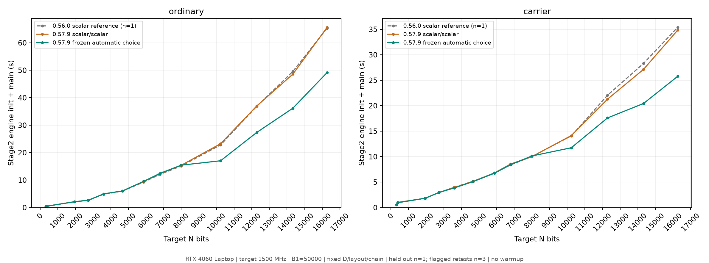

[相同数据的对数图](attachments/stage2-backend-0.57.9-low-families-log.png) · [完整曲线墙钟](attachments/stage2-backend-0.57.9-low-curve-wall-linear.png) · [墙钟对数图](attachments/stage2-backend-0.57.9-low-curve-wall-log.png)。18个≤8192-bit格均保持实际baby／giant=0／0；另外8格均选32／32。低位没有切换算术，不把其计时波动归因于协作优化。所有格的点策略、NTT长度计数、S4归约系数数及G根摘要与同形状标量一致。

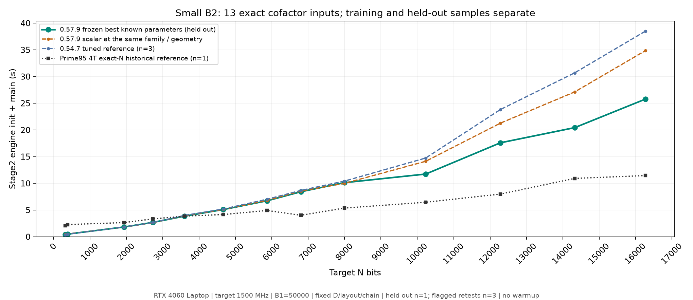

[相同数据的对数图](attachments/stage2-backend-0.57.9-low-best-times-log.png)。主曲线13点引擎合计137.166→115.191s，较所选同家族／几何的标量少16.02%；0.54.7独立n=3中位数之和148.428s，新结果较其少22.39%。跨版本差额还包含已有链长与算术优化，不能全部归因于本次giant auto，更不能只归因于giant核。

Prime95为31.4b05、Ryzen AI9 HX370四线程、用户声明4GHz的历史n=1，采用相同精确N、曲线族、B1和实际B2；完整时间含初始化、主计算与GCD，没有本轮CPU复测或有效频率遥测。13点参考69.501s，当前GPU合计仍为其1.66倍，最高位25.779／11.455≈2.25倍。图中阴影为补测样本min/max，不是置信区间；n=1点没有误差估计。输入与CPU边界见[精确参考](EDWARDS_STAGE2.md)。

| N bits | 路径 | D / P | 布局 / 链长 | baby / giant | 同形状标量，s | 冻结auto，s | n |
|---:|---|---|---|---|---:|---:|---:|
| 318 | 普通 | 150150 / 14400 | 0 / 32 | 0 / 0 | 0.393 | 0.398 | 1 |
| 383 | 普通 | 180180 / 17280 | 1 / 32 | 0 / 0 | 0.513 | 0.491 | 1 |
| 1939 | 承载 | 180180 / 17280 | 1 / 64 | 0 / 0 | 1.814 | 1.827 | 1 |
| 2726 | 普通 | 150150 / 14400 | 0 / 64 | 0 / 0 | 2.641 | 2.677 | 1 |
| 3600 | 承载 | 210210 / 20160 | 0 / 32 | 0 / 0 | 3.937 | 3.859 | 1 |
| 4667 | 承载 | 274890 / 26880 | 0 / 64 | 0 / 0 | 5.124 | 5.099 | 1 |
| 5872 | 承载 | 240240 / 23040 | 1 / 32 | 0 / 0 | 6.791 | 6.736 | 1 |
| 6797 | 承载 | 240240 / 23040 | 1 / 32 | 0 / 0 | 8.559 | 8.427 | 1 |
| 7995 | 承载 | 207480 / 20736 | 0 / 32 | 0 / 0 | 9.990 | 10.128 | 1 |
| 10232 | 承载 | 240240 / 23040 | 1 / 32 | 32 / 32 | 14.135 | 11.742 | 1 |
| 12285 | 承载 | 240240 / 23040 | 1 / 32 | 32 / 32 | 21.278 | 17.596 | 1 |
| 14328 | 承载 | 210210 / 20160 | 1 / 32 | 32 / 32 | 27.130 | 20.433 | 1 |
| 16272 | 承载 | 210210 / 20160 | 1 / 32 | 32 / 32 | 34.861 | 25.779 | 1 |

布局0为连续、1为分块空位；baby／giant的0代表实际标量。仅5872-bit的实际B2不同，见本节输入说明。表中为已有几何上的最佳合格后端，D的全局最优性未经本轮验证。

### 阶段变化与剩余成本

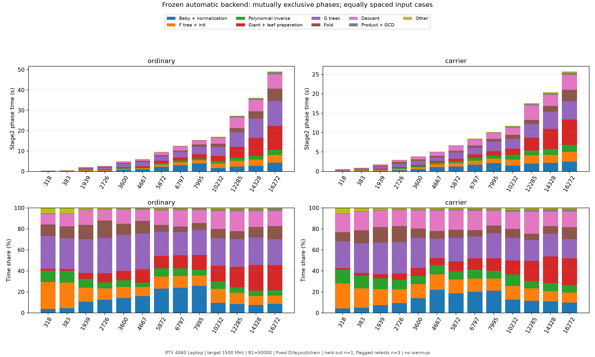

上排为绝对秒数，下排为100%占比；柱按13个输入等距排列，不是等距位宽轴。分项秒数对同格独立样本取均值，再归一化；n=3格的总高度因此不强求等于引擎中位数。异步工作可能计入随后同步的主机范围，图不是纯kernel或CPU独占时间。

最高位16272-bit固定D210210／P20160、布局1／链长32的变化如下，时间为独立n=1。Giant合并点生成与叶准备／同步：

| 阶段 | 普通：标量→auto，s | 承载：标量→auto，s | auto占比：普通／承载 |
|---|---|---|---|
| Baby＋归一化 | 16.618→4.307 | 9.111→2.521 | 8.76%／9.78% |
| Giant＋叶准备 | 16.189→11.768 | 9.076→6.576 | 23.94%／25.51% |
| G树 | 12.101→12.154 | 4.676→4.679 | 24.72%／18.15% |
| Fold | 6.183→6.126 | 2.958→2.960 | 12.46%／11.48% |
| 下降 | 7.073→7.005 | 4.004→3.801 | 14.25%／14.74% |

Baby与giant的联合收益减少了点阶段的绝对时间，G树等分项占比因此上升，并不表示NTT突然退化。最高位普通的G树／fold／下降合计约51.43%，承载约44.38%；这些阶段包括NTT、逐系数归约、提交和同步，仍不能将总和叫作纯NTT时间。Seed-pair／[D]Q默认标量，可显式启用下节的协作路径；恢复ladder仍是标量。点工作及普通系数归约的平方项也未消失；后端切换改变效率系数，不能把跨切换折线拟合成新的统一O()。公式与独立剖析见[位宽增长分析](STAGE2_BIT_SCALING.md)。

### 验证、依据与TODO

160次完整NF均通过回执和日志重读；S4 GMP抽查847040项、自检323328项，错误0。冻结性能文件在独立调用后摘要不变，后端与冻结选择一致；同形状G根摘要相同只是工作与输出一致性检查，不代替逐叶独立oracle。另通过CPU资格／搜索／B2边界、533项TOML布尔别名、GUI保存与worker覆盖，以及固定／凑整B2、显式小P、未配对保护、只读与增量ECM tune原生回归。

Stage2二进制为0.57.9，SHA256 `fb39b41e0edeaa9b85ad1df876d6bb810c1fd83f6bb351e14247796dc9c2bf61`；GMP SHA256 `969f0e96ac587dedfecf611ca3442fc7211f9218f1a553214c83548dcdbcfd6e`。256项构建输入核对通过，4个CUDA目标文件与冻结0.57.8逐字节相同，本次未替换设备算术。策略入口为[后端配对](../../src/ecm/stage2/planning/runtime_tune.h#L67)、[有限候选](../../src/ecm/stage2/planning/runtime_tune.h#L125)、[运行时选型](../../src/ecm/stage2/planning/planning.cpp#L647)与[显式调优](../../src/ecm/stage2/planning/planning.cpp#L1152)，完整合同见[自动点后端](../architecture/AUTO_B2.md#协作点后端选型)。

证据根`data/experiments/stage2_giant_auto_20261101/`：`matrix01`为冻结程序、输入、性能文件、100次学习和60次独立调用；`gpu_auto05`、`gpu_formal`为最终原生功能验证；`binary_audit.json`绑定构建，`environment_after.json`保留收尾功耗查询及忙碌采样功耗统计。此前失败／中间二进制证据仍保留，不进入成绩。汇总／CSV在`data/benchmarks/stage2_giant_auto_20261101/matrix01/`，PNG／SVG在同名figures目录，公开PNG复制至本页attachments。复现入口为[后端矩阵工具](../../tools/bench/README_STAGE2_VERSION.md#babygiant自动后端的小b2矩阵)。data全部由Git忽略，分发时需另附原始证据。

TODO：在新点成本下校准D／P模型并做独立持出；补其他GPU、大B2、更多并行链数与显存边界。优先分离seed-pair／[D]Q成本及G树内NTT／S4／等待，再决定后续核优化。本轮结论仅适用于上述小B2、固定几何和设备条件，不把有限自动学习视为全局最优搜索。

## 可选协作seed：固定几何对照

0.57.11新增CUDA `stage2_seed_backend="coop32"`，将高位宽paired seed和GPU构建[D]Q改为TPI32，复用按位宽分档的binary ladder。默认仍是scalar；不改变点数、坐标布局、NTT工作量或非单位回退。baby／giant链后端独立配置，本项尚不自动探索。算法、内存及正确性细节见[位宽增长分析第13节](STAGE2_BIT_SCALING.md#13-可选协作paired-seed与dq)。

### 条件与完整曲线

设备为RTX4060 Laptop／GPU1，驱动610.88，CUDA13.3、sm89／GL PTX；目标1500MHz，默认／强制功耗上限55W，未改设备设置。八格忙碌遥测1667项中1661项为1500MHz，3项1485、3项1470MHz；忙碌采样功耗9.131…48.675W、温度63…72°C。编译全部结束后串行计时，只白名单既有Codex界面进程，其余外部GPU上下文按原门禁拒绝。

输入复用0.57.9矩阵的已验证Edwards save，sigma26、B1=50000、实际B2=27015978990。目标bits为10232／12285／14328／16272，承载指数10267／12511／14401／16319。前两档D240240、P23040，后两档D210210、P20160；布局1、链32、baby32、giant32固定。配置batch256／arena6300／fold640 MiB；关闭学习、短校准、短NTT调优、relocation、尾块平衡与B2凑整。对每格正反交替一次，仅改变seed策略，无warmup，不丢首轮。下表为**引擎init+main、每组n=1**；不含Stage1和点算术启动自检，不作为统计置信区间。

| 目标bits | 算术 | D | 标量seed，s | 协作seed，s | 耗时减少 |
|---:|---|---:|---:|---:|---:|
|10232|普通|240240|16.550|15.308|7.51%|
|10232|承载|240240|11.434|10.902|4.65%|
|12285|普通|240240|26.930|23.399|13.11%|
|12285|承载|240240|16.796|14.708|12.43%|
|14328|普通|210210|36.225|29.904|17.45%|
|14328|承载|210210|20.667|17.626|14.71%|
|16272|普通|210210|48.258|40.941|15.16%|
|16272|承载|210210|26.123|21.742|16.77%|

八格合计202.983→174.530s，减少14.02%。包含读档／规划、点启动检查和发布的`curve_done.wall`合计211.412→182.745s，减少13.56%；它与引擎、进程墙钟分别统计，不能相加。最高位完整曲线普通49.551→42.172s，承载27.423→23.045s。16次完整NF的mandatory GMP检查均零错，每一对的NTT长度分布、逻辑多项式乘积数、S4次数和归约系数数相同。

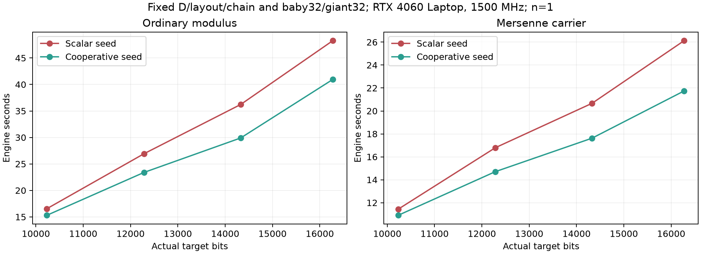

### 瓶颈与适用边界

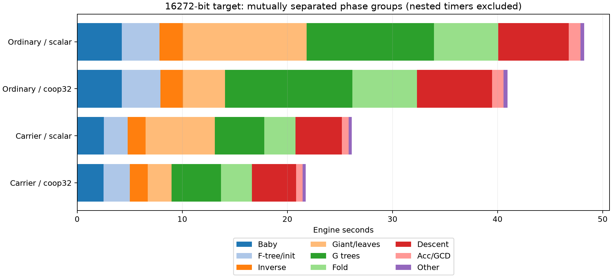

最高位giant加叶准备由普通11.747→3.999s、承载6.581→2.263s。图中F-tree/init是init扣除baby后的剩余，Other为未分配残差；各组覆盖引擎墙钟，不另加嵌套[D]Q、S4或host等待。

优化后普通G树／fold／下降合计占62.02%，承载占54.43%；这些范围仍含NTT、归约、提交和等待。普通S4归约设备事件约15.67s，占新引擎38.27%，承载仅0.907s、4.17%。因此优先研究普通逐系数归约的相依计算；承载则需按长度／批量拆分树和下降内的NTT与提交成本。不能把这两条路线都归因为纯NTT，也不能将独立seed的约8…11倍套到整条曲线。

默认保护保留：冻结0.57.10与新默认在10232-bit、D6006／B2=26000000的单次控制为5.325827／5.336219s（+0.20%），NTT分布、系数数及G根摘要一致。7995-bit普通／8011-bit承载的显式coop32请求均实际回退标量；首轮承载波动+5.33%，按正反顺序补至每组n=3并保留首轮。普通三次中位数为15.219110／14.996041s，承载为10.326106／9.825204s；两组执行相同标量kernel，不能据此宣称协作算术在低位加速。

EXE为0.57.11，SHA256 `0137ba813e1305e57b38947b48e2e53714132e4a574a7860091b20ba0d724157`；GMP同本页0.57.9基准。原始证据在`data/experiments/stage2_seed_coop_20261102/`，汇总、CSV、绘图器快照及PNG／SVG在对应benchmarks／figures的`final02/`，公开PNG位于attachments。复现入口为[协作paired seed验证](../../tools/bench/README_STAGE2_VERSION.md#协作paired-seed验证)。

TODO：补其他GPU、大B2、容量切换边界及更多D／链数的资格；在新seed策略下校准D模型并独立持出，再决定自动选型或默认启用。当前八格只证明本设备、固定几何和小B2的结果，不证明所有输入普遍加速。

## D／布局选型参考：0.54.7小档B2

范围为13份精确Edwards余因子，实际N318–16272 bits、B1=50000，名义B2=26000000000；实际B2沿用Prime95输入，不按B2或频率换算。仅本档完成当前验证，较大档仍是冻结参考。

GPU1 RTX4060 Laptop、CUDA13.3/SM89、驱动610.88、PTX3/addsub1；arena6300/fold640/batch256 MiB。二进制SHA256 `be599bb90aeba1417be92f4096886a2722a2039d83a983508496134ac4d6e636`。测试未修改GPU或CPU设置，未验证当前CPU频率；设备查询功耗上限为55W，不代表恒定实耗。独立复测中815个GPU利用率≥50%的NVML样本均为1500MHz。旧CPU／GPU条件见下方冻结资料。仅放行用户批准的Codex界面PID及冻结路径，其他外部同卡任务拒绝。

### 独立选型成绩

当前tune主成绩来自冻结性能文件后的39次独立NF调用，每格n=3；完整引擎均值之和为 **148.447 s**。旧0.39.3选型观察均值之和为149.708 s，变化-0.84%；相对本轮默认两类型逐格较快的事后参考161.171 s，变化-7.89%。旧数据参与过选型，当前数据为独立复测，不把两者当作同口径因果A/B。

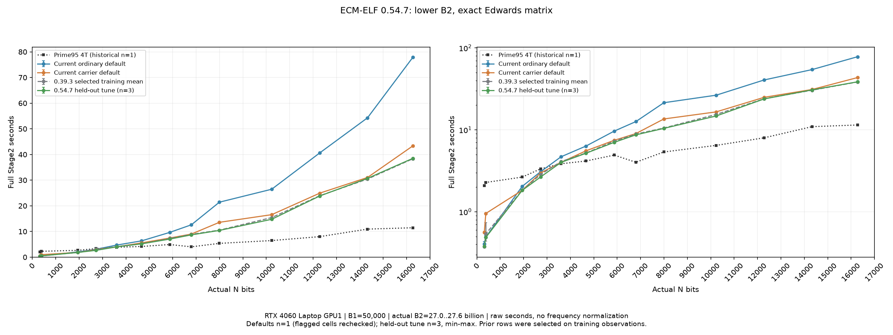

| N bits | 实际B2 | 默认普通 | 默认承载 | 旧tune均值 | 当前独立均值±标准差 | 当前D/P | 算术／布局 |
|---:|---:|---:|---:|---:|---:|---:|:---|
| 318 | 27,015,978,990 | 0.405 | 0.562 | 0.374 | 0.377 ± 0.002 | 150150/14400 | 普通／0 |
| 383 | 27,015,978,990 | 0.490 | 0.954 | 0.538 | 0.486 ± 0.013 | 180180/17280 | 普通／1 |
| 1939 | 27,015,978,990 | 2.043 | 1.829 | 1.829 | 1.826 ± 0.015 | 180180/17280 | 承载／1 |
| 2726 | 27,015,978,990 | 3.082 | 2.977 | 2.857 | 2.658 ± 0.006 | 150150/14400 | 普通／0 |
| 3600 | 27,015,978,990 | 4.690 | 4.013 | 4.100 | 4.005 ± 0.011 | 210210/20160 | 承载／0 |
| 4667 | 27,015,978,990 | 6.340 | 5.546 | 5.214 | 5.178 ± 0.035 | 274890/26880 | 承载／0 |
| 5872 | 27,567,389,850 | 9.641 | 7.445 | 7.266 | 7.037 ± 0.023 | 240240/23040 | 承载／1 |
| 6797 | 27,015,978,990 | 12.602 | 8.992 | 8.876 | 8.680 ± 0.019 | 240240/23040 | 承载／1 |
| 7995 | 27,015,978,990 | 21.413 | 13.570 | 10.516 | 10.411 ± 0.020 | 207480/20736 | 承载／0 |
| 10232 | 27,015,978,990 | 26.460 | 16.550 | 15.414 | 14.754 ± 0.036 | 240240/23040 | 承载／1 |
| 12285 | 27,015,978,990 | 40.610 | 24.932 | 23.932 | 23.830 ± 0.028 | 240240/23040 | 承载／1 |
| 14328 | 27,015,978,990 | 54.289 | 31.039 | 30.434 | 30.686 ± 0.045 | 210210/20160 | 承载／1 |
| 16272 | 27,015,978,990 | 77.925 | 43.385 | 38.358 | 38.519 ± 0.043 | 210210/20160 | 承载／1 |

默认筛查每格n=1，明显回退单项补至n=3并保留首轮；表中默认取中位数，当前tune取独立n=3均值，误差带为原始min/max。布局0为连续，1为分块空位。相同Stage1点重放只验证性能，不增加独立ECM覆盖。

### 阶段占比与计时边界

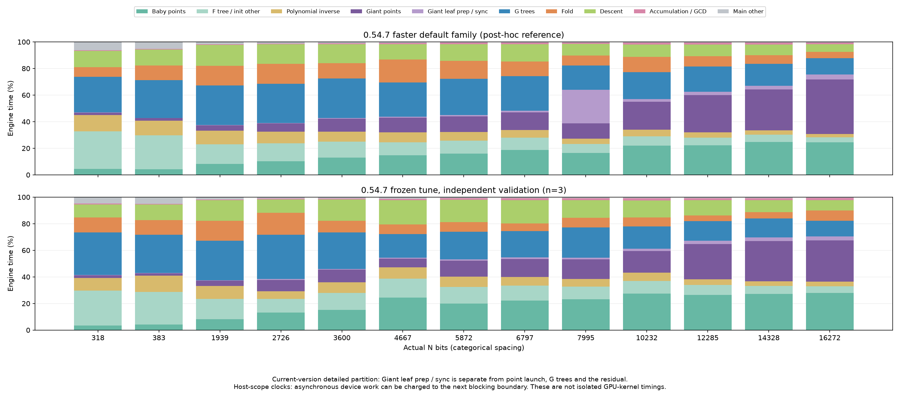

堆积高度固定为100%，采用逐调用比例的均值。Baby从init中拆出；F树/初始化余项包括必要自检。当前日志可再从main余项拆出Giant叶准备/同步，其他分项互斥；旧日志缺此细分，仍留在旧余项，跨版本共同口径图见[共同分项对照](attachments/stage2-layout-0.54.7-low-phase-shares-common.png)。NTT/S4嵌套计时不再相加。占比上升不等于绝对秒数增加；异步GPU工作可能在下一处阻塞边界计时，不能把此图当作独立kernel耗时。

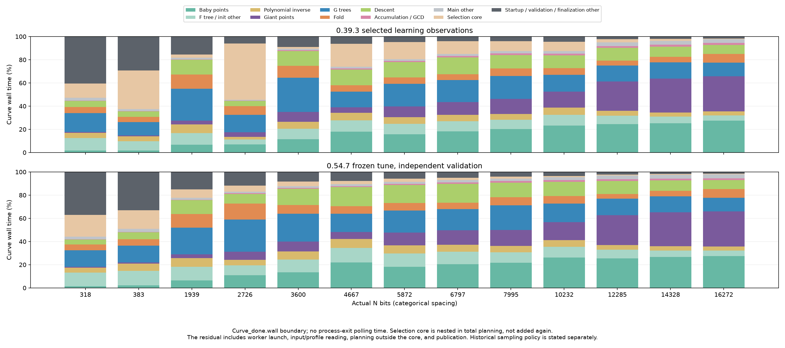

曲线墙钟使用curve_done.wall，包含worker启动、选型、读取与发布；不混入采集器退出轮询。选型核心使用runtime_prepare.total_seconds，其余外层成本留在余项，未记录的细分项不猜测。

跨版本共同分项的累计值（叶准备仍留在余项；每格先求均值再相加，单位秒）。默认列这里也采用均值，因此不与上表默认中位数之和强行闭合：

| 阶段 | 旧tune | 当前较快默认参考 | 当前独立tune |
|---|---:|---:|---:|
| Baby points | 37.278 | 34.434 | 37.617 |
| F tree / init other | 11.508 | 10.326 | 11.819 |
| Polynomial inverse | 7.559 | 6.736 | 7.261 |
| Giant points | 34.510 | 42.612 | 34.516 |
| G trees | 25.324 | 29.736 | 24.110 |
| Fold | 9.935 | 13.166 | 9.782 |
| Descent | 16.849 | 13.891 | 16.774 |
| Accumulation / GCD | 2.255 | 2.107 | 2.166 |
| Main other | 4.490 | 8.176 | 4.404 |

### 验证协议与证据

旧文件仅作先验。每格先重测旧最快几何的当前自动布局2次，再解锁D／算术／布局进行有界学习；本轮每格学习合计上限8条，原生停止可能保留1条已启动调用。随后冻结性能文件，用生产入口核对最快已准入重复均值，独立复测不写回。不声称穷尽D表或达到全局最优。

代码与复现入口见[有界布局矩阵](../../tools/bench/README_STAGE2_VERSION.md#布局与旧tune的有界验证)。原始证据为`data/experiments/stage2_layout_matrix_20261031/low_warm2/`；默认26格来自上级`default_screen3/`的范围边界快照。冻结的format 9性能文件为该研究的`frozen_tune.toml`，可用`stage2_tune_profile`或`--tune-profile`引用。汇总／CSV为`data/benchmarks/stage2_layout_matrix_20261031/low_final/`，PNG／SVG为`data/figures/stage2_layout_matrix_20261031/low_final/`，公开PNG在attachments。全部data由Git忽略，分发报告需另附原始证据。范围收缩时一条已启动的大B2进程自然结束，保留原始日志并按预先声明的小B2范围排除，未继续大档矩阵。

同二进制固定D旧布局对照仅重跑布局改变的14格，旧布局各n=1；自动布局使用现有筛查/补测中位数。完整引擎合计93.584→91.219 s（-2.53%），G树分项24.638→22.070 s（-10.42%）。未变化的12格不重复计为独立对照。该筛查不代替每格n=3的布局因果实验；14格均有正的digest_words且根摘要匹配；完整回执留在legacy_controls。摘要和抽查不等于逐叶独立oracle。

严格重读共189次完整NF：104次学习、39次独立复测、26次默认筛查及20次补测/布局对照；GMP抽查890737、自检381408，错误0。学习引擎总时长1501.723 s，另列成本，不加到独立成绩。普通额度收紧发生的位宽为[5872, 6797, 7995, 10232, 12285, 14328, 16272]。

旧学习观察的曲线墙钟均值之和173.866 s，当前冻结复测为156.798 s；旧侧仍含学习期选型成本，新侧关闭探索，不能把该差额全部归因于代码或缓存优化。

### 结论与下一步条件

默认普通／承载13格的中位数之和分别为259.988／161.792 s；旧0.38.4为259.602／161.462 s，相差+0.15%／+0.20%，本轮只能确认整体基本持平。筛查相对旧中位数同时超过5%和20ms的三格已各补2遍，保留首轮：318-bit普通与383-bit普通回到较小差距；318-bit承载仍为0.562 s、较旧0.530 s慢5.94%。同二进制旧布局对照为0.550 s，差距2.09%；不能把跨版本差额全部归因于布局。其余默认格n=1，不宣称每一格均无回退。

tune沿用了旧成果，只为每格增加8条学习调用，已实现矩阵合计持平略优；14328／16272-bit分别比旧学习最优均值慢约0.83%／0.42%，都小于本轮明显回退筛查门限。普通候选额度收紧在7个宽位条件实际触发，但本轮没有“关闭收紧”的同输入学习对照，不能量化节省了多少调优时间，也不证明8条足以搜索全局最优。

阶段图需要连同绝对秒数阅读：调优后的16272-bit，Baby约27.93%、Giant点约30.97%、Giant叶准备／同步约2.86%，三者合计约61.76%；G树约11.93%。因此该档继续只优化NTT／G树的整条收益上限有限，点链和分块值得优先定位。D增大可以减少giant，却增加Baby和下降；不能把所有分项同时压低作为选型目标。

7995-bit是分块影响选型的明确线索。默认D180180／P17280有149940个giant，按138240点容量分为138240＋11700；算术字数W=126，短尾低于32768点阈值，日志确认主块走chain、尾块退回ladder。Giant叶准备／同步累计3.434 s，占完整引擎13.570 s的25.31%，其中记录的CPU求逆仅0.010722 s，不能把整段3.434 s称作CPU GCD／求逆成本。tune所选D207480／P20736只有130212点，单块走chain，叶准备／同步为0.144 s、完整引擎均值10.411 s。两者D/P和工作量不同，该差额还不能单独归因于短尾。

布局随完整形状选择，而不是固定按位宽：上述7995-bit默认采用布局1，tune的D207480采用布局0。独立固定D的点路线筛查已确认，6P容量使该输入完整引擎少14.25%；宽位探针的链长32比64少11.41%。这些是两个形状各n=2的局部结果，不与本页全矩阵成绩相加。管理员时间线、硬件计数器及目标环叶校验统一见[点生成瓶颈](STAGE2_PREPARATION.md#点生成固定d瓶颈验证)。

当前生产入口已支持完整区间尾块平衡，以及32／64固定链长和auto有限探索，相关身份进入tune；默认仍为不平衡、64链。无实际借块时复用原路径统计身份，真实借块的原分块重放仍需扩展联合预算资格。当前验证和高位宽优先级见[点策略](STAGE2_PREPARATION.md#全位宽有限链长与尾块平衡)及[位宽增长分析](STAGE2_BIT_SCALING.md)；不能把可选功能已实现等同于全设备默认资格。

代码依据：[分块及算法路由](../../src/ecm/stage2/cuda/batch.cpp#L202)、[giant与叶准备边界](../../src/ecm/stage2/cuda/batch.cpp#L328)、[主循环细分计时](../../src/ecm/stage2/cuda/engine.cpp#L665)。这些是主机范围计时，异步设备执行可能计入下一处同步；要确认GPU核函数归属仍需固定D剖析。

## OpenCL 与 CUDA：全位宽快速矩阵

### 默认0.54.4与显式递推验证

0.54.4默认启用NVIDIA 8193～16384-bit的有界渐进升档，giant chain默认关闭。最终默认另测13位宽×两B2×普通／承载×两后端，每格1遍，共104次完整NF；输入、D/P、预算与下方312次基准相同。单遍保留初始化／JIT成本，不与三遍合并为同一统计样本。

[相同数据的线性图](../../data/figures/opencl_giant_chain_20261030_final_default_linear.png) · [当前默认的阶段百分比图](../../data/figures/opencl_giant_chain_20261030_final_default_phases.png)。

较大B2=2600000的宽位摘录如下，单位s。旧默认为0.54.3的n=3中位数；其余为n=1。联合列额外开启giant chain，并非当前默认。不同样本数只作量级和资格对照，不给置信区间。

| 实际N bits | 旧默认普通 n=3 | 当前默认普通 n=1 | CUDA普通 n=1 | 当前默认承载 n=1 | CUDA承载 n=1 | 联合普通 n=1 |
|---:|---:|---:|---:|---:|---:|---:|
| 10232 | 65.657 | 9.245 | 3.936 | 8.385 | 2.305 | 5.577 |
| 12285 | 180.084 | 22.022 | 6.488 | 21.435 | 3.766 | 12.949 |
| 14328 | 313.539 | 38.181 | 9.101 | 37.323 | 5.126 | 20.659 |
| 16272 | 425.241 | 51.575 | 12.006 | 50.443 | 6.524 | 27.591 |

当前默认普通26格耗时之和为OpenCL **200.729333 s**、CUDA **69.725703 s**；承载为 **193.922362／41.262320 s**。它们是单遍矩阵合计，不是三遍中位数之和。显式联合设置另104次NF，普通／承载OpenCL合计 **195.444242／137.951971 s**；不把更快的设置逐格挑选后称作默认成绩。

同二进制四设置n=3与固定提交大小n=3的算法对照、完整身份、频率读数和限制见 [宽位与递推验证](OPENCL_STAGE2.md#宽位升档与连续巨步验证)。当前默认及联合矩阵的每格数据分别在 `data/benchmarks/opencl_giant_chain_20261030/{final_default,broad_joint}/`。未测生产B2、其他GPU及贴近显存边界的组合。

### 冻结0.54.3基准（每格三遍）

2026-10-30，RTX4060 Laptop、1500MHz，冻结OpenCL **0.54.3**默认设备点与CUDA **0.54.0**。13个精确余因子覆盖318～16272 bits；每个位宽两档B2、普通／梅森承载各n=3，每后端156次，合计 **312次完整NF**。同一保存点的重复用于计时，不增加独立ECM曲线覆盖。

B1=50000，固定D2310/P240，B2=260000／2600000，arena512/batch64/fold640 MiB；关闭自动承载、运行时学习和短校准。两后端每格读取相同Edwards save，M2003为sigma27、其余sigma26；承载显式指定对应M指数。无额外warmup，不丢首轮或JIT慢样本，后端和普通／承载次序按轮次反转。

[相同数据的线性坐标图](../../data/figures/opencl_full_matrix_20261030_linear_v2.png)。图上两行为普通模数，下两行为梅森承载；每种类型分别显示引擎中位数及min/max、OpenCL/CUDA引擎与完整父进程比值。比值大于1表示OpenCL更慢；误差棒不是置信区间。横轴是真实余因子位宽，刻度1000。

占比图使用每次完整引擎的阶段百分比，再对三遍取平均；每柱合计100%。点生成包括主机准备、检查和归一化，NTT相关树／fold阶段包括提交及同步。点kernel、program build等嵌套计时未再次堆叠；准备／其他是完整引擎扣除互斥阶段的余量。折线图8192-bit虚线标记本基准的点分块策略边界，不是数学复杂度的分界。

单位s，全部为n=3引擎中位数；比值为同格OpenCL/CUDA。版本、N、B1、sigma、实际B2、D/P和算术检查均逐项核对。

| M指数 | N bits | B2 | OpenCL普通 | CUDA普通 | 比值 | OpenCL承载 | CUDA承载 | 比值 |
|---:|---:|---:|---:|---:|---:|---:|---:|---:|
| 503 | 318 | 260000 | 0.411 | 0.069 | 5.96 | 0.405 | 0.067 | 6.01 |
| 503 | 318 | 2600000 | 0.428 | 0.089 | 4.82 | 0.456 | 0.084 | 5.43 |
| 1009 | 383 | 260000 | 0.386 | 0.070 | 5.50 | 0.410 | 0.082 | 5.00 |
| 1009 | 383 | 2600000 | 0.438 | 0.087 | 5.04 | 0.458 | 0.103 | 4.44 |
| 2003 | 1939 | 260000 | 0.575 | 0.169 | 3.39 | 0.470 | 0.127 | 3.70 |
| 2003 | 1939 | 2600000 | 0.609 | 0.209 | 2.91 | 0.585 | 0.152 | 3.84 |
| 3001 | 2726 | 260000 | 0.604 | 0.239 | 2.53 | 0.531 | 0.182 | 2.92 |
| 3001 | 2726 | 2600000 | 0.738 | 0.294 | 2.51 | 0.701 | 0.224 | 3.13 |
| 4001 | 3600 | 260000 | 0.662 | 0.364 | 1.82 | 0.686 | 0.260 | 2.63 |
| 4001 | 3600 | 2600000 | 0.912 | 0.449 | 2.03 | 0.886 | 0.313 | 2.83 |
| 5003 | 4667 | 260000 | 0.798 | 0.553 | 1.44 | 0.782 | 0.375 | 2.09 |
| 5003 | 4667 | 2600000 | 1.208 | 0.676 | 1.79 | 1.148 | 0.445 | 2.58 |
| 6011 | 5872 | 260000 | 1.046 | 0.877 | 1.19 | 1.387 | 0.582 | 2.39 |
| 6011 | 5872 | 2600000 | 1.626 | 1.062 | 1.53 | 1.549 | 0.697 | 2.22 |
| 7001 | 6797 | 260000 | 1.277 | 1.259 | 1.01 | 1.203 | 0.887 | 1.36 |
| 7001 | 6797 | 2600000 | 2.102 | 1.616 | 1.30 | 1.901 | 1.040 | 1.83 |
| 8011 | 7995 | 260000 | 1.662 | 1.875 | 0.89 | 1.447 | 1.221 | 1.19 |
| 8011 | 7995 | 2600000 | 2.795 | 2.288 | 1.22 | 2.407 | 1.416 | 1.70 |
| 10267 | 10232 | 260000 | 16.975 | 3.244 | 5.23 | 16.592 | 1.999 | 8.30 |
| 10267 | 10232 | 2600000 | 65.657 | 3.896 | 16.85 | 64.802 | 2.308 | 28.08 |
| 12511 | 12285 | 260000 | 45.498 | 5.332 | 8.53 | 45.169 | 3.236 | 13.96 |
| 12511 | 12285 | 2600000 | 180.084 | 6.520 | 27.62 | 179.016 | 3.780 | 47.36 |
| 14401 | 14328 | 260000 | 79.268 | 7.497 | 10.57 | 78.908 | 4.397 | 17.95 |
| 14401 | 14328 | 2600000 | 313.539 | 9.093 | 34.48 | 312.590 | 5.131 | 60.92 |
| 16319 | 16272 | 260000 | 107.193 | 9.895 | 10.83 | 106.643 | 5.600 | 19.04 |
| 16319 | 16272 | 2600000 | 425.241 | 12.017 | 35.39 | 424.152 | 6.524 | 65.01 |

普通26格中位数之和为OpenCL **1251.730716 s**、CUDA **69.738635 s**，比值 **17.95**；承载26格为 **1245.283201／41.230204 s**，比值 **30.20**。不能将两种类型的合计当作实际自动选型的生产吞吐，也不能用这组固定D的快速B2数据按比例外推生产范围。

完整52格父进程中位数合计为OpenCL 2509.276154 s、CUDA 149.477380 s；它与引擎是两个边界，不能相加。CUDA部分设备规划位于引擎外，OpenCL包含context/JIT准备及独立叶哨兵，因此小N的两种比值可能方向不同。

500ms遥测共15761条：1500MHz：15751条、1890MHz：10条；非零利用率样本为1500MHz：15439条。没有改动GPU频率、功耗或驱动；CPU未定频、GPU0有外部任务，GPU0不参与测量。测试期间没有本任务的并行编译或额外GPU测试。

输入、二进制SHA、阶段成本、CPU和内存边界统一见 [OpenCL性能报告](OPENCL_STAGE2.md)。原始证据为 `data/experiments/opencl_full_matrix_20261030/quick_13/`，逐格表与审计统计为 `data/benchmarks/opencl_full_matrix_20261030/quick_13_log_v2/`。这些目录由Git忽略，分发文档时须另附数据。

**范围限制**：这是全位宽、固定D的快速矩阵；下文正式CUDA矩阵采用约2.7×10¹⁰／2.7×10¹¹的实际B2及不同D/P。两组不混合计算倍率，不与旧Prime95耗时按B2折算。正式OpenCL生产范围的52格仅完成只规划检查，尚未计时，证据位于 `data/experiments/opencl_full_matrix_20261030/production_preflight/`。

## 冻结双档参考：0.38.4与0.39.3

冻结的0.39.3运行时曲线覆盖全部26个条件，最佳合格均值之和为 **641.374 秒**，相对默认两类型逐格较快的参考，耗时变化 **-4.49%**。实际样本数见表；这些观察同时用于选型，属于本轮已观测候选的最好成绩。

0.38.4 默认矩阵 156/156 次完整 NF 测量通过，52 格均为 n=3，没有剔除首轮。相比同输入历史全范围基准，普通路径 26 格中位数之和的耗时减少 **4.51%**，承载路径减少 **4.08%**。16272-bit、高档 B2 的普通 / 承载路径分别慢 **5.95% / 10.70%**，因此不能概括为全范围提速。逐格差异与波动见下图和版本对照。

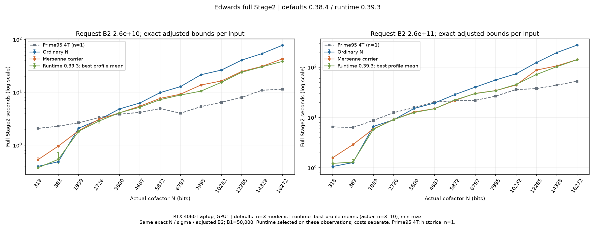

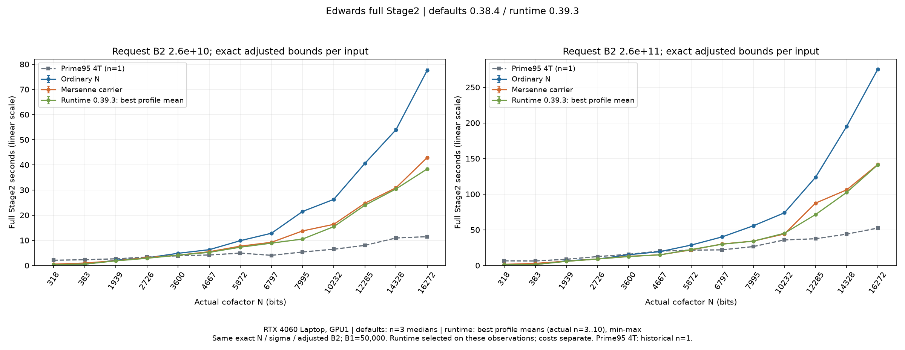

0.38.4 默认矩阵为 Edwards、B1=50000，13 个精确余因子 N（318–16272 bits），两档 B2，普通 / 梅森承载各三次，共 156 次。低/高档请求为 2.6×10^10 / 2.6×10^11；实际调用采用 Prime95 各格上调后的 B2，不按比例换算。每次从同一 Stage1 save 开始、串行运行一条完整曲线。普通/承载在偶数轮交换顺序，没有丢弃的预热或首轮。D 自动选择；短标定、runtime tune、自动承载及 relocation 关闭，NTT 计数关闭。0.39.3 沿用精确输入与预算，运行时选型方法见下文。

下表单位秒：默认普通/承载为原三次完整引擎耗时的中位数；运行时列为 tune 最佳合格行的均值，括号中是实际 n。三条 GPU 曲线均保留原值及 min/max；Prime95 31.4b05 为四线程历史样本，每格 n=1。

| M 指数 | N bits | 实际 B2 | Prime95 4T | 默认普通 0.38.4 | 默认承载 0.38.4 | 运行时 0.39.3 均值（n） |
| ---: | ---: | ---: | ---: | ---: | ---: | ---: |
| 503 | 318 | 27,015,978,990 | 2.078 | 0.396 | 0.530 | 0.374（10） |
| 503 | 318 | 278,982,814,110 | 6.494 | 1.054 | 1.572 | 1.218（3） |
| 1009 | 383 | 27,015,978,990 | 2.279 | 0.486 | 0.959 | 0.538（3） |
| 1009 | 383 | 278,982,814,110 | 6.317 | 1.265 | 2.887 | 1.292（3） |
| 2003 | 1939 | 27,015,978,990 | 2.650 | 2.094 | 1.871 | 1.829（3） |
| 2003 | 1939 | 278,982,814,110 | 8.712 | 6.615 | 5.926 | 5.820（3） |
| 3001 | 2726 | 27,015,978,990 | 3.339 | 3.026 | 3.091 | 2.857（3） |
| 3001 | 2726 | 278,982,814,110 | 12.468 | 8.980 | 9.080 | 9.077（3） |
| 4001 | 3600 | 27,015,978,990 | 3.855 | 4.840 | 4.079 | 4.100（3） |
| 4001 | 3600 | 273,142,759,890 | 15.709 | 15.111 | 12.841 | 12.566（3） |
| 5003 | 4667 | 27,015,978,990 | 4.163 | 6.267 | 5.462 | 5.214（3） |
| 5003 | 4667 | 273,142,759,890 | 20.148 | 19.375 | 14.942 | 14.900（3） |
| 6011 | 5872 | 27,567,389,850 | 4.916 | 9.858 | 7.672 | 7.266（3） |
| 6011 | 5872 | 273,142,759,890 | 21.538 | 28.558 | 21.810 | 22.255（3） |
| 7001 | 6797 | 27,015,978,990 | 4.021 | 12.812 | 9.211 | 8.876（3） |
| 7001 | 6797 | 273,142,759,890 | 21.901 | 40.095 | 30.118 | 29.871（3） |
| 8011 | 7995 | 27,015,978,990 | 5.367 | 21.479 | 13.736 | 10.516（3） |
| 8011 | 7995 | 273,142,759,890 | 26.545 | 55.655 | 34.173 | 34.122（3） |
| 10267 | 10232 | 27,015,978,990 | 6.460 | 26.268 | 16.345 | 15.414（3） |
| 10267 | 10232 | 273,142,759,890 | 35.871 | 73.883 | 44.215 | 45.181（3） |
| 12511 | 12285 | 27,015,978,990 | 7.991 | 40.574 | 24.729 | 23.932（3） |
| 12511 | 12285 | 273,142,759,890 | 37.475 | 123.797 | 87.520 | 71.438（3） |
| 14401 | 14328 | 27,015,978,990 | 10.927 | 53.969 | 30.898 | 30.434（3） |
| 14401 | 14328 | 273,142,759,890 | 43.960 | 195.300 | 106.119 | 102.580（10） |
| 16319 | 16272 | 27,015,978,990 | 11.455 | 77.533 | 42.879 | 38.358（10） |
| 16319 | 16272 | 264,004,751,010 | 52.502 | 275.535 | 141.742 | 141.344（10） |

### 正常运行时选型：0.39.3

构建为 `build_cuda_cmake/stage2_d_search_0_39_3/` production，GPU1、13 份原始已验证 Stage1 点与两档实际 B2 保持不变。26 个条件共执行 627 次完整 NF：保留原规则下的三条完整队列及一条停止队列，共 186 次；其余 22 个条件执行 441 次。新规则每条件提供上限 48 曲线的连续 worktodo 队列，当前最快合格的完整形状达到第 3 个入账观察后，通过原生事件在当前曲线结束时退出。22 条新队列各执行 13–21 次，没有额外完成调用；实际执行次数与被选行样本数分开记录。

整个研究从空白性能文件开始，普通/承载和 D/P 全由程序选择，启用默认准备缓存及每组最多 10 个观察；不执行单独 tune、不锁定参数、不丢弃已执行的首轮或尾部。提前停止是用户指定的采集启发式，不代表搜索穷尽：更多重复仍可能开放更大的候选配额。相同点重放仅作计时与选型观察，不增加独立 ECM 覆盖。

全部条件采集结束后，通过只规划入口读取 `runtime_measured_fastest` 决策。每格采用当前准入的重复观察中最小均值，实际 n=3–10；均值、样本标准差及 min/max 均可追溯。这些观察也用于选型，属于本次已观测候选的最好成绩，没有另做独立的选型后 n=3 验证，也不证明全表 D 的全局最优。

自动路径 26 格均值之和 **641.374 秒**，相对默认普通减少 **41.95%**，相对默认承载减少 **4.90%**。默认两类型逐格较快者之和为 671.495 秒，相对它减少 4.49%。前者使用均值，旧默认使用 n=3 中位数；后者是事后参考，不冒充旧程序已执行的自动选择。跨版本、会话和样本数的差异保留，不能把全部差额归因于 D。

同一批被选观察的 `curve_done.wall` 均值之和为 700.332 秒，包含子进程、外层选型和结果收尾。其中选型准备区间的均值之和为 45.096 秒，嵌套于父队列时间，不能重复相加。父计时仍包含参与学习的调用，不代表参数冻结后的持续吞吐；不能把父队列与引擎的差额全部归为启动。

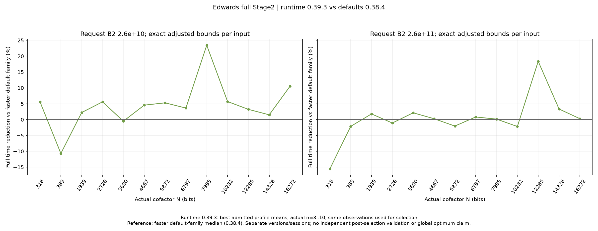

相对默认两类型较快参考，19/26 格更快，7/26 格更慢；逐格耗时减少范围 -15.59%～+23.44%。微小差异须结合原始 min/max 与样本标准差，不能概括成全范围提速。

26 格中 20 格选择承载，17 格相对所选类型的默认 D/P 改变几何。下表“减少”对照默认两类型较快的中位数；负值表示变慢。

| N bits | B2 档 | 0.38.4 普通 D/P | 0.38.4 承载 D/P | 0.39.3 自动 D/P | 类型 | n | 耗时减少 |
|---:|:---:|---:|---:|---:|:---:|---:|---:|
| 318 | 低 | 180180/17280 | 180180/17280 | 150150/14400 | 普通 | 10 | +5.59% |
| 318 | 高 | 570570/51840 | 570570/51840 | 570570/51840 | 普通 | 3 | -15.59% |
| 383 | 低 | 180180/17280 | 180180/17280 | 180180/17280 | 普通 | 3 | -10.69% |
| 383 | 高 | 570570/51840 | 570570/51840 | 570570/51840 | 普通 | 3 | -2.15% |
| 1939 | 低 | 180180/17280 | 180180/17280 | 180180/17280 | 承载 | 3 | +2.23% |
| 1939 | 高 | 570570/51840 | 570570/51840 | 690690/63360 | 承载 | 3 | +1.79% |
| 2726 | 低 | 180180/17280 | 180180/17280 | 150150/14400 | 普通 | 3 | +5.59% |
| 2726 | 高 | 570570/51840 | 570570/51840 | 570570/51840 | 普通 | 3 | -1.08% |
| 3600 | 低 | 180180/17280 | 180180/17280 | 180180/17280 | 承载 | 3 | -0.51% |
| 3600 | 高 | 570570/51840 | 570570/51840 | 690690/63360 | 承载 | 3 | +2.14% |
| 4667 | 低 | 180180/17280 | 180180/17280 | 274890/26880 | 承载 | 3 | +4.55% |
| 4667 | 高 | 570570/51840 | 570570/51840 | 690690/63360 | 承载 | 3 | +0.28% |
| 5872 | 低 | 180180/17280 | 180180/17280 | 240240/23040 | 承载 | 3 | +5.28% |
| 5872 | 高 | 570570/51840 | 570570/51840 | 570570/51840 | 承载 | 3 | -2.04% |
| 6797 | 低 | 180180/17280 | 180180/17280 | 240240/23040 | 承载 | 3 | +3.63% |
| 6797 | 高 | 570570/51840 | 690690/63360 | 870870/80640 | 承载 | 3 | +0.82% |
| 7995 | 低 | 180180/17280 | 180180/17280 | 207480/20736 | 承载 | 3 | +23.44% |
| 7995 | 高 | 570570/51840 | 690690/63360 | 630630/60480 | 承载 | 3 | +0.15% |
| 10232 | 低 | 180180/17280 | 180180/17280 | 240240/23040 | 承载 | 3 | +5.70% |
| 10232 | 高 | 570570/51840 | 570570/51840 | 570570/51840 | 承载 | 3 | -2.18% |
| 12285 | 低 | 180180/17280 | 180180/17280 | 240240/23040 | 承载 | 3 | +3.22% |
| 12285 | 高 | 570570/51840 | 360360/34560 | 510510/46080 | 承载 | 3 | +18.38% |
| 14328 | 低 | 180180/17280 | 180180/17280 | 210210/20160 | 承载 | 3 | +1.50% |
| 14328 | 高 | 360360/34560 | 360360/34560 | 431970/42240 | 承载 | 10 | +3.33% |
| 16272 | 低 | 180180/17280 | 180180/17280 | 210210/20160 | 承载 | 10 | +10.55% |
| 16272 | 高 | 360360/34560 | 360360/34560 | 360360/34560 | 承载 | 10 | +0.28% |

16272-bit、高档实际 B2=264,004,751,010：0.38.4 默认普通/承载为 275.535/141.742 秒；0.39.3 最佳合格决策为承载、D/P=360360/34560，均值 141.344 秒、样本标准差 0.145 秒、n=10。相对当前所选类型默认路径，耗时变化 -0.28%；相对较早历史承载 128.042 秒，耗时变化 +10.39%。历史承载 D/P=330330/31680，不是新版本固定 D 的因果对照。

该格实际测过普通 1 种 D、承载 1 种 D。搜索终止原因与实测范围分别保留，不将提出、预算拒绝或显存拒绝的 D 算作已完成计时。
普通最后一次搜索记录的显存拒绝示例为 D=567840：模型所需 free 17.615 GB，现场 7.451 GB。这是分配前的准入模型需求，不是实测显存峰，也不证明其他未测 D 更慢。
承载最后一次搜索记录的显存拒绝示例为 D=531300：模型所需 free 17.473 GB，现场 7.451 GB。这是分配前的准入模型需求，不是实测显存峰，也不证明其他未测 D 更慢。

同一最大位宽的低档 B2，D/P 由默认承载 180180/17280 变为 210210/20160，giant 点由 149,940 降至 128,521，G 数由 9 降至 7；完整引擎均值 38.358 秒，相对默认承载中位数减少 10.55%。相应 NTT 模块峰值中位数从 1623.2 增至 3183.7 MiB，体现了本次选型的时间与内存取舍；两者均为模块自身计数，不是进程或整卡峰值。

完整 NF 调用的引擎时间之和 6.522 小时，`curve_done.wall` 队列时间之和 7.210 小时，有记录的进程墙钟之和 5.786 小时（1 条停止队列缺失此项）；后者包含退出观察：保留的旧队列间隔 250 ms，新队列 20 ms。三者的计时边界与覆盖集合不同，不能相加或直接相减估算规划成本。最优成绩来自这些调用中的合格观察，不再作为额外工作量加到学习总时间。

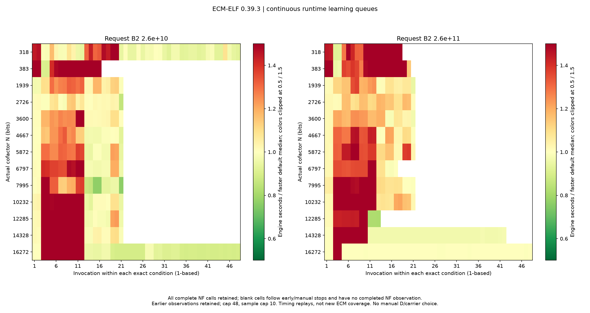

完整 D 列表、搜索理由、最后准入拒绝及每条观察在新 CSV/JSON 与原始记录中。配置与复现见[正常运行时选型矩阵](../../tools/bench/README_STAGE2_VERSION.md#正常运行时选型矩阵)。

### 与旧全范围基准比较

旧基准同为 GPU1 RTX 4060 Laptop、驱动610.88，程序未调节时钟或功耗。GPU 利用率≥50%的整卡采样中，SM 时钟 1425–1500 MHz、中位1500 MHz，功率观测 8.425–54.960 W、中位33.672 W；这些是过程观测，不是恒定设置或进程能耗。

对照是 2026-10-17 的同一 13 输入、两档实际 B2、普通 / 承载各 n=3 基准。旧程序未记录可用的数字版本号，明确标为“历史基准（版本未记录）”，不补写版本。主要编译参数（sm89、PTX3、addsub1、outer unroll0、split8、MSVC14.51.36231）相同。两次会话未固定同一瞬时功耗、温度或后台负载，因此比较反映整版与运行环境的整体表现，不能把差额全部归因于某一个分块或尾处理改动。

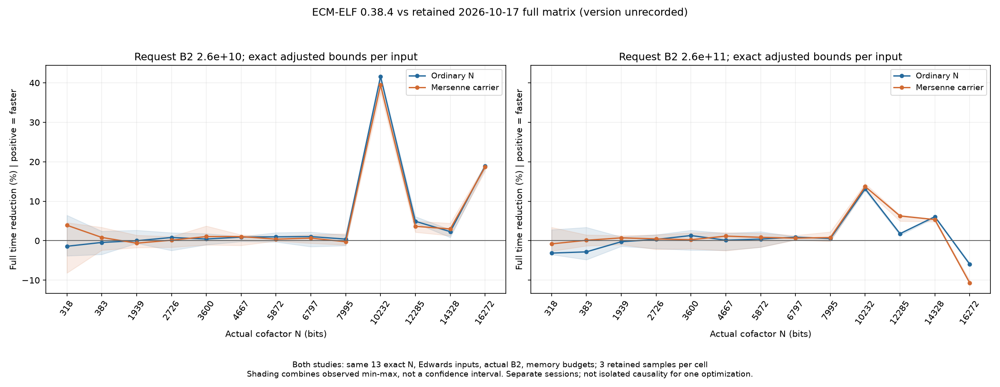

耗时减少为 `100×(1−T新/T旧)`，正值表示更快。图中线为逐格中位数之比，阴影组合两侧实测 min/max，不是置信区间。小幅差异应结合实测范围判断，不外推为全部位宽或预算的稳定加速。

| 路径 | 旧基准 26 格 / s | 0.38.4 26 格 / s | 耗时减少 | 逐格耗时减少范围 |
|---|---:|---:|---:|---:|
| 普通 | 1156.999 | 1104.824 | 4.51% | -5.95%～+41.61% |
| 承载 | 703.090 | 674.409 | 4.08% | -10.70%～+39.44% |

此处求和是每条件一条曲线的中位时间之和，作为固定矩阵工作量指标；不是单次进程计时，也不是 156 次采集的总墙钟。

普通路径的 10232–16272-bit 八格，耗时减少中位值 5.50%，范围 -5.95%～+41.61%；其中 7/8 格新版三次均快于旧版三次。318–7995-bit 十八格减少中位值 0.41%，各格仍应结合阴影范围阅读。

承载路径的 10232–16272-bit 八格，耗时减少中位值 5.81%，范围 -10.70%～+39.44%；其中 7/8 格新版三次均快于旧版三次。318–7995-bit 十八格减少中位值 0.65%，各格仍应结合阴影范围阅读。

52 格中有 5 格的 D/P 与历史基准不同。该图是整条默认路径的版本比较；即使输入界限一致，也不能当作固定 D 的单项内核实验。实际新旧 D/P 均在 CSV 中。

普通路径的 26 格独立进程墙钟中位数之和为 1144.720 秒，旧参考 1190.442 秒，减少 +3.84%。包含启动、外层规划、计时外预检及退出观察，不能按差值全归为启动，也不等同于多曲线常驻进程吞吐。

承载路径的 26 格独立进程墙钟中位数之和为 714.560 秒，旧参考 741.360 秒，减少 +3.61%。包含启动、外层规划、计时外预检及退出观察，不能按差值全归为启动，也不等同于多曲线常驻进程吞吐。

52 格中，17 格新版三次均快于旧版三次，2 格新版三次均慢于旧版三次，余下 33 格范围重叠。这只是已观测范围的比较，不是显著性检验或置信区间。

## 分项分析

CUDA归一化、少量GCD与尾部块乘积的CPU/GPU同输入对照、传输边界和收益上限见 [CPU尾部成本报告](STAGE2_CPU_TAIL.md)。生产默认已将组根求逆和最终GCD交给CPU；不能把OpenCL算子差异直接当作CUDA增量收益。

### 初始化与主计算

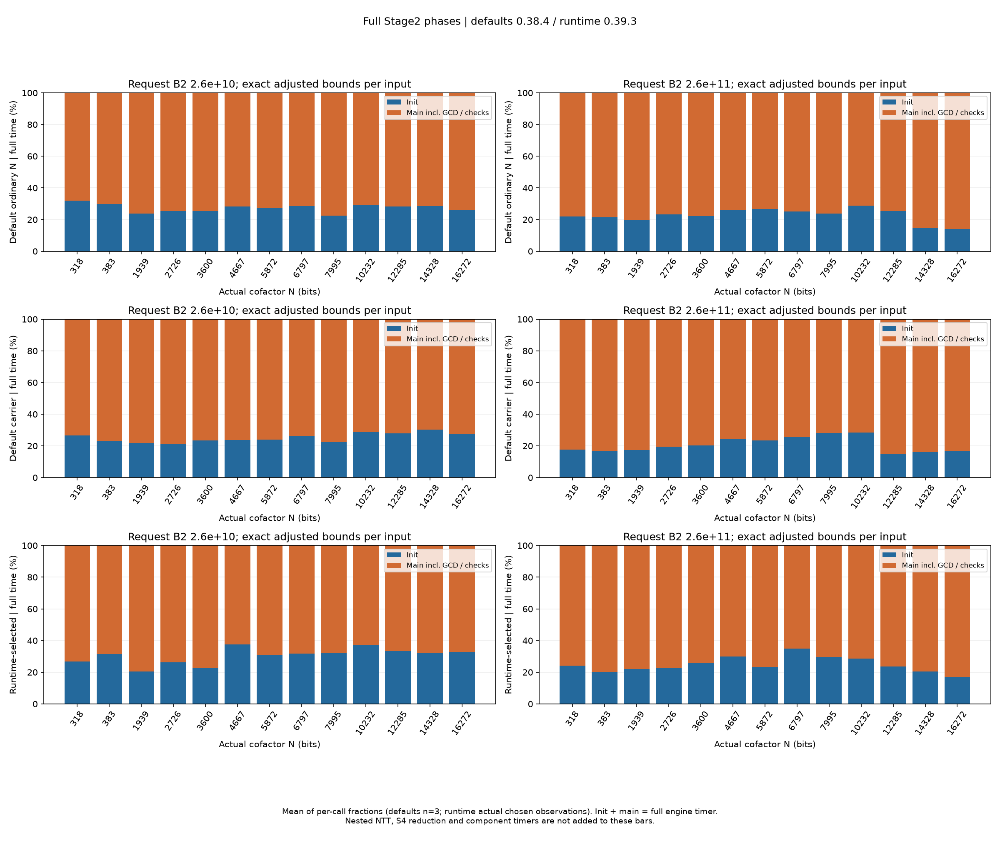

init 包含 baby 集枚举、baby 点与归一化、F 树及引擎内必需检查；main 包含 inverse、giant/G 树/fold、下降、GCD 和检查收尾。图按默认各三次、运行时按被选行的实际观察数，取每次调用 init/total 的均值，另一部分为 main/total，避免将组件中位数相加后冒充完整中位数。shape 已包含在 init 中。

| 路径 | 低档初始化占比 | 高档初始化占比 |
|---|---:|---:|
| 普通 | 28.1% | 23.2% |
| 承载 | 24.0% | 19.5% |
| 运行时自动 | 31.9% | 23.5% |

表为每格逐调用比例均值在 13 个输入上的中位数，不按耗时加权。较大 B2 下初始化被摊销，主循环仍需按实际点数、G 树及 fold 工作量评价。下图分项是诊断区间，不是另一份可相加的 100% 账本。

### Giant、G 树与非满尾

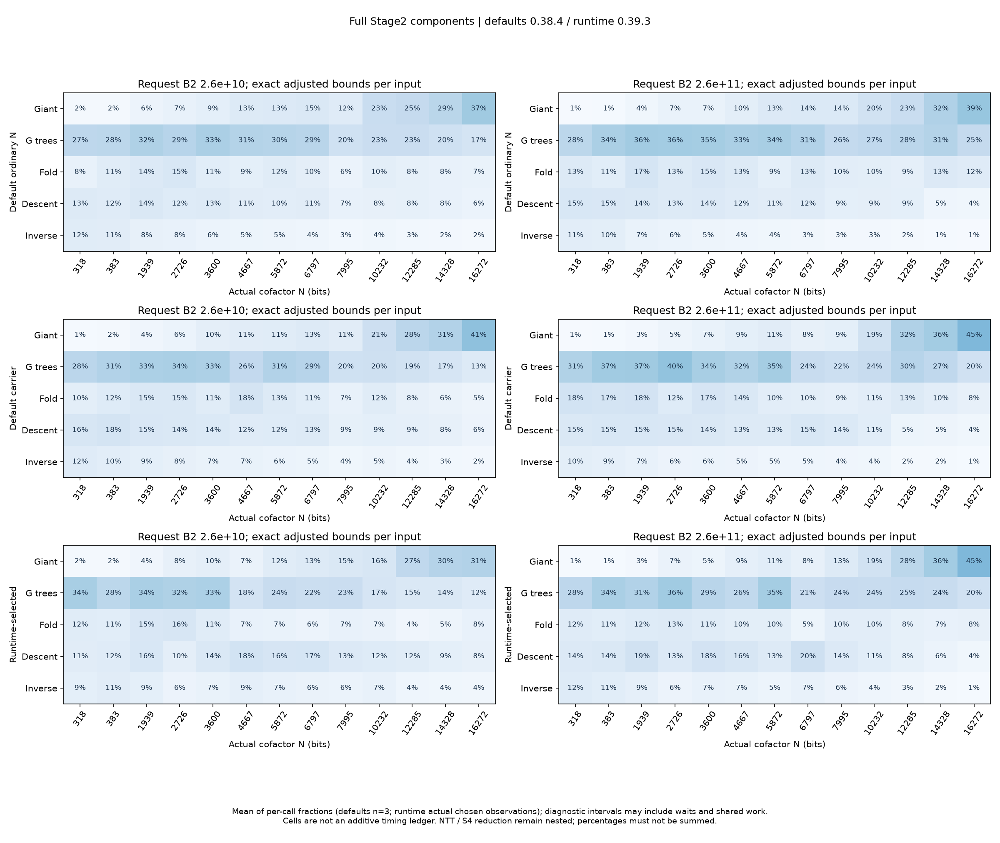

默认路径的分项占比显示，较小位宽主要成本在 G 树；随着位宽增大，giant 点生成占比上升，在 16272-bit 条件约占完整耗时的 37%–45%。这为后续优化提供方向，但占比本身不能证明该组件相对旧版变慢。

Stage2 的几何由 `P=φ(D)/2`、`I=⌊B2/D⌋+2`、`G=⌈I/P⌉` 决定。增大 B2 会改变点数、G 数、非满尾与选 D，NTT 长度和预算又会产生阶梯效应；不能仅用 B2 比例或最高 NTT 长度预测完整耗时。

宽位 giant 可使用相邻 seed 和差分 chain；短尾保留受预算和单位性检查约束的路线。宽位多批次 G 树使用分块空位布局，常数 1 空位不增加真实 giant 点。非满尾按真实次数执行，程序不会为填满 P 自动扩大选定 B2。当前机制与回退条件见 [点生成](../architecture/STAGE2.md#点生成与归一化)、[G 树](../architecture/STAGE2.md#多项式与-scaled-下降)和 [G 树固定推导](../reference/ECM_STAGE2_G_TREE_LAYOUT.md)。

默认路径为完整版本复测，运行时路径采用被选行的实际观察；未逐项关闭优化做因果对照。`real_batched_split` 中 giant/gtrees/fold/descent/inv 可定位成本，但异步等待、共享初始化及嵌套算术不构成独立可相加的总账。NTT、S4 reduction 已在相应树、fold 和下降中，不再加到 init/main。

### 算术承载与内存

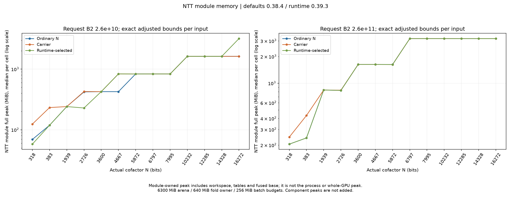

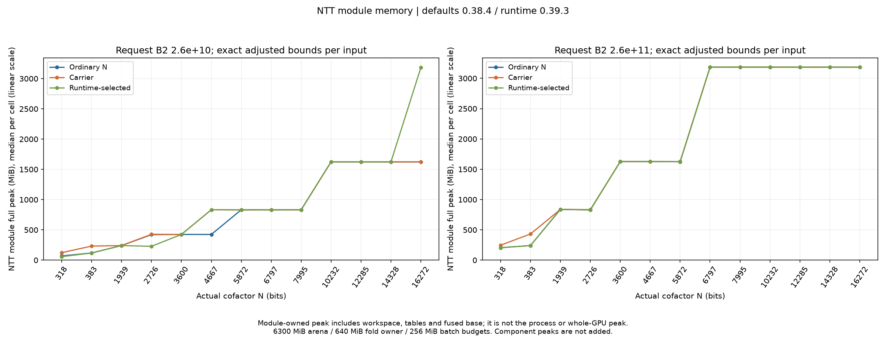

普通路径按余因子 N 运算，承载按原 Mersenne 指数运算。承载可使用快速归约，但可能扩大实际算术位宽；小余因子并不一定受益。默认矩阵分别显式测两条路径；运行时矩阵由程序在同一条件下选择类型，不能将分开测量的组件优势相加。

图为 `ntt_workspace_stats.full_peak_bytes` 的逐格中位数（默认各三次；运行时按被选行的实际观察），包含 NTT workspace、表及 fuse base；它是模块峰，不是整个进程峰。arena6300 / fold owner640 / batch256 MiB 是预算，不是实测峰。NVML 是整卡采样，包含其他使用者，也会漏掉短时峰；不能相加各组件峰值，不能将整卡占用解释为本进程占用。预算公式见 [内存规划](../architecture/MEMORY.md)。

## Montgomery 全范围参考

保留同一 RTX 4060 Laptop 的 318–7995-bit、三档 B2=2.6×10^10 / 2.6×10^11 / 2.6×10^12 扫描。曲线为 PARAM0，B1=20，除 M2003 用 sigma27 外均 sigma26；目标为精确余因子，carrier=0、自动 D、arena6300/fold640/batch256 MiB、factor-only、正常算术检查。1800/2400 MHz 两次会话复用同一程序和输入；图中另保留 2026-10-08 的 55 W 设置旧扫描，使用不同的历史程序，不能将三组差额只归因于频率。三组均未记录数字版本；本轮没有重新测 Montgomery。

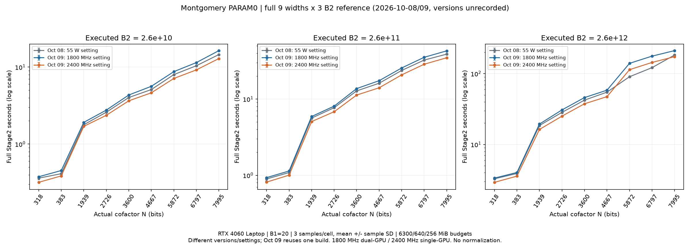

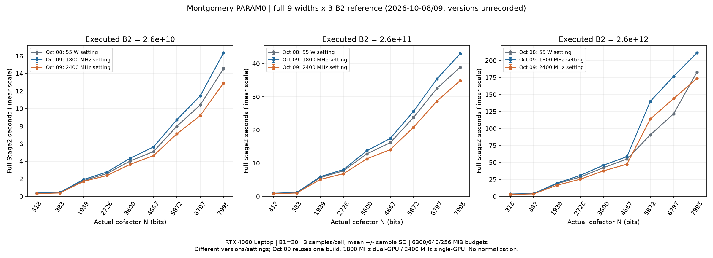

下表为完整引擎秒数，均值±样本标准差，各格 n=3。1800 MHz 为双卡会话，2400 MHz 为用户移除另一张显卡并重启后的单卡会话；设置频率不代表每刻恒频，程序没有调整设置。不同环境不作时钟或功耗归一化，也不当作 0.38.4 与旧版的曲线族 A/B。

| N bits | 1800 / 低 B2 | 1800 / 中 B2 | 1800 / 高 B2 | 2400 / 低 B2 | 2400 / 中 B2 | 2400 / 高 B2 |
|---:|---:|---:|---:|---:|---:|---:|
| 318 | 0.377±0.006 | 0.932±0.007 | 3.352±0.035 | 0.319±0.006 | 0.814±0.019 | 2.923±0.049 |
| 383 | 0.454±0.004 | 1.140±0.021 | 4.028±0.007 | 0.386±0.007 | 1.005±0.023 | 3.578±0.043 |
| 1939 | 1.914±0.018 | 5.909±0.050 | 19.429±0.089 | 1.701±0.028 | 5.073±0.076 | 16.304±0.057 |
| 2726 | 2.764±0.007 | 8.082±0.032 | 30.775±0.065 | 2.365±0.025 | 6.827±0.036 | 25.140±0.045 |
| 3600 | 4.342±0.026 | 13.733±0.034 | 45.950±0.100 | 3.650±0.003 | 11.299±0.035 | 37.557±0.077 |
| 4667 | 5.629±0.057 | 17.434±0.044 | 58.426±0.132 | 4.637±0.025 | 14.069±0.087 | 47.377±0.134 |
| 5872 | 8.734±0.018 | 25.602±0.059 | 139.805±0.045 | 7.121±0.020 | 20.792±0.128 | 113.791±0.273 |
| 6797 | 11.449±0.014 | 35.355±0.305 | 176.669±0.110 | 9.199±0.039 | 28.673±0.109 | 143.952±0.369 |
| 7995 | 16.358±0.028 | 42.968±0.308 | 211.383±0.102 | 12.917±0.046 | 34.873±0.127 | 173.644±0.166 |

图中 55 W 旧扫描的实际 SM 时钟最高2400 MHz，不能标为固定1800 MHz，也不与 1800/2400 MHz 同构建会话混为纯频率对照。各组全部27格 n=3 汇总保存在统计 JSON 中。

1800/2400 MHz 每次会话另有 27 条完整 Mersenne 数单次对照和 9 条预热，保留原始证据，未混入余因子 n=3 统计。完整 M 与余因子可能触发不同非单位回退。1800 MHz 正式格 CV 为 0.032%–1.839%，2400 MHz 为 0.081%–2.311%。2400 MHz 全进程遥测最高 2400 MHz、最高 73°C，负载期间可见约 75–86 W 的读数，观测瞬时峰 107.97 W 未经独立校准；1800 MHz 正式记录最高不超过 1800 MHz。原始遥测中的异常功率值保留，不用其平均值宣称物理能效。

完整范围显示，较大 B2 可摊销 baby/F 初始化，但宽位、大 B2 的 G 树和 fold 增长以及内存准入可改变 D/P，不能将经验幂律当作所有输入的成本保证。Prime95 精确 Edwards/Montgomery 26 格参考与 CPU 测量集中见 [参考页](EDWARDS_STAGE2.md)，不将不同 B1、sigma 或实际 B2 混为严格算法对照。

## 有界D搜索的验证范围

### 默认无tune路径

0.39.2与冻结0.38.4在同一会话逐格相邻交替运行：相同13份精确余因子save、Edwards构造、保存的B1=50000/sigma、两档实际B2、普通/承载共52格，两侧各n=1，共104次完整NF。不预热、不剔除首轮，全部D/P相同。完整引擎时间之和为旧版1800.362882秒、新版1799.730271秒，变化−0.03514%，**满足本次同会话总耗时不增加的数值门槛**；不将该微小差额解释为显著提速。普通1115.369953→1114.483256秒（−0.07950%），承载684.992929→685.247015秒（+0.03709%）。没有单项同时变慢超过5%且0.25秒，复测清单为空；一格一次不提供方差或置信区间。

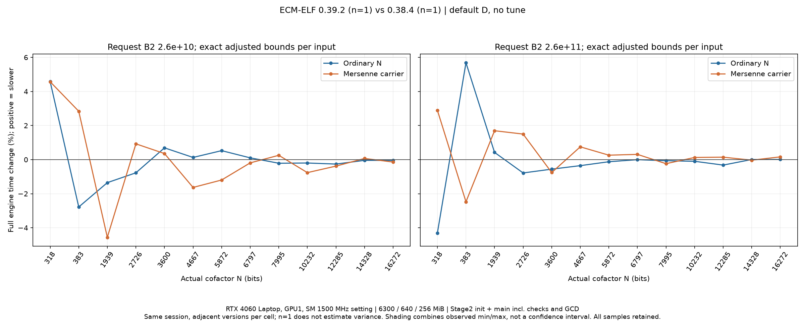

设备为GPU1 RTX4060 Laptop、SM1500MHz设置，arena6300/fold640/batch256 MiB，工具链与CUDA对象同下文身份。两侧利用率≥50%的整卡采样各6912/6958点，SM均为1395–1500MHz、中位1500；温度均为64–77°C、中位71。全程不改变GPU控制设置，GPU0用户任务不接触。两侧各GMP抽查464685、自检109440，错误0；共208份调用前后快照未检出同GPU外部计算任务，不代表连续每一瞬间的进程证明。

原始0.38.4的n=3历史基准为1779.232910秒；当前0.39.2比它多1.15203%，**历史绝对时间口径没有满足不增加门槛**。同一冻结旧0.38.4程序本次也为1800.362882秒，比自己的历史结果多1.18759%。这支持区分会话共同变化与代码差异，不能单凭温度、频率或后台负载之一认定原因；不能用本次同会话结果覆盖历史记录。两份比较、逐格原值和各自样本数分别保存在`data/benchmarks/stage2_d_search_0_39_2/paired01/`、`historical01/`。

保留的0.39.0跨会话比较同为13输入、两档实际B2、普通/承载共52格各一次，没有丢弃首轮。D/P全部与0.38.4的n=3基准一致；普通、承载的逐格时间之和分别为1113.891、683.940秒，相对旧基准1104.824、674.409秒增加0.82%、1.41%；合计1797.830对1779.233秒，增加1.05%。该跨会话数据未满足严格总耗时门槛，没有将小幅差异改写为持平。没有单项同时变慢超过5%和0.25秒；这只说明未触发单项复测筛查，不替代总耗时要求。

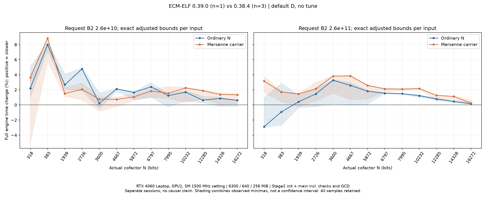

图中正值为变慢，阴影组合两侧观测范围，不是置信区间。两次均为GPU1 RTX4060 Laptop、SM1500 MHz设置、arena6300/fold640/batch256 MiB、CUDA13.3.73/MSVC14.51.36231/PTX3/addsub1/GMP Zen3，沿用同一CUDA算术对象。新会话6939个利用率≥50%的采样点中，SM为1410–1500 MHz、中位1500，温度64–75°C、中位70；旧会话温度中位62°C。未调整GPU控制设置，不能据温度差单独认定变慢原因。52次NF的GMP抽查464685项、自检109440项，错误0；104份调用前后进程快照未检出同GPU外部计算任务，快照不能覆盖每一瞬间。

### 稳定队列与准备成本

0.39.2的稳定准备开销对照采用相同worktodo入口、12条队列、固定初始性能文件，按默认承载／自动关闭缓存／自动开启缓存／自动开启缓存／自动关闭缓存／默认承载执行；不预热、不丢弃队列尾部。输入为M2003的1939-bit精确余因子、Edwards sigma27、B1=50000、B2=27015978990，设备与预算同上。各模式两条队列共24条完整NF，性能文件不变；自动两组均选择承载D210210，已有10次观察、无试跑。每组12条的队列墙钟之和取两次中位：默认承载28.367945秒、自动关闭缓存30.321465秒、自动开启缓存26.019765秒。开启相对关闭缓存减少14.19%，相对默认承载减少8.28%。对应引擎时间之和为22.401373、21.248803、21.213010秒；同D自动两组的引擎时间接近，主要改善发生在引擎外准备。

队列墙钟使用各`curve_done.wall`之和，包含worker启动、选型、完整引擎及完成进度持久化；外层进程观察退出另存，不将250ms轮询延迟混入该指标。缓存开启组的运行时准备中位0.039246秒、原生规划2次，关闭组0.523179秒、15次；首条冷准备仍计入总耗时。全部72条保留，GMP抽查215424项、自检145152项，错误0。该结果只覆盖已稳定的1939-bit队列，不能宣称高位宽、学习阶段或完整矩阵也加速同等比例。

4667-bit精确余因子M5003另以Edwards sigma26、相同B1/B2、设备与预算学习48条完整NF：普通5种D、承载9种D（含默认），36次合格观察，最终为承载D274890。冻结所得文件后，按默认承载/自动/自动/默认承载运行8条队列，各模式两队列、共32条NF；自动均已有10次观察、无试跑、文件不变。每组8条的队列墙钟中位从默认承载D180180的48.492410降到44.823560秒，减少7.57%；引擎之和43.855667降到40.952015秒，减少6.62%。32条的GMP抽查109920、自检64512，错误0。此点同时包含D改善和准备复用，不将7.57%全部归给缓存；48条学习队列另记引擎265.078187秒、队列298.009050秒，不混入稳定组。证据为`learning_n4667_0_39_2_01/`及`stable_n4667_0_39_2_01/`。

此点P从17280增到26880，giant从149940降到98281，G从9降到4；两条路线的NTT `big_peak_bytes`均为768MiB。它说明在同一大工作区容量内继续寻找D可以取得收益，不能据此推出所有任务都应取该区间最大的P。这里记录的是NTT模块大数组容量，其他owner及瞬时缓冲仍需联合生命周期核算，不当作进程显存峰值。

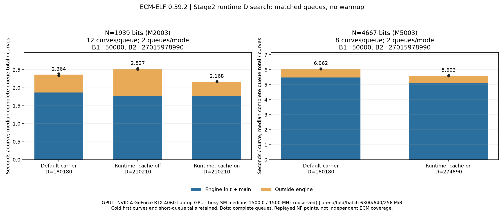

图按各完整队列总时间的中位数除以队列曲线数展示；黑点为各队列均摊时间，蓝色为引擎，橙色为总时间减引擎，包含启动、选型、预检和队列I/O，不等于单独测得的CPU内核时间。两个面板分别为12/8条、每模式两条队列，首条冷准备和短队列尾部均保留；相同保存点重放只作性能/功能观察，不计作新增独立ECM覆盖。图与逐项审计在`data/figures/stage2_d_search_0_39_2/prepare03/`和`data/benchmarks/stage2_d_search_0_39_2/prepare03/`。

### 身份与验证边界

0.39.2的69项CPU搜索/缓存检查、原有runtime/portable CPU门禁、22项GPU功能门禁、52格只规划核对通过；另有10项编排与续跑、17项比较和交替实验身份、11项绘图证据拒绝的纯CPU检查。M503的318-bit余因子重放64条NF，普通6种D、承载5种D，30次合格观察，多尺度、后续轮次、区间重启、显式锁及关闭写入均得到验证。完整默认矩阵不替代带tune的52格性能矩阵，0.39.2的独立稳定队列收益仅确认上述1939/4667-bit两点；生产B1/B2、其他设备与显存边界仍需扩展。

上述默认对照的版本为0.39.2与冻结0.38.4，沿用同一CUDA算术对象；sm89、CUDA13.3.73、MSVC14.51.36231、PTX3/addsub1、GMP Zen3，只改主机选型与准备，不声称NTT算术内核提速。

证据根为`data/experiments/stage2_d_search_implementation_20261019/`：当前默认交替实测为`default_pair01/`，准备对照为`route_cache_ab01/`，4667-bit学习/稳定对照为`learning_n4667_0_39_2_01/`、`stable_n4667_0_39_2_01/`，完整身份与范围审计为`phase03_audit.json`及`phase04_audit.json`。含冻结EXE/DLL、91项编译输入、原始队列/命令/结果/日志与遥测。初始并发污染、错误save入口、队列参数冲突、顺序问题及较早版本的数据均保留，不混入当前有效比较；没有重标旧样本版本。复现与显式样本数审计见[工具](../../tools/bench/README_STAGE2_D_CATALOG.md#有界搜索实现验证)，更广范围见[TODO](../TODO.md)。

## 计时与环境

GPU 主指标为 `stage2_full_wall.total=init+main`，包含引擎内必需自检、点/树、多项式、GCD 和检查排空；Stage1、进程启动、外层选 D 和计时前的 Montgomery/xADD 预检排除。另保留进程墙钟，0.38.4 收集器以 250 ms、0.39.3 新队列以 20 ms 观察退出，该值不用于精确分离启动成本。Prime95 使用 init+main+GCD；其屏幕主计算 Total time 不等于完整 Stage2。

0.38.4 使用正式 local 构建，sm89、CUDA13.3.73、MSVC14.51.36231、Goldilocks PTX 后端3、addsub1、GMP Zen3。GPU1 为 RTX 4060 Laptop（8 GiB）、驱动610.88，GPU0 由用户另用；本任务 CUDA 构建在正式测量前完成，没有与测量并行的本任务 GPU 诊断。未调整时钟、功耗或进程优先级；power.limit 接口为 N/A，不能据此声称已测得固定功耗墙。主机 Ryzen AI 9 HX 370、Windows 11，CPU 用户声明固定 4 GHz，未采集有效 CPU 频率或 CPU 功耗。

完整进程生命周期中 GPU 利用率≥50%的 20833 个整卡采样点：SM 时钟 1395–1500 MHz、中位 1500 MHz；温度 53–68°C、中位 62°C；功率接口观测 9.079–54.952 W、中位 33.540 W。这是整卡、有限间隔的观测，不是恒定功耗、进程能耗或独立校准后的物理峰值。

0.39.3 使用上述指定构建，sm89、CUDA13.3.73、MSVC14.51.36231、PTX3/addsub1、GMP Zen3；未调整任何 GPU 控制。具有完整遥测且利用率≥50%的 69084 个整卡样本中，SM 时钟 210–1500 MHz、中位 1500.0；温度 48–74°C。功率接口原始读取 1.782–55.180 W、中位 32.076 W，0 个样本位于0–200 W之外。另有 1 条旧队列未落盘完整遥测，停止后的快照不冒充过程采样。它们是有限间隔整卡观测，不是进程能耗或校准后的物理峰值；队列前后快照未见外部同卡任务，不能覆盖每一瞬间。

## 证据与复现

默认矩阵原始证据为 `data/experiments/stage2_v0_38_4_20261018/full_matrix/`，包含冻结的 0.38.4 EXE/GMP、13 份 save、采集器、计划、每次结果/日志/设备遥测和严格范围审计。汇总为 `data/benchmarks/stage2_v0_38_4_20261018/final/summary.json` 与 `cells.csv`，PNG/SVG 在 `data/figures/stage2_v0_38_4_20261018/final/`。图像的公开副本位于本页相邻 attachments 目录，按主题和版本命名。新增元数据和图注用版本号记录程序来源。

严格审计确认 13 个输入、52 个条件、156 个唯一完整 NF 调用，计时闭合；逐调用版本均为 0.38.4。引擎 GMP 抽样检查合计 1,394,055 项，GMP 自检合计 328,320 项，报告算术错误 0。独立末点验证与引擎抽样各有明确范围；这份无因子性能矩阵不作为每个叶值独立 oracle 或命中因子兼容性的替代。

0.39.3 原始学习证据与可复用性能文件为 `data/experiments/stage2_runtime_v0_39_3_20261019/adaptive_01/`（其中三条完整队列及一条用户停止队列的完整 NF 指向原 `matrix_01/`）；`stage2_ecm_tune_frozen.toml` 与活动文件逐字节相同，可用 `stage2_tune_profile` / `--tune-profile` 引用。叠加汇总为 `data/benchmarks/stage2_runtime_v0_39_3_20261019/final/summary.json`、`runtime_cells.csv`，图为 `data/figures/stage2_runtime_v0_39_3_20261019/final/`；公开副本在相邻 attachments。审计覆盖 627 次调用、250 组、551 个已入账观察，独立恢复均值与样本标准差。用户停止时的一次未完成调用保留原始日志，未纳入 NF 或成绩；GMP 抽查 5,894,711、自检 1,319,424，错误 0。未完成的旧 0.38.4 运行时轮次按用户要求排除，没有改写其原始记录。

复现入口见 [版本化测量与绘图](../../tools/bench/README_STAGE2_VERSION.md)。历史 Edwards 全范围证据在 `data/experiments/edwards_stage2_reference_20261017/matrix_01/`，Montgomery 两组在 `data/experiments/stage2_n_scaling_20261009_current/`、`data/experiments/stage2_n_scaling_20261009_2400/`；对应分组 CSV 为 `data/benchmarks/stage2_n_scaling_20261009_{current,2400}_summary.csv`，55 W 全范围为 `data/benchmarks/stage2_n_scaling_20261008_reaudit_summary.csv`。单点选型、生产 B1 探针、relocation 和完整 G 边界实验的原始记录保留在 data，开发草稿保留；它们不参与本页全范围统计。

## 待验证范围

本页 GPU 主指标为单条 Edwards 曲线的完整引擎计时，预算固定、两档 B2、GPU1。0.39.3连续队列用于学习观察；0.54.7已完成小档B2的13格冻结后独立n=3复测，大档仍未完成当前版本的独立矩阵。其他设备、生产B1或宽位B2≥10^12也未覆盖。旧 Montgomery 三档全范围与 Prime95 单次参考不能替代这些复测。优先用固定 D 对照复核宽位高 B2 的默认 D/P、NTT 长度边界和候选准入模型，区分选型与分块算法的影响。运行时自动选型在其他设备、生产 B1/B2 和长期波动中的收益仍需扩展；G=1、小预算回退和可选 relocation 另行验证。CPU 保持历史参考，不据 GPU 改进推定 CPU 后端收益。
