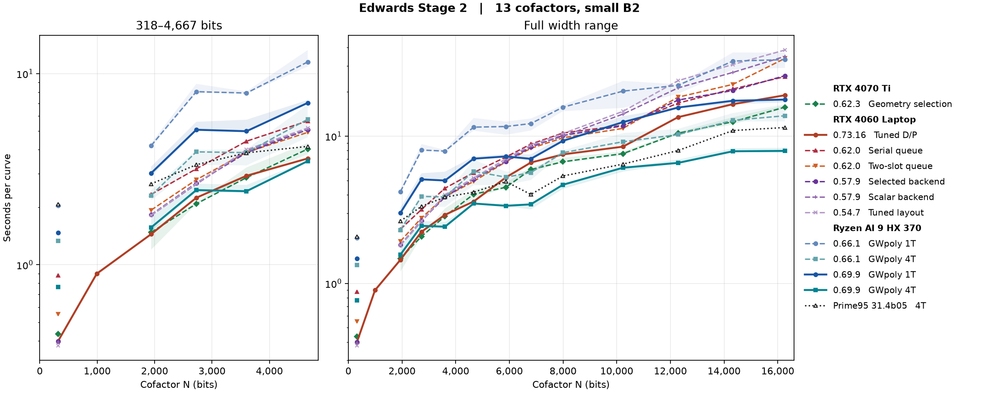
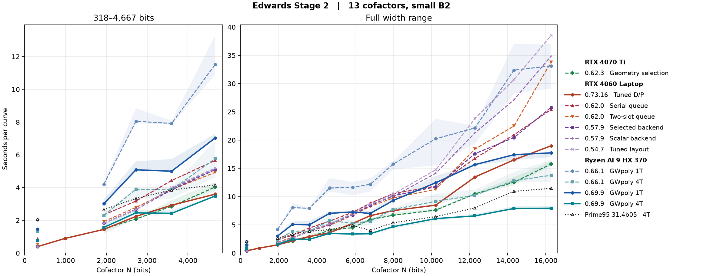
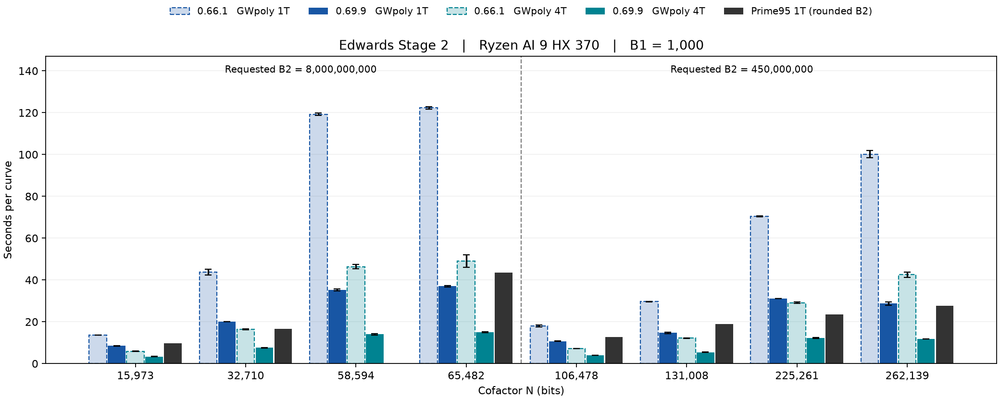
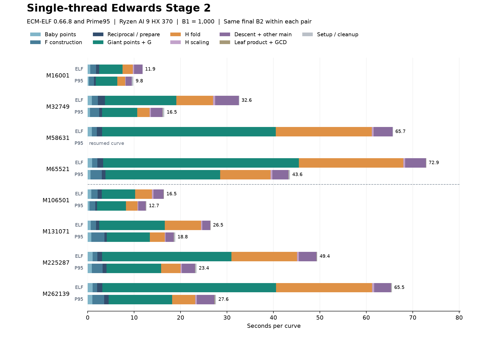
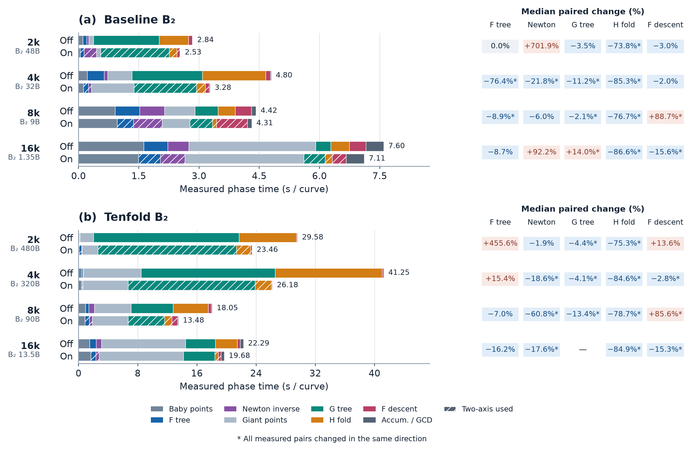
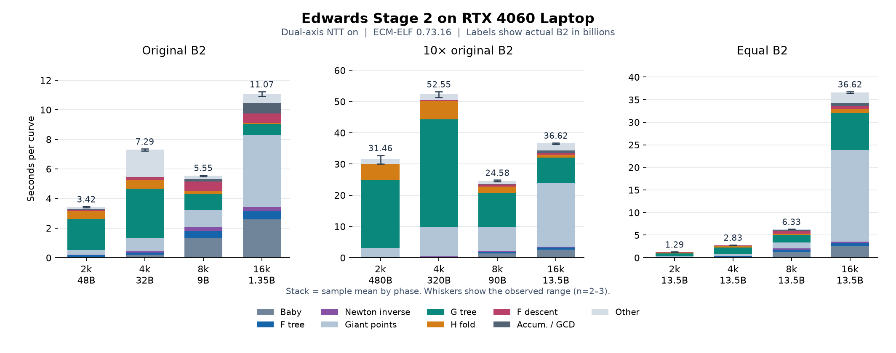
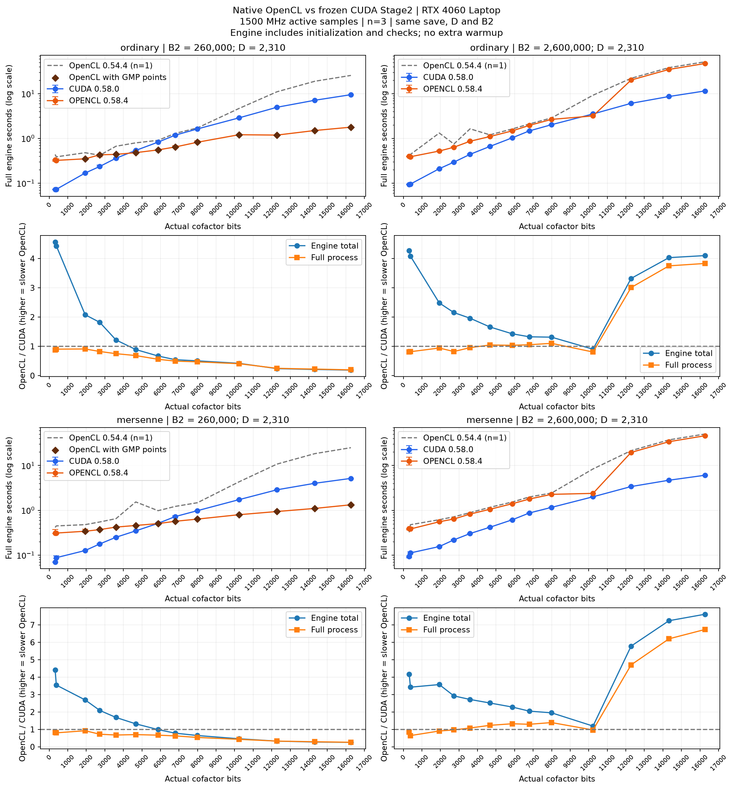
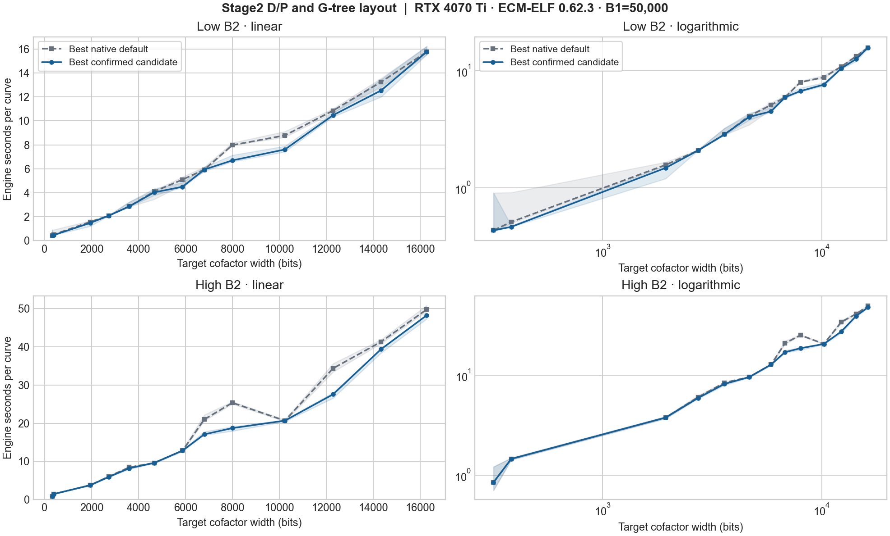
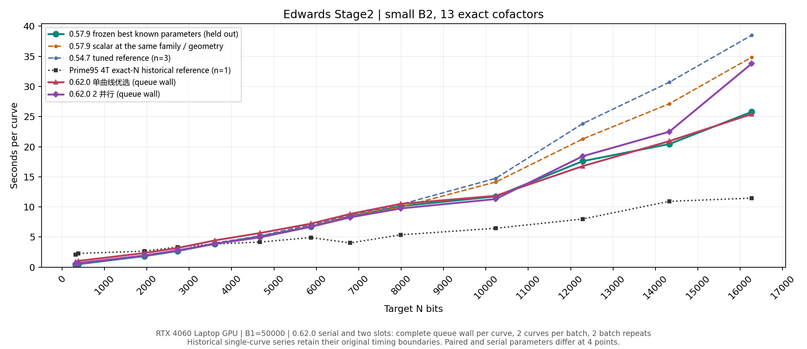
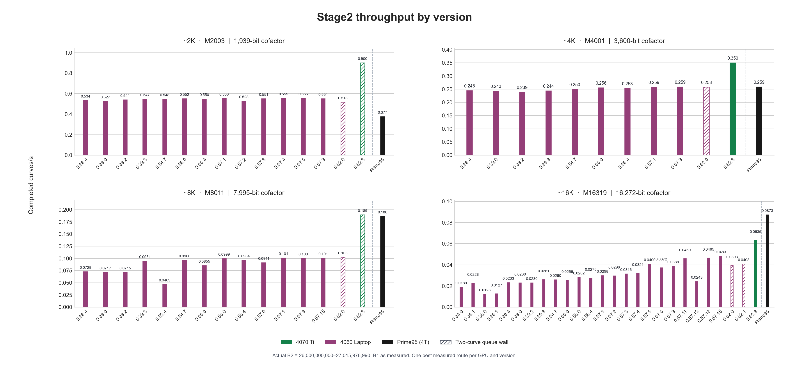

# Stage2 性能

小档 Edwards 全位宽对照覆盖 318–16,272 位，包含 CPU、CUDA 和 Prime95。CUDA 0.73.16 新增 992 位测点。CPU 宽位矩阵延伸至 262,139 位，按 B2 分区。比较数据时，先核对实际 B2 和计时边界。单曲线引擎耗时、含调度和发布的队列墙钟，以及队列中段吞吐各有独立口径。生产配置见 [Stage2 使用](../usage/STAGE2.md) 与 [D/P 规划](../architecture/AUTO_B2.md)。

- [Edwards 全位宽图](#edwards-全位宽对照) · [CPU 宽位矩阵和 Prime95 分阶段对照](#cpu-宽位分区矩阵)
- [CUDA 热点实测](#cuda-热点) · [OpenCL 与 CUDA](#opencl-与-cuda全位宽快速矩阵) · [CUDA 几何与队列](#cuda-几何与队列)
- [历史基准](#历史基准) · [专题与复现](#专题与复现)

## Edwards 全位宽对照

两张图使用同一组数据，左半放大最窄的六个输入，右半覆盖全部 13 个位宽。图例按设备分组，CPU 0.69.9 和 CUDA 0.73.16 用实线，较早版本用虚线。992 位仅有本轮 CUDA 实测。Prime95 4T 用黑色点线。色带标出有逐次记录的观测范围。

表中单位为秒／曲线。0.73.16 取单曲线引擎耗时。0.62.0 串行和双槽用两条曲线的整批墙钟除以二。

| 实际位数 | 0.69.9 1T | 0.69.9 4T | 0.66.1 1T | 0.66.1 4T | Prime95 4T | 4070 Ti 0.62.3 | 4060 调优 0.73.16 | 4060 串行 0.62.0 | 4060 双槽 0.62.0 | 4060 自动 0.57.9 | 4060 标量 0.57.9 | 4060 布局 0.54.7 |
| ---: | ---: | ---: | ---: | ---: | ---: | ---: | ---: | ---: | ---: | ---: | ---: | ---: |
| 318 | 1.472 | 0.767 | 2.038 | 1.332 | 2.078 | 0.434 | 0.399 | 0.880 | 0.551 | 0.398 | 0.393 | 0.378 |
| 992 | — | — | — | — | — | — | 0.899 | — | — | — | — | — |
| 1939 | 3.016 | 1.568 | 4.200 | 2.306 | 2.650 | 1.479 | 1.446 | 2.335 | 1.932 | 1.827 | 1.814 | 1.818 |
| 2726 | 5.088 | 2.460 | 8.051 | 3.898 | 3.339 | 2.084 | 2.243 | 3.178 | 2.787 | 2.677 | 2.641 | 2.659 |
| 3600 | 4.999 | 2.427 | 7.917 | 3.864 | 3.855 | 2.858 | 2.922 | 4.432 | 3.877 | 3.859 | 3.937 | 3.999 |
| 4667 | 7.033 | 3.489 | 11.520 | 5.773 | 4.163 | 4.034 | 3.600 | 5.658 | 4.931 | 5.099 | 5.124 | 5.196 |
| 5872 | 7.286 | 3.365 | 11.633 | 5.264 | 4.916 | 4.498 | 5.252 | 7.222 | 6.701 | 6.736 | 6.791 | 7.027 |
| 6797 | 7.019 | 3.444 | 12.179 | 5.657 | 4.021 | 5.933 | 6.618 | 8.832 | 8.268 | 8.427 | 8.559 | 8.675 |
| 7995 | 9.300 | 4.679 | 15.739 | 7.728 | 5.367 | 6.700 | 7.520 | 10.515 | 9.749 | 10.128 | 9.990 | 10.417 |
| 10232 | 12.454 | 6.107 | 20.235 | 9.166 | 6.460 | 7.612 | 8.489 | 11.844 | 11.302 | 11.742 | 14.135 | 14.746 |
| 12285 | 15.654 | 6.584 | 22.156 | 10.251 | 7.991 | 10.475 | 13.467 | 16.769 | 18.414 | 17.596 | 21.278 | 23.824 |
| 14328 | 17.412 | 7.896 | 32.389 | 12.817 | 10.927 | 12.536 | 16.496 | 20.928 | 22.488 | 20.433 | 27.130 | 30.702 |
| 16272 | 17.738 | 7.944 | 33.125 | 13.768 | 11.455 | 15.757 | 18.990 | 25.413 | 33.798 | 25.779 | 34.861 | 38.506 |

CPU 0.69.9 的 12 个可比位宽共 72 次 NF。逐点中位数之和为 1T **108.470 秒**、4T **50.729 秒**，0.66.1 分别为 181.183 秒和 81.824 秒。4T 对 1T 的逐点加速比中位数为 **2.05 倍**。

### 输入与计时

- 所有列按同一实际余因子 N、B1=50000 和实际 B2 对齐。名义 B2 为 260 亿，5872 位（M6011）实际为 27,567,389,850，其余为 27,015,978,990。ECM-ELF CPU 直接重放 0.62.0 串行队列的同一行 Edwards save，M2003 的 sigma 为 27，其余为 26。CPU 使用对应梅森数承载算术，并对存档里的 N 求 GCD。[输入清单与 Prime95 口径](EDWARDS_STAGE2.md)
- **ECM-ELF CPU 0.69.9** 使用 GWNUM 31.6 计时 DLL `be7bb3ee352538e6`，并保留历史 0.66.1 作为参考。每格三次，1T 绑定逻辑 CPU 5，4T 绑定 1、3、5、7。每条曲线用独立进程，逐轮交换线程顺序，避让编译。关闭 B2 扩展与运行时调优，自动选 D，两版实际 D、P 和 FFT 可不同。0.69.9 使用 4096 MiB 规划预算及 Windows Job 单进程提交量硬限。计入曲线重构、规划、计算和清理，排除进程启动、读档和发布。未采集实测频率和功耗。[0.69.9 的逐次结果、指纹和阶段计时](../../data/experiments/stage2_cpu_full_0699/summary.json) · [0.66.1 冻结记录](../../data/experiments/stage2_cpu_full_0661/summary.json) · [核心拓扑](../../data/experiments/stage2_ab_0661/topology.json)
- **RTX 4060 Laptop** 的五条序列和 Prime95 参考均取自「0.62.0 串行优选与双槽」原图的数据。0.62.0 的两条 GPU 曲线取两批中位数，每批两条，以整批墙钟除以二，包含队列首尾。忙碌样本 1500 MHz，串行／双槽各批活跃功耗中位数范围分别为 11.7–39.7 W／13.2–38.7 W。0.57.9 自动与同几何标量为独立引擎计时，入图各点各一次。0.54.7 布局优选沿用原图的三次中位数，仅绘中心线。[串行与双槽的参数、样本和证据](#0620-串行优选与双槽) · [冻结选型](#0579-冻结选型与参考)
- **RTX 4070 Ti** 补入 0.62.3 几何选型矩阵的小档单槽。每点取入选配置三次完整引擎计时的中位数，含初始化、点生成、多项式和 GCD。原串行矩阵忙碌样本 2610 MHz，整卡功耗 32.88–215.04 W。[两档输入与几何选型](#rtx-4070-ti-的-dp-与布局)
- **Prime95 31.4b05** 为同型号 CPU 的历史 4T 结果，每点一次，用户当时设置 4 GHz，未采集有效频率和功耗。计时合并初始化、主计算和 GCD。比较同一版本的 CPU 线程收益时，使用对应的 1T 和 4T 列。[Prime95 全范围参考](EDWARDS_STAGE2.md#prime95-全范围参考)

[更新后的全精度汇总 CSV](../../data/benchmarks/stage2_4060_width_07316/comparison.csv) · [原 CPU 对照 CSV](../../data/benchmarks/stage2_cpu_full_0699/comparison.csv) · [CPU 采集命令与检查](../../tools/bench/bench_cpu_stage2_full_width.py) · [汇总与绘图脚本](../../tools/bench/plot_stage2_cpu_full_width.py)

### RTX 4060 Laptop 的 0.73.16 调优复测

以 **992 位**替换原来的 383 位。新输入为 $N=(2^{1019}-1)/(2039×75407)$，使用 Edwards σ=26、B1=50,000 的 CPU Stage1 存档。其余 12 点重放原存档。实际 B2 沿用小档矩阵，关闭 B2 凑整及 relocation。992 位使用同组的 B2=27,015,978,990。[新输入及原始准备日志](../../data/experiments/stage2_4060_width_07316/prepare_992_current.log)

在 RTX 4060 Laptop 8 GiB 上使用 Windows CUDA 13.3、驱动 610.88、`sm_89`，ECM-ELF 0.73.16 的 SHA-256 为 `5d77ca332e22ee21ff9ece799031f8d1d9aff088ee72d3003a3f9aa8338f21e6`。NVML 查询的强制功耗上限为 55 W。100 ms 遥测中，利用率达到 50% 的样本 SM 时钟中位数为 1,500 MHz，功耗范围为 8.35–45.27 W。arena／batch／owner 预算为 6300／256／640 MiB。[冻结构建和采集记录](../../data/experiments/stage2_4060_width_07316/)

原生 `--tune ecm` 从旧矩阵的 D 候选执行有界搜索，992 位单独给出四个 D。普通和梅森承载分别比较，候选须有两次以上通过校验的完整计时。对初轮跳过旧优选 D 的 318、2,726 和 16,272 位补做定向调优。Baby／giant 后端和有限链长沿用同位宽的历史实测配置，seed 与 S4 使用标量。按最快合格引擎均值选定参数，随后固定 D/P、承载和 G 树选项，独立串行重放三次。入表的 39 次均为完整 NF，计时取 `stage2_full_wall.total`，计入引擎初始化、计算及 GCD，排除读档、外层规划和结果发布。同一点三次复测的 NTT 计数及下降摘要一致。布局 0 为连续、1 为分块空位。子树值 1 对应四根模式。[输入及候选范围](../../data/experiments/stage2_4060_width_07316/inputs.json) · [原生 tune](../../data/experiments/stage2_4060_width_07316/tune.toml) · [参数和耗时 CSV](../../data/benchmarks/stage2_4060_width_07316/selected.csv)

| 实际位数 | 输入 | D/P | 承载指数 | G 树布局／子树 | Giant 链长 | 合格 tune 形状 | 复测中位数（秒） | 最小–最大（秒） |
| ---: | --- | --- | ---: | --- | ---: | ---: | ---: | ---: |
| 318 | M503 | 150150/14400 | — | 0／0 | 32 | 6 | 0.399 | 0.394–0.403 |
| 992 | M1019 | 180180/17280 | 1019 | 0／1 | 32 | 7 | 0.899 | 0.881–0.908 |
| 1939 | M2003 | 180180/17280 | 2003 | 1／1 | 64 | 4 | 1.446 | 1.439–1.470 |
| 2726 | M3001 | 180180/17280 | 3001 | 1／1 | 64 | 4 | 2.243 | 2.230–2.258 |
| 3600 | M4001 | 210210/20160 | 4001 | 0／1 | 32 | 10 | 2.922 | 2.901–2.934 |
| 4667 | M5003 | 274890/26880 | 5003 | 0／0 | 64 | 3 | 3.600 | 3.578–3.621 |
| 5872 | M6011 | 240240/23040 | 6011 | 1／0 | 32 | 8 | 5.252 | 5.244–5.277 |
| 6797 | M7001 | 180180/17280 | 7001 | 1／0 | 32 | 8 | 6.618 | 6.605–6.636 |
| 7995 | M8011 | 207480/20736 | 8011 | 0／0 | 32 | 6 | 7.520 | 7.493–7.528 |
| 10232 | M10267 | 240240/23040 | 10267 | 1／0 | 32 | 4 | 8.489 | 8.475–8.516 |
| 12285 | M12511 | 240240/23040 | 12511 | 1／0 | 32 | 4 | 13.467 | 13.463–13.619 |
| 14328 | M14401 | 210210/20160 | 14401 | 1／0 | 32 | 4 | 16.496 | 16.486–16.514 |
| 16272 | M16319 | 210210/20160 | 16319 | 1／0 | 32 | 4 | 18.990 | 18.934–19.001 |

992 位选出 **D/P=180180/17280**，三次中位数 **0.899 秒**。与 0.57.9 同卡同输入的 12 点自动后端比较，完整引擎的逐点计时之和为 114.701 秒和 87.443 秒，0.73.16 变化为 **-23.8%**。两版的 D/P、布局和执行路径可以不同，差额反映整条路径。历史串行和双槽列使用队列墙钟。

## CPU 宽位分区矩阵

选用 Stage1 NTT 宽位基准的八个梅森指数，剥除工作行中的已知因子，以实际余因子位数作横轴。B1 固定为 1,000，Edwards σ 固定为 26。设计时以每条约 30 秒为中心，接受 3–300 秒，尽量让相邻位宽共用 B2。虚线分隔请求 B2=80 亿与 4.5 亿的两区，跨区柱高对应不同工作量。0.69.9 重放 0.66.1 存档并使用同一精确 B2。

| 梅森指数 | 余因子位数 | 请求 B2 | 0.69.9 1T | 0.69.9 4T | 0.66.1 1T | 0.66.1 4T | Prime95 实际 B2 | Prime95 1T（秒） |
| ---: | ---: | ---: | ---: | ---: | ---: | ---: | ---: | ---: |
| 16001 | 15973 | 8,000,000,000 | 8.479 | 3.402 | 13.647 | 5.868 | 9,189,029,850 | 9.830 |
| 32749 | 32710 | 8,000,000,000 | 20.109 | 7.623 | 43.856 | 16.486 | 9,189,029,850 | 16.518 |
| 58631 | 58594 | 8,000,000,000 | 35.301 | 14.024 | 119.252 | 46.381 | 8,298,447,885 | — |
| 65521 | 65482 | 8,000,000,000 | 36.996 | 15.038 | 122.305 | 49.054 | 8,270,171,910 | 43.555 |
| 106501 | 106478 | 450,000,000 | 10.764 | 4.046 | 17.994 | 7.121 | 459,428,970 | 12.672 |
| 131071 | 131008 | 450,000,000 | 14.694 | 5.474 | 29.689 | 12.206 | 459,428,970 | 18.849 |
| 225287 | 225261 | 450,000,000 | 31.064 | 12.296 | 70.386 | 29.151 | 459,428,970 | 23.433 |
| 262139 | 262139 | 450,000,000 | 28.761 | 11.827 | 100.141 | 42.555 | 459,428,970 | 27.648 |

ECM-ELF 每格重放同一存档两次。柱高是整曲线耗时的中位数，误差线标出两次实测范围。计时排除 Stage1、读档和发布。若校准中找到因子，则先除去该因子再生成 Stage1 存档，图中只使用最终余因子的样本。Prime95 按同一工作行运行，表中单列其实际 B2。

使用 Ryzen AI 9 HX 370 和同一 GWNUM 31.6 计时 DLL。0.69.9 的 32 条样本均为 NF，精确 B2、自动 D，限制单进程提交量为 4096 MiB。峰值为 3814 MiB，最大舍入误差为 0.107528。1T 使用逻辑线程 5，4T 允许使用四个物理核心上的逻辑线程 1、3、5、7。测试串行执行，采集器避让编译。未采集 CPU 有效频率和功耗。

[0.69.9 的阶段、几何与样本](../../data/experiments/stage2_cpu_wide_0699/summary.json) · [0.66.1 的逐点原始汇总](../../data/experiments/stage2_wide_b1000/summary.json) · [采集与校准脚本](../../data/experiments/stage2_wide_b1000/run.py) · [绘图与工作行生成器](../../tools/bench/plot_stage2_cpu_wide.py) · [Prime95 工作行](../../tools/benchmarks/prime95/worktodo_ecm2_stage2_wide_b1000.txt)

### 宽位单线程阶段耗时

这张阶段图使用 0.66.8。七对完整样本均按 Prime95 实际完成的 B2 重跑 ECM-ELF。M58631 缺 Prime95 完整计时，该点只绘制 ECM-ELF 按请求 B2=80 亿的结果。0.66.9 的固定 D/P 对照另见 [giant 点、G 树和 H 折叠](CPU_GWPOLY_STAGE2.md#giant-点g-树和-h-折叠)。

每个指数上方为 ECM-ELF，下方为 Prime95，柱尾为整曲线秒数。两者均在 Ryzen AI 9 HX 370 上用 1T 并绑定逻辑 CPU 1。ECM-ELF 使用 GWNUM 31.6 本地 DLL `0e7b52c2995e0baf`、4096 MiB 规划预算和自动 D，Prime95 报告 4096 MB 可用内存。采集避让编译，有效频率和功耗未测量。ECM-ELF 另存了各点按请求 B2 执行的样本。[完整计时与逐块记录](../../data/benchmarks/stage2-cpu-prime-phases.json) · [绘图工具](../../tools/bench/plot_stage2_cpu_phases.py)

同色表示相近的工作。Prime95 的 `nQx complete` 包含部分 giant 种子准备，`PolyG built` 已包含 giant 点生成。其 `PolyH built` 从第二块开始计时，ECM-ELF 的 H 折叠还计入首块求余。深紫色是主计时扣除 G、折叠、缩放和叶积后的余量，覆盖 F 树下降、重建及主循环余项。Prime95 的 `PolyF up/down` 由首个切片外推，详表单列。图中末端叶积与 GCD 合并，灰色归入其余初始化和引擎外层耗时。[Prime95 的 G 块计时](../../.refactor/p95v3106b01.source/ecm.cpp#L9350) · [F 切片计时](../../.refactor/p95v3106b01.source/ecm.cpp#L9673)

M262139 的实际 B2 同为 459,428,970。ECM-ELF 整曲线为 **65.516 秒**，Prime95 为 **27.648 秒**。ECM-ELF 在 giant 点加 G 树上多用 23.725 秒，在 H 折叠上多用 15.684 秒。M65521 的整曲线相差 29.381 秒，这两段分别相差 17.456 和 11.611 秒。

M106501 两边均选 D=30,030、P=2,880、系数 FFT 长度 6,144，整曲线分别为 16.455 秒和 12.672 秒。ECM-ELF 构造 6 块，Prime95 构造 5 块。G 阶段相差 0.973 秒，折叠相差 1.128 秒。Prime95 可按迁移素数调整 B2 起点，测量日志未打印每块起点。这组阶段差值包含分块工作量和算术实现两方面的影响。[Prime95 起点与 D 段规划](../../.refactor/p95v3106b01.source/ecm.cpp#L827)

对 M262139 单独强制 Prime95 的 D/P=30030/2880，ECM-ELF 在 Windows 强制的 4096 MiB 单进程提交量上限内完成，耗时 43.852 秒，约为 Prime95 的 1.59 倍。该次实验将内部规划器参数提高到 9200 MiB 才能选用此几何，实际峰值提交量为 4073 MiB。图中 ECM-ELF 柱采用默认 4096 MiB 规划器的结果。[几何探测与内存口径](../development/CPU_STAGE2_PLAN_SELECTION.md#相同实际-b2-下扩大-d)

ECM-ELF 0.66.8 与 Prime95 的逐指数阶段明细（秒）

ECM-ELF 的 giant 点包含批归一化，G 树只计建树，下降含必要的 F 子树重建。合计另含设置、阶段间工作与清理。

| 指数 | D | G 块 | baby | F 树 | 倒数 | giant 点 | G 树 | H 折叠 | H 缩放 | 下降 | 叶积与 GCD | 合计 |
|---:|---:|---:|---:|---:|---:|---:|---:|---:|---:|---:|---:|---:|
| 16001 | 150150 | 5 | 0.553 | 1.267 | 0.648 | 1.662 | 3.375 | 2.202 | 0.268 | 1.801 | 0.025 | 11.860 |
| 32749 | 103950 | 9 | 0.925 | 1.301 | 1.485 | 5.246 | 10.142 | 7.887 | 0.456 | 5.063 | 0.043 | 32.633 |
| 58631 | 60060 | 24 | 0.920 | 1.059 | 1.122 | 14.474 | 22.963 | 20.628 | 0.413 | 4.056 | 0.036 | 65.749 |
| 65521 | 60060 | 24 | 0.956 | 1.129 | 1.242 | 15.843 | 26.291 | 22.495 | 0.424 | 4.430 | 0.037 | 72.936 |
| 106501 | 30030 | 6 | 0.792 | 1.334 | 0.923 | 2.976 | 4.207 | 3.618 | 0.345 | 2.131 | 0.031 | 16.455 |
| 131071 | 18480 | 13 | 0.685 | 1.118 | 0.655 | 6.115 | 8.018 | 7.802 | 0.281 | 1.703 | 0.030 | 26.496 |
| 225287 | 16170 | 17 | 1.071 | 0.991 | 1.034 | 12.482 | 15.355 | 14.142 | 0.380 | 3.805 | 0.048 | 49.449 |
| 262139 | 13860 | 24 | 1.066 | 0.961 | 1.150 | 17.140 | 20.253 | 20.653 | 0.466 | 3.603 | 0.050 | 65.516 |

Prime95 的 F 为初始化各层之和，G 和 H 按各块求和。F up、F down 为切片外推。合计使用 init、main 和 GCD 三个外层计时。

| 指数 | G 块 | nQx | F | 倒数 R | 压缩 | G（含点） | H 折叠 | H 缩放 | F up 估计 | F down 估计 | 叶积 | GCD | 合计 |
|---:|---:|---:|---:|---:|---:|---:|---:|---:|---:|---:|---:|---:|---:|
| 16001 | 4 | .258 | 1.090 | .353 | .065 | 4.593 | 1.705 | .132 | .088 | 1.165 | .033 | .000 | 9.830 |
| 32749 | 4 | .490 | 1.996 | .548 | .094 | 7.571 | 2.652 | .261 | .165 | 2.304 | .068 | .001 | 16.518 |
| 58631（恢复段） | 3 | .347 | 1.280 | .368 | .067 | 3.553 | 1.276 | .189 | .054 | 1.415 | .038 | .001 | 8.776 |
| 65521 | 10 | .619 | 2.423 | .680 | .119 | 24.678 | 10.884 | .400 | .240 | 3.122 | .055 | .002 | 43.555 |
| 106501 | 5 | .383 | 1.254 | .341 | .070 | 6.211 | 2.490 | .155 | .068 | 1.442 | .041 | .004 | 12.672 |
| 131071 | 5 | .764 | 2.860 | .428 | .093 | 9.231 | 3.212 | .170 | .102 | 1.607 | .051 | .005 | 18.849 |
| 225287 | 5 | .875 | 2.353 | .676 | .138 | 11.785 | 4.158 | .296 | .295 | 2.486 | .096 | .009 | 23.433 |
| 262139 | 5 | .987 | 2.553 | .817 | .156 | 13.668 | 4.969 | .354 | .757 | 2.981 | .108 | .014 | 27.648 |

### Prime95 单线程差距

宽位分区图的 Prime95 数据来自单线程日志。日志记录了逻辑 CPU 1 和 4096 MB 可用内存，未记录程序版本、有效频率或功耗。七个完整样本的实际 B2 比请求值高约 2.1%–14.9%。M58631 从 93.51% 继续，其 8.776 秒只覆盖恢复段，宽位图和阶段图均留空。[Prime95 原始日志](../../tools/benchmarks/prime95/screen_ed_stage2_matrix.log)

0.66.1 的七个完整点用时为 Prime95 的 1.39–3.62 倍。以 M262139 为例，ECM-ELF 当时选择 D/P=9240/960，生成 48,701 个 giant 点，分 51 块建 G 树并折叠。Prime95 选择 30030/2880，记录了 5 次 PolyG 构建。后续按 Prime95 实际 B2 重跑、固定几何及分段 F 树的结果分别见 [单线程阶段对照](#宽位单线程阶段耗时) 和 [F 树与 D 配对](#完整树与较大-d-的配对)。[0.66.1 逐点记录](../../data/experiments/stage2_wide_b1000/summary.json)

CPU 专题另有 [同实际 B2 的五档对照](CPU_GWPOLY_STAGE2.md#0694-的-8k-至-262k-位-cpu-配对)、[262k 的单线程配对](CPU_GWPOLY_STAGE2.md#0698-与-prime95-的-262139-位对照)和 [约 300 万位的生产输入](CPU_GWPOLY_STAGE2.md#m3033533-的-3033447-位余因子)。

### CPU Stage2 的 F 树预算与 D 选型

`cpu_memory_mib` 是 CPU GW 多项式规划的准入上限。tune 中的 `planned_mib` 估算所选布局的算术内存峰值。令 $P=\varphi(D)/2$，$T$ 为计算线程数，$C=\texttt{gwnum\_size(gw)}+64$ 为每个系数槽的估算字节数，$L=\texttt{polymult\_fft\_size}(2P+2)$ 为暂存估算采用的**外层多项式 FFT 长度**。完整和普通分段布局的峰值活跃系数槽数记为 $Q$ 时，

$$
\texttt{planned\_mib}=\frac{(Q+256+48T)\,C\,1.06+520LT}{2^{20}}.
$$

固定余量和线程工作区以槽数计入，再加 6% 分配余量及外层 FFT 暂存。tune 的 `fft_length` 记录系数内部的 GWNUM FFT 长度，它通过实际 GWNUM 布局影响 $C$。进程提交量或工作集另行测量。[F 树估算公式](../../src/ecm/stage2/cpu/gwpoly.cpp#L774) · [按实际 GWNUM 布局复核](../../src/ecm/stage2/cpu/gwpoly.cpp#L927)

完整树、分段树与紧凑布局的估算

完整树的 $Q=(\lceil\log_2 P\rceil+7)P+8$。分段树保留顶部 $s$ 次分裂，把其余子树留到下降阶段逐段重建。令 $K=2^s$、$U=\lceil P/K\rceil$、$R=(s+2)P+2K$，其中 $R$ 是保留的树节点和 baby 根占用的槽数。峰值取初始化、G/H 主循环和下降三个阶段的最大值。

$$
Q=\max\!\left(R+2P+8,\ R+4P+8,\ R+3P+U(\lceil\log_2 U\rceil+3)\right).
$$

紧凑布局用二进制保存两层 F 检查点和 baby 根，额外计入 $3P$ 个定长二进制余数。GW 槽数分别估算 F 建树、主循环和单个 F 子树的重建，固定余量为 128 槽。主循环按所选布局计入整行或半行 giant 分母。[4 GiB 实测](CPU_GWPOLY_STAGE2.md#m3033533-的-4-gib-紧凑-f-树)

HX 370 生产 `tune-HX370.toml` 的三条记录均为 4T、GWNUM 31.6、AVX-512，B1=3,000,000、实际 B2=8,305,517,219、D/P=120120/11520。三条的 $L=24576$，外层 FFT 暂存为 48.75 MiB。表中 $C$ 从记录反算。记录中的宿主程序均标为 0.69.19，分段记录复现的是旧 DLL 在下降阶段使用的 $R+4P$ 公式。采用根余式缓冲复用后，下降估算使用 $R+3P$。

| 规划上限 | 系数 FFT | F 树顶部分裂 | 每槽字节 $C$ | 峰值槽数 $Q$ | `planned_mib` |
| ---: | ---: | ---: | ---: | ---: | ---: |
| 4096 MiB | 3840 | 4 | 30,968 | 124,592 | 3963.17589111 |
| 4096 MiB | 3584 | 5 | 28,920 | 131,104 | 3894.68283691 |
| 8192 MiB | 3584 | 0（完整树） | 28,920 | 241,928 | 7134.63099976 |

FFT 3840 的旧布局保留四次分裂，底层每段含 720 个根。增加到五次分裂会升至 4167.04 MiB，越过 4 GiB。用现行公式对同一输入做 4 GiB 预检，五次分裂已能放下，规划值为 4032.05 MiB。FFT 3584 的两条历史记录使用相同的系数布局，分段树的规划内存比完整树少约 45%。[分段行复用实测](CPU_GWPOLY_STAGE2.md#0698-分段-f-树下降)

**不同树布局的准入与评分。** 静态默认计划对每个 D 先尝试完整树，放不下才采用预算内最深的分段布局。静态评分对完整树计 `6P⌈log₂P⌉`，对分段树计 `8P⌈log₂P⌉`，两者都加上以请求 `B2/D` 近似 giant 点数量的主循环项。历史 ABI 4 的运行时只试默认 D 和最多两个备选，每个 D 只给一种树布局。ABI 5 允许同 D 的两种树分别计时，并在候选中纳入估计能减少 G 块的更大 D 分段布局。[D 评分](../../src/ecm/stage2/cpu/gwpoly.cpp#L861) · [备选预检](../../src/ecm/stage2/cpu/gwpoly.cpp#L981) · [实测选型](../../src/ecm/stage2/cpu/runtime_tune.cpp#L301)

2026-11-20 用 ECM-ELF 0.69.19 加载的 GWNUM 31.6 DLL 做 ABI 4 只读预检，取 M62701 承载、4T、8192 MiB、B1=3,000,000、请求 B2=7,500,000,000。自动候选 `120120`、`103950`、`90090` 都用完整树。逐个固定更大的 D 后，`150150/14400`、`180180/17280`、`210210/20160` 均通过准入，FFT 都是 3584，分别保留顶部 12、9、7 次分裂，估值为 7891.49、7694.12、7763.99 MiB。在相同的精确 B2=8,305,517,219 下，按 giant 区间规则，完整树基准 `120120` 为 69,120 个 giant、6 个 G 块，三个较大 D 分别为 55,297 点／4 块、46,081 点／3 块、39,499 点／2 块。[DLL 预检入口](../../include/ecm/stage2_gw_abi.h#L73) · [giant 区间与凑整规则](../../src/ecm/stage2/cpu/giant_range.h#L13)

#### 完整树与较大 D 的配对

使用 Ryzen AI 9 HX 370 的逻辑 CPU 1、3、5、7，4 个 P 核，ECM-ELF 0.69.19 和 GWNUM 31.6，系数 FFT 与 polymult 均走 AVX-512。每格复用同一 Edwards 存档和同一条曲线，固定精确 B2，关闭运行时调优。完整树组的规划上限为 8192 MiB。按位宽从小到大，`120120` 分段组用 1250、2350、4096 MiB，`210210` 分段组用 2250、4500、8192 MiB，以选到所需的树布局。所有组在同一主机串行执行。两轮反向排序，54 条曲线均完成 NF。整曲线秒数取两轮中位数，从起点重构计至引擎清理，排除读档与发布。Windows Job 记录单进程峰值提交量。未固定或采集有效频率和功耗。[逐曲线记录与分项时间](../../data/experiments/cpu_stage2_ftree_dp_20261120/matrix/samples.jsonl)

| 余因子位宽（梅森承载） | B1 | 精确 B2 | 系数 FFT | 120120 完整树（秒） | 120120 分段树（秒） | 210210 分段树（秒） | G 块数，120120 → 210210 |
| ---: | ---: | ---: | ---: | ---: | ---: | ---: | ---: |
| 16272（16319） | 1000 | 2,600,000,000 | 896 | **1.893** | 1.951 | 2.677 | 2 → 1 |
| 16272（16319） | 1000 | 8,305,517,219 | 896 | **3.474** | 3.487 | 3.910 | 6 → 2 |
| 16272（16319） | 1000 | 26,000,000,000 | 896 | 8.305 | 8.355 | **7.424** | 18 → 6 |
| 32710（32749） | 1000 | 2,600,000,000 | 2048 | **3.920** | 4.295 | 6.717 | 2 → 1 |
| 32710（32749） | 1000 | 8,305,517,219 | 2048 | **7.049** | 7.483 | 9.386 | 6 → 2 |
| 32710（32749） | 1000 | 26,000,000,000 | 2048 | **17.372** | 18.096 | 17.878 | 18 → 6 |
| 62502（62701） | 3,000,000 | 2,600,000,000 | 3584 | **7.022** | 7.916 | 12.568 | 2 → 1 |
| 62502（62701） | 3,000,000 | 8,305,517,219 | 3584 | **14.138** | 14.759 | 17.974 | 6 → 2 |
| 62502（62701） | 3,000,000 | 26,000,000,000 | 3584 | 30.355 | 32.096 | **29.555** | 18 → 6 |

固定 D=120120，分段树在 9 格内的配对中位耗时多 0.4%–12.7%，峰值提交量约少 30%–41%。按三个系数 FFT 档，完整树峰值约为 1502、3387、5902 MiB，分段树约为 1058、2011、3501 MiB。完整树节省的是末段重建和下降成本，giant 点与 G 块数在同 D 下完全相同。对于同时运行多个 worker 的场景，节省内存后的总吞吐量仍需另测。

把内存转给更大的 D，需要主循环省下的时间覆盖更宽的 F 树。B2=260 亿时，16272 位的 giant 点、G 树和 H 折叠合计从 6.989 降至 4.932 秒，F 建树加下降从 0.973 增至 1.825 秒，整曲线配对中位数快 10.6%。62502 位同样两轮获益，配对中位数快 2.6%，峰值提交量从约 5902 增至 7231 MiB。32710 位也从 18 块降至 6 块，整曲线用时增加 2.9%。此档主循环约省 3.56 秒，F 建树加下降多用约 3.21 秒，其他阶段也有额外成本。

三种方案中，完整树取得 7 格的最低中位耗时。较大 D 的分段树在 260 亿的两档领先，适合作为高 B2 的实测候选。[实验汇总](../../data/experiments/cpu_stage2_ftree_dp_20261120/matrix/summary.json) · [调优配置](../usage/EDWARDS_CPU_STAGE2.md#运行时调优)

## CUDA 热点

### RTX 4060 Laptop 的全曲线瓶颈

按 0.73.16 小档矩阵的三次重放取阶段中位数。1–4k 位的 G 树约占整曲线 29%–34%。7,995 位的主要成本分布在 F/G 树和下降。到 16,272 位，giant 点生成与 G 树合计约占 52%。H 折叠在这两个较宽输入上约占 5%。表中是 `real_batched_split` 的阶段墙钟，含相应的提交与等待。[矩阵和计时边界](#rtx-4060-laptop-的-07316-调优复测) · [原始样本](../../data/experiments/stage2_4060_width_07316/summary.json)

| 余因子位数 | 整曲线（秒） | Giant 点 | G 树 | H 折叠 | F 下降 |
| ---: | ---: | ---: | ---: | ---: | ---: |
| 992 | 0.899 | 0.022 | 0.265 | 0.073 | 0.154 |
| 1939 | 1.446 | 0.066 | 0.484 | 0.138 | 0.228 |
| 3600 | 2.922 | 0.274 | 0.884 | 0.197 | 0.545 |
| 7995 | 7.520 | 1.074 | 2.049 | 0.376 | 1.237 |
| 16272 | 18.990 | 5.485 | 4.464 | 0.876 | 2.645 |

#### 宽位 giant 的协作种子

在矩阵入选的四个宽位形状上，固定 Edwards 存档、精确 B2、D/P、链长 32 和 baby／giant 协作后端，只切换 `--seed-backend scalar|coop32`。每档交错测两对。四档的精确 B2 均为 27,015,978,990。各对均为 NF，NTT 计数和下降叶值哈希一致。

| 余因子位数 | D/P | Giant 点（秒，标量 → 协作） | 整曲线（秒，标量 → 协作） | 整曲线配对中位变化 |
| ---: | --- | ---: | ---: | ---: |
| 10232 | 240240/23040 | 1.332 → 0.517 | 8.684 → 7.791 | −10.3% |
| 12285 | 240240/23040 | 2.701 → 0.789 | 13.588 → 11.848 | −12.8% |
| 14328 | 210210/20160 | 4.305 → 1.069 | 16.781 → 13.563 | −19.2% |
| 16272 | 210210/20160 | 5.484 → 1.155 | 19.485 → 14.783 | −24.1% |

16,272 位两侧都执行 4,017 次相邻种子梯形。协作时，构建 `[D]Q` 的计时由约 1.09 秒降至 0.016 秒，giant 阶段的其余收益主要发生在成对种子和后续准备中。标量种子下，链长 64 将成对梯形减至 2,009 次，整曲线缩短约 4.0%。链长改变了投影点的表示，下降叶值哈希随之改变。这里的收益适用于实测的宽位承载形状，`seed_backend="auto"` 按已有合格配对记录选择。[16k 配对、链长和阶段日志](../../data/experiments/stage2_4060_hotspots/wide_points/) · [点后端调优](../usage/STAGE2.md#cuda-入口)

独立正确性重放使用 16,272 位、B2=1.2 亿、D/P=6006/720。链长 32 与 64 均用 GMP 交叉相乘校验协作种子与独立梯形所得的投影点，两次都返回 NF。这两条用于验证种子，性能表采用正式配对样本。[两种链长的检查日志](../../data/experiments/stage2_4060_hotspots/seed_correctness_verified/)

单独关闭 F 下降的双轴路径后，7,995 位与 16,272 位的下降分别慢 18.7% 和 19.1%，叶值哈希一致。7,995 位的整曲线慢 3.6%，16,272 位整曲线变化约 +0.6%。[8k 开关配对](../../data/experiments/stage2_4060_hotspots/middle_descent/summary.json) · [16k 开关配对](../../data/experiments/stage2_4060_hotspots/wide_points/summary.json)

#### G 树偏移暂存复用

驻留 G 树在同条曲线内复用主机和设备偏移暂存。未缓存完整表时，逐组生成并上传所需偏移。根直接交给折叠时省去空主机树的构造。按原矩阵的布局及算术比较两次构建。1,939 位长档的实际 B2 为 162,095,873,940，建立 53 棵 G 树。16,272 位两侧固定协作种子，其余沿用原矩阵。各对的下降叶值哈希、NTT 计数和 NF 结果一致。[暂存实现](../../src/ecm/stage2/cuda/tree.cpp#L358) · [逐次日志](../../data/experiments/stage2_4060_hotspots/)

| 余因子位数 | B2 | 样本对数 | G 树（秒，原版 → 复用） | 整曲线（秒，原版 → 复用） | 整曲线配对中位变化 |
| ---: | ---: | ---: | ---: | ---: | ---: |
| 1939 | 27,015,978,990 | 3 | 0.494 → 0.484 | 1.510 → 1.470 | −2.6% |
| 1939 | 162,095,873,940 | 3 | 2.806 → 2.747 | 4.794 → 4.720 | −1.6% |
| 7995 | 27,015,978,990 | 3 | 2.076 → 2.076 | 7.622 → 7.604 | +0.1% |
| 16272 | 27,015,978,990 | 2 | 4.537 → 4.479 | 15.127 → 14.851 | −1.8% |

普通树和四根子树各通过 48 个 GMP 树用例，故障注入均触发校验。未缓存完整表的同输入重放在页锁定和分页两种暂存方式下得到相同的下降叶值哈希与 NTT 计数。统一程序的 CUDA／CPU 入口也通过了因子 10007 的回归。[普通树用例](../../data/experiments/stage2_4060_hotspots/groot_fixture_0/) · [四根用例](../../data/experiments/stage2_4060_hotspots/groot_fixture_4/) · [主机暂存复测](../../data/experiments/stage2_4060_hotspots/groot_fallback/) · [因子回归](../../data/experiments/stage2_4060_hotspots/dispatch_and_factor/)

全部配对使用 Windows RTX 4060 Laptop 8 GiB、CUDA 13.3、驱动 610.88 和 55 W 强制功耗上限。100 ms 遥测中，各次活跃 SM 时钟中位数为 1,500 MHz，活跃功耗中位数为 12.78–41.91 W。两构建均基于 0.73.16，原版 SHA-256 为 `5d77ca332e22ee21ff9ece799031f8d1d9aff088ee72d3003a3f9aa8338f21e6`，偏移暂存复用版为 `16a4e228be030cf4af27d5722bc8fcf4e6d52217f35b0d0bacbeb0d3cc689f9f`。引擎计时取 `stage2_full_wall.total`，固定 arena／batch／owner 为 6300／256／640 MiB，采集避让编译。[构建清单、命令与遥测](../../data/experiments/stage2_4060_hotspots/)

### 双轴 NTT 的分位宽耗时

RTX 4070 Ti 上的 0.73.6 实测覆盖 2k、4k、8k、16k，各测基准 B2 和十倍 B2。左图堆叠各阶段的平均墙钟，斜线表示该阶段实际执行双轴乘积。右图为同一 B2 下三对开关样本的变化率中位数。负值表示开启后省时，星号表示三对变化同向。图中的阶段之和可以与阶段合计表核对，未归属墙钟另见原始日志。

| 档位 | B2 基准 → 十倍 | 基准阶段合计（秒） | 十倍阶段合计（秒） | 十倍 H 折叠（秒） |
| --- | ---: | ---: | ---: | ---: |
| 2k | 480 亿 → 4,800 亿 | 2.840 → 2.532 | 29.582 → 23.458 | 7.727 → 1.916 |
| 4k | 320 亿 → 3,200 亿 | 4.797 → 3.275 | 41.246 → 26.184 | 14.482 → 2.214 |
| 8k | 90 亿 → 900 亿 | 4.420 → 4.314 | 18.052 → 13.478 | 4.743 → 1.009 |
| 16k | 13.5 亿 → 135 亿 | 7.599 → 7.112 | 22.288 → 19.682 | 2.951 → 0.468 |

表内耗时均按关 → 开列出。**H 折叠在全部 24 对中都更快。** 十倍 B2 时，按位宽从小到大，H 折叠配对省时的中位数为 **5.836、12.161、3.734、2.473 秒**。2k、4k、8k 的十倍 B2 组还在三对中一致缩短了 G 树时间。8k 的 F 下降在两档 B2 都变慢，十倍档三对分别增加 0.336–0.355 秒。

`--ntt-counts 1` 确认十倍 B2 的四档每曲线执行了 **4,161 / 2,775 / 195 / 117** 次双轴 H 折叠乘积，分别对应 1,387 / 925 / 65 / 39 轮折叠。16k 十倍档在开关两组都采用均衡 G 树布局。P=5,760 的满批根乘法最大输入为 2,881 项，低于 4,096 项的双轴候选门槛，所以 G 树的双轴计数为 0。[16k 阶段日志](../../data/experiments/stage2_two_axis_width_chart/tenfold/times_10/16k_on_1/stage2_debug.log) · [G 树布局](../../src/ecm/stage2/giant_tree.h) · [双轴乘积准入](../../src/ecm/stage2/cuda/product.cpp#L250)

**输入与计时。** 重放 M2203（B1=1,000，σ=17）、M4253（B1=64，σ=4294967311）、M8011 / 80111 和 M16319 / 270811405193137（B1=1,000，σ=26）的 Edwards 存档。后两档实际余因子为 7,995 和 16,272 位。8k 固定 D/P=120,120/11,520，其余为 60,060/5,760。每格按关、开、开、关、关、开的顺序测三对。48 次均返回 NF，配对的几何与下降叶值哈希一致。Baby 点和 F 树取独立阶段墙钟，其余阶段取 `real_batched_split`。[基准数据](../../data/experiments/stage2_two_axis_width_chart/balanced/summary.json) · [2k 基准数据](../../data/experiments/stage2_two_axis_width_chart/tenfold/base_2k/summary.json) · [十倍 B2 数据](../../data/experiments/stage2_two_axis_width_chart/tenfold/times_10/summary.json) · [绘图脚本](../../tools/bench/plot_stage2_two_axis_phases.py)

**设备与波动。** Windows，CUDA 13.3，驱动 610.88，功耗上限 285 W。ECM-ELF 0.73.6 `sm_89` worker SHA-256 为 `056ca3007fd8865d9595981cff43788e70365953ade1b4719e5ee785472e378f`。250 ms 遥测中，利用率至少 50% 的样本时钟中位数均为 2,610 MHz，各次活跃功耗中位数为 41.84–121.71 W。图中的配对中位数使用全部合格样本。例如 8k 十倍档 F 树有两对分别快 7.0% 和 10.9%，还有一对慢 118.2%，三对的中位数为 −7.0%。[逐次命令、日志和功耗](../../data/experiments/stage2_two_axis_width_chart/tenfold/)

#### RTX 4060 Laptop 的耗时反转

**4k 对 16k 复现了反转。** 基准档 4k 为 7.298 秒，短于 16k 的 11.076 秒。十倍档 4k 用 53.123 秒，超过 16k 的 36.649 秒。2k 在十倍档超过 8k，仍快于标量 seed 的 16k。右图统一实际 B2 后，四档耗时随位宽上升。

| 档位（余因子位数） | 基准 B2 → 十倍 B2 | 基准（秒） | 十倍（秒） | G 树棵数，基准 → 十倍 | 统一 B2=135 亿（秒） |
| --- | ---: | ---: | ---: | ---: | ---: |
| 2k（2203） | 480 亿 → 4,800 亿 | 3.418 | 31.483 | 139 → 1,388 | 1.290 |
| 4k（4253） | 320 亿 → 3,200 亿 | 7.298 | 53.123 | 93 → 926 | 2.827 |
| 8k（7995） | 90 亿 → 900 亿 | 5.567 | 24.431 | 7 → 66 | 6.333 |
| 16k（16272） | 13.5 亿 → 135 亿 | 11.076 | 36.649 | 4 → 40 | 36.649 |

**主因是 G 批数。** 固定 D/P 时，本轮完整区间的 giant 点数为 `floor(B2/D)+2`，每 P 点建一棵 G 树，首棵之后每棵再折叠一次。十倍档 4k 与 16k 都用 D/P=60060/5760，但 4k 的实际 B2 约为 16k 的 23.7 倍，建了 926 对 40 棵 G 树。16k 平均每棵 G 树约 205 ms，4k 约 37 ms。批数差使 4k 的 G 树总时比 16k 多 **26.26 秒**，H 折叠另多 **5.00 秒**，超过了 16k 多出的约 10.83 秒 giant 成本。G 树与 H 折叠耗时按阶段样本均值计算。基准档的重复工作少，16k 的 baby、giant 和下降等宽位开销仍使整曲线最慢。8k 的 D 和 P 均为其他档两倍，同 B2 下的 G 批数还会进一步减少。

**开关决定反转的边界。** 4k 和 16k 的十倍档各测一次关闭双轴，仍是 4k 更慢（79.104 对 41.811 秒）。4k 的 H 折叠升到 30.911 秒，所以双轴在此处缩小了两档差距。2k 默认四根子树合并了约 599 万个底层二叉乘积，关闭后两次中位数为 33.639 秒，仍低于标量 seed 的 16k。若只将 16k 的 seed 改为 `coop32`，giant 均值由 20.313 降至 12.541 秒，整曲线中位数降至 30.624 秒，低于 2k 的 31.483 秒中位数，两档实测范围有重叠。[双轴开关、子树和 seed 复测](../../data/experiments/stage2_4060_two_axis_reversal/summary.json)

复用上节的 Edwards save、B1、σ、承载和各档 D/P，关闭 B2 凑整、relocation、尾块平衡和调优。Windows RTX 4060 Laptop 8 GiB，CUDA 13.3、驱动 610.88，强制功耗上限 55 W，arena／batch／owner 为 6300／256／640 MiB。0.73.16 `sm_89` worker 已含 G 树偏移暂存复用，SHA-256 为 `16a4e228be030cf4af27d5722bc8fcf4e6d52217f35b0d0bacbeb0d3cc689f9f`。100 ms 遥测中，活跃样本的各次 SM 时钟中位数均为 1,500 MHz，活跃功耗中位数为 12.07–42.58 W。基准和十倍档各三次，等 B2 对照补测 2k／4k／8k 各两次，16k 沿用十倍档。36 次均为 NF，同形状重复的 NTT 计数与下降叶值哈希一致。表取 `stage2_full_wall.total` 的中位数，图按阶段均值堆叠，柱高包含其余引擎时间，误差线为实测范围。三个面板分别使用线性纵轴。[阶段与工作量 CSV](../../data/benchmarks/stage2_4060_two_axis_reversal/phases.csv) · [命令和原始计时](../../data/experiments/stage2_4060_two_axis_reversal/)

#### Giant 点和 G 树的计算单元

Giant 点在实际算术环内生成 `[iD]Q`。长点块先计算共享的 `[D]Q`，每条链用一次梯形取得两个相邻种子，随后反复执行 Montgomery X/Z 差分加法。当前 xADD 为 **4 次模乘和 2 次模平方**，梯形的一位还要做一次 xDBL，合计 **7 次模乘和 4 次模平方**。短点块可能退回逐点梯形。点坐标的乘法、模平方和分母分段积均走多精度模运算。单位段可直接构造投影叶 `Z·x−X`，由分段求逆累计校正量，避免逐点求逆。[点算术](../../src/ecm/stage2/cuda/device/point.cuh#L174) · [点块和叶准备](../../src/ecm/stage2/cuda/batch.cpp#L284) · [Montgomery 的差分算术](https://doi.org/10.1090/S0025-5718-1987-0866113-7)

G 树以投影叶为输入，每层批量合并同形状的多项式。普通单轴路径先将系数打包，再做两次 Goldilocks 正向 NTT、频域点乘和一次逆向 NTT，随后执行进位、S4 系数模归约及散射写回。合格的较大梅森乘积可用系数轴与多项式轴分离的双轴路径。四根子树在协作核内直接做底层的小多项式乘法。[驻留 G 树](../../src/ecm/stage2/cuda/tree.cpp#L310) · [批量多项式乘法](../../src/ecm/stage2/cuda/product.cpp#L395)

##### Giant 点的设备热点

在上述 4060 Laptop 上为四个场景各采集一次 Nsight Systems 2026.1.3 CUDA／NVTX 时间线，复用上节的 0.73.16 二进制、各位宽的 Edwards 存档和算术预算。通过 CUDA launch 与 NVTX 范围关联，将核函数计入它的发射阶段。下表单位为设备核函数秒数，包含从 Giant 范围发射、随后异步完成的核函数。主机 GMP 和等待另计。55 W 上限和 1,500 MHz 时钟来自上节未开启 profiler 的遥测。[时间线与命令](../../data/experiments/stage2_4060_giant_gtree/) · [核函数分类 CSV](../../data/benchmarks/stage2_4060_giant_gtree/nsys_kernel_groups.csv)

| 场景 | 相邻种子梯形次数 | 逐点梯形点数 | 共享 `[D]Q` | 种子梯形 | 逐点梯形 | 差分递推 | 分母分段积 |
| --- | ---: | ---: | ---: | ---: | ---: | ---: | ---: |
| 4k 基准，320 亿 | 7,920 | 25,922 | 0.037 | 0.301 | **1.616** | 0.496 | 0.113 |
| 4k 十倍，3,200 亿 | 83,160 | 5,767 | 0.036 | 3.648 | 0.435 | **5.214** | 0.948 |
| 16k 十倍，135 亿，标量 seed | 3,513 | 0 | 0.920 | 7.246 | 0 | **11.527** | 2.731 |
| 16k 十倍，135 亿，协作 seed | 3,513 | 0 | 0.012 | 0.388 | 0 | **11.535** | 2.734 |

4k 基准只有 4.87% 的 giant 点走逐点梯形，却占该发射范围的设备核函数时间约 **63%**。提高 B2 后，这个形状的末块只剩 5,767 个逐点梯形，热点转到长链及其种子。16k 的协作 seed 缩短了共享点和相邻种子，剩余设备时间约 **79%** 落在差分递推、约 **19%** 落在分母分段积。4k 短尾的设备梯形也可能在随后准备 G 叶时等待，因此 `real_batched_split.giant` 的主机范围与表中的设备时间使用不同边界。四次重放均为 NF，下降叶值哈希与对应原始样本一致。

所测标量链由每个 CUDA 线程串行推进一条链，每步计算多精度乘积，再写出 X/Z。4k 的乘积操作数为 67 个 64 位字，16k 为 255 个字。两档都启用了梅森折叠归约和专用对称平方，完整乘积仍遍历两重字循环。种子协作与差分链分别选后端。时间线给出了核函数耗时，整型流水线、占用率和坐标写回的影响仍需硬件计数器分辨。[差分递推核](../../src/ecm/stage2/cuda/device/giant_chain.cuh#L5) · [标量模乘](../../src/ecm/stage2/cuda/device/point.cuh#L140) · [协作链调度](../../src/ecm/stage2/cuda/points.cpp#L525)

##### Giant 短尾与协作归约

设备种子和 G 叶驻留可用时，65–128 个 64 位字的算术宽度允许从 4,096 点起直接递推。4k 基准的 25,922 点尾块保留原分块，整曲线耗时和借块模式相近。旧二进制借 11,520 点做两次对照，中位数为 5.783 秒。新路径无需借点，4k 长 B2 的 5,767 点尾块也能直接递推。16k 使用相同的 coop32 seed、coop32 递推和 64 点链，梅森模乘按实际 Montgomery 基数一次旋转，分母的 16 点分段积和 64 段分组积也由协作线程计算。[驻留短块条件](../architecture/STAGE2.md#点生成与归一化) · [原始命令、各次计时和功耗](../../data/experiments/stage2_4060_giant_optimization/summary.json)

| 输入 | B2 | D/P | 变化 | Giant 与 G 叶准备（秒） | 阶段耗时变化 | 整曲线（秒） | 整曲线耗时变化 |
| --- | ---: | --- | --- | ---: | ---: | ---: | ---: |
| 4k | 245,885,640 | 60060/5760 | 单块 4,096 点直接递推 | 0.328 → 0.206 | −37.3% | 1.092 → 0.973 | −10.9% |
| 4k | 320 亿 | 60060/5760 | 25,922 点尾块直接递推 | 2.591 → 1.159 | −55.3% | 7.195 → 5.765 | −19.9% |
| 8k | 180 亿 | 120120/11520 | 11,612 点尾块直接递推 | 4.480 → 2.611 | −41.7% | 9.962 → 8.113 | −18.6% |
| 16k | 135 亿 | 60060/5760 | coop32 的模乘与分母积 | 3.974 → 1.376 | −65.4% | 17.889 → 15.203 | −15.0% |

各档按原、新、新、原交错，每格两次取中位数。阶段墙钟对每次运行合计 `real_batched_split.giant` 和 `real_batched_wall.gleaves`，覆盖点生成及 G 叶准备，排除 G 树构建和折叠。逐点梯形异步提交，部分等待计入 G 叶准备。以 4k、B2=320 亿为例，日志的 `giant` 从 0.893 秒增至 1.085 秒，`gleaves` 从 1.699 秒降至 0.074 秒，合计缩短 55.3%。百分比按展示舍入前的中位数计算。[计时边界](../../src/ecm/stage2/cuda/engine.cpp#L726)

沿用上节 Edwards 存档、B1、σ 和显存预算，固定 B2，关闭凑整、借块与调优。两支 0.73.16 `sm_89` 二进制的 SHA-256 为 `16a4e228be030cf4af27d5722bc8fcf4e6d52217f35b0d0bacbeb0d3cc689f9f` 和 `921bb069013eaf0d15fc42ea902b576a101efbd15ea6a9310d688aa43e3aa060`。RTX 4060 Laptop 55 W，100 ms 采样中 GPU 利用率至少 50% 的各次 SM 时钟中位数均为 1,500 MHz，功耗中位数为 12.05–42.29 W。整曲线取 `stage2_full_wall.total`，各配对均为 NF，下降叶值哈希一致。

16k 固定 coop32 和 64 点链各采集一次 CUDA 时间线。Giant 范围发射的 8 次分段／分组积从 2.733 秒降到 0.162 秒，4 次协作递推从 0.764 秒到 0.751 秒。两次重放的下降叶值哈希相同。新二进制的主要收益来自分母归约。未开启 profiler 的整曲线样本中，G 叶准备中位数由 2.187 秒降到 0.077 秒。[核函数耗时](../../data/experiments/stage2_4060_giant_optimization/profile_summary.json)

旧 16k 二进制的标量、coop16、coop32 递推在相同协作 seed 下，整曲线分别为 28.611、18.227、17.927 秒，Giant 与 G 叶准备分别为 14.748、4.302、3.971 秒，各测两次。新二进制单次对照中，coop32 的 32 点链为 15.483 秒，64 点的 coop16 为 15.658 秒，对应阶段为 1.664、1.757 秒。16k 使用固定链长比较各自的承载哈希。

4k 十倍档只测了一组，原路线、借块、直接短尾递推的整曲线分别为 52.111、51.970、50.461 秒，对应阶段为 10.636、10.452、10.282 秒。直接递推的阶段耗时比原路线缩短 3.3%。长 B2 的尾块收益需要更多样本才能与主体批次的波动区分。[各次结果](../../data/experiments/stage2_4060_giant_optimization/summary.json)

正确性对照覆盖了 4,095／4,096 点边界、非单位 `[D]Q`、非单位分组与 8,193 bit 通用模数。两种回退分别保留因子 103 和 10007，完整下降叶值哈希与原路线一致。通用模数的协作路径通过 GMP 对 512 个分段和 8 个分组乘积的核对。调度及原生内存规划也验证了短尾回退的缓冲区预留。[正确性结果](../../data/experiments/stage2_4060_giant_optimization/correctness/summary.json) · [原生内存规划检查](../../data/experiments/stage2_4060_giant_optimization/native_plan_current/checks.json)

##### G 树的 NTT 长度分布

下表每行是单曲线的实际卷积数，来自 28 个场景的 75 次正确性通过的原有重放。同形状的重复计数一致。单轴短长度后括号为占该行**单轴卷积次数**的比例，双轴按多项式乘积计一次，矩阵形状按「系数轴 × 多项式轴」表示。完整 CSV 保留每个实际长度的正、逆变换次数，并给出其他 Stage2 阶段的数据。[G 树长度 CSV](../../data/benchmarks/stage2_4060_giant_gtree/gtree_ntt_lengths.csv) · [全部阶段长度 CSV](../../data/benchmarks/stage2_4060_giant_gtree/stage2_ntt_lengths.csv)

| 场景 | G 树 | 单轴卷积数 | 单轴最常用长度 | 单轴长度范围 | 双轴形状和乘积数 |
| --- | ---: | ---: | --- | --- | --- |
| 2k 基准 | 139 | 199,523 | 2,048（50.1%）、4,096（25.0%） | `2^11–2^20` | 128×6144，139 次 |
| 2k 十倍 | 1,388 | 1,995,228 | 2,048（50.1%）、4,096（25.0%） | `2^11–2^20` | 128×6144，1,387 次 |
| 2k 十倍，关闭四根子树 | 1,388 | 7,989,234 | 1,024（75.0%）、2,048（12.5%） | `2^10–2^20` | 128×6144，1,387 次 |
| 4k 基准 | 93 | 532,617 | 2,048（75.0%）、4,096（12.5%） | `2^11–2^21` | 256×6144，92 次 |
| 4k 十倍 | 926 | 5,326,156 | 2,048（75.0%）、4,096（12.5%） | `2^11–2^21` | 256×6144，925 次 |
| 8k 基准 | 7 | 74,907 | 4,096（75.0%）、8,192（12.5%） | `2^12–2^22` | 512×6144，1 次。512×12288，12 次 |
| 8k 十倍 | 66 | 749,056 | 4,096（75.0%）、8,192（12.5%） | `2^12–2^22` | 512×12288，130 次 |
| 16k 基准 | 4 | 22,471 | 8,192（75.0%）、16,384（12.5%） | `2^13–2^23` | 1024×6144，4 次 |
| 16k 十倍 | 40 | 224,737 | 8,192（75.0%）、16,384（12.5%） | `2^13–2^24` | — |
| 16k 调优点，D/P=210210/20160 | 7 | 128,496 | 8,192（75.0%）、16,384（12.5%） | `2^13–2^24` | 1024×12288，12 次。1024×24576，6 次 |

同一位宽增大 B2 通常增加每种长度的调用次数。各档固定 B2=135 亿时，2k／4k／8k／16k 的最常用单轴长度仍为 2,048／2,048／4,096／8,192。16k 从 4 棵增至 40 棵时触发均衡 G 树布局，满批树根的最大操作数缩到 2,881 项，低于双轴准入的 4,096 项，因此双轴卷积消失。换到调优点的较大 P 后，G 树重新出现双轴乘积。2k 十倍档的四根子树直接完成 5,994,006 个底层二叉乘积，最短一档随之从 1,024 移到 2,048。点工作量 CSV 单独记录这些直接乘积。[点工作量和各档 B2](../../data/benchmarks/stage2_4060_giant_gtree/shape_and_points.csv)

F 树对 baby 点叶执行同类多项式合并，每条曲线只构建一次。D/P 和算术位宽固定时，增大 B2 没有改变测得的 F 树长度分布。4k 十倍档的 F 树有 5,758 个单轴卷积（长度 2,048 到 2,097,152）和一个 256×6144 双轴乘积，设备核共 0.035 秒。16k 十倍档的 F 树也有 5,758 个单轴卷积（长度 8,192 到 8,388,608），另有一个 1024×6144 双轴乘积，设备核共 0.177 秒。F 下降的低积单独归类。[分阶段长度 CSV](../../data/benchmarks/stage2_4060_giant_gtree/stage2_ntt_lengths.csv) · [F 树入口](../../src/ecm/stage2/cuda/engine.cpp#L493)

##### 卷积次数、GPU 时间与优化范围

| Nsight 场景 | G 树设备核函数合计（秒） | NTT 与频域乘积 | 进位、归约与散射 | 打包与转置 | GPU 耗时最高的单轴请求长度 |
| --- | ---: | ---: | ---: | ---: | --- |
| 4k 基准 | 3.040 | 2.008 | 0.791 | 0.227 | 2,048（0.431 秒）、524,288（0.248 秒）、1,048,576（0.243 秒） |
| 4k 十倍 | 30.413 | 20.085 | 7.912 | 2.271 | 2,048（4.313 秒）、524,288（2.480 秒）、1,048,576（2.435 秒） |
| 16k 十倍，标量 seed | 7.885 | 5.454 | 1.944 | 0.463 | 8,192（1.016 秒）、2,097,152（0.895 秒）、8,388,608（0.768 秒） |

设备核函数合计还包含投影叶等其余核函数。打包组包含融合的系数轴变换。按长度统计使用单轴 `NTT.shape` 范围内发射的核函数，包含范围内的打包和进位等处理，这一列与前面的分类秒数有重叠。[按长度和批量的设备时间](../../data/benchmarks/stage2_4060_giant_gtree/nsys_length_batch.csv)

4k 十倍档中，2,048 点占单轴卷积次数的 75%，对应请求的设备核时间占 G 树总核时间的 **14.2%**。首层可用 1,280 点 PFA 的满批请求占 **2.872 秒**，同长度的第二层满批另占 **1.441 秒**。524,288 与 1,048,576 点的合计调用量低于 0.2%，设备时间合计为 **4.916 秒**。[阶段与点工作量](../../data/benchmarks/stage2_4060_giant_gtree/shape_and_points.csv)

##### 共用 4,096 点逆向 tile

Stage2 普通逆向 tile 从全局内存加载频谱时完成点乘及缩放，省去一次共享内存中转和块同步。12 层 warp tile 使用 Stage1 已有的固定 radix-4 收尾，最后一组直接写回。协议和实现见[共用变换与调用边界](../architecture/NTT.md#cuda-共用变换与调用边界)。

| 场景 | B2 | 配对数 | G 树（秒） | G 树变化 | 整曲线（秒） |
| --- | ---: | ---: | ---: | ---: | ---: |
| 2k | 480 亿 | 2 | 2.143 → 2.115 | −1.3% | 3.492 → 3.431 |
| 4k | 320 亿 | 3 | 3.466 → 3.434 | −0.9% | 6.004 → 5.953 |
| 8k | 90 亿 | 2 | 1.193 → 1.186 | −0.6% | 5.643 → 5.628 |
| 16k | 13.5 亿 | 2 | 0.715 → 0.700 | −2.0% | 4.010 → 3.890 |
| 4k 十倍档 | 3,200 亿 | 2 | 36.545 → 34.281 | −6.2% | 54.849 → 52.109 |

RTX 4060 Laptop，Windows、CUDA 13.3、驱动 610.88，功耗上限 55 W。GPU 利用率至少 50% 的样本中，各次 SM 时钟中位数均为 1,500 MHz，功耗中位数范围为 20.11–35.86 W。使用前述矩阵的 Edwards 存档及 D/P，16k 固定三个点后端为 coop32，其他位宽固定标量。每对交替顺序，取各臂中位数。G 树读取 `real_batched_split.gtrees`，整曲线读取 `stage2_full_wall.total`。4k 十倍档的两对 G 树分别缩短 10.1% 和 1.9%，4k 与 8k 基准档各有一对耗时增加。原 `sm_89` 二进制版本为 0.73.16，SHA-256 为 `b1f9e0c8d200e1d410caa9a9b4f06018f5866f511c9b55ab01a24bdac8fac6e1`。共用 tile 的二进制版本为 0.73.17，SHA-256 为 `b4a8c10ab609c007fa911548aefe4781fe3dabd9ec7c8932fb9c8ec1b73fd73e`。各对的 NTT 分阶段计数、下降叶值哈希和 NF 结果一致。[配对计时与计数](../../data/experiments/stage2_gtree_ntt/paired_summary.json)

Stage1 独立重放 M19937、B1=20、加权 8,192 点，覆盖 23 条曲线的通用路径，以及 24 条曲线开启和关闭 Graph 的固定路径，共 71 个保存端点一致。[Stage1 验证](../../data/experiments/stage2_gtree_ntt/stage1_checks.json)

4k、B2=320 亿另对两支二进制各采集一次 Nsight Systems 2026.1.3 时间线，按 `GTree.build` 范围中的 launch 归属设备核函数。普通逆向 tile 均启动 1,395 次，设备时间从 0.557 降至 0.498 秒，缩短 10.7%。其中 2,048 点请求从 0.122 降至 0.114 秒，4,096 点请求从 0.042 降至 0.037 秒。前向 tile 两次均约 0.816 秒，G 树所有核函数合计从 3.037 降至 2.977 秒。该对照测量的是 320 亿档设备核函数时间，长 B2 表格取的是未开启 profiler 的阶段墙钟。[CUDA 时间线汇总](../../data/experiments/stage2_gtree_ntt/profile_summary.json)

短卷积融合在原二进制上单独对照。4k 基准中 2,048 点的融合路径每曲线命中 192 次，两对 G 树分别从 3.348 和 3.511 秒降为 3.275 和 3.491 秒。2k 单对从 2.117 增至 2.144 秒，8k 单对未命中。保留显式短卷积选项，默认按通用路径运行。[短卷积对照日志](../../data/experiments/stage2_gtree_ntt/)

##### 五点 DFT 与 1,280 点 PFA

实验开关 `NTT_STAGE2_GTREE_PFA5=1` 为驻留 G 树首层的线性卷积启用 \(5\times256\) PFA。每个线程块完成两个正变换、频域乘积与逆变换。进位和 S4 使用 2,048 字步长，第二层的三项式乘积使用 2,048 点变换。[准入与共享实现](../architecture/NTT.md#cuda-共用变换与调用边界)

正确性对照使用 M4253、B1=64、σ=4,294,967,311，固定 D/P=60,060/5,760。短档 B2=7,567,560 产生一棵 128 叶的 G 树，PFA 命中 64 次。独立 GMP 检查覆盖 255 个节点、85,693 个 64 位字，另有 984 个 S4 系数比较。两种路径的下降叶哈希及 NF 一致。[独立 GMP 对照](../../data/experiments/stage2_gtree_pfa5/oracle.json)

Stage1 用加权 2,560 点变换重放 M53281（B1=32、NAF 宽度 8）和 M65521（B1=20、NAF 宽度 6）。两档各两条曲线，共用五点 DFT 前后的四个保存端点一致。[Stage1 重放记录](../../data/experiments/stage2_gtree_pfa5/stage1_checks.json)

| B2 | 配对数 | 每曲线改用 PFA 的卷积数 | G 树（秒） | G 树变化 | 整曲线（秒） | 整曲线变化 |
| --- | ---: | ---: | ---: | ---: | ---: | ---: |
| 320 亿 | 3 | 266,401 | 3.311 → 3.285 | −0.8% | 5.801 → 5.800 | −0.03% |
| 3,200 亿 | 2 | 2,664,003 | 35.368 → 51.334 | +45.1% | 54.763 → 76.869 | +40.4% |

同一 Edwards 存档固定标量点后端，关闭 G 树四根子树与短卷积融合，使用 6,300 MiB arena、256 MiB 批次和 640 MiB owner 预算。Windows RTX 4060 Laptop，驱动 610.88、CUDA 13.3、功耗上限 55 W。100 ms 采样中，GPU 利用率至少 50% 时，各次 SM 时钟中位数均为 1,500 MHz，功耗中位数为 28.38–36.10 W。两条路径使用同一个本地 `sm_89` 0.73.19 开发构建，SHA-256 为 `4809eede017a7e951d3efbdd811b23b9ce0957fd1f79f4c75a81fc23b1078e0c`。关开与开关交替顺序，表中取各路径的中位数。G 树计时取 `real_batched_split.gtrees`，整曲线取 `stage2_full_wall.total`。每档的下降叶值哈希、NF 和除首层长度替换外的变换计数一致。[各次计时、变换计数与 NVML 样本](../../data/experiments/stage2_gtree_pfa5/statistics.json)

320 亿档三对 G 树变化为 −0.8%、−2.6% 和 +7.0%，3,200 亿档两对为 +53.8% 和 +35.4%。长档开启 PFA 时，Giant 和 H 折叠的墙钟也有上涨。下方时间线单独量化了 PFA 的核函数耗时。[配对原始日志](../../data/experiments/stage2_gtree_pfa5/)

另用 Nsight Systems 2026.1.3 对每档录制一对 CUDA 时间线。按每棵树的首个 `GTree.level` 归属设备核函数。首层每批变换从两个前向和一个逆向合为一次启动。

| B2 | 首层变换启动次数 | 首层变换（秒） | 首层全部设备核函数（秒） | G 树全部设备核函数（秒） |
| --- | ---: | ---: | ---: | ---: |
| 320 亿 | 279 → 93 | 0.198 → 0.108（−45.4%） | 0.357 → 0.267 | 2.977 → 2.887 |
| 3,200 亿 | 2,778 → 926 | 1.984 → 1.082（−45.4%） | 3.572 → 2.670 | 29.787 → 28.871 |

首层设备时间包含打包、进位和 S4。十倍档的核函数节省约 0.9 秒，占整棵 G 树设备时间的 3.1%。该次追踪的主计算墙钟 `real_batched_wall.sum` 从 49.671 降到 48.693 秒，包含 G 树、点、折叠与下降等工作。[320 亿档时间线](../../data/experiments/stage2_gtree_pfa5/profile_baseline_B2.json) · [3,200 亿档时间线](../../data/experiments/stage2_gtree_pfa5/profile_tenfold_B2.json)

关闭 profiler 和连续 NVML 采样后，以先开后关的顺序重跑十倍档一对。G 树从 33.421 降到 32.250 秒（−3.5%），整曲线从 51.063 降到 49.870 秒（−2.3%），Giant 均约 9.65 秒。两种采集条件下的墙钟结果方向不同，差异来源尚未定位。PFA 保留为默认关闭的实验路径。[关闭采样的复测](../../data/experiments/stage2_gtree_pfa5/unsampled_tenfold.json)

#### 双轴固定频谱与父谱复用

两种复用同时开启时，8k 的 H 折叠墙钟中位数从 0.979 秒降至 0.802 秒，配对变化中位数为 −18.1%。16k 从 0.541 秒降至 0.355 秒，三对分别缩短 15.7%、53.7% 和 34.6%。`ntt_phase_row` 显示，H 折叠多项式轴正变换分别少了 32.8% 和 32.5%，逆变换数相同。每档使用两块 96 MiB 的固定频谱，计入 H 折叠原预算。F 下降分别跳过 3 次和 1 次父谱变换，双轴工作区峰值相同，整段墙钟波动较大。整曲线配对变化中位数为 8k −3.9%、16k +2.0%。[各次计时、变换计数和频谱字节数](../../data/experiments/stage2_groot_subtree_config/spectrum_reuse_compact/summary.json)

Windows RTX 4070 Ti，驱动 610.88，CUDA 13.3，功耗上限 285 W。250 ms 采样中，GPU 利用率至少 50% 的各次功耗中位数为 8k 92.4–97.1 W、16k 52.0–56.4 W，SM 时钟中位数均为 2610 MHz。ECM-ELF 0.73.11 单曲线 worker SHA-256 为 `93620b81ba5d65f79502b60af52c0b53949e8d6759aec9324d95e315bd7a63f2`。同一二进制按关开、开关、关开顺序各测三对，关闭 GMP 抽查。输入为 M8011 / 80111 与 M16319 / 270811405193137 的 Edwards 存档，B1=1,000、sigma=26。8k 使用 B2=90,000,000,000、D/P=120,120/11,520，16k 使用 B2=13,500,000,000、D/P=60,060/5,760。阶段取 `real_batched_split`，整曲线取 `stage2_full_wall`，两档各自的下降叶值哈希和因子结果一致。[命令与功耗样本](../../data/experiments/stage2_groot_subtree_config/spectrum_reuse_compact/)

单独计时一个父状态与两个兄弟多项式的乘积，合成输入复用了两档曲线的顶层形状，父长度为 11,520 和 5,760，兄弟长度为 5,761 和 2,881。两档各交错 12 对，CUDA 事件从预变换到两个窗口都写回为止，配对变化中位数为 −18.1% 和 −17.3%。窗口逐字一致。同卡 100 ms 采样有 6 个活跃样本，功耗中位数 36.1 W、SM 时钟 2610 MHz。探针 SHA-256 为 `af6bacf97b92b47637760542fb6da8242368b528411c8a70d503173a39d7eb00`。[CUDA 事件和功耗记录](../../data/experiments/stage2_groot_subtree_config/parent_spectrum_events.json)

独立的 8k 正确性运行通过了 H 折叠 585 个、F 下降 27 个 GMP 系数抽查。将折叠预算降至 255 MiB 后，两份缓存均未获准入，195 次双轴乘积仍完成，下降叶值哈希一致。[抽查日志](../../data/experiments/stage2_groot_subtree_config/spectrum_reuse_compact/8k_gmp/run.log) · [预算回退日志](../../data/experiments/stage2_groot_subtree_config/spectrum_reuse_compact/8k_budget_fallback/run.log)

#### G 树的双轴覆盖与计时边界

十倍 B2 的 2k、4k、8k 分别有约 799 万、533 万、75 万次 G 树乘积，双轴命中约占 0.017%。单轴对照中最短两个变换长度合计占乘积数约 87.5%，最长长度按 `次数 × N log₂ N` 估算只占约 13%–14% 的变换工作量。2k 的逐层日志中，前两层累计耗时中位数约 2 ms，13 层树约 13 ms，乘积次数和耗时分布不同。H 折叠每轮以同样的三个低积处理完整多项式，能够重复使用同一双轴工作区。[逐层计时与 NTT 计数](../../data/experiments/stage2_two_axis_width_chart/tenfold/times_10/2k_on_1/stage2_debug.log)

在 0.73.6 上用 `NTT_S4_TWO_AXIS_PHASES=2` 固定附加阶段为 G 树，H 折叠继续走自身的双轴路径。各条件一次试跑，准入门槛取 4,096 / 2,048 / 1,024 项时，2k 的 G 树耗时为 1.724 / 1.606 / 1.425 秒，8k 为 0.795 / 1.003 / 0.970 秒，16k 为 3.953 / 3.948 / 3.771 秒。这三档依次使用 B2=480 / 90 / 135 亿，降门槛的方向随形状变化。生产默认门槛仍为 4,096 项，单批最多接受八个双轴乘积。[阈值原始样本](../../data/experiments/stage2_gtree_reuse/threshold/summary.json) · [双轴准入](../../src/ecm/stage2/cuda/product.cpp#L250)

F 树、Newton 倒数和 F 下降各执行一次。相应的墙钟包括准备、搬运、计划分配或释放及同步。Newton 随精度上升释放上一层的双轴计划，8k 的驻留下降在一次运行中申请了五种双轴形状。阶段墙钟体现完整路径的代价，无法单独归因到 NTT kernel。[Newton 路径](../../src/ecm/stage2/cuda/remainder.cpp#L122) · [8k 双轴准入日志](../../data/experiments/stage2_two_axis_width_chart/tenfold/times_10/8k_on_1/stage2_debug.log)

8k 的独立开关复测固定 B2=90 亿，仅将附加双轴阶段掩码从 `27` 改为 `19`，三对的下降时间差为 −0.307 至 +0.431 秒。相同的 G 树配置也测到 +0.031 至 +0.397 秒的配对差。该复测支持保留下降的默认策略，测得的墙钟波动仍需与 kernel 耗时分开解释。[仅切换下降的配对样本](../../data/experiments/stage2_gtree_reuse/descent/summary.json)

##### 4060 的 G 树分层成本与双轴准入

M4253 十倍 B2 的单条关闭 PFA 的时间线记录了 29.787 秒 G 树设备核时间。第 4–12 层累计 21.200 秒（71.2%），首层 3.572 秒（12.0%）。按核函数汇总，tile 变换 13.142 秒，outer 正逆变换 6.050 秒，进位及残留检查 5.257 秒，其中残留扫描 1.686 秒。S4 归约另占 2.374 秒。这些是设备核函数时长，G 树墙钟另外包含主机调度和等待。[逐层时间](../../data/experiments/stage2_gtree_asymmetric/levels.csv) · [核函数汇总](../../data/experiments/stage2_gtree_asymmetric/kernels.csv)

将双轴准入限制在 G 树（`NTT_S4_TWO_AXIS_PHASES=2`），每组至多八个乘积。保持同一 Edwards 存档、连续树形和 D/P，依次测试 4,096、1,024、512、2,048、4,096 项。H 折叠使用独立双轴路径。以下时间来自 `real_batched_split.gtrees` 和 `stage2_full_wall.total`。对照关闭 PFA、四根子树、短卷积和连续 NVML 采样。同一 RTX 4060 Laptop、驱动 610.88、CUDA 13.3、功耗上限 55 W，使用上节同一 `sm_89` 0.73.19 二进制。批次、arena、owner 预算为 256／6,300／640 MiB。[逐次命令与结果](../../data/experiments/stage2_gtree_asymmetric/two_axis_screen.json)

| 输入 | B2 | 准入较大操作数项数 | 样本数 | 双轴乘积数 | G 树（秒） | 整曲线（秒） |
| --- | ---: | ---: | ---: | ---: | ---: | ---: |
| M4253 | 320 亿 | 4,096 | 2 | 92 | 3.271 | 5.805 |
| M4253 | 320 亿 | 2,048 | 1 | 185 | 3.170 | 5.704 |
| M4253 | 320 亿 | 1,024 | 1 | 462 | 3.016 | 5.553 |
| M4253 | 320 亿 | 512 | 1 | 1,017 | 2.897 | 5.427 |
| M4253 | 3,200 亿 | 4,096 | 2 | 925 | 33.196 | 50.882 |
| M4253 | 3,200 亿 | 512 | 2 | 10,175 | 29.201 | 46.902 |
| M8011 承载 | 900 亿 | 4,096 | 2 | 130 | 10.785 | 24.661 |
| M8011 承载 | 900 亿 | 2,048 | 1 | 325 | 10.061 | 23.954 |
| M8011 承载 | 900 亿 | 1,024 | 1 | 715 | 9.384 | 23.276 |
| M8011 承载 | 900 亿 | 512 | 1 | 715 | 9.398 | 23.266 |

M4253 使用 B1=64、σ=4,294,967,311、D/P=60,060/5,760。M8011 去掉已知因子 80,111，使用 8,011 位梅森承载，B1=1,000、σ=26、D/P=120,120/11,520。有两次样本的行取中位数。4k 十倍档交替跑两对，G 树分别缩短 11.8% 和 12.3%，整曲线中位数下降 7.8%。长档新增的 9,250 个双轴乘积原本使用 524,288、1,048,576 或 2,097,152 点的单轴变换。[十倍 B2 配对结果](../../data/experiments/stage2_gtree_asymmetric/4k_long_confirm.json)

双轴计划工作区峰值，4k 基准档从 32.1 MiB 增至 116.5 MiB，十倍档从 32.1 MiB 增至 95.4 MiB，8k 从 240.4 MiB 增至 380.8 MiB。8k 的 512 与 1,024 项两档实际覆盖相同乘积。各输入的下降叶值哈希和 NF 结果一致。另以 512 叶短树将根乘积切到双轴，GMP 核对了 1,023 个节点和 411,581 个 64 位字，以及双轴根的三个抽样系数。降低门槛的生产准入还需覆盖更宽位、不同 D/P 及显存边界。[GMP 与下降对照](../../data/experiments/stage2_gtree_asymmetric/oracle.json)

4k 基准档用 Nsight Systems 2026.1.3 各采一条。门槛从 4,096 降到 512 后，第 10–12 层设备核函数从 0.750 降到 0.423 秒（−43.6%），各层设备核函数合计从 2.963 降到 2.637 秒。主机 `cudaStreamSynchronize` 从 92 增至 556 次，而同步 `cudaMemcpy` 从 1,307 降至 869 次。两种 API 的耗时都可包含等待前序设备任务。[4,096 项逐层时间](../../data/experiments/stage2_gtree_asymmetric/profile_screen_4k_4096_1/levels.csv) · [512 项逐层时间](../../data/experiments/stage2_gtree_asymmetric/profile_screen_4k_512_3/levels.csv)

##### 其余可分离的成本

- **进位检查。** 保留 4,096 项准入，单独切换 `NTT_CARRY_RESIDUAL_MODE`，4k 基准档交错各两次，G 树中位数 3.271 → 3.235 秒，整曲线 5.813 → 5.800 秒。紧凑汇总可减少少量块内检查成本，卷积计数和下降叶值一致。[进位对照](../../data/experiments/stage2_gtree_asymmetric/carry.json)
- **单轴梅森归约。** 当前 4k 标量核为每线程的解包和折叠数组分配了 3,104 字节栈。可试用直接从 digit 组装折叠所需的 limb 区间，再用 warp 前缀传播进位，复用现有 S4 的前缀逻辑。该方向需要独立测量归约核及逐系数 GMP 对照。[核函数资源记录](../../data/experiments/stage2_gtree_asymmetric/s4_resources.txt) · [标量 S4](../../src/ecm/stage2/cuda/device/s4_reduce.cuh#L23) · [warp 前缀](../../src/ecm/stage2/cuda/device/s4_warp_reduce.cuh#L6)
- **非对称操作数的单轴选长。** 完整乘积可按 `ceil((ma+mb)/2)` 选对称等效宽度，仍覆盖最多相交的 `min(ma,mb)` 项。按连续满批树及 Goldilocks 的逻辑蝶形代理估算，4,096 项准入下本次两档各只有一个单轴乘积会缩短变换，节省均低于 1%。更低的实测优选门槛已将该乘积交给双轴。该方向更适合根部双轴无法准入的几何或一般模数。[形状枚举](../../data/experiments/stage2_gtree_asymmetric/shape_bound.json)
- **中层批量双轴。** 4k 十倍档第 4–9 层设备核函数累计 13.705 秒，占 G 树约 46%。现有双轴逐个执行乘积，并将每组限制在八个以内。先用第 9 层的实际批量对比单轴和双轴，在同形状下合并提交并限制工作区。驻留双轴以主机偏移算出输入输出地址，可将设备偏移上传延迟到单轴回退时，再核对双轴提交后的同步边界和缓冲区生命周期。[现有双轴分派](../../src/ecm/stage2/cuda/product.cpp#L260) · [逐层时间](../../data/experiments/stage2_gtree_asymmetric/levels.csv)

#### 驻留 G 树偏移表缓存

算术位宽不超过 4,096 位且至少有 128 棵满批 G 树时，CUDA Stage2 为相同树形复用偏移表。M2203（B1=1,000，sigma=17，B2=1,440 亿，D/P=60,060/5,760）建 417 棵 G 树。每曲线的元数据上传由 **7,191,561 字降至 21,606 字**，设备偏移表峰值由 98,304 字节增至 138,216 字节。8k 无条件缓存试验在三对中均增加 G 树耗时，生产采用上述条件化策略。[缓存准入](../../src/ecm/stage2/cuda/batch.cpp#L165) · [树内复用](../../src/ecm/stage2/cuda/tree.cpp#L359) · [无条件缓存对照](../../data/experiments/stage2_gtree_reuse/cache/summary.json)

同一存档交错测三对，G 树阶段均更快，平均 **5.415 → 5.107 秒**，配对省时中位数 **0.109 秒**，范围 0.063–0.752 秒。整曲线平均为 **7.131 → 7.137 秒**。G 树时间包括偏移表准备、上传和设备乘法，整曲线沿用 `stage2_full_wall`。8k、16k 另各重放一对，验证未启用缓存时的偏移上传和下降哈希。[阶段耗时与逐次证据](../../data/experiments/stage2_gtree_reuse/qualified/summary.json)

Windows RTX 4070 Ti，CUDA 13.3，285 W 功耗上限。2k 各次活跃功耗中位数范围 80.28–92.79 W，SM 频率中位数均为 2610 MHz。基线为双轴 NTT 矩阵使用的 0.73.6 worker，复用版为 0.73.7 `sm_89` worker，SHA-256 为 `cde644a6fa077d019d28068e6625b020ae85aa750e0bd51607cd2784960ee036`。正式样本的下降叶值哈希逐档对齐。同步与异步上传各通过 48 个 GMP 设备树用例，故障注入触发节点校验失败。[GMP 及故障注入](../../data/experiments/stage2_gtree_reuse/fixture_qualified/summary.json) · [同步上传日志](../../data/experiments/stage2_gtree_reuse/fixture_qualified_blocking/console.log)

#### 驻留 G 树的片内子树

CUDA 子树内核可融合 G 树底部一层或两层。每个协作组计算一个输出系数，四根模式的二次片根留在共享内存。规范系数写入原有紧凑前沿，中高层继续使用原树执行。支持非首一投影叶和短尾。生产用 `groot_subtree` 选择原路径或四根模式。下表中的两根模式为诊断档。[设备内核](../../src/ecm/stage2/cuda/device/groot_subtree.cuh) · [配置与调优](../usage/STAGE2.md#固定参数g树实验)

| Edwards 输入 | B2 | 每片根数 | G 树（秒） | Stage2 整曲线（秒） | G 树单轴 NTT 乘积数 |
| --- | ---: | ---: | ---: | ---: | ---: |
| M2203 | 480 亿 | 0 / 2 / 4 | 1.851 / 1.587 / 1.422 | 3.261 / 2.838 / 2.410 | 798,924 / 399,323 / 199,523 |
| M2203 | 1,440 亿 | 0 / 4 | 5.877 / 5.011 | 8.029 / 6.635 | 2,396,771 / 598,568 |
| M4253 | 320 亿 | 0 / 2 / 4 | 1.731 / 1.916 / 1.679 | 4.354 / 4.461 / 4.580 | 532,617 / 266,216 / 133,016 |

M2203 的四根模式在两个 B2 档的六对样本中都缩短 G 树和整曲线。G 树配对省时中位数分别为 0.411 秒和 0.928 秒。M4253 的四根模式三对整曲线都增加耗时。子树承担的二叉乘积数与所省的单轴 NTT 乘积数一致，上层双轴乘积数保持一致。另在 M8011 / 80111、B2=90 亿、D/P=120120/11520 做一对宽位回退，子树计数为零，NTT 计数与叶值哈希一致。[480 亿和 320 亿对照与宽位回退](../../data/experiments/stage2_groot_subtree/paired/summary.json) · [1,440 亿重复对照](../../data/experiments/stage2_groot_subtree/long_2k/summary.json)

使用同一批既有 Stage1 存档，M2203 的 sigma=17、B1=1,000，M4253 的 sigma=4294967311、B1=64，两档固定 D/P=60060/5760。每个表中条件交错测三次，列出算术平均值。G 树取 `real_batched_split.gtrees`，整曲线取 `stage2_full_wall`。0.73.10 `sm_89` worker SHA-256 为 `0f9788098a5e7b4fe71901dc1a030b3ee52cabebddd3db4ab81810008354d03d`。RTX 4070 Ti、Windows、CUDA 13.3，功耗上限 285 W，各次活跃 SM 频率中位数为 2610 MHz。M2203 两档活跃功耗中位数分别落在 47.05–86.95 W、68.62–96.93 W，M4253 为 81.31–112.01 W。全部整曲线样本返回 NF，逐档下降叶值哈希一致。两种片大小各通过 48 个 GMP 设备树用例，包含首项非一、短尾和均衡布局，故障注入触发节点校验。[2 根 GMP 检查](../../data/experiments/stage2_groot_subtree/fixture_2/summary.json) · [4 根 GMP 检查](../../data/experiments/stage2_groot_subtree/fixture_4/summary.json)

### 大档 B2 的归约与准备

RTX 4060 Laptop 上的 0.57.17 大档矩阵覆盖 26 个普通／承载形状，B1=50,000，实际 B2 约 2,700 亿。固定 D/P、布局、链长和点后端，在四个宽位普通形状各测三次。缓存除数并有限展开后，S4 事件合计从 101.009 降至 92.998 秒，完整引擎从 346.316 降至 339.314 秒，整曲线耗时少 2.02%。[固定几何对照图](../../data/figures/stage2_large_b2_20261103/final/stage2_large_b2_s4_ab.png) · [矩阵输入与计时](STAGE2_LARGE_B2.md#同二进制26格对照) · [S4 归约构建与开关](STAGE2_S4_REDUCTION.md#除数缓存与有限组展开显式实验)

在 P=51,840 的样本中，实际算术位宽从 12,285 升到 12,511 位时，最大 NTT 长度从 $2^{27}$ 升到 $2^{28}$，主数组占用从 3,072 增到 6,144 MiB。评估新的 D/P 时需同时看 NTT 台阶和显存。固定在同一 NTT 档内，12,285 位承载配上较大的 D/P 可减少 19.59% 的引擎耗时。16,272 位样本则要结合尾块平衡才有收益。[NTT 拐点](STAGE2_LARGE_B2.md#ntt拐点与dp) · [同档选型与短尾记录](STAGE2_LARGE_B2.md#定向dp与短尾承载资格)

### 可选协作 seed：固定几何对照

在 0.57.11、RTX 4060 Laptop 小档 B2 的固定几何实验中，对比显式 scalar 与 coop32。协作路径处理 paired seed 和 GPU 上的 [D]Q，保留相同点数、NTT 工作量和非单位回退。配置与准入规则见 [Stage2 使用](../usage/STAGE2.md)，独立算术验证见 [位宽增长分析](STAGE2_BIT_SCALING.md#13-可选协作paired-seed与dq)。

0.57.11 协作 seed 原始对照

#### 条件与完整曲线

设备为RTX4060 Laptop／GPU1，驱动610.88，CUDA13.3、sm89／GL PTX；目标1500MHz，默认／强制功耗上限55W，未改设备设置。八格忙碌遥测1667项中1661项为1500MHz，3项1485、3项1470MHz；忙碌采样功耗9.131…48.675W、温度63…72°C。编译全部结束后串行计时，只白名单既有Codex界面进程，其余外部GPU上下文按原门禁拒绝。

输入复用0.57.9矩阵的已验证Edwards save，sigma26、B1=50000、实际B2=27015978990。目标bits为10232／12285／14328／16272，承载指数10267／12511／14401／16319。前两档D240240、P23040，后两档D210210、P20160；布局1、链32、baby32、giant32固定。配置batch256／arena6300／fold640 MiB；关闭学习、短校准、短NTT调优、relocation、尾块平衡与B2凑整。对每格正反交替一次，仅改变seed策略，无warmup，不丢首轮。下表为**引擎init+main、每组n=1**；不含Stage1和点算术启动自检，不作为统计置信区间。

| 目标bits | 算术 | D | 标量seed，s | 协作seed，s | 耗时减少 |
|---:|---|---:|---:|---:|---:|
|10232|普通|240240|16.550|15.308|7.51%|
|10232|承载|240240|11.434|10.902|4.65%|
|12285|普通|240240|26.930|23.399|13.11%|
|12285|承载|240240|16.796|14.708|12.43%|
|14328|普通|210210|36.225|29.904|17.45%|
|14328|承载|210210|20.667|17.626|14.71%|
|16272|普通|210210|48.258|40.941|15.16%|
|16272|承载|210210|26.123|21.742|16.77%|

八格合计202.983→174.530s，减少14.02%。包含读档／规划、点启动检查和发布的`curve_done.wall`合计211.412→182.745s，减少13.56%；它与引擎、进程墙钟分别统计，不能相加。最高位完整曲线普通49.551→42.172s，承载27.423→23.045s。16次完整NF的mandatory GMP检查均零错，每一对的NTT长度分布、逻辑多项式乘积数、S4次数和归约系数数相同。

[固定几何的协作seed完整引擎对照](attachments/stage2_seed_coop_times.png)

#### 瓶颈与适用边界

[最高位互斥阶段分组](attachments/stage2_seed_coop_phases.png)

最高位giant加叶准备由普通11.747→3.999s、承载6.581→2.263s。图中F-tree/init是init扣除baby后的剩余，Other为未分配残差；各组覆盖引擎墙钟，不另加嵌套[D]Q、S4或host等待。

优化后普通G树／fold／下降合计占62.02%，承载占54.43%；这些范围仍含NTT、归约、提交和等待。普通S4归约设备事件约15.67s，占新引擎38.27%，承载仅0.907s、4.17%。因此优先研究普通逐系数归约的相依计算；承载则需按长度／批量拆分树和下降内的NTT与提交成本。不能把这两条路线都归因为纯NTT，也不能将独立seed的约8…11倍套到整条曲线。

默认保护保留：冻结0.57.10与新默认在10232-bit、D6006／B2=26000000的单次控制为5.325827／5.336219s（+0.20%），NTT分布、系数数及G根摘要一致。7995-bit普通／8011-bit承载的显式coop32请求均实际回退标量；首轮承载波动+5.33%，按正反顺序补至每组n=3并保留首轮。普通三次中位数为15.219110／14.996041s，承载为10.326106／9.825204s；两组执行相同标量kernel，不能据此宣称协作算术在低位加速。

EXE为0.57.11，SHA256 `0137ba813e1305e57b38947b48e2e53714132e4a574a7860091b20ba0d724157`；GMP同本页0.57.9基准。原始证据在`data/experiments/stage2_seed_coop_20261102/`，汇总、CSV、绘图器快照及PNG／SVG在对应benchmarks／figures的`final02/`，公开PNG位于attachments。复现入口为[协作paired seed验证](../../tools/bench/README_STAGE2_VERSION.md#协作paired-seed验证)。

## OpenCL 与 CUDA：全位宽快速矩阵

[0.58.5 宽位 GMP 递推](OPENCL_STAGE2.md#宽位-gmp-点递推)在 B2=260 万、同 D 的四个宽位普通／承载格上单独复测，每侧三遍。16272-bit 普通／承载为 2.398／1.314 s，同形状 CUDA 为 11.510／6.058 s。下方完整双档矩阵保留 0.58.4 的实测默认。

RTX 4060 Laptop、固定 D=2310/P=240，13 位宽、普通和承载、每后端各三遍。以下为完整引擎的 13 格中位数之和，单位秒。小档的中高位宽使用 GMP 点，大档的 1127 个 giant 使默认计划回到设备点，多项式部分两档均使用 OpenCL GPU。

| 快速 B2 | 普通 OpenCL / CUDA | 承载 OpenCL / CUDA |
|---:|---:|---:|
| 260000 | 10.053 / 29.555 | 8.090 / 17.036 |
| 2600000 | **115.389 / 36.081** | **111.377 / 20.089** |

[逐位宽矩阵、阶段解释与测量口径](OPENCL_STAGE2.md#全位宽双档-b2-与运行时调优) · [线性图](attachments/opencl_tune_0584_bounds_linear.png) · [阶段百分比堆积图](attachments/opencl_tune_0584_bounds_phases.png)。

### OpenCL 与 CUDA：生产 B2

在 RTX 4060 Laptop 上，1939-bit 普通余因子、D=870870，B2=2600 亿与 2.6 万亿的 OpenCL 0.58.10 完整引擎为 20.523／114.694 s（n=2／1），同形状 CUDA 为 6.624／25.292 s。大档将点窗口拼到整 P 后，G 批由 67 减至 38。12285-bit、D=129360、B2=2600 亿，显式 GMP 点的 OpenCL 0.58.11 为 869.433 s，冻结 CUDA 为 392.964 s（各 n=1）。G 树构建占 OpenCL 整曲线的 30.8%、H·G 与求余占 23.1%、giant 点占 22.8%、叶哨兵占 20.5%。[完整对照与阶段占比图](OPENCL_STAGE2.md#生产-b2-的同几何采样) · [首一乘法的同二进制验证](OPENCL_STAGE2.md#宽位-g-树的首一项与-ntt-拐点)

0.54.3 与 0.54.4 固定 D 的历史矩阵

### 冻结 0.54.4 双档与显式递推验证

0.54.4默认启用NVIDIA 8193～16384-bit的有界渐进升档，giant chain默认关闭。最终默认另测13位宽×两B2×普通／承载×两后端，每格1遍，共104次完整NF；输入、D/P、预算与下方312次基准相同。单遍保留初始化／JIT成本，不与三遍合并为同一统计样本。

[冻结0.54.4与同轮CUDA全位宽快速比较](../../data/figures/opencl_giant_chain_20261030_final_default.png)

[相同数据的线性图](../../data/figures/opencl_giant_chain_20261030_final_default_linear.png) · [0.54.4 默认的阶段百分比图](../../data/figures/opencl_giant_chain_20261030_final_default_phases.png)。

较大B2=2600000的宽位摘录如下，单位s。旧默认为0.54.3的n=3中位数；其余为n=1。联合列在 0.54.4 的设置上显式开启 giant chain。不同样本数只作量级和资格对照，不给置信区间。

| 实际N bits | 旧默认普通 n=3 | 当前默认普通 n=1 | CUDA普通 n=1 | 当前默认承载 n=1 | CUDA承载 n=1 | 联合普通 n=1 |
|---:|---:|---:|---:|---:|---:|---:|
| 10232 | 65.657 | 9.245 | 3.936 | 8.385 | 2.305 | 5.577 |
| 12285 | 180.084 | 22.022 | 6.488 | 21.435 | 3.766 | 12.949 |
| 14328 | 313.539 | 38.181 | 9.101 | 37.323 | 5.126 | 20.659 |
| 16272 | 425.241 | 51.575 | 12.006 | 50.443 | 6.524 | 27.591 |

0.54.4 默认普通26格耗时之和为OpenCL **200.729333 s**、CUDA **69.725703 s**；承载为 **193.922362／41.262320 s**。它们是单遍矩阵合计，不是三遍中位数之和。显式联合设置另104次NF，普通／承载OpenCL合计 **195.444242／137.951971 s**；不把更快的设置逐格挑选后称作默认成绩。

0.54.4 逐格数据见 `data/benchmarks/opencl_giant_chain_20261030/{final_default,broad_joint}/`。四种设置的配对、构建身份和设备遥测见 [宽位升档与连续巨步验证](OPENCL_STAGE2.md#宽位升档与连续巨步验证)。

### 冻结 0.54.3 基准

2026-10-30，RTX4060 Laptop、1500MHz，冻结OpenCL **0.54.3**默认设备点与CUDA **0.54.0**。13个精确余因子覆盖318～16272 bits；每个位宽两档B2、普通／梅森承载各n=3，每后端156次，合计 **312次完整NF**。同一保存点的重复用于计时，不增加独立ECM曲线覆盖。

B1=50000，固定D2310/P240，B2=260000／2600000，arena512/batch64/fold640 MiB；关闭自动承载、运行时学习和短校准。两后端每格读取相同Edwards save，M2003为sigma27、其余sigma26；承载显式指定对应M指数。无额外warmup，不丢首轮或JIT慢样本，后端和普通／承载次序按轮次反转。

[13位宽普通与承载的OpenCL／CUDA比较（对数）](../../data/figures/opencl_full_matrix_20261030_log_v2.png)

[相同数据的线性坐标图](../../data/figures/opencl_full_matrix_20261030_linear_v2.png)。图上两行为普通模数，下两行为梅森承载；每种类型分别显示引擎中位数及min/max、OpenCL/CUDA引擎与完整父进程比值。比值大于1表示OpenCL更慢；误差棒不是置信区间。横轴是真实余因子位宽，刻度1000。

[不同位宽与B2的OpenCL阶段占比](../../data/figures/opencl_full_matrix_20261030_log_v2_phases.png)

占比图使用每次完整引擎的阶段百分比，再对三遍取平均；每柱合计100%。点生成包括主机准备、检查和归一化，NTT相关树／fold阶段包括提交及同步。点kernel、program build等嵌套计时未再次堆叠；准备／其他是完整引擎扣除互斥阶段的余量。折线图8192-bit虚线标记本基准的点分块策略边界，不是数学复杂度的分界。

单位s，全部为n=3引擎中位数；比值为同格OpenCL/CUDA。版本、N、B1、sigma、实际B2、D/P和算术检查均逐项核对。

| M指数 | N bits | B2 | OpenCL普通 | CUDA普通 | 比值 | OpenCL承载 | CUDA承载 | 比值 |
|---:|---:|---:|---:|---:|---:|---:|---:|---:|
| 503 | 318 | 260000 | 0.411 | 0.069 | 5.96 | 0.405 | 0.067 | 6.01 |
| 503 | 318 | 2600000 | 0.428 | 0.089 | 4.82 | 0.456 | 0.084 | 5.43 |
| 1009 | 383 | 260000 | 0.386 | 0.070 | 5.50 | 0.410 | 0.082 | 5.00 |
| 1009 | 383 | 2600000 | 0.438 | 0.087 | 5.04 | 0.458 | 0.103 | 4.44 |
| 2003 | 1939 | 260000 | 0.575 | 0.169 | 3.39 | 0.470 | 0.127 | 3.70 |
| 2003 | 1939 | 2600000 | 0.609 | 0.209 | 2.91 | 0.585 | 0.152 | 3.84 |
| 3001 | 2726 | 260000 | 0.604 | 0.239 | 2.53 | 0.531 | 0.182 | 2.92 |
| 3001 | 2726 | 2600000 | 0.738 | 0.294 | 2.51 | 0.701 | 0.224 | 3.13 |
| 4001 | 3600 | 260000 | 0.662 | 0.364 | 1.82 | 0.686 | 0.260 | 2.63 |
| 4001 | 3600 | 2600000 | 0.912 | 0.449 | 2.03 | 0.886 | 0.313 | 2.83 |
| 5003 | 4667 | 260000 | 0.798 | 0.553 | 1.44 | 0.782 | 0.375 | 2.09 |
| 5003 | 4667 | 2600000 | 1.208 | 0.676 | 1.79 | 1.148 | 0.445 | 2.58 |
| 6011 | 5872 | 260000 | 1.046 | 0.877 | 1.19 | 1.387 | 0.582 | 2.39 |
| 6011 | 5872 | 2600000 | 1.626 | 1.062 | 1.53 | 1.549 | 0.697 | 2.22 |
| 7001 | 6797 | 260000 | 1.277 | 1.259 | 1.01 | 1.203 | 0.887 | 1.36 |
| 7001 | 6797 | 2600000 | 2.102 | 1.616 | 1.30 | 1.901 | 1.040 | 1.83 |
| 8011 | 7995 | 260000 | 1.662 | 1.875 | 0.89 | 1.447 | 1.221 | 1.19 |
| 8011 | 7995 | 2600000 | 2.795 | 2.288 | 1.22 | 2.407 | 1.416 | 1.70 |
| 10267 | 10232 | 260000 | 16.975 | 3.244 | 5.23 | 16.592 | 1.999 | 8.30 |
| 10267 | 10232 | 2600000 | 65.657 | 3.896 | 16.85 | 64.802 | 2.308 | 28.08 |
| 12511 | 12285 | 260000 | 45.498 | 5.332 | 8.53 | 45.169 | 3.236 | 13.96 |
| 12511 | 12285 | 2600000 | 180.084 | 6.520 | 27.62 | 179.016 | 3.780 | 47.36 |
| 14401 | 14328 | 260000 | 79.268 | 7.497 | 10.57 | 78.908 | 4.397 | 17.95 |
| 14401 | 14328 | 2600000 | 313.539 | 9.093 | 34.48 | 312.590 | 5.131 | 60.92 |
| 16319 | 16272 | 260000 | 107.193 | 9.895 | 10.83 | 106.643 | 5.600 | 19.04 |
| 16319 | 16272 | 2600000 | 425.241 | 12.017 | 35.39 | 424.152 | 6.524 | 65.01 |

普通26格中位数之和为OpenCL **1251.730716 s**、CUDA **69.738635 s**，比值 **17.95**；承载26格为 **1245.283201／41.230204 s**，比值 **30.20**。不能将两种类型的合计当作实际自动选型的生产吞吐，也不能用这组固定D的快速B2数据按比例外推生产范围。

完整52格父进程中位数合计为OpenCL 2509.276154 s、CUDA 149.477380 s；它与引擎是两个边界，不能相加。CUDA部分设备规划位于引擎外，OpenCL包含context/JIT准备及独立叶哨兵，因此小N的两种比值可能方向不同。

500ms遥测共15761条：1500MHz：15751条、1890MHz：10条；非零利用率样本为1500MHz：15439条。没有改动GPU频率、功耗或驱动；CPU未定频、GPU0有外部任务，GPU0不参与测量。测试期间没有本任务的并行编译或额外GPU测试。

输入、二进制SHA、阶段成本、CPU和内存边界统一见 [OpenCL性能报告](OPENCL_STAGE2.md)。原始证据为 `data/experiments/opencl_full_matrix_20261030/quick_13/`，逐格表与审计统计为 `data/benchmarks/opencl_full_matrix_20261030/quick_13_log_v2/`。这些目录由Git忽略，分发文档时须另附数据。

## CUDA 几何与队列

### RTX 4070 Ti 的 D/P 与布局

ECM-ELF 0.62.3 在 GPU0 RTX 4070 Ti 12 GiB 上复用 13 份 Edwards 余因子存档，覆盖 318–16272 bit。B1=50000，B2 采用历史 Prime95 对应的实际边界，小档为 27,015,978,990–27,567,389,850，大档为 264,004,751,010–278,982,814,110。驱动 610.88，CUDA 13.3.73，sm89，MSVC 14.51.36231。串行用 8500 MiB arena、256 MiB batch、1024 MiB owner 规划预算。关闭 B2 再凑整、relocation、尾块平衡、启动校准与运行时学习。同一个保存点的重放用于计时。

每格先测普通和梅森承载的原生 D/P 与布局。保留接近最快路线的历史几何，再从现有 D 表选取相邻候选。$P=\varphi(D)/2$，giant 点数为 $I=\lfloor B_2/D\rfloor+2$，G 批数为 $\lceil I/P\rceil$。在初筛领先的 D/P 上翻转一次 G 树布局，0 为连续，1 为分块空位。按现有分档固定链长和点后端，宽位普通归约使用 coop32。先做原生显存准入，再执行完整曲线。候选范围内以引擎 `stage2_full_wall.total` 的中位数比较，保留首次样本。入围配置至少一次独立重放，差距不足 1.5% 时保留原生参考。计时包括引擎初始化、点生成、多项式与 GCD。

小档有 71 个实测几何、139 次完整曲线。大档含四个边界条件的额外复核，共 74 个几何、151 次完整曲线。相对每格最快的原生参考，小档 13 个中位数之和从 79.214 降至 74.867 秒，减少 5.49%，大档从 235.538 降至 214.357 秒，减少 8.99%。小档有 8 个点改变 D/P，大档有 6 个。两档各有 10 个点最终选承载。290 条完整曲线均为 NF，通过 GMP 检查。同配置的下降叶值摘要和 NTT 计数在重放中一致。利用率至少 50% 的 16411 个串行遥测点均为 2610 MHz，板功耗 32.88–215.04 W。

小档 383 bit 选 `150150/14400` 和连续布局，fold／树 NTT 从 $2^{21}$ 降至 $2^{20}$，G 批数从 9 增至 13，耗时仍少 9.2%。小档 7995 bit 选 `207480/20736` 和分块空位，fold／树 NTT 都保持 $2^{25}$，G 批数从 9 降至 7，耗时少 16.0%。

12285 bit 大档普通 `690690/63360` 虽通过原生预检，fold 升至 $2^{28}$ 后，整卡显存采样接近 11.6 GiB，运行 182 秒仍未结束，本次采集主动终止该候选。第二个同档候选在采集中断前已运行 171 秒。续跑复核并复用已有完整曲线，保留两份慢样本日志。剩余三个宽位的大档额外候选，在计划达到 $2^{28}$ 且扣除预留后余量低于 1536 MiB 时跳过，共跳过八个候选。

大档的 6797 和 7995 bit 都选了承载。6797 bit 用 `570570/51840` 和连续布局，7995 bit 用 `622440/62208` 和分块空位。两格的 fold 仍为 $2^{27}$，树顶 NTT 都由 $2^{27}$ 减为 $2^{26}$。G 批数分别由 5 增至 10 和 8，整条耗时分别下降 18.61% 和 26.18%。12285 bit 由普通 `570570/51840` 转为承载 `510510/46080`，引擎中位数从 34.37 降至 27.57 秒。16272 bit 改用 `330330/31680` 后，从 49.80 降至 48.27 秒。该 D/P 的两种布局中位差约 0.04 秒。

表中是测过的候选里确认最快的配置。时间为引擎中位数，图中阴影是用于该中位数的样本范围。

| 余因子 bit | 小档 D/P | 算术／布局 | 小档 s／条 | 大档 D/P | 算术／布局 | 大档 s／条 |
|---:|---:|---|---:|---:|---|---:|
| 318 | 180180/17280 | 普通／0 | 0.434 | 570570/51840 | 普通／0 | 0.843 |
| 383 | 150150/14400 | 普通／0 | 0.464 | 570570/51840 | 普通／1 | 1.450 |
| 1939 | 150150/14400 | 承载／0 | 1.479 | 570570/51840 | 承载／0 | 3.769 |
| 2726 | 180180/17280 | 承载／1 | 2.084 | 570570/51840 | 普通／0 | 5.923 |
| 3600 | 180180/17280 | 承载／1 | 2.858 | 690690/63360 | 承载／0 | 8.204 |
| 4667 | 158340/16128 | 普通／0 | 4.034 | 570570/51840 | 承载／0 | 9.618 |
| 5872 | 240240/23040 | 承载／1 | 4.498 | 570570/51840 | 承载／1 | 12.836 |
| 6797 | 180180/17280 | 承载／1 | 5.933 | 570570/51840 | 承载／0 | 17.087 |
| 7995 | 207480/20736 | 承载／1 | 6.700 | 622440/62208 | 承载／1 | 18.722 |
| 10232 | 240240/23040 | 承载／1 | 7.612 | 570570/51840 | 承载／1 | 20.675 |
| 12285 | 240240/23040 | 承载／1 | 10.475 | 510510/46080 | 承载／1 | 27.566 |
| 14328 | 210210/20160 | 承载／1 | 12.536 | 431970/42240 | 承载／1 | 39.395 |
| 16272 | 180180/17280 | 承载／1 | 15.757 | 330330/31680 | 承载／0 | 48.270 |

#### 同形状的 1／2 槽

选定 D/P、承载、布局和点后端后，各测两批串行和双槽，每批两条，顺序为串行、双槽、双槽、串行。两侧均用 4500 MiB arena、128 MiB batch、512 MiB owner。取已验收队列墙钟除以 2 的中位数，包含两条短批的头尾开销。

| B2 档 | 位宽 | D/P | 串行 s／条 | 双槽 s／条 | 耗时减少 |
|---|---:|---|---:|---:|---:|
| 小 | 318 | 180180/17280 | 0.786 | 0.502 | 36.15% |
| 小 | 1939 | 150150/14400 | 1.407 | 1.111 | 21.04% |
| 小 | 7995 | 207480/20736 | 6.320 | 5.278 | 16.49% |
| 大 | 1939 | 570570/51840 | 3.763 | 3.121 | 17.06% |

16272 bit 小档的双槽实际完成两条 NF，下降阶段一个 worker 因 `headroom` 退出 frontier 驻留，队列标记 `checked=0`。大档选中形状未通过双槽预检。这两格保留单槽成绩，原始日志中保留双槽拒绝原因。

逐点、候选和双槽 CSV 在 `data/benchmarks/stage2_4070ti_0623/`。命令、原始日志、完整样本及边界复核在 `data/experiments/stage2_4070ti_0623/` 的 `full/` 和 `targeted/`。汇总与图表使用 [几何矩阵分析脚本](../../tools/bench/analyze_stage2_geometry_matrix.py)。

### 0.62.0 串行优选与双槽

在 GPU1 RTX 4060 Laptop 8 GiB 上使用同一 ECM-ELF 0.62.0 CUDA 构建、13 份 Edwards save、B1 和实际 B2。串行从冻结的普通／承载优选配置、0.62.0 规划器为两种算术返回的 D/P 与布局、双槽实际配置中筛选。52 个候选先各测一条，首轮距最快值 3% 以内且有多个候选时各补一条，共测 58 条。按完整引擎时间选定的 13 个配置均与 0.57.9 冻结优选一致。图中红线使用 0.62.0 选定后的独立复测。

串行与双槽各跑两批、每批两条。计时从父进程启动首条前到确认最后一条完成，取整批墙钟除以 2 的中位数。阴影为两批的最小值和最大值。历史 GPU 与 Prime95 参考保留各自的引擎计时口径。

[小档 B2 全位宽对照，对数纵轴](attachments/stage2-small-b2-0.62.0-two-concurrent-log.png)

[小档 B2 双槽相对串行的每曲线耗时变化](attachments/stage2-small-b2-0.62.0-parallel-time-change.png)

设 $t_1$、$t_2$ 分别为串行和双槽的每条耗时。图中变化率为 $100\times(t_2/t_1-1)\%$，负值表示耗时减少。斜线柱的差值同时包含参数和调度变化。误差线取两种模式各两批观测值的交叉范围。长队列中固定配置的吞吐对照见[双槽持续队列](#双槽持续队列)。

同参数的 9 个点每条耗时减少 6.4%–37.4%。10232、12285、14328、16272 bit 为满足双槽显存与下降前沿驻留检查，将 D/P 分别缩至 150150/14400、120120/11520、120120/11520、90090/8640，沿用原 B2 与承载。

| N bits | 串行 D / P | 承载 p | 布局 / 链长 | baby / giant | 串行 s/条 | 双槽 s/条 | 变化 |
|---:|---|---:|---|---|---:|---:|---:|
| 318 | 150150 / 14400 | 普通 | 0 / 32 | 0 / 0 | 0.880 | 0.551 | −37.4% |
| 383 | 180180 / 17280 | 普通 | 1 / 32 | 0 / 0 | 1.036 | 0.672 | −35.1% |
| 1939 | 180180 / 17280 | 2003 | 1 / 64 | 0 / 0 | 2.335 | 1.932 | −17.2% |
| 2726 | 150150 / 14400 | 普通 | 0 / 64 | 0 / 0 | 3.178 | 2.787 | −12.3% |
| 3600 | 210210 / 20160 | 4001 | 0 / 32 | 0 / 0 | 4.432 | 3.877 | −12.5% |
| 4667 | 274890 / 26880 | 5003 | 0 / 64 | 0 / 0 | 5.658 | 4.931 | −12.9% |
| 5872 | 240240 / 23040 | 6011 | 1 / 32 | 0 / 0 | 7.222 | 6.701 | −7.2% |
| 6797 | 240240 / 23040 | 7001 | 1 / 32 | 0 / 0 | 8.832 | 8.268 | −6.4% |
| 7995 | 207480 / 20736 | 8011 | 0 / 32 | 0 / 0 | 10.515 | 9.749 | −7.3% |
| 10232 | 240240 / 23040 | 10267 | 1 / 32 | 32 / 32 | 11.844 | 11.302 | −4.6% |
| 12285 | 240240 / 23040 | 12511 | 1 / 32 | 32 / 32 | 16.769 | 18.414 | +9.8% |
| 14328 | 210210 / 20160 | 14401 | 1 / 32 | 32 / 32 | 20.928 | 22.488 | +7.5% |
| 16272 | 210210 / 20160 | 16319 | 1 / 32 | 32 / 32 | 25.413 | 33.798 | +33.0% |

2026-11-12，串行和双槽各 26 批、52 条，均通过 NF、GMP、下降叶值与 NTT 计数核对。100 ms NVML 采样中，利用率 ≥50% 的 7997 个样本均为 1500 MHz。串行 24 批有活跃功耗样本，中位数范围为 11.7–39.7 W。双槽为 13.2–38.7 W。两种模式的整卡显存采样峰值分别为 475–5547 MiB 和 622–5508 MiB。汇总见 `data/benchmarks/stage2_parallel_0620/small_b2_comparison/serial_vs_parallel.csv`，原始串行筛选与复测见 `data/experiments/stage2_parallel_0620/small_b2_serial/`，双槽证据见其同级的 `control_two/`、`full_two_remaining/`、`full_two_wide/` 和 `full_two_stable_wide/`。

双槽全矩阵同点两次短批的每曲线耗时相差 0.03%–2.46%，中位差为 0.38%，以两次中位数为分母。固定保存点、D/P 和承载时，318、1939、7995 bit 的短批每条耗时分别比 9 条队列去头尾后的中段高 8.83%、10.60%、3.39%。同一 9 条队列内，整段比中段高 1.45%–5.46%。长批证据在 `data/experiments/stage2_parallel_0620/control_nine/`。

### 多曲线队列与显存

队列实验区分整窗墙钟、中段完成节拍和单个 worker 的引擎计时。双槽收益取决于 D/P、工作区能否同时驻留和点生成是否能与其他阶段重叠。0.62.9 的 RTX 4070 Ti 大 D 样本中，两个常驻工作区未通过准入。采用 F 树前租约后，两槽的准备和 Baby 可以重叠。在串行和租约各九条的窗口中，租约的中段吞吐高 16.1%。当前调度及内存规则见 [双目标阶段调度](../architecture/STAGE2.md#双目标阶段调度) · [显存时间线](../architecture/MEMORY.md#giant-与工作区共同时间线)。

0.61.1–0.61.8 双目标启动、错峰和互斥

### 双目标吞吐试验

用 0.61.1 CUDA Stage2 在 GPU1 RTX 4060 Laptop 8 GiB 上同时运行两条来自 Edwards Stage1 存档的曲线，目标为 M5167、M8387，各用同指数梅森承载。B1=1.1×10⁸、B2=2.5×10¹⁰，固定 D=150150、P=14400、链长 64 和加权 NTT。每个进程的 arena／batch／owner 预算分别为 512／32／256 MiB。SM 固定 1500 MHz，GPU 活跃样本的每轮整卡功耗中位数为 30–31.5 W。三种启动方式交替，各 3 次，轮流交换先启动的目标。墙钟从启动第一个进程计至两个进程均退出，包含初始化、完整曲线、结果写出与退出。

| 启动方式 | 两目标墙钟中位数（样本范围），s | 吞吐相对串行 | 整卡 NVML 采样最高占用，MiB |
|---|---:|---:|---:|
| 串行 | 20.99（20.20–23.49） | 1.000× | 2805 |
| 同时启动 | 19.65（19.62–19.75） | 1.068× | 3850 |
| 错开 0.5 s | 19.42（19.41–19.81） | 1.081× | 3850 |

所有结果均为 NF，每个目标的实际几何、NTT 长度计数、下降叶值摘要与算术检查一致。另取一组串行／同时启动的 Nsight Systems CUDA 轨迹。以 worker 各自首末 kernel 的区间之和作为串行窗口，以两 worker 合并后的首末区间作为并行窗口。两种窗口中无任何已记录 CUDA kernel 的时间分别为 4.42 s 与 2.64 s。跨进程 kernel 时间戳有重叠，仍可能包含上下文分时。M8387 的 giant 在这组剖析中由 2.07 s 增至 4.48 s。双目标的收益取决于空档、资源争用和显存，当前证据支持将其作为有界队列实验。日志、采样、结果及 Nsight 轨迹见 `data/experiments/fft_ntt_20261111/stage2/`、`stage2_trace/` 和 `stage2_pair.nsys-rep`。

同一对目标提高到 B2=5×10¹⁰、D=240240、P=23040。其余条件相同，串行和同时启动各 2 次，交换先启动的目标。两目标中位数为 **32.41 → 29.65 s**（串行 32.29–32.54 s，并行 29.61–29.70 s），吞吐提高 **9.3%**。整卡显存采样峰值为 **3691 → 5412 MiB**，活跃样本每轮整卡功耗中位数约 31–33 W。两目标结果与上述相同的校验项逐条件一致。证据见 `data/experiments/fft_ntt_20261111/stage2_larger/`。

#### 双目标准入与阶段错峰

0.61.7 在同一张 GPU1 RTX 4060 Laptop（8 GiB，1500 MHz）复测两个独立进程的启动策略。沿用 512／32／256 MiB 的 arena／batch／owner 预算、加权 NTT 与链长 64。每对交替测试串行、同时启动和阶段错峰。阶段错峰在第一个 worker 报告 `Giant points, G trees and fold` 时启动第二个。前两组每策略各 2 次并交换启动顺序，已知因子组每策略 1 次。计时包含两次进程启动、规划、Stage2 计算、结果发布和退出。50 ms NVML 采样记录整卡显存，活跃样本的每轮整卡功耗中位数约 16–33 W。

| 配对 | B1／B2／D | 串行，s | 同时，s | 阶段错峰，s | 同时／错峰的吞吐变化 | 整卡采样峰值，MiB（串行／同时／错峰） |
|---|---|---:|---:|---:|---:|---:|
| M5167、M8387 各一条 Edwards | 1.1×10⁸／5×10¹⁰／240240 | 31.35 | 29.58 | 30.34 | +6.01%／+3.33% | 3691／5412／5682 |
| M8011 的两条 Edwards，不同 sigma | 5000／5.2×10⁹／60060 | 13.68 | 15.15 | 13.99 | −9.71%／−2.21% | 1623／3014／3014 |
| M8387 承载、M29 已知因子 | 1.1×10⁸／2.5×10⁹／30030 与 2／40000／210 | 7.28 | 6.47 | 6.55 | +12.44%／+11.16% | 1965／1965／2122 |

准入试验用各输入串行时的整卡占用增量作为估算，在每个 worker 的估算上另加 12.5% 或 256 MiB，取较大值。开始时检查合计估算及 512 MiB 设备余量，启动第二个 worker 前再检查当时的整卡可用显存。将第一组预算收紧到 **3892 MiB** 时，合计估算约 **6139 MiB**，调度回到串行，耗时 **31.31 s**。这是采样和预留量驱动的试验，进程峰值和 Windows 驱动分页仍需独立验证。

各配对中同一输入的实际几何、NTT 长度计数、下降叶值摘要和因子结果一致。M29 三次均返回同一组已知因子。第一组同时启动提高总体吞吐，但 M5167 单任务墙钟从约 10.5 s 增至约 19.3 s。M8011 同时启动时每条曲线的 giant 时间由约 1.13 s 增至约 2.90 s，显存允许并行仍可能降低吞吐。原始命令、日志、阶段时间、准入决定及遥测见 `data/experiments/fft_ntt_20261112_tile/stage2_admission/`。

#### 双目标阶段互斥

0.61.8 在同一设备和固定 D/P 下剖析三个 Edwards 输入。每个输入单独采一条 Nsight Systems CUDA + NVTX 时间线。下表每格为阶段墙钟／kernel 覆盖率。覆盖率使用同一 worker 的 kernel 执行区间并集与阶段窗口的交集，表示该窗口内有 CUDA kernel 执行的时间比例。设备性能计数器权限不足，未测得 SM active、warp occupancy 或带宽占比。CUDA 剖析带来额外开销，配对墙钟另用非剖析运行。

| 阶段 | M5167，D=240240 | M8387，D=240240 | M8011，D=60060 |
|---|---:|---:|---:|
| 规划与引擎预检 | 0.19 s／1% | 0.24 s／2% | 0.21 s／2% |
| Baby 点与归一化 | 0.95 s／95% | 2.43 s／97% | 0.65 s／95% |
| F 树 | 0.65 s／33% | 1.10 s／37% | 0.32 s／28% |
| 求逆 | 0.62 s／34% | 0.94 s／36% | 0.23 s／36% |
| Giant 点块与归一化 | 0.95 s／98% | 2.99 s／99% | 1.27 s／99% |
| G 树与 fold | 4.67 s／68% | 9.18 s／71% | 2.53 s／88% |
| 下降 | 1.17 s／70% | 2.16 s／78% | 0.38 s／85% |
| GCD 前后的累积与检查 | 0.06 s／56% | 0.18 s／76% | 0.17 s／91% |
| 检查收尾 | 0.11 s／0% | 0.13 s／0% | 0.08 s／0% |

前半段可用于错峰的窗口集中在 F 树与求逆，其中没有 kernel 的时间合计为 0.85／1.30／0.38 s。Baby 和 giant 均持续提交工作。M8011 的 giant 链和种子两个 kernel 各发射 22 个 64 线程 block，合占该阶段 0.96 s；设备有 24 个 SM。这个网格规模进一步说明，仅用 kernel 覆盖率无法判断同一 context 内可并行的资源余量。

试验沿用前节配对输入和预算。两边均允许通过各自的准备阶段。每策略测两次并对调先启动的 worker。固定错峰按单曲线 baby 段时间，在第一条进程启动后等待 0.95、2.43 或 0.65 s 再启动另一条。只互斥 giant 的方案按实际点块准入。扩大互斥范围的方案在本次试验把覆盖率至少 80%、累计墙钟至少 0.2 s 的阶段纳入同一锁，宽档为 baby + giant，M8011 再加入 G 树/fold 和下降。这两个阈值仅用来选择本轮试验掩码。

| 配对 | 串行，s | 同时启动，s | 固定错峰，s | 仅互斥 giant，s | 按形状互斥，s | 最佳吞吐相对串行 |
|---|---:|---:|---:|---:|---:|---:|
| M5167 + M8387 | 32.24 | 29.75 | 29.92 | 29.76 | 28.96 | +11.33% |
| M8011 的两条曲线 | 13.95 | 14.92 | 14.44 | 14.36 | 12.29 | +13.50% |

表中为从首个进程启动到两个进程退出的墙钟中位数，含规划、曲线计算、结果写出与退出。串行／按形状互斥的原值范围分别为 31.63–32.85／28.89–29.02 s，以及 13.74–14.17／12.26–12.33 s。50 ms 整卡采样的策略峰值依次为 3691／5412／5682／5412／5554 MiB（宽档）与 1623／3014／3014／3014／3014 MiB（M8011）。利用率达到 50% 的样本中 SM 时钟为 1500 MHz，轮次整卡功耗中位数为 26.8–32.0 W。未调整设备设置。整卡采样含同设备其他使用者及驱动资源。

宽档同时启动时 giant 点块本身没有重叠，baby／giant 合计仍有 2.61 s 的高负载阶段重叠。共享互斥后高负载阶段重叠为零，同时保留 7.54 s 的受控与未受控阶段重叠。M5167 单条进程墙钟从串行的 11.09 s 增至 18.83 s，M8387 的 giant 窗口仍从 2.99 s 增至 4.98 s。低覆盖率阶段也会争用设备资源，生产准入需同时约束吞吐和单条曲线延迟。

M8011 同时启动时两边的 giant 窗口重叠 3.11 s。只互斥 giant 去除了这段重叠，仍留有 9.25 s 的其他受控候选阶段相撞。扩展互斥后受控阶段相撞为零，受控与未受控阶段重叠 2.30 s。这里的重叠取 worker 的阶段墙钟区间，锁释放以各 worker CUDA 事件完成为准。驱动可对两个 context 分时，墙钟重叠不能直接推算硬件并发比例。

同一 M8011 配对再交换启动顺序复测，每种范围各两次。串行为 13.76 s，互斥 baby + giant 为 13.91 s，加入 G 树与 fold 后为 12.72 s，再加入下降为 12.39 s。G 树与 fold 是这组配对的主要额外争用来源。加入下降后的中位数再降约 0.32 s，两组各两次的样本范围部分重叠。活跃样本 SM 时钟均为 1500 MHz，各轮整卡功耗中位数为 24.1–29.4 W。

M8011 另采串行、同时启动、扩展互斥各一条双进程轨迹。从第一条进入引擎到最后一条引擎收尾，三种策略的无 kernel 区间分别为 3.69、0.77、1.16 s，串行窗口包含两次调用之间的间隔。同时启动的空档最少，每条 giant 窗口却由串行的 1.28 s 增至约 3.22 s，扩展互斥下为 1.28–1.59 s。此组说明压缩空档和减少争用都影响总体吞吐。

配对中的同一输入均匹配串行的 D/P、NTT 长度计数及下降叶值摘要。另用 M8387 小档配 M29 验证串行、giant 互斥、扩展互斥各一次，三次均得到相同的六个已知真因子。关闭实验开关时，该配对与 0.61.7 结果一致。0.61.8 的独立 worker 试验通过环境开关启用，单曲线 tune 数据保持隔离。当前队列策略见 [阶段调度设计](../architecture/STAGE2.md#双目标阶段调度)。

原始输入、命令、结果、窗口时间戳和 50 ms 设备采样见 `data/experiments/stage2_phase_gate_20261112/`。单曲线与配对时间线为 `solo.nsys-rep` 与 `pair.nsys-rep`，分段统计为 `solo.phase.json` 与 `pair.pair_phase.json`。墙钟摘要为 `ab_wide/summary.json`、`ab_same_factor/summary.json` 和 `mask_ablation/summary.json`。构建为 0.61.8，CUDA 13.3.73、sm89、MSVC 14.51.36231、GMP Zen3。

#### 双槽持续队列

0.62.0 在 GPU1 RTX 4060 Laptop（8 GiB、1500 MHz 设置）用生产父进程对照 `--parallel 0` 和 `--parallel 1`。有待执行曲线时，任一条完成即补位。固定 B2=5.2×10⁹、D=60060、P=5760、链长 64、加权 NTT 与 512／32／256 MiB arena／batch／owner 预算。318 和 1939 bit 两组回放相同 Edwards save（B1=50000，普通算术）。M8011 的 7995-bit 余因子使用 8011-bit 梅森承载和 B1=5000，按 worktodo 执行不同 sigma。各 9 曲线对照按串行／双槽／双槽／串行运行，表中每种模式取两次中位数。

全段墙钟从启动首条前到父进程确认最后一条。设第 $j$ 次完成的时刻为 $C_j$，中段吞吐为 $(n-3)/(C_{n-1}-C_2)$。例如 8 条按 $(C_2,C_7]$ 内 5 条计，9 条按 $(C_2,C_8]$ 内 6 条计。中段窗口包含每条曲线重复发生的启动、计算、等待及结果回执。

| 目标余因子位宽 | 最大 NTT 长度 | 全段串行 → 双槽，s | 全段吞吐提升 | 中段串行 → 双槽，曲线/s | 中段吞吐提升 | 整卡显存采样峰值，MiB |
|---|---:|---:|---:|---:|---:|---:|
| 318 | 2¹⁹ | 6.96 → 4.40 | +58.17% | 1.293 → 2.182 | +68.79% | 433 → 552 |
| 1939 | 2²¹ | 12.27 → 9.69 | +26.61% | 0.739 → 0.968 | +31.07% | 643 → 972 |
| 7995（承载 8011） | 2²⁴ | 55.89 → 50.62 | +10.42% | 0.161 → 0.180 | +11.88% | 1623 → 2932 |

本组越窄，双槽收益越大。较短的变换和较轻的算术可能使进程准备、提交和结果 I/O 占整条曲线的比例更高。每线程寄存器用量降低通常会放宽同时驻留线程块的限制。是否能填满 GPU 还取决于网格规模、阶段提交空档和资源争用。本组计时覆盖整条队列，尚无小位宽 SM 或 warp 驻留计数。自动准入依据同形状实测吞吐。

0.61.8 的独立进程预筛在宽档 8 曲线时整段吞吐提升 15.35%，5 个中段完成间隔却给出 −1.65%。9 曲线复测保留 6 个间隔，中段提升 17.44%。两个窗口长度各只有一组双槽预筛，预筛也多了一层进程启动。

同一 M8011 任务扩展到 17 条，每种模式各一次。全段从 105.81 s 降到 94.83 s，吞吐提高 11.59%。中段从 0.1606 增至 0.1804 曲线/s，提高 12.32%。9 条和 17 条的双槽中段分别为 0.1803 和 0.1804 曲线/s。

9 条和 17 条对照的结果、下降叶值摘要和 NTT 长度计数逐条件一致。父进程记录的活跃曲线不超过两条，17 条双槽对照有 15 次补位。两槽的受控阶段窗口没有重叠。100 ms 整卡采样中，利用率达到 50% 的样本 SM 时钟均为 1500 MHz。各轮活跃整卡功耗中位数范围分别为 10.0–12.5、16.3–21.1、22.8–28.2 W，温度为 57–69°C。设备设置在对照中未改动。

另用 318-bit 固定几何验证默认 auto。前 4 条走单曲线路线调优，随后两种调度各取 9 条，剩余 4 条采用双槽。下次启动读取共享 tune，5 条也可使用已验证的双槽策略。构造中段仅提高 2% 的控制档案，程序选择串行。中断真实双槽 worktodo 后重启，六条曲线最终各有一份回执。M29 两次得到相同的六个已知因子，重复 sigma 合并为一条提交用 F。

原始证据在 `data/experiments/stage2_parallel_0620/`，其中 `pilot8_valid/`、`pilot9/` 为预筛，`production_valid/` 为生产对照，`auto_verified/`、`recovery_final/`、`factor_verified/` 和 `negative_verified/` 为功能回归。生产构建为 0.62.0、sm89、CUDA 13.3.73、MSVC 14.51.36231、GMP Zen3。

#### 队列预读与工作区交接

0.62.1 的 CUDA 队列按算术位宽启用预读，驻留下降直接用设备叶值计算块积。固定路线对照用 GPU1 RTX 4060 Laptop 8 GiB、1500 MHz，沿用 B2=5.2×10⁹、D60060/P5760、链长 64 和加权 NTT，预算为 512／32／256 MiB。318 和 1939 bit 用普通算术、B1=50000，3600 bit 余因子用 M4001 承载、B1=50000，7995 bit 余因子用 M8011 承载、B1=5000。每个对照组沿用相同保存点与调度槽数。整窗从父进程开始执行窗口计至最后一条回执确认并更新进度，中段统计去掉头两条和尾一条后的六个完成间隔。

0.62.1 的交替对照固定路线并关闭运行时单曲线 tune。保留默认因子归因时，在引擎返回后交接 GPU。使用 `--factor-only` 时，可在块积后提前交接。每种配置各两批 9 条，均为真实 worktodo，表中为关闭三项优化到启用策略的整窗中位数和相对变化。

| 余因子位宽 | GPU 槽 | 默认归因整窗 | 墙钟／中段吞吐变化 | 仅报告因子整窗 | 墙钟／中段吞吐变化 |
|---:|---:|---:|---:|---:|---:|
| 318 | 1 | 5.695 → 4.856 s | −14.7%／+21.1% | 5.603 → 4.078 s | −27.2%／+43.9% |
| 318 | 2 | 3.701 → 3.100 s | −16.2%／+23.6% | 3.555 → 2.717 s | −23.6%／+37.6% |
| 3600 | 1 | 21.898 → 21.349 s | −2.5%／+2.8% | 21.930 → 20.433 s | −6.8%／+8.7% |
| 3600 | 2 | 19.065 → 19.279 s | +1.1%／+0.1% | 19.032 → 18.699 s | −1.8%／+3.5% |

3600 bit 的默认归因双槽中段基本持平，整窗稍慢。这一模式默认预读至 2048 bit 算术位宽。单槽和仅报告因子的双槽默认预读至 4096 bit。

仅报告因子的优化批次中，318／3600 bit 的 worker 内预读中位数为 0.81／1.21 ms，包含进程启动后的读档校验与保存点 GCD。块积后的最后检查为 0.02／0.06 ms，释放大缓冲为 1.68／5.84 ms。准备发布及写入前的主机工作为 40.86／59.01 ms，另有内部回执写入与刷盘 4.34／4.73 ms。预读和发布可以与其他槽重叠。

独立主机原型中，预读使 318 bit 单槽／双槽中段吞吐分别提高 23.5%／20.1%，1939 bit 提高 8.9%／5.3%，7995 bit 变化小于 0.4%。这些点各测一批 9 条。带运行时 tune 的串行 worktodo 各测两批 9 条，318 和 1939 bit 的进程墙钟中位数分别从 6.44 s 到 5.06 s、从 11.25 s 到 10.51 s。持有 tune 发布锁的四曲线测试中，后一条在磁盘更新前已采用前一条的验证观测，最终四份回执各计一次。

0.62.1 独立拆分试验中，7995 bit 每条保留 5.54 MiB 的叶值读回，省去同样大小的再上传。双槽单批 9 条的墙钟从 49.02 s 到 48.52 s，允许块积后交接时为 48.30 s。同样开启预读的 318 bit 单槽从 4.77 s 到 4.75 s，再到 4.20 s。1939 bit 双槽三个成绩为 8.37、8.40、8.00 s。各处理的 NF、同形状下降摘要与 NTT 计数一致。

Nsight Systems 2026.1.3 单独采集了两批 318-bit 双槽，各四条曲线。每批的 76 个持锁 NVTX 区间跨 worker 互斥。以 CUDA kernel、memcpy、memset 时间段的并集计，持锁时间内无上述 GPU 活动的比例为 52.2% 和 52.4%。优化批次中，G 树与 fold 的此类空档合计约 344 ms，giant 约 6 ms。G 树建树前的主机叶值、索引和回退补丁可以在阶段锁前准备，设备叶值写入和 fold 仍需受同一所有权保护。当前时间线给出可移动边界，尚需隔离量出该边界的吞吐收益。

显式双槽 D/P 搜索使用真实 worktodo，沿用单槽的实际 B2，原几何和每个候选各测一个 9 条窗口。318 bit 将 D60060 的布局从 1 换到 0，双槽整窗从 3.170 s 到 3.016 s，随后四曲线任务复用该布局。1939 bit 的原布局 1 最快。两组缩小到 D41250/P5000 或 D27918/P4140 后均更慢。搜索占用额外实际曲线，缺省仍沿用单槽优选路线。

0.62.1–0.62.9 大 D 的工作区、显存和阶段锁

在实际 B2=27,015,978,990 的两个宽档，单套工作区租约允许双槽使用原 D210210/P20160。下表各一批两条，单位为整窗墙钟除以 2，显存为 NVML 整卡采样峰值。标准双槽用同输入的合格小 D 路线。

| 余因子位宽 | 单槽，s/条 / MiB | 标准双槽，s/条 / MiB | 单工作区租约，s/条 / MiB | 换出 H，s/条 / MiB |
|---:|---:|---:|---:|---:|
| 14328 | 20.217 / 3895 | 22.151 / 5508 | 20.195 / 3895 | 20.477 / 5110 |
| 16272 | 24.501 / 5547 | 33.388 / 5420 | 24.606 / 5547 | 24.787 / 6762 |

两个档的 H 回读分别为 34.76 和 39.22 MiB。恢复上传 H 与逆多项式约 69.52 和 78.45 MiB，保存释放约 25–42 ms，恢复分配和上传约 17–21 ms。交换后，两槽的前沿仍驻留，原 D 的叶值与 NTT 工作量一致。两种租约模式的吞吐接近优选单槽，交换的整卡采样峰值更高，两者均保留为显式实验。

同路线的 32 个对照窗口均通过 NF、下降叶值摘要、NTT 计数和 GMP 检查。最终构建另用五批四条验证预读默认范围和手动覆盖。额外测试覆盖 Montgomery PARAM0 双槽、梅森承载的目标环摘要、六个已知因子的双槽报告、非单位和点策略重放、tune 复用、强制中断及回执去重。预读后修改 save 的测试安全拒绝了受影响的曲线，恢复存档后从未确认记录继续。换出 H 的独立因子测试复现了同一组已知因子。

实验与原始采集在 `data/experiments/stage2_queue_pipeline_20261112/`。`host_1/` 与 `tune_2/` 使用标识为 0.62.0 的独立主机原型。`resident_3_clean/`、`geometry_4/`、`workspace_5/`、`nsight_verified/` 及两组对照 `final_ab_witness/` 和 `final_ab_rechecked/` 使用 0.62.1、sm89、CUDA 13.3.73、MSVC 14.51.36231、GMP Zen3。功能证据为 `final_policy_checked/`、`auto_final/`、`target_final/`、`factor_final/`、`factor_replay_final/`、`nonunit_final/`、`recovery_final/`、`save_recheck_final/`、`factor_workspace_final/` 和 `mont_queue_final/`。100 ms NVML 采样中，利用率达到 50% 的样本均为 1500 MHz，已采到活跃样本的各批整卡功耗中位数为 10.3–33.0 W。Nsight 剖析批次独立于性能计时。

#### 大 D 的显存时序与错峰

[显存与阶段时间线](../web/stage2-phase-memory-20261112.html)对照串行、整条工作区租约和 fold 后换出 H。RTX 4070 Ti 使用 M2693 的 2579-bit 余因子、B1=260000000、B2=2839516920240、D=2282280/P=207360、M2693 承载、平衡 G 树、chain64 和 batch 64 MiB。三组各跑同两条保存曲线。使用 0.62.9 sm89 / CUDA 13.3 构建，SHA256 为 `69249e8c7776118989ab8d77f4eec6d7410966a4e6a53ac8c7d708e7b89a5c3b`。NVML 的目标采样间隔为 50 ms，三组活跃样本的 SM 频率中位数为 2610 MHz，功耗中位数分别为 110.65、106.99、101.95 W。

串行整卡采样峰值按阶段为 Baby 1.90 GiB、F 树 5.18 GiB、求逆 5.70 GiB、giant/G 树/fold 6.17 GiB、下降 5.89 GiB。显存的首个大台阶在 F 树，最高点在 G 树/fold。整条租约峰值为 6.17 GiB，H 换出为 6.96 GiB。初始可用 10.80 GiB，标准双工作区要求 11.93 GiB，单工作区租约要求 6.09 GiB。两种租约均完成两条，分配账本无失败，下降摘要和 NTT 计数与串行一致。

关闭分配账本后的独立吞吐对照，在同设备和形状下各测 9 条。串行与整条租约的队列整窗分别为 154.65 s 和 153.98 s，去头尾的六个完成间隔分别为 101.27 s 和 102.48 s。整条租约的中段吞吐低 1.2%，该样本达不到自动采用所需的 3% 增益。250 ms NVML 采样的活跃样本 SM 频率和功耗中位数为 2610 MHz 和 89.73 W。

整段 giant/G 树/fold 锁在 RTX 4060 Laptop 的独立对照使用 318-bit N、B1=50000、B2=5200000000、D=60060 和 512 KiB 点块预算。两个策略各两窗，每窗 18 条。同一构建、SM 频率中位数 1500 MHz、活跃功耗中位数 15.04–15.69 W。逐批墙钟 8.34/8.65 s，整段 9.06/8.08 s。整段将该阶段每条曲线的锁获取从 24 次降至 1 次，最长持锁从 34 ms 增至 423 ms，两个窗口未显示稳定的整窗收益。

命令、NVML 样本、分配账本、阶段时间戳及核验输出位于 `data/experiments/stage2_giant_gate_0629/`。

#### F 树前租约的四曲线对照

沿用上一节的 RTX 4070 Ti、B1、B2、D 和承载，固定重复计算保存记录 440–443。F 树前租约允许下一槽先完成准备和 Baby。F 树、求逆、giant/G 树/fold 和下降仍由单个工作区租约覆盖。两次对照中，前置准备与其他槽重阶段重叠 0.52–0.70 s，Baby 重叠 4.56–4.58 s。按阶段时间戳区间并集统计，包含阶段内的主机工作。整条租约的引擎阶段重叠为零。

四条的进程墙钟包含启动和发布。中间两条按第 2 次到第 3 次引擎收尾完成的间隔计算。串行对照为 74.89 s／17.90 s。整条租约两轮为 71.62、73.90 s／18.02、18.02 s。F 树前租约两轮为 66.87、66.46 s／16.23、15.99 s。启用账本的独立四条样本也通过，四次重工作区租约无交集，CUDA 分配失败数为零。以上对照的结果、下降叶值摘要和 NTT 计数一致。

250 ms NVML 整卡采样峰值为串行及整条租约 6033 MiB、F 树前租约 6840 MiB。SM 频率中位数为 2610 MHz。活跃样本的功耗中位数为串行 82.51 W、整条租约 85.71–87.82 W、F 树前租约 96.38–98.86 W。串行及首个整条租约样本使用上一节的 `69249e8c…` 构建，其余样本使用 0.62.9 sm89 / CUDA 13.3 构建 `dba3d06a92d30ca099414af0fc7342854b36bd082f2284eaefc366584f62e090`。证据位于同一实验目录下的 `split_verified.json` 及其列出的各运行目录。

最终构建另对同四条各测一轮，用与 GUI 相同的 `nvmlDeviceGetUtilizationRates` 读取整卡利用率。串行和 F 树前租约的进程墙钟分别为 75.89、65.70 s，中间间隔 19.11、15.99 s。采样间隔中位数约 78 ms，分别记录 942、827 个样本。以利用率至少 50% 的样本计，SM 频率中位数均为 2610 MHz，功耗中位数为 113.62、114.75 W。NVML 整卡峰值为 6320、7127 MiB。

从首条开始准备到末条结束收尾，按观测间隔加权，GPU 利用率读数低于 85% 的时间比例由 63.36% 降至 50.79%，读数中位数由 63% 升至 83%。串行样本中，F 树、求逆和 G 树/fold 分别占 15.34、8.89、10.02 s 的低于 85% 观测时间。无活动引擎阶段的间隙为 3.18 s，F 树前租约样本降至 0.15 s。NVML 利用率属于驱动内部采样窗，阶段归属用读数时间近似，定位具体 kernel、同步和传输需要 CUDA 时间线。原始证据为 `split_nvml_serial.nvml.jsonl`、`split_nvml_split.nvml.jsonl` 及 `split_nvml_summary.json`。[NVML 利用率定义](https://docs.nvidia.com/deploy/nvml-api/620/api/structnvmlUtilization__t.html)

#### F 树前租约的自动选型

同一 RTX 4070 Ti、M2693 的 2579-bit 余因子、B1=260000000、B2=2839516920240、D=2282280、P=207360，连续 18 条分为两个 9 条队列窗口。0.62.9 sm89 / CUDA 13.3 本地构建 SHA256 为 `ecdbe19d4e28c30b1240cd641a212018659fd713a0aa4bb2a783dd4249276082`。1373 个 250 ms NVML 样本中，整卡峰值 6828 MiB，活跃样本功耗及 SM 频率中位数为 77.75 W、2610 MHz。

标准双槽要求 12807322096 字节，可用 11593056256 字节，自动候选的 F 树前租约要求 7160133570 字节。串行与租约的整窗为 189.69、164.03 s，整窗缩短 13.5%。去头尾的六个完成间隔为 125.51、108.08 s，中段吞吐提高 16.1%。两窗均通过核验。后续四条队列从同一 tune 复用模式 3，保留阶段掩码 57。证据位于同一实验目录的 `split_auto_long_final/` 和 `split_auto_reuse_final/`。

#### 阶段锁粒度与双工作区并发

同一组 M2693 余因子在 RTX 4070 Ti 上使用 `D=1021020/P=92160`，B1、B2 和承载沿用大 D 用例。设备空闲 10.80 GiB，双槽准入门槛 7.13 GiB。RTX 4060 Laptop 的对照使用 318-bit N、B1=50000、B2=5200000000、D=60060 和 512 KiB giant 点块预算。两张卡都使用 0.62.9 sm89 / CUDA 13.3 构建 `85c13b971c2ce0707356117a1732ab6124bf038a6fd52caf28b28dbc18733d40`。原始数据位于同一实验目录的 `more_*` 运行目录和 `more_verified.json`。

4070 Ti 的同 D 双槽各测四条。默认锁、无阶段锁、只锁下降的队列墙钟分别为 71.57、86.22、86.18 s。第 2 到第 3 次收尾完成间隔分别为 29.16、39.34、36.21 s。双槽完成容易成对，因此还比较前后两对完成时间的均值差，再除以每对两条，分别为 16.78、21.08、19.94 s/条。重阶段交集约为 11.20、75.62、73.15 s。三组整卡 NVML 峰值均约 7381 MiB，利用率中位数为 85%、98%、98%。SM 频率中位数为 2610 MHz，利用率至少 50% 的样本功耗中位数分别为 123.08、115.50、115.45 W。各组约 78 ms 一次采样，样本数分别为 901、1083、1082。三组均通过窗口核验，下降摘要与 NTT 计数一致。

同 D 串行对照的进程墙钟为 83.06 s。相同边界的默认锁、无阶段锁、只锁下降分别为 72.18、86.83、86.97 s。串行 1036 个 NVML 样本的峰值为 4114 MiB，利用率中位数为 74%，利用率至少 50% 的样本功耗中位数为 129.47 W，SM 频率中位数为 2610 MHz。

只放开下降的四条窗口为 69.70 s，第 2 到第 3 次收尾间隔为 33.43 s，按前后两对完成时间计为 17.27 s/条。重阶段交集为 13.46 s。883 个 NVML 样本的峰值为 7381 MiB，利用率中位数为 87%，利用率至少 50% 的样本功耗中位数为 129.51 W，SM 频率中位数为 2610 MHz。整窗比默认锁缩短 2.6%，按前后两对计算的完成节拍慢约 2.9%，目前保留默认锁。

在 `D=2282280` 上用 F 树前租约各测四条。默认掩码整窗为 71.88 s。放开 Baby 的两个有效窗口为 74.91、71.24 s，Baby 与 Baby 的时间线交集为 2.79、3.07 s，重工作区阶段仍无交集。第 2 到第 3 次收尾间隔从 20.05 s 变为 16.20、17.23 s，整窗未显示稳定收益。三组分别采样 902、941、896 次，峰值均约 7115 MiB，SM 频率中位数 2610 MHz，利用率至少 50% 时的功耗中位数为 116.25、113.77、113.11 W。同卡并行做显存拒绝验证的两个窗口受到干扰，发生下降前沿回退或双槽补位回退，均未纳入性能比较。单独关闭阶段锁也无法使该 D 的两套工作区通过准入。

RTX 4060 每种掩码测两窗，每窗 18 条。默认掩码 57 的整窗和去头尾中段中位数为 9.33、7.63 s，放开全部阶段锁为 9.88、8.18 s，只锁下降为 11.56、9.62 s，只放开下降为 9.08、7.41 s，只放开 giant 点生成则为 9.37、7.65 s。后两种相对默认掩码的差异小于默认两轮间的整窗波动。NVML 样本 SM 频率中位数为 1500 MHz，利用率至少 50% 的样本功耗中位数在 14.33–16.11 W，各窗采样 114–160 次。

两个槽的阶段时间戳交集包含主机工作、GPU 提交和等待。此处的阶段交错使用不同 CUDA 上下文，由 GPU 分时推进；更高的 NVML 利用率或更长的阶段交集并不保证更高吞吐。[CUDA 多上下文](https://docs.nvidia.com/cuda/cuda-c-best-practices-guide/#multiple-contexts)

## 历史基准

### 按版本比较 Stage2 吞吐

沿用 Stage1 版本图的四个输入 M2003、M4001、M8011、M16319，Stage2 的目标余因子分别为 1939、3600、7995、16272 位。按**实际 B2** 筛选，闭区间为 **26,000,000,000–27,015,978,990**。B1 使用原始记录的值，两项界限均不作耗时换算。每个显卡、版本和位宽取可核实的最快实测路线，允许曲线族、D/P、布局、承载和调度不同。各柱比较的是这批历史测试实际达到的吞吐量，版本之间的差额也可能来自参数、计时边界和运行条件。输入见 [精确输入与实际 B2](EDWARDS_STAGE2.md#输入身份与实际-b2)。

实心 GPU 柱取完整 Stage2 引擎每曲线耗时的倒数。斜线柱取两条曲线除以整批墙钟，包含启动、调度与收尾。各轮沿用源报告的均值或中位数，包括 0.39.3 学习期的合格观察均值。RTX 4060 Laptop 和 RTX 4070 Ti 的主要测试频率分别约为 1.50 GHz 和 2.61 GHz，功耗与时钟沿用对应实验实测，不跨卡换算。每图最右的黑柱为 Ryzen AI 9 HX 370 上 4 GHz、四线程 Prime95 31.4b05，B1=50,000、B2=27,015,978,990，各档一次，计时包含 Stage2 初始化、主计算和 GCD。见 [冻结双档参考](#冻结双档参考0384与0393)、[0.62.0 串行与双槽](#0620-串行优选与双槽)、[4070 Ti 的 D/P 与布局](#rtx-4070-ti-的-dp-与布局) 和 [Prime95 全范围参考](EDWARDS_STAGE2.md#prime95-全范围参考)。

本图收录 28 个 GPU 版本及四个 Prime95 参考。入图样本的 B1 均为 50,000。早期符合 B2 区间的 B1=20 记录缺少可核实的数字版本号，未用于版本轴。逐柱的 B1/B2、样本数、计时边界和来源由绘图脚本写入 `data/benchmarks/stage2_version_throughput/selected.csv`。[版本吞吐绘图脚本](../../tools/bench/plot_stage2_version_throughput.py)

0.66.1 CPU 与 CUDA 小规模优化实验

### 0.66.1 CPU 与 CUDA 小规模对照

0.66.1 复用了 CUDA 的小素数处理。只要 baby 点归一化成功，`(B1,min(B2,D/2)]` 内其余与 D 互素的奇素数已由 baby 点覆盖，只需对 D 的不同素因子单独执行梯形和 GCD。非单位分母仍走因子检查或饱和处理。M127、M2203 分别少执行 3,080、1,587 次梯形。10,232 位组的 B1 已超过 D/2，两版都跳过该步。[CPU 实现](../../src/ecm/stage2/cpu/gwpoly.cpp) · [CUDA 对应处理](../../src/ecm/stage2/cuda/batch.cpp#L57)

**正式二进制复测。** Windows x64，Ryzen AI 9 HX 370，GWNUM 31.6，512 MiB。Windows 核心拓扑给出物理核心 0–3 的 SMT 对为 (0,1)、(2,3)、(4,5)、(6,7)。1T 固定逻辑线程 5，4T 的进程掩码为 `0xAA`，每个物理核心只开放一个逻辑线程。CPU 单独计时，先完成构建和 GPU 测试，每次启动前检查编译进程。CPU/GPU 均未锁频或持续采样功耗、温度。M127、M2203 为完整梅森数，B1=1000、sigma=17；10232 位为 M10267 的已知因子剥离后的准确余因子，B1=50000、sigma=26。三组都使用同一份 Edwards save 配对，固定 D，按实际 N 计算。

| 实际 N 位数 | B2 / D | 线程 | 0.66.0 / s | 0.66.1 / s | 配对变化 | 峰值工作集 MiB，旧 → 新 |
| ---: | --- | ---: | ---: | ---: | ---: | ---: |
| 127 | 10⁹ / 60060 | 1 | 0.6555 | 0.4602 | -29.79% | 58.1 → 58.1 |
| 127 | 10⁹ / 60060 | 4 | 0.5372 | 0.3314 | -38.73% | 65.5 → 65.6 |
| 2203 | 10⁸ / 30030 | 1 | 0.2534 | 0.1694 | -33.39% | 82.0 → 82.1 |
| 2203 | 10⁸ / 30030 | 4 | 0.2030 | 0.1170 | -42.86% | 86.0 → 85.3 |
| 10232 | 5×10⁶ / 2310 | 1 | 0.3867 | 0.3897 | +0.63% | 58.2 → 58.2 |
| 10232 | 5×10⁶ / 2310 | 4 | 0.3045 | 0.3054 | +0.31% | 59.7 → 59.5 |

CPU 表为正式 0.66.0 与 0.66.1 各一次独立 GMP 校验后、按旧版、新版顺序交替各测 7 条完整 NF 的整曲线墙钟中位数，包含曲线重构、规划、计算和清理，排除进程启动、读档、发布。变化列先按轮次配对再取中位数。通过 Windows 进程计数器取各次完整进程峰值工作集。DLL 构建标识分别为 `6bbf348cf243d3a4`、`7444a53678a1e166`，实际系数 FFT 在上述三组依次为 FMA3、AVX-512、AVX-512，外层 polymult 均为 AVX-512。[1T 逐次结果、输入及哈希](../../data/experiments/stage2_ab_0661/cpu_release1/summary.json) · [4T 逐次结果](../../data/experiments/stage2_ab_0661/cpu_release4/summary.json) · [物理核心映射](../../data/experiments/stage2_ab_0661/topology.json)

正式 CPU 回归通过 38 项，覆盖 CPU/GPU1 save、GMP 投影、B2=2.6×10¹²、无因子结果和中途停止。用独立梯形算出剩余点阶 3、5、7，对应因子 131、67、97；分别让该素数整除 D 或出现在 baby 表内，且 B2 恰取该素数。新旧二进制的 12 次运行全部给出对应因子。两张 GPU 的各个候选也完成了独立小形状折叠检查、NF 与因子 10007 的对照。[CPU 回归](../../data/experiments/stage2_ab_0661/regression/summary.json) · [分支对照](../../data/experiments/stage2_ab_0661/small_independent/summary.json) · [GPU0](../../data/experiments/stage2_ab_0661/gpu_math_0/summary.json) · [GPU1](../../data/experiments/stage2_ab_0661/gpu_math_1/summary.json)

实际 worktodo 另用 M127、B1=1000、B2=2.6×10⁸、sigma=17/18 的两曲线队列。4T、自动 D，新旧版都选 18480。每次从新队列运行到两个结果发布并退出，一次预热后按 AB/BA 轮换 5 对，进程墙钟中位数 **0.6098 → 0.4944 秒**，配对中位耗时降低 **17.40%**。各轮均生成一条两曲线 NF 和一次 finished 回执。正式 CPU 与 CUDA 也通过了两个方向的整曲线停机续算。[队列吞吐原始记录](../../data/experiments/stage2_ab_0661/queue_timing/summary.json) · [跨后端接续](../../data/experiments/stage2_ab_0661/handoff/summary.json)

**其余 CPU 方向。** 下表为同一实验 DLL 内单独切换一个候选的 1T 整曲线配对中位变化，每格 5 对，负值表示耗时下降。线程项测的是单任务直接使用父上下文，多线程池跨任务复用仍待测。相邻位宽中的小幅涨跌不足以扩大默认策略。

| 候选 | M127 | M2203 | 10232 位 | 结论 |
| --- | ---: | ---: | ---: | --- |
| 单任务省略 GW clone | −0.41% | +0.09% | −0.36% | 幅度接近轮间波动 |
| 按 G 块次数复用层表 | −0.28% | +0.79% | +0.29% | 复用偏移表未改善整体 |
| 首个满块取 G−F | −0.50% | −0.22% | +0.50% | 一次折叠省下的时间有限 |
| 同父两子共享 polymult 变换 | −1.06% | −0.45% | +0.45% | 窄位下降阶段缩短，整曲线收益随形状变化 |
| 末层双叶直接乘加 | −0.06% | +0.05% | +0.28% | 维持现行下降 |
| 两个首一线性因子直接相乘 | +0.60% | −0.08% | −2.02% | 宽位 5 对均快，可优先复测相邻宽位 |

[CPU 首轮各次测量](../../data/experiments/stage2_ab_0661/cpu_samples/summary.json) · [建树、层表与小素数对照](../../data/experiments/stage2_ab_0661/cpu_round2/summary.json)

**CUDA 方向。** 两张卡并行处理不同输入，每张卡内部轮换基线与候选。CUDA 13.3、SM89，普通模数路径，D=2310、P=240、关闭 relocation。M127、M2203、10232 位对应 B2 为 2×10⁷、10⁷、5×10⁶。每项每格 5 对完整 NF，计时取 `stage2_full_wall.total`，含引擎初始化、主计算和 GCD。首轮部分样本与固定在其他核心的 CPU 深度校验重叠，宽位样本亦有较大波动。表中每格均为同卡、同实验二进制的配对中位变化。

| 候选 | 4070 Ti · 2203 位 | 4070 Ti · 10232 位 | 4060 Laptop · 127 位 | 4060 Laptop · 2203 位 |
| --- | ---: | ---: | ---: | ---: |
| 余式固定 P 项，取消逐次长度读回 | −3.52% | +11.36% | −2.45% | −1.99% |
| 块积 GCD 命中时才读对应叶子 | −1.03% | +2.21% | −2.21% | −0.78% |
| 末层同父双叶由主机 GMP 乘加 | −1.75% | +0.11% | +0.09% | −1.29% |

固定 P 项使 2203 位样本的 fold 读回从 160 降至 16 字节，省去 18 次长度等待；该原型仍生成设备端长度。延后读取使四格 NF 的叶值读回均为零，10232 位单条少传 307200 字节，但该格整曲线未见收益。GMP 末层原型共享读入的父系数，保留普通与非均分叶序，结果送回设备后走原块积；两卡的完整叶摘要均与各自基线相同。它测的是末层主机分流，同父 NTT 在设备端复用仍待单独验证。[4070 Ti 折叠与读回](../../data/experiments/stage2_ab_0661/0_ab/summary.json) · [4060 Laptop 折叠与读回](../../data/experiments/stage2_ab_0661/1_ab/summary.json) · [4070 Ti 末层](../../data/experiments/stage2_ab_0661/0_sibling/summary.json) · [4060 Laptop 末层](../../data/experiments/stage2_ab_0661/1_sibling/summary.json)

固定 P 项再做一次独立复测。两张 GPU 仍并行，各自按 AB/BA 轮换，各 6 对完整 NF，期间没有 CPU 实验或编译。127/2203 位的 B2 改为 1.5×10⁷，10232 位改为 4×10⁶。4070 Ti 的 2203 位耗时降低 1.25%，10232 位增加 2.73%（6 对均慢）；4060 Laptop 的 127/2203 位分别降低 1.12%/0.74%。收益随输入和显卡变化，本版保留 CUDA 生产路径。设备驱动 610.88，每条曲线启动前的时钟与功耗随日志保留。[4070 Ti 独立复测](../../data/experiments/stage2_ab_0661/0_confirm/summary.json) · [4060 Laptop 独立复测](../../data/experiments/stage2_ab_0661/1_confirm/summary.json)

0.57.9 CUDA 小档 B2 点后端与冻结选型

### 0.57.9 CUDA 小档 B2 的自动点后端

#### 输入、设备与口径

2026-11-02，GPU1 RTX4060 Laptop、SM89／CUDA13.3、驱动610.88、Goldilocks fixed3/add_sub1，目标SM1500MHz，收尾查询的enforced power limit为55W；没有修改设备设置。12045条利用率≥50%的NVML样本中，12038条1500MHz、5条1485MHz、2条1470MHz，全部保留；未采集CPU有效频率。GPU0有外部任务，不参与测量；GPU1仅放行已授权且绑定路径的Codex界面进程，逐调用记录进程门禁。预算为batch256、arena6300、fold640 MiB，不能相加视作实际显存峰值。

复用13份精确Edwards余因子保存点，目标N318…16272 bits、B1=50000；M2003为sigma27，其余sigma26。名义B2=26000000000，实际为27015978990，M6011／5872-bit为27567389850，沿用Prime95界限；本轮关闭B2再次凑整、尾块平衡、relocation、短校准、短NTT批量学习和warmup。普通算术在N上计算，承载在2ᵖ−1上计算并回到N做GCD；横轴始终是目标N位数，承载实际算术位宽为p。

D／布局／链长固定为已有优选项，仅学习baby和giant后端。每格从空性能文件开始，每个有效候选至少2次观察；先比较baby，再依次比较giant32／16。普通与承载各自冻结，**主曲线的家族由冻结训练的引擎均值＋点启动检查选定**，不从独立计时中挑最小值，也不声称穷尽D或全部2×3后端组合。完整100次学习的引擎成本1993.403s另计，不加入成绩；重复同一点只用于计时，不增加ECM覆盖。

冻结后每格标量／标量和auto各独立1次，交错顺序。auto相对同二进制标量或0.56.0来源参考同时慢超过5%和20ms时，两侧各补2次，保留首轮、取中位数。本轮触发318-bit承载、6797-bit普通，两格最终变化为+0.90%／+0.79%；没有仍越过双门限的格。60次独立调用与100次学习分开统计，主曲线13个入选点均为独立n=1。

主指标是stage2_full_wall.total，即引擎init＋main，含必需NTT／S4检查、点生成、树／fold／下降与GCD，排除Stage1、外层读档／选型、进程与计时前点检查。选型额外计入point_check_seconds；完整曲线另用curve_done.wall，包含这些曲线内外层成本，不含采集器退出轮询。下面阶段采用互斥分项，NTT／S4嵌套计时不再相加。

#### 26格对照与13点主曲线

| 范围 | 同二进制标量，s | 冻结auto，s | 耗时减少 |
|---|---:|---:|---:|
| 普通，13格 | 228.358 | 183.845 | 19.49% |
| 承载，13格 | 138.161 | 116.094 | 15.97% |
| 全部26格 | **366.518** | **299.939** | **18.17%** |
| >8192-bit普通，4格 | 174.466 | 129.745 | 25.63% |
| >8192-bit承载，4格 | 97.404 | 75.551 | 22.44% |

表中汇总各格独立值或补测中位数。含启动检查的整曲线墙钟合计由 384.654 降至 318.633 秒，减少 17.16%。

[普通与承载的固定几何自动后端对照](attachments/stage2-backend-0.57.9-low-families-linear.png)

[相同数据的对数图](attachments/stage2-backend-0.57.9-low-families-log.png) · [完整曲线墙钟](attachments/stage2-backend-0.57.9-low-curve-wall-linear.png) · [墙钟对数图](attachments/stage2-backend-0.57.9-low-curve-wall-log.png)。18个≤8192-bit格均保持实际baby／giant=0／0；另外8格均选32／32。低位没有切换算术，不把其计时波动归因于协作优化。所有格的点策略、NTT长度计数、S4归约系数数及G根摘要与同形状标量一致。

#### 0.57.9 冻结选型与参考

0.57.9 冻结主曲线的 13 点引擎耗时合计为标量 137.166 秒、自动后端 115.191 秒，减少 16.02%。0.54.7 三次独立复测的逐点中位数之和为 148.428 秒，版本间的差额还包含链长与算术实现变化。

Prime95 为 31.4b05、Ryzen AI9 HX370 四线程、用户声明 4 GHz 的历史单次测试，采用相同 N、曲线族、B1 和实际 B2，计时包含初始化、主计算和 GCD。13 点参考合计 69.501 s，0.57.9 冻结 GPU 系列为其 1.66 倍，最高位 25.779／11.455≈2.25 倍。输入与 CPU 计时口径见[精确参考](EDWARDS_STAGE2.md)。

| N bits | 路径 | D / P | 布局 / 链长 | baby / giant | 同形状标量，s | 冻结auto，s | n |
|---:|---|---|---|---|---:|---:|---:|
| 318 | 普通 | 150150 / 14400 | 0 / 32 | 0 / 0 | 0.393 | 0.398 | 1 |
| 383 | 普通 | 180180 / 17280 | 1 / 32 | 0 / 0 | 0.513 | 0.491 | 1 |
| 1939 | 承载 | 180180 / 17280 | 1 / 64 | 0 / 0 | 1.814 | 1.827 | 1 |
| 2726 | 普通 | 150150 / 14400 | 0 / 64 | 0 / 0 | 2.641 | 2.677 | 1 |
| 3600 | 承载 | 210210 / 20160 | 0 / 32 | 0 / 0 | 3.937 | 3.859 | 1 |
| 4667 | 承载 | 274890 / 26880 | 0 / 64 | 0 / 0 | 5.124 | 5.099 | 1 |
| 5872 | 承载 | 240240 / 23040 | 1 / 32 | 0 / 0 | 6.791 | 6.736 | 1 |
| 6797 | 承载 | 240240 / 23040 | 1 / 32 | 0 / 0 | 8.559 | 8.427 | 1 |
| 7995 | 承载 | 207480 / 20736 | 0 / 32 | 0 / 0 | 9.990 | 10.128 | 1 |
| 10232 | 承载 | 240240 / 23040 | 1 / 32 | 32 / 32 | 14.135 | 11.742 | 1 |
| 12285 | 承载 | 240240 / 23040 | 1 / 32 | 32 / 32 | 21.278 | 17.596 | 1 |
| 14328 | 承载 | 210210 / 20160 | 1 / 32 | 32 / 32 | 27.130 | 20.433 | 1 |
| 16272 | 承载 | 210210 / 20160 | 1 / 32 | 32 / 32 | 34.861 | 25.779 | 1 |

布局0为连续、1为分块空位；baby／giant的0代表实际标量。仅5872-bit的实际B2不同，见本节输入说明。表中为已有几何上的最佳合格后端，D的全局最优性未经本轮验证。

#### 阶段变化与剩余成本

[自动点后端的阶段绝对时间及占比](attachments/stage2-backend-0.57.9-low-phase-shares.png)

上排为绝对秒数，下排为100%占比；柱按13个输入等距排列，不是等距位宽轴。分项秒数对同格独立样本取均值，再归一化；n=3格的总高度因此不强求等于引擎中位数。异步工作可能计入随后同步的主机范围，图不是纯kernel或CPU独占时间。

最高位16272-bit固定D210210／P20160、布局1／链长32的变化如下，时间为独立n=1。Giant合并点生成与叶准备／同步：

| 阶段 | 普通：标量→auto，s | 承载：标量→auto，s | auto占比：普通／承载 |
|---|---|---|---|
| Baby＋归一化 | 16.618→4.307 | 9.111→2.521 | 8.76%／9.78% |
| Giant＋叶准备 | 16.189→11.768 | 9.076→6.576 | 23.94%／25.51% |
| G树 | 12.101→12.154 | 4.676→4.679 | 24.72%／18.15% |
| Fold | 6.183→6.126 | 2.958→2.960 | 12.46%／11.48% |
| 下降 | 7.073→7.005 | 4.004→3.801 | 14.25%／14.74% |

Baby与giant的联合收益减少了点阶段的绝对时间，G树等分项占比因此上升，并不表示NTT突然退化。最高位普通的G树／fold／下降合计约51.43%，承载约44.38%；这些阶段包括NTT、逐系数归约、提交和同步，仍不能将总和叫作纯NTT时间。本次 seed-pair、[D]Q 和恢复 ladder 使用标量。点工作及普通系数归约的平方项也未消失；后端切换改变效率系数，不能把跨切换折线拟合成新的统一O()。公式与独立剖析见[位宽增长分析](STAGE2_BIT_SCALING.md)。

#### 验证与复现

100 次学习和 60 次独立运行均返回 NF，GMP 抽查 847,040 项、自检 323,328 项，均无误。独立运行沿用冻结后端，性能文件摘要保持一致。[后端选型规则](../architecture/AUTO_B2.md#协作点后端选型)

Stage2二进制为0.57.9，SHA256 `fb39b41e0edeaa9b85ad1df876d6bb810c1fd83f6bb351e14247796dc9c2bf61`；GMP SHA256 `969f0e96ac587dedfecf611ca3442fc7211f9218f1a553214c83548dcdbcfd6e`。256项构建输入核对通过，4个CUDA目标文件与冻结0.57.8逐字节相同，本次未替换设备算术。策略入口为[后端配对](../../src/ecm/stage2/planning/runtime_tune.h#L67)、[有限候选](../../src/ecm/stage2/planning/runtime_tune.h#L125)、[运行时选型](../../src/ecm/stage2/planning/planning.cpp#L647)与[显式调优](../../src/ecm/stage2/planning/planning.cpp#L1152)，完整合同见[自动点后端](../architecture/AUTO_B2.md#协作点后端选型)。

原始输入、构建、学习与独立样本见 `data/experiments/stage2_giant_auto_20261101/matrix01/`，计时汇总在 `data/benchmarks/stage2_giant_auto_20261101/matrix01/`。[后端矩阵工具](../../tools/bench/README_STAGE2_VERSION.md#babygiant自动后端的小b2矩阵)

0.54.7 CUDA 小档 B2 的布局和调优

### 0.54.7 小档 B2 的 D/P 与布局

范围为13份精确Edwards余因子，实际N318–16272 bits、B1=50000，名义B2=26000000000；实际B2沿用Prime95输入，不按B2或频率换算。该次布局复测限于小档。

GPU1 RTX4060 Laptop、CUDA13.3/SM89、驱动610.88、PTX3/addsub1；arena6300/fold640/batch256 MiB。二进制SHA256 `be599bb90aeba1417be92f4096886a2722a2039d83a983508496134ac4d6e636`。测试未修改GPU或CPU设置，未采集 CPU 有效频率；设备查询功耗上限为55W，不代表恒定实耗。独立复测中815个GPU利用率≥50%的NVML样本均为1500MHz。旧版环境见 [历史计时与环境](#计时与环境)。仅放行用户批准的Codex界面PID及冻结路径，其他外部同卡任务拒绝。

#### 独立选型成绩

0.54.7 冻结性能文件后执行 39 次独立 NF，每格三次。完整引擎均值之和为 **148.447 秒**。0.39.3 学习期选型均值之和为 149.708 秒。0.54.7 的每格较快默认路径合计为 161.171 秒，冻结复测比这组事后参考少用 7.89%。

[0.54.7 小档 B2 的独立调优、默认与旧参考](attachments/stage2-layout-0.54.7-low-times.png)

| N bits | 实际B2 | 默认普通 | 默认承载 | 旧tune均值 | 当前独立均值±标准差 | 当前D/P | 算术／布局 |
|---:|---:|---:|---:|---:|---:|---:|:---|
| 318 | 27,015,978,990 | 0.405 | 0.562 | 0.374 | 0.377 ± 0.002 | 150150/14400 | 普通／0 |
| 383 | 27,015,978,990 | 0.490 | 0.954 | 0.538 | 0.486 ± 0.013 | 180180/17280 | 普通／1 |
| 1939 | 27,015,978,990 | 2.043 | 1.829 | 1.829 | 1.826 ± 0.015 | 180180/17280 | 承载／1 |
| 2726 | 27,015,978,990 | 3.082 | 2.977 | 2.857 | 2.658 ± 0.006 | 150150/14400 | 普通／0 |
| 3600 | 27,015,978,990 | 4.690 | 4.013 | 4.100 | 4.005 ± 0.011 | 210210/20160 | 承载／0 |
| 4667 | 27,015,978,990 | 6.340 | 5.546 | 5.214 | 5.178 ± 0.035 | 274890/26880 | 承载／0 |
| 5872 | 27,567,389,850 | 9.641 | 7.445 | 7.266 | 7.037 ± 0.023 | 240240/23040 | 承载／1 |
| 6797 | 27,015,978,990 | 12.602 | 8.992 | 8.876 | 8.680 ± 0.019 | 240240/23040 | 承载／1 |
| 7995 | 27,015,978,990 | 21.413 | 13.570 | 10.516 | 10.411 ± 0.020 | 207480/20736 | 承载／0 |
| 10232 | 27,015,978,990 | 26.460 | 16.550 | 15.414 | 14.754 ± 0.036 | 240240/23040 | 承载／1 |
| 12285 | 27,015,978,990 | 40.610 | 24.932 | 23.932 | 23.830 ± 0.028 | 240240/23040 | 承载／1 |
| 14328 | 27,015,978,990 | 54.289 | 31.039 | 30.434 | 30.686 ± 0.045 | 210210/20160 | 承载／1 |
| 16272 | 27,015,978,990 | 77.925 | 43.385 | 38.358 | 38.519 ± 0.043 | 210210/20160 | 承载／1 |

默认筛查每格n=1，明显回退单项补至n=3并保留首轮；表中默认取中位数，0.54.7 调优列取三次独立复测均值，误差带为原始min/max。布局0为连续，1为分块空位。相同Stage1点重放只验证性能，不增加独立ECM覆盖。

#### 阶段占比与计时边界

[较小B2互斥阶段占比](attachments/stage2-layout-0.54.7-low-phase-shares.png)

堆积高度固定为100%，采用逐调用比例的均值。Baby从init中拆出；F树/初始化余项包括必要自检。0.54.7 日志可从 main 余项拆出 giant 叶准备与同步，其他分项互斥；旧日志缺此细分，仍留在旧余项，跨版本共同口径图见[共同分项对照](attachments/stage2-layout-0.54.7-low-phase-shares-common.png)。NTT/S4嵌套计时不再相加。占比上升不等于绝对秒数增加；异步GPU工作可能在下一处阻塞边界计时，不能把此图当作独立kernel耗时。

[较小B2曲线墙钟阶段占比](attachments/stage2-layout-0.54.7-low-wall-shares.png)

曲线墙钟使用curve_done.wall，包含worker启动、选型、读取与发布；不混入采集器退出轮询。选型核心使用runtime_prepare.total_seconds，其余外层成本留在余项，未记录的细分项不猜测。

跨版本共同分项的累计值（叶准备仍留在余项；每格先求均值再相加，单位秒）。默认列这里也采用均值，因此不与上表默认中位数之和强行闭合：

| 阶段 | 旧tune | 当前较快默认参考 | 当前独立tune |
|---|---:|---:|---:|
| Baby points | 37.278 | 34.434 | 37.617 |
| F tree / init other | 11.508 | 10.326 | 11.819 |
| Polynomial inverse | 7.559 | 6.736 | 7.261 |
| Giant points | 34.510 | 42.612 | 34.516 |
| G trees | 25.324 | 29.736 | 24.110 |
| Fold | 9.935 | 13.166 | 9.782 |
| Descent | 16.849 | 13.891 | 16.774 |
| Accumulation / GCD | 2.255 | 2.107 | 2.166 |
| Main other | 4.490 | 8.176 | 4.404 |

#### 验证协议与证据

各格先复测旧优选几何两次，再探索 D、算术类型和布局，每格至多计划八条学习调用。随后冻结性能文件，独立复测最快的合格候选。原始样本和 `frozen_tune.toml` 在 `data/experiments/stage2_layout_matrix_20261031/low_warm2/`，默认筛查在同级 `default_screen3/`，汇总在 `data/benchmarks/stage2_layout_matrix_20261031/low_final/`。[有界布局矩阵工具](../../tools/bench/README_STAGE2_VERSION.md#布局与旧tune的有界验证)

同二进制固定D旧布局对照仅重跑布局改变的14格，旧布局各n=1；自动布局使用现有筛查/补测中位数。完整引擎合计93.584→91.219 s（-2.53%），G树分项24.638→22.070 s（-10.42%）。未变化的12格不重复计为独立对照。该筛查不代替每格n=3的布局因果实验；14格均有正的digest_words且根摘要匹配；完整回执留在legacy_controls。摘要和抽查不等于逐叶独立oracle。

严格重读共189次完整NF：104次学习、39次独立复测、26次默认筛查及20次补测/布局对照；GMP抽查890737、自检381408，错误0。学习引擎总时长1501.723 s，另列成本，不加到独立成绩。普通额度收紧发生的位宽为[5872, 6797, 7995, 10232, 12285, 14328, 16272]。

旧学习观察的曲线墙钟均值之和173.866 s，0.54.7 冻结复测为156.798 s；旧侧仍含学习期选型成本，新侧关闭探索，不能把该差额全部归因于代码或缓存优化。

#### 布局、尾块与阶段耗时

默认普通／承载13格的中位数之和分别为259.988／161.792 s；旧0.38.4为259.602／161.462 s，相差+0.15%／+0.20%，本轮只能确认整体基本持平。筛查相对旧中位数同时超过5%和20ms的三格已各补2遍，保留首轮：318-bit普通与383-bit普通回到较小差距；318-bit承载仍为0.562 s、较旧0.530 s慢5.94%。同二进制旧布局对照为0.550 s，差距2.09%；不能把跨版本差额全部归因于布局。其余默认格n=1，不宣称每一格均无回退。

阶段图需要连同绝对秒数阅读：调优后的16272-bit，Baby约27.93%、Giant点约30.97%、Giant叶准备／同步约2.86%，三者合计约61.76%；G树约11.93%。因此该档继续只优化NTT／G树的整条收益上限有限，点链和分块值得优先定位。D增大可以减少giant，却增加Baby和下降；不能把所有分项同时压低作为选型目标。

7995-bit是分块影响选型的明确线索。默认D180180／P17280有149940个giant，按138240点容量分为138240＋11700；算术字数W=126，短尾低于32768点阈值，日志确认主块走chain、尾块退回ladder。Giant叶准备／同步累计3.434 s，占完整引擎13.570 s的25.31%，其中记录的CPU求逆仅0.010722 s，不能把整段3.434 s称作CPU GCD／求逆成本。tune所选D207480／P20736只有130212点，单块走chain，叶准备／同步为0.144 s、完整引擎均值10.411 s。两者D/P和工作量不同，该差额还不能单独归因于短尾。

7995 位默认 D/P=180180/17280 使用分块空位，调优选中的 D/P=207480/20736 使用连续布局。布局的取舍随完整形状变化。[点生成固定 D 剖析](STAGE2_PREPARATION.md#点生成固定d瓶颈验证)

0.38.4 默认路径与 0.39.3 运行时选型

### 冻结双档参考：0.38.4与0.39.3

冻结的0.39.3运行时曲线覆盖全部26个条件，最佳合格均值之和为 **641.374 秒**，相对默认两类型逐格较快的参考，耗时变化 **-4.49%**。实际样本数见表；这些观察同时用于选型，属于本轮已观测候选的最好成绩。

0.38.4 默认矩阵 156/156 次完整 NF 测量通过，52 格均为 n=3，没有剔除首轮。相比同输入历史全范围基准，普通路径 26 格中位数之和的耗时减少 **4.51%**，承载路径减少 **4.08%**。16272-bit、高档 B2 的普通 / 承载路径分别慢 **5.95% / 10.70%**，因此不能概括为全范围提速。逐格差异与波动见下图和版本对照。

[默认0.38.4、运行时0.39.3与Prime95全范围对比（对数坐标）](attachments/stage2-runtime-0.39.3-overall-log.png)

[默认0.38.4、运行时0.39.3与Prime95全范围对比（线性坐标）](attachments/stage2-runtime-0.39.3-overall-linear.png)

0.38.4 默认矩阵为 Edwards、B1=50000，13 个精确余因子 N（318–16272 bits），两档 B2，普通 / 梅森承载各三次，共 156 次。低/高档请求为 2.6×10^10 / 2.6×10^11；实际调用采用 Prime95 各格上调后的 B2，不按比例换算。每次从同一 Stage1 save 开始、串行运行一条完整曲线。普通/承载在偶数轮交换顺序，没有丢弃的预热或首轮。D 自动选择；短标定、runtime tune、自动承载及 relocation 关闭，NTT 计数关闭。0.39.3 沿用精确输入与预算。

下表单位秒：默认普通/承载为原三次完整引擎耗时的中位数；运行时列为 tune 最佳合格行的均值，括号中是实际 n。三条 GPU 曲线均保留原值及 min/max；Prime95 31.4b05 为四线程历史样本，每格 n=1。

| M 指数 | N bits | 实际 B2 | Prime95 4T | 默认普通 0.38.4 | 默认承载 0.38.4 | 运行时 0.39.3 均值（n） |
| ---: | ---: | ---: | ---: | ---: | ---: | ---: |
| 503 | 318 | 27,015,978,990 | 2.078 | 0.396 | 0.530 | 0.374（10） |
| 503 | 318 | 278,982,814,110 | 6.494 | 1.054 | 1.572 | 1.218（3） |
| 1009 | 383 | 27,015,978,990 | 2.279 | 0.486 | 0.959 | 0.538（3） |
| 1009 | 383 | 278,982,814,110 | 6.317 | 1.265 | 2.887 | 1.292（3） |
| 2003 | 1939 | 27,015,978,990 | 2.650 | 2.094 | 1.871 | 1.829（3） |
| 2003 | 1939 | 278,982,814,110 | 8.712 | 6.615 | 5.926 | 5.820（3） |
| 3001 | 2726 | 27,015,978,990 | 3.339 | 3.026 | 3.091 | 2.857（3） |
| 3001 | 2726 | 278,982,814,110 | 12.468 | 8.980 | 9.080 | 9.077（3） |
| 4001 | 3600 | 27,015,978,990 | 3.855 | 4.840 | 4.079 | 4.100（3） |
| 4001 | 3600 | 273,142,759,890 | 15.709 | 15.111 | 12.841 | 12.566（3） |
| 5003 | 4667 | 27,015,978,990 | 4.163 | 6.267 | 5.462 | 5.214（3） |
| 5003 | 4667 | 273,142,759,890 | 20.148 | 19.375 | 14.942 | 14.900（3） |
| 6011 | 5872 | 27,567,389,850 | 4.916 | 9.858 | 7.672 | 7.266（3） |
| 6011 | 5872 | 273,142,759,890 | 21.538 | 28.558 | 21.810 | 22.255（3） |
| 7001 | 6797 | 27,015,978,990 | 4.021 | 12.812 | 9.211 | 8.876（3） |
| 7001 | 6797 | 273,142,759,890 | 21.901 | 40.095 | 30.118 | 29.871（3） |
| 8011 | 7995 | 27,015,978,990 | 5.367 | 21.479 | 13.736 | 10.516（3） |
| 8011 | 7995 | 273,142,759,890 | 26.545 | 55.655 | 34.173 | 34.122（3） |
| 10267 | 10232 | 27,015,978,990 | 6.460 | 26.268 | 16.345 | 15.414（3） |
| 10267 | 10232 | 273,142,759,890 | 35.871 | 73.883 | 44.215 | 45.181（3） |
| 12511 | 12285 | 27,015,978,990 | 7.991 | 40.574 | 24.729 | 23.932（3） |
| 12511 | 12285 | 273,142,759,890 | 37.475 | 123.797 | 87.520 | 71.438（3） |
| 14401 | 14328 | 27,015,978,990 | 10.927 | 53.969 | 30.898 | 30.434（3） |
| 14401 | 14328 | 273,142,759,890 | 43.960 | 195.300 | 106.119 | 102.580（10） |
| 16319 | 16272 | 27,015,978,990 | 11.455 | 77.533 | 42.879 | 38.358（10） |
| 16319 | 16272 | 264,004,751,010 | 52.502 | 275.535 | 141.742 | 141.344（10） |

#### 正常运行时选型：0.39.3

冻结构建来自 `build_cuda_cmake/stage2_d_search_0_39_3/`。从空性能文件开始，在原 GPU 和预算上按完整 worktodo 队列学习普通／承载与 D/P。26 个条件共 627 次完整 NF。原规则下保留的四条队列贡献 186 次，后 22 个条件各执行 13–21 次，共 441 次。这 22 条队列在最快合格形状累计三个观察后于曲线结束时退出。每个观察组最多计十次。

每格成绩取 `runtime_measured_fastest` 选出的最小合格均值，样本数为 3–10，这些样本也参与了选型。26 格均值之和为 **641.374 秒**，比逐格取较快 0.38.4 默认类型的事后参考 **671.495 秒** 少 4.49%。表内旧版使用三次中位数。两版的差额包含会话、参数和统计口径差异。

同一批入选样本的 `curve_done.wall` 均值之和为 700.332 秒，覆盖子进程、选型、引擎和结果收尾。其中 45.096 秒为已纳入父队列时间的选型准备。独立的冻结后调优成绩见 [0.54.7 布局复测](#0547-小档-b2-的-dp-与布局)。

[运行时最佳合格均值相对默认较快路径的变化](attachments/stage2-runtime-0.39.3-change.png)

相对默认两类型较快参考，19/26 格更快，7/26 格更慢；逐格耗时减少范围 -15.59%～+23.44%。微小差异须结合原始 min/max 与样本标准差，不能概括成全范围提速。

26 格中 20 格选择承载，17 格相对所选类型的默认 D/P 改变几何。下表“减少”对照默认两类型较快的中位数；负值表示变慢。

| N bits | B2 档 | 0.38.4 普通 D/P | 0.38.4 承载 D/P | 0.39.3 自动 D/P | 类型 | n | 耗时减少 |
|---:|:---:|---:|---:|---:|:---:|---:|---:|
| 318 | 低 | 180180/17280 | 180180/17280 | 150150/14400 | 普通 | 10 | +5.59% |
| 318 | 高 | 570570/51840 | 570570/51840 | 570570/51840 | 普通 | 3 | -15.59% |
| 383 | 低 | 180180/17280 | 180180/17280 | 180180/17280 | 普通 | 3 | -10.69% |
| 383 | 高 | 570570/51840 | 570570/51840 | 570570/51840 | 普通 | 3 | -2.15% |
| 1939 | 低 | 180180/17280 | 180180/17280 | 180180/17280 | 承载 | 3 | +2.23% |
| 1939 | 高 | 570570/51840 | 570570/51840 | 690690/63360 | 承载 | 3 | +1.79% |
| 2726 | 低 | 180180/17280 | 180180/17280 | 150150/14400 | 普通 | 3 | +5.59% |
| 2726 | 高 | 570570/51840 | 570570/51840 | 570570/51840 | 普通 | 3 | -1.08% |
| 3600 | 低 | 180180/17280 | 180180/17280 | 180180/17280 | 承载 | 3 | -0.51% |
| 3600 | 高 | 570570/51840 | 570570/51840 | 690690/63360 | 承载 | 3 | +2.14% |
| 4667 | 低 | 180180/17280 | 180180/17280 | 274890/26880 | 承载 | 3 | +4.55% |
| 4667 | 高 | 570570/51840 | 570570/51840 | 690690/63360 | 承载 | 3 | +0.28% |
| 5872 | 低 | 180180/17280 | 180180/17280 | 240240/23040 | 承载 | 3 | +5.28% |
| 5872 | 高 | 570570/51840 | 570570/51840 | 570570/51840 | 承载 | 3 | -2.04% |
| 6797 | 低 | 180180/17280 | 180180/17280 | 240240/23040 | 承载 | 3 | +3.63% |
| 6797 | 高 | 570570/51840 | 690690/63360 | 870870/80640 | 承载 | 3 | +0.82% |
| 7995 | 低 | 180180/17280 | 180180/17280 | 207480/20736 | 承载 | 3 | +23.44% |
| 7995 | 高 | 570570/51840 | 690690/63360 | 630630/60480 | 承载 | 3 | +0.15% |
| 10232 | 低 | 180180/17280 | 180180/17280 | 240240/23040 | 承载 | 3 | +5.70% |
| 10232 | 高 | 570570/51840 | 570570/51840 | 570570/51840 | 承载 | 3 | -2.18% |
| 12285 | 低 | 180180/17280 | 180180/17280 | 240240/23040 | 承载 | 3 | +3.22% |
| 12285 | 高 | 570570/51840 | 360360/34560 | 510510/46080 | 承载 | 3 | +18.38% |
| 14328 | 低 | 180180/17280 | 180180/17280 | 210210/20160 | 承载 | 3 | +1.50% |
| 14328 | 高 | 360360/34560 | 360360/34560 | 431970/42240 | 承载 | 10 | +3.33% |
| 16272 | 低 | 180180/17280 | 180180/17280 | 210210/20160 | 承载 | 10 | +10.55% |
| 16272 | 高 | 360360/34560 | 360360/34560 | 360360/34560 | 承载 | 10 | +0.28% |

16272-bit、高档实际 B2=264,004,751,010：0.38.4 默认普通/承载为 275.535/141.742 秒；0.39.3 最佳合格决策为承载、D/P=360360/34560，均值 141.344 秒、样本标准差 0.145 秒、n=10。相对 0.38.4 的承载默认路径，耗时变化 -0.28%；相对较早历史承载 128.042 秒，耗时变化 +10.39%。历史承载 D/P=330330/31680，不是新版本固定 D 的因果对照。

该格实际测过普通 1 种 D、承载 1 种 D。搜索终止原因与实测范围分别保留，不将提出、预算拒绝或显存拒绝的 D 算作已完成计时。
普通最后一次搜索记录的显存拒绝示例为 D=567840：模型所需 free 17.615 GB，现场 7.451 GB。这是分配前的准入模型需求，不是实测显存峰，也不证明其他未测 D 更慢。
承载最后一次搜索记录的显存拒绝示例为 D=531300：模型所需 free 17.473 GB，现场 7.451 GB。这是分配前的准入模型需求，不是实测显存峰，也不证明其他未测 D 更慢。

同一最大位宽的低档 B2，D/P 由默认承载 180180/17280 变为 210210/20160，giant 点由 149,940 降至 128,521，G 数由 9 降至 7；完整引擎均值 38.358 秒，相对默认承载中位数减少 10.55%。相应 NTT 模块峰值中位数从 1623.2 增至 3183.7 MiB，体现了本次选型的时间与内存取舍；两者均为模块自身计数，不是进程或整卡峰值。

完整 NF 调用的引擎时间之和 6.522 小时，`curve_done.wall` 队列时间之和 7.210 小时，有记录的进程墙钟之和 5.786 小时（1 条停止队列缺失此项）；后者包含退出观察：保留的旧队列间隔 250 ms，新队列 20 ms。三者的计时边界与覆盖集合不同，不能相加或直接相减估算规划成本。最优成绩来自这些调用中的合格观察，不再作为额外工作量加到学习总时间。

[逐条件学习轨迹及提前结束](attachments/stage2-runtime-0.39.3-learning.png)

完整 D 列表、搜索理由、最后准入拒绝及每条观察在新 CSV/JSON 与原始记录中。配置与复现见[正常运行时选型矩阵](../../tools/bench/README_STAGE2_VERSION.md#正常运行时选型矩阵)。

#### 与旧全范围基准比较

旧基准同为 GPU1 RTX 4060 Laptop、驱动610.88，程序未调节时钟或功耗。GPU 利用率≥50%的整卡采样中，SM 时钟 1425–1500 MHz、中位1500 MHz，功率观测 8.425–54.960 W、中位33.672 W；这些是过程观测，不是恒定设置或进程能耗。

对照是 2026-10-17 的同一 13 输入、两档实际 B2、普通 / 承载各 n=3 基准。旧程序未记录可用的数字版本号，明确标为“历史基准（版本未记录）”，不补写版本。主要编译参数（sm89、PTX3、addsub1、outer unroll0、split8、MSVC14.51.36231）相同。两次会话未固定同一瞬时功耗、温度或后台负载，因此比较反映整版与运行环境的整体表现，不能把差额全部归因于某一个分块或尾处理改动。

[相同完整矩阵相对历史基准的耗时变化](attachments/stage2-0.38.4-change.png)

耗时减少为 `100×(1−T新/T旧)`，正值表示更快。图中线为逐格中位数之比，阴影组合两侧实测 min/max，不是置信区间。小幅差异应结合实测范围判断，不外推为全部位宽或预算的稳定加速。

| 路径 | 旧基准 26 格 / s | 0.38.4 26 格 / s | 耗时减少 | 逐格耗时减少范围 |
|---|---:|---:|---:|---:|
| 普通 | 1156.999 | 1104.824 | 4.51% | -5.95%～+41.61% |
| 承载 | 703.090 | 674.409 | 4.08% | -10.70%～+39.44% |

此处求和是每条件一条曲线的中位时间之和，作为固定矩阵工作量指标；不是单次进程计时，也不是 156 次采集的总墙钟。

普通路径的 10232–16272-bit 八格，耗时减少中位值 5.50%，范围 -5.95%～+41.61%；其中 7/8 格新版三次均快于旧版三次。318–7995-bit 十八格减少中位值 0.41%，各格仍应结合阴影范围阅读。

承载路径的 10232–16272-bit 八格，耗时减少中位值 5.81%，范围 -10.70%～+39.44%；其中 7/8 格新版三次均快于旧版三次。318–7995-bit 十八格减少中位值 0.65%，各格仍应结合阴影范围阅读。

52 格中有 5 格的 D/P 与历史基准不同。该图是整条默认路径的版本比较；即使输入界限一致，也不能当作固定 D 的单项内核实验。实际新旧 D/P 均在 CSV 中。

普通路径的 26 格独立进程墙钟中位数之和为 1144.720 秒，旧参考 1190.442 秒，减少 +3.84%。包含启动、外层规划、计时外预检及退出观察，不能按差值全归为启动，也不等同于多曲线常驻进程吞吐。

承载路径的 26 格独立进程墙钟中位数之和为 714.560 秒，旧参考 741.360 秒，减少 +3.61%。包含启动、外层规划、计时外预检及退出观察，不能按差值全归为启动，也不等同于多曲线常驻进程吞吐。

52 格中，17 格新版三次均快于旧版三次，2 格新版三次均慢于旧版三次，余下 33 格范围重叠。这只是已观测范围的比较，不是显著性检验或置信区间。

#### 初始化与主计算

[完整 Stage2 的互斥 init/main 占比](attachments/stage2-runtime-0.39.3-phases.png)

init 包含 baby 集枚举、baby 点与归一化、F 树及引擎内必需检查；main 包含 inverse、giant/G 树/fold、下降、GCD 和检查收尾。图按默认各三次、运行时按被选行的实际观察数，取每次调用 init/total 的均值，另一部分为 main/total，避免将组件中位数相加后冒充完整中位数。shape 已包含在 init 中。

| 路径 | 低档初始化占比 | 高档初始化占比 |
|---|---:|---:|
| 普通 | 28.1% | 23.2% |
| 承载 | 24.0% | 19.5% |
| 运行时自动 | 31.9% | 23.5% |

表为每格逐调用比例均值在 13 个输入上的中位数，不按耗时加权。较大 B2 下初始化被摊销，主循环仍需按实际点数、G 树及 fold 工作量评价。下图分项是诊断区间，不是另一份可相加的 100% 账本。

#### Giant、G 树与非满尾

[各分项诊断计时占完整引擎的比例](attachments/stage2-runtime-0.39.3-components.png)

冻结默认矩阵中，较窄输入的主要成本在 G 树。16,272 位的 giant 点生成占完整耗时约 37%–45%。这些对照使用精确 B2。生产 CUDA 完整区间和 CPU gwpoly 默认启用 `b2_round_chain`，实际 B2 可能高于请求值。参数和例外见 [B2 与 CUDA 参数](../usage/STAGE2.md#cuda-入口)。

默认路径为完整版本复测，运行时路径采用被选行的实际观察；未逐项关闭优化做因果对照。`real_batched_split` 中 giant/gtrees/fold/descent/inv 可定位成本，但异步等待、共享初始化及嵌套算术不构成独立可相加的总账。NTT、S4 reduction 已在相应树、fold 和下降中，不再加到 init/main。

#### 算术承载与内存

[NTT 模块自身的显存峰（对数坐标）](attachments/stage2-runtime-0.39.3-ntt-memory-log.png)

[NTT 模块自身的显存峰（线性坐标）](attachments/stage2-runtime-0.39.3-ntt-memory-linear.png)

普通路径按余因子 N 运算，承载按原 Mersenne 指数运算。承载可使用快速归约，但可能扩大实际算术位宽；小余因子并不一定受益。默认矩阵分别显式测两条路径；运行时矩阵由程序在同一条件下选择类型，不能将分开测量的组件优势相加。

图为 `ntt_workspace_stats.full_peak_bytes` 的逐格中位数（默认各三次；运行时按被选行的实际观察），包含 NTT workspace、表及 fuse base；它是模块峰，不是整个进程峰。arena6300 / fold owner640 / batch256 MiB 是预算，不是实测峰。NVML 是整卡采样，包含其他使用者，也会漏掉短时峰；不能相加各组件峰值，不能将整卡占用解释为本进程占用。预算公式见 [内存规划](../architecture/MEMORY.md)。

0.39.2 有界 D 搜索与准备缓存

### 有界D搜索的验证范围

#### 默认无tune路径

0.39.2与冻结0.38.4在同一会话逐格相邻交替运行：相同13份精确余因子save、Edwards构造、保存的B1=50000/sigma、两档实际B2、普通/承载共52格，两侧各n=1，共104次完整NF。不预热、不剔除首轮，全部D/P相同。完整引擎时间之和为旧版1800.362882秒、新版1799.730271秒，变化−0.03514%，**满足本次同会话总耗时不增加的数值门槛**；不将该微小差额解释为显著提速。普通1115.369953→1114.483256秒（−0.07950%），承载684.992929→685.247015秒（+0.03709%）。没有单项同时变慢超过5%且0.25秒，复测清单为空；一格一次不提供方差或置信区间。

[0.39.2默认路径的同会话交替对照](attachments/stage2-d-search-0.39.2-default-pair.png)

设备为GPU1 RTX4060 Laptop、SM1500MHz设置，arena6300/fold640/batch256 MiB，工具链与CUDA对象同下文身份。两侧利用率≥50%的整卡采样各6912/6958点，SM均为1395–1500MHz、中位1500；温度均为64–77°C、中位71。全程不改变GPU控制设置，GPU0用户任务不接触。两侧各GMP抽查464685、自检109440，错误0；共208份调用前后快照未检出同GPU外部计算任务，不代表连续每一瞬间的进程证明。

原始0.38.4的n=3历史基准为1779.232910秒；0.39.2比它多1.15203%，**历史绝对时间口径没有满足不增加门槛**。同一冻结旧0.38.4程序本次也为1800.362882秒，比自己的历史结果多1.18759%。这支持区分会话共同变化与代码差异，不能单凭温度、频率或后台负载之一认定原因；不能用本次同会话结果覆盖历史记录。两份比较、逐格原值和各自样本数分别保存在`data/benchmarks/stage2_d_search_0_39_2/paired01/`、`historical01/`。

#### 稳定队列与准备成本

0.39.2的稳定准备开销对照采用相同worktodo入口、12条队列、固定初始性能文件，按默认承载／自动关闭缓存／自动开启缓存／自动开启缓存／自动关闭缓存／默认承载执行；不预热、不丢弃队列尾部。输入为M2003的1939-bit精确余因子、Edwards sigma27、B1=50000、B2=27015978990，设备与预算同上。各模式两条队列共24条完整NF，性能文件不变；自动两组均选择承载D210210，已有10次观察、无试跑。每组12条的队列墙钟之和取两次中位：默认承载28.367945秒、自动关闭缓存30.321465秒、自动开启缓存26.019765秒。开启相对关闭缓存减少14.19%，相对默认承载减少8.28%。对应引擎时间之和为22.401373、21.248803、21.213010秒；同D自动两组的引擎时间接近，主要改善发生在引擎外准备。

队列墙钟使用各`curve_done.wall`之和，包含worker启动、选型、完整引擎及完成进度持久化；外层进程观察退出另存，不将250ms轮询延迟混入该指标。缓存开启组的运行时准备中位0.039246秒、原生规划2次，关闭组0.523179秒、15次；首条冷准备仍计入总耗时。全部72条保留，GMP抽查215424项、自检145152项，错误0。该结果只覆盖已稳定的1939-bit队列，不能宣称高位宽、学习阶段或完整矩阵也加速同等比例。

4667-bit精确余因子M5003另以Edwards sigma26、相同B1/B2、设备与预算学习48条完整NF：普通5种D、承载9种D（含默认），36次合格观察，最终为承载D274890。冻结所得文件后，按默认承载/自动/自动/默认承载运行8条队列，各模式两队列、共32条NF；自动均已有10次观察、无试跑、文件不变。每组8条的队列墙钟中位从默认承载D180180的48.492410降到44.823560秒，减少7.57%；引擎之和43.855667降到40.952015秒，减少6.62%。32条的GMP抽查109920、自检64512，错误0。此点同时包含D改善和准备复用，不将7.57%全部归给缓存；48条学习队列另记引擎265.078187秒、队列298.009050秒，不混入稳定组。证据为`learning_n4667_0_39_2_01/`及`stable_n4667_0_39_2_01/`。

此点P从17280增到26880，giant从149940降到98281，G从9降到4；两条路线的NTT `big_peak_bytes`均为768MiB。它说明在同一大工作区容量内继续寻找D可以取得收益，不能据此推出所有任务都应取该区间最大的P。这里记录的是NTT模块大数组容量，其他owner及瞬时缓冲仍需联合生命周期核算，不当作进程显存峰值。

[0.39.2稳定队列的引擎与外层开销](attachments/stage2-d-search-0.39.2-queue-prepare.png)

图按各完整队列总时间的中位数除以队列曲线数展示；黑点为各队列均摊时间，蓝色为引擎，橙色为总时间减引擎，包含启动、选型、预检和队列I/O，不等于单独测得的CPU内核时间。两个面板分别为12/8条、每模式两条队列，首条冷准备和短队列尾部均保留；相同保存点重放只作性能/功能观察，不计作新增独立ECM覆盖。图与逐项审计在`data/figures/stage2_d_search_0_39_2/prepare03/`和`data/benchmarks/stage2_d_search_0_39_2/prepare03/`。

构建沿用冻结 0.38.4 的 CUDA 算术对象，差异在主机选型与准备。0.39.0 的 52 格跨会话单次筛查较旧版三次中位数合计慢约 1.05%。逐格原值与身份审计见 `data/experiments/stage2_d_search_implementation_20261019/`。[0.39.0 跨会话筛查图](attachments/stage2-d-search-0.39.0-default-change.png) · [有界 D 搜索工具](../../tools/bench/README_STAGE2_D_CATALOG.md#有界搜索实现验证)

Montgomery 三档 B2 历史参考

### Montgomery 全范围参考

保留同一 RTX 4060 Laptop 的 318–7995-bit、三档 B2=2.6×10^10 / 2.6×10^11 / 2.6×10^12 扫描。曲线为 PARAM0，B1=20，除 M2003 用 sigma27 外均 sigma26；目标为精确余因子，carrier=0、自动 D、arena6300/fold640/batch256 MiB、factor-only、正常算术检查。1800/2400 MHz 两次会话复用同一程序和输入；图中另保留 2026-10-08 的 55 W 设置旧扫描，使用不同的历史程序，不能将三组差额只归因于频率。三组均未记录数字版本；本轮没有重新测 Montgomery。

[Montgomery 三档 B2 全范围历史参考（对数坐标）](attachments/stage2-montgomery-full-reference-log.png)

[Montgomery 三档 B2 全范围历史参考（线性坐标）](attachments/stage2-montgomery-full-reference-linear.png)

下表为完整引擎秒数，均值±样本标准差，各格 n=3。1800 MHz 为双卡会话，2400 MHz 为用户移除另一张显卡并重启后的单卡会话；设置频率不代表每刻恒频，程序没有调整设置。不同环境不作时钟或功耗归一化，也不当作 0.38.4 与旧版的曲线族 A/B。

| N bits | 1800 / 低 B2 | 1800 / 中 B2 | 1800 / 高 B2 | 2400 / 低 B2 | 2400 / 中 B2 | 2400 / 高 B2 |
|---:|---:|---:|---:|---:|---:|---:|
| 318 | 0.377±0.006 | 0.932±0.007 | 3.352±0.035 | 0.319±0.006 | 0.814±0.019 | 2.923±0.049 |
| 383 | 0.454±0.004 | 1.140±0.021 | 4.028±0.007 | 0.386±0.007 | 1.005±0.023 | 3.578±0.043 |
| 1939 | 1.914±0.018 | 5.909±0.050 | 19.429±0.089 | 1.701±0.028 | 5.073±0.076 | 16.304±0.057 |
| 2726 | 2.764±0.007 | 8.082±0.032 | 30.775±0.065 | 2.365±0.025 | 6.827±0.036 | 25.140±0.045 |
| 3600 | 4.342±0.026 | 13.733±0.034 | 45.950±0.100 | 3.650±0.003 | 11.299±0.035 | 37.557±0.077 |
| 4667 | 5.629±0.057 | 17.434±0.044 | 58.426±0.132 | 4.637±0.025 | 14.069±0.087 | 47.377±0.134 |
| 5872 | 8.734±0.018 | 25.602±0.059 | 139.805±0.045 | 7.121±0.020 | 20.792±0.128 | 113.791±0.273 |
| 6797 | 11.449±0.014 | 35.355±0.305 | 176.669±0.110 | 9.199±0.039 | 28.673±0.109 | 143.952±0.369 |
| 7995 | 16.358±0.028 | 42.968±0.308 | 211.383±0.102 | 12.917±0.046 | 34.873±0.127 | 173.644±0.166 |

图中 55 W 旧扫描的实际 SM 时钟最高2400 MHz，不能标为固定1800 MHz，也不与 1800/2400 MHz 同构建会话混为纯频率对照。各组全部27格 n=3 汇总保存在统计 JSON 中。

1800/2400 MHz 每次会话另有 27 条完整 Mersenne 数单次对照和 9 条预热，保留原始证据，未混入余因子 n=3 统计。完整 M 与余因子可能触发不同非单位回退。1800 MHz 正式格 CV 为 0.032%–1.839%，2400 MHz 为 0.081%–2.311%。2400 MHz 全进程遥测最高 2400 MHz、最高 73°C，负载期间可见约 75–86 W 的读数，观测瞬时峰 107.97 W 未经独立校准；1800 MHz 正式记录最高不超过 1800 MHz。原始遥测中的异常功率值保留，不用其平均值宣称物理能效。

完整范围显示，较大 B2 可摊销 baby/F 初始化，但宽位、大 B2 的 G 树和 fold 增长以及内存准入可改变 D/P，不能将经验幂律当作所有输入的成本保证。Prime95 精确 Edwards/Montgomery 26 格参考与 CPU 测量集中见 [参考页](EDWARDS_STAGE2.md)，不将不同 B1、sigma 或实际 B2 混为严格算法对照。

0.38.4、0.39.3 与 Montgomery 的计时环境和证据

### 计时与环境

GPU 主指标为 `stage2_full_wall.total=init+main`，包含引擎内必需自检、点/树、多项式、GCD 和检查排空；Stage1、进程启动、外层选 D 和计时前的 Montgomery/xADD 预检排除。另保留进程墙钟，0.38.4 收集器以 250 ms、0.39.3 新队列以 20 ms 观察退出，该值不用于精确分离启动成本。Prime95 使用 init+main+GCD；其屏幕主计算 Total time 不等于完整 Stage2。

0.38.4 使用正式 local 构建，sm89、CUDA13.3.73、MSVC14.51.36231、Goldilocks PTX 后端3、addsub1、GMP Zen3。GPU1 为 RTX 4060 Laptop（8 GiB）、驱动610.88，GPU0 由用户另用；本任务 CUDA 构建在正式测量前完成，没有与测量并行的本任务 GPU 诊断。未调整时钟、功耗或进程优先级；power.limit 接口为 N/A，不能据此声称已测得固定功耗墙。主机 Ryzen AI 9 HX 370、Windows 11，CPU 用户声明固定 4 GHz，未采集有效 CPU 频率或 CPU 功耗。

完整进程生命周期中 GPU 利用率≥50%的 20833 个整卡采样点：SM 时钟 1395–1500 MHz、中位 1500 MHz；温度 53–68°C、中位 62°C；功率接口观测 9.079–54.952 W、中位 33.540 W。这是整卡、有限间隔的观测，不是恒定功耗、进程能耗或独立校准后的物理峰值。

0.39.3 使用上述指定构建，sm89、CUDA13.3.73、MSVC14.51.36231、PTX3/addsub1、GMP Zen3；未调整任何 GPU 控制。具有完整遥测且利用率≥50%的 69084 个整卡样本中，SM 时钟 210–1500 MHz、中位 1500.0；温度 48–74°C。功率接口原始读取 1.782–55.180 W、中位 32.076 W，0 个样本位于0–200 W之外。另有 1 条旧队列未落盘完整遥测，停止后的快照不冒充过程采样。它们是有限间隔整卡观测，不是进程能耗或校准后的物理峰值；队列前后快照未见外部同卡任务，不能覆盖每一瞬间。

### 证据与复现

默认矩阵原始证据为 `data/experiments/stage2_v0_38_4_20261018/full_matrix/`，包含冻结的 0.38.4 EXE/GMP、13 份 save、采集器、计划、每次结果/日志/设备遥测和严格范围审计。汇总为 `data/benchmarks/stage2_v0_38_4_20261018/final/summary.json` 与 `cells.csv`，PNG/SVG 在 `data/figures/stage2_v0_38_4_20261018/final/`。图像的公开副本位于本页相邻 attachments 目录，按主题和版本命名。

严格审计确认 13 个输入、52 个条件、156 个唯一完整 NF 调用，计时闭合；逐调用版本均为 0.38.4。引擎 GMP 抽样检查合计 1,394,055 项，GMP 自检合计 328,320 项，报告算术错误 0。独立末点验证与引擎抽样各有明确范围；这份无因子性能矩阵不作为每个叶值独立 oracle 或命中因子兼容性的替代。

0.39.3 原始学习证据与可复用性能文件为 `data/experiments/stage2_runtime_v0_39_3_20261019/adaptive_01/`（其中三条完整队列及一条用户停止队列的完整 NF 指向原 `matrix_01/`）；`stage2_ecm_tune_frozen.toml` 与活动文件逐字节相同，可用 `stage2_tune_profile` / `--tune-profile` 引用。叠加汇总为 `data/benchmarks/stage2_runtime_v0_39_3_20261019/final/summary.json`、`runtime_cells.csv`，图为 `data/figures/stage2_runtime_v0_39_3_20261019/final/`；公开副本在相邻 attachments。审计覆盖 627 次调用、250 组、551 个已入账观察，独立恢复均值与样本标准差。用户停止时的一次未完成调用保留原始日志，未纳入 NF 或成绩；GMP 抽查 5,894,711、自检 1,319,424，错误 0。

复现入口见 [版本化测量与绘图](../../tools/bench/README_STAGE2_VERSION.md)。历史 Edwards 全范围证据在 `data/experiments/edwards_stage2_reference_20261017/matrix_01/`，Montgomery 两组在 `data/experiments/stage2_n_scaling_20261009_current/`、`data/experiments/stage2_n_scaling_20261009_2400/`；对应分组 CSV 为 `data/benchmarks/stage2_n_scaling_20261009_{current,2400}_summary.csv`，55 W 全范围为 `data/benchmarks/stage2_n_scaling_20261008_reaudit_summary.csv`。单点选型、生产 B1 探针、relocation 和完整 G 边界实验的原始记录保留在 data，开发草稿保留；它们不参与本页全范围统计。

## 专题与复现

- CPU GWNUM 的 DLL、静态库、指令集、线程分工和内存计数器见 [CPU GW 多项式性能](CPU_GWPOLY_STAGE2.md)。CPU 的固定边界尾块和内存对照见 [CPU 尾块](STAGE2_CPU_TAIL.md)。精确输入和 Prime95 的 Edwards／Montgomery 对照见 [Edwards Stage2 参考](EDWARDS_STAGE2.md)。
- NTT 长度、模数表示和点生成随位宽的变化见 [位宽增长分析](STAGE2_BIT_SCALING.md)。层表、尾块和等待成本见 [G 树布局](STAGE2_GTREE_LAYOUT.md)、[准备与点策略](STAGE2_PREPARATION.md)及 [加权 NTT](NTT_OUTER.md#生产验证与固定-dp-对照)。
- 版本矩阵的复现入口见 [Stage2 测量工具](../../tools/bench/README_STAGE2_VERSION.md)。`attachments/` 保存随仓库分发的图。标为 `data/` 的链接指向本机原始记录或生成物。

## 待验证范围

CPU 全位宽矩阵尚无同输入的大档 B2 复测。长队列吞吐和其他 CPU 的线程扩展也需单独测量。CUDA 宽位高 B2 需在相同输入上固定 D/P，复核 NTT 长度边界和显存准入，现有双轴配对限于 RTX 4070 Ti。
