# Stage2 性能

本页集中展示完整 Stage2 的全范围性能，再分析初始化、主循环和内存。当前 GPU 全范围n=3基准为 **ECM-ELF 0.38.4**；**0.39.2**的完整n=1同会话对照、稳定队列及历史差异见[验证范围](#有界d搜索的验证范围)。输入与 Prime95 / CPU 历史参考集中在 [精确输入基准](EDWARDS_STAGE2.md)，CPU 多线程快速多项式后端见 [GW 性能](CPU_GWPOLY_STAGE2.md)。使用方法、算法和选型合同分别见 [Stage2 使用](../usage/STAGE2.md)、[管线](../architecture/STAGE2.md)与 [Auto B2 / tune](../architecture/AUTO_B2.md)。

绝对耗时和 NTT 模块显存曲线均提供对数、线性两版，使用完全相同的数据。对数图便于跨数量级观察，线性图便于比较绝对差距；百分比图保持线性坐标。

## 整体性能

156/156 次完整 NF 测量通过，52 格均为 n=3，没有剔除首轮。相比同输入历史全范围基准，普通路径 26 格中位数之和的耗时减少 **4.51%**，承载路径减少 **4.08%**。16272-bit、高档 B2 的普通 / 承载路径分别慢 **5.95% / 10.70%**，因此不能概括为全范围提速。逐格差异与波动见下图和版本对照。

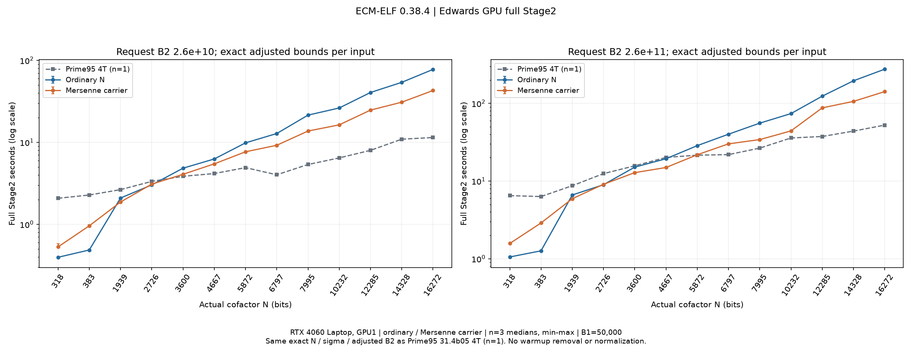

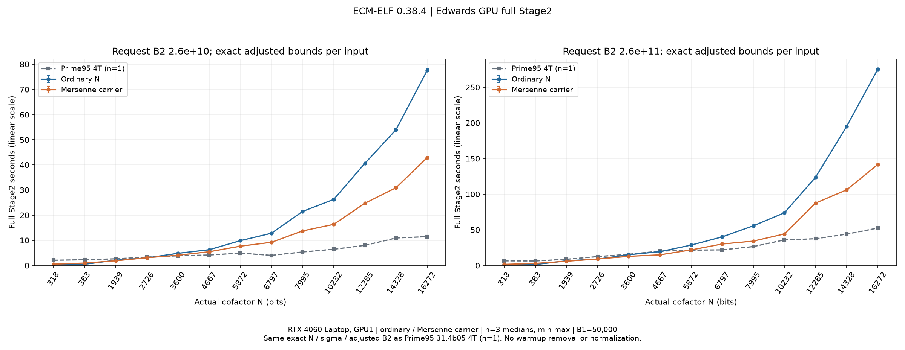

本矩阵为 Edwards、B1=50000，13 个精确余因子 N（318–16272 bits），两档 B2，普通 / 梅森承载各三次，共 156 次。低/高档请求为 2.6×10^10 / 2.6×10^11；实际调用采用 Prime95 各格上调后的 B2，不按比例换算。每次从同一 Stage1 save 开始、串行运行一条完整曲线。普通/承载在偶数轮交换顺序，没有丢弃的预热或首轮。D 自动选择；短标定、runtime tune、自动承载及 relocation 关闭，NTT 计数关闭。

下表单位秒，每格为三次完整引擎耗时的中位数；每次原值与 min/max 在图和 CSV 中。Prime95 31.4b05 为四线程历史样本，每格 n=1。

| M 指数 | N bits | 实际 B2 | Prime95 4T | GPU 普通 | GPU 承载 |
|---:|---:|---:|---:|---:|---:|
| 503 | 318 | 27,015,978,990 | 2.078 | 0.396 | 0.530 |
| 503 | 318 | 278,982,814,110 | 6.494 | 1.054 | 1.572 |
| 1009 | 383 | 27,015,978,990 | 2.279 | 0.486 | 0.959 |
| 1009 | 383 | 278,982,814,110 | 6.317 | 1.265 | 2.887 |
| 2003 | 1939 | 27,015,978,990 | 2.650 | 2.094 | 1.871 |
| 2003 | 1939 | 278,982,814,110 | 8.712 | 6.615 | 5.926 |
| 3001 | 2726 | 27,015,978,990 | 3.339 | 3.026 | 3.091 |
| 3001 | 2726 | 278,982,814,110 | 12.468 | 8.980 | 9.080 |
| 4001 | 3600 | 27,015,978,990 | 3.855 | 4.840 | 4.079 |
| 4001 | 3600 | 273,142,759,890 | 15.709 | 15.111 | 12.841 |
| 5003 | 4667 | 27,015,978,990 | 4.163 | 6.267 | 5.462 |
| 5003 | 4667 | 273,142,759,890 | 20.148 | 19.375 | 14.942 |
| 6011 | 5872 | 27,567,389,850 | 4.916 | 9.858 | 7.672 |
| 6011 | 5872 | 273,142,759,890 | 21.538 | 28.558 | 21.810 |
| 7001 | 6797 | 27,015,978,990 | 4.021 | 12.812 | 9.211 |
| 7001 | 6797 | 273,142,759,890 | 21.901 | 40.095 | 30.118 |
| 8011 | 7995 | 27,015,978,990 | 5.367 | 21.479 | 13.736 |
| 8011 | 7995 | 273,142,759,890 | 26.545 | 55.655 | 34.173 |
| 10267 | 10232 | 27,015,978,990 | 6.460 | 26.268 | 16.345 |
| 10267 | 10232 | 273,142,759,890 | 35.871 | 73.883 | 44.215 |
| 12511 | 12285 | 27,015,978,990 | 7.991 | 40.574 | 24.729 |
| 12511 | 12285 | 273,142,759,890 | 37.475 | 123.797 | 87.520 |
| 14401 | 14328 | 27,015,978,990 | 10.927 | 53.969 | 30.898 |
| 14401 | 14328 | 273,142,759,890 | 43.960 | 195.300 | 106.119 |
| 16319 | 16272 | 27,015,978,990 | 11.455 | 77.533 | 42.879 |
| 16319 | 16272 | 264,004,751,010 | 52.502 | 275.535 | 141.742 |

### 与旧全范围基准比较

旧基准同为 GPU1 RTX 4060 Laptop、驱动610.88，程序未调节时钟或功耗。GPU 利用率≥50%的整卡采样中，SM 时钟 1425–1500 MHz、中位1500 MHz，功率观测 8.425–54.960 W、中位33.672 W；这些是过程观测，不是恒定设置或进程能耗。

对照是 2026-10-17 的同一 13 输入、两档实际 B2、普通 / 承载各 n=3 基准。旧程序未记录可用的数字版本号，明确标为“历史基准（版本未记录）”，不补写版本。主要编译参数（sm89、PTX3、addsub1、outer unroll0、split8、MSVC14.51.36231）相同。两次会话未固定同一瞬时功耗、温度或后台负载，因此比较反映整版与运行环境的整体表现，不能把差额全部归因于某一个分块或尾处理改动。

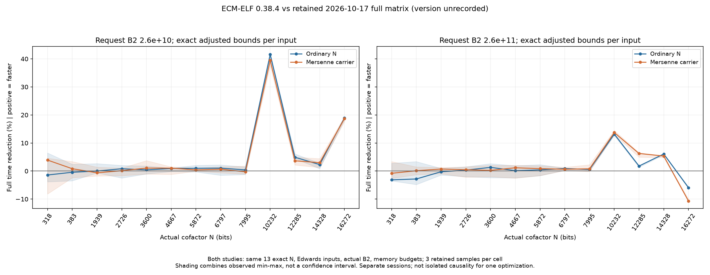

耗时减少为 `100×(1−T新/T旧)`，正值表示更快。图中线为逐格中位数之比，阴影组合两侧实测 min/max，不是置信区间。小幅差异应结合实测范围判断，不外推为全部位宽或预算的稳定加速。

| 路径 | 旧基准 26 格 / s | 0.38.4 26 格 / s | 耗时减少 | 逐格耗时减少范围 |
|---|---:|---:|---:|---:|
| 普通 | 1156.999 | 1104.824 | 4.51% | -5.95%～+41.61% |
| 承载 | 703.090 | 674.409 | 4.08% | -10.70%～+39.44% |

此处求和是每条件一条曲线的中位时间之和，作为固定矩阵工作量指标；不是单次进程计时，也不是 156 次采集的总墙钟。

普通路径的 10232–16272-bit 八格，耗时减少中位值 5.50%，范围 -5.95%～+41.61%；其中 7/8 格新版三次均快于旧版三次。318–7995-bit 十八格减少中位值 0.41%，各格仍应结合阴影范围阅读。

承载路径的 10232–16272-bit 八格，耗时减少中位值 5.81%，范围 -10.70%～+39.44%；其中 7/8 格新版三次均快于旧版三次。318–7995-bit 十八格减少中位值 0.65%，各格仍应结合阴影范围阅读。

52 格中有 5 格的 D/P 与历史基准不同。该图是整条默认路径的版本比较；即使输入界限一致，也不能当作固定 D 的单项内核实验。实际新旧 D/P 均在 CSV 中。

普通路径的 26 格独立进程墙钟中位数之和为 1144.720 秒，旧参考 1190.442 秒，减少 +3.84%。包含启动、外层规划、计时外预检及退出观察，不能按差值全归为启动，也不等同于多曲线常驻进程吞吐。

承载路径的 26 格独立进程墙钟中位数之和为 714.560 秒，旧参考 741.360 秒，减少 +3.61%。包含启动、外层规划、计时外预检及退出观察，不能按差值全归为启动，也不等同于多曲线常驻进程吞吐。

52 格中，17 格新版三次均快于旧版三次，2 格新版三次均慢于旧版三次，余下 33 格范围重叠。这只是已观测范围的比较，不是显著性检验或置信区间。

## 分项分析

### 初始化与主计算

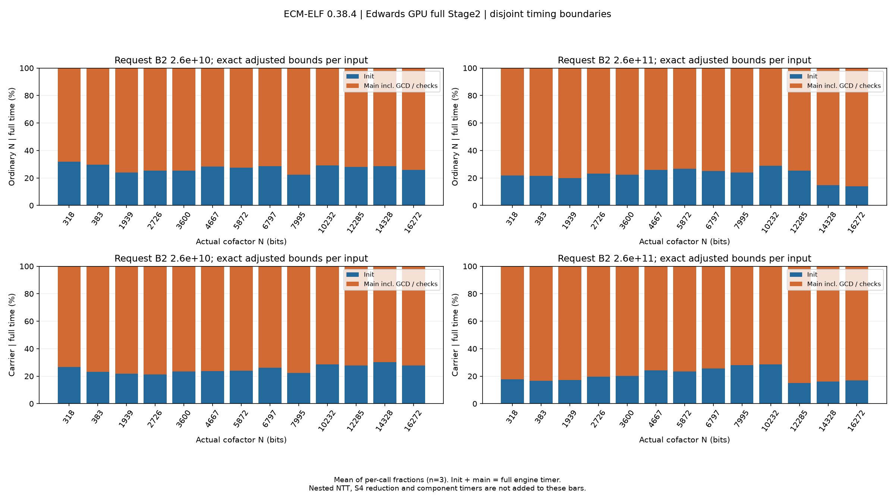

init 包含 baby 集枚举、baby 点与归一化、F 树及引擎内必需检查；main 包含 inverse、giant/G 树/fold、下降、GCD 和检查收尾。图取每次调用 init/total 的均值，另一部分为 main/total，避免将组件中位数相加后冒充完整中位数。shape 已包含在 init 中。

| 路径 | 低档初始化占比 | 高档初始化占比 |
|---|---:|---:|
| 普通 | 28.1% | 23.2% |
| 承载 | 24.0% | 19.5% |

表为每格三次比例均值在 13 个输入上的中位数，不按耗时加权。较大 B2 下初始化被摊销，主循环仍需按实际点数、G 树及 fold 工作量评价。下图分项是诊断区间，不是另一份可相加的 100% 账本。

### Giant、G 树与非满尾

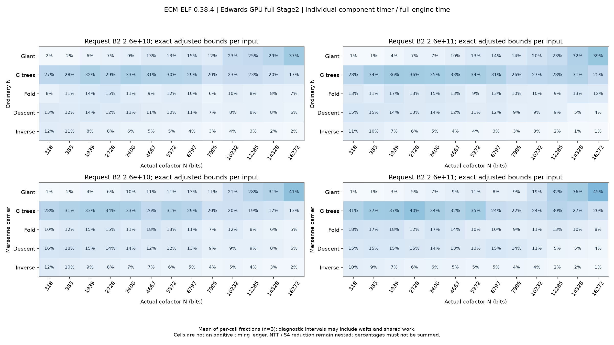

分项占比显示，较小位宽主要成本在 G 树；随着位宽增大，giant 点生成占比上升，在 16272-bit 条件约占完整耗时的 37%–45%。这为后续优化提供方向，但占比本身不能证明该组件相对旧版变慢。

Stage2 的几何由 `P=φ(D)/2`、`I=⌊B2/D⌋+2`、`G=⌈I/P⌉` 决定。增大 B2 会改变点数、G 数、非满尾与选 D，NTT 长度和预算又会产生阶梯效应；不能仅用 B2 比例或最高 NTT 长度预测完整耗时。

宽位 giant 可使用相邻 seed 和差分 chain；短尾保留受预算和单位性检查约束的路线。宽位多批次 G 树使用分块空位布局，常数 1 空位不增加真实 giant 点。非满尾按真实次数执行，程序不会为填满 P 自动扩大选定 B2。当前机制与回退条件见 [点生成](../architecture/STAGE2.md#点生成与归一化)、[G 树](../architecture/STAGE2.md#多项式与-scaled-下降)和 [G 树固定推导](../reference/ECM_STAGE2_G_TREE_LAYOUT.md)。

本次是完整版本的复测，未逐项关闭优化做因果对照。`real_batched_split` 中 giant/gtrees/fold/descent/inv 可定位成本，但异步等待、共享初始化及嵌套算术不构成独立可相加的总账。NTT、S4 reduction 已在相应树、fold 和下降中，不再加到 init/main。

### 算术承载与内存

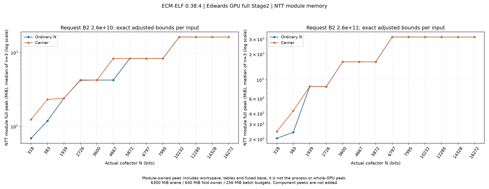

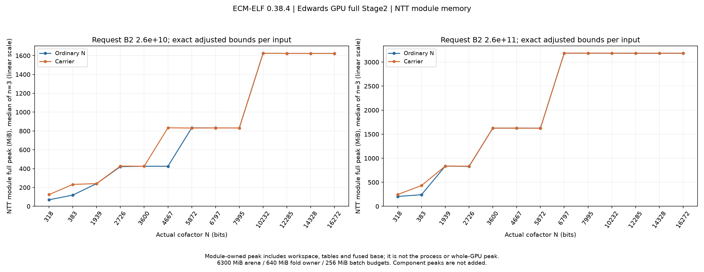

普通路径按余因子 N 运算，承载按原 Mersenne 指数运算。承载可使用快速归约，但可能扩大实际算术位宽；小余因子并不一定受益。当前完整矩阵分别显式测两条路径，不把一条路径的优点加到另一条路径上。

图为每次 `ntt_workspace_stats.full_peak_bytes` 的逐格中位数，包含 NTT workspace、表及 fuse base；它是模块峰，不是整个进程峰。arena6300 / fold owner640 / batch256 MiB 是预算，不是实测峰。NVML 是整卡采样，包含其他使用者，也会漏掉短时峰；不能相加各组件峰值，不能将整卡占用解释为本进程占用。预算公式见 [内存规划](../architecture/MEMORY.md)。

## Montgomery 全范围参考

保留同一 RTX 4060 Laptop 的 318–7995-bit、三档 B2=2.6×10^10 / 2.6×10^11 / 2.6×10^12 扫描。曲线为 PARAM0，B1=20，除 M2003 用 sigma27 外均 sigma26；目标为精确余因子，carrier=0、自动 D、arena6300/fold640/batch256 MiB、factor-only、正常算术检查。1800/2400 MHz 两次会话复用同一程序和输入；图中另保留 2026-10-08 的 55 W 设置旧扫描，使用不同的历史程序，不能将三组差额只归因于频率。三组均未记录数字版本；本轮没有重新测 Montgomery。

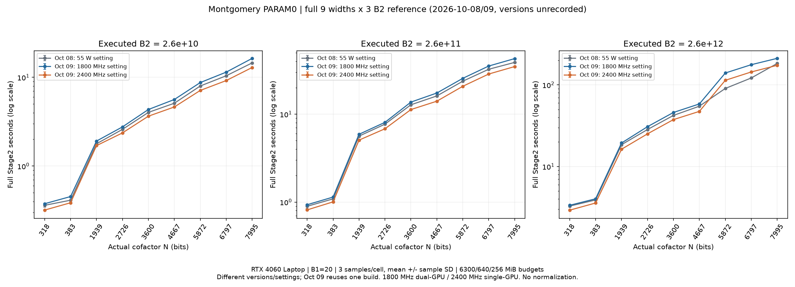

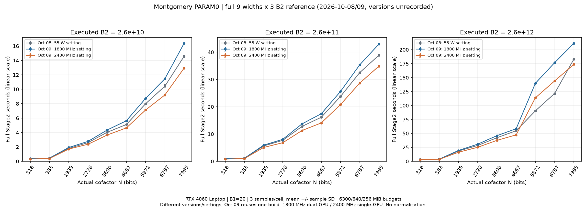

下表为完整引擎秒数，均值±样本标准差，各格 n=3。1800 MHz 为双卡会话，2400 MHz 为用户移除另一张显卡并重启后的单卡会话；设置频率不代表每刻恒频，程序没有调整设置。不同环境不作时钟或功耗归一化，也不当作 0.38.4 与旧版的曲线族 A/B。

| N bits | 1800 / 低 B2 | 1800 / 中 B2 | 1800 / 高 B2 | 2400 / 低 B2 | 2400 / 中 B2 | 2400 / 高 B2 |
|---:|---:|---:|---:|---:|---:|---:|
| 318 | 0.377±0.006 | 0.932±0.007 | 3.352±0.035 | 0.319±0.006 | 0.814±0.019 | 2.923±0.049 |
| 383 | 0.454±0.004 | 1.140±0.021 | 4.028±0.007 | 0.386±0.007 | 1.005±0.023 | 3.578±0.043 |
| 1939 | 1.914±0.018 | 5.909±0.050 | 19.429±0.089 | 1.701±0.028 | 5.073±0.076 | 16.304±0.057 |
| 2726 | 2.764±0.007 | 8.082±0.032 | 30.775±0.065 | 2.365±0.025 | 6.827±0.036 | 25.140±0.045 |
| 3600 | 4.342±0.026 | 13.733±0.034 | 45.950±0.100 | 3.650±0.003 | 11.299±0.035 | 37.557±0.077 |
| 4667 | 5.629±0.057 | 17.434±0.044 | 58.426±0.132 | 4.637±0.025 | 14.069±0.087 | 47.377±0.134 |
| 5872 | 8.734±0.018 | 25.602±0.059 | 139.805±0.045 | 7.121±0.020 | 20.792±0.128 | 113.791±0.273 |
| 6797 | 11.449±0.014 | 35.355±0.305 | 176.669±0.110 | 9.199±0.039 | 28.673±0.109 | 143.952±0.369 |
| 7995 | 16.358±0.028 | 42.968±0.308 | 211.383±0.102 | 12.917±0.046 | 34.873±0.127 | 173.644±0.166 |

图中 55 W 旧扫描的实际 SM 时钟最高2400 MHz，不能标为固定1800 MHz，也不与 1800/2400 MHz 同构建会话混为纯频率对照。各组全部27格 n=3 汇总保存在统计 JSON 中。

1800/2400 MHz 每次会话另有 27 条完整 Mersenne 数单次对照和 9 条预热，保留原始证据，未混入余因子 n=3 统计。完整 M 与余因子可能触发不同非单位回退。1800 MHz 正式格 CV 为 0.032%–1.839%，2400 MHz 为 0.081%–2.311%。2400 MHz 全进程遥测最高 2400 MHz、最高 73°C，负载期间可见约 75–86 W 的读数，观测瞬时峰 107.97 W 未经独立校准；1800 MHz 正式记录最高不超过 1800 MHz。原始遥测中的异常功率值保留，不用其平均值宣称物理能效。

完整范围显示，较大 B2 可摊销 baby/F 初始化，但宽位、大 B2 的 G 树和 fold 增长以及内存准入可改变 D/P，不能将经验幂律当作所有输入的成本保证。Prime95 精确 Edwards/Montgomery 26 格参考与 CPU 测量集中见 [参考页](EDWARDS_STAGE2.md)，不将不同 B1、sigma 或实际 B2 混为严格算法对照。

## 有界D搜索的验证范围

### 默认无tune路径

0.39.2与冻结0.38.4在同一会话逐格相邻交替运行：相同13份精确余因子save、Edwards构造、保存的B1=50000/sigma、两档实际B2、普通/承载共52格，两侧各n=1，共104次完整NF。不预热、不剔除首轮，全部D/P相同。完整引擎时间之和为旧版1800.362882秒、新版1799.730271秒，变化−0.03514%，**满足本次同会话总耗时不增加的数值门槛**；不将该微小差额解释为显著提速。普通1115.369953→1114.483256秒（−0.07950%），承载684.992929→685.247015秒（+0.03709%）。没有单项同时变慢超过5%且0.25秒，复测清单为空；一格一次不提供方差或置信区间。

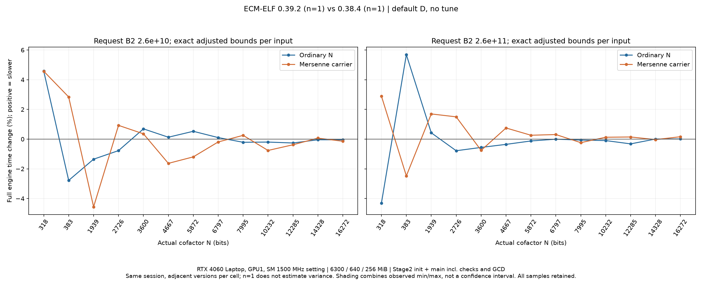

设备为GPU1 RTX4060 Laptop、SM1500MHz设置，arena6300/fold640/batch256 MiB，工具链与CUDA对象同下文身份。两侧利用率≥50%的整卡采样各6912/6958点，SM均为1395–1500MHz、中位1500；温度均为64–77°C、中位71。全程不改变GPU控制设置，GPU0用户任务不接触。两侧各GMP抽查464685、自检109440，错误0；共208份调用前后快照未检出同GPU外部计算任务，不代表连续每一瞬间的进程证明。

原始0.38.4的n=3历史基准为1779.232910秒；当前0.39.2比它多1.15203%，**历史绝对时间口径没有满足不增加门槛**。相同SHA256的旧0.38.4本次也为1800.362882秒，比自己的历史结果多1.18759%。这支持区分会话共同变化与代码差异，不能单凭温度、频率或后台负载之一认定原因；不能用本次同会话结果覆盖历史记录。两份比较、逐格原值和各自样本数分别保存在`data/benchmarks/stage2_d_search_0_39_2/paired01/`、`historical01/`。

保留的0.39.0跨会话比较同为13输入、两档实际B2、普通/承载共52格各一次，没有丢弃首轮。D/P全部与0.38.4的n=3基准一致；普通、承载的逐格时间之和分别为1113.891、683.940秒，相对旧基准1104.824、674.409秒增加0.82%、1.41%；合计1797.830对1779.233秒，增加1.05%。该跨会话数据未满足严格总耗时门槛，没有将小幅差异改写为持平。没有单项同时变慢超过5%和0.25秒；这只说明未触发单项复测筛查，不替代总耗时要求。

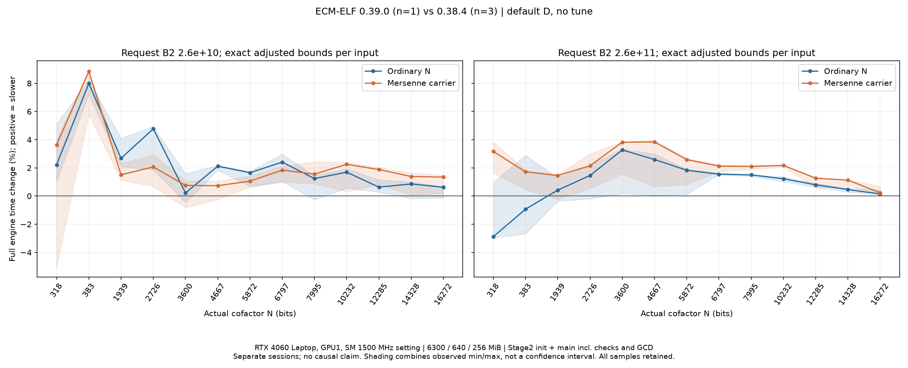

图中正值为变慢，阴影组合两侧观测范围，不是置信区间。两次均为GPU1 RTX4060 Laptop、SM1500 MHz设置、arena6300/fold640/batch256 MiB、CUDA13.3.73/MSVC14.51.36231/PTX3/addsub1/GMP Zen3，沿用同一CUDA算术对象。新会话6939个利用率≥50%的采样点中，SM为1410–1500 MHz、中位1500，温度64–75°C、中位70；旧会话温度中位62°C。未调整GPU控制设置，不能据温度差单独认定变慢原因。52次NF的GMP抽查464685项、自检109440项，错误0；104份调用前后进程快照未检出同GPU外部计算任务，快照不能覆盖每一瞬间。

### 稳定队列与准备成本

0.39.2的稳定准备开销对照采用相同worktodo入口、12条队列、固定初始性能文件，按默认承载／自动关闭缓存／自动开启缓存／自动开启缓存／自动关闭缓存／默认承载执行；不预热、不丢弃队列尾部。输入为M2003的1939-bit精确余因子、Edwards sigma27、B1=50000、B2=27015978990，设备与预算同上。各模式两条队列共24条完整NF，性能文件不变；自动两组均选择承载D210210，已有10次观察、无试跑。每组12条的队列墙钟之和取两次中位：默认承载28.367945秒、自动关闭缓存30.321465秒、自动开启缓存26.019765秒。开启相对关闭缓存减少14.19%，相对默认承载减少8.28%。对应引擎时间之和为22.401373、21.248803、21.213010秒；同D自动两组的引擎时间接近，主要改善发生在引擎外准备。

队列墙钟使用各`curve_done.wall`之和，包含worker启动、选型、完整引擎及完成进度持久化；外层进程观察退出另存，不将250ms轮询延迟混入该指标。缓存开启组的运行时准备中位0.039246秒、原生规划2次，关闭组0.523179秒、15次；首条冷准备仍计入总耗时。全部72条保留，GMP抽查215424项、自检145152项，错误0。该结果只覆盖已稳定的1939-bit队列，不能宣称高位宽、学习阶段或完整矩阵也加速同等比例。

4667-bit精确余因子M5003另以Edwards sigma26、相同B1/B2、设备与预算学习48条完整NF：普通5种D、承载9种D（含默认），36次合格观察，最终为承载D274890。冻结所得文件后，按默认承载/自动/自动/默认承载运行8条队列，各模式两队列、共32条NF；自动均已有10次观察、无试跑、文件不变。每组8条的队列墙钟中位从默认承载D180180的48.492410降到44.823560秒，减少7.57%；引擎之和43.855667降到40.952015秒，减少6.62%。32条的GMP抽查109920、自检64512，错误0。此点同时包含D改善和准备复用，不将7.57%全部归给缓存；48条学习队列另记引擎265.078187秒、队列298.009050秒，不混入稳定组。证据为`learning_n4667_0_39_2_01/`及`stable_n4667_0_39_2_01/`。

此点P从17280增到26880，giant从149940降到98281，G从9降到4；两条路线的NTT `big_peak_bytes`均为768MiB。它说明在同一大工作区容量内继续寻找D可以取得收益，不能据此推出所有任务都应取该区间最大的P。这里记录的是NTT模块大数组容量，其他owner及瞬时缓冲仍需联合生命周期核算，不当作进程显存峰值。

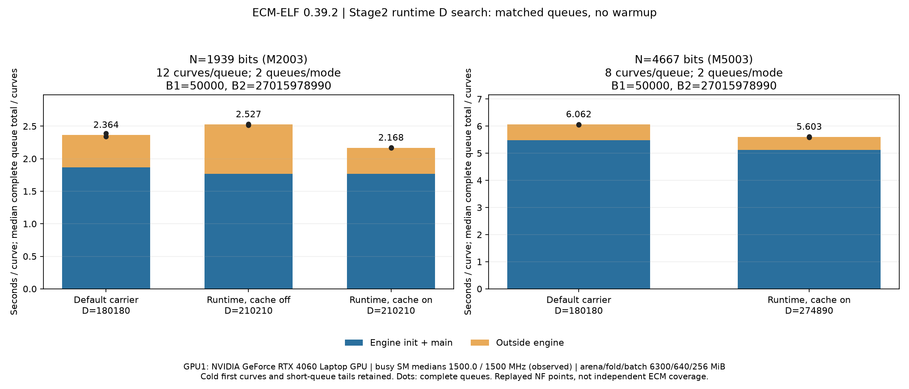

图按各完整队列总时间的中位数除以队列曲线数展示；黑点为各队列均摊时间，蓝色为引擎，橙色为总时间减引擎，包含启动、选型、预检和队列I/O，不等于单独测得的CPU内核时间。两个面板分别为12/8条、每模式两条队列，首条冷准备和短队列尾部均保留；相同保存点重放只作性能/功能观察，不计作新增独立ECM覆盖。图与逐项审计在`data/figures/stage2_d_search_0_39_2/prepare03/`和`data/benchmarks/stage2_d_search_0_39_2/prepare03/`。

### 身份与验证边界

0.39.2的69项CPU搜索/缓存检查、原有runtime/portable CPU门禁、22项GPU功能门禁、52格只规划核对通过；另有10项编排与续跑、17项比较和交替实验身份、11项绘图证据拒绝的纯CPU检查。M503的318-bit余因子重放64条NF，普通6种D、承载5种D，30次合格观察，多尺度、后续轮次、区间重启、显式锁及关闭写入均得到验证。完整默认矩阵不替代带tune的52格性能矩阵，稳定收益当前仅确认上述1939/4667-bit两点；生产B1/B2、其他设备与显存边界仍需扩展。

0.39.2 EXE SHA256为`f41849b7e2d260a1f76d19bda27488b06382090f886a4dcd3704f65f87c95792`，冻结旧0.38.4为`ad1b86808e009c9a8b152e78ba81f40fa50a97f44d4537ae585e2734ec6e944a`；沿用同一CUDA对象`a86a40017ec4b9794459764decfdbddb774a1dd4987778ec7a30ded4755dc3a7`。sm89、CUDA13.3.73、MSVC14.51.36231、PTX3/addsub1、GMP Zen3；只改主机选型与准备，不声称NTT算术内核提速。

证据根为`data/experiments/stage2_d_search_implementation_20261019/`：当前默认交替实测为`default_pair01/`，准备对照为`route_cache_ab01/`，4667-bit学习/稳定对照为`learning_n4667_0_39_2_01/`、`stable_n4667_0_39_2_01/`，完整身份与范围审计为`phase03_audit.json`及`phase04_audit.json`。含冻结EXE/DLL、91项编译输入、原始队列/命令/结果/日志与遥测。初始并发污染、错误save入口、队列参数冲突、顺序问题及较早版本的数据均保留，不混入当前有效比较；没有重标旧样本版本。复现与显式样本数审计见[工具](../../tools/bench/README_STAGE2_D_CATALOG.md#有界搜索实现验证)，更广范围见[TODO](../TODO.md)。

## 计时与环境

GPU 主指标为 `stage2_full_wall.total=init+main`，包含引擎内必需自检、点/树、多项式、GCD 和检查排空；Stage1、进程启动、外层选 D 和计时前的 Montgomery/xADD 预检排除。另保留进程墙钟，收集器以 250 ms 观察退出，该值不用于精确分离启动成本。Prime95 使用 init+main+GCD；其屏幕主计算 Total time 不等于完整 Stage2。

0.38.4 使用正式 local 构建，sm89、CUDA13.3.73、MSVC14.51.36231、Goldilocks PTX 后端3、addsub1、GMP Zen3。GPU1 为 RTX 4060 Laptop（8 GiB）、驱动610.88，GPU0 由用户另用；本任务 CUDA 构建在正式测量前完成，没有与测量并行的本任务 GPU 诊断。未调整时钟、功耗或进程优先级；power.limit 接口为 N/A，不能据此声称已测得固定功耗墙。主机 Ryzen AI 9 HX 370、Windows 11，CPU 用户声明固定 4 GHz，未采集有效 CPU 频率或 CPU 功耗。

完整进程生命周期中 GPU 利用率≥50%的 20833 个整卡采样点：SM 时钟 1395–1500 MHz、中位 1500 MHz；温度 53–68°C、中位 62°C；功率接口观测 9.079–54.952 W、中位 33.540 W。这是整卡、有限间隔的观测，不是恒定功耗、进程能耗或独立校准后的物理峰值。

## 证据与复现

本轮原始证据为 `data/experiments/stage2_v0_38_4_20261018/full_matrix/`，包含冻结的 0.38.4 EXE/GMP、13 份 save、采集器、计划、每次结果/日志/设备遥测和严格范围审计。汇总为 `data/benchmarks/stage2_v0_38_4_20261018/final/summary.json` 与 `cells.csv`，PNG/SVG 在 `data/figures/stage2_v0_38_4_20261018/final/`。图像的公开副本位于本页相邻 attachments 目录，按主题和版本命名。新增元数据和图注用版本号记录程序来源。

严格审计确认 13 个输入、52 个条件、156 个唯一完整 NF 调用，计时闭合；逐调用版本均为 0.38.4。引擎 GMP 抽样检查合计 1,394,055 项，GMP 自检合计 328,320 项，报告算术错误 0。独立末点验证与引擎抽样各有明确范围；这份无因子性能矩阵不作为每个叶值独立 oracle 或命中因子兼容性的替代。

复现入口见 [版本化测量与绘图](../../tools/bench/README_STAGE2_VERSION.md)。历史 Edwards 全范围证据在 `data/experiments/edwards_stage2_reference_20261017/matrix_01/`，Montgomery 两组在 `data/experiments/stage2_n_scaling_20261009_current/`、`data/experiments/stage2_n_scaling_20261009_2400/`；对应分组 CSV 为 `data/benchmarks/stage2_n_scaling_20261009_{current,2400}_summary.csv`，55 W 全范围为 `data/benchmarks/stage2_n_scaling_20261008_reaudit_summary.csv`。单点选型、生产 B1 探针、relocation 和完整 G 边界实验的原始记录保留在 data，开发草稿保留；它们不参与本页全范围统计。

## 待验证范围

本轮只比较单条 Edwards 曲线、固定预算、两档 B2 与 GPU1，没有测多曲线常驻吞吐、其他设备、生产 B1 或宽位 B2≥10^12。旧 Montgomery 三档全范围与 Prime95 单次参考不能替代这些复测。优先用固定 D 对照复核宽位高 B2 的默认 D/P 与 NTT 长度边界，区分选型与分块算法的影响。完整 tune、自动承载、G=1、小预算回退与可选 relocation 的选型收益须另行固定条件测量。CPU 保持历史参考，不据 GPU 改进推定 CPU 后端收益。
