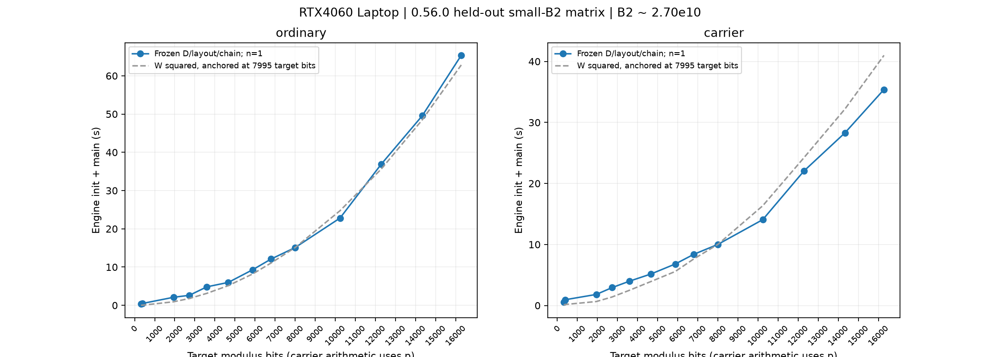
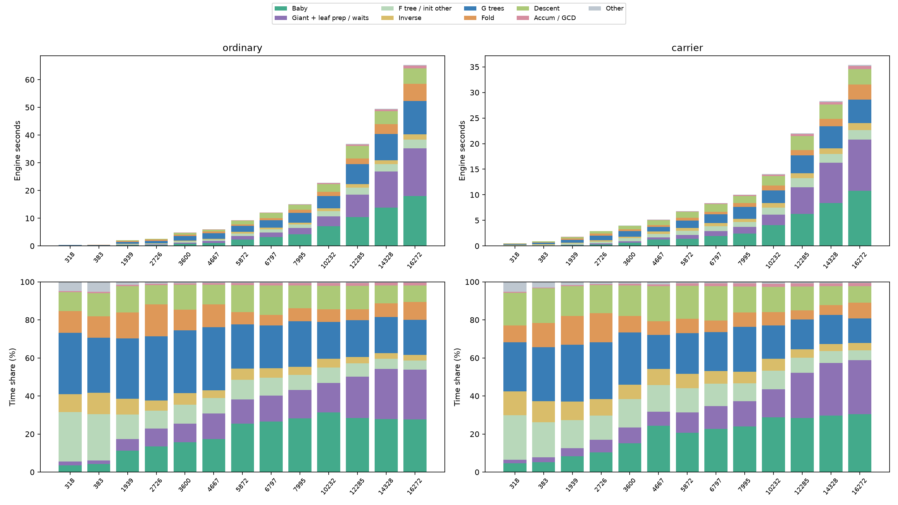
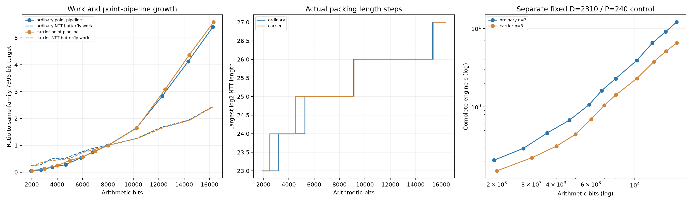
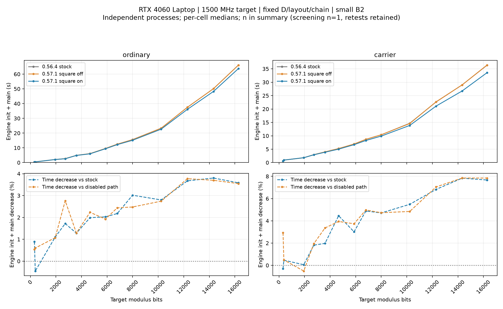
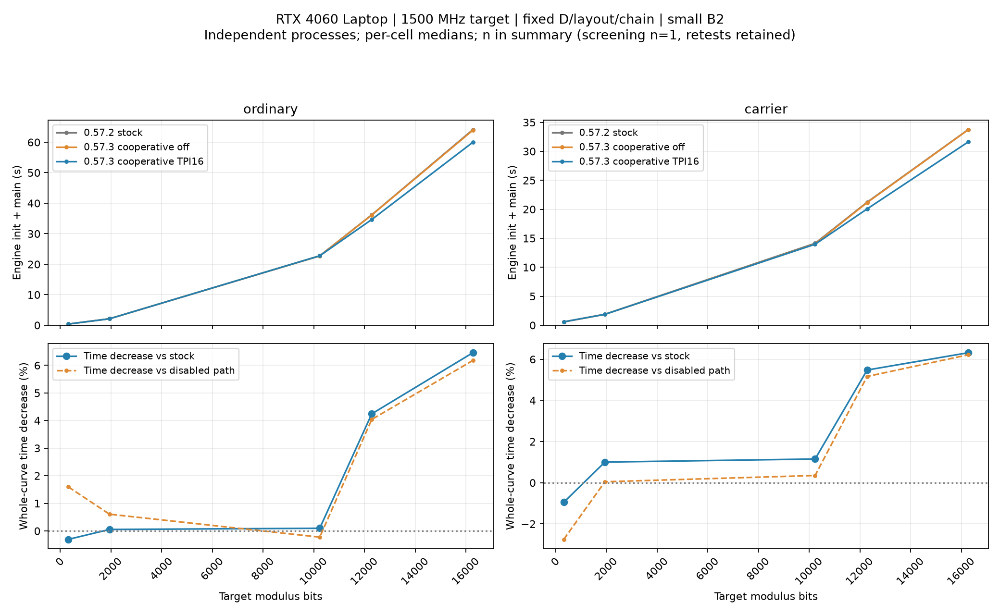
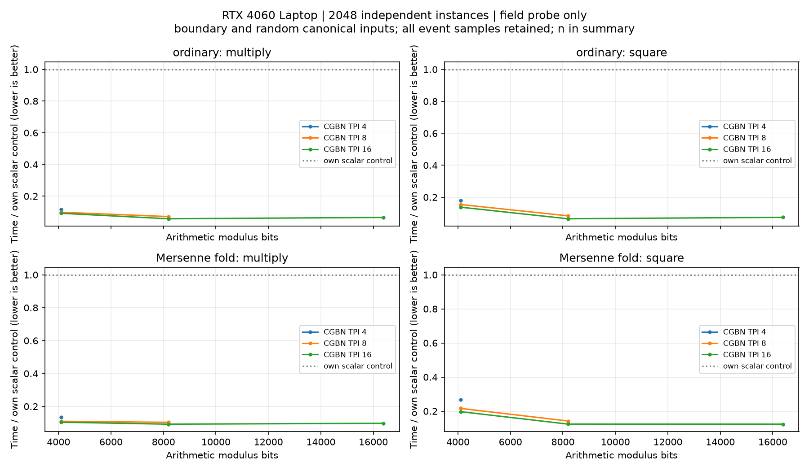
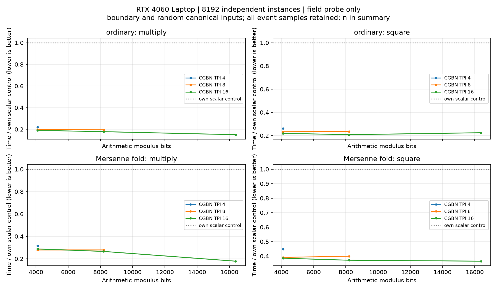
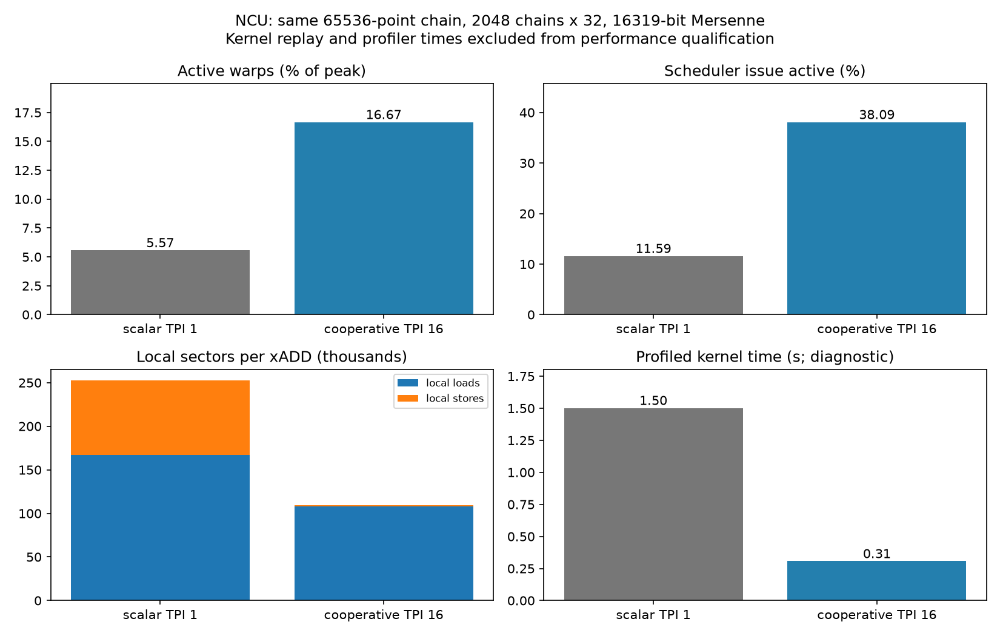

# Stage2 位宽增长、复杂度与优化优先级

高位宽下的首要问题是点算术仍有平方工作量，普通多项式系数归约也有平方项；NTT本身为长度乘对数的工作量。梅森承载已改善两类归约，但完整点乘仍保留schoolbook平方项。本页是当前实现的性能解释；完整数学推导集中于[位宽复杂度资料](../reference/ECM_STAGE2_BIT_COMPLEXITY.md)，[离线图表阅读版](../web/stage2-bit-complexity-20261101.html)由同一分析结果生成。

## 数据范围与可比较性

复杂度拟合重读下列冻结矩阵的回执、阶段日志、算术检查、输入／程序／性能文件哈希和NTT分布；点专用平方和协作giant链另有第10／11节的GPU对照，各数据范围分开：

| 数据 | 条件与用途 |
|---|---|
| 生产形状主矩阵 | ECM-ELF0.56.0，SHA256 `9e2eba5821ac8593b897c7d56cfc7e76324717214a51fef73369e8c286f1a282`；13个目标位宽318…16272 bits，普通／承载26格，52次独立off/on调用。主结论取off侧每格n=1，on侧只作敏感性核对，不与学习样本混合 |
| 主矩阵参数 | B1=50000，sigma26（M2003为27）；实际B2=27015978990，M6011为27567389850。固定已选D／G树布局／32或64链，batch256、arena6300、fold640 MiB；两侧实际点调度和NTT工作量相同 |
| 固定D控制 | CUDA0.54.0，SHA256 `e24de9c753d50ad8642bc69984374e768da60b6f4235f955358fcee7bf28b5e0`；同13位宽，两档B2=260000／2600000，D2310／P240，普通／承载每格n=3，共156次CUDA调用。不与主矩阵合并，不使用同批OpenCL成绩作CUDA拟合 |
| 设备与时钟 | RTX4060 Laptop、24SM／8GiB，驱动610.88、CUDA13.3。两份原研究以SM1500MHz为目标；主矩阵繁忙遥测2823条中2809条为1500MHz，另有1425–1485MHz。未在本轮调整显卡设置，功耗不是恒定值 |
| 计时 | `stage2_full_wall.total=init+main`，包括引擎内必需检查，排除Stage1、读档、选型、进程启动与发布。固定D小工作量控制仍含每次必需自检，不代表生产长曲线的纯kernel效率 |

原始主矩阵为`data/experiments/stage2_point_matrix_20261031/min1_full03/`；固定D控制为`data/experiments/opencl_full_matrix_20261030/quick_13/`的CUDA子集。两者都保留原字节。它们用于解释相应算法工作量，不能将旧构建成绩标成当前版本的新GPU测量。

## 符号与计量约定

### 模数、点与分块

| 符号 | 含义／单位 |
|---|---|
| \(\mathcal N,t\) | 待分解目标及其实际位数，\(t=\lfloor\log_2\mathcal N\rfloor+1\)；避免把模数数值N与位数混用 |
| \(\mathcal M,p,s\) | 算术模数、承载指数和算术位数；普通\(\mathcal M=\mathcal N,s=t\)，梅森承载\(\mathcal M=2^p-1,s=p\) |
| \(W,W_{cap}\) | 64-bit limb数\(W=\lceil s/64\rceil\)；\(W_{cap}\)是4／8／16／32／64／128／256中不小于W的最小模板容量 |
| \(R\) | 点Montgomery表示的radix \(2^{64W}\)；不是NTT素数，也不是多项式的系数个数 |
| \(B1,B2,B2_{req}\) | 已完成的Stage1界、实际执行的Stage2界及用户请求界；向上凑整开启时以实际B2计算下面的工作量 |
| \(D,P,J\) | giant步长，\(P=\varphi(D)/2\)；baby索引集\(J=\{1\le j\le D/2:\gcd(j,D)=1\}\)，\(\lvert J\rvert=P\) |
| \(I,G,g_i\) | 单次pass的giant点数、G树数及第i棵树的实际叶数；默认\(I=\lfloor B2/D\rfloor+2\)，\(G=\lceil I/P\rceil\)，\(\sum_i g_i=I\) |
| \(C,n_a,i_a,A\) | 点块容量、第a块实际点数／首个绝对giant索引及点块数；\(\sum_a n_a=I\)，未平衡的常规分块\(A=\lceil I/C\rceil\) |
| \(c,K_a\) | 一条差分链的点数，生产候选32／64；第a块的链数\(K_a=\lceil n_a/c\rceil\)。链数、CUDA块数与G树数不同 |
| \(c_{seg},q_a,z_a\) | giant分段长度、\(q_a=\lceil n_a/c_{seg}\rceil\)个段、\(z_a=\lceil q_a/64\rceil\)个求逆组；当前\(c_{seg}=16\) |
| \(g_{256},n_B\) | baby归一化组数\(g_{256}=\lceil P/256\rceil\)；最终积块数\(n_B=\lceil P/64\rceil\) |

日志中的`sigma`仍代表曲线构造参数。relocation后缀或重放须分别替换实际I、\(i_a\)、\(n_a\)并累计；不能把默认完整区间公式直接套到后缀上。

### 多项式、NTT与计数

| 符号 | 含义／单位 |
|---|---|
| \(r,\gamma_r,\kappa_r\) | 一个同形多项式请求组、重复次数、每次的独立卷积对数；逻辑卷积数为\(\gamma_r\kappa_r\) |
| \(a_r,e_r,m_r\) | 两操作数的系数个数及\(m_r=\max(a_r,e_r)\)；含常数项，不是次数 |
| \(f_r,\tau_r,o_r\) | 输出窗口起点、保留的系数个数，以及完整padding输出槽数\(o_r=2m_r-1\)；有效乘积长度为\(a_r+e_r-1\) |
| \(h_r,b_r,u_r,U_r\) | 每系数隔离位数\(h_r=2s+\max(1,\lceil\log_2m_r\rceil)\)；每NTT digit位数、\(u_r=\lceil h_r/b_r\rceil\)个digit及约\(U_r=\lceil h_r/64\rceil\)个64-bit暂存limb |
| \(q,L_r\) | Goldilocks素数\(q=2^{64}-2^{32}+1\)；\(L_r=2^{\lceil\log_2(2m_ru_r+1)\rceil}\)，且须满足\(m_ru_r(2^{b_r}-1)^2<q\) |
| \(v_r,J_r\) | 一个物理NTT提交中的slice数，及\(J_r=\gamma_r\lceil\kappa_r/v_r\rceil\)个提交；预算可能改变\(v_r\)，末提交可能不足 |
| \(M(W),S(W),\mathcal R_r(W)\) | 点模乘、点模平方及一个S4系数归约的工作成本；M/S的输出仍是W limbs，不能把多项式长度代入W |
| \(C_r(s),C_{poly}(m,s)\) | 一个实际窗口卷积请求的成本、以最大输入m概括的完整多项式卷积成本；包含NTT、packing／carry和系数归约 |
| \(C_{inv}(x),C_{gcd}(t)\) | x-bit模数的CPU求逆、目标t-bit模数的GCD成本；由GMP实际算法决定，单独保留，不能强行归并为点kernel的MAC |
| \(B_x,H\) | 组件x的bytes及某个主导驻留预算bytes；MiB=bytes／2²⁰。保留容量、当前live和峰值分别计量 |

**计数口径：**普通完整卷积每对有2次forward＋1次inverse，所以某阶段\(\Phi\)的逻辑变换数、radix-2等价蝶形数和S4归约数分别为

$$
N_{NTT,\Phi}(L)=3\sum_{r\in\Phi:L_r=L}\gamma_r\kappa_r,\qquad
Q_{bf,\Phi}=\sum_{r\in\Phi}\gamma_r\kappa_r\frac{3L_r\log_2L_r}{2},\qquad
Q_{red,\Phi}=\sum_{r\in\Phi}\gamma_r\kappa_r\tau_r.
$$

三者均不是CUDA kernel启动数。tile／outer可融合多个radix层，Graph可合并提交；改变物理batch不会自动减少逻辑蝶形数。当前窗口只减少S4转换／归约及输出，**不截短NTT**；完整\(o_r\)个槽仍做范围检查。额外自检和诊断不在这些正常请求计数中。

## 1. 从8k到16k：增长的主要来源

| 路径 | 算术位数 | 引擎时间，s | 点生成＋叶准备，s | 多项式阶段，s | S4设备归约，s |
|---|---:|---:|---:|---:|---:|
| 普通 | 7995 | 15.099 | 6.515 | 8.293 | 2.627 |
| 普通 | 16272 | 65.351 | 35.222 | 28.878 | 15.703 |
| 承载 | 8011 | 10.010 | 3.729 | 6.043 | 0.391 |
| 承载 | 16319 | 35.403 | 20.802 | 13.776 | 0.907 |

此处两端目标位数分别7995／16272；承载行使用p作为实际算术位数。多项式阶段合计F树／初始化余项、inverse、G树、fold、下降；S4事件时间嵌套其中，不能再加到多项式或引擎时间上。点组包含baby归一化、giant叶准备／同步，不能全部叫点kernel时间。

两端D207480／P20736变为D210210／P20160，实际giant数130212→128521，减少约1.3%，归约系数数减少3.24%。输入工作规模没有成倍增加；反而出现：

- 普通完整时间增至4.328倍，承载增至3.537倍。
- W²分别增至4.162／4.096倍，说明平方工作量是合适的首要检查方向；这不是对每一分项拟合平方的证明。
- 按真实分布计算的逻辑radix-2蝶形工作量只增至2.444倍。分布中的每个卷积计两个forward和一个inverse；计数排除算术自检，不是完整kernel数。
- 最高位宽的点组占53.90%／58.76%；多项式组占44.19%／38.91%。普通S4设备归约占完整引擎24.03%，承载仅2.56%，均为嵌套指标。

灰线按7995-bit目标的完整时间锚定W²，仅用于看增长形状，不是拟合出的预测模型。x轴是目标位宽，承载路径的实际计算位宽另见表格。

## 2. 经验指数：分阶段看，不能直接当作O()

用\(\log T=a+\alpha\log s\)在约8k…16k的5个位宽做最小二乘，s取真实算术位数：

因此在该测量窗口可写为普通\(T\propto s^{2.10}\)、承载\(T\propto s^{1.82}\)。这是经验拟合，不是渐近复杂度证明。

| 数据／分项 | 普通α | 承载α | 样本口径 |
|---|---:|---:|---|
| 主矩阵，完整引擎 | 2.099 | 1.821 | 每家族5个位宽、各n=1 |
| 主矩阵，点组 | 2.438 | 2.505 | 包含归一化／等待及几何、链长变化 |
| 主矩阵，多项式组 | 1.764 | 1.159 | 包含NTT、归约、准备／等待及引擎内检查 |
| 固定D，B2=260000 | 2.366 | 2.177 | 每家族5个位宽×3次，共15样本 |
| 固定D，B2=2600000 | 2.369 | 2.189 | 同上；小P工作量，不能混入生产形状均值 |

on侧的完整引擎指数为2.097／1.820，未改变上述判断。将窗口收窄到约10k…16k，主矩阵完整指数变为2.243／1.986；这个窗口依赖性本身说明不能把经验指数当作渐近复杂度、跨GPU规律或未测位宽的可靠预测。

主矩阵的D/P和链长有变化，固定D控制排除了一部分选型混杂，但仍包含初始化、自检及短任务固定成本。没有足够的独立重复来为主矩阵给出可信的统计置信区间，log拟合的高R²也不能替代因果实验。

上排是互斥阶段秒数，下排为同一调用的百分比。两家族的秒数纵轴范围不同。绿色baby和紫色giant组在高位宽明显增长；只看比例，无法区分某项变慢还是其他项变快。

## 3. 8192-bit容量、并行度和NTT台阶

默认Stage2点算术按实际W选择4／8／16／32／64／128／256-limb模板；超过8192算术bits进入NW256。这与Stage1的容器预留和TPI选择不同。默认链核每线程处理一条大整数点链，W>128时CUDA块使用32线程，否则64线程；32线程块不等于TPI32协作运算。baby ladder块仍为64线程。可选的宽位TPI16协作链见第11节。

当前单次点模乘的limb乘积、进位与归约由一个线程执行，整个点阶段则同时运行多个点／链。Baby每次launch最多处理8192个点；Giant的第a个物理点块包含\(K_a=\lceil n_a/c\rceil\)条独立链，CUDA块数为\(Q_a=\lceil K_a/\tau\rceil\)，\(\tau\)是32或64的线程块大小。链内下一点依赖前两点，不能把\(n_a\)个点都视为独立线程。

例如65536点、c=32、W>128时，有2048条链／有效线程、64个32线程块；在24SM上只有平均约2.67个块／SM可分配。这是提交规模，不是实测驻留率；寄存器、local、时钟和不均匀调度还会限制执行。上面的Baby8192点则有128个64线程块。小块、长链以及单次大整数内部串行可以同时限制giant，单纯增大TPB不会凭空增加独立链。

CGBN的TPI16／32表示每个整数实例使用16／32线程；一个warp因此分别容纳2／1个整数实例，多个warp／块／SM仍并发处理其他实例。若将同一组\(K_a\)条链分配给TPI=u的协作内核，其有效线程数可为\(uK_a\)，但总MAC不因此减少，还会增加通信并改变寄存器／local需求。第11节的可选路径采用这种分派；默认仍为标量。不能以“单次只用16线程”推断整卡利用率，也不能只凭线程增加保证加速。NTT的蝶形并行和逐系数归约并行属于另外两种调度，不与点模乘混计。

静态资源基线为0.56.4本机二进制，SHA256 `e2f8891da7d717f7df8c32d41974c4710aeb3aad693b4fe2158e39fe5d3e0dfd`。`cuobjdump --dump-resource-usage`给出；专用平方的资源变化见第10节：

| 内核 | NW128静态栈帧／thread | NW256静态栈帧／thread | 寄存器／thread |
|---|---:|---:|---:|
| chain | 13328 B | 26640 B | 64 |
| seed-pair | 11280 B | 22544 B | 74 |
| ladder | 16400 B | 32784 B | 64 |

这是编译器资源记录，不是累计访问量、全进程显存或一次kernel性能测量。STACK大且LOCAL字段为0不能解释为没有local访问；可寻址私有数组／栈也不等同于寄存器spill。此前同类NW256诊断已测得chain的long-scoreboard等待约65.50%、实际活跃warp约2.98%，但只对应64链、34个CUDA块的一个调用，不外推为当前全矩阵的计数。[点核剖析](STAGE2_PREPARATION.md#宽位chain的并行度与local访问)

主矩阵约8k时最大NTT为2²⁵，约10k…14k为2²⁶，最高档为2²⁷。NTT模块full_peak约831.9→1624.4→3183.7 MiB；这是模块峰值，不是进程峰值。物理点块数也从1增至2，但两块均走chain，没有短尾ladder可供尾块平衡消除。

左图点组时间与蝶形工作量各自按同家族7995-bit目标归一化；中图为最大长度台阶，不能代表全部长度分布；右图是独立小B2固定D矩阵，不能与左图混合拟合。

位宽翻倍时，NTT的L可能翻倍或跨多个台阶，三大数组payload随L增长，单位蝶形耗时还受tile、批量及内存层级影响。数学NTT仍为O(L log L)。当前数据没有把NTT设备事件从所有多项式／归约／等待中单独拆净，不能用多项式墙钟倒推一个“NTT平方算法”。

## 4. 复杂度结论如何指导优化

令W=ceil(s/64)。当前点模乘的普通／承载主项分别为2W²／W²；baby约需P log D次模乘，giant有限链约需I(1+log I/c)次。多项式卷积则包含L log L的变换和逐系数归约：普通归约约W²，承载归约在当前范围为线性。

当前点生成主项明确写为

$$
T_{points}=O\!\left(\left[P\log D+
I\left(1+\frac{\log I}{c}\right)\right]W^2\right),\qquad I\approx B2/D.
$$

梅森承载把点模乘主导MAC从约\(2W^2\)降到\(W^2\)，完整乘积仍为平方工作量；NTT则为\(O(L\log L)\)，须另计逐系数归约。这里的点主项尚未包含归一化、非单位恢复及其他阶段。

因此固定D/P/B2时，普通Stage2整体有显著平方项；梅森承载降低了常数和多项式归约的增长，却保留点乘平方项。若显存进一步迫使P、D随位宽缩小，giant数量还可能额外增加，条件性地产生接近B2·W³/H的工作量。这不是本批高位P近似不变矩阵的已证成因，只是大B2／预算边界必须防范的模型条件。完整推导见[数学说明](../reference/ECM_STAGE2_BIT_COMPLEXITY.md)。

## 5. 优先级与验收建议

| 顺序 | 候选 | 依据和可量化上限 | 首轮验证 |
|---|---|---|---|
| 1 | 点专用平方的验证／启用；宽位私有数组与协作乘法探针 | 约16k时点组54%／59%。把整个点组加速2倍，理想整条加速仅1.369／1.416倍；这是Amdahl估算，不是已实现收益 | 先测NW128／256、实际W128／129／160／192／255，普通／梅森、乘／平方独立GMP校验；保持现有表示和非单位回退 |
| 2 | 减少baby独立ladder；评估共同前缀／固定基点批量生成 | 最高档baby18.050／10.751s，约27.62%／30.37%。候选目标为减少P log D中的重复工作，不只调TPB | 必须保留相同j集合、曲线、尺度和因子集合；先固定D，验证每点及命中边界，不把giant均匀索引链直接套到不均匀baby索引 |
| 3 | 普通路径S4归约、与承载联合选型 | 普通最高档S4事件15.703s；承载0.907s。已有长除法及快速梅森折叠，不能再次把它们列作未实现功能 | 固定系数形状做依赖MAC／修正次数剖析；承载先验证整除及预算，再比较整条成本 |
| 4 | 固定F／逆多项式频谱复用，截断或循环middle product与NTT联合布局 | 承载最高档多项式组约39%，NTT只是其中一部分。复用一个forward可从3变换降至2，但只影响对应NTT部分，S4和其余阶段不消失 | 从固定D的fold重复乘法开始，绑定模数／形状／方向／数据生命周期并保留原路径；逐项核对变换、归约及内存占用 |
| 5 | D/P、布局、链长、物理分块和预算联合模型 | 一味增大D会把成本从giant移到baby；压小P可能增加巨步和内存回退。32／64生产选型、尾块平衡及布局身份已经实现 | 使用当前受保护默认作参考；只测近邻与边界代表，先小B2高位3格，不立即重跑完整大B2矩阵 |

专用平方的部分积潜力可进一步量化：chain为4M+2S，ladder位步为7M+4S。若只把平方的完整乘积由W²降到约W²/2，普通Montgomery归约不变，则chain／ladder主导MAC约少8.33%／9.09%；梅森路径约少16.67%／18.18%。这是理想部分积计数，额外进位、访存和寄存器压力可能抵消收益，不能直接写成GPU或完整Stage2加速。

一步Karatsuba也只是减少约四分之一完整乘积的主导部分积；普通REDC仍平方，递归scratch和local访问可能吃掉收益。相比直接移植完整大整数FFT，先比较专用平方、单层Karatsuba和小TPI协作更容易限定正确性及性能边界。

## 6. 子阶段的可预测工作量

本节给出**正常、无命中、无非单位恢复**的主路径。多项式闭式计数进一步限定为I>P、缓存逆、多G驻留fold、保留P系数及scaled下降；这与`planning/requests.h::request_program`的合同一致。单G、主机兼容路线、自检、诊断、失败后重放须另计，不通过删掉这些成本“满足”公式。

| 子阶段 | 可预测的核心计数 | 工作复杂度；以下各式须另计CPU及线性搬运 |
|---|---|---|
| Baby点 | P点，\(\sum_{j\in J}(5+11\lfloor\log_2j\rfloor)\)次M/S调用 | \(O(P\log D\,M(W))\) |
| Baby归一化 | GPU模乘\(4P-3g_{256}\)；CPU组根逆\(g_{256}\)次 | \(O(PM(W)+g_{256}C_{inv}(t))\) |
| F树 | P−1对卷积；3(P−1)次NTT | \(O(C_{poly}(P,s)\log P)\) |
| 级数逆 | \(2H_P\)对卷积；\(6H_P\)次NTT，\(H_P=\lceil\log_2(P+1)\rceil\) | \(O(C_{poly}(P,s))\)，按倍增形状求和 |
| Giant点／seed | I点、\(\sum_aK_a\)条链；按6.5节求seed和链体调用数 | \(O(I(1+\log I/c)M(W))\) |
| 段积／组积 | 按每块\(n_a-q_a+f_a\)、\(q_a-z_a+f'_a\)计模乘 | \(O(IM(W))\)，CPU逆另计 |
| G树 | I−G对卷积；3(I−G)次NTT | \(O(GC_{poly}(P,s)\log P)\) |
| Fold | 3(G−1)对卷积；9(G−1)次NTT | \(O((G-1)C_{poly}(P,s))\) |
| Scaled根／下降 | 2P−1对卷积；3(2P−1)次NTT | \(O(C_{poly}(P,s)\log P)\) |
| 积块／NF GCD | P−\(n_B\)次GPU模乘；\(n_B\)次CPU GCD | \(O((P-n_B)M(W)+n_BC_{gcd}(t))\) |

\(O(C_{poly}(P,s))\)等写法省略次数与系数数之间的+1常数，精确长度始终按请求中的\(a_r,e_r\)计算。此表的NTT次数指逻辑单变换，不是batch／kernel数。

### 6.1 读档、验证和规划

读档的工作量取决于实际读取／校验的save字节数\(S_{save}\)，约为\(O(S_{save})\)的I/O、解码及哈希，再加模数／因子整除验证的大整数成本。它不按B2生成点，也不执行Stage1的B1轮次。解析整份save与读取一个记录有不同的\(S_{save}\)，不能直接用文件大小除以单条曲线数预测耗时。

规划枚举\(K_D\)个实际候选及其算术家族／布局，对每个候选生成分组请求并查询形状、生命周期和预算；其成本约为“被考察的候选数×每候选的请求／分配事件数”。压缩重复G批次时不必逐点或逐G展开。实际短校准属于额外计算，应以被测曲线计入，不能当作单纯规划CPU开销。

这两个阶段在外层完整曲线墙钟内，在本页`init+main`拟合之外；引擎内部mandatory自检属于初始化／校验成本，不是文件读取成本。

### 6.2 Baby点及归一化

对正整数j，当前ladder先做一次xdbl，再处理\(\ell(j)=\lfloor\log_2j\rfloor\)个位步。六模乘xADD开启时：

$$
Q_{baby,M}=\sum_{j\in J}[3+7\ell(j)],\qquad
Q_{baby,S}=\sum_{j\in J}[2+4\ell(j)],\qquad
Q_{baby}=\sum_{j\in J}[5+11\ell(j)].
$$

即使j=1，现有ladder仍计算初始倍点。这些是“模运算调用数”，每次调用再乘M(W)或S(W)，不是64-bit乘法数。关闭专用平方时S=M；启用后应分别按M／S成本建模，整体仍为\(O(P\log D\,M(W))\)。正常device baby不在ladder结束时将每个X/Z转换出Montgomery表示，不能额外加2P次转换。

256点分组归一化的上行乘积树需\(P-g_{256}\)次模乘，下行逆传播需\(2(P-g_{256})\)次，最终X/Z需P次：

$$
Q_{baby,normalize,GPU}=4P-3g_{256}.
$$

CPU还尝试\(g_{256}\)次组根求逆、一次radix求逆及组根尺度修正，均按目标\(\mathcal N\)的合同计算；承载时不要求在整个承载环中求逆。全单位时为\(O(PM(W)+g_{256}C_{inv}(t))\)，另加CPU尺度修正；失败组会回读坐标并逐点恢复，不属于这个正常计数。依据：`points.cpp:614`的`device_baby_generate`、`device/baby_giant.cuh:16/29/45`。

### 6.3 F树

F树P个一次叶有**P−1对非空逻辑乘法**。层内孩子次数为\(d_l,d_r\)时，请求的输入系数数为\(a=d_l+1,e=d_r+1\)，保留\(\tau=d_l+d_r+1\)个系数；与常数1的空分支只复制。

连续左布局的层宽\(h=1,2,4,\ldots\)：满配对\(\lfloor P/(2h)\rfloor\)个\((h+1,h+1)\)，若\(r=P\bmod2h>h\)再加一个\((h+1,r-h+1)\)尾乘。逐形状计算\(L_r\)，即可预测该层NTT长度分布，而不是把P−1次全部视为根长度。

$$
T_F=\sum_{r\in F}\gamma_r\kappa_r C_r(s)
=O(C_{poly}(P,s)\log P).
$$

其中完整请求成本\(C_r\)在6.8节定义。依据：`geometry.h::tree_multiply_groups`、`requests.h:59`、`cuda/tree.cpp::build_tree_flat`。

### 6.4 反转F的级数逆

逆长度为P+1。令\(x_0=1,x_{j+1}=\min(2x_j,P+1)\)，共\(H_P=\lceil\log_2(P+1)\rceil\)轮Newton，每轮两对卷积：

$$
(a,e,\tau)=(x_{j+1},x_j,x_{j+1}),\quad
(x_j,x_{j+1},x_{j+1}).
$$

故逻辑乘法数为\(2H_P\)，归约系数数为\(2\sum_jx_{j+1}\)，每个请求仍按较大输入选择完整NTT。另有一次标量首项求逆，monic F的首项为1。时间可直接求和；在常用增长条件下，倍增序列成本为\(O(C_{poly}(P,s))\)，不能误算成P次完整大卷积。依据：`cuda/remainder.cpp:122`、`requests.h:86`。

### 6.5 Giant点、分段与G树

第a块的第k条链起点为\(j_{a,k}=i_a+kc\)，长度\(d_{a,k}=\min(c,n_a-kc)\)。正起点的seed-pair复用一次ladder，同时得到两个相邻点：

$$
Q_{seed}=\sum_{a,k}[5+11\lfloor\log_2j_{a,k}\rfloor],\qquad
Q_{chain}=6\sum_{a,k}\max(0,d_{a,k}-2).
$$

链体中M／S次数分别是上式求和的4倍／2倍；seed中的M／S与baby相同。若绝对起点为0，现有核直接构造单位点和基点，seed不套用log公式。走独立ladder的块改用\(\sum_j[5+11\lfloor\log_2j\rfloor]\)，开启普通坐标输出时再加每点2次转换。还应单列[D]Q基点与尺度准备，约\(O(\log D\,M(W))\)。

每块坐标做分段乘积：\(q_a=\lceil n_a/c_{seg}\rceil\)个段，扫描需\(n_a-q_a\)次模乘，精确尺度修正再加\(f_a\)次，\(f_a\)是长度大于1的段数。驻留分组将\(q_a\)个段再按64分组，同理需\(q_a-z_a+f'_a\)次。CPU通常只处理组根及段逆，求逆数量由实际分组／回退决定，不是每个giant点一次。正常giant准备仍为\(O(IM(W)+\sum_a z_aC_{inv}(t))\)量级，叠加上述seed成本；目标投影、组内尺度和Gamma另计。

第i棵G树有\(g_i-1\)对逻辑乘法，总数为

$$
Q_{Gtree}=\sum_i(g_i-1)=I-G.
$$

布局改变各节点的\((d_l,d_r)\)及NTT长度，不改变这个逻辑对数。总成本为\(\sum_iO(C_{poly}(g_i,s)\log g_i)\)，保守写为\(O(GC_{poly}(P,s)\log P)\)。首棵G根直接成为H，不执行fold。依据：`point.cuh:343`的seed-pair、`giant_chain.cuh:6`、`points.cpp:261/338`、`giant_tree.h`。

小素数补充检查单列：令\(U=\{q\text{为素数}:B1<q\le\min(B2,D/2)\}\)，\(U_{miss}\)为没有可复用baby归一化证明的子集。当前每个missing值做普通输出ladder，约\(\sum_{q\in U_{miss}}[7+11\lfloor\log_2q\rfloor]\)次模运算及一次目标GCD；已复用值不重算点。CPU还枚举／测试这个区间。B1会通过U改变这里的工作量，但不会改变一次点平方的位宽。依据：`cuda/batch.cpp:52`。

### 6.6 逐G折叠

后续每个G根与H相乘，再按F取余。设根有\(n_g\)个系数、H有\(n_h\)个系数，先做\((n_g,n_h)\)卷积，保留\(n_t=n_g+n_h-1\)个系数。若\(n_t>P\)，设\(k=n_t-P\)，再做窗口\((k,k;\tau=k)\)和\((k,P+1;\tau=P)\)，减法保留P系数。

在本节主路径中，每次fold都有这三对卷积，因此逻辑乘法数为**3(G−1)**；反转、gather、减法和尺度数据搬运另外为\(O(GPW)\)。时间为\(O((G-1)C_{poly}(P,s))\)。窗口减少归约数，但没有把每对的2F＋1I变换改成短变换。依据：`requests.h:68`、`cuda/remainder.cpp::FoldDeviceState`。

### 6.7 Scaled根、下降、积块与GCD

scaled根先做一对\((P,P;\tau=P)\)卷积。F树每个双非空内节点，设左右次数a、b，再对左右孩子各做一次middle product：\((a+b,b+1;f=b,\tau=a)\)及对称请求。因此**根＋下降共有2P−1对逻辑乘法**。

$$
Q_{descent,red}=P+\sum_{v:\,\text{双非空内节点}}d_v,\qquad
T_{descent}=O(C_{poly}(P,s)\log P).
$$

\(d_v\)是该内节点的次数。空分支复制／清零只计线性字节工作；根Gamma／目标投影另计\(O(PM(W))\)的上界。依据：`requests.h:117`、`cuda/remainder.cpp::descent_scaled`。

最终P个叶按64成积块，设备模乘**P−n_B次**，NF时CPU做**n_B次GCD**。命中块至多再检查其实际叶数；最坏还可能多P次叶GCD及可选命名／分解，不能使用NF成本预测所有命中任务。

$$
T_{accum,NF}=O((P-n_B)M(W)+n_BC_{gcd}(t)).
$$

已在设备上的叶值不必再H2D；具体路线仍可能为CPU验算／发布读取叶值。GCD对象是目标\(\mathcal N\)，承载的叶／块积先按合同投影。依据：`point.cuh:419`、`cuda/batch.cpp:922`。

### 6.8 单请求、自检与完整计数

一个普通卷积请求的工作上界可按实际窗口写为

$$
C_r(s)=O\!\left(L_r\log L_r+L_r+m_rW+o_r+
\tau_r\mathcal R_r(W)\right),
$$

其中普通\(\mathcal R_r=O(W(U_r-W+1))\)，梅森有界折叠\(\mathcal R_r=O(U_r+W)\)。第一项不是系数级模乘；\(o_r\)项包括被窗口省略的系数仍进行的范围检查。物理提交数为\(\sum_rJ_r\)，CUDA启动数还取决于每形状的tile／outer／carry／Graph，不存在恒定的“每卷积几个kernel”。

上述多项式主路径合计逻辑卷积数可闭式核对：

$$
Q_{poly}=(P-1)+(I-G)+2H_P+3(G-1)+(2P-1)
=3P+I+2G+2H_P-5.
$$

总变换数为\(3Q_{poly}\)，但各自长度不同；总蝶形仍须逐请求累加。示例P20160、I128521、G7、\(H_P=15\)：F20159、G128514、inverse30、fold18、根／下降40319，合计**189040对卷积、567120次逻辑变换**，与本批最高位普通日志的长度分布总数一致。该计数没有包含必需自检。

当前基础点模乘自检保留2048组；专用平方启用时另加128组平方。协作链请求且位宽合格时，再加64组协作乘法及64组协作平方，三类检查复用原有设备缓冲。S4每个新\((h,u,b)\)形状有96窗口自检。若遇到\(K_S\)个新S4形状，自检工作约为

$$
2048M(W)+128\mathbf1_{square}S(W)+64\mathbf1_{coop}(M_C+S_C)
+96\sum_{j=1}^{K_S}\mathcal R_j(W).
$$

\(M_C,S_C\)是固定16384-bit协作容器的成本，当前协作平方调用一般乘法。另加对应CPU参考计算、GMP抽样、carry检查及排空。协作检查额外D2H为\(1024W\) bytes，没有额外H2D或显式设备数组。形状数不等于NTT长度数，冷／热缓存也会改变初始化成本。发布、可选因子分解主要与结果数量和因子本身有关，没有仅凭B2／位宽就能可靠确定的固定复杂度。

## 7. 分阶段内存与数据量

以下是payload公式，不是进程实测峰值；借用不重复计，缓存保留按容量计。完整依据及根表／pass表公式仍由[内存说明](../architecture/MEMORY.md)维护。

| 阶段／对象 | 可预测的容量或数据量，bytes | 边界 |
|---|---|---|
| 点模乘／平方的单个操作数、完整乘积 | \(8W\)、\(16W\)；实际临时数组受\(W_{cap}\)影响 | 栈帧包含嵌套函数及其他坐标，不能只用一个乘积数组预测local流量 |
| Baby设备正常临时量 | \(8[(3P+5)W+P+WT_8]+g_{256}\)，\(T_8=\sum_{l=1}^8\lceil P/2^l\rceil\) | 5常量、索引、X/Z、积树、叶输出、mask；在F树前释放 |
| Baby正常传输 | H2D：\(40W+8P+8g_{256}W+g_{256}\)；D2H：\(8g_{256}W+8PW\) | 没有非单位／额外检查时；两个方向不能当作同时驻留内存 |
| 完整F树主机系数 | 逻辑payload \(8W[P(h_P+1)+2\widehat P]\)，\(\widehat P=2^{h_P},h_P=\lceil\log_2P\rceil\) | 含空常数节点与未用0槽；不含vector capacity余量、对象、degree、叶副本和构建临时量；量级\(O(WP\log P)\) |
| Host来源多项式的搬运基准 | 各有效操作数各传一次：输入\(8W\sum\gamma\kappa(a+e)\)、输出\(8W\sum\gamma\kappa\tau\) | 若输入按m补齐则为\(16W\sum\gamma\kappa m\)；驻留/借用减少这些传输，精确值按来源统计 |
| NTT大工作区 | 单请求\(8\nu L_rv_r\)，\(\nu\in\{2,3\}\) | slice批量、B/Q复用、pool与缓存决定保留量；不是整个arena |
| NTT digit／verdict／carry | \(8(o_r+2)v_r\)；有carry scratch时另加\(8\lceil L_r/256\rceil v_r\) | carry取实际inner batch与阈值；表、base及S4结果另计 |
| S4窗口输出 | \(8W\tau_rv_r\) | 是compact窗口输出；不意味着NTT只处理这些系数 |
| G树compact raw A/B | 对\(n>1\)：新租约所需\(8W[3n+\lceil n/2\rceil]\)；metadata为\(12\widehat n\) | raw A为2n、B为\(n+\lceil n/2\rceil\)系数；缓存可能保留更大容量；非compact另按布局 |
| Giant坐标／seed／段积 | X/Z：\(16n_aW\)；paired seeds：\(16W(2K_a+1)\)；段积：\(8q_aW\) | 点块可跨多棵G树。seed／base等可跨块保留；ladder路线可增大seed容量 |
| Giant驻留组根搬运 | 每块正常D2H约\(8z_aW\) | 不等于全坐标D2H；组逆／fix的H2D及非单位恢复另计 |
| Fold owner／frontier | 默认reuse=3时\(8W(7P+7)+48\)；frontier metadata另加\(24P\) | frontier状态借用owner，不再加一份“frontier峰”；预算回退改用其他路径 |
| 最终叶与积块 | \(8PW\)、\(8n_BW\) | 主机最终叶回读正常为8PW；块积回读为\(8n_BW\)，是否两者都传取决于路线 |
| 基础点／S4自检瞬时缓冲 | \(8W(3\cdot2048+1)\)；每新形状\(8\cdot96(u_r+W)\) | 不是全部自检同时分配；旧NTT缓存可能仍存活 |

显存和主机内存分别按时间线求峰，不能相互混加：

$$
B_{GPU,owned,peak}=\max_t\sum_{x\in\text{当时设备所有者}}B_x(t),\qquad
B_{RAM,owned,peak}=\max_t\sum_{x\in\text{当时主机所有者}}B_x(t).
$$

不能把上表的各自容量／峰值直接相加。当前`curve_workspace_memory`还计算设备free准入、预留、初始化和回退上界；预算上限不是预分配量。主机峰还包括save解析／缓存、F树、逆和H、多项式staging及对象容量；CUDA上下文、编译器local资源、其他进程应分别报告，不能由上述显式payload直接推导NVML进程峰。

最高位示例P20160、W255：baby设备公式为164518039 bytes（156.90 MiB），默认fold owner为287899128 bytes（274.56 MiB）。根NTT为2²⁷时，3个大数组本身为3072 MiB。这些对象处于不同生命周期，仍不能据此写成总峰。

## 8. 点专用平方的位宽，以及NTT／CGBN是否适合

### 8.1 平方操作数有多宽

专用平方针对每个点坐标或中间残数\(x<\mathcal M\)，不是把P个点拼成一个平方：输入最多s bits、W个64-bit limbs，未归约乘积最多2s bits、约2W limbs，归约输出仍为W limbs。实际值可能有前导0，现有固定宽循环不会因此自动缩短。B1、B2、D及chain长度影响调用次数，不直接决定每次平方的位宽。

| 当前数据中的目标 | 路径／算术位宽s | 实际W | 模板容量／bits |
|---|---|---:|---|
| 7995 bits | 普通7995／承载8011 | 125／126 | NW128／8192 |
| 16272 bits | 普通16272／承载16319 | 255／255 | NW256／16384 |

进入NW256会增大私有数组容量，但不是所有模乘都无条件执行256²次；主循环使用实际`nw`。这也不是Stage1的额外6-bit容器或TPI规则。专用平方使用相同的s／W和归约合同，通过`NTT_POINT_SQUARE=0|1`进行同二进制对照：0使用`s2g_mont_mul(x,x)`，1使用严格上三角和对角线的专用乘积，随后调用共享归约。两者输出尺度相同，新增验证不替代原有2048组模乘自检。

### 8.2 CGBN不是\(O(s^{1.585})\)算法

\(O(s^{\log_2 3})\approx O(s^{1.585})\)是**递归Karatsuba**的乘法复杂度。CGBN首先是一种每大整数由4／8／16／32线程协作的实现方式；算法与线程组织是两个维度，可以组合，但不是同义词。[NVlabs说明](https://github.com/NVlabs/CGBN)给出的固定环境范围为32…32768 bits、32-bit递增。

本地`third_party/cgbn/include/cgbn/impl_cuda.cu:518/526/1027/1032`中，`sqr_wide(a)`调用`mul_wide(a,a)`，`mont_sqr(a)`调用`mont_mul(a,a)`；IMAD实现`core/core_mul_imad.cu:81`、`core/core_mont_imad.cu:28`是循环的部分积与消元，没有递归Karatsuba。令n为总32-bit limb数、TPI固定，跨所有协作线程的工作量仍为\(\Theta(n^2)\)；不能把单线程分摊的约\(n^2/TPI\)误称为整个算法次平方。

因此CGBN或自写小TPI协作可能降低每线程私有状态和串行依赖，让少量宽位chain获得更多可执行线程。代价包括shuffle／同步、每SM能驻留的独立点数下降、编译体积与容器padding。第11节已验证可选TPI16链；尚未比较TPI32完整链，不能套用Stage1的最优TPI。sm89协作探针实际使用的WMAD及规范余数合同，另见[固定资料第8节](../reference/ECM_STAGE2_BIT_COMPLEXITY.md#8-协作容器与原montgomery尺度)。

对承载尤其要保留当前线性梅森归约；直接改用通用CGBN `mont_mul`会重新引入普通Montgomery消元。当前可选协作链采用“协作完整乘积＋专用梅森归约”，普通路径保留CGBN REDC。普通模数若仅将完整乘积换成Karatsuba、REDC不变，完整模乘的渐近平方项仍存在。[Karatsuba递推](https://gmplib.org/manual/Karatsuba-Multiplication)

若要让普通模乘也获得次平方的工作量，须把归约一并改为与快速乘法匹配的方案，例如基于预计算倒数的Barrett或快速Montgomery归约。它们会增加乘法、窗口／carry及修正，不能在NTT成本对照中省略；同一模数可复用的倒数和常量频谱则是潜在收益。此处是后续研究范围，当前点后端仍使用既有REDC。

本地引用快照：`impl_cuda.cu` SHA256 `21094ef6170489ec25c7f43fe7ac3376994c8a5ec5c49ef831a803cbe6d2ed0a`；上述IMAD mont／mul文件分别为`68c5b6061bd6817457eaf5e87fc41c9cc748f2ce05209b34d888d8752cd35f4c`／`d4d0aa5a3f21b2c4dbfc846638d57fb44967e79249f66081743985b24840b6a2`。结论限定于这些路径，不凭库名推断其他分支。

### 8.3 单个点模乘用的NTT会很短

单个s-bit整数若按\(\beta\)bits拆为\(k=\lceil s/\beta\rceil\)个digits，完整乘积可以用

$$
\ell=2^{\lceil\log_2(2k-1)\rceil},\qquad
k(2^\beta-1)^2<q
$$

的线性卷积精确求出。普通乘法需2F＋1I，平方可复用同一输入，只需1F＋1I；都仍需点乘、carry、表示转换及模归约。这里的\(\ell\)是**一个点整数**的长度，与产品树\(L_r\)的2²⁵…2²⁷完全不同。下表固定\(\beta=27\)，单Goldilocks素数满足上述界，属于候选设计计算，不是现有点后端实测。

| s bits | k digits | 单点NTT长度ℓ | 乘法／平方等价蝶形数 | 3／2个8-byte数组payload |
|---:|---:|---:|---:|---:|
| 4096 | 152 | 512 | 6912／4608 | 12／8 KiB |
| 8192 | 304 | 1024 | 15360／10240 | 24／16 KiB |
| 16384 | 607 | 2048 | 33792／22528 | 48／32 KiB |

蝶形数不是64×64 MAC数，二者指令、归约和访存成本不同。数组只是候选payload，不包含根表、坐标、carry与同步；若放进shared，需比较每SM资源和并行组数。现有多项式API对一个系数仍预留约2s-bit slot及其卷积空间，不能假定将m设为1就得到上表的紧凑单整数实现。

**是否已经足够大：数学上可行，性能交叉点尚未实测。**当前上限16k bits（256个64-bit limbs）还不足以仅凭O()断言NTT更快。单线程schoolbook当前很慢，不代表NTT一定胜过优化后的专用平方、协作schoolbook或浅层Karatsuba；大量独立baby适合批处理，而同一ladder／chain内有连续依赖，不能为每次模乘单独做主机提交／分配。

2024年[Oancea／Watt的GPU中等整数研究](https://arxiv.org/html/2405.14642v1#S6.SS3)在A100上比较二次、有限域FFT和CGBN，报告FFT相对其优化二次实现约在2¹⁵-bit附近形成交叉。其低半乘积／融合程序、批量和硬件不同，既不是本仓库的完整模乘门槛，也不能直接套到4060。它支持把NTT列入实测候选，不能作为本项目已经达到交叉点的证据。

首轮应在相同的实际W、普通／承载和点数下比较：现有模乘、专用平方、小TPI协作、浅层Karatsuba、设备内融合短NTT。先分别测吞吐量与依赖链延迟，再测完整xADD／ladder；最后固定D做整条小B2 A/B。NTT候选优先放在宽位和梅森线性归约路径，不将普通REDC成本从比较中删除。跨大小自动分派须在这些数据完成后确定，而不是现在设一个未经测量的bit阈值。

## 9. 将子阶段合并为Stage2

从工作量账本出发，应先按实际形状求和：

$$
\begin{aligned}
T_{engine}={}&T_{setup/check}+T_{baby,points}+T_{baby,norm}+T_F+T_{inverse}\\
&+T_{giant,points}+T_{segment/group/\Gamma}+T_{Gtrees}+T_{fold}\\
&+T_{root/descent}+T_{accum/GCD}+T_{small\ primes}+T_{finalize}.
\end{aligned}
$$

这是一份互斥阶段账本；不要再把嵌套S4／NTT事件或等待墙钟加一次。外层还需读档、规划、实际短校准、进程启动、可选分解与发布。普通／承载的求逆、非单位恢复和目标投影按各自合同计入。

以同一条曲线的外层边界计量，完整Stage2还应写成

$$
T_{curve}=T_{read/validate}+T_{plan}+T_{calibration}+T_{spawn/IPC}
+T_{engine}+T_{factor}+T_{publish}.
$$

短校准包含其自身子进程和算术成本；不能既计入calibration，又把这些试算重复加进该条正式曲线的engine。是否触发短校准由覆盖范围／配置决定，不能用一个恒定百分比代替。

若在一个局部范围视digit位数b稳定，采用6节的保守树上界，可以合并为

$$
\begin{aligned}
T_{engine}=O\!\Bigg(&
\left[P\log D+I\left(1+\frac{\log I}{c}\right)+P+I\right]M(W)\\
&+(P+I)\left[\frac{s}{b}\log(Ps/b)\log P+
\mathcal R(W)\log P\right]\Bigg)+T_{host}+T_{small}+T_{check}.
\end{aligned}
$$

点平方分开后，第一行应用各自M／S调用数重写。\(T_{small}\)按6.5节的小素数集合及实际缓存命中另计；\(T_{host}\)保留其余CPU逆、GCD、投影及相关字节工作，\(T_{check}\)保留必需校验；实际时间还受有效并行度、local/cache和提交开销影响。

因此**固定D/P/B2、固定执行分支**时，当前普通点乘／归约都有\(W^2\)项；承载的系数归约虽接近线性，点乘仍为\(W^2\)。内存约束若另使P和D缩小，则I还会增长，须重算几何而不是沿用固定形状的位宽拟合。与之对应，本批约8k…16k普通\(s^{2.10}\)、承载\(s^{1.82}\)只是包含不同子阶段及NTT台阶的观测，不替代上面的复杂度分解。

## 10. 点专用平方的实现与性能

CUDA生产点原语提供`NTT_POINT_SQUARE=0|1`同二进制开关，0.57.2默认1，启用专用平方；显式0保留通用乘法执行平方。此变量随曲线子进程继承，并进入ECM tune的环境快照；严格环境匹配可区分两者，用户配置忽略environment时仍按既定规则允许沿用旧数据。它不是新增TOML键。普通／承载共用相同平方乘积和已有归约，不改变D/P、点集、链长或NTT请求。旧二进制绑定的cost-profile仍要求通用平方，与当前可移植ECM tune分开。

验证条件：RTX4060 Laptop、GPU1、CUDA13.3／MSVC14.51.36231／sm89、Goldilocks PTX3／addsub1，SM目标1500MHz，不调整频率或功耗。GPU0保留其外部任务；逐次进程门禁仅允许GPU1的实验程序与已授权Codex界面。预算arena6300／fold640／batch256 MiB。旧控制为0.56.4，SHA256 `e2f8891da7d717f7df8c32d41974c4710aeb3aad693b4fe2158e39fe5d3e0dfd`；候选0.57.1为`7e06c3ea78587153dd0476a4595707b1d616f754cf2229792a69fe5be79f525c`。

正常性能矩阵复用本页13个实际目标位宽、B1=50000和相同Stage1点，实际B2约2.70…2.76×10¹⁰，逐格固定原D／布局／链长。每格旧版、同二进制off、on各n=1；最高位宽另作相反顺序的off/on独立复测，共82次进程。下表汇总逐格中位数，最高位宽off/on为n=2，其余仍n=1，旧版均n=1。不丢弃预热，时长为引擎init+main，包含新增自检，不包括外层读档／规划／启动／发布。没有使用诊断时间替代正常性能。

| 路径／13格合计 | 旧版，s | 候选off，s | 候选on，s | on较旧版减少 |
|---|---:|---:|---:|---:|
| 普通 | 231.324 | 231.254 | 223.825 | 3.24% |
| 承载 | 144.046 | 144.177 | 135.148 | 6.18% |
| 总计 | 375.369 | 375.431 | 358.972 | 4.37% |

最高目标位宽16272：普通66.106→63.737s，减少3.58%；承载36.337→33.550s，减少7.67%。约8k目标位宽7995的收益为3.02%／4.71%。最高档逆序复测单独为普通66.025→63.784s、承载36.337→33.602s，方向保持。所有正常调用的NTT长度分布、归约系数数和G根摘要一致；矩阵中没有同时超过5%与20ms的回退格。多数格仍是n=1筛查，不能提供统计置信区间或保证所有设备／B2均有相同比例收益。

生产包装的独立原语对照覆盖4096／8192／8193／16319算术bits，4096个独立实例，每实例4次依赖平方；每次进程保留全部5个CUDA事件样本，元数据查询在计时外。每组合两个进程并反转顺序，先取进程内中位数，再取两个进程中位数，共32次调用。普通平方事件时间减少8.00%…18.95%，精确梅森减少21.57%…29.18%；这仅是原语吞吐量／依赖混合探针，不能代替上述完整Stage2收益。它测试包含运行时分支的生产包装，不把独立直调函数的较高收益混入。原始样本为研究目录的`micro_final/`，派生数据为`qualified/micro_summary.json`。

正确性另有两类证据：32个位宽×三种模数×两种别名×专用函数／生产包装，分别执行单步与三次依赖平方，共768次合法探针调用、49152组最终结果、3253248个64-bit输出词均与GMP一致；两个独立故障注入均被拒绝。单步检查与递推检查互补，不将最终值一致称作逐次中间状态均已回读。7995／16272目标bits、普通／承载、D2310／P240／B2=2600000的12条完整诊断，旧版／off／on的目标环完整叶指纹一致，完整leaf及xADD检查通过。诊断开启附加检查，不能作为正常速度样本。

新路径保留2048组模乘自检，另加128组平方，复用原设备缓冲；50组原生分配与模型、4556项检查通过，容量变异仍被拒绝。没有新增点数据数组。静态资源显示NW128／256的chain栈仍13328／26640 B、64寄存器；ladder栈仍16400／32784 B，但寄存器64→72；seed-pair栈仍11280／22544 B、寄存器74→76。静态资源不等于实际占用或local访问量，也不证明NVML进程峰不变。

最终默认构建0.57.2为SHA256 `0fec5f4ffc2a09a51867ed66c7413f01231ebbe9c14a08e21c45f70552f4bc2e`，两份CUDA目标文件与计时候选完全一致；本段不是一次重新标记版本的全矩阵计时。独立M127、sigma26／B1=20／B2=13230／D210的完整小算例确认默认开启、显式0、显式1和真实worktodo子进程均正确；另三项2／−1／1.0的非法环境值均清晰拒绝。7项行为检查全部通过。

平方减少常数，没有改变点算术的二次复杂度。最高档on的点分组中位数中，baby ladder／affine＋giant生成＋giant叶准备合计普通32.829s／51.5%，承载18.221s／54.3%；这是主机范围计时的点生成与准备分组，不是纯平方核函数时间。其余主要工作仍是F/G树、fold、下降及系数归约。小TPI协作的独立对照与固定D整条结果见第11节；NTT优化须另测完整卷积和归约，不能把点算术收益归因于NTT。

原始证据为`data/experiments/stage2_point_square_20261101/`下的`curves_low_full/`、`curves_high_recheck/`、`curve_diagnostics/`、`correctness_full/`、`correctness_single_step/`、`default_0_57_2/`、`initial_memory_fixed/`及`resource_comparison.json`、`final_default_object_audit.json`。汇总／图为`data/benchmarks/stage2_point_square_20261101/qualified/`、`data/figures/stage2_point_square_20261101/qualified/`。复现工具为[原语探针构建](../../tools/build/test/build_stage2_point_square_probe.ps1)、[原语采集](../../tools/bench/bench_stage2_point_square.py)、[完整曲线采集](../../tools/bench/bench_stage2_square_curves.py)、[默认与子进程检查](../../tools/test/test_stage2_point_square_native.py)、[离线汇总与绘图](../../tools/bench/analyze_stage2_square.py)。程序和脚本的冻结副本／构建清单保留在各研究目录。

## 11. 可选TPI16协作giant链

### 11.1 分派、表示与边界

ECM-ELF0.57.3提供`NTT_GIANT_COOP=0|16`环境变量，默认0。16仅替换实际\(128<W\le256\)、链长2…64的giant链核；小位宽、非单位基点的ladder恢复仍走标量。Baby、seed-pair、归一化、NTT及GCD均不切换。当前没有同名TOML键，也没有根据tune自动选择TPI。

协作链固定16384-bit容量、每整数16线程，每个64线程块处理4条链：块数为\(\lceil16K_a/64\rceil\)。前述2048链示例由64个标量块变为512个协作块，共32768个有效线程。TPI16允许一个warp同时执行两个整数；它不是整卡只使用16线程，也不保证比TPI32更快。实际同时驻留的实例还受寄存器、栈和SM数量限制。

设备输入／输出仍为实际W个64-bit词，支持分离／交错seed与1／2点短尾，不新增扩大到容器宽度的全局坐标数组。适配器保留原\(R_a=2^{64W}\)：普通乘积在固定容器REDC前校正radix，梅森乘积保留线性折叠／旋转；规范化到\([0,\mathcal M)\)。xADD保持既有6次模乘、尺度及差分坐标别名合同。完整证明见[协作表示合同](../reference/ECM_STAGE2_BIT_COMPLEXITY.md#8-协作容器与原montgomery尺度)。总工作量仍为二次；约10k位也使用16k容器，padding不能忽略。

变量随队列子进程继承，进入现有ECM tune的NTT环境快照；严格environment匹配可区分开关，配置忽略environment时仍允许复用旧数据。旧二进制绑定的cost-profile要求0。本节固定D验证没有重新学习协作路径的D／链长，因此不能声明已有默认选型模型已针对它校准。

### 11.2 完整Stage2：宽位有收益，暂不默认启用

设备为RTX4060 Laptop、24SM／8GiB、驱动610.88、CUDA13.3／MSVC14.51.36231／sm89，SM目标1500MHz。34次正常调用中GPU利用率≥50%的遥测3549条均为1500MHz；功耗随负载变化，没有调整频率或功耗。GPU0外部任务保持运行，GPU1逐次门禁只允许本研究和已授权界面。预算arena6300／fold640／batch256 MiB。

旧版0.57.2的EXE SHA256为`0fec5f4ffc2a09a51867ed66c7413f01231ebbe9c14a08e21c45f70552f4bc2e`；0.57.3为`1083a51c3fa568b202ec33f1a314bf7146de85f7782126001ff2717f70215db0`。新旧均启用专用平方；协作链内部平方使用CGBN一般乘法，不能将上一节平方收益再次相加。

范围为目标318／1939／10232／12285／16272 bits，普通／承载共10格。B1=50000、sigma26（1939-bit目标为27），实际B2=27015978990；复用同一已验证Stage1点，逐格固定原D／布局／32或64链。旧版／新off／新on各n=1，最高位宽off/on追加相反顺序复测至n=2，共34次。计时为引擎init+main，包含必需自检；不丢弃预热，不含外层读档／选型／进程启动／发布。以下为逐格中位数之和，**不是13位宽完整矩阵**。

| 5格合计 | 0.57.2，s | 0.57.3 off，s | TPI16，s | 较旧版减少 |
|---|---:|---:|---:|---:|
| 普通 | 125.603 | 125.281 | 119.905 | 4.54% |
| 承载 | 71.596 | 71.348 | 68.124 | 4.85% |
| 总计 | 197.199 | 196.629 | 188.028 | 4.65% |

新off较旧版合计减少0.29%，没有同时超过5%及20ms的默认回退格。TPI16较同二进制off合计减少4.37%；10232-bit普通为22.704→22.755s，基本持平，承载14.019→13.970s；12285-bit普通36.124→34.664s（−4.04%），承载21.162→20.069s（−5.16%）；16272-bit普通63.926→59.978s（−6.18%），承载33.717→31.621s（−6.22%）。最高位逆序单独为63.983→59.935s及33.689→31.712s，收益方向一致。小位宽未进入协作核，其微小差异属于整条运行波动。

所有正常调用NF、bad_factors=0，GMP检查通过；NTT长度分布、S4归约系数数和G根摘要相同。独立完整叶诊断另有12条，不纳入速度。多数格仍n=1筛查，没有统计置信区间；其他GPU、大B2、更多位宽及不同D／链长未形成资格，因此保持默认0。

### 11.3 原语吞吐量、链延迟与NCU

字段探针比较TPI4／8／16及各自二进制中的标量控制，分别覆盖至4096／8192／16381算术bits。独立实例数为1／2048／8192，每实例8次依赖运算，每次进程保留全部5个事件样本，再对两次相反顺序进程取中位数，共288次调用。count=1特意使用0边界输入，**不能用于代表随机整数单次延迟**；下面仅展示大批量。

纵轴为候选时间／本二进制标量时间，越低越快；不是完整Stage2速度。2048实例时，TPI16普通乘法／平方约快10.84…17.34／7.25…15.28倍，梅森乘法／平方约快9.59…10.84／5.07…8.07倍；8192实例降为5.25…6.65／4.45…4.81及3.48…5.60／2.59…2.74倍。批量变化会改变标量可隐藏的延迟，不能将某个较大的倍率外推到所有点数。

使用**生产协作头**的真实链递推另测p=16319、W255、2048链×32点、交错seed，总65536点／61440次xADD。两个相反顺序进程各保留5次事件，标量中位数1495.813ms、TPI16为306.247ms，约4.88倍；全部输出SHA256一致，首末链GMP通过。它是链核对照，仍不包括seed、baby、树与归一化。

管理员Nsight Compute2026.2.1对同一链探针选取第二次kernel，禁用工具改频和cache清理，分别重放19／17 passes；程序输出与未剖析参考一致。NCU时间不纳入上面的性能验收。

| NCU指标 | 标量 | TPI16 |
|---|---:|---:|
| 提交块数／每块线程 | 64／32 | 512／64 |
| 寄存器／线程 | 64 | 255 |
| 活跃warp占峰值 | 5.571% | 16.665% |
| 调度器issue active | 11.590% | 38.093% |
| eligible warps／active cycle | 0.116 | 0.449 |
| local load sectors | 10,270,990,020 | 6,642,204,672 |
| local store sectors | 5,241,958,971 | 96,199,234 |

local读取sector减少35.33%、写入减少98.16%。这些是缓存事务计数，不能当成VRAM传输字节或进程显存。TPI16的寄存器分配已把理论驻留限制到4个64线程块／SM，即8 warp／SM；在此24SM／每SM48 warp设备上约16.67%，实测接近此上限。**占用率仍不高，但更多可发射warp与更少local访问足以改善本例延迟**；活跃warp也不等于所有算术单元的利用率。此诊断来自同一生产头的独立探针，没有证明完整曲线每一阶段都有相同比例变化。

### 11.4 正确性、内存与证据

独立字段验证共312次合法调用、1,477,632个64-bit输出词，覆盖三类模数、非对齐边界、别名及单步／三次递推；3次故障注入均被拒绝。生产链头的294次合法调用、76,908,204词由GMP全部核对，覆盖8193／12285／16272／16319／16384 bits、32／64链、1／2点尾、单链／37链及两类seed布局；两后端共同覆盖的形状另要求完整坐标SHA256相同。完整Stage2诊断覆盖7995／16272目标bits的普通／承载，旧版／off／on目标环全叶指纹一致，full leaf、xADD及S4检查通过。

默认／显式0／16、非法值、小位宽回退、真实队列继承9例通过；原平方开关7例回归通过。初始化分配50组、4556项检查和容量变异门禁通过；协作自检复用原4个显式设备数组。最终二进制静态chain资源为64→255寄存器／thread、26640→1504 B栈帧／thread，不是累计local字节。最高位正常调用的0.2s整卡NVML采样峰，旧版／off为5556.4 MiB、on为5558.4 MiB；包含上下文及已允许界面，不是精确进程峰，也不能证明采样间没有更高瞬时值。

原始证据保留`data/experiments/stage2_point_coop_20261101/`，包括`canonical_correct4/8/16`、`native_chain_edges/deep/single`、`native_chain_perf`、`native_switch`、`square_regression`、`curve_diagnostics`、`curves_fixed`、`curves_recheck`、`initial_memory`、`production_resources.txt`及`ncu_scalar/coop`。早期失败、构建中断及探索性成绩独立保留，不进入合格统计。派生结果为`data/benchmarks/stage2_point_coop_20261101/final/`与`curves_final/`；同名figures目录保留PNG/SVG。脚本入口见[复现说明](../../tools/bench/README_STAGE2_VERSION.md#协作点算术与giant链验证)。临时[实验草稿](../development/STAGE2_COOPERATIVE_POINTS_DRAFT.md)保留探索记录，尚未清理。

当前入口及行号：

- [points.cpp](../../src/ecm/stage2/cuda/points.cpp)：479行宽位分派，保留既有非单位恢复；[options.cpp](../../src/ecm/stage2/cuda/options.cpp)：33行默认值、241行请求判定、342行值验证。
- [point_coop_chain.cuh](../../src/ecm/stage2/cuda/device/point_coop_chain.cuh)：7行固定容器适配器、16行radix校正乘法、53行xADD、80行协作链、108行自检；[point_coop_field.cuh](../../src/ecm/stage2/cuda/device/point_coop_field.cuh)：13行规范化、19行梅森折叠。
- [point_coop_kernels.cu](../../src/ecm/stage2/cuda/device/point_coop_kernels.cu)：6／17行独立host启动器；[checks.cpp](../../src/ecm/stage2/cuda/checks.cpp)：725行资格、776行64＋64组必需GMP检查。

## TODO

- 先比较更贴近实际W的协作容器与TPI32，降低固定16k容器在约10k位的padding和255寄存器限制；保留实际radix及规范余数检查，不预先承诺TPI32更快。
- Baby／seed尚未协作；先隔离其依赖与吞吐量，再决定是否替换。对既有可选协作链补其他GPU、大B2／更多D／链长资格，资格不足前默认关闭；点成本改变后的D模型须独立校准。
- 专用平方已通过小档完整矩阵及单步／依赖递推检查；补充其他GPU与大B2资格。浅层Karatsuba／融合短NTT尚未实现，仍须独立GMP及固定D验证；失败与回退样本全部保留。
- 给NTT设备时间建立与S4／host等待分离的完整分项，确认长变换是算术、带宽还是批量台阶，不依靠阶段名称推断。
- 将当前报告的工作代理接入离线模型验证；在独立持出矩阵通过前不替换默认选型或放宽性能保护。

## 复现与代码依据

[分析器](../../tools/bench/analyze_stage2_bit_complexity.py)只读证据，不调用GPU。指定`--study`、`--fixed-study`、`--output`、`--figures`；可选`--html`生成离线阅读页，`--public-figures`复制三张公开PNG。默认不写docs。汇总和CSV位于`data/benchmarks/stage2_bit_complexity_20261101/final01/`，图位于`data/figures/stage2_bit_complexity_20261101/final01/`；静态资源记录位于`data/experiments/stage2_bit_complexity_20261101/static_resources/`。

分阶段公式另由当前生产`request_program`、`baby_memory_layout`、`fold_owner_layout`作CPU描述查询，对照52次冻结调用，逐项核对F/G／inverse／fold／下降卷积数、全部NTT长度分布、归约系数数和baby／fold字节数。日志实记的baby／fold payload及baby各项传输量也与公式一致；单点候选NTT表的精确性界通过整数计算。证据为`data/experiments/stage2_bit_complexity_20261101/formula_audit/result_v2.json`，辅助程序保留同目录。这验证当前主路径的工作预测，不是新内核性能测量，也不覆盖失败重放。

- [point.cuh](../../src/ecm/stage2/cuda/device/point.cuh)：109行共享归约、140行`s2g_mont_mul`、174行`s2g_xdbl`、211行`s2g_xadd`；[point_square.cuh](../../src/ecm/stage2/cuda/device/point_square.cuh)：专用平方；[point_mersenne.cuh](../../src/ecm/stage2/cuda/device/point_mersenne.cuh)：6行起的线性折叠／旋转。
- [point_launch.h](../../src/ecm/stage2/cuda/point_launch.h)：4行起的容量分派、39行起的ladder启动、77／94行的真实线程块选择；[giant_chain.cuh](../../src/ecm/stage2/cuda/device/giant_chain.cuh)：6行起的一线程一链、私有坐标和串行循环。
- [stage2_scalar.cuh](../../src/ecm/stage2/cuda/stage2_scalar.cuh)：45行普通长除法、102行梅森系数折叠；[shape.cpp](../../src/ecm/cuda/ntt/shape.cpp)：97行`choose_cfg`、283行`ntt_shape_query`，包含精确packing、digit与长度选择。行号按本报告对应的源码核对，后续修改以入口名定位。
- [product.cpp](../../src/ecm/stage2/cuda/product.cpp)：`print_ntt_lengths`的逻辑变换／蝶形计数；[phase_times.h](../../src/ecm/stage2/cuda/phase_times.h)：引擎互斥计时边界。外层读档／选型不在此拟合中。
- [requests.h](../../src/ecm/stage2/planning/requests.h)：59／68／78行的树、fold和完整请求拓扑；[initial_memory.h](../../src/ecm/stage2/planning/initial_memory.h)：12行`baby_memory_layout`；[geometry.h](../../src/ecm/stage2/geometry.h)：`fold_owner_layout`与分块策略。
- [points.cpp](../../src/ecm/stage2/cuda/points.cpp)：626行baby生成／目标环求逆、261行驻留giant准备、338行chain；[remainder.cpp](../../src/ecm/stage2/cuda/remainder.cpp)：122行级数逆、`descent_scaled`及fold；[batch.cpp](../../src/ecm/stage2/cuda/batch.cpp)：52行小素数复用、922行积块／GCD。
- 本地[CGBN实现](../../third_party/cgbn/include/cgbn/impl_cuda.cu)：518／526／1027／1032行乘法和平方入口；[IMAD乘法](../../third_party/cgbn/include/cgbn/core/core_mul_imad.cu)：81行；[IMAD Montgomery](../../third_party/cgbn/include/cgbn/core/core_mont_imad.cu)：28行。
