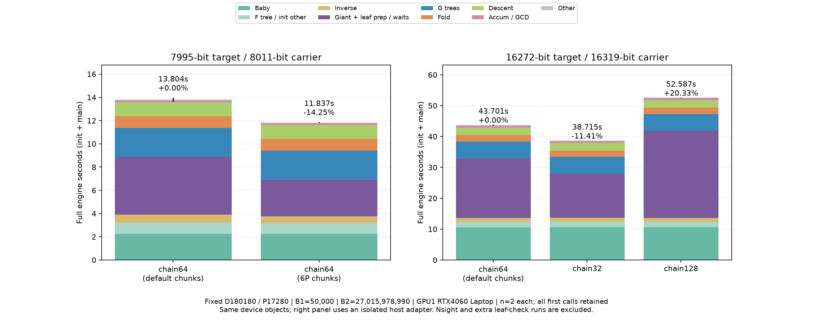
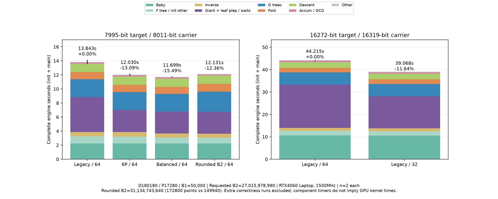
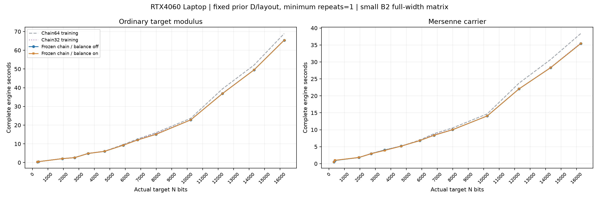
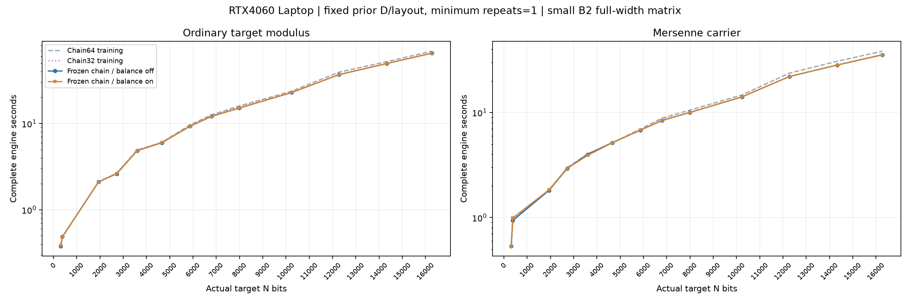
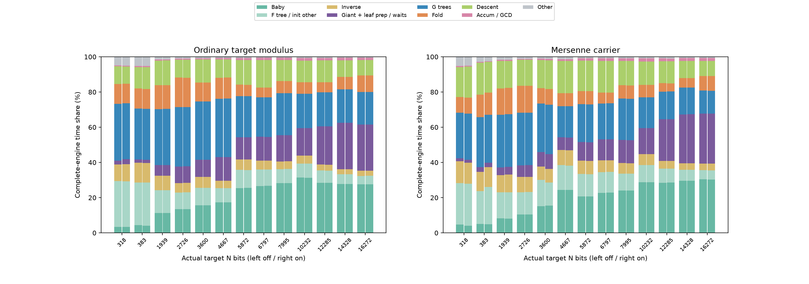

# Stage2 准备、同步与补零开销

## 输入与证据范围

准备/同步剖析及首组固定D实验使用GPU1 RTX4060 Laptop、24SM、8GiB，UUID `8a67b1f8ef1c3177a822813a7ac2224d`，驱动610.88、CUDA13.3.73、MSVC14.51.36231，55W/1800MHz上限；该组GPU0有外部任务，设置上限不代表实际恒频恒功耗。两卡SM1500MHz的扩大验证另列下文，不与该组样本混合。测试工具不修改显卡控制。

主要剖析输入为M4423、B1=20、sigma26有效Stage1 save，B2=2.6×10¹⁰、D60060、P5760，batch256、arena6300、fold640 MiB；Graph、短batch选型和短校准关闭，中段M6开启。Nsight Systems2026.1.3以管理员运行，保留全部CUDA API和CPU NVTX范围，采样/CPU上下文切换采集关闭。所有剖析运行均核对因子、rootfold、NTT工作量、S4分块与未插桩输入一致，不进入性能统计。

正式联合计划矩阵、重复数、全部位宽和B2见[outer性能](NTT_OUTER.md#tileouter-联合组织)。性能二进制为 `3a6da7e504b80f3da45cb9cf9c1879444e209b5f14e39d7ba9c5a191fd427a2e`；扩充CPU标记的剖析二进制为 `6e42ab02480240a9512e40c5ad72b4a9f6f16a5319a2fb38984076dbb1112f90`。两版完整SASS文本SHA256均为 `8973bd25d87e5ff566e7bb80e6a5f7e415abcb085373d70c926a64dfc33a2831`，GPU指令相同；后者另外通过完整曲线工作量/输出核对。它们的主机标记范围不同，不混合计时。

## 计时边界

`stage2_full_wall.total=init+main`。init已包含单独打印的shape时间，不能再加shape；这里shape是baby索引枚举，D/显存候选规划在计时之外。

- init：索引枚举，加Montgomery启动自检之后的上下文/S4初始化、baby生成与F树；包含S4 pack/division和形状自检。
- main：inverse、giant/G树/fold、下降、累乘、GCD、命名与最终oracle排空。
- Montgomery启动自检、保存点验证、进程启动、D/显存规划及结果发布位于引擎total之外。

本页GPU窗口从本进程**第一个到最后一个GPU事件**，包含kernel、copy和memset并集。它不覆盖启动前和最后GPU事件后的全部进程活动，不能称为完整进程墙钟或全卡空闲率。

原二进制同一矩阵off侧各4样本中位数为：

| 输入 | 引擎total | 进程墙钟 | 差值 |
|---|---:|---:|---:|
| M521、短B2 | 0.149092 s | 0.616537 s | 0.467445 s |
| M2203、短B2 | 0.596838 | 1.082648 | 0.485810 |
| M4423、B2=2.6×10¹⁰ | 6.299864 | 6.869408 | 0.569545 |
| M2203、P155520 | 19.540058 | 20.218640 | 0.678582 |

差值包含读取、规划、CUDA初始化、计时外检查和收尾，不是纯CPU准备时间。短曲线会明显暴露这些固定成本；长曲线应分别评价引擎和进程指标。

## 生产队列的阶段计时与选型开销

### 已定位的输入和构建

2026-10-31的生产观察对应`e_m5987_260e6.save`第364条曲线，结果时间戳为`2026-10-31 03:45:04`。CUDA程序为 **0.53.5**，实际EXE与结果`source-build`均为SHA256 `497c69f8e3e73d07e744c6024e65d4f1887d836e7acd9e505b2cf5cc83a5e2e1`。GPU1为RTX4060 Laptop；本样本没有同步保存GPU频率、功耗或硬件计数器，不能套用其他实验的定频条件。

输入为Edwards、sigma=3668336656946893、B1=260000000、B2=1300000000000，目标余因子5700 bits，梅森承载指数5987，算术字数W=94。实际D=1141140、P=103680，baby点103680，giant点1139213，G树11棵、fold10次。arena自动准入6338 MiB，batch64 MiB；fold与frontier均已驻留，arena overflow=0。单条生产观察不是固定输入重复性能基准。

生成目录中相邻`stage2_build_manifest.json`声明的EXE摘要为`f47f05e1…`，与实际运行的`497c69f8…`不同；该manifest不能用于证明本样本的完整编译配置。下面以日志、结果和实际EXE身份为依据；源码链接解释当前同名入口，不宣称这份过期清单绑定了当前源码。

原始记录为生产`stage2_screen_2.log:149483–149533`，`tune_selection`位于149485行。精确字节副本、结果及身份保存在`data/experiments/stage2_phase_read_20261031/`；派生阶段表、相邻曲线表和统计在`data/benchmarks/stage2_phase_read_20261031/`。这些目录由Git忽略，分发文档时须另附。以下生产观察解释0.53.5的计时；当前准备复用与阶段边界见后文验证。

### “读取与验证”实际包含什么

该0.53.5样本在按偏移读取一条save、检查指纹、字段、校验和及曲线参数后，仍把tune选型、运行时D搜索、观察计划准备等计入读取阶段，直到进入CUDA引擎才打印规划标记。因此8.34 s不是单条保存点的磁盘读取耗时。

当前[curve_worker](../../src/ecm/stage2/task.cpp#L107)完成save解析与显式承载校验后，在[选型之前进入规划](../../src/ecm/stage2/task.cpp#L133)。选型、保存点X的GCD、观察准备和引擎规划属于该规划区间。[阶段输出](../../src/ecm/platform/compute_log.h#L47)合并相同的连续阶段名，原生引擎再次标记规划时不会切碎计时。必需的算术自检仍在各执行阶段进行。

它不会重新执行Stage1。save中的B1=260000000用于任务和曲线身份，并不意味着启动时重新计算这段指数。

| 本样本的嵌套计时 | 秒 | 口径 |
|---|---:|---|
| GUI“读取与验证” | 8.340 | 从读取标记到引擎规划标记，已四舍五入 |
| 自动选型`selection_seconds` | **8.277994** | 上一行内部，约99.3% |
| 观察计划准备 | 0.022491 | 选型之后，仍在读取阶段内 |
| 其余输入/GCD/配置差额 | 约0.040 | 由舍入后的总量作差，未细分为纯I/O |
| 选型内部的准备总量 | 8.175911 | 不可再加到8.277994上 |
| 准备内：默认路线／已知候选／新候选搜索 | 0.345365／0.014279／7.816183 | 最后一项是主要成本 |
| 搜索内：普通／承载模型排序 | 3.023841／3.373246 | 合计 **6.397086**，两条路线各排序829个形状 |
| 全部原生规划API墙钟 | 1.742983 | 分布在前述默认、候选及搜索内部，不能重复相加 |

两条路线各16个新候选因显存准入被拒绝，`proposed_D=0`、`runtime_probe=false`，没有执行新D的完整试跑。末个拒绝分别要求约18.20／18.41 GB，而当时free约7.45 GB。总原生规划调用40次；已有计划和跨曲线路线各命中10次，但没有避免这32次拒绝及模型排序。

该样本的暂停提示要求本轮没有原生准入尝试，正向路线缓存未覆盖显存失败项，因此下一条曲线重复相同拒绝前缀。当前[准备复用合同](../architecture/AUTO_B2.md#准备结果的复用)以精确free/total和完整规划条件约束失败位图，命中后继续搜索，不永久删除D；成本与预测在不可变估计器内复用。

相邻12条不同sigma、同D/承载的生产记录，其读取阶段范围为5.75～9.03 s，中位7.435 s；并非仅首次启动的一次性慢读。该统计不是同一输入的n=12重复测试。当前选择继续采用已有实测最快的D1141140／承载5987；本曲线并未因搜索而更换参数。

### GUI各阶段与完整墙钟

GUI按[上一阶段名与下一条日志的previous值](../../src/ecm/application/gui_v2/ui/stage2_progress.h#L171)记账，这个归属方向正确。`previous`表示刚结束的阶段，不表示当前行刚开始的阶段。表中“仅上次运行”使用同可执行文件身份、设备及任务形状的最近已观察完成曲线，不是当前曲线实时剖析或平均值。

| GUI阶段 | 秒 | 已知阶段占比 | 解释 |
|---|---:|---:|---|
| 读取与验证 | 8.340 | 13.54% | 主项为自动选型，非磁盘读取 |
| 规划与初始化 | 0.240 | 0.39% | 引擎D/显存准备、Montgomery/XADD启动检查等 |
| Baby点 | 8.430 | 13.68% | ladder8.112、affine0.316，ladder约占96.2% |
| Baby F树 | 4.010 | 6.51% | 103679次逻辑乘法，包含批处理、提交和检查 |
| 多项式求逆 | 2.830 | 4.59% | 逆多项式与主循环准备；内部inv为2.746 |
| Giant点/G树/fold | **31.150** | **50.56%** | 下表单独拆分 |
| 归一化与下降 | 6.240 | 10.13% | 缩放根、frontier及有序下降；descent内部6.208 |
| 乘积/GCD | 0.190 | 0.31% | 1620个块，内部accum0.175 |
| 算术校验/收尾 | 0.180 | 0.29% | 检查排空、资源和结果准备；必需检查还分布在前面各阶段 |
| 因子分解 | 0.000 | 约0% | NF，结果中的可选分解约14微秒 |
| 发布 | 未知 | 未计入 | 没有后续phase标记来闭合此计时，不表示发布失败 |

已知阶段合计 **61.610 s**，而`stage2_full_wall.total=52.962188 s`、`stage2_result.seconds=61.593999 s`、`curve_done.wall=62.5016 s`。引擎计时排除前置选型、部分启动与外层收尾；GUI合计受0.01 s舍入影响，并缺少发布阶段。62.5016与61.594的差额还包含父子进程及收尾，不能全部归为发布文件I/O。

图右两面板嵌套于左侧阶段，不能相加。发布为未知值，未以零填入。

### 主循环的真正大项

| 内部组件 | 秒 | 占31.150 s主循环 | 占61.610 s已知阶段 |
|---|---:|---:|---:|
| Giant点 | 5.776 | 18.54% | 9.37% |
| **G树** | **19.307** | **61.98%** | **31.34%** |
| Fold | 5.563 | 17.86% | 9.03% |
| 循环其他工作与计时差额 | 0.504 | 1.62% | 0.82% |

G树、F树、求逆、fold和下降都是多项式流水线墙钟，包含NTT、pack/carry、S4归约、检查、主机准备和等待。现有字段不足以把它们全部称为NTT设备时间。本样本未打印`ntt_lengths`，没有精确长度/批量分布。

- Baby点明显受ladder主项约束；giant已经使用设备种子、重标定和分段路线，不能把已有giant优化当作未实现收益。G树约19.3 s才是主循环最大项。
- S4归约设备事件合计2.674 s，约占已知阶段4.34%；主机`t_reduce_host=10.840 s`含提交和依赖等待。两者嵌套于多项式阶段，不能相加，也不能将差额8.166 s判为可直接删除的CPU开销。7476次ring wait同样不是7476次固定代价。
- `s4_multiply_stats.launches=330`不是全曲线CUDA kernel数；仅pack/zero统计已有19962次launch。`words=60248137728`表示最终digit覆盖量，乘8约448.88 GiB，为设备内部逻辑写入，非PCIe传输，也不是仍可全部消除的memset。融合已开启。
- 下降记录F上传1471945248 bytes、元数据4976592 bytes、叶读回77967360 bytes；`upload_seconds=0.187588`仅为该计时项。它不足以解释6.24 s下降，更不支持把整条曲线归因于PCIe带宽。该API墙钟也不等于纯DMA事件时间。
- 最大fold工作区描述约3074 MiB，tree top的65537系数约3073 MiB；实际NTT模块`full_peak`约3183.58 MiB。fold峰约520.49 MiB且已启用，frontier已启用，arena无overflow。不能由arena cap较大但未占满推断“加显存就会更快”；不同模块峰值也不能相加成进程峰值。

### 准备复用的验证结果

验证输入为上述生产第364条保存点的隔离副本：5700-bit余因子、承载5987、B1=260000000、B2=1300000000000、sigma=3668336656946893。测试没有改动生产队列、配置、性能文件或GPU设置。GPU1为RTX4060 Laptop，驱动610.88、CUDA13.3、SM89/PTX、add/sub=1、outer=0；保存的遥测中利用率≥50%的样本均为SM1500MHz，显存8001MHz，活动功耗均值约38～39 W、采样峰值约52 W。该批`nvidia-smi -f`文件存在未刷新的尾部，只覆盖部分队列，不能据此保证全程时钟或推算完整能耗。功耗是实测draw，不是重新设置的限制值。

基线为当前源码优化前的0.54.4，EXE SHA256 `443ac27ff097c7782779786e168f1fbc2ee7443b6eb98912f1b5231097dff0ad`；优化版为0.54.5，SHA256 `deeaca58b7e0e9688775bab934286f5c82e39f07672a804950ec8b9ac36dc75b`。优化版经host overlay链接，两个CUDA设备对象的输入与对象摘要均核验后原样复用；本轮没有NTT或点生成kernel修改。身份依据是本轮构建清单及实际EXE，不借用生产目录中过期的manifest。

**连续规划重放。** 两版各6次同点规划，其中前3次队列剩余≥4，执行运行时搜索，后3次按既有策略不再探索。串行运行，不与编译或完整GPU曲线并行；profile始终不写回。以下n=3为活动搜索的计时重复，不是3条独立ECM曲线。

| 指标 | 0.54.4 | 0.54.5 | 变化 |
|---|---:|---:|---:|
| 准备总量均值 | 4.871 s | **1.418 s** | **−70.9%** |
| 普通＋承载排名均值 | 3.498 s | **0.215 s** | **−93.9%** |
| 原生规划调用，逐次 | 50、40、40 | 50、34、24 | 失败提示逐步复用 |
| 两家族失败位图命中，逐次 | 0、0、0 | 0、31、55 | 不占新准入额度 |

每条路线仍排名829个形状，没有缩减D表或修改成本公式。同一优化二进制的缓存开关核对中，342472次NTT成本请求只需2191次真正求值，其余340281次复用原始double。CPU回归逐项比较共享候选表的工作量、预测秒数、误差及rank，缓存开关结果一致；另外覆盖NTT实测/外推成本、B1完整身份与复用身份、不同设备、失败位图全部D的往返及显存变化失效。

第二次重放越过拒绝前缀，找到普通D1018710的可准入试跑，证明搜索可以继续推进。这是未执行的候选，不是性能胜出证据；重放未更新tune，也没有据此宣称普通路线快于已有承载路线。

**完整曲线对照。** 两版各4次同一NF点，均由真实队列启动独立worker，实际执行保持D1141140/P103680、承载5987。首条进行活动搜索，最后3条因剩余数不足4而不搜索，因此该短队列不能代表长队列每条均搜索时的稳态收益。

| 边界 | 0.54.4 | 0.54.5 | 解释 |
|---|---:|---:|---|
| 父进程完整队列墙钟 | 204.434 s | **199.620 s** | 减少2.35%，包含启动/收尾 |
| 4条`curve_done.wall`合计 | 203.468 s | **199.210 s** | 减少2.09% |
| 首条`selection_seconds` | 5.236 s | **2.903 s** | 减少44.6%，独立于引擎计时 |
| 首条普通＋承载排名 | 3.572 s | **0.509 s** | 减少85.8% |
| 4条引擎`init+main`合计 | 194.701 s | 193.057 s | 差0.84%；不能归为kernel加速 |
| 读取阶段，逐条 | 5.29、0.55、0.55、0.56 s | **0.01、0、0、0 s** | 改善包含正确归类，非独立加速指标 |

8次全部NF、clean=1，因子/不变量错误为0；两侧各8832项GMP启动自检、292688项抽查均通过，所有曲线的fold根摘要一致。两侧保存点、原始性能文件及其副本摘要不变。优化版每条只有一次规划阶段标记。引擎约48.3 s的主体仍在：优化版均值baby6.653 s、F树3.253 s、inverse2.100 s、giant/G树/fold29.830 s、下降6.170 s；其中G树约18.52 s，仍应优先研究G树/NTT。

证据在`data/experiments/stage2_preparation_20261031/`：`full_ab/`包含完整原始日志、命令、结果、遥测和前后输入摘要，`final_plan_measured/`为串行连续规划，`final_plan_ab/`为同二进制开关检查。CPU合同为`d_search_final/`（2288项）及`model_cpu04/`；OpenCL共享worker的32项命中/NF/队列合同为`opencl_worker/`。派生汇总为`data/benchmarks/stage2_preparation_20261031/summary.json`和`curves.csv`。这些忽略目录需要另外归档，不能仅依赖Git恢复证据。

复现入口：[隔离准备检查](../../tools/test/check_stage2_preparation.py)，参数为`--exe`、`--baseline-exe`、`--profile`、`--save`、`--record`、`--exponent`、`--b2`、`--device`、`--curves`、`--cache`、`--output`；默认只重放规划，`--execute`才运行完整曲线。当前采集器使用[逐行刷新的NVML记录](../../tools/bench/gpu_telemetry.py)，输出`telemetry.jsonl`；测量后停止采样并等待线程退出，保留完整的已采集尾部。样本未饱和而发生采样写回时检查会拒绝“冻结性能文件”口径，应另外按学习实验计量。

### 既有证据支持的优化顺序

准备复用和阶段归类已经接入；其余项目仍是待验证方向。

1. **继续收紧准备预算。** 已有成本记忆化、正向计划与显存失败提示，不保存庞大的跨曲线排名表；仍可继续评估将CPU准备成本纳入探索预算。默认D继续实时规划，尚无整套初始化跨曲线复用资格。
2. **闭合发布计时。** 选型已归入规划且连续规划标记合并；发布仍须用结果/曲线完成标记单独闭合。不能用引擎内部十段统计补成包含外层选型的完整计时。
3. **GPU优先分析G树/NTT上层。** 当前算术W=94，未进入仅W>128的均衡G树默认范围；65537系数接近packing拐点，值得固定D/P比较[分块空位布局](../reference/ECM_STAGE2_G_TREE_LAYOUT.md)，但实际NTT长度必须重新查询。保留根/叶数学验证和现有低位宽性能保护，再决定是否扩展资格。继续用Systems拆解NTT、pack/carry、S4、分配及主机空隙，之后对热核用Compute定位。
4. **再研究baby序列复用。** 103680次稀疏标量ladder是独立热点。候选是按固定wheel组织可递推小步，再选取coprime点；额外点、种子、缩放和非单位恢复均须计账，不能直接套用等间距giant chain或承诺固定倍数。
5. **尾部和小NTT保持证据约束。** [CPU尾部](STAGE2_CPU_TAIL.md)已显示大批量归一化通常保留CUDA更合适，少量GCD当前已用CPU；本例affine仅0.316 s、乘积/GCD0.190 s，优先级低。[短Graph](NTT_GRAPH.md)的生产大P对照未显示稳定收益，[Tensor NTT](NTT_TENSOR.md)亦未获生产资格；先取得本任务的长度和提交分布，再选择候选。

只消除本例全部选型8.278 s的理想上限，是将62.5016 s曲线墙钟降至约54.224 s，少13.24%、吞吐约增15.3%；必要准入和输入验证仍有成本。若剩余596条保持相同开销，理论累计约1.37小时。这是收益上界，不是本轮实测加速。另一条件例子：若G树墙钟独立减少20%，约省3.861 s，约占当前曲线墙钟6.2%；不能把这个假设套成“NTT快20%即可得到同样收益”。

已有配置支持对照：在`[workers.2.stage2]`设`stage2_tune_runtime=false`，或CLI使用`--tune-runtime 0`。它停止新试跑、采集和写回，仍读取已有合格实测组比较D和承载；不会关闭所有tune选型。当前源码在搜索入口立即跳过新D扩展，因而可避免本记录中的7.816 s搜索主体；最终节省须做相同D/承载的A/B确认，不能保证读取阶段降到零。完整合同见[运行时选型](../architecture/AUTO_B2.md#正常运行累计采样与候选试跑)。本轮未修改该配置。

代码依据：[save解析](../../src/ecm/stage2/input.cpp#L35)、[外层计时与选型](../../src/ecm/stage2/task.cpp#L130)、[搜索及模型排序](../../src/ecm/stage2/planning/planning.cpp#L397)、[跨曲线正向准入缓存](../../src/ecm/stage2/planning/runtime_cache.h#L53)、[额外成本预算](../../src/ecm/stage2/planning/runtime_tune.h#L32)、[giant/G/fold](../../src/ecm/stage2/cuda/batch.cpp#L194)、[阶段输出](../../src/ecm/platform/compute_log.h#L47)、[GUI归档](../../src/ecm/application/gui_v2/ui/stage2_progress.h#L171)。

## 点生成：固定D瓶颈验证

### 条件与边界

0.54.7、2026-10-31的小范围实验沿用全位宽矩阵的有效Edwards点，B1=50000、sigma26、B2=27015978990、D180180／P17280；均为梅森承载。GPU1为RTX4060 Laptop、24SM、驱动610.88，arena6300／fold640／batch256 MiB。设备55W上限由前述研究查询观察，本实验不写时钟、功耗或驱动；逐次NVML实测频率另存，CPU未由本实验固定。GPU0的外部任务继续运行，未参与计时。

7995-bit目标／8011-bit承载使用生产0.54.7，SHA256 `be599bb90aeba1417be92f4096886a2722a2039d83a983508496134ac4d6e636`。16272-bit目标／16319-bit承载的链长比较使用隔离主机适配器，SHA256 `863e2a3c063bb8146900e430437506176f3a41c605d959e2dbd0a480c37b4a3e`：核对并复用43个对象，只重编译一个配置适配器，CUDA编译0次。适配器仅允许链长32／64／128；其余生产检查保留，正式程序仍要求64。该探针不是发布版。

短尾采用默认／6P／6P／默认的ABBA顺序；宽位采用64／32／128／128／32／64，每设置n=2、不预热、不丢首轮。主指标是完整引擎init+main；D/P、点覆盖、算术、G树布局不变，唯一实验变量分别是点块容量或每条链点数。Nsight和额外叶检查独立执行，不并入性能均值。

10次正式计时的608个GPU利用率≥50%样本均为1500MHz。另8次时间线／叶诊断中423个高利用率样本为1500MHz、3个为1485MHz；不作频率归一化。计时、4次Nsight Systems、4次额外叶检查和1次NCU合计19条已审计完整NF，GMP抽查130174、自检39360、错误0。额外叶检查覆盖228508560个设备叶word，两组目标环摘要分别为`4224553901201175228`与`8971569639330620771`，组内设置一致；摘要不是逐叶独立oracle。

### 完整曲线与实际分块

单位秒，均值及原始范围；Giant＋叶准备合并是为消除两条路线上不同的同步记账位置，不与完整引擎再次相加。

| 输入／设置 | 真实点块 | 每链点数 | 完整引擎均值［min,max］ | 相对同组默认 | Giant＋叶准备均值 |
|---|---|---:|---:|---:|---:|
| 7995-bit，默认 | 138240＋11700 | 64，尾块ladder | 13.804［13.623,13.986］ | — | 4.963 |
| 7995-bit，6P容量 | 103680＋46260 | 64，两块chain | 11.837［11.789,11.885］ | **−14.25%** | 3.136 |
| 16272-bit，默认 | 69120＋69120＋11700 | 64 | 43.701［43.526,43.876］ | — | 19.332 |
| 16272-bit，短链 | 同上 | 32 | 38.715［38.707,38.723］ | **−11.41%** | 14.303 |
| 16272-bit，长链 | 同上 | 128 | 52.587［52.538,52.636］ | **+20.33%** | 28.285 |

小档输入已说明默认D与tune D会改变点块／NTT分布，见[全位宽性能](STAGE2.md#当前cuda小档b2的布局与运行时tune)。这里固定D的结论不能直接作为其他D或生产大B2的收益保证，两个局部收益也不能相加。

### 两级分块与计算量

这里有两级不同的划分。外层点块容纳一段连续giant索引，容量C取整到P的倍数，限制坐标驻留与准备量；内层链长L表示一条CUDA线程连续生成至多L个点。点块不是一个CUDA线程块，链长也不是线程数或TPI。

7995-bit实验的总点数I=149940、C=8P=138240。默认先取满8P，留下r=11700点；该算术字数W=126的chain门槛T=32768，因此尾部走独立ladder。6P实验改成103680＋46260，两块都满足chain门槛，链长L始终64。B1/B2、D/P、原始索引1…149940、8棵完整G树与1棵非满G树、8次fold及固定形状下的多项式NTT请求不变；并没有少检查候选或缩小B2。改变的是生成这些点的算法与准备边界。

按seed-pair与xADD6／xDBL5的实际调用公式计数，本例原划分的点主核模乘为：seed369620＋chain803520＋独立ladder4434300=5607440；新划分为seed404756＋chain871524=1276280，约少77.24%。该数仅比较点主核，不含基点、段积、加减、CPU求逆、NTT或其他Stage2工作，不能按77.24%推算完整曲线收益。seed-pair线程数从2160增至2343，分组逆从147组增至148组；这些少量准备增加已包含在完整实测中。

实验的最大X/Z坐标载荷从265.781降至199.336 MiB，只是一个组件的同时占用，不代表进程显存峰下降25%。可选的完整区间尾块平衡保持原配置容量C，仅在倒数两个点块借出整P点；不全局把容量硬改成6P。例如借出

\[
m=P\left\lceil\frac{T-r}{P}\right\rceil=34560=2P
\]

后，倒数两块从C、r变为C−m、r+m，即103680、46260。必须同时满足两块均达到chain门槛、均不超过C、点数和点块数量不变；条件不满足时保留原划分。更早的满块不改。配置容量不变也不保证组件实分配不变，实际分配仍按各点块执行；内存准入需要用同一调度重算生命周期。

### 叶准备的3秒主要是设备等待

7995-bit的主机Giant计时从1.538升至2.860 s，但叶准备／同步从3.426降至0.277 s；CPU分组求逆仍约0.011 s。其原因可由管理员Nsight Systems2026.1.3的实际GPU时间线确认：默认短尾的两次NW128 ladder合计 **3.191517 s**，6P分块中这两次调用消失。原chain核为0.845051 s，改后两次chain合计1.637916 s；seed-pair核0.473818→0.970308 s。新增chain／seed工作抵消部分收益，完整曲线仍更快。

[ladder分支](../../src/ecm/stage2/cuda/batch.cpp#L300)提交设备工作后没有在Giant计时结束前统一等待；[ResidentGiant准备](../../src/ecm/stage2/cuda/points.cpp#L288)读取分组乘积时必须等待前序kernel。[chain分支](../../src/ecm/stage2/cuda/points.cpp#L485)则显式同步后才返回。因此单看Giant或gleaves可能得出相反结论。移除同步只会改变归属，除非形成真正重叠或减少工作，不能据某个分项变小宣称加速。

Nsight所见本进程首末GPU事件窗口中，默认事件并集12.461／窗口13.674 s，6P为10.636／11.767 s；无本进程GPU事件区间分别1.213／1.131 s。它们包括启动自检，既不是完整进程墙钟，也不是整卡空闲率。本输入的收益主要来自避免昂贵点计算，不是节省大量PCIe传输或填满约一半的主机空隙。

### 宽位chain的并行度与local访问

当前[链核](../../src/ecm/stage2/cuda/device/giant_chain.cuh#L6)由一条CUDA线程负责一个大整数点链；[启动包装](../../src/ecm/stage2/cuda/point_launch.h#L94)在W>128时采用32线程一个CUDA块。这不是TPI32协作算术。每个69120点满块在链长64时只有1080条链、34个CUDA块；链长32时为2160条链、68块；链长128时只有540条链、17块，少于设备24个SM。

当前生产默认L=64，并关闭短块链长覆盖；可显式选择32或auto，auto按每个算术家族当前优选形状补有限32／64对照后采用最快合格均值，不是固定按位宽切换。128仍仅用于实验探针。较短L增加seed与启动工作，却增加独立链和可用CUDA块；较长L减少seed，却延长串行依赖并减少并行链。优选点取决于实际算术W及其核函数档位、点块大小、D／P／B2引起的尾部、设备SM数量、普通／承载算术和缓存工作集，不能据单个宽位实验全局改为32。完整范围见[有限链长验证](#全位宽有限链长与尾块平衡)。

管理员Nsight Systems对宽位64／32的单次独立诊断表明：chain核合计 **9.694747→4.763964 s**，seed-pair核 **6.182539→6.138760 s**。短链虽然增加seed数量，seed时间基本不变；点链时间接近减半，G树等分项保持接近。这支持该形状首先受并行度、长依赖链和延迟隐藏限制。

Nsight Compute2026.2.1仅采集默认64的第一个真实NW256 chain调用，32线程×34块、实际69120点，采用`--clock-control none`，不将重放计时并入性能样本：

| 指标 | 单kernel诊断值 | 含义 |
|---|---:|---|
| 每线程寄存器 | 64 | 寄存器准入上限32块／SM，大于架构块数上限24；该配置并非首先受寄存器块数限制 |
| 理论／实际SM活跃warp占比 | 50.00%／2.98% | 实际平均约1.43活跃warp／SM；发出的grid太小，远未达到理论驻留上限 |
| SM吞吐／L2吞吐 | 4.38%／12.65% | 工具定义的峰值比例，不能用“GPU忙100%”代替有效吞吐 |
| long-scoreboard stall | 65.50% | 活跃warp大量等待L1TEX来源的依赖，不能单独等同于DRAM带宽饱和 |
| local读／写请求 | 13,338,497,250／6,773,169,690 sectors | 包含线程私有数组及栈访问，不全是编译器寄存器spill |
| global读／写请求 | 10,271,400／35,251,200 sectors | local请求约为global请求的442倍；这不是PCIe传输量 |

`cuobjdump --dump-resource-usage`对相同设备对象给出的每线程静态栈帧为：NW128 chain13328 B、NW256 chain26640 B、NW256 seed-pair22544 B、NW256 ladder32784 B。Nsight Systems的`localMemoryPerThread=0`不能代替这项栈帧检查，也不能据它排除local访问；栈帧容量和累计访存量都不是进程显存峰。

结论更符合“少量活跃warp难以隐藏大量私有数组访问和串行模乘的延迟”。本次未采集独立DRAM带宽计数，不把L2指标当作DRAM指标；低寄存器上限和单纯增大每链点数都缺乏直接收益依据。协作多精度、减少runtime索引数组访问、改善坐标组织值得研究，但需要独立算术门禁及完整曲线验证。

### 计算量模型需要包含并行效率

[原生giant工作模型](../../src/ecm/stage2/giant_work.h#L25)按物理chunk统计chain／ladder及seed-pair位步。当前[portable代理](../../src/ecm/stage2/planning/portable_model.h)对新点策略使用包含seed的精确模乘计数乘W²；受保护的原64链／不平衡默认仍保留原成本先验。实际CUDA块数、相对SM数量、模板私有栈及缓存效率尚未成为独立校准的吞吐模型，不能仅用模乘数判断胜者；位宽增长的量化分析见[位宽性能](STAGE2_BIT_SCALING.md)。

设每点块n_c、链长L，S_c=ceil(n_c/L)，起点i_c；本实现的seed-pair大致需要

\[
M_{seed}=\sum_c\sum_{b=0}^{S_c-1}\left(5+11\lfloor\log_2(i_c+bL)\rfloor\right),\qquad
M_{chain}=6\sum_c\sum_{b=0}^{S_c-1}\max(0,\min(L,n_c-bL)-2).
\]

这是seed-pair与chain主核中的模乘计数，不含[D]Q基点、段积、线性加减／折叠、自检或其他Stage2阶段。上述宽位三块的计数为：

| 链长L | seed线程数 | seed＋chain理论模乘 | 完整曲线相对64 |
|---:|---:|---:|---:|
| 32 | 4686 | 1,652,975 | −11.41% |
| 64 | 2343 | 1,276,280 | — |
| 128 | 1172 | 1,088,017 | +20.33% |

算术更少却更慢，说明不能只优化模乘次数。后续候选模型应分别计入seed、chain和段积，对块数／SM、W、局部工作集和阶梯取整做校准；无实测区域保留当前默认与性能保护，不能将新公式直接当作已验证吞吐模型。

### 优先级与启用前提

1. **完整区间的尾块平衡。** 可选入口已与压缩调度、工作量和显存生命周期共用[整P借块](../../src/ecm/stage2/giant_schedule.h)，固定D对照见下节。默认关闭，继续补充设备、预算和边界覆盖后再考虑默认启用。
2. **按W／点块／设备选择有限链长。** 32/64已具有独立身份及有限运行时对照；默认64。需要扩大不同D、算术家族及位宽的持出对照；16/128仍只作针对性算子研究，不扩展生产候选表。
3. **Baby步减少独立ladder。** 宽位Baby仍逐索引做binary ladder。可研究轮筛算术级数的分段链：取w整除D，生成j=r+kw、gcd(r,w)=1的序列，再过滤gcd(j,D)=1。候选点数约K=Dφ(w)/(2w)，而真实叶P=φ(D)/2，额外点比例K/P约为∏_{q∣D,q∤w}q/(q−1)。D180180、w210时约多19.17%的点，却可用大量xADD替代完整ladder；收益尚未计时，须同时解决seed并行度、映射、非单位恢复和预算，不能按运算次数直接宣称加速。
4. **协作点模乘与数组组织。** 先建立与现有标量核相同输入／输出的算子探针，评价TPI、32／64-bit limb、AoS／SoA及Mersenne折叠；Stage1的[协作算术](../../src/ecm/stage1/montgomery/cuda/arithmetic.cuh)只能作代码参考，不是Stage2已完成移植的证明。NTT优化继续按其自身算子和完整曲线数据验收，不应承担点生成的计时成本。

计时维护也应先补设备事件的点生成／段积分项，主机等待单列；保留可读的默认日志，细节仍由诊断开关控制。去掉一次同步可能只把时间移到后面的拷贝，必须以完整引擎和真实GPU重叠验收，不能单独以某个主机timer下降作为收益。

默认完整区间分块和64链保持；可选项的当前实现及边界见[点策略合同](../architecture/STAGE2.md#完整区间点块策略)。NF摘要不能替代命中因子验证。默认启用前仍需扩大非单位[D]Q／Gamma、退化传播、最小B1/B2、W128／129及预算边界，并核对普通／承载和原默认性能。

证据根为`data/experiments/stage2_point_routes_20261031/`；`tail_abba/`与`wide_chain_probe/`是10次性能样本，`tail_nsys/`、`wide_nsys/`为独立时间线，`wide_ncu/`为一次kernel重放诊断，`tail_leafcheck_verified/`与`wide_leafcheck_verified/`为额外规范叶检查。原始失败尝试保留，不混入平衡顺序的均值。汇总为`data/benchmarks/stage2_point_routes_20261031/final/summary.json`，图为`data/figures/stage2_point_routes_20261031/final/`，均由[分析工具](../../tools/bench/analyze_stage2_point_routes.py)重读生成，复现见[点路线工具说明](../../tools/bench/README_STAGE2_POINT_ROUTES.md)。

## 完整尾块平衡、B2凑整与32／64生产选项

输入仍为上节有效Edwards保存点：B1=50000、sigma26、D180180、P17280、请求B2=27015978990，分别为7995-bit目标／8011-bit承载，以及16272-bit目标／16319-bit承载。GPU1 RTX4060 Laptop、8GiB、驱动610.88；繁忙遥测以1500MHz为主，宽位4次计时中有2个1485MHz采样，其余307个繁忙采样1500MHz。GPU0存在外部工作，CPU未固定，工具没有更改显卡设置。batch64 MiB、arena自动、fold960 MiB，G树布局固定为来源矩阵同一值；固定D与布局，不运行全矩阵。

下表为同一二进制内的平衡顺序、每项n=2，包含全部首轮，不含额外逐叶诊断。边界为 `stage2_full_wall.total=init+main`，包含必需自检、GCD及检查排空，排除Stage1与进程启动／读档／前端选型。7995-bit使用0.55.0 SHA `21e9794ce3d0fa8a8d2e415a9b5a547d87a91abe26ce1421bec98c694ae6401f`，宽位使用0.55.0 SHA `08d40614289fd4f213b670c756a30ac6f5f9f0b6f53024737db3cd67aaffdc01`；两者复用同一已核对的生产CUDA对象，清单及完整来源哈希保存在各自build manifest。

| 目标位数／策略 | 实际B2 | 点块划分 | 链长 | 完整引擎均值［min,max］s | 相对同组原策略 |
| --- | ---: | --- | ---: | ---: | ---: |
| 7995／原策略 | 27015978990 | 138240＋11700 | 64 | 13.843［13.530,14.155］ | — |
| 7995／6P实验 | 27015978990 | 103680＋46260 | 64 | 12.030［11.883,12.178］ | −13.09% |
| 7995／完整尾块平衡 | 27015978990 | 103680＋46260 | 64 | **11.699［11.622,11.776］** | **−15.49%** |
| 7995／最小整P且避免ladder | **31134743640** | 138240＋34560 | 64 | 12.131［12.128,12.134］ | −12.36% |
| 16272／原策略 | 27015978990 | 69120＋69120＋11700 | 64 | 44.215［43.993,44.437］ | — |
| 16272／有限短链 | 27015978990 | 同上 | 32 | **39.068［39.006,39.129］** | **−11.64%** |

尾块平衡不增加I=149940，不改变G树/fold工作量。6P实验恰好得到相同两块，其点核运算数一致；两者0.331秒差异包含初始化、求逆和NTT短时波动，不能据n=2宣称平衡算法本身额外快2.75%。B2凑整则增至I′=172800，约多15.25%的点，G树批次数9→10、fold8→9；它以增加覆盖量换取避免ladder，不能作为等工作量对照。

| 7995-bit策略 | seed模乘 | chain模乘 | 独立ladder模乘 | 点主核合计 | 最大X/Z载荷MiB |
| --- | ---: | ---: | ---: | ---: | ---: |
| 原策略 | 369620 | 803520 | 4434300 | 5607440 | 265.781 |
| 6P／完整尾块平衡 | 404756 | 871524 | 0 | 1276280 | 199.336 |
| B2凑整 | 473300 | 1004400 | 0 | 1477700 | 265.781 |

这些计数按实际点块和绝对索引计算，排除共享[D]Q、段积、归一化、加减及全部多项式计算。最大坐标载荷是组件同时占用，不能当作进程峰值。宽位64→32时，seed404756→809567、chain871524→843408，总点主核模乘1276280→1652975，**增加约29.5%却更快**；这是必须用完整实测评价并行效率的直接证据。64链保留参考资格，不能仅按模乘量否决32。

算术／队列集成验证版SHA `f7bbe604f07b30cdfc4b26476c32de37ba9d81914a27bad739781caf85877202` 每项另测1遍：原策略13.780、平衡11.951、凑整12.373、6P实验11.797 s。该独立小档复测支持同一结论，不并入上表n=2。该版还修正块GCD=N时跳过所有叶的边界：独立CPU保存点10007×65537、B1=20、B2=13230有7个叶能分离出10007，原基线丢失，修复后各策略一致得到真因子。9次生产保存点门禁覆盖素数NF、非单位[D]Q、块GCD=N及新策略的完整原路径重放；单叶GCD=N的进一步分离仍未实现。

纯CPU调度／seed位步／工作量／显存生命周期测试38796项通过；联合NTT/S4/Giant生命周期6097066项检查通过，包含末两块平衡及32/64的独立逐事件／压缩对照。7995-bit额外4次叶诊断核对162660960个设备叶word：原B2两路线的目标规范叶hash同为4224553901201175228；凑整与显式相同实际B2的hash同为1088995889456719260。宽位最终版32/64的目标规范叶hash同为8971569639330620771，另检查152938800个设备叶word，两档合计315599760。诊断clean=0，不计入性能均值。

集成验证版六次复制保存点的功能测试固定D、布局及尾块平衡：先64、64，再32、32，后两次采用32；矩阵独立保留64链n=2与32链n=4，均值分别11.766和10.968 s。只读规划继续选最快均值，未改写tune。这用于验证有限探索、独立身份与采用逻辑，重复同一点不增加独立ECM覆盖，也不是另一组交错性能验收。

证据根 `data/experiments/stage2_point_policy_20261031/`：`tail_abba02/`、`wide_abba01/`为表中性能；`final_tail_holdout01/`为最终版复测；`tail_leafcheck01/`与`wide_leafcheck01/`为额外叶诊断；`factor_gate03/`、`runtime_gpu02/`为最终门禁，其中后者只读审核`runtime_gpu01/`的6条原始回执并补规划。失败目录保留。汇总 `data/benchmarks/stage2_point_policy_20261031_03/summary.json`，图由[分析器](../../tools/bench/analyze_stage2_point_policy.py)重读原始回执生成。

交付构建SHA `6685f65b62d7c8f043ca670b804226ec10cff7a02597d42a80ead0ab17b48bb3` 将默认D成本先验保持为原公式，仅新点策略使用新增seed计数；CPU接口明确核对两条公式，332项依赖哈希与当前源码一致，`factor_gate04/`再次通过9例。`final_tail_holdout02/`每项各1次：原策略13.781、平衡11.915、凑整12.392 s，仍是固定D集成复核，不合并前述样本。`final_adopt01/`只读采用已测最快32链且profile不变。

三项新配置默认仍为false、false、64。上述是单卡、两个位宽和小档固定D的证据；大B2、更多D／预算及其他设备的全范围性能尚待扩展；普通／承载优选D的小B2全位宽见下一节，不能据此默认启用或将两种局部收益相加。运行时自动链长和B2覆盖规则见[架构说明](../architecture/AUTO_B2.md#点块与有限链长身份)。

## 全位宽：有限链长与尾块平衡

小B2、已有优选D矩阵的26格实际点块、chain/ladder路线和各长度NTT次数均未改变。完整引擎合计关闭367.875793s、开启367.937068s，差+0.0167%，应视为未触发调度下的中性结果，不能据此证明真实借块在显存边界内也无回退。当前默认保持 `stage2_giant_tail_balance=false`、`stage2_giant_chain="64"`；链长已调优用户可显式选择auto。重复门槛默认2，可用 `stage2_tune_min_repeats=1` 快速筛查，不减少任何算术检查。

### 无短尾时的开销、身份与回退边界

0.56.3在最终点容量确定后计算是否实际借块。未借块时不增加点kernel、传输、额外检查排空或因子命中重放，沿用原点成本及tail=0的tune身份；只增加一次常数时间的主机几何判断。跨曲线的紧凑路由缓存恢复用于实际tail=0／64链，并在恢复点容量后再次核对能否借块。完整计划缓存仍绑定请求许可与环境，防止借用不同原生准入策略的计划。旧tail=1记录保持原身份，不把旧请求标记重新解释为已实际借块。规则见[选型与缓存](../architecture/AUTO_B2.md)。

默认关闭的当前约束是命中／非单位重放的联合显存预算，而非无短尾矩阵的0.0167%差异。CPU生命周期入口以D180180/P17280、I149940、C138240、W126、T32768、64链计算，原分块Giant组件峰值296372456 bytes，平衡分块222303032 bytes。试算组件少约70.64 MiB，但发生命中后原路径可能重新需要这部分空间；当前准入没有完整验证两条路径的联合生命周期。此处是组件模型，不是GPU显存实测或进程峰值，不能与NTT等独立峰值相加。

同一入口的点主核计数在尾点数1时仅从1173519降至1173332次模乘，少187次；尾点数11700时为5607440→1276280。两者均不包含归一化、段积、多项式及分配，不能据理论模乘减少保证微小尾块的完整运行更快。预算不足、禁用resident/seed、强制ladder、单块／整块／已足够长的尾块及无法保证借出块仍达chain门槛等情况均不启用借块。

性能验收二进制的版本标识为0.57.0，SHA256为`3f4c7c6cd2feab4ed401a4df9a0b03c1984753856fc498ea86afc4621e27ad2f`；0.56.3与其计算实现一致，仅调整公开版本号，不改写原始性能证据。GPU1 RTX4060 Laptop、驱动610.88、CUDA13.3.73、MSVC14.51.36231，使用7995-bit余因子、8011-bit梅森承载、B1=50000、sigma26、B2=27015978990、连续G树、64链，batch256／arena6300／fold640 MiB。每个固定D执行off/on/on/off，每侧n=2，无warmup，完整保留首遍，计时仍为init+main：

- D207480/P20736：两侧都是130212点的单个chain块，10.973074→10.980411s（+0.067%，中性）；点调度、S4提交／归约数量及GMP检查数量相同。四次均直接采用旧tail0的 `runtime_measured_fastest`，未启动冷tune或改写冻结文件。
- D180180/P17280：138240+11700的chain/ladder改为103680+46260的两个chain块，14.184527→12.450055s（−12.23%）。此格在两侧都保留默认预测保护，没有用本轮数据重新选优。

两格共8条独立曲线。GPU繁忙度≥80%的152条遥测SM均为1500MHz，功率10.51–46.94W，工具没有修改GPU设置；CPU未锁定，GPU0仍有其他任务。这不是全矩阵或恒功耗结论。原始日志、遥测、冻结tune和构建清单在 `data/experiments/stage2_policy_default_20261101/fixed_ab02/`，提炼为同目录 `analysis.json`。无短尾的统计复用已验证；不能将这两格外推为所有真实短尾和预算边界都更快。

模型与CPU回归证据在`build_dev/stage2_policy_audit_0_57_0/`、`build_dev/stage2_policy_0_57_0/`；开发集成记录见[检查草稿](../development/STAGE2_POLICY_DEFAULT_AUDIT_DRAFT.md)。这些检查不改写下列0.56.0冻结性能样本。当前G树布局配置为 `stage2_groot_balanced="auto"`，强制true/false与点块平衡是两种独立控制，见[使用说明](../usage/STAGE2.md#固定参数g树实验)。

### 条件与计时

ECM-ELF0.56.0、GPU1 RTX4060 Laptop（24SM、8GiB）、驱动610.88、CUDA13.3.73、MSVC14.51.36231。目标SM1500MHz；104次主矩阵调用的繁忙遥测2823条中2809条为1500MHz，少量1425–1485MHz，不能称为每个采样完全恒频。GPU0有外部任务，CPU未固定；测试不改显卡设置，GPU1逐次拒绝未授权外部上下文，保留已批准的Codex界面PID/路径白名单。

采用0.54.7小档矩阵的13个有效余因子保存点，普通/合法承载共26格。B1=50000、sigma26（M2003为27），名义B2=26000000000；实际B2=27015978990，M6011为27567389850。显存配置batch256、arena6300、fold640MiB；未将这些预算或组件峰值相加为进程峰值。B2凑整、短校准和短NTT批量调优关闭，无warmup，全部首轮保留。

固定原有最快D、G树布局和算术家族；先为64/32各补一次当前条件NF，随后冻结profile，由原生选择最快均值。21格选32，5格选64。学习期逐格选优合计388.144→369.289s（−4.858%），该值带有选优偏差，不是独立链长性能验收。新的52次开/关对照固定选中的D、布局、链长、预算及B2，并按格交替先后顺序；不收集或改写tune。

主计时为 `stage2_full_wall.total=init+main`，包含必需自检、GCD及检查排空，排除Stage1和前端读档/选型。另核对曲线进程内从规划到完成检查的时间：关闭380.043946s、开启380.212769s；它是嵌套口径，不能加到完整引擎耗时上。

### 独立矩阵

表中为各一次独立调用的完整引擎秒数；L为冻结链长，carrier p为承载指数，N为实际目标位数。每一行两种算术家族的开/关实际点块均相同。

| N bits | 普通D / P | L | 普通关闭 / 开启s | carrier p | 承载D / P | L | 承载关闭 / 开启s |
| ---: | --- | ---: | ---: | ---: | --- | ---: | ---: |
| 318 | 150150 / 14400 | 32 | 0.378 / 0.388 | 503 | 196350 / 19200 | 64 | 0.532 / 0.531 |
| 383 | 180180 / 17280 | 32 | 0.485 / 0.484 | 1009 | 180180 / 17280 | 32 | 0.938 / 0.992 |
| 1939 | 180180 / 17280 | 64 | 2.102 / 2.097 | 2003 | 180180 / 17280 | 64 | 1.811 / 1.834 |
| 2726 | 150150 / 14400 | 64 | 2.621 / 2.625 | 3001 | 180180 / 17280 | 32 | 2.931 / 2.937 |
| 3600 | 180180 / 17280 | 32 | 4.838 / 4.849 | 4001 | 210210 / 20160 | 32 | 3.993 / 3.906 |
| 4667 | 158340 / 16128 | 32 | 5.991 / 6.019 | 5003 | 274890 / 26880 | 64 | 5.167 / 5.163 |
| 5872 | 240240 / 23040 | 32 | 9.280 / 9.273 | 6011 | 240240 / 23040 | 32 | 6.797 / 6.807 |
| 6797 | 240240 / 23040 | 32 | 12.099 / 12.058 | 7001 | 240240 / 23040 | 32 | 8.386 / 8.373 |
| 7995 | 207480 / 20736 | 32 | 15.099 / 15.118 | 8011 | 207480 / 20736 | 32 | 10.010 / 10.024 |
| 10232 | 240240 / 23040 | 32 | 22.810 / 22.820 | 10267 | 240240 / 23040 | 32 | 14.068 / 14.081 |
| 12285 | 240240 / 23040 | 32 | 36.889 / 36.866 | 12511 | 240240 / 23040 | 32 | 22.046 / 22.060 |
| 14328 | 210210 / 20160 | 32 | 49.553 / 49.512 | 14401 | 210210 / 20160 | 32 | 28.298 / 28.311 |
| 16272 | 210210 / 20160 | 32 | 65.351 / 65.383 | 16319 | 210210 / 20160 | 32 | 35.403 / 35.425 |

灰/紫线为64/32链学习样本，蓝/橙线为冻结链长后的独立开/关样本，不能把学习点并入持出均值。横轴为实际N位数，刻度间隔1000；普通和承载分面，两个时间轴使用同一批数据。

每个位数左柱关闭、右柱开启。Baby属于init，其余init包含F树和自检；Giant与叶准备/等待合并，其他main分项互斥。柱内比例总和100%，只解释该次完整引擎的归属，不等于GPU kernel时间，也不能由主机timer判断GPU利用率。

### 波动复测与正对照

对首遍正负差异统一使用门槛：绝对差>0.05s且相对差>3%，追加off/on/on/off。仅383-bit、M1009承载格触发：首遍0.938037/0.991744s；新两次均值0.920990/0.919373s。保留全部三次后关闭0.926672、开启0.943497s（+1.816%），实际分块和NTT工作量仍相同。用该格三次均值替换矩阵的一次均值，仅用于报告加权口径后的合计367.864428/367.888821s（+0.00663%）；原矩阵和原始首遍不改写。

同程序的7995-bit目标/8011-bit承载、固定D180180/P17280正对照确实触发：原138240+11700点（短尾ladder），开启后103680+46260点（均chain）。64链13.808550→11.881535s（−13.96%），32链13.313239→11.070683s（−16.84%），各一次。该组不加入优选D矩阵。优选D207480/P20736在相同B2下只有130212点，坐标块容量145152点，整段已能走chain；因此无需借块。

该结果说明应先优化D/P和有限链长，再按实际短尾使用平衡。当前保持默认false，允许显式开启；本轮不能推导大B2、其他设备、未调优D或显存边界的普遍收益。无实际借块时已复用原统计身份；将凑整/借块收益纳入联合D模型、完整预算覆盖命中重放后再扩大默认资格仍为TODO。

### 校验、证据与复现

主矩阵52次学习+52次独立验证均为完整NF，mandatory GMP抽样488672、必需自检209280，错误0。额外4次波动复测和4次正对照分别存储，均通过相同门禁；复制同一点不增加独立ECM曲线覆盖。配置公共CLI/TOML的6项dry-run边界、最小次数1/2/3、cap1、D搜索/链长采用及正式单样本资格的CPU测试另列原始结果。

测量程序SHA256 `9e2eba5821ac8593b897c7d56cfc7e76324717214a51fef73369e8c286f1a282`，冻结profile SHA256 `6ffa05cf56d74486fccfb26edeac8deadb82ec4c4a711957504622cf79bea6a8`。构建核对复用2个生产CUDA对象，重编译主机代码；177份仓库内编译依赖在研究根source_snapshot冻结，外部工具链依赖保留哈希。

证据根 `data/experiments/stage2_point_matrix_20261031/`：`min1_full03/`记录完整矩阵，部分学习记录指向原`min1_full02/`。14328-bit两条已完成曲线因Python4300位十进制转换限制被采集器拒绝；修复为局部512位块精确解析，保持全局资源保护，按原始回执/日志哈希审核后续跑，原失败目录保留。没有重跑或修改这两条GPU证据。`recheck01/`、`control01/`为额外验证。汇总为`data/benchmarks/stage2_point_matrix_20261031/final01/`，包括完整26格表和各分项；图在`data/figures/stage2_point_matrix_20261031/`。

交付构建为 `build_stage2_point_matrix_0_56_0_02/ecm_cuda_stage2.exe`，SHA256 `2864cf997aa70cb44b15582121fd587a3e4351b2febfab1a0de449588725466a`。R=1行为与测量版相同；正式样本不足R时的精确资格、单样本离散度标签及help文字另有收口。最终配置6项、9次小因子门禁及R1/R2只读采用通过；均不改变上述矩阵原始计时。

复现入口：[矩阵工具说明](../../tools/bench/README_STAGE2_POINT_MATRIX.md)，[采集器](../../tools/bench/bench_stage2_point_matrix.py)、[分析器](../../tools/bench/analyze_stage2_point_matrix.py)。最小重复数合同见[调优身份与门槛](../architecture/AUTO_B2.md#点块与有限链长身份)，配置键仅在ecm_options.json维护并生成参考。

## GPU空隙的互斥分解

扩充标记的一条诊断曲线GPU窗口6.349079秒，本进程没有kernel/copy/memset事件的区间合计0.598152秒，即9.42%。算法将这些区间与同一worker的CUDA runtime调用做区间交集，按不重叠片段计账；不同API或NVTX范围的嵌套时长不重复相加。

| 空隙所在位置 | 秒 |
|---|---:|
| 已记录runtime API之外 | 0.256011 |
| cudaMemcpy调用内 | 0.174105 |
| kernel提交调用内 | 0.044563 |
| cudaDeviceSynchronize内 | 0.024775 |
| cudaMemsetAsync内 | 0.021675 |
| cudaMemcpyAsync内 | 0.019838 |
| cudaFree内 | 0.018067 |
| cudaMalloc内 | 0.011546 |
| cudaHostAlloc / cudaFreeHost内 | 0.008958 |
| cudaFuncSetAttribute内 | 0.003155 |

未列小项保留在JSON中；以上表格不是全部API持续时间。空隙落在某调用内不证明该API是唯一原因，可能包含驱动调度和剖析影响。

runtime API外的0.256011秒，按最内层CPU范围归属为：

| 范围 | 秒 |
|---|---:|
| 尚未标注 | 0.079498 |
| S4请求准备 | 0.045451 |
| S4常量初始化 | 0.031888 |
| 主机树驱动 | 0.030125 |
| Montgomery自检 | 0.019810 |
| NTT形状/缓存规划 | 0.016544 |
| NTT请求准备 | 0.008868 |
| S4形状自检 | 0.006561 |
| GMP pack自检 | 0.004281 |
| baby准备 | 0.003307 |
| G树level准备 | 0.003155 |
| GMP快照校验 | 0.002554 |

其余小项在原始JSON。范围覆盖函数的CPU执行和等待，不能直接等同于该函数的可消除成本。Montgomery启动自检处于引擎total之外；各项优化价值还要按上一节计时边界评价。

## 传输与等待

当前 FIFO 计时槽回收及可选低 CPU 等待的实现、独立验证与取舍见 [Stage2 主机等待](STAGE2_HOST_WAIT.md)。本页原剖析数据仍按下文的冻结二进制和计时边界阅读。

相同剖析中的真实GPU copy事件为：

| 方向 | 事件数 | bytes | GPU累计时间 |
|---|---:|---:|---:|
| H2D | 1549 | 155,880,627 | 13.703 ms |
| D2H | 2146 | 125,198,016 | 12.165 ms |
| D2D | 309 | 324,326,240 | 1.809 ms |

参考CPU范围追踪中的1843次同步cudaMemcpy API累计约4.56秒，大部分与GPU工作重叠。默认流上读回结果依赖前面的计算；API持续时间不能当作PCIe传输时间，也不能与kernel持续时间重复相加。保留同步前须先识别其结果消费者、缓冲复用和算术断言依赖。

当前样本不支持“传输带宽是主要瓶颈”的结论。常规及全API追踪中，属性设置在空隙中约3–4ms，pinned申请/释放约9–23ms；单独缓存它们无法解释数秒API等待。

## pack与补零的候选空间

GPU memset共4391次，写入84,325,430,832 bytes（78.53GiB），累计0.298869秒。按发起调用的correlationId关联CPU范围，NTT.request内4315次贡献84,325,430,216 bytes和0.298839秒；该范围包含A/B工作区补零及诊断计数器，不能把所有次数都归为大数组清零。

同一曲线pack kernel累计0.256848秒。默认direct/gather输入路径先对A/B整个NTT数组补零，再写占用的digits。对一个m-slice请求，长度L、系数位宽S、digit宽b、两输入系数数ma/mb，该路径写入量近似为：

- 全数组补零：16·m·L bytes。
- 有效digit覆写：8·m·(ma+mb)·⌈S/b⌉ bytes；contiguous路径按padding后的P打包。

完整输出覆盖的pack/zero融合把这两次写入组织成一次，并减少两次独立memset提交。槽内高位、空系数、NTT尾部仍必须写零；0.299秒不能全部视为可消除收益。融合路径的当前合同和已测范围如下。

### pack/zero 融合路径

独立生产程序默认启用pack/zero融合，配置键为`stage2_pack_zero=true`；设为false或使用`--pack-zero 0`恢复原packer。优先级为CLI、显式TOML、`NTT_S4_PACK_ZERO`环境变量、内置默认值；TOML支持共享设置和Worker覆盖，环境/CLI接受严格0/1。父进程把解析值传给曲线及tune子进程，tune条件记录`env_s4_pack_zero`。完整规则见[TOML参考](../ECM_TOML_REFERENCE.md#stage2_pack_zero)。旧严格.cprof要求关闭融合；未显式覆盖且指定该配置时，驱动保持false，不放宽成本合同。

融合不改变D、NTT长度、分块、carry、设备归约或GMP抽查。显式B2的普通save输入和resident gather共用相同digit表示，reverse-B有独立编译实例。不符合整数索引范围和slot容量的输入回退原packer。底层探针/库入口由显式环境开关控制，生产默认值由驱动读取统一配置后设置。

每个线程负责一个最终digit地址，连续写入A或B；有效digit从原始系数提取，其他地址写零。每对输入通常由两个融合kernel替换两个memset及两个pack kernel。单个launch的slice上限65535，更多slice分段提交。slot内的除法用32-bit reciprocal、multiply-high及一次余数修正，保留sw=1分支；输入最大NTT地址必须可由uint32表示。

两输入最终写入量为16·m·L bytes，少掉的是原先有效digit的重复覆写，近似8·m·(ma+mb)·⌈S/b⌉ bytes；不是少写16·m·L bytes。contiguous路径以padding后的P代替ma/mb。无需额外设备数组或host staging，原owner、metadata、arena借用和回退生命周期保持不变。

`s4_pack_zero_stats`按进程累计：contiguous/gather计操作数批次调用次数（一次可含m个slice），reverse为gather子集；launches为实际融合kernel数，words为最终覆盖的digit数，avoided_memsets为替换掉的独立清零提交数。`replaced_memset_bytes=8·words`只是被替换清零操作的规模，不能当作避免的全部显存写入量，更不是PCIe流量。

独立探针与生产共用[pack.cuh](../../src/ecm/stage2/cuda/device/pack.cuh)中的原始及融合内核。663项GMP验证完整38,030,604 words，覆盖1–16384 bits、bpw1/7/19/31/62、普通/gather/reverse、空/单/多系数、非零metadata偏移、slot尾、NTT尾、脏目标、两侧guard及65535-slice边界；专用故障仅产生bad1并返回3。另有1,048,576组uint32商余数边界检查，包含sw1–65536、随机值及UINT32_MAX，bad0。

在本页相同GPU/工具链设置下，21个孤立准备形状每侧6样本、每样本8次、不丢弃预热，共252样本；设备事件包括默认memset+pack或完整融合kernel，排除源数据上传和结果检查。已测318/2203/4423/7995/12011 bits，P3/32/1024/5761/77761，batch1/4/64/512，三种输入路径耗时减少24.87%–73.63%。这是单操作数准备时间，不是NTT或完整Stage2收益。sm89探针的ptxas结果为新路径20 registers/thread、原路径38–40，均无spill；并不由寄存器数直接推断加速。

原始证据为`data/experiments/stage2_pack_zero_20261015/`，复现入口见[pack/zero工具](../../tools/bench/README_STAGE2_PACK_ZERO.md)。旧严格cprof成本配置要求该开关为0，不能直接把旧配置当成融合路径的已测成本。

### 固定D完整曲线结果

同一生产二进制SHA256=`b4ca90b0542c2081cc992060574d41c3c60e2fc99b68bb6e1b784d5591cba9d0`，探针SHA256=`d728876ed737e0bb4395e28da4280b33d30c2533fca30e1cb5b5afc7df947688`。GPU/驱动/CUDA/GMP条件同本页，保持55W/1800MHz上限，不调整设备设置。10个save、B2、固定D和预算沿用[outer矩阵](NTT_OUTER.md#固定-d-完整曲线)，B1=20、sigma26；Graph、MID_COOP、JOINT、短batch选型及短校准关闭，只改变PACK_ZERO=0/1。每侧4样本、交错顺序、没有丢弃预热，总计80条正式曲线。

各格引擎init+main中位数（off→on）为：

- M521、batch64：0.138931→0.136033秒，少2.09%。
- M2203、batch64：0.597498→0.573956秒，少3.94%。
- M4423、batch64：1.398738→1.338799秒，少4.29%；batch256：1.377218→1.349973秒，少1.98%。
- 7995-bit普通余因子、batch256：5.424563→5.361173秒，少1.17%；同余因子承载8011：3.777614→3.727039秒，少1.34%。
- M4423、host fold：1.547628→1.521478秒，少1.69%。
- M4423、B2=2.6×10¹⁰：6.726268→6.517520秒，少3.10%；7995-bit普通余因子、相同B2：16.065545→15.785060秒，少1.75%。
- M2203、P155520、B2=2.6×10¹²：19.680968→19.193714秒，少2.48%。

各格中位数之和56.734972→55.504744秒，少2.17%；不是某一生产任务时长。计时边界见本页前文；进程墙钟另保留在CSV中。GMP、自检、因子/rootfold、NTT长度分布、S4分块与检查数量均一致。各格NTT模块full_peak均相同，包括最大P项约3190.44 MiB；不是全进程显存峰，融合路径也没有新增设备临时数组。

图上半为单操作数准备时间，下半为完整曲线；两者不能相加。下半误差线为两侧MAD经比值传播后的离散尺度，不是置信区间。原始样本在`ab/`，孤立准备在`probe/`，汇总为`data/benchmarks/stage2_pack_zero_20261015/`；独立smoke、补充输入、诊断及剖析不加入这80条样本。

M4423/batch64的独立6次/侧复测为1.381022→1.337825秒（3.13%），两侧MAD为0.003554/0.006237秒。它支持该短曲线存在收益，但不把首轮4.29%视为固定增益；单对最终smoke曾仅少约0.16%。`recheck_short/`、smoke及正式矩阵全部保留，复测不覆盖正式样本。

正式矩阵GPU利用率≥80%的740个采样点中，SM1515–1800 MHz、中位1800；功率15.60–54.73 W、中位48.45。频率实际变化，不能称为恒频/恒功耗测量。原始GPU采样保留，不用空闲时的异常功率读数解释硬件限制。

另18条补充曲线、每侧3样本：M2203、B1=20、sigma26、B2=2.6×10⁸、D30030、batch16、arena1/fold0 MiB为0.756954→0.743536秒（1.77%）；M12011真实save的11694-bit余因子，B1=44000000、sigma606255614715327、B2=2.6×10⁸、D30030、batch64，普通为12.889000→12.825073秒（0.50%），承载12011为7.629668→7.556426秒（0.96%），后两项arena6300/fold640 MiB。此组与主矩阵分开保存为`extended/`。

高位宽收益受其他阶段限制：上述普通余因子的一个on样本中，giant为8.360/12.844秒，约65.1%，而G树0.616秒、fold0.134秒、下降0.535秒；这些阶段计时不再与完整total相加。该输入应优先研究点生成，不应由孤立packer的约50%收益推断完整曲线也改善约50%。

另8条普通/承载/大P完整叶子诊断一致。B/Q复用加原生flat输入和workspace fixture通过：flat为16项/16,800 words，workspace为144检查/260 words，覆盖两/三缓冲、别名、失败回滚及拥有/借用回退；新增packer仍通过完整曲线GMP和叶子指纹。carry计数器故障被检出并使生产队列返回曲线失败，不能因融合而擦除诊断结果。诊断和故障均不进入性能统计。

### 两卡SM1500MHz扩大验证

设备为上述4060LP和GPU0 RTX4070 Ti、12282MiB，UUID `d9139abeea58ffc8b97d2066e52c9702`；驱动/工具链相同，GMP DLL SHA256为`969f0e96ac587dedfecf611ca3442fc7211f9218f1a553214c83548dcdbcfd6e`。用户锁定两卡SM1500MHz、暂停GPU0外部计算，逐卡测试；工具未改时钟、功耗。正式高负载采样中SM均为1500MHz。显存未独立锁定：4060LP采样7001–8001MHz、中位8001，4070 Ti为810–10251MHz、中位10251；采样含状态过渡，不能据此声称每个kernel的显存频率恒定。

性能对照均用上述b4ca90b0二进制，仅切换PACK_ZERO，同一save、D/自动D、预算、检查和NTT工作量；交错次序，不丢弃预热。B1=20，sigma26，M2003使用27；Stage1不计时。新默认版SHA256为`da6bf9bcc893151ae7de5a9dcf2cc406df1eb7f2ce66026e7e2dbcc6f5f85e4a`，复用完全相同的CUDA对象SHA256=`87c49973a28b5d0f759fb31226da8d0b4691308abd34ff872a17a95e284edc64`，变化在TOML/CLI与子进程配置。构建器逐项核对CUDA依赖及对象哈希，另通过14项配置检查、普通/承载配对tune和4条新二进制曲线冒烟。

| 正式矩阵 | 格数；每侧样本 | 引擎中位数之和 off→on，秒 | 减少 | 进程墙钟中位数之和减少 |
|---|---:|---:|---:|---:|
| 4060LP，318–7995 bits，三档B2 | 27；3 | 115.485890→112.601388 | 2.50% | 1.89% |
| 4060LP，10232/12285/14328/16272 bits，普通/承载 | 16；2 | 199.930811→197.946799 | 0.99% | 0.73% |
| 4060LP，功能/预算/自动D组合 | 17；2 | 66.047362→64.189795 | 2.81% | 2.48% |
| 4070 Ti，位宽/B2及适用组合 | 26；3 | 198.273808→191.375170 | 3.48% | 1.90% |

共86格、450条正式曲线。主矩阵三档B2为2.6×10⁸、2.6×10⁹、2.6×10¹⁰，固定D分别30030/60060/120120；高位宽使用B2=2.6×10⁷/10⁸、D30030，承载指数10267/12511/14401/16319。组合包含Graph、中段M6、joint tile/outer、B/Q复用、关闭workspace池、arena1/fold0、16/64/256MiB分块、自动D，以及M2203、B2=2.6×10¹²、D1711710/P155520。常规预算为arena6300/fold640MiB。M6/joint表仅在已测4060LP适用，GPU0使用其设备支持的路径。

四矩阵的总计各自是格中位数之和，不是某条任务或跨设备总时长。NTT分布、分块、自检、GMP抽查、S4 launch与因子/rootfold均一致；各格NTT模块报告的full_peak相同，新packer不新增设备数据数组。该字段不是进程峰值，也不能据pool关闭时的模块字段反推全部临时分配。数学变换覆盖k7–27；两卡另通过完整叶子诊断共16条曲线。

图格为100·(1−Ton/Toff)，正值更快，空白为未测组合；纵轴是实际余因子N位数，carrier面板仍以目标N标轴，实际算术位宽为承载指数。图只显示规则位宽/B2格，自动D、预算及组合见完整[条图](../../data/figures/stage2_pack_zero_expanded_1500_20261015.png)和汇总CSV。GPU0较大的正值也含分配等待抖动，不将18%之类上界称为稳定算法收益。

五个负收益格均各侧追加6次，不替换原样本；GPU0复测关闭本工具的周期采样，沿用用户锁频，保留未连续采样的条件差别：

| 输入 | 正式减少率 | 独立复测减少率 |
|---|---:|---:|
| GPU1，1939-bit，B2=2.6×10⁸ | −0.80% | +1.36% |
| GPU0，7995-bit，B2=2.6×10⁸ | −0.27% | +2.44% |
| GPU0，12285-bit，B2=2.6×10⁷ | −0.98% | +1.89% |
| GPU0，3600-bit，B2=2.6×10⁹，自动D | −12.76% | +17.25% |
| GPU0，7995-bit/承载8011，B2=2.6×10⁹，自动D | −3.94% | +3.06% |

复测共96条，还包含正向异常项：GPU1的383-bit中档B2由+8.15%复测为+3.89%，GPU0的2726-bit短B2由+18.21%复测为+2.15%。GPU0自动D的17.25%同样带较大离散，其off/on MAD约0.254/0.074秒；这些数字用于核对回退，不作稳定加速承诺。关闭本工具采样后仍有等待，不能将波动归因于该采样或SM频率一个因素。复测数据与图保存在独立汇总目录。

两卡各自通过663项/38,030,604 words独立GMP、1,048,576商余数及bad1/退出3的故障检查；SM锁频条件下各21准备形状、3样本/侧，减少范围分别为4060LP 25.98%–72.65%、4070 Ti 29.32%–84.44%。GPU0另外9个2726/7995-bit精确形状、6样本/侧减少46.50%–72.19%，完整数组与guard一致。这些是准备操作收益，不是完整Stage2收益。

当前默认资格依据为四矩阵总计均下降、五项回退复测通过、完整算术/叶子诊断及准备探针通过。原始证据位于`data/experiments/stage2_pack_zero_expand_20261015/`；正式汇总为`data/benchmarks/stage2_pack_zero_expand_20261015_matrix/`，复测为同前缀`_rechecks/`。GPU0的2595MHz筛查单独保留在`gpu0_matrix/`，不加入450条正式统计。其他发布架构和驱动尚无本轮设备验收。

### GPU0分配等待的管理员定位

Systems2026.1.3以管理员各采一条M3001、2726-bit余因子、B2=2.6×10⁸、D30030、batch64曲线，GPU0锁SM1500MHz，输出/工作量与参考一致，剖析不加入正式计时：

- memset381→141次，bytes为1,685,109,664→277,408，少240次A/B清零，与packer统计一致；诊断清零保留。
- pack kernel累计9.433→2.205ms，连同全部memset为11.726→2.386ms，准备GPU时间少79.65%；H2D/D2H/设备内复制的次数和bytes相同。
- 本进程GPU事件并集0.545392→0.540868秒；窗口内无自身GPU事件的时间0.293301→0.823348秒。该对引擎却为0.820918→1.348964秒，不能据剖析墙钟评价算法回退。
- 互斥空隙归属中，cudaHostAlloc为0.112128→0.398494秒，cudaMalloc为0.004696→0.261417秒，增加约0.543秒；总额外空隙约0.530秒，其他分区略降。两种API全程调用次数分别保持35和283，不是融合新增分配。最大单空隙约397.784ms，约396.346ms落在host.pinned_reserve的cudaHostAlloc内。

这些事件定位了该对样本的等待位置；底层驱动/系统延迟成因仍未证实。`cuLibraryGetKernel`落在空隙内的时间很小，不以CUDA lazy loading解释这些大等待。优先研究pinned缓冲增长/生命周期和设备准备数组复用，保留失败回退与检查；GPU0完整曲线的离散不能用SM锁频或kernel耗时单独解释。依据为`gpu0_nsys_off/`、`gpu0_nsys_on/`及`data/benchmarks/stage2_pack_zero_expand_20261015_profiles/gaps_off.json`、`gaps_on.json`。

### GPU1的1800MHz上限管理员剖析

Systems2026.1.3以管理员各采一条相同M4423、B2=2.6×10¹⁰、D60060、batch256曲线，开启全API与CPU范围，算术、工作量和输入身份通过采集器核对。使用上述同一b4ca90b0二进制，所有剖析秒数排除正式A/B：

- GPU memset：4391→1527次；84,325,430,832→7,206,448 bytes；0.299407→0.001507秒。少掉2864次清零提交，与融合统计的2864个操作数批次完全一致，余下诊断等清零保持。
- 原pack kernel累计0.255337秒，新pack/zero累计0.305582秒。新kernel还承担补零，不能单看这一项认为变慢；两边连同全部memset比较为0.554745→0.307089秒，少44.64%。
- 本进程GPU事件窗口6.823283→6.611632秒，空隙0.631112→0.605956秒，即9.25%→9.16%。API外空隙0.266244→0.259290秒，CPU准备问题仍存在，不能宣称已经消除。
- H2D/D2H事件数量和bytes相同，累计分别约13.6/12.1–12.3 ms；收益没有来自减少PCIe数据量。

Compute2026.2.1以管理员采集新路径的一个热点gather实例，核对Systems的mangled kernel及第61次调用、grid32768×1、CTA256、20 registers/thread、动态shared0。16次replay，clock/cache control均为none，没有修改GPU控制；指标为SM约1799 MHz、单次kernel308.288 μs、DRAM吞吐占峰值96.04%、SM吞吐18.69%、活跃warp占峰值74.67%、local spilling0。原始导出中DRAM字节总吞吐约214.93 GB/s。这是单实例replay诊断，不是生产全程保证；SM吞吐较低不等于GPU空闲，当前完整写出已接近该实例的DRAM上限。

融合侧outer/tile累计3.517414秒，占全部GPU kernel累计5.976605秒的约58.9%；该分母是kernel事件时间，不是GPU窗口或引擎墙钟。M4423长B2下应继续研究NTT遍历与tile/outer组织；11694-bit短B2样本则优先研究giant点生成。不能据一个输入指定全位宽的唯一瓶颈。

证据：`nsys_off/`、`nsys_on/`、`ncu_pack/`，互斥空隙为汇总目录`gaps_off.json`、`gaps_on.json`，组件为`profile_comparison.json`。这组上限频率的剖析不与SM1500MHz矩阵混合；当前默认与扩大范围见上文，其他发布架构仍待设备验收。

## 当前实现与下一步

`NTT_HOST_TRACE=1` 默认关闭，启用CUDA附带NVTX3的CPU范围标记；不改变算术检查数量或日志。没有NVTX3头文件的构建在请求该功能时明确拒绝。正式矩阵不启用此开关。

优先级：

1. 扩大其他发布架构/驱动及tune自动选型全矩阵；两卡SM89的当前默认资格不代表全部硬件已验收。继续核对预算逼近边界及真实分配失败。
2. NTT继续测试tile11/CTA256与outer联合组织，以及中段M6与pack融合的组合；已有联合扫描的tile均为CTA512，没有CTA256收益证据。
3. GPU0优先减少pinned/device反复分配，GPU1优先验证固定D尾块平衡、有限链长及点核延迟隐藏，详见[点生成验证](#点生成固定d瓶颈验证)；生产高B2准备/同步仍需扩展；不同设备的空隙比例差别很大，约9%不是通用上限。
4. 评估同N连续曲线的初始化/计划复用；需要完整的模数/表示身份、状态重置和验证合同，不减少现有必需检查。

## 复现与代码依据

- [工具入口](../../tools/bench/README_NTT_OUTER_PLANS.md)：联合扫描、完整曲线、管理员范围追踪与空隙分解。
- 原始证据：`data/experiments/stage2_tile_sync_20261015/`，其中`nsys_all/`为常规全API追踪，`nsys_nvtx_off/`、`nsys_nvtx_on/`、`nsys_nvtx_full/`为CPU范围追踪。
- 汇总：`data/benchmarks/stage2_tile_sync_20261015/gaps_nvtx_full.json`；剖析和正式性能使用独立的构建身份。
- [host_trace.h](../../src/ecm/cuda/ntt/host_trace.h)：默认关闭的范围标记；[runtime.cpp](../../src/ecm/cuda/ntt/runtime.cpp)中的 `ntt_run_passes`、`ntt_poly_mul_batch_dev` 与 [shape.cpp](../../src/ecm/cuda/ntt/shape.cpp) 的 `ntt_shape_plan` 为 NTT 范围入口。
- [s4.cpp](../../src/ecm/stage2/cuda/s4.cpp)：`s4_reduce_init`；[checks.cpp](../../src/ecm/stage2/cuda/checks.cpp)：`s4_compare_snapshot`；[product.cpp](../../src/ecm/stage2/cuda/product.cpp)：`poly_mul_batch_modN`、`s4_gather_final_input`、`s4_pack_final_input`；[tree.cpp](../../src/ecm/stage2/cuda/tree.cpp)：`build_tree_flat`；[points.cpp](../../src/ecm/stage2/cuda/points.cpp)：`giant_chunk_chain`。
- [pack.cuh](../../src/ecm/stage2/cuda/device/pack.cuh)：商余数修正及完整写入；[product.cpp](../../src/ecm/stage2/cuda/product.cpp)：`stage2_pack::launch` 分段提交，gather和contiguous接入保留形状校验及不支持时的默认路径。
- [配置解析](../../src/ecm/stage2/cuda/main.cpp)、[子进程传递](../../src/ecm/stage2/process.cpp)；默认值/双语说明源为[ecm_options.json:1109](../../config/ecm_options.json#L1109)，经生成器同步TOML及参考。GPU0分配范围入口为[s4.cpp](../../src/ecm/stage2/cuda/s4.cpp) 的 `pin_words`。
- 同文件`stage2_init_begin`、`stage2_init_seconds`及`run_batched`返回处定义引擎计时；[ecm_stage2_phase_times.h](../../src/ecm/stage2/cuda/phase_times.h)定义互斥阶段，不能将旧嵌套timer重新相加。
