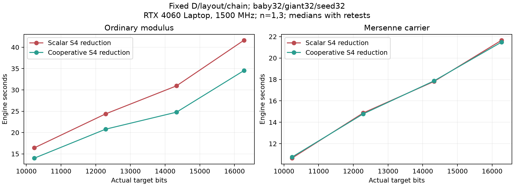
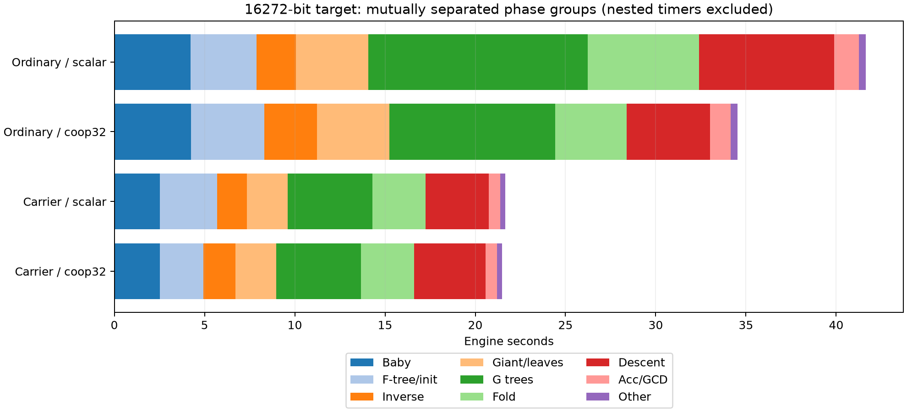
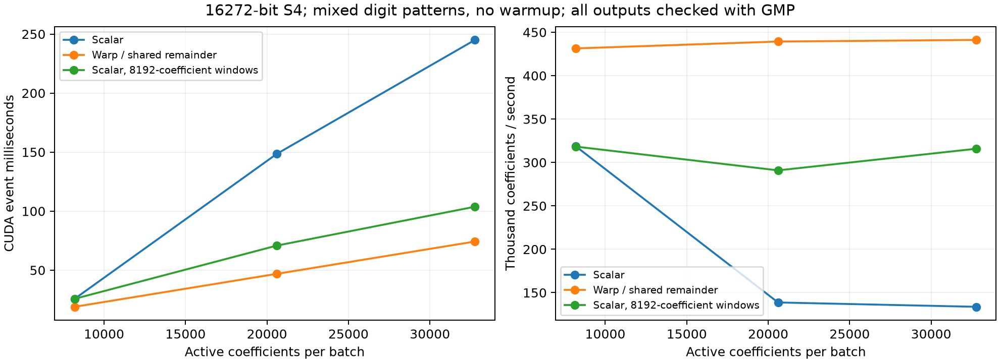
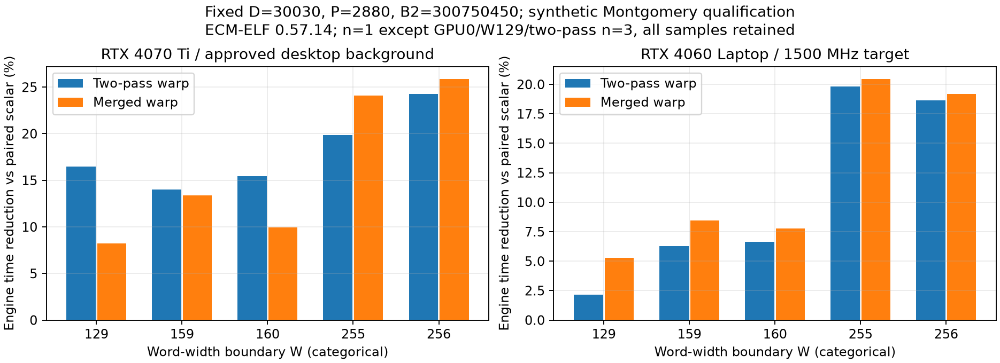

# 普通高位宽 S4 归约性能

当前CUDA提供`stage2_reduce_backend=auto|scalar|coop32`，默认auto。coop32对8193…16384实际算术bits的普通系数归约使用一个warp处理一个系数，余数放在共享内存；小位宽和精确梅森归约保留原内核。CLI为`--reduce-backend`，worker覆盖和环境回退见[配置参考](../ECM_TOML_REFERENCE.md#stage2_reduce_backend)。auto先完成点后端对照，再固定几何比较标量、warp两遍乘减和warp合并乘减，按完整引擎加启动算术检查成本选优；无合格配对时保留标量。

RTX4060 Laptop固定D的小档B2四个普通输入，0.57.13标量／warp两遍参考的完整引擎合计113.389→94.091s（减少17.02%），完整曲线墙钟119.029→98.686s（减少17.09%）。最高位S4设备事件累计15.681→7.939s，约减半；不是整条Stage2快一倍。固定后端成绩不等于auto或新D的收益承诺，后者须独立资格与持出。

## 输入、设备和计时

2026-11-02，GPU1 NVIDIA GeForce RTX4060 Laptop，SM89／CUDA13.3／驱动610.88，Goldilocks fixed3/add_sub1；GPU Ceiling Power Limit的Current／Requested／Default均为55W。未修改时钟、功耗或缓存控制。主矩阵1466条利用率≥50%的NVML样本全部为1500MHz，忙碌样本功耗9.090…47.808W；低负载和启动时可降至210MHz。未采集CPU有效频率，本轮未更改CPU控制。GPU0有外部任务，不参与本轮；GPU1逐次门禁只放行已授权并绑定路径的Codex界面PID16148。

四个Stage1输入均为Edwards、sigma26、B1=50000的已验证余因子保存点。每格请求／实际B2均为27015978990，layout1、chain32、baby32／giant32／seed32；batch／arena／fold预算为256／6300／640MiB。关闭学习、短校准、短NTT批调优、relocation、B2凑整和尾块平衡。两个后端的NTT分布、S4次数／系数数、D／P及NF结果逐格相同。

首轮每格每后端n=1、按格交替顺序，无warmup。承载最低两档出现约6%的外层波动，再各补两次反序复测，最终这两格用全部三次中位数；其余n=1。原始首轮和复测全部保留，不挑最小值。图中横轴为目标余因子bits，承载实际算术分别为p=10267／12511／14401／16319，不能把相邻点连线当成固定几何的位宽复杂度证明。

完整引擎为`stage2_full_wall.total`，含baby／F-tree及强制S4自检、主循环／GCD和oracle排空，排除启动点检查、读档／选型及发布。完整曲线为`curve_done.wall`，包含上述外层成本；两者分别汇总。`t_reduce`是S4设备事件范围，嵌套于树／fold／下降，不能再与这些阶段相加。诊断调用和NCU重放时间均不进入性能表。

## 完整Stage2结果

| 目标bits | W | D／P | S4事件 scalar→warp，s | 引擎 scalar→warp，s | 引擎减少 | 完整曲线 scalar→warp，s |
|---:|---:|---|---:|---:|---:|---:|
| 10232 | 160 | 240240／23040 | 4.460→3.281 | 16.413→13.993 | 14.74% | 17.492→14.896 |
| 12285 | 192 | 240240／23040 | 8.189→4.790 | 24.378→20.786 | 14.74% | 25.418→22.066 |
| 14328 | 224 | 210210／20160 | 10.906→6.241 | 30.948→24.776 | 19.94% | 32.671→25.861 |
| 16272 | 255 | 210210／20160 | 15.681→7.939 | 41.650→34.536 | 17.08% | 43.448→35.864 |

承载是回退控制：请求coop32时`enabled=0`，S4仍执行原来的梅森折叠。外层差异不归因于协作归约。

| 目标bits／算术p | 每后端n | 引擎 scalar请求→coop32请求，s | S4事件，s |
|---|---:|---:|---:|
| 10232／10267 | 3 | 10.652→10.749 | 0.505→0.505 |
| 12285／12511 | 3 | 14.872→14.785 | 0.630→0.630 |
| 14328／14401 | 1 | 17.816→17.870 | 0.789→0.790 |
| 16272／16319 | 1 | 21.660→21.488 | 0.907→0.908 |

八格按上述n和中位数口径的引擎合计178.389→158.982s（减少10.88%），完整曲线188.492→168.043s（减少10.85%）。首轮八格原始合计180.310→159.277s另保留，不覆盖或冒充复测后汇总。

最高位普通路线的G树／fold／下降由12.168／6.150／7.486s降到9.180／3.955／4.644s；合计占引擎61.95%→51.48%。S4嵌套占比37.65%→22.99%，点生成及其他阶段的占比随之上升。F树准备、多项式求逆等范围仍包含CPU工作、检查及等待，不能把其变化全部解释为纯NTT或S4设备时间。

## NCU：显式local工作集和依赖链

管理员Nsight Compute2026.2.1分别采0.57.11标量和0.57.13协作路径，均固定最高位普通输入、D210210/P20160、相同逻辑窗口，seed scalar、baby／giant32。以NW256普通kernel过滤，跳过200次后取3次真实调用；两次完整NF、NTT／归约工作及GMP覆盖一致。clock/cache control均为none；重放显著拖慢应用，不作为普通计时成绩。

| 对应调用 | grid scalar→warp | kernel时间，ms | issue，% | eligible warps | long scoreboard／issue |
|---:|---|---:|---:|---:|---:|
| 1 | (81, 1, 1)→(2561, 1, 1) | 35.215→25.292 | 22.77→67.71 | 0.266→1.306 | 10.798→0.057 |
| 2 | (161, 1, 1)→(5041, 1, 1) | 159.308→49.468 | 9.21→68.08 | 0.115→1.318 | 44.857→0.056 |
| 3 | (30, 1, 1)→(945, 1, 1) | 13.093→9.611 | 20.40→66.50 | 0.216→1.271 | 3.282→0.050 |

block均为128线程。旧grid按源系数分配线程，新grid按有效输出分配warp，另外仍检查所有被省略源槽；grid倍数不是工作量倍数。最大调用的local读／写为665968490／667472271 sectors，协作后均为0；两侧寄存器均40/thread、寄存器spilling指令均0。显式可寻址数组也产生local流量，不能把这些访问全部称作spill。

long scoreboard表示等待L1TEX相关操作，不等于已经证明DRAM带宽耗尽；本表是每issue的ratio，不是等待百分比，sectors也不是DRAM字节量。指标定义见[NVIDIA Profiling Guide](https://docs.nvidia.com/nsight-compute/ProfilingGuide/)。旧最大调用L1／L2命中率36.90%／73.24%，新路径87.32%／17.52%；请求集合已从大量local重读改成输入流读，不能因新L2命中率低而判定性能回退。

最大调用活跃warp占比52.78%→40.79%，但发射率显著提高，说明不能只追求occupancy。协作的short scoreboard／issue约1.175，固定延迟wait／issue约2.714；当前仍有共享存储和指令依赖成本，不能从stall名称直接断言shared带宽饱和。

## 缓存窗口对照与复杂度

独立探针使用同一真实16272-bit N、W255、26-bit digits、单batch、0／全1／交替／高位／随机混合模式。源系数两端省略，全部输出及哨兵由GMP逐词核对。每后端两进程、相反顺序，每进程3个CUDA事件，无warmup；下表为两个进程事件中位数的中位数。8192窗口只存在于探针，不是生产选项。

| 源／有效系数 | 原标量，ms | 标量8192窗口，ms | warp，ms |
|---:|---:|---:|---:|
| 8192／8190 | 25.703 | 25.734 | 18.985 |
| 20608／20606 | 148.548 | 70.837 | 46.907 |
| 32768／32766 | 245.034 | 103.757 | 74.271 |

同样的乘减工作，仅限制标量活跃系数窗口，就能大幅改善大批量耗时；因此当前瓶颈不能概括为“只有减少MAC才有效”。warp在这三档均更快，吞吐随批量增长接近线性；这不等于任意输入、所有NTT长度或完整Stage2都有同倍率收益。

设归一化被除数为U词、除数为W词，商位数J=max(0,U−W+1)。每商位仍计算W个完整64×64乘积，普通S4工作为O(JW)，常见J≈W时仍为O(W²)。两遍低／高乘积借位前缀缩短整数内部依赖，未减少NTT、商位数或乘积数；商估计、最多两次加回、反归一化均保留。推导、填充词传播及共享内存公式见[数学资料](../reference/ECM_STAGE2_BIT_COMPLEXITY.md#11-精确长除法的-warp-协作组织)。

旧NW256内核的t／u可寻址私有数组静态local为6176B/thread，新内核local为0；新动态shared为8[W+(T/32)(2W+4)]B/block，T128、W255时18488B。没有新增显式设备数组或H2D／D2H，也不增加NTT arena条目；shared是SM片上资源。上述静态容量不能乘上总系数数，或与arena／fold峰值直接相加，当作进程显存节省。

## 按实际除数位宽选择缓存容量

显式 `--reduce-backend coop32 --reduce-kernel 4` 使用与kernel3相同的商估计、乘减、借位前缀和校正。差别只在除数的两个寄存器视图。若模数有W个64位词，最高商窗口还要处理索引W，故所需组数为⌊W/32⌋+1。W159用5组，W160用6组，W256回到原9组内核。实际身份4独立写入tune，自动配对仍比较0/1/2。分派入口为[s4_reduce.cuh](../../src/ecm/stage2/cuda/device/s4_reduce.cuh)，容量映射在[s4_warp_reduce.cuh](../../src/ecm/stage2/cuda/device/s4_warp_reduce.cuh)。

4060 Laptop、SM89/CUDA13.3、0.57.17、128线程，原语筛查在同一探针中以两种相反顺序分别调用各后端，每进程保留5个事件。下表比较两次进程事件中位数的均值，负值表示特化后耗时减少。初筛探针SHA256为`c115c9a74ef1e604f2a36c3b9e3753f908cbbdf5ed8c1f6919d155ba29c9ff7c`。8192和20608为系数槽数，每批写出其中的系数数为槽数减2。首事件保留。

| W | 寄存器/线程，3→4对应实现 | 8192槽时间变化 | 20608槽时间变化 |
|---:|---:|---:|---:|
|159|78→62|−7.01%|−7.67%|
|160|78→64|−6.02%|−6.56%|
|191|78→64|−1.98%|−2.20%|
|192|78→68|−1.41%|−1.49%|
|223|78→68|−1.10%|−1.37%|
|224|78→72|−1.45%|−1.26%|
|255|78→72|−1.41%|−1.38%|
|256|78→78|−0.11%|−0.01%|

最终生产分派另行通过四类模数、八个位宽、两种digit宽度、三批的64个GMP调用，两档空窗口及源padding/输出故障注入。10232-bit普通保存点、D30030和B2=300750450的两侧完整诊断均核对2880叶、460800词，归一化摘要同为17517772758962882522。原始证据在`data/experiments/stage2_s4_capacity_20261103/`，其中`perf`是初筛，`production_gate`及`curves/diagnostic`属于最终分派。

完整曲线使用同一生产二进制 `b3e9730cd644371fa505ce7737eefa42efc4a8f8348e5c184183d2fc794ead2b`，输入是 M10267/M12511 的 Edwards 余因子、B1=50000、sigma26、实际B2=273142759890。固定 D570570/P51840，沿用冻结的大B2矩阵布局与链长。表中引擎计时为 init+main，S4 设备事件嵌套其中。所有初次和追加调用均参与中位数，GPU利用率≥50%的2375条记录中2361条为1500MHz，其余为1410…1440MHz，记录功耗4.34…47.36W。

| 普通N bits | 每侧n | S4设备中位数 3→4，s | 引擎中位数 3→4，s | 引擎变化 | 完整曲线墙钟中位数 3→4，s |
|---:|---:|---:|---:|---:|---:|
|10232|3|12.053→11.564|46.607→47.242|+1.36%|47.985→48.974|
|12285|2|17.087→16.862|68.368→68.797|+0.63%|69.872→72.809|

10232-bit 特化的三条引擎耗时为46.241、54.976、47.242s，慢样本的下降阶段耗时16.06s，另一次同侧为7.43s，两次的S4事件均为11.564s。12285-bit 两侧各两条的范围为67.611…69.124s与67.525…70.069s。相同D的NTT计数、归约系数数、点调度与G根摘要逐次一致。当前两格可复现设备归约节省，整曲线中位数均有轻微回退，kernel4保留显式实验资格。

管理员 NCU 2026.2.1 对同一10232-bit余因子、20608槽、128线程、bpw26的最终生产分派各采一个内核，clock/cache control 均为 none。固定与有限容量的寄存器分别为78和64，局部内存加载与存储sector各为0。两侧执行指令计数分别为1636401062与1607907563。此处节省来自已有寄存器缓存的容量和生成的指令，两侧均未观察到局部内存流量。探针 SHA256 为 `6ed3c53b5f5db13240da6b724377fb72682e909424cacc0581699da1e18b0e48`，原始报告与单位行见同证据目录的 `capacity_ncu/`。

## 资格、默认保护与tune

生产头和分派入口通过216次独立GMP对照：9个位宽8193／10240／10241／12288／12289／14336／14337／16319／16384，四类模数、digit1／26／64、多batch，4523400个输出／哨兵词；另16次空窗口和16次padding／输出破坏拒绝全部通过。空窗口仍检查所有源槽。最高位完整诊断的20160个目标叶、5140800词摘要一致，GMP抽查、设备叶和seed投影检查均通过；诊断模式约翻倍的墙钟不作成绩。

7995-bit普通／8011-bit承载回退控制在两种请求下均`enabled=0`，完整引擎分别6.851→6.857s、3.924→3.935s，未观察到明显开销。相邻旧版0.57.12／新版0.57.13的标量S4控制，10232-bit为15.422→15.156s、16272-bit为41.185→40.325s，NTT／S4工作相同；这是两格n=1保护，不能声明完整26格或所有设备均已验证。

真实Worker #2验证worker覆盖、CLI优先、环境回退和非法coop16拒绝；协作S4条件下另有28条NF验证seed auto的重复门槛、只读胜者、未配对保护及baby／giant／seed／32与64链长联合学习。CPU运行时、边界、后端资格以及Python聚合／生成物检查通过。

ECM格式13以实际`reduce_coop/threads/kernel`区分成本，不因忽略environment合并；请求设置不再分裂NTT条件。旧非零请求且缺实际执行证据时保留为未知255，不参与选型。协作宽度模型以ceil((W+1)/32)隔离额外高词组台阶，不跨W160／192／224／256直接平滑复用；无协作实测时仍是保守先验。

auto默认128线程，有限比较kernel1两遍和kernel2合并；诊断CLI允许`--reduce-threads 64|96|128`及`--reduce-kernel 0|1|2|3`，0表示auto允许前两项，3是下述显式实验。kernel2合并qN的低／高词及乘积进位后，一次读写余数字；乘法和商位数不变。资格限定硬件、位宽、NTT区间、实际B2、驻留、点后端、布局及链长；不要求B1相同。同一区间相邻D可复用胜者，未覆盖的NTT拐点先建立标量参考。配置的最小重复次数适用于自动比较，已经开始的比较会完成，剩余曲线不足不再启动新比较。

## 两卡字长边界与大B2资格

0.57.14的性能EXE为`0502832a97a2705e4e48d7b233e490ced3cff022803d4fba1fabac205f4d732f`，258项构建输入及46个目标文件冻结核验。使用相同sm89／CUDA13.3／GMP依赖、batch／arena／fold预算256／6300／640MiB。无warmup，不改变时钟或功耗。GPU1的1176条利用率≥50%记录均为1500MHz，忙碌功耗9.408…48.727W；GPU0的1362条均为2595MHz，忙碌功耗30.237…203.864W。两卡不按频率归一化，也不跨卡比较绝对倍率。GPU0按用户授权保留桌面背景；新增生产GUI经管理员路径核实后另存背景快照，所有前后门禁与遥测保留。

边界测试为Montgomery param0／sigma26、B1=20的合成算术资格点，目标bits为8193／10176／10240／16258／16382，对应W129／159／160／255／256。前三个为确定生成的probable prime，后两个为已知大梅森素数的乘积／平方，不能当作生产余因子分布。固定D30030/P2880、请求／实际B2=300750450、layout1、chain32、点后端32，正常算术检查开启。两项warp各自与标量配对；每格n=1，GPU0/W129两遍首轮初始化明显偏长，追加反序两次，三次中位数含首轮。比较的是完整引擎，不是单个kernel。

| W／实际bits | 4060两遍减少 | 4060合并减少 | 4070 Ti两遍减少 | 4070 Ti合并减少 |
|---|---:|---:|---:|---:|
| 129／8193 | 2.15% | 5.29% | 16.48% | 8.23% |
| 159／10176 | 6.30% | 8.46% | 13.99% | 13.36% |
| 160／10240 | 6.63% | 7.77% | 15.47% | 9.95% |
| 255／16258 | 19.81% | 20.47% | 19.83% | 24.07% |
| 256／16382 | 18.63% | 19.17% | 24.24% | 25.89% |

图中W为分类边界，间隔不代表数值距离；两组结果各用自己的标量对照。两遍／合并没有跨场景稳定的单一胜者，较低边界收益也较小，因此采用配对auto，不设置仅凭位宽就强制替换的阈值。

大B2使用真实16272-bit余因子、Edwards／sigma26／B1=50000及p16319承载，固定D360360/P34560、请求／实际B2=80000000000，其余预算及点策略同上。普通比较标量与合并warp；承载两种请求的实际S4均为0/0/0，属于回退控制。GPU0普通追加两次反序复测，采用全部三次中位数；其他格n=1。

| 设备／路线 | 每后端n | 完整引擎 scalar→合并请求，s | 耗时减少 | S4事件，s |
|---|---:|---:|---:|---:|
| 4060／普通 | 1 | 75.065→56.249 | 25.07% | 28.136→13.882 |
| 4070 Ti／普通 | 3 | 44.369→30.385 | 31.52% | 17.131→4.133 |
| 4060／承载 | 1 | 33.653→34.353 | −2.08% | 1.608→1.607 |
| 4070 Ti／承载 | 1 | 21.145→21.771 | −2.96% | 0.925→0.948 |

承载的约2%～3%外层波动不归因于S4优化。该资格不覆盖全部GPU、全部D或原26格自动选型矩阵，也不证明更大B2的同等收益。

最终生产分派的180次GMP比较覆盖上述W边界、四类模数、digit1／26／64及三batch，共3625020个输出／哨兵词；另32次空窗口、32次源padding破坏和32次输出破坏拒绝均通过。16382-bit完整独立诊断的2880叶／737280词摘要一致。运行时15条曲线验证R=2顺序、只读、相邻D、NTT拐点、强制执行及未配对保护；真实worker覆盖／CLI优先／环境回退通过，联合点策略28条曲线及正式tune三项配对、相邻D只测胜者、重复跳过均通过。

## 线程块与共享读写实证

管理员NCU使用相同真实16272-bit模数、20608源系数／20606有效输出、digit26、GPU1、无clock/cache控制。每项独立GMP检查5255040词，输出摘要一致；重放计时不纳入完整曲线。128线程两遍／合并的内核分别46.803／45.595ms；合并64／96线程为50.234／48.162ms，均慢于128。寄存器40→42，local仍为0。合并128线程的issue59.10%→57.82%，short-scoreboard/issue1.140→1.311，但实际耗时减少，不能单凭这些指标定输赢。

另一次同输入直接计数的128线程两遍／合并为46.807／45.581ms：共享load wavefronts为353022701→280655872（−20.50%），store为170344194→97860564（−42.55%）。load bank conflicts86205→72284，store218719→129695；与相应wavefront总量相比很小，没有证据将主要瓶颈归因于bank冲突。计数是片上事务，不是DRAM字节。减少余数数组读写确有体现，但除数字读、进位／借位和商依赖仍在，故不是访存或耗时减半。

## 树阶段：纯NTT、S4及主机等待

管理员Nsight Systems在GPU1分别诊断普通／承载真实输入，D210210/P20160、B2=27015978990、点后端32、普通两遍warp；0.57.14 EXE如上。两次NF、保存点、D/P、NTT分布、归约次数及GMP检查与各自冻结参考一致。以下为诊断数据，不纳入普通计时矩阵。

利用CPU的`Tree.host_driver`、`GTree.build`范围及进程限定的CUDA关联ID归属内核；按提交API归属，而非按内核执行时刻切片，避免异步越界误分。两次trace均无无法关联的GPU事件。纯NTT含transform、pointwise、位逆序及scale，carry／pack／表构建归其他内核。F树范围1次，G树范围7次。

| 路线／树 | 主机范围，s | 纯NTT，s | S4，s | 其他kernel，s | 同步API驻留，s | CUDA API外主机范围，s |
|---|---:|---:|---:|---:|---:|---:|
| 普通／F | 3.534 | 0.518 | 0.775 | 0.155 | 1.054 | 1.591 |
| 承载／F | 1.921 | 0.518 | 0.096 | 0.156 | 0.594 | 0.824 |
| 普通／G | 9.227 | 3.012 | 4.998 | 0.947 | 8.660 | 0.291 |
| 承载／G | 4.655 | 3.012 | 0.519 | 0.951 | 4.318 | 0.191 |

CPU范围、API驻留与GPU时间重叠，不能横向相加；API外范围也包含调度和OS等待，不是测得的CPU指令时间。普通／承载G树的`cudaMemcpy`主机驻留8.487／4.206s，但DMA仅0.010／0.010s，主要在等待此前的GPU工作，不能据此宣称PCIe瓶颈。G树自身GPU活动并集8.968／4.493s，接近主机范围9.227／4.655s，主机准备余量有限。普通仍以S4为最大内核组；承载的纯NTT约占G树主机范围65%，另有约0.95s的carry／pack等，优先级应相应变化。

F树仍有显著主机准备和pinned分配成本：普通的`cudaHostAlloc`／`cudaFreeHost`API驻留0.211／0.520s，承载0.094／0.338s。是否预留或改变增长策略需另做总墙钟和host峰值对照，不能把开销移出引擎计时后声称加速，也不能减少必需GMP检查来制造收益。

## 新S4成本下的D/P保护

GPU0、同一真实输入及小B2、合并warp成本，普通／承载分别校准D210210/P20160、240240/P23040、300300/P28800，再冻结选择并独立持出。普通学习耗时17.612／16.843／29.734s，承载13.490／13.460／17.851s，均推荐240240。独立持出普通为基线16.871／候选17.623s，承载14.401／14.482s；两项没有通过不增时保护，因此保持210210，不将学习样本的最小值当作生产收益。

D更大并不必然更快，P=28800这档的树／NTT成本明显增加；该实验没有改变默认D表或批准全局模型收益。S4身份进入新的模型和配对行后，继续依靠已验证候选与默认保护，不能沿用标量时期的D收益承诺。

## 除数缓存与有限组展开：显式实验

kernel3在合并乘减中预装两种对齐的除数字视图，静态展开有限32词组，避免每个商位都从shared读取相同除数。完整qN、乘积进位、精确借位、最多两次加回、反归一化及所有源槽的padding检查均保留，工作仍为O(JW)。缓存和展开共同变化，不能把全部收益单独归因于缓存；一般公式见[复杂度资料](../reference/ECM_STAGE2_BIT_COMPLEXITY.md#不变除数的寄存器缓存)。

使用`--reduce-backend coop32 --reduce-kernel 3 --reduce-threads 128`显式启用；实际身份`reduce_kernel=3`可在tune中保存和往返读取。自动配对、候选生成仍限0/1/2，实验行不能绕过此保护进入auto。小位宽及梅森承载仍实际回退0，没有新增NTT工作区、全局临时数组或主机/设备拷贝。当前宽位模板容量256词，缓存9组，实际W较小时也可能保留多余寄存器。

2026-11-03，RTX4060 Laptop、目标1500MHz、同一16272-bit真实模数、26-bit digits、单batch；各后端3个独立进程，每进程5个事件，交换顺序、无warmup，全部输出及哨兵由GMP核对。表取每进程事件中位数，再取三个进程中位数；不是完整Stage2成绩。

| 线程块 | 源/有效系数 | 合并kernel2，ms | 缓存kernel3，ms | 耗时减少 |
|---:|---:|---:|---:|---:|
| 128 | 8192/8190 | 18.4863 | 16.5703 | 10.36% |
| 128 | 20608/20606 | 45.6468 | 40.9723 | 10.24% |
| 128 | 32768/32766 | 72.3067 | 64.8796 | 10.27% |
| 96 | 20608/20606 | 48.1638 | 42.9281 | 10.87% |
| 64 | 20608/20606 | 50.2661 | 44.5317 | 11.41% |

128线程的绝对耗时更低，因此保持该对照配置；不能因64线程的相对改进百分比更大而选它。两侧静态local均0、动态shared均18488B/block；寄存器42→78/thread。管理员NCU2026.2.1、相同20608系数单次归约，clock/cache control均none：

| 指标 | kernel2 | kernel3 |
|---|---:|---:|
| shared读取wavefronts | 280655196 | 136580983 |
| shared写入wavefronts | 97861263 | 97887471 |
| shared读取bank conflicts | 71616 | 35165 |
| shared写入bank conflicts | 129737 | 147695 |
| 执行warp指令 | 3768534796 | 3294590928 |
| local读/写sectors | 0/0 | 0/0 |
| NCU设备duration，ms | 45.5621 | 40.9303 |

shared读取减少51.34%，指令减少12.58%；写入基本不变，写冲突略增但绝对量远小于写wavefronts。不能据单项冲突数或寄存器增加判断整体快慢。NCU重放下应用事件显著变长，未加入上面的正常计时。

W129/159/160/191/192/223/224/255/256、四类模数、digit1/26/64、三batch共216次探针通过，两侧共核对4508280词；另10次空窗口、各10次padding/输出破坏检出通过。真实16272-bit保存点的普通/承载诊断，D30030/P2880、B2=300750450，两内核各734400个归一化叶值词摘要一致，NTT及归约工作相同。完整大B2资格与阶段分项见[大B2矩阵](STAGE2_LARGE_B2.md)，不能把算子约10%的改进直接用于完整曲线或其他GPU。

大档B2约2.7e11、固定D/P/layout/chain及全部点后端，普通宽位各三次，保留首样本后取中位数。S4事件与引擎分别取中位数，两者仍是嵌套计时，不相加：

| 目标bits | S4事件kernel2→3，s | 完整引擎kernel2→3，s | 引擎减少 |
|---:|---:|---:|---:|
| 10232 | 12.414→12.054 | 48.348→47.227 | 2.32% |
| 12285 | 18.197→17.087 | 69.431→68.710 | 1.04% |
| 14328 | 31.472→28.473 | 103.775→102.275 | 1.45% |
| 16272 | 38.926→35.384 | 124.763→121.101 | 2.94% |

四格引擎合计346.316→339.314s，减少2.02%；S4事件合计101.009→92.998s，减少7.93%。最高位kernel2样本123.473…134.822s、kernel3样本120.988…124.644s，准备阶段有显著波动，不能把三个样本当作普遍收益或置信区间。全26格新二进制对照合计915.158→906.602s；其中22个实际回退0的格不能归因于缓存。初始独立基线906.033s与新二进制control也有差距，完整默认不增时资格不能仅凭这组数据声明通过。kernel3继续显式保留，不进入auto。

小档B2=27015978990的四个普通保护格各n=1、同D/P和点后端：10232-bit为13.848→13.535s（D240240/P23040），12285-bit为20.223→19.198s（同D/P），14328-bit为25.001→24.701s（D210210/P20160），16272-bit为32.238→32.705s（同D/P）。合计91.310→90.139s，最高位单格反而慢1.45%；这些结果不支持一个“超过某位宽便总有收益”的默认阈值。NTT工作与G根摘要一致，原始数据为`small_guard`。

证据为`data/experiments/stage2_large_b2_20261103/`下`cache_gate/cache_gate_middle`、`cache_empty`、`cache_fault1/2`、`cache_perf_t*_r*`、`cache_ncu`、`cache_full_checks`及`paired`；探针EXE SHA256为`2c5ec5e0f01dade3e0861c4a874090a69598ac0dffc107b89ec936a2f148789f`。三个进程的汇总在`data/benchmarks/stage2_large_b2_20261103/probe/`，原始首事件与失败证据均保留。

## 证据、源码与后续工作

完整曲线EXE为0.57.13，SHA256 `1f14235e6e25f7003d99b1268f954e8a831272382720cab8ba155b12c31f5c6e`，19624448B；257项构建输入和46个目标文件核验一致。GMP DLL为`969f0e96ac587dedfecf611ca3442fc7211f9218f1a553214c83548dcdbcfd6e`。旧标量保护EXE0.57.12为`3f01cc3da82a87cb26fdd3112659f26534a064ed2c1e0c20e30c45c7fd0b68cc`；NCU旧0.57.11为`0137ba813e1305e57b38947b48e2e53714132e4a574a7860091b20ba0d724157`。探针EXE为`9391d6f62d3aeb07669d774732052848b00d7a8511e4dda132970be8b8f4bcb9`，使用同一生产S4头。

0.57.13原始证据根`data/experiments/stage2_s4_20261102/`：`production_correct01`／`production_empty01`／`production_fault1/2`、`production_perf01`、`curves01`／`carrier_retest01`、`native_checks01`／`s4_config01`／`seed_auto_s4_01`、`low_fallback01`／`default_guard01`、`ncu_baseline_200`／`ncu_warp_200`和`s4_release`／`s4_final_audit.json`。功耗查询保留于`power_identity.txt`；初期探针输入padding错误和编译类型错误均保留，修正测试生成器／启动转换，未放宽生产guard。

0.57.14证据根`data/experiments/stage2_s4_auto_20261102/`：`release14`／`release14_audit.json`，`production_correct01`／`production_empty01`／`production_fault1/2`，`boundary_gpu{0,1}_k{1,2}`及`boundary_gpu0_k1_retest`，`merged_leaf_check`，`big80_gpu{0,1}_k2`／`big80_gpu0_retest`，`native_auto05`／`native_config05`／`native_combined03`／`formal01`，`ncu_merged01`／`ncu_shared01`，`nsys_ordinary01`／`nsys_carrier01`和`d_holdout02`。新汇总、CSV及分类图位于`data/benchmarks/stage2_s4_auto_20261102/final02`和同名figures目录；`final01`线图也保留。失败原始记录与临时草稿不删除。

最终本机构建仅更正自动轴数的一行注释后重建，EXE为`4ee77139494b427e3e64eb9e48f9d45eef9c2e19948c5b7e599e2320b3b35f0c`；258项输入及46个目标核验，`.text`、`.data`、异常表与CUDA镜像均与测量版相同，链接元数据不同。最终真实worker复验通过；冻结位置`release14_final_v3`、`native_final_config02`和`final_audit.json`。

汇总、CSV和图位于`data/benchmarks/stage2_s4_20261102/{curves_final,probe01,ncu01}`及同名figures目录。`curves01`原始汇总和图也保留；`curves_final`明确纳入两档承载复测。复现入口见[测量协议](../../tools/bench/README_STAGE2_VERSION.md#s4普通归约验证)；`analyze_stage2_s4_ncu.py`绑定输入、二进制、GMP覆盖、NTT工作及CSV单位，不运行GPU。

源码依据：

- [s4_warp_reduce.cuh:6](../../src/ecm/stage2/cuda/device/s4_warp_reduce.cuh#L6)借位前缀，35行合并乘减，59行缓存视图，112行kernel及全源检查；[s4_reduce.cuh:90](../../src/ecm/stage2/cuda/device/s4_reduce.cuh#L90)生产分派和合法空窗口。
- [s4.cpp:194](../../src/ecm/stage2/cuda/s4.cpp#L194)实际启用／共享字节诊断；[host_policy.cpp:66](../../src/ecm/stage2/cuda/host_policy.cpp#L66)配置优先级，`process.cpp::run_curve_process`显式转发子进程。
- [runtime_tune.h:131](../../src/ecm/stage2/planning/runtime_tune.h#L131)配对资格、246行有限S4候选；`planning.cpp::portable_runtime_select`、`portable_measure`负责运行时与正式tune。`tune_portable.h::hydrate`／`compact_summary`保留实际身份，`portable_model.h::s4_coop_tiles`及`width_prediction.h::region`隔离成本区域。
- `tools/bench/profile_stage2_tree_trace.py`采集并验证完整曲线，`analyze_stage2_tree_trace.py::analyze`按提交关联树阶段，`tools/test/test_stage2_tree_trace.py`覆盖异步跨界、进程ID隔离及重叠等待并集。

TODO：

- 扩展非SM89设备、更多生产模数／D／更大B2的资格，特别是NTT和驻留边界；保留auto标量参考与默认D保护。
- 在同几何持出下优化承载G树的纯NTT和carry／pack；普通路线继续分析商位依赖，不单凭stall或occupancy改默认。
- 评估F树pinned增长／复用及主机准备，记录完整墙钟、host峰值与全部GMP覆盖，避免计时外移。
- 新S4 D/P继续按每条算术家族独立校准、足够重复并持出；当前三D单次学习结果未批准替换默认。
